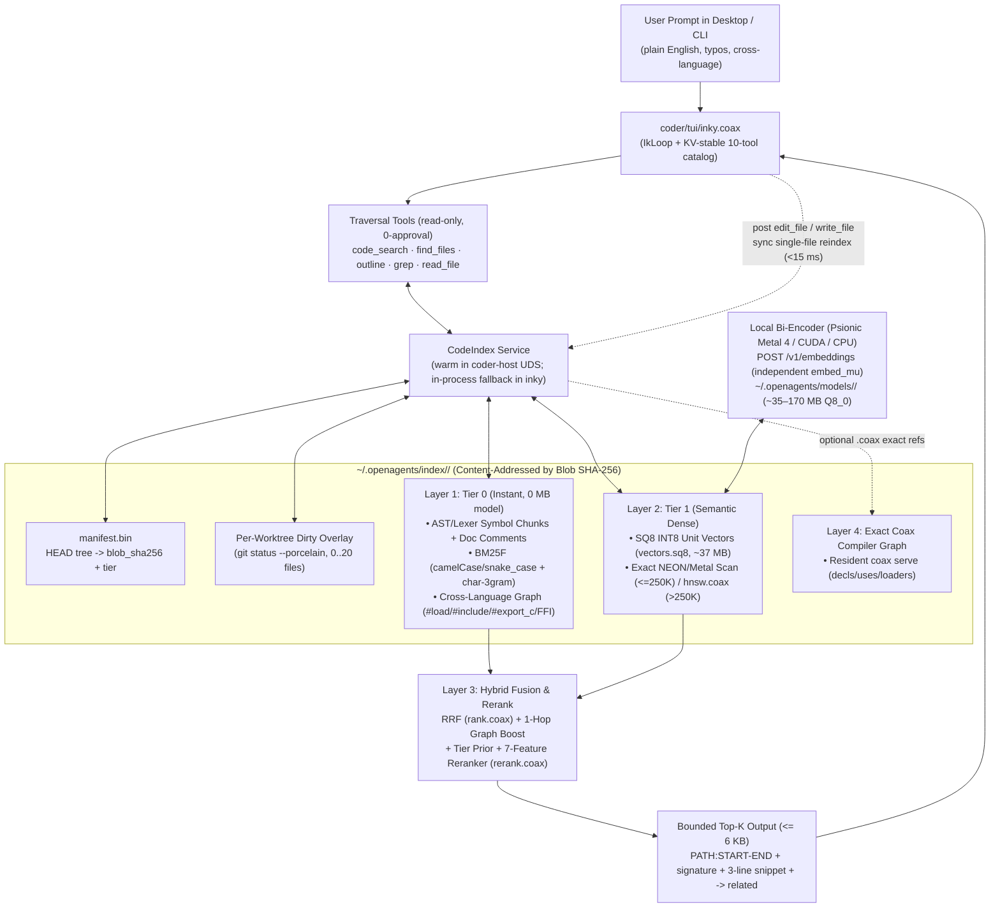

# Inky Codebase Traversal Audit & Hybrid Semantic Index Specification

**Date:** 2026-11-22  
**Status:** System Audit + Proposed Specification  
**Baseline:** `origin/main` `82f9620bcd` (including Inky/Psionic Phase 8 commit `403ba63df8`)  
**Scope:** `coax/lib/inky/`, `coax/lib/codeindex/` *(new)*, `coder/tui/inky.coax`, `coax/lib/agent/engine/mcworker-wire.coax`, `apps/openagents-desktop/`, `psionic/platform/inkling-serve.c`, `coax/src/{query,serve}.cpp`  
**Related Docs:**
- [Inky: Native Agent Harness for Inkling 2.0 (Specification)](inky-spec.md)
- [Inky Self-Improvement & Benchmark Status](inky-self-improvement.md) *(Failure Class F4 & §9.3)*
- [Inky: Avenues from Other Projects](inky-avenues-from-other-projects.md) *(Finding the right files & forked exploration)*
- [OpenAgents v1.0 Specification (Inkling-Only Minimal Release)](../desktop/openagents-v1-spec.md)
- [Indexed Repos Specification](../repos/2026-11-11-indexed-repos.md)
- [Compiler Questions for Coding Agents (`coax/lib/agent/intel/`)](../../coax/lib/agent/intel/README.md)

---

## Executive Summary

When a user gives **Inky** (the local Inkling 2 Mini coding harness) a plain-English behavioral task in a large repository—such as *"the delay that happens after i hit command to see the nubmers in the sidebar i want that cut in half"*—the agent routinely spirals through **13–25 blind search/read turns and 70+ seconds of speculative thinking** without even locating the target file.

This audit traces that failure across the entire stack on `origin/main` (`82f9620bcd`) and specifies a local-first, zero-cloud **Smart Codebase Traversal & Hybrid Semantic Index (`coax/lib/codeindex/`)** engineered specifically around Inkling 2 Mini's 5:1 SWA geometry, Psionic's KV prefix cache, per-chat git worktrees, and OpenAgents Desktop v1.0's strict bundle limits.

### Key Audit Findings

1. **Zero semantic, fuzzy, symbol, or file-name discovery tools:** Inky exposes only 7 tools (`read_file`, `edit_file`, `write_file`, `grep`, `list_dir`, `run_command`, `update_todos`). There is no semantic/hybrid search, no `find_files` glob finder, no symbol/outline reader, and no compiler-graph tool.
2. **Broken & unranked `grep` on a 26,371-file monorepo:** `ik_exec_grep` (`coax/lib/inky/run.coax`) is **strictly case-sensitive** (no `-i` or smart-case flag), has no `files_only` (`-l`) or per-file hit cap, returns raw alphabetical order capped at 50 lines / 12 KB, and scans all 26,371 tracked files equally—allowing `NEEDS_OWNER.md`, 307 transcripts, 740 verification logs, 3,475 JSON files, and 1,306 `.out`/`.log`/`.stderr` artifacts to drown live source code.
3. **Root `AGENTS.md` was accidentally wiped to 0 bytes:** Commit `cca95dcf9c` (`#13845`, 2026-11-20) deleted all 350 lines of `AGENTS.md` (`blob e69de29b`, `0 B` on `origin/main`). Inky starts every turn completely blind to repo structure, hybrid Swift/C/Coax boundaries, and Coax syntax conventions.
4. **Misleading Desktop UI & failure inflation (`MWW_VIEW` overload):** Both `list_dir` and `grep` emit `IK_EV_VIEW` (`MWW_VIEW`) with `path = a.path` (dropping the tool verb and search pattern) and `found = shown > 0`. Desktop (`apps/openagents-desktop/page/host-api.coax:239`, `layout/conversation.coax:55-62`) renders every `grep` and `list_dir` as **`Read .`** or **`Read openagents-desktop`** and marks every 0-match grep as a **failed file read (`"No such file."`)**.
5. **Model physics amplify every wasted search step:** Inkling 2 Mini (`inkling2_loop`, 26.4B total / 3.4B active MoE) uses a 5:1 SWA-to-Full attention ratio (`sliding_window = 1024`) in a 32K context window, and interactive `effort = medium (0.7)` runs with `max_thinking_tokens = 0` (unlimited) by default. Each blind grep triggers 500–2,000 speculative reasoning tokens, flushes prior observations past the 1,024-token SWA window, and pushes the session into slow 16K–24K decode before edits even begin—reproducing **Failure Class F4** (`docs/coder/inky-self-improvement.md §4`).
6. **High-value retrieval primitives already exist in this repo—unwired:** `psionic/lib/book-search/{rank,hnsw,rerank,encoder}.coax` (BM25, RRF, deterministic HNSW, RankNet 7-feature reranker), `psionic/lib/fast-encoder.coax` (ModernBERT-shaped Q8 encoder), `coax/src/query.cpp` + `coax/lib/agent/intel/` (compiler-exact Coax decls/refs), and `coder-host` (persistent daemon) already exist, while `coder/tui/inky.coax:430` explicitly rejects `MWW_EMBED`.

### Solution Overview

Build a **4-layer local hybrid codebase index** (`coax/lib/codeindex/`, hosted warm in `coder-host` with an in-process fallback in `inky`) shared across all git worktrees via content-addressed SHA-256 blob storage (`~/.openagents/index/<repo-hash>/`) plus a fast per-worktree dirty overlay:

- **Layer 1 — Instant Structural & Lexical Index (Tier 0, 0 MB download, < 1.5 s cold / < 5 ms incremental):** Multi-language symbol-aware chunker (Coax, Swift, C/C++, Python, TS/JS, Rust, Markdown) preserving leading doc-comments and class property blocks; BM25F with camelCase/snake_case splitting, path/symbol/comment field weights, character 3-gram typo recovery, and file-tier priors; plus a cross-language `#load`/`#include`/`#export_c`/`#foreign` FFI symbol graph.
- **Layer 2 — Local Semantic Dense Embeddings (Tier 1, ~145–170 MB verified GGUF bi-encoder in `~/.openagents/models/`, 10–35 s cold background build / < 15 ms per edited file):** Compact bidirectional code/text encoder running in Psionic Metal 4 / CUDA / CPU on an independent mutex (never blocking Inkling's `sess_mu` or touching Inkling's KV cache), storing SQ8 INT8 unit vectors (`~37 MB` for 95K × 384d chunks → `< 6 ms` exact NEON scan, `< 0.5 ms` Metal scan; HNSW via `hnsw.coax` above 250K chunks).
- **Layer 3 — Hybrid RRF + 1-Hop Graph Co-Scoring + Rerank:** Fuses BM25F + Dense Cosine via Reciprocal Rank Fusion (`rank.coax`), expands 1-hop cross-language FFI bridges (connecting Swift callers directly to Coax UI handlers), and returns tightly bounded (`≤ 6 KB`) `PATH:START-END` spans that fit inside Inkling's 1,024-token SWA window.
- **Layer 4 — Clean KV-Cache-Safe Tool Surface & Resident Compiler Graph:** Adds `code_search`, `find_files`, and `outline`, upgrades `grep` (smart-case, `files_only`, `max_per_file`, noise filtering), fixes `MWW_VIEW` UI reporting, restores a lean `< 1.8 KB` `AGENTS.md`, and moves `coax query` into resident `coax serve`.

**Target outcome:** Cut behavioral feature-location from **13+ turns / 71+ seconds** down to **1–2 tool calls / < 15 ms index query / ~12–18 s end-to-end**, and cut median steps-before-first-edit on Dev-9 Buckets B–E by `≥ 50%` with `≥ 85%` KV-cache hit rate preserved.

---

## Part I — Forensic Audit of the Current System

### 1.1 Live Case Study Replay (2026-11-22 Incident)

**User prompt (in OpenAgents Desktop, Inkling 2 Mini, Medium effort, worktree `~/.openagents/worktrees/openagents-f007...`):**
> `"the delay that happens after i hit command to see the nubmers in the sidebar i want that cut in half"`

**Observed trace at 1m 11s (still running, zero edits made):**
- Summary line: `Thought 13 times · ran 2 commands · read 15 files · 4 failed`
- Activity log: repeated `Read .`, `Read openagents-desktop`, `Read apps`, `Read components` (including 4 failed rows), followed by a shell fallback `grep -ri "numbers" --include="*.coax" -l . | head -30`, `ls apps/openagents-desktop/page/layout/ && wc -l ...`, and finally `Read sidebar.coax`—still unaware that the delay timer lives in Swift (`Window.swift`), not `.coax`.
- Model reasoning repeatedly speculated across wrong apps (`openagents-web`, `openagents-ios`, command palette `Cmd-K`/`Cmd-P`, `README.md`) while burning thousands of output tokens.

#### Ground Truth in the Codebase

The actual feature spans **3 languages across 5 files**, with the timer constant in Swift and the rendering in Coax:

| Hop | File & Lines | Symbol / Code | What It Does |
| --- | --- | --- | --- |
| 1 (Timer) | `apps/openagents-desktop/Window.swift:187-188` | `flagsMonitor // Command-key hold (>1s) sidebar shortcut hints`, `cmdHoldTimer: Timer?` | Declares modifier monitor and timer |
| 2 (Delay) | `apps/openagents-desktop/Window.swift:709-740` | `handleModifierFlags` → **`Timer.scheduledTimer(withTimeInterval: 1.0, repeats: false)`** (`L728`) | **The exact `1.0` s delay to cut to `0.5` s** |
| 3 (C Bridge) | `apps/openagents-desktop/host.h:87`, `host.c:458` | `void cd_cmd_hints(void *page, int shown)` | Swift → C → Coax FFI bridge |
| 4 (Coax State) | `apps/openagents-desktop/page/host-api.coax:12-14`, `state.coax:348` | `coder_page_cmd_hints` → `s[0].cmd_hints = shown` | Sets page boolean flag |
| 5 (UI Badges) | `apps/openagents-desktop/page/layout/sidebar.coax:163-181`, `303-322` | `if s[0].cmd_hints` (`slot 1..9`) + `cp_side_key_badge` (`// ... while Command is held (>1s)`) | Renders floating `1`..`9` keycap badges |

#### Why Lexical Guessing Fails (Vocabulary Gap + Case Sensitivity + Ranking)

Not a single non-trivial word in the user's prompt (`delay`, `hit`, `nubmers`/`numbers`) appears in `Window.swift:709-740` or `sidebar.coax:163-181, 303-322`. Replaying Inky's exact `git grep -n -I --no-color -E` invocation (`coax/lib/inky/run.coax:948-963`) against `origin/main` (`82f9620bcd`) reproduces every failure deterministically:

| Query (Inky's exact `git grep -n -I -E`) | Total Matches | What Inky Actually Sees (first 50 lines / 12 KB, alphabetical) | Reaches `Window.swift:728` or `sidebar.coax:309`? |
| --- | ---: | --- | --- |
| `pattern="sidebar"`, `path="."` | `1,012` | `NEEDS_OWNER.md`, `Foreman.swift`, `GymBenchmarkView.swift`, `README.md`, … | **No** (truncated alphabetically at 50 hits) |
| `pattern="numbers"`, `path="apps/openagents-desktop"` | `7` | `README.md`, `filepane.coax` (line numbers), `forge.coax`, `state.coax`, `ple-run.coax` | **No** (0 relevant hits) |
| `pattern="delay"`, `path="apps/openagents-desktop"` | `4` | `LocalModels.swift:541` (`--retry-delay`), `linux/main.c`, `windows/main.c`, `wine-window.sh` | **No** (0 relevant hits) |
| `pattern="timer"`, `path="apps/openagents-desktop"` | `48` | All lowercase `timer` hits (`usageTimer`, comments, tests) — **0 `cmdHoldTimer` hits** | **No** (case-sensitive! `-i` immediately hits `Window.swift:188, 716, 728`!) |
| `pattern="command"`, `path="apps/openagents-desktop"` | `395` | `README.md`, `palette.coax` (command palette), truncated at 50 | **No** (`Window.swift:187` and `sidebar.coax:309` capitalize `Command`!) |
| `pattern="Command"`, `path="apps/openagents-desktop"` | — | Immediately hits `Window.swift:187` (`Command-key hold (>1s) sidebar shortcut hints`) & `README.md:43` | **Yes**—if the model happened to guess capital `C` and scope to `apps/openagents-desktop` |

### 1.2 Measured Scale & Noise Profile of the `openagents` Monorepo

Measured directly on `origin/main` (`82f9620bcd`) on Apple Silicon macOS:

- `git ls-files`: **26,371 tracked files** in **17.8 ms**.
- Full `stat` + read + newline count of all 16,375 code and doc files: **392.6 ms** (single-threaded Python; native C/Coax is faster).

| Category | Extensions Included | Files | Bytes | Lines | Share of Tracked Files |
| --- | --- | ---: | ---: | ---: | ---: |
| **Source Code** | `.coax` (8,575), `.py` (1,251), `.c` (1,213), `.sh` (525), `.h` (480), `.sql` (234), `.proto` (164), `.cpp` (132), `.swift` (128), `.ts`/`.js`/`.rs`/`.metal`/`.cu`/`.lean` | **12,936** | **164.6 MB** | **2,494,810** | 49.1% |
| **Documentation** | `.md` (3,222), `.txt` (216), `.rst` | **3,439** | **53.1 MB** | **892,962** | 13.0% |
| **Structured Data** | `.json` (3,475), `.svg` (897), `.jsonl` (174), `.html` (174), `.yaml`/`.toml`/`.xml` | **4,740** | **56.5 MB** | — | 18.0% |
| **Media / Logs / Fixtures** | `.jpg` (1,391), `.out` (827), `.log` (339), `.bin` (229), `.png` (223), `.ogg` (153), `.f32` (153), `.stderr` (140), `.gz` (138), no-ext (245) | **5,255** | **183.1 MB** | — | 19.9% |
| **Total** | 25 top-level trees (`psionic` 7,943, `coax` 5,716, `apps` 3,216, `metaverse-engine` 2,282, `docs` 1,919, `components` 998, …) | **26,371** | **457.3 MB** | **3,387,772** | 100.0% |

**Desktop app footprint (`apps/openagents-desktop/`):** 216 files — **106 `.coax`**, **70 `.swift`**, **20 `.sh`**, **8 `.c`**, **4 `.h`**, **2 `.md`**, 6 packaging files. Notice why searching only `--include="*.coax"` (which Inkling eventually resorted to via shell) is structurally guaranteed to miss macOS event handling, timers, windowing, and local model management in Swift.

### 1.3 End-to-End Subsystem Audit

#### A. Workspace Orientation & Instructions (`coax/lib/inky/prompt.coax`, `instructions.coax`, `AGENTS.md`)

- **Critical regression (`AGENTS.md` is empty):** Commit `cca95dcf9c` (`docs: split INVARIANTS.md per context... (#13845)`) accidentally truncated root `AGENTS.md` by 350 lines to **0 bytes** (`100644 blob e69de29bb2d1d6434b8b29ae775ad8c2e48c5391 0 AGENTS.md`), and `CLAUDE.md` does not exist. `ik_ws_instructions_load` (`coax/lib/inky/instructions.coax:239`) returns `""`.
- **Zero repo structure in prompt:** Inky receives only OS, `cwd`, and git branch (`prompt.coax:130-136`). It has no map of the 25 top-level directories and no hint that `apps/openagents-desktop/` splits UI into `page/*.coax` and macOS platform logic into `*.swift` + `host.c`.
- **Worktree proliferation:** Desktop launches isolated chats in `~/.openagents/worktrees/openagents-<id>` (visible in the incident screenshots). Any index stored inside `cwd` rather than shared per repository would cold-rebuild 26,371 files for every chat.

#### B. Native Tool Surface (`coax/lib/inky/tools.coax`, `format.coax`, `run.coax`)

| Tool (`IK_TOOLS_JSON`) | Implementation | Measured Limits | Structural Traversal Gaps |
| --- | --- | --- | --- |
| `read_file` | `run.coax:490-553`, `format.coax:63-151` | 200 lines / 16 KB head-only, 512 KB file cap | No outline/symbol mode; reading a 775-line Swift file or 1,470-line Coax file burns 4–8 steps. |
| `grep` | `run.coax:906-1028`, `tools.coax:204-223` | 50 matches default (200 max), 12 KB cap, 15 s timeout | **No `-i`/smart-case**, **no `-l` (`files_only`)**, **no per-file cap**, alphabetical unranked output, scans `.out`/`.log`/`.json`/transcripts/fixtures, emits `MWW_VIEW` without pattern. |
| `list_dir` | `run.coax:800-891`, `tools.coax:225-236` | `depth <= 3`, 200 entries, 8 KB, 64 subdirs/level | No filename/glob search (`find_files`); exploring a 26K-file monorepo via `list_dir` requires serial directory drilling. |
| `edit_file` / `write_file` | `run.coax:555-733` | Atomic up to 8 hunks (`origin/main`), Class-E diff/schema guard | Works well once target lines are known (`0%` misses on clean reads per `inky-avenues-from-other-projects.md`). |
| `run_command` | `run.coax:343-457, 1086-1130` | 8 KB inline (`origin/main`), 4 KB search cap | System prompt explicitly steers inspection *away* from `run_command` toward `list_dir`/`grep`/`read_file` (`prompt.coax:92`), trapping the model inside broken `grep` until frustration triggers shell fallback. |
| `update_todos` | `run.coax:1030-1041` | 64 items | N/A |
| *(Missing)* | — | — | **No `code_search` (semantic + BM25F)**, **no `find_files`**, **no `outline` / symbol-refs**, **no repo-wide `coax query`**. |

#### C. Model, Context & Guardrail Physics (`loop.coax`, `guard.coax`, `compact.coax`, `inkling-serve.c`)

1. **5:1 SWA Recency Tax (`docs/coder/inky-spec.md §2.1`):** Only 4 of Inkling 2 Mini's 24 physical layers (`5, 11, 17, 23`) use full attention; the other 20 use `sliding_window = 1024`. Every 2–12 KB failed or noisy search result evicts prior clues from SWA, forcing the model to re-derive hypotheses from scratch in `<|content_thinking|>`.
2. **Decode Slowdown vs. Context Length (`docs/coder/inky-self-improvement.md §7.8`):** Pure decode speed drops ~34–49% between 1K and 24K context, and Stage 1 compaction (`compact.coax:16`, 80% / 96 msgs / 48 calls) invalidates KV cache whenever exploration bloats history past 26K tokens.
3. **Unbounded Discovery Thinking:** Commit `403ba63df8` shipped KV-cache-safe sampler-level `max_thinking_tokens` in `psionic/platform/inkling-serve.c:592, 2046` and `coder/tui/inky.coax:356` (`INKY_MAX_THINK_TOKENS`), **but its default is `0` (unlimited)** and Desktop (`Window+Runs.swift`) does not set it. At `effort = medium (0.7)`, every blind search turn burns 500–2,000 thinking tokens.
4. **Reactive-Only Guards:** `guard.coax` (`origin/main`) fires hints only *after* `zero_grep_streak >= 4` (`run.coax`) or at steps 8 and 14 (`ik_guard_nudge_explore`). Telling an agent *"stop grepping and use `list_dir`"* on a 26,371-file monorepo cannot fix a semantic vocabulary gap.
5. **Direct Link to Benchmark Failure Class F4:** In `docs/coder/inky-self-improvement.md §4 & §9.3`, **F4 (Unbounded multi-file exploration spirals)** is already identified as a primary failure driver on Dev-9 Buckets B–E (`sh_008` ran 23 exploration commands with 0 edits; `sh_009`, `sh_018`, `sh_020`, `sh_023` spent 15–25 steps reading without converging).

#### D. Wire Protocol & Desktop Transcript Misreporting Bug

Traced across four files:

1. `coax/lib/inky/run.coax:890` (`ik_exec_list`): emits `IkRunEvent.{kind = IK_EV_VIEW, text = a.path, found = true}`.
2. `coax/lib/inky/run.coax:1027` (`ik_exec_grep`): emits `IkRunEvent.{kind = IK_EV_VIEW, text = a.path, found = shown > 0}` — **discarding `a.pattern` and `a.glob` entirely**, and setting `found = false` whenever a search legitimately has 0 matches!
3. `coder/tui/inky.coax:76`: translates `IK_EV_VIEW` directly to `mww_view(o, e.text, e.found)`.
4. `apps/openagents-desktop/page/host-api.coax:239` (and `transcript.coax:879`) + `layout/conversation.coax:55-62`:
   ```coax
   else if kind == MWW_VIEW { cp_cmd_add(s, i, l[0].path, ifx l[0].found.value then "" else "No such file.", true, !l[0].found.value); }
   ```
   ```coax
   if s[0].calls[q].read {
     ...
     return AppActRow.{kind = APP_ACT_READ, verb = "Read", target = basename(text), ..., failed = s[0].calls[q].failed, ...};
   }
   ```

**Result:** Users see opaque `Read .`, `Read openagents-desktop`, `Read apps`, `Read components` rows, and every 0-match grep inflates the red `N failed` counter with a bogus `"No such file."` body—hiding both what the agent searched for and why it struggled.

#### E. Audit of Existing Retrieval & Compiler Assets in This Repository

OpenAgents already contains significant retrieval and compiler infrastructure that Inky does not use today:

| Existing Module | Capabilities Already Built & Tested | Why Inky Can't Use It Directly Yet |
| --- | --- | --- |
| `psionic/lib/book-search/rank.coax` (`#authority`) | Okapi BM25 (`k1=1.2, b=0.75`), Lucene IDF, Reciprocal Rank Fusion (`BS_FUSE=60`), deterministic tie-breaking, freshness checks | Specialized for book chapter/section passages; needs multi-field BM25F + camelCase/trigram tokenization for code |
| `psionic/lib/book-search/hnsw.coax` | Pure Coax, zero-heap, deterministic HNSW (`PSHNSW01` binary format, `dim <= 1024`, `ef <= 512`), full `#test` oracle parity | Ready to reuse directly for >250K chunk repos (and smaller repos can use exact SQ8 SIMD scan) |
| `psionic/lib/book-search/rerank.coax` | Pairwise RankNet 7-feature hybrid lexical+dense reranker, deterministic full-batch GD, NDCG/MRR metrics | Ready to train/fit on git-commit retrieval pairs |
| `psionic/lib/book-search/encoder.coax` | 64-dim attention-pooled word-embedding encoder (`bs-attnpool-d64-v1`) trained self-supervised on a corpus | Pure lexical bag-of-words vocabulary; strong zero-download fallback, weaker than pretrained code bi-encoders on unseen English synonyms |
| `psionic/lib/fast-encoder.coax` (`#authority`) | ModernBERT-shaped bidirectional transformer encoder (global + local sliding attention, GeGLU, int8 block quantization, `< 20 ms` P99 latency gate) | Currently sized to tiny test profile `fe-tiny-v1` (`d=16, L=3`); proves Psionic's exact runtime pattern for a real 22M–149M GGUF encoder |
| `coax/src/query.cpp` + `coax/lib/agent/intel/` | Exact checked Coax declarations, resolved references, exports, effects, loaders, SHA-256 cached index (`coax.query-index.v2`) | Requires a single entry file (no repo-wide index), not served by resident `coax serve` (~230 ms subprocess floor), Coax-only (`README.md` §"What the compiler can't answer yet") |
| `coax/lib/repo/` (`docs/repos/2026-11-11-indexed-repos.md`) | Bounded `tree`/`find`/`search`/`read`/`log`/`show`/`blame` over git repos | Phase 3 (`symbols`) and Phase 4 (`similar`/embeddings) were never implemented; `coder/tui/inky.coax:430` rejects `MWW_EMBED` |
| `psionic/platform/inkling-serve.c` | Slot-2 pinned KV prefix checkpoints (`tool_declare` / `system` boundary), `max_thinking_tokens`, Metal 4 & CUDA backends | Exposes `/health`, `/v1/models`, `/v1/chat/completions`, `/v1/responses` only—no `/v1/embeddings` endpoint yet |
| `apps/openagents-desktop/v1-bundle-policy.coax` & `LocalModels.swift` | Persistent `coder-host` daemon + SHA-256 verified model downloader (`~/.openagents/models/`) | Enforces strict bundle caps (14–18 MiB unpacked macOS, 12 MiB Linux/Windows) and zero external Python/Node/DB runtimes |

---

## Part II — Solution Specification: Smart Codebase Traversal & Hybrid Semantic Index

### 2.1 Design Goals & Non-Negotiable Constraints

1. **Behavioral & Conceptual Recall in 1 Step:** Plain-English queries—even with typos (`"nubmers"`) and zero identifier overlap (`"delay after hit command to see numbers in sidebar"`)—must surface the exact files, line spans, and cross-language FFI partners in the Top 5 results on Step 1.
2. **100% Local-First, Offline-Capable, Zero Cloud Dependency:** Matches `docs/desktop/openagents-v1-spec.md`. Works with zero internet access once models are installed; Tier 0 works immediately with **0 MB** extra downloads.
3. **Zero External Runtime Bloat & Bundle Compliance:** Pure Coax + C (`coax/lib/codeindex/`), compiled directly into `coder-host` and `inky`. Adds `< 250 KB` to the app bundle (well inside `v1-bundle-policy.coax`'s 14–18 MiB / 12 MiB ceilings). No Python, Node, Docker, tree-sitter-npm, or external vector database servers.
4. **Zero Worktree Cold-Start Penalty:** Shared content-addressed store under `~/.openagents/index/<sha256(git_common_dir)>/` + tiny per-worktree dirty overlay so opening a new worktree chat (`~/.openagents/worktrees/...`) mounts a 100% warm index in `< 20 ms`.
5. **KV-Cache & SWA Physics Compliance:**
   - **Never mutate the system prompt per query.** All discovery happens via deterministic, read-only, zero-approval tools pinned once in `IK_TOOLS_JSON` (slot 2 of `psionic-inkling-serve`).
   - **Compact, deterministic tool outputs (`≤ 6 KB`)** so search responses stay inside Inkling 2 Mini's 1,024-token SWA window and never trigger early compaction.
6. **Zero Contention with Chat Inference:** Background semantic embedding runs on a separate encoder session/mutex (`embed_mu`), never locking Inkling's `sess_mu` or evicting Inkling's KV cache.
7. **`#authority` Verification:** Path confinement, file-tier policy, BM25F/RRF ranking, and tool argument admission are `#authority` Coax modules verified to `0` surviving non-equivalent mutants under `coax mutate`.

### 2.2 System Architecture



### 2.3 Storage Layout, Worktree Sharing & Incremental Freshness

#### Shared Content-Addressed Repository Store

1. **Repo Identity:** Resolve `git rev-parse --path-format=absolute --git-common-dir` (or canonical realpath of `cwd` for non-git directories). Compute `repo_key = sha256(common_dir)[0..16]`. Store index files at `~/.openagents/index/<repo_key>/` (overridable via `OA_INDEX_DIR`).
2. **Immutable Content-Addressed Files:**
   - `manifest.bin` (`OACIDX01`): maps `(path)` → `(blob_sha256, lang, tier, line_count, chunk_start, chunk_count)`. Keying chunks and vectors by `blob_sha256` guarantees that two branches or worktrees sharing 99.9% of files share 99.9% of chunk and embedding data.
   - `chunks.bin`: packed chunk records (`path_id`, `start_line`, `end_line`, `kind`, `symbol_name`, `scope_name`, `doc_offset`, `snippet_offset`, `out_edges[]`).
   - `bm25.bin`: sorted term dictionary + delta-varint compressed postings `(chunk_id, tf_path, tf_sym, tf_doc, tf_body)` + character 3-gram index over the term vocabulary for O(1) typo candidate lookup.
   - `vectors.sq8`: flat contiguous array of `N` records, each `(float32 scale, int8[D] quantized_unit_vec)` = `4 + D` bytes per chunk, mmap'd read-only.
   - `graph.bin`: adjacency lists for file edges (`#load`, `#include`, `import`) and cross-language symbol bridge edges (`#export_c`, `#foreign`, C header prototypes, call targets).
   - `hnsw.bin` *(created only when `N > 250,000`)*: serialized `PSHNSW01` graph (`psionic/lib/book-search/hnsw.coax`).

#### Memory & Latency Budget (Calculated on `openagents` 2.5M LOC Corpus)

| Metric | Measured / Projected for `openagents` (12,936 code + 3,439 doc files → ~95,000 chunks) |
| --- | --- |
| Tracked file discovery (`git ls-files`) | **17.8 ms** (measured) |
| Full cold read + structural chunk + BM25F build (Tier 0, native C/Coax) | **0.8 – 1.5 s** (392.6 ms measured for raw Python read+scan) |
| Cold dense embedding build (Tier 1, 95K chunks, 137M–161M Q8_0 bi-encoder on Metal 4 / RTX 4080) | **12 – 35 s** (async background; Tier 0 answers immediately at t=1.5 s) |
| `vectors.sq8` size (`95,000 × (4 + 384)` B at 384d Matryoshka) | **36.86 MB** mmap'd |
| `bm25.bin` + `chunks.bin` + `graph.bin` + `manifest.bin` | **~35 – 50 MB** |
| **Total disk & RSS overhead (entire 26,371-file monorepo)** | **~75 – 90 MB** (`< 0.5%` of Inkling's 17.6 GB weights) |
| Exact SQ8 dot-product scan over 95K × 384d vectors | **< 0.5 ms** (Metal 4) / **3 – 6 ms** (CPU NEON 4–8 threads) — **100% exact recall** |
| BM25F + RRF + 1-hop graph fusion + snippet formatting | **3 – 8 ms** |
| **End-to-end `code_search` query latency (p50 / p99)** | **< 12 ms / < 25 ms** |
| New worktree mount (`git status --porcelain -z` + dirty overlay) | **< 25 ms** (0 redundant embeddings) |
| Post-`edit_file` / `write_file` incremental update (1 file) | **< 5 ms** (Tier 0) / **< 15 ms** (Tier 1 re-embed) |

#### Worktree Dirty Overlay & Freshness Invariants

- On query, `CodeIndex` checks `HEAD` OID and `git status --porcelain -z` (cached via directory/index mtime + FSEvents/inotify inside `coder-host`).
- Modified or untracked files in the active worktree (typically 0–20 files) are chunked and indexed into an in-memory **worktree overlay** that shadows the corresponding `manifest.bin` paths; deleted paths are tombstoned.
- Every `ik_exec_edit` and `ik_exec_write` notifies `CodeIndex` synchronously before returning to the model, so a subsequent `code_search` or `outline` immediately sees the edit.
- Every `code_search` footer prints index state (`warm` vs `warming 42% (lexical ready)` vs `lexical-only`), `HEAD` short SHA, and dirty file count—preserving Inky's *"never lie in diagnostics"* invariant (`inky-spec.md §5.2`).

### 2.4 Structural Symbol-Aware Chunking & Contextual Enrichment

Fixed-line sliding windows split functions mid-body and sever doc-comments from declarations. Instead, `coax/lib/codeindex/chunk.coax` implements deterministic, zero-LLM-call structural chunking per language family:

1. **Declaration-Anchored Chunks:**
   - **Coax (`.coax`):** top-level `NAME :: (...)`, `NAME :: struct`, `NAME :: enum`, `NAME :: <const-group>`, `#test "..."`, `#forall "..."`, plus `#load` / `#export_c` / `#foreign` metadata.
   - **Swift (`.swift`):** `func`, `init`, `class`, `struct`, `enum`, `extension`, `protocol`, plus **stored-property clusters** (so lines like `Window.swift:180-196` containing `flagsMonitor` and `cmdHoldTimer` become a first-class searchable chunk!).
   - **C / C++ / Metal / CUDA (`.c`, `.h`, `.cpp`, `.metal`, `.cu`):** function definitions, prototypes in `.h`, `struct`/`enum`/`typedef`, `#define` clusters, `#include` edges.
   - **Python / JS / TS / Rust / Go / Lean / Proto / SQL:** top-level `def`/`class`/`function`/`const`/`fn`/`struct`/`impl`/`theorem`/`lemma`/`message`/`CREATE TABLE`.
   - **Markdown (`.md`):** `#` / `##` / `###` heading sections with full breadcrumb path (reusing `psionic/lib/book-search/corpus.coax` heading rules).
2. **Leading Comment Attachment (Mandatory):** Attach up to 12 contiguous preceding comment lines (`//`, `///`, `/* ... */`, `#`, `"""`) to every declaration chunk. In our case study, the plain-English intent lives directly in those comments (`// Command-key hold (>1s) sidebar shortcut hints` at `Window.swift:187`, `// Subtle floating keycap badge on the right side of a sidebar row while Command is held (>1s).` at `sidebar.coax:309`).
3. **Oversized Block Splitting:** Declarations exceeding 120 lines (~400 tokens) split cleanly on nested block/blank-line boundaries with 8-line overlap, inheriting the parent symbol header.
4. **Deterministic Contextual Embedding Header:** Before computing a chunk's dense vector, prepend a compact 2-line synthetic header (discarded after embedding, never altering disk files):
   ```text
   file: apps/openagents-desktop/Window.swift | lang: swift | scope: CoderWindow | symbol: handleModifierFlags
   comments: Command-key hold (>1s) sidebar shortcut hints | calls: setCmdHints, cancelCmdHold, cd_cmd_hints, Timer.scheduledTimer
   ```
   This transfers class-level comments (e.g., `flagsMonitor` comment on the property referenced by `handleModifierFlags`) and FFI callees (`cd_cmd_hints`) directly into the chunk's vector representation at 0 LLM cost.
5. **File Tier Policy (`#authority coax/lib/codeindex/policy.coax`):**

| Tier | Default Multiplier | Paths / Extensions | Behavior |
| --- | ---: | --- | --- |
| **Tier 1 (Code)** | `1.00×` | `.coax`, `.swift`, `.c`, `.h`, `.cpp`, `.py`, `.ts`, `.tsx`, `.js`, `.rs`, `.go`, `.metal`, `.cu`, `.sh`, `.lean`, `.proto`, `.sql` (excluding tests/fixtures) | Always indexed in Tier 0 & Tier 1 |
| **Tier 2 (Active Docs)** | `0.55×` | `README.md`, `AGENTS.md`, `docs/*.md`, `*/book/*.md` (excluding `docs/transcripts/`, `docs/verification/`, `docs/archive/`) | Indexed; promoted to `1.0×` when `kind="docs"` |
| **Tier 3 (Tests & Evals)** | `0.25×` | `*/checks/*`, `*checks*.coax`, `*_test.*`, `tests/`, `evals/` | Indexed; promoted to `1.0×` when `kind="tests"` or query mentions test/check/eval |
| **Tier 4 (Noise / Artifacts)** | `0.08×` *(excluded when `kind="code"`)* | `docs/transcripts/`, `docs/verification/`, `docs/archive/`, `*/fixtures/`, `*.json`, `*.jsonl`, `*.out`, `*.log`, `*.stderr`, `*.svg`, lockfiles, minified bundles | Tier 0 metadata only unless explicitly scoped; never pollutes default `code_search` or `grep` |
| **Excluded (Never Indexed)** | `0` | `.git/`, binaries (NUL byte in first 8 KB), files `> 1 MB`, gitignored paths, `.env*` / secret files | Hard-refused by `#authority` policy |

### 2.5 Hybrid Lexical + Semantic + Cross-Language Graph Retrieval

#### Layer 1 — Code-Aware BM25F + Typo Tolerance (`coax/lib/codeindex/lexical.coax`)

Extends `#authority psionic/lib/book-search/rank.coax` (`bs_idf`, `bs_bm25`, `BS_K1 = 1.2`, `BS_B = 0.75`):
- **Identifier splitting:** Splits camelCase, PascalCase, snake_case, kebab-case, path slashes, and digit boundaries while keeping the original full identifier as an additional exact token (`cmdHoldTimer` → `cmdholdtimer`, `cmd`, `hold`, `timer`; `cp_side_key_badge` → `cp_side_key_badge`, `cp`, `side`, `key`, `badge`).
- **Field weighting (BM25F):** `symbol_name = 3.5`, `file_path = 3.0`, `doc_comment = 2.0`, `body = 1.0`.
- **Typo recovery (zero external deps):** If a query token `q` (`len >= 4`) has `df == 0` in the inverted index (e.g., `"nubmers"`), look up candidate vocabulary terms sharing `>= 2` character 3-grams and accept the closest match within Damerau-Levenshtein distance `1` (`"nubmers"` → `"numbers"`, transposition distance 1) at `0.7×` weight.

#### Layer 2 — Local Semantic Dense Embeddings (`psionic-embed` / `POST /v1/embeddings`)

##### Why NOT Use Inkling 2 Mini Itself for Bulk Code Embedding

| Dimension | Inkling 2 Mini (`inkling2_loop`) as Embedder | Dedicated Compact Bi-Encoder (`22M–161M` GGUF) |
| --- | --- | --- |
| Model size & bandwidth | 26.4B total / 3.4B active (`4.1 GB/tok` traffic) | 22M–161M dense (`24–170 MB` total weights — fits in L2/SLC!) |
| Attention geometry | Causal + 5:1 SWA (`1024`), not contrastively trained for retrieval | Bidirectional full/ModernBERT attention, contrastively trained on NL↔code |
| Cold index time (95K chunks) | ~20–40 minutes | **12–35 seconds** (Metal 4 / CUDA) |
| Contention with active chat | Locks `sess_mu` & evicts Inkling KV cache | **Zero contention** (separate `embed_mu` + separate GPU command queue) |
| RAM overhead on 32 GB Mac | 0 extra (already loaded) | **~60–220 MB** (`< 1.3%` of Inkling's 17.6 GB footprint) |

##### Candidate Local Bi-Encoder Bake-Off Matrix (Phase 2 Gate)

All candidates are open-weight, local-only GGUF/safetensors models verified by SHA-256 in `LocalModels.swift` (`~/.openagents/models/<id>/`):

| Candidate Model | Params | Native / Stored Dim (SQ8) | Weight Size (Q8_0) | Max Ctx | Code Training | Psionic Architecture Fit |
| --- | ---: | --- | ---: | ---: | --- | --- |
| **`jina-embeddings-v2-base-code`** *(Primary Code Candidate)* | 161M | 768d → 384d | ~170 MB | 8,192 | Explicit 30-lang code + NL-to-code pairs | Standard ALiBi BERT encoder |
| **`gte-modernbert-base`** *(Primary ModernBERT Candidate)* | 149M | 768d → 384d | ~158 MB | 8,192 | Code + web + technical docs | Matches `psionic/lib/fast-encoder.coax` (RoPE + local/global attn + GeGLU) directly! |
| **`nomic-embed-text-v1.5`** *(Matryoshka Candidate)* | 137M | 768d → 384d / 256d | ~146 MB | 8,192 | General + code, native Matryoshka | Rotary BERT + SwiGLU |
| **`snowflake-arctic-embed-xs`** *(Ultra-Light Option)* | 22M | 384d | ~24 MB | 512 | General English retrieval | Tiny MiniLM BERT (instant download, lowest RAM) |
| **`bs-attnpool-d64-v1`** *(Zero-Download Offline Fallback)* | <2M | 64d | 0 MB download | 256 | Self-supervised per-repo (`book-search/encoder.coax`) | Already shipped in pure Coax |

**Selection protocol:** Do not pick by intuition—run all four downloaded candidates plus Tier 0 BM25F on the automated `evals/code-search/` benchmark (§3.1) and freeze the winner on `(Held-Out Recall@5, MRR@10, Cold Build Time, Peak RAM)`.

##### Psionic Runtime Endpoint (`psionic/platform/inkling-serve.c`)

Add `POST /v1/embeddings` (OpenAI-compatible request/response shape `{model, input: [string, ...], dimensions?: 384}`) backed by an independent `InkEmbedSession *embed_sess` protected by its own `embed_mu` (never touching `sv->sess` or `sv->sess_mu`):
- Batch-encodes up to 32 chunks per Metal 4 / CUDA / CPU dispatch, returning L2-normalized float32 (or quantized SQ8) vectors.
- Also unblocks `MWW_EMBED` in `coder/tui/inky.coax:430` (currently returning `"embeddings are not served by the local worker"`).

#### Layer 3 — Hybrid Fusion, Cross-Language Graph Boost & Rerank

1. **Candidate Generation:** Retrieve Top-60 chunks from BM25F (`lex_hits`) and Top-60 chunks from SQ8 dense cosine (`sem_hits`).
2. **Reciprocal Rank Fusion (`psionic/lib/book-search/rank.coax`, `k = 60`):**
   $$S_{\text{rrf}}(c) = \frac{w_{\text{lex}}}{60 + r_{\text{lex}}(c)} + \frac{w_{\text{sem}}}{60 + r_{\text{sem}}(c)}$$
   with default `w_lex = 1.0`, `w_sem = 1.2` (falling back seamlessly to `w_sem = 0` when Tier 1 is warming or unavailable).
3. **1-Hop Cross-Language Graph Expansion:** For the Top-10 fused chunks, inspect `graph.bin` for outgoing/incoming `#load`, `#include`, `#export_c`, `#foreign`, and C-ABI symbol edges (e.g., `Window.swift:712 cd_cmd_hints` → `host.c:458` → `host-api.coax:12 coder_page_cmd_hints` → `sidebar.coax:163 cmd_hints`). Add a bounded co-score boost (`+0.25 × parent_score`) to direct bridge partners and render a 1-line `-> related:` breadcrumb on the hit.
4. **Tier Prior & Learned Rerank:** Multiply by file-tier weight (§2.4). Once `evals/code-search/` has ≥ 100 Dev commit queries, optionally replace hand weights with `psionic/lib/book-search/rerank.coax`'s deterministic 7-feature RankNet scorer (strictly gated on Held-Out NDCG@10).

### 2.6 Inky Native Tool Surface Specification

#### Catalog Summary (10 Orthogonal Tools, ~780 Tokens Total, Pinned in Slot 2)

| Tool | Status | Purpose | Hard Output Cap |
| --- | --- | --- | --- |
| **`code_search`** | **NEW** | Natural-language, behavioral, or multi-concept search over the hybrid semantic + BM25F + graph index | **6 KB** (default `max_results=8`, max `15`) |
| **`find_files`** | **NEW** | Fast glob or fuzzy substring path lookup across tracked + untracked workspace files (`< 20 ms`) | **4 KB** (default `max_results=40`, max `100`) |
| **`outline`** | **NEW** | File structure (declarations, signatures, line ranges, doc-comments, imports) OR repo-wide symbol defs/uses | **6 KB** (max `100` symbols) |
| **`grep`** | **UPGRADED** | Exact regex/literal search with **smart-case / `case_insensitive`**, **`files_only`**, **`max_per_file` (5)**, and **default noise exclusion** | **12 KB** (default `max_results=50`, max `200`) |
| `read_file` | Existing | Numbered line reads (200 lines / 16 KB head-only + cursor + hash) | 16 KB |
| `list_dir` | Existing | Direct directory listing (`depth 1..3`) | 8 KB |
| `edit_file` | Existing | Atomic 1–8 hunk exact edit + Class-E diff/schema verification | 2 KB |
| `write_file` | Existing | Create/overwrite file + Class-E verification | 2 KB |
| `run_command` | Existing | Builds, tests, git, scripts | 8 KB inline + spill |
| `update_todos` | Existing | Multi-step checklist | 1 KB |

#### Tool Schemas (`coax/lib/inky/prompt.coax` & `#authority tools.coax`)

```json
{
  "type": "function",
  "function": {
    "name": "code_search",
    "description": "Search the workspace by natural-language behavior, concept, or symbol using the hybrid semantic + lexical + call-graph index. Use this FIRST to find where a feature or bug lives.",
    "parameters": {
      "type": "object",
      "properties": {
        "query": {"type": "string", "description": "Plain-English description or symbols (e.g. 'delay holding command key to show sidebar numbers')"},
        "path": {"type": "string", "description": "Optional subpath scope (default .)"},
        "kind": {"type": "string", "enum": ["code", "docs", "tests", "all"], "description": "Result filter (default code)"},
        "mode": {"type": "string", "enum": ["hybrid", "semantic", "lexical"], "description": "Search mode (default hybrid)"},
        "max_results": {"type": "integer", "description": "Max ranked spans (default 8, max 15)"}
      },
      "required": ["query"]
    }
  }
}
```

```json
{
  "type": "function",
  "function": {
    "name": "find_files",
    "description": "Find workspace files by glob or path substring (skips .git and build noise). Fast path discovery without running shell find.",
    "parameters": {
      "type": "object",
      "properties": {
        "pattern": {"type": "string", "description": "Glob or substring, e.g. '*sidebar*' or '*.swift'"},
        "path": {"type": "string", "description": "Optional subpath (default .)"},
        "max_results": {"type": "integer", "description": "Max paths (default 40, max 100)"}
      },
      "required": ["pattern"]
    }
  }
}
```

```json
{
  "type": "function",
  "function": {
    "name": "outline",
    "description": "Inspect a file's top-level declarations, signatures, line ranges, and imports, OR look up where a symbol is defined and referenced across the workspace.",
    "parameters": {
      "type": "object",
      "properties": {
        "path": {"type": "string", "description": "File path to outline (optional if symbol is given)"},
        "symbol": {"type": "string", "description": "Symbol name to locate definitions/references for"},
        "include_refs": {"type": "boolean", "description": "Include callers/references (default false)"}
      },
      "required": []
    }
  }
}
```

**Upgraded `grep` additions:**
- `case_insensitive: bool` *(optional; if omitted, defaults to **smart-case**: `-i` when `pattern` contains no ASCII uppercase letters `A..Z`, exact when it does!)*
- `files_only: bool` *(optional, default `false`; runs file aggregation sorted by descending match count)*
- `max_per_file: int` *(optional, default `5`, max `50`; prevents a single noisy file from consuming all 50 slots)*
- `include_noise: bool` *(optional, default `false`; excludes `.out`, `.log`, `.stderr`, `*.lock`, `docs/transcripts/`, `docs/verification/`, `*/fixtures/` when searching broad paths like `.`)*

#### System Prompt Delta (`coax/lib/inky/prompt.coax`, +32 tokens, zero contradictions)

Replace line 92 of `prompt.coax`:
> `- To inspect files or search the repo, prefer list_dir, grep, and read_file over run_command.`

With:
> `- To locate unfamiliar features or behavior, call code_search first; use find_files for path patterns, outline for file/symbol structure, grep for exact strings/regexes, and read_file for targeted line ranges (prefer these over run_command).`

#### Case Study Replay Under the Proposed Spec

Prompt: `"the delay that happens after i hit command to see the nubmers in the sidebar i want that cut in half"`

1. **Step 1 (`~200` thinking tokens, `11 ms` index latency):**
   Inkling calls `code_search(query="delay after holding command key to show numbers in sidebar")`.
   Tool returns (`~1.1 KB`, well inside the 1,024-token SWA window):
   ```text
   1. apps/openagents-desktop/Window.swift:709-740  func handleModifierFlags / setCmdHints  [hybrid:0.94 sem:0.89 lex:0.78]
      // Command-key hold (>1s) sidebar shortcut hints (Window.swift:187 cmdHoldTimer)
      727: if !cmdHintsShown && cmdHoldTimer == nil {
      728:     cmdHoldTimer = Timer.scheduledTimer(withTimeInterval: 1.0, repeats: false) { [weak self] _ in
      -> related: host.c:458 cd_cmd_hints -> page/host-api.coax:12 coder_page_cmd_hints -> page/layout/sidebar.coax:163

   2. apps/openagents-desktop/page/layout/sidebar.coax:303-322  proc cp_side_key_badge  [hybrid:0.88 sem:0.86 lex:0.74]
      // Subtle floating keycap badge on the right side of a sidebar row while Command is held (>1s).
      310: cp_side_key_badge :: (f: [] UiFrame, right: f32, y: f32, row_h: f32, key: string) {

   3. apps/openagents-desktop/page/layout/sidebar.coax:162-182  proc cp_sidebar (cmd_hints badges)  [hybrid:0.83 sem:0.81 lex:0.70]
      163: if s[0].cmd_hints && s[0].side_view > 0 { ... slot 1..9 ... cp_side_key_badge(...)

   [index: warm (HEAD 82f9620b + 0 dirty) | 12,936 code files, 68,420 chunks | 11 ms]
   ```
2. **Step 2 (parallel read):** `read_file("apps/openagents-desktop/Window.swift", 183, 195)` + `read_file("apps/openagents-desktop/Window.swift", 709, 742)` + `read_file("apps/openagents-desktop/page/layout/sidebar.coax", 302, 323)`.
3. **Step 3 (parallel edit):** `edit_file` updates `withTimeInterval: 1.0` → `0.5` and comments `(>1s)` → `(>0.5s)` in `Window.swift` and `sidebar.coax`.
4. **Step 4 (verify & reply):** Runs desktop build/check once and answers concisely.

**Total:** **4 steps, ~12–18 s** vs. **13+ thinking turns, 71+ s, still lost**.

### 2.7 Wire Protocol & OpenAgents Desktop UI Fixes

Fix the `MWW_VIEW` conflation bug across `coax/lib/agent/engine/mcworker-wire.coax`, `coder/tui/inky.coax`, `coax/lib/inky/run.coax`, and `apps/openagents-desktop/page/{host-api,transcript,layout/conversation}.coax`:

1. **Backward-compatible `MWW_VIEW` extension (or dedicated `MWW_SEARCH` line):**
   ```json
   {"kind":"search","op":"code_search","query":"delay holding command sidebar numbers","path":".","hits":3,"ms":11,"mode":"hybrid"}
   ```
   Supported `op` values: `"code_search"`, `"grep"`, `"find_files"`, `"list_dir"`, `"outline"`.
   - `read_file` continues emitting `MWW_VIEW` (`"Read Window.swift"`, `failed = !found`).
   - `MWW_SEARCH` with `hits == 0` renders neutrally (`Searched "timer" in apps/openagents-desktop · 0 matches`) and **never** sets `failed = true` or `"No such file."`! Only genuine tool errors (invalid regex, path outside workspace, process spawn failure) set `failed = true`.
2. **Truthful Desktop activity rows (`conversation.coax`):**
   - `code_search` → `Searched index "delay holding command..." (3 hits · 11 ms)`
   - `grep` → `Grepped "cmdHoldTimer" in apps/openagents-desktop (6 hits)`
   - `find_files` → `Found files "*sidebar*" (4 matches)`
   - `list_dir` → `Listed apps/openagents-desktop (42 entries)`
   - `outline` → `Outlined Window.swift (28 symbols)`
3. **Summary counter separation:** Separate `searched N times` from `read M files` so users immediately understand discovery vs. file inspection.

### 2.8 Coax Compiler Resident Index Integration (`coax/src/{query,serve}.cpp`)

To close the four compiler-query gaps documented in `coax/lib/agent/intel/README.md`:
1. **Route `coax query` through resident `coax serve`:** Eliminates the `~230 ms` cold process startup floor per query, bringing warm exact queries to `< 5 ms`.
2. **Add workspace-level declaration & `#load` reverse index:** Maintain an incremental map of `(decl_name -> file:line:end_line, kind, exported)` and `(file -> loaders[])` across all `.coax` units checked in the workspace.
3. **Populate `id`, `to_file`, `to_line` reliably** in `coax.query.v1` JSON output so `outline(symbol=..., include_refs=true)` and `code_search`'s 1-hop graph expansion use exact compiler resolution for `.coax` files instead of lexical heuristics.

### 2.9 Root `AGENTS.md` Restoration & Thinking-Budget Defaults

1. **Restore a lean, high-signal root `AGENTS.md` (`≤ 1.8 KB`):** Following the ETH Zurich empirical finding cited in `docs/coder/inky-avenues-from-other-projects.md` (bloated repo overviews hurt; short, specific non-standard facts help), restore root `AGENTS.md` from its accidental 0-byte state with strictly:
   - Compact top-level subsystem map (10 lines: `apps/openagents-desktop/` = Swift + C + Coax UI, `coax/`, `psionic/`, `components/`, `metaverse-engine/`, `docs/`, `evals/`).
   - Non-standard Coax rules (exclusive `..<` ranges, no `let`/`const`/`fn`, `#authority` mutation gate, `coax/bin/coax test <file> --library`).
   - Pointer to `INVARIANTS.md` per-context index and git/push discipline.
   - Fits comfortably under `IK_WS_INSTR_MAX = 2560` without truncation.
2. **Discovery Thinking Guardrail:** Use `psionic-inkling-serve`'s already-shipped KV-safe sampler parameter `max_thinking_tokens` (from `403ba63df8`) with a sensible interactive default (e.g., `max_thinking_tokens = 768` on pre-edit discovery steps, `2048` once editing/debugging—calibrated via Dev-9 grid sweep per `inky-avenues-from-other-projects.md`), preventing 70-second monologue loops before the first search tool call.

### 2.10 Security, Privacy & Verification Invariants

- **Confinement:** Every path indexed or queried passes `#authority ik_path_under` after `fs_realpath`; symlinks escaping `cwd` are never indexed or returned.
- **Secret & Gitignore Exclusion:** Respects `.gitignore` (`git ls-files --cached --others --exclude-standard`) and hard-excludes `.env`, `*.pem`, `*.key`, `*secret*`, `.git/`.
- **Zero Code Execution:** Indexing is strictly read-only file parsing—never runs build scripts, git hooks, or `#run` blocks.
- **Prompt-Injection Hygiene:** Indexed snippets are wrapped strictly inside `<|message_tool|>code_search<|content_text|>` with explicit line numbers and file headers; no indexed text ever enters `<|message_system|>`.
- **Mutation Gate:** `#authority` modules (`coax/lib/codeindex/{policy,lexical,rank,admit}.coax` and updated `coax/lib/inky/tools.coax`) must pass `coax/bin/coax mutate` with **0 surviving non-equivalent mutants**.

---

## Part III — Evaluation Plan & Phased Rollout

### 3.1 Evaluation Suite (`evals/code-search/`)

#### A. Offline Retrieval Benchmark (0 LLM Calls, Deterministic, Leak-Free)

- **Git-History Mining:** Automatically mine 200 historical commits from `openagents` whose commit subject describes a user-visible behavior/bug without naming file paths, stratified across `apps/openagents-desktop/` (Swift+Coax), `psionic/` (C/Metal/CUDA), `coax/` (compiler/libs), and `metaverse-engine/`. Partition strictly into **Dev-120** and locked **Held-Out-80** (Ch 239/247).
- **Behavioral Plain-English Curated Slice (30 queries):** Real user-style prompts with colloquial phrasing, cross-language targets, and natural typos—explicitly including `"the delay that happens after i hit command to see the nubmers in the sidebar i want that cut in half"` → ground truth `{apps/openagents-desktop/Window.swift:728, apps/openagents-desktop/page/layout/sidebar.coax:309}`.
- **Metrics:** `Recall@1`, `Recall@5`, `Recall@10`, `MRR@10`, `NDCG@10`, `query p50/p99 ms`, `cold/incremental build ms`, `index MB`.

#### B. Live End-to-End Inky Benchmark (Paired 5-Trial Protocol)

Run on idle M5 Max (`host_clean.py`, GPU util `<= 10%`) against `psionic-inkling-serve --ctx 32768`:
- **Suites:** Session-History Dev-9 (Buckets B–E), Locked Held-Out 6, Tier 2 conversational/0-tool regression suite, and a new **10-task Behavioral Feature-Location Suite** (modeled on the screenshot incident).
- **Metrics:** Pass rate (paired per-task delta), **median steps before first edit**, **median discovery thinking tokens**, **median wall time to first edit & to completion**, peak main-context tokens, KV prefix cache hit rate (`cached_tokens / prompt_tokens`), and 0 regressions on 0-tool conversational turns.

### 3.2 Phased Implementation Roadmap & Hard Exit Gates

| Phase | Est. Effort | Deliverables & Exact Files | Hard Quantitative Exit Gate |
| --- | --- | --- | --- |
| **Phase 0: Stop the Bleeding** | 1–2 days | 1. Restore lean `< 1.8 KB` root `AGENTS.md`.<br>2. Upgrade `grep` in `coax/lib/inky/{tools,prompt,run}.coax` (smart-case / `case_insensitive`, `files_only`, `max_per_file=5`, default noise exclusion).<br>3. Add `find_files` and regex/lexer `outline` tools.<br>4. Fix `MWW_VIEW` / `MWW_SEARCH` wire + Desktop UI (`mcworker-wire.coax`, `inky.coax`, `host-api.coax`, `transcript.coax`, `conversation.coax`).<br>5. Wire interactive discovery `max_thinking_tokens` default. | • Zero surviving mutants on `tools.coax` & `guard.coax`.<br>• 0-match greps no longer render as red `"Read ... — No such file."`.<br>• `grep(pattern="timer", path="apps/openagents-desktop")` hits `Window.swift:728` in 1 call.<br>• 0 regressions on Tier 1/2 conversational suites. |
| **Phase 1: Tier 0 Structural + BM25F + Graph Index** | 3–5 days | 1. Build `coax/lib/codeindex/` (`policy.coax`, `chunk.coax`, `lexical.coax`, `graph.coax`, `store.coax`, `query.coax` + C mmap/git-status host).<br>2. Content-addressed store (`~/.openagents/index/<repo-hash>/`) + worktree dirty overlay + post-edit sync hook.<br>3. Host warm index inside `coder-host` with in-process fallback in `inky`.<br>4. Expose `code_search` native tool in `coax/lib/inky/`.<br>5. Ship `evals/code-search/` offline + live benchmark suites. | • Cold Tier 0 build on `openagents` (26K files) `< 2.0 s`; new worktree mount `< 30 ms`; query p95 `< 20 ms`.<br>• Offline `evals/code-search/` Dev-120 `Recall@5 >= 0.72` (vs `< 0.30` baseline grep).<br>• `#authority` mutation score `100%` (`0` survivors). |
| **Phase 2: Tier 1 Local Semantic Bi-Encoder + Hybrid RRF** | 5–7 days | 1. Add independent `POST /v1/embeddings` (`embed_mu`, Metal 4 / CUDA / CPU) to `psionic-inkling-serve` (generalizing `psionic/lib/fast-encoder.coax` / GGUF BERT-ModernBERT loader).<br>2. Add embedder model catalog entry + SHA-256 download in `LocalModels.swift` (and Linux/Windows installers).<br>3. Run bake-off across the 4 candidate embedders on `evals/code-search/` and freeze winner.<br>4. Build background SQ8 vector indexer (`vectors.sq8` + `hnsw.coax` above 250K chunks) + RRF + 1-hop FFI graph co-scoring.<br>5. Wire `MWW_EMBED` in `coder/tui/inky.coax`. | • Held-Out-80 `Recall@5 >= 0.88`, Behavioral-30 `Recall@5 >= 0.90` (screenshot query hits `Window.swift:728` + `sidebar.coax:309` in **Top 3**).<br>• Cold Tier 1 build `< 45 s` on M5 Max with **0% decode slowdown** on concurrent chat (`sess_mu` uncontended).<br>• Live Inky: **steps-before-first-edit `-50%`**, **discovery wall time `-60%`** on Dev-9 Buckets B–E + Behavioral-10; KV cache hit rate `>= 85%`.<br>• `v1-bundle-check` passes on macOS/Linux/Windows. |
| **Phase 3: Resident Coax Compiler Graph** | 3–5 days | 1. Serve `coax query` inside resident `coax serve` (`coax/src/{query,serve}.cpp`).<br>2. Add workspace-wide Coax decls/refs/loaders index.<br>3. Wire exact Coax defs/callers directly into `outline` and `code_search` 1-hop expansion. | • Warm Coax `defines`/`uses`/`loaders` `< 10 ms` (down from `230–5,400 ms`).<br>• Exact Coax cross-unit caller resolution in `outline(symbol=..., include_refs=true)`. |
| **Phase 4: Forked Exploration & Learned Reranker (Optional / Post-Gate)** | 4–6 days | 1. Evaluate 7-feature RankNet reranker (`psionic/lib/book-search/rerank.coax`) fitted on Dev-120 commits.<br>2. Prototype forked-context parallel search from `psionic-inkling-serve`'s slot-2 prefix checkpoint (`docs/coder/inky-avenues-from-other-projects.md`) for broad architectural tasks.<br>3. Share `coder-host` index with Desktop Cmd+P / Cmd+K search UI. | • Strict paired Held-Out win (`>= +3 pts` NDCG@10 or `>= -25%` main-context tokens on multi-subsystem tasks) before enabling by default. |

### 3.3 Risks & Mitigations

1. **Will Inkling 2 Mini reliably invoke `code_search` instead of falling back to `grep`/`run_command`?**
   - *Mitigation:* Give `code_search` a clear, idiomatic OpenAI tool schema (`query`, `path`, `kind`), place it cleanly in `IK_TOOLS_JSON`, and test tool-choice rate on Dev-9 + Behavioral-10 immediately in Phase 1. If the shell-grep habit persists on hard prompts, follow `inky-avenues-from-other-projects.md` (e.g., expose an `oa-search` CLI on the sandbox `PATH` backed by the exact same `coder-host` socket so even shell invocations hit the hybrid index in `< 15 ms`!).
2. **Memory pressure on 32 GB Macs (`17.6 GB` Inkling + OS + Desktop):**
   - *Mitigation:* Total Tier 1 overhead is `~170 MB` weights + `~37 MB` mmap'd SQ8 vectors = `~210 MB` (`< 1.2%` of Inkling RSS). Automatically unload the embedder GPU buffers after 60 s idle if free memory drops below 3 GB, keeping Tier 0 BM25F permanently resident.
3. **Stale index across rapid edits, `git rebase`, or branch switches:**
   - *Mitigation:* Content-addressed `blob_sha256` store makes branch switches instant and lossless; `git status --porcelain -z` overlay + synchronous post-`edit_file`/`write_file` update eliminates edit staleness; every result header states the exact `HEAD` + dirty count observed.
4. **Over-engineering before measuring:**
   - *Mitigation:* Every phase is independently valuable and strictly gated. Phase 0 ships in 1–2 days; Phase 1 delivers a full hybrid-ready `code_search` tool with 0 MB downloads; Phase 2 must beat Phase 1 on locked Held-Out-80 and Behavioral-30 before shipping.
