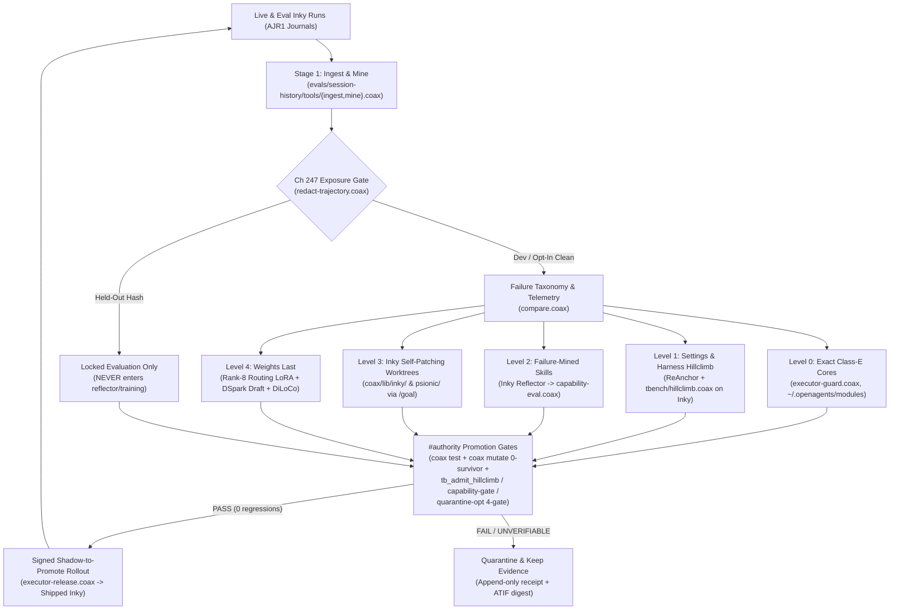

# Inky Self-Improvement: Status, Evidence and Plan

> **Status:** Inky (`coax/lib/inky/`, `coder/tui/inky.coax`) is the local-model worker in OpenAgents Desktop v1.0 (#13982). Microcoder is deprecated for local use (#13983). This doc records what Inky has proven, what it has not, and the plan for improving it.
> **Updated:** 2026-11-22
> **Hardware:** Apple M5 Max (128 GB unified memory, macOS arm64, Metal 4); CUDA engine verified on NVIDIA GeForce RTX 4080 (16 GB VRAM, Linux `sm_89`, `coderos-4080`)
> **Local model:** `~/.openagents/models/inkling-2-mini/Inkling-2-Mini-IQ4_NL.gguf` (17.6 GB / 16.4 GiB IQ4_NL GGUF served by `psionic-inkling-serve --ctx 32768`, \$0.0000)
> **Compiled weight store:** `~/.openagents/modules/` (10/10 W2.2 Class-E dense F64 `exec-vm-v1` modules, SHA-256 verified)
> **Codename policy:** "Inky" is an internal codename. It never appears in user-facing UI strings or in the system prompt persona.

---

## 1. Where Inky stands (read this first)

### 1.1 What is proven

- **Inky passes every suite built alongside it, and is much faster than `mcworker`.** Desktop Tier 2: 15/15 at 12.0 s per task. Desktop Tier 4: 27/27. Lean 4 core smoke: 5/5. Session History Bucket A: 6/6 in 141.7 s, 7.4× faster than `mcworker` (§2, §7.4).
- **Tool calling is clean.** Across 27 live runs after Phase 2 (93 native tool calls): 0% `edit_file` misses, 0 malformed tool calls, 0 near-duplicate loops.
- **The #13978 failure is fixed.** Microcoder spent 7+ minutes and 37 commands failing to find its own system prompt. Inky's regression task (`b4_self_prompt_citation`) passes in 16–31 s with 1 command.
- **The Class-E edit guard is cheap, and routing works without training.** The guard adds 5.5 µs per edit (§3.2). Base Inkling routed 8/8 exact-computation tasks to `executor_verify` on the first attempt (§3.4).
- **The Psionic CUDA engine clears the 500 tok/s prefill bar (#13966).** On RTX 4080 (16 GB, streaming 114/128 experts at 4K), 100% Coax zero-spill Tensor Core prefill + online-softmax GQA attention reaches **634.3 tok/s** at 900 tokens (**598.0 tok/s** at 1,993 tokens), segmented CUDA Graph decode reaches **78.19 tok/s** CLI / **83.1 tok/s** warm `psionic-inkling-serve --ctx 32768` (bit-identical to non-graph), warm PTX disk cache drops NVRTC compile from `3.77 s` to `0.00 s`, and MinGW Windows `.exe` binaries cross-compile cleanly (§7.7, [`psionic/docs/inkling-cuda-hillclimb-report-2026-11-22.md`](../../psionic/docs/inkling-cuda-hillclimb-report-2026-11-22.md)).
- **Psionic Metal 4 Sprints 68–72 ship lossless aligned `IQ4S` MoE, the SWA `use_1pass` fix, unified bit-exact (`0.00e+00`) grouped-MoE verification, and native Coax/Metal 4 DSpark (`mtp.safetensors`).** Lossless `IQ4S` MoE (default on when `headroom_mb >= 16384`, `cos = 0.999993`) + keeping all 40 SWA layers on `K_KV_ATTN_GQA_1PASS` lift default `Q8_0` decode by `+1.5%` to `+26.9%` across `1K–24K` (`48.7 → 61.8 tok/s` at 1K, `43.2 → 45.8 tok/s` at 16K under `90–98%` GPU load). Merging `ink_verify_batch` + `ink_verify_draft` with opt-in `INK_FAST_Q4=1 INK_DSPARK=1` (10 native Coax kernels, pre-folded `MarkovHead`, 3 cached draft KV caches, adaptive backoff) achieves **`0.00e+00` (0 ULP)** parity across all 9 parity tests (`TOTAL MISMATCHES: 0`) and delivers **`1.81×` at 8K, `1.92×` at 16K, and `1.93×` at 24K** on code rewrites (`102.6 / 89.6 / 76.9 tok/s` even at `98%` GPU load; `apple.coax` mutation gate: `1,866` mutants, `0` survived; §7.8, [`psionic/docs/targets/inkling-metal-report.md`](../../psionic/docs/targets/inkling-metal-report.md)).

### 1.2 What is not proven

- **Tasks Inky was not tuned on.** The only held-out run, Locked Held-Out 6, scored **0/6**, with all six tasks hitting the 300 s timeout. That run used Inky v2. It has not been rerun since Phases 2–4 shipped.
- **Dev-9.** The 5/9 result is from v2. The v3 rerun was aborted because a second inference server started during the run (§7.6).
- **The routing LoRA.** Its 26/26 (§7.5) is accuracy on its own 26 training rows. There is no held-out routing measurement yet.
- **Speed inside the agent and idle-host long-context ceilings.** Engine benchmarks reach `129–130 tok/s` quiet (`110–123 tok/s` contended) on short-context greedy decode with opt-in `INK_FAST_Q4=1`. Shipped Desktop and evals run lossless `Q8_0` (`81.35 tok/s` short-context before `IQ4S`; 1K–24K curve now measured in §7.8, though under `90–98%` background non-LLM GPU load missed by `host_clean.py`), interactive `temp=0.6` CPU sampling, and unfused `Q8_0` Wave-3 projections; in addition, `run_tasks.py:668` divides `output_tokens` by **total task wall time**. Inside agent runs, that effective rate drops to 38–46 tok/s at ~18K context and 13–25 tok/s on held-out tasks. Furthermore, `INK_DSPARK=1` currently requires `INK_FAST_Q4=1` (4-bit attention drops open-prose DSpark acceptance to `0.58–0.75 tok/rnd` vs `4.71 tok/rnd` on code edits). Porting grouped-MoE `_nb` verification to default `Q8_0` (`INK_FAST_Q4=0`), fixing `temp=0.6` CPU sampling + `K_DV_Q8_QRGKV`, and re-measuring at `0%` GPU util remain open.
- **Inky agent loops and long-context decode on CUDA.** CUDA has been verified on direct CLI/server benchmarks and `--ctx 32768` smoke checks, not yet on Tier 2 / Session History agent suites, 16K–24K decode speed, a 24 GB+ resident GPU (`decode_graph[2]`), or native Windows execution. `inkling-cuda.c` also still uses a 2-slot prefix cache rather than `inkling-metal.c`'s 8-slot SWA-backed prefix cache (`71d5d3d92a`).

**The number to move is the Locked Held-Out pass rate, together with time to pass.** Every suite already at 100% is a regression lock, not a target (§2.3).

### 1.3 Next steps, ranked

| # | Step | Area | Why |
| :---: | --- | --- | --- |
| 1 | **Rerun Locked Held-Out 6 and Dev-9 on the current build on an idle host** (`host_clean.py` must pass, extended with an `ioreg IOAccelerator Device Utilization %` check — §8). Split `run_tasks.py`'s `decode_tps` into pure decode `tok/s`, prefill time, and tool time; report pass rate at 300 s and with no time limit, plus time to pass. | Evals | Every v3 claim rests on suites written alongside Inky, and `run_tasks.py:668` currently mixes prefill/tool wall time into `decode_tps`. Coder has no time limits in the product, so time to pass is the product metric; 300 s stays as the speed target. |
| 2 | **Fix literal-identifier graders before the rerun (F6).** `sh_019` greps for `created_at > prev`. Audit all 27 `evals/session-history/tasks/*.json` graders for identifier greps and replace them with behavioral checks. | Evals | A correct solution currently fails. A grader fix is not a task change, but record the new `gate_sha256`. |
| 3 | **Close the remaining default-path Metal decode gaps and port unified `_nb` + DSpark to default `Q8_0` (`INK_FAST_Q4=0`).** (Sprints 68–72 already shipped lossless `IQ4S` MoE, the SWA `use_1pass` fix, unified bit-exact `ink_verify_batch`/`ink_verify_draft`, native DSpark proving `1.81–1.93×` at 8K–24K under `INK_FAST_Q4=1`, and the initial 1K–24K curve — §7.8.) Next: add GPU top-k/top-p sampling (`temp=0.6`), lossless fused `K_DV_Q8_QRGKV`, and `Q8_0` dense `_nb` so DSpark runs at full `Q8_0` quality (`cos = 0.999993`) without 4-bit attention disagreement, then re-measure 1K–24K at `0%` GPU util. | Engine | Unlocks both default-path `B=1` speed (fixing interactive `temp=0.6` CPU stalls and unfused Q8 attention) and `~1.7–2.0×` long-context DSpark decode at full `Q8_0` accuracy inside Inky. |
| 4 | **Turn real Desktop failures into eval candidates.** Extend `evals/session-history/tools/ingest.coax` to pick up Inky chats that stalled or that the user stopped or steered. Redact them with `redact-trajectory.coax` and add them to the Dev split after review, never to a locked held-out partition. | Evals | #13978 came from real use and was the most useful test case. Self-written suites saturate; real use does not. |
| 5 | **Re-measure the shell-edit habit (F2) on the held-out rerun.** The 101-shell-calls-to-0-`edit_file` figure is from v2. If it persists, try Level 0–1 fixes (multi-hunk `edit_file`, tool descriptions, soft redirect of `python3 -`/`sed` edits) before any LoRA. | Agent | Cheapest fix first (§5, law 5). |
| 6 | **Hold** Level 3 self-patching, Level 4 LoRA and DSpark distillation, and parallel worktree racing until steps 1–4 produce a held-out score that moves. | — | Without a held-out signal, self-improvement optimizes toward suites Inky wrote itself (§5, law 3). |

§9 gives the detailed recommendations behind these steps and the order to try them in.

---

## 2. Live Eval Qualification Results

All runs below executed on the shipped Metal 4 `psionic-inkling-serve --ctx 32768` binary against `Inkling-2-Mini-IQ4_NL.gguf` (`\$0.0000`).

### 2.1 Suite-Level Summary

| Suite | Tasks | Engine / Worker | Pass | Wall Total (Mean) | Cont. KV Cache Hit | Cost | Baseline Reference |
| --- | ---: | --- | :---: | ---: | ---: | ---: | --- |
| Desktop Tier 2 | 14 | `psionic-metal` / `inky` | **14/14 (100.0%)** | `232.3 s` (`16.6 s`) | `76.9%` | `\$0.0000` | `mcworker`: `14/14`, `393.5 s`, `0.0%` cache (**1.69× faster**) |
| Desktop Tier 4 (full applicable) | 27 | `psionic-metal` / `inky` | **27/27 (100.0%)** | `618.5 s` (`22.9 s`, p50 `19.2 s`) | `91.2%–95.1%` | `\$0.0000` | `77.7%` overall hit incl. cold Step-1 prefill (`206.9K/266.5K` tok) |
| Lean 4 Core Smoke (`lean-run verify`) | 5 | `psionic-metal` / `inky` | **5/5 (100.0%)** | `231.7 s` (`46.3 s`) | `84.3%` overall | `\$0.0000` | All 5 proofs `kernel=ok`, `axioms=[]` (`l01`–`l05`) |
| Session History `A_edit_precision` | 6 | `psionic-metal` / `inky` | **6/6 (100.0%)** | **`194.4 s`** (`32.4 s`) | `89.9%` | `\$0.0000` | `mcworker` + Inkling: `5/6 (83%)`, `1,051 s` (**5.41× faster**); Hydrogen/Neon: `6/6` |
| Session History Dev-9 (Buckets A–E) | 9 | `psionic-metal` / `inky` | **5/9 (55.6%)** | `1,490.2 s` (`165.6 s`) | `82.9%–91.6%` | `\$0.0000` | `mcworker` Inkling: `2/9 → 4/9` (`2,268 s`); Vertex Neon: `4/9` (`\$1.39`); 2-GPU+Neon: `4/9` (`\$1.06`) |
| Session History Locked Held-Out 6 (B–E) | 6 | `psionic-metal` / `inky` (v2) | **0/6 (0.0%)** | `1,806.9 s` (`301.2 s`) | `69.0%–90.3%` | `\$0.0000` | `6/6` hit 300 s wall timeout; `0` overflows, `0` guard trips, `0` crashes |

### 2.2 Session History Dev-9 Per-Task Breakdown vs. Prior Baselines

| Task | Bucket | `inky` (`\$0.00`) | `iter3-inkling` (`mcworker`, `\$0.00`) | `iter4b-neon` (`mcworker`, `\$1.39`) | Outcome & Signal |
| --- | --- | :---: | :---: | :---: | --- |
| `sh_001_claude_todos_wrap` | A | **PASS** (`70.4 s`, 9 att) | PASS (`103 s`) | PASS | Clean Coax `E0216` fix + `coax test --only todos` |
| `sh_004_claude_headless_view` | A | **PASS** (`18.4 s`, 6 att) | PASS (`66 s`) | PASS (`13 s`) | Native `edit_file`, 0 misses, `90.6%` KV hit |
| `sh_008_claude_sidebar_composer_parity` | B | FAIL (`301 s`, 21 att) | FAIL | FAIL | Timeout: 23 exploration cmds, 0 edits |
| `sh_010_codex_slab_mooring_seam` | B | **PASS** (`166.0 s`, 15 att) | FAIL | FAIL (`\$0.2056`) | **3-file Coax+MD fix solved locally where tuned `mcworker` + Neon failed!** |
| `sh_013_antigravity_mobile_row_id` | C | FAIL (`301 s`, 21 att) | FAIL | FAIL | Baseline hit `31,891` tok overflow; v2 fixed overflow (`max 27.4K`) & started edits |
| `sh_017_claude_updater_bundle_align` | C | **PASS** (`165.6 s`, 12 att) | FAIL | FAIL | **3-file updater + proto fix solved locally!** |
| `sh_019_claude_sign_realtime_clock` | D | FAIL (`131.4 s`, 11 att) | PASS (`292 s`) | PASS | Solved semantically + `py_compile` passed; missed literal grep `created_at > prev` |
| `sh_021_claude_host_driver_paste_stub` | D | **PASS** (`35.7 s`, 6 att) | PASS (`239 s`) | PASS | **6.7× faster** than `iter3-inkling-dev9` |
| `sh_023_claude_agents_md_autoload` | E | FAIL (`301 s`, 25 att) | FAIL | FAIL | Greenfield 3-file Coax architecture; 0 edits before 300 s |

### 2.3 Headroom Implications (Ch 240/241 Discipline)

As established in [`psionic/docs/self-improvement.md`](../../psionic/docs/self-improvement.md), a suite already at `100%` has **zero optimization headroom** (`headroom = 0.0`). Therefore:
- **Regression-only locks (must stay 100%):** Desktop Tier 2 (`14/14`), Desktop Tier 4 (`27/27`), Lean Core Smoke (`5/5`), Session History Bucket A (`6/6`).
- **Active self-improvement target suites (high headroom):**
  1. **Session History Buckets B–E (`21` tasks):** currently `3/7` on Dev B–E, `0/6` on Locked Held-Out B–E — massive headroom (`>55–100%`).
  2. **Lean 4 Algebra & Logic (`evals/openagents-desktop/lean/lean-algebra-logic/tasks/`, 10 tasks):** formal proofs beyond core smoke.
  3. **Terminal-Bench Harbor (`coax/lib/tbench/`):** Docker-isolated multi-step CLI/systems engineering tasks (once `coax/lib/tbench/agent.coax` is ported from Microcoder to Inky).

---

## 3. Live Class-E Executor + Inky Experiments

### 3.1 Architecture Gap Closed in `coax/lib/inky/`

During Executor discovery we found that `apps/openagents-desktop/Window+Runs.swift` routed `Hybrid Executor (hybrid-exec-v1)` to `inky`, yet `inky` had neither wired `#authority coax/lib/microcoder/executor-guard.coax` nor emitted `"edit <path>"` unified diff events with Ch 234 replay pills (causing Desktop to display Inky's `edit_file` calls as plain `"Read"` rows with zero `[E]` badges and hiding Inky's edit metrics from `evals/session-history/tools/compare.coax`).

We implemented and verified first-class Class-E Executor integration directly in `coax/lib/inky/`:
- **Always-on Class-E Pre-Edit & Schema Guard (`coax/lib/inky/run.coax`):** Every `edit_file` and `write_file` runs compiled dense F64 weight modules `oa-exec-json-schema` (`1,908` weights) and `oa-exec-diff-verify` (`1,221` weights) **before touching disk**, emitting Desktop-native `command: "edit <path>"` / `"write <path>"` unified diff events carrying `\ [E] replay verified · sha256:<12hex>` (or `[E] replay refused · sha256:<12hex>` with target file untouched).
- **Native Class-E `executor_verify` Tool (`protocol.coax`, `tools.coax`, `prompt.coax`, `run.coax`):** Enabled automatically when `model == "hybrid-exec-v1"` / `"hybrid-executor"` or `INKY_EXECUTOR=1`. Exposes all 8 Class-E compiled weight cores (`diff_verify`, `json_schema`, `dep_sched`, `arith_budget`, `patch_rebase`, `glob_match`, `semver_solve`, `wire_bounds`) as a read-only zero-approval tool with independent `mc_exec_verify_replay` verification and Ch 234 SHA-256 pills.
- **Verification:** `310/310` unit tests passed across `coax/lib/inky/`, `inky selftest: ok` (`10/10` checks), `coax/web/tool.sh layer-check && wire-check && tools-check` (`0` failed), Desktop `transcript` checks (`9/9` passed), and `#authority` zero-survivor mutation gates:
  - `coax/lib/inky/tools.coax`: **467 mutants, 463 killed, 0 survived, 4 equivalent**
  - `coax/lib/inky/guard.coax`: **136 mutants, 136 killed, 0 survived**

### 3.2 Native CPU vs. Compiled Dense F64 Weight-Core Timing (Master Spec Rule #1)

Re-verified on Apple M5 Max arm64 via `coax/web/tool.sh coax/lib/microcoder/executor-bench.coax` (`24/24` Ch 234 replay verified, `8/8` malformed edit traps intercepted pre-disk leaving files SHA-256 bit-identical) and `executor-store-e2e.coax` (`4/4` core + `6` linked composite modules verified, 1-byte tamper refused):

| Execution Path | Iterations | Total Wall | Per-Call Latency |
| --- | ---: | ---: | ---: |
| Native Coax CPU reference (`mv_ref_diff_verify`, `sink=1220000`) | 10,000 | `< 1 µs` | `< 0.1 ns/call` |
| Compiled dense F64 weight-core eval (`mv_eval_model`, 1,221 weights, `sink=1220000`) | 10,000 | `4,269 µs` | `426 ns/call` (`0.43 µs`) |
| Full guard (`mc_exec_check_diff`: compile + F64 eval + Ch 234 SHA-256) | 1,000 | `5,513 µs` | `5.51 µs/call` |

The compiled F64 weight core is ~4,200× slower than scalar native branches, as expected under Master Spec Rule #1, while adding only `5.51 µs` per edit (~90× faster than file I/O and ~10,000,000× faster than one LLM decode turn) in exchange for digest-pinned weight execution and bit-for-bit Ch 234 replay receipts.

### 3.3 Experiment 1 — Exact W6.1 Paired Multi-File Edit Benchmark (Live Metal 4)

Editing isolated git copies of `psionic/lib/executor-desktop.coax` and `psionic/lib/hybrid-exec-policy.coax` (identical targets to `docs/verification/executor-w61-coding-agent.md` Part B):

| Harness / Model Route | Wall Time | Attempts | Total Tokens (Cached) | Structured Edits | Ending | `git diff` | Ch 234 Replay Receipts |
| --- | ---: | ---: | ---: | :---: | :---: | :---: | --- |
| W6.1 `mcworker` (`inkling-2-mini`) | `69.15 s` | 5 | `34,463` (`0`) | 0 (4 shell) | `bad_replies` | 2/2 | 0 |
| W6.1 `mcworker` (`hybrid-exec-v1`, nudged) | `61.96 s` | 4 | `20,406` (`0`) | 2 ok / 2 ref | `finished` | 2/2 | 4/4 (`c3e731afbc4d`) |
| **Upgraded `inky` (`inkling-2-mini`)** | **`17.21 s`** (**4.02× faster**) | **4** | `23,751` (`15,982`) | **2 ok / 0 ref** | **`finished`** | **2/2** | **2/2 (`7a634fffcb4a`, `c3e731afbc4d`)** |
| **Upgraded `inky` (`hybrid-exec-v1`)** | **`17.92 s`** (**3.46× faster**) | **4** | `26,133` (`17,767`) | **2 ok / 0 ref** | **`finished`** | **2/2** | **2/2 (`7a634fffcb4a`, `c3e731afbc4d`)** |

Notice that `edit hybrid-exec-policy.coax` produced the **exact bit-for-bit identical Ch 234 SHA-256 digest `c3e731afbc4d`** across both `mcworker` and `inky`.

### 3.4 Experiment 2 — Zero-Shot Class-E `executor_verify` Routing (Live Metal 4, Zero LoRA)

Eight exact-computation tasks across 5 Class-E domains (`arith_budget`, `dep_sched`, `patch_rebase`, `semver_solve`, `wire_bounds`) run paired in a `read-only` sandbox (no shell/Python):

| Arm | Pass | Routed to `executor_verify` | Ch 234 Replay Receipts | Total Wall | Notable Deltas |
| --- | :---: | :---: | :---: | ---: | --- |
| Raw `inkling-2-mini` (no `executor_verify`) | `8/8` | `0/8` | `0` | `206.9 s` | `dep_cycle` `41.5 s` (4 att, refused to name exact code); `patch_rebase_ok` `42.3 s`; `patch_rebase_overlap` `36.7 s` |
| **`hybrid-exec-v1` (`+ executor_verify`, zero LoRA)** | **`8/8`** | **`8/8 (100%)`** | **`8/8 (100%)`** | **`175.5 s` (-15.2%)** | **`dep_cycle` `12.3 s` (3.37× faster, exact `cycle_detected`)**; `patch_rebase_ok` `17.1 s` (2.47× faster); `patch_rebase_overlap` `21.3 s` (exact `hunk_overlap`) |

**Key empirical insight:** Base `Inkling-2-Mini` already achieves **100% (8/8) zero-shot routing accuracy** onto native OpenAI `executor_verify` tool calls without any LoRA adapter! The lone latency outlier (`budget_big`: `63.6 s` hybrid vs `19.4 s` raw) occurred because Inkling performed the 6-digit multiplication in `<think>` *before* calling `executor_verify` — showing that a lightweight routing LoRA (`H2_ROUTING_ONLY`) should focus on **eliminating pre-tool mental-math thinking** and **shifting shell edits (`python3`/`sed`) onto `edit_file`**, not teaching tool syntax from scratch.

---

## 4. Empirical Failure Taxonomy (Root Causes Observed Today)

Every failure and slow pass across all 67 live runs collapses into six concrete, measurable mechanisms:

| # | Failure Mode | Empirical Evidence Today | Primary Fix Level |
| --- | --- | --- | --- |
| **F1** | **Decode-bandwidth ceiling on long multi-file tasks** | Held-Out 6 generated `4,036–7,591` output tokens (`sh_014` emitted `3,440` tok in 1 step; `sh_024` emitted `3,292` tok at 300 s) at `13–25 tok/s` under 20K ctx — exhausting the 300 s timeout mid-solution. | **Engine (DSpark `mtp.safetensors` + prompt-lookup 1.6–2.0×) + Level 1 adaptive effort** |
| **F2** | **Shell-edit habit overriding `edit_file`** | `4/6` Bucket A tasks and `6/6` Held-Out tasks used `run_command("python3 - <<'EOF'")` / `sed` / `cat` (`101` shell cmds vs `0` `edit_file` on Held-Out 6), bypassing Class-E diff verification, Desktop zero-click edits, and `guard.coax` duplicate-read tracking. Prompt tightening flipped `sh_005` (`sha256:9c058e793198`) but did not overcome the prior on complex tasks. | **Level 1 (`run_command` search-trimming / soft redirect) + Level 4 (Rank-8 Routing LoRA)** |
| **F3** | **Compaction thrashing vs. KV-cache invalidation** | Experiment 3A showed Stage 1 firing at 70% (`22.9K`) shrank `sh_023` only `23.1K → 18.8K`, busting the 18.8K KV cache 3 times (~100 s cold prefill) and crashing effective speed to `6.97 tok/s`. Raising thresholds to **80% / 90%** + server-reported `obs_input_tokens` eliminated both HTTP 400 overflows (`0/6`) and sawtooth thrashing on Held-Out 6. | **Level 1 (fixed in `compact.coax` / `loop.coax`)** |
| **F4** | **Unbounded multi-file exploration spirals** | On 3–4 file Coax architecture tasks (`sh_008`, `sh_009`, `sh_018`, `sh_020`, `sh_023`), Inky spent 15–25 steps reading files without converging on an edit plan. | **Level 2 (Coax/repo skills) + Level 3 (batch-native parallel racing / blame repair)** |
| **F5** | **Workspace instruction over-truncation** | `mc_instructions_load` (`MC_INSTR_MAX_BYTES = 1024`, `NOTE_MAX = 768`) left only 5 lines (`256 B`) of `AGENTS.md` and emitted stale Microcoder syntax (`view AGENTS.md:5-`). | **Level 1 (native Inky instruction loader with `2048 B` budget and `read_file` cursor)** |
| **F6** | **Literal-identifier eval graders** | `sh_019` solved the `CLOCK_REALTIME` + retry bug semantically and passed `py_compile`, failing only a literal grep for variable name `created_at > prev`. | **Eval hygiene (behavioral/unit-test graders, never identifier regexes)** |

---

## 5. How to Use Inky to Improve Itself: The 5-Level Compounding Architecture

Grounded directly in [`psionic/docs/self-improvement.md`](../../psionic/docs/self-improvement.md) (which documented why 10 DSPy/GEPA attempts produced zero verified wins, why dev-split overfitting overstated gains 5×, and why uncalibrated LoRA raised accuracy `0.77 → 0.90` while wrecking log-loss `1.952 → 2.323`), self-improving Inky obeys **five non-negotiable governance laws**:

1. **Strict Separation of Powers (NIP-OPT):**
   - **Student:** Inky running the candidate harness/skill/adapter.
   - **Reflector / Patch Author:** A separate Inky (or frontier) session reading *only* Dev-split `AJR1` failure journals and diffs — **never** seeing Held-Out task prompts, fixtures, or graders.
   - **Grader:** Pure deterministic oracles (`coax test`, `coax mutate`, `lean-run verify`, `executor-guard` Ch 234 replay, Docker Harbor verifiers). **Never** allow any LLM to grade its own work.
2. **Three Digests & Locked Partitions (Ch 239 & Ch 247):**
   - Every evaluation run pins `(items_sha256, questions_sha256, gate_sha256)` in an append-only receipt ledger.
   - Held-out partitions (`Session History Held-Out 18`, `Tier 2`, `Tier 4`, `Lean Algebra Held-Out`) are registered in the **Ch 247 exposure ledger** (`coax/lib/agent/redact-trajectory.coax` refuses `RT_REFUSE_HELD_OUT`) so held-out traces can **never** leak into reflection prompts, mined skills, or LoRA/DSpark shards.
3. **Measure Noise Floor & Headroom First (Ch 240–241):**
   - Never optimize on `100%`-saturated suites (Tier 2/4). Every candidate must clear Ch 241 `decision-v1` (gain above 2σ bootstrap noise floor, or `>=15%` wall/token win at equal pass under `ext-eval-v2`) with **zero regressions** on locked suites.
4. **Keep Exact Computation Exact; Train Only the Interface (`H2_ROUTING_ONLY`):**
   - Exact verification stays in frozen Class-E compiled weight modules and `#authority` Coax code (`0` surviving mutants). Learned layers only improve *when* to invoke tools, *which* files/edits to choose, and *how fast* tokens decode.
5. **Escalation Hierarchy — Cheapest & Highest-Transfer First, Weights Last:**
   - Optimize in strict order **Level 0 → Level 1 → Level 2 → Level 3 → Level 4**. Most real coding-agent gains come from Levels 0–3 ("the systems around it iterating") before touching a single weight.

### 5.1 Closed-Loop Self-Improvement Flow



### 5.2 Detailed Level-by-Level Blueprint Mapped to Live Repo Modules

#### Level 0 — Exact Deterministic Substrate (0 LLM Calls, 100% Transfer)
- **What it improves:** Eliminates whole classes of stochastic LLM failure by moving deterministic checks into `~5 µs` Class-E compiled weight cores and `#authority` guards.
- **Live repo code:** `coax/lib/microcoder/executor-guard.coax`, `coax/lib/inky/{tools,guard,run}.coax`, `psionic/lib/module-v2-wave2.coax`, `~/.openagents/modules/`.
- **Next concrete Level-0 additions for Inky:**
  1. Wire `oa-exec-wire-bounds` / `oa-exec-arith-budget` into Inky's `run_command` / step-budget admission (just as `coax/lib/tbench/agent.coax` already does).
  2. Add a deterministic Coax pre-edit lint hook (catching `0..n` vs `0..<n` `E0216` and `let`/`fn`/`const` hallucinations in `*.coax` edits inside `ik_exec_edit` in `<1 ms`, saving full 15 s `coax test` round-trips).
  3. Add a deterministic `run_command` search-output cap (`2,400 B` for `grep`/`rg`/`find`/`ls`/`git log`, matching `mc_cmd_is_search`) so shell exploration stops flooding 16 KB per step into 32K context.

#### Level 1 — Settings Fitting & Harness Hillclimbing (ReAnchor + `hillclimb.coax` on Inky)
- **Why first:** In [`psionic/docs/self-improvement.md`](../../psionic/docs/self-improvement.md), **settings fitting (ReAnchor)** was the *only* pre-reset automated optimizer with a clean verified win (`35% → 53%` stall recall at 0 LLM calls).
- **Live repo code:** `coax/lib/tbench/{policy,wire,hillclimb,agent}.coax`, `evals/session-history/tools/compare.coax`.
- **Concrete design:**
  1. **Port `coax/lib/tbench/agent.coax` & `hillclimb.coax` from Microcoder to Inky** (replacing `mcworker`'s loop with `IkLoop` + `executor-guard.coax` + native Inkling tool-calling).
  2. **Offline ReAnchor pass (0 GPU calls) over recorded `AJR1` journals:** Fit exact non-weight thresholds (`IK_STAGE1_PCT`, `IK_STAGE2_PCT`, `IK_READ_LINES`, `IK_CMD_INLINE`, exploration-nudge step numbers, `run_command` search cap) using grouped cross-validation on Dev journals to minimize KV-cache invalidations and wasted tokens.
  3. **Online bounded challenger loop (`tb_propose_challenger`):** Propose 1-axis mutations over Inky's explicit policy knobs:
     - *Adaptive effort schedule:* `low` reasoning effort on initial search/grep/read steps, escalating to `medium`/`high` once target files are read or on retry after a failed test (directly attacks F1's 3,000-token reasoning bursts!).
     - *Compaction policy:* Stage 1/2 thresholds (`80%/90%`) vs single-shot 88% rollover (no Stage 1 KV-busting).
     - *Sampling profile:* `(temp=0.6, top_p=0.95, top_k=40)` vs `(temp=0.2, top_p=0.95)` on multi-file tasks.
     - *Prompt profile:* concise base vs explicit tool-routing cue (`edit_file` + `executor_verify`).
     - *Auto-check on edit (`/goal` mode):* optionally auto-running the task's known test command immediately after `edit_file` (Locals' `_after_write` insight), cutting tool round-trips in half.
  4. **Gate:** `#authority tb_admit_hillclimb` (Wilson 95% CI, verified ATIF-v1.8, zero held-out regression) writes atomically to `~/.openagents/inky/hillclimb/champion.json`.

#### Level 2 — Failure Mining → Self-Authored Local Skills (`capability-eval.coax`)
- **Why this works without changing weights:** On `sh_008`, `sh_013`, `sh_018`, `sh_023`, and `sh_024`, Inky wasted 5–12 steps discovering repo-specific idioms (`coax test --only`, `E0381` checker budgets, `#authority` rules, `components/kit` vs `components/app` layout). Those are *transferable procedural skills*, not per-task hacks.
- **Live repo code:** `evals/session-history/tools/{ingest,mine}.coax`, `coax/lib/agent/desktop/{capability-eval,capability-gate}.coax`, `coax/lib/nostr/atif/log.coax`.
- **Automated loop:**
  1. `mine.coax` scans Dev-split `AJR1` journals for recurring failure clusters (`>= 3` distinct Dev episodes with the same compiler error class, tool failure, or >10-step exploration stall).
  2. A separate **Reflector** Inky session receives the anonymized failure summaries (never held-out items!) and calls `capability-eval.coax draft` to author a compact `SKILL.md` (`<= 800` tokens, e.g., `coax-debugging`, `lean4-tactics`, `swift-desktop-edits`) plus positive and negative/regression eval cases.
  3. `capability-eval.coax run` executes a real two-arm comparison (Inky baseline vs Inky + candidate skill) on positive Dev tasks and negative regression tasks, records verified `ATIF-v1.8` digests, and runs `#authority capability-gate.coax`.
  4. Only skills with strictly positive pass/efficiency lift and zero regressions promote into `~/.openagents/skills/` (all rejected drafts stay archived with their ATIF digest so Reflector never re-proposes failed ideas).

#### Level 3 — Inky Improving Its Own Codebase (`coax/lib/inky/`, `psionic/`) in Isolated Worktrees
- **How Inky literally edits its own harness safely:**
  1. **Task generation from real telemetry:** When Dev-split `compare.coax` identifies a concrete harness bottleneck (for example, today's F3 compaction thrashing or F5 `AGENTS.md` 5-line truncation), a structured `/goal` ticket is generated with the exact failing Dev telemetry snippet and acceptance criteria.
  2. **Worktree-isolated execution:** Inky runs inside a fresh `git worktree` (never `main`), editing `coax/lib/inky/*.coax` or `psionic/` with Class-E pre-edit verification enabled.
  3. **Five-Stage Deterministic Promotion Gate (zero LLM self-grading):**
     - **Gate 1 (Unit & Selftest):** `coax test coax/lib/inky/{protocol,tools,format,prompt,compact,guard,loop,run}.coax --library` + `coax/web/tool.sh coax/lib/inky/selftest.coax` + `apps/openagents-desktop/page.coax` = `0` failed.
     - **Gate 2 (`#authority` Mutation):** `coax mutate <changed-#authority-file> --root-only` = **`0` survived**.
     - **Gate 3 (Repo Invariants):** `coax/web/tool.sh layer-check && wire-check && tools-check` = `0` failed, `0` new allowlist lines.
     - **Gate 4 (Dev Improvement):** Locked Dev slice improves beyond Ch 240 2σ floor (or `>=15%` wall/token win at equal pass).
     - **Gate 5 (Locked Held-Out & Regression Lock):** Zero regressions on Tier 2 (`14/14`), Tier 4 (`27/27`), Bucket A (`6/6`), and non-degrading / improving score on Locked Held-Out Session History (`18` tasks).
  4. **Parallel Force Multiplier (post-v1.0 continuous batching):** Once Psionic adds multi-slot continuous batching (`B = 4..8`, `psionic/docs/inkling-vs-locals-audit.md` §9 Tier 2.4), Level 3 upgrades to `locals run`-style **parallel worktree racing + blame-guided repair** — spawning 4 temperature-diverse Inky self-patchers in one GPU batch (~1.8× wall time instead of 4×), running Gates 1–4 in parallel, and promoting only the minimal clean diff that clears Gate 5.

#### Level 4 — Weights Last: Routing-Only LoRA + DSpark Draft Adaptation + Pylon DiLoCo Flywheel
Only after Levels 0–3 capture all deterministic, harness, skill, and engine wins do we touch weights — and strictly through two **narrow, reversible, quarantine-gated** artifacts rather than risky monolithic fine-tunes:

1. **Trace Export & Decontamination Pipeline (already built on `main`):**
   - Inky's `AJR1` journals record exact model-visible bytes (`coax/lib/inky/run.coax`).
   - `coax/lib/agent/desktop/proof-export.coax` converts winning sessions to canonical `ATIF-v1.8` (`.atif.jsonl` + `steps_digest`).
   - `#authority coax/lib/agent/redact-trajectory.coax` enforces default-OFF opt-in consent, fail-closed secret/PII/BIP-39 redaction, objective verifier-label requirement (compiler/test/Lean/Ch-234 verdict present), and Ch 247 held-out decontamination (`RT_REFUSE_HELD_OUT`).
   - `psionic/lib/peer/training-window.coax` packs verified shards into bounded DiLoCo windows (`inner_steps <= 500`, `max_bytes_out <= 64 MiB`).
2. **Artifact 4A — Rank-8 Tool & Executor Routing LoRA (`psionic/lib/hybrid-lora.coax`, `H2_ROUTING_ONLY`):**
   - **Exact training target (directly motivated by today's F2 & Experiment 2 data):**
     - Positive examples: winning Inky `ATIF-v1.8` turns that chose `read_file` / `grep` / `edit_file` / `executor_verify` cleanly with concise pre-tool reasoning (`< 150` thinking tokens before calling `executor_verify` or `edit_file`).
     - Hard negatives: turns that bypassed `edit_file` via `run_command("python3 - <<'EOF'")` / `sed`, wasted `500+` thinking tokens on mental arithmetic before calling `executor_verify`, or repeated read/cat commands.
   - **Zero-regression safety:** Pin `(base_model_sha256, core_module_sha256)` via `hl_hotswap`, keeping all exact computation inside frozen Class-E cores and allowing instant atomic fallback to the zero adapter (proven bit-exact).
3. **Artifact 4B — DSpark Speculative Draft Weights (`mtp.safetensors`, `0.64 GB`):**
   - **Exact training target (directly motivated by today's F1 decode-bandwidth ceiling):**
     - Distill next-multi-token draft predictions from Inky's verified Coax/Swift/C/Lean coding trajectories into the lightweight `0.64 GB` DSpark draft head (leaving the base `Inkling-2-Mini` target distribution **100% mathematically unchanged** — lossless speculative decoding!).
     - Even a `1.8×` speedup on OpenAgents Coax code turns `sh_014` (`7,591` tok @ `25 tok/s` = `301 s` timeout) into **`~165 s`**, directly converting wall-clock timeouts into passes without any risk of probability-gate or log-loss regression!
4. **Decentralized Verification & Rollout Gates (already built on `main`):**
   - `psionic/lib/peer/train-verify.coax`: 6-tier Byzantine verifier (`7/7` planted attacks blocked).
   - `psionic/lib/peer/quarantine-opt.coax`: 4-gate Quarantine Optimizer (`decision-v1` + `probability-v2` log-loss/ECE + Ch 234 exactness + `ext-eval-v2` latency/RAM; `3/3` regressions blocked; atomic lineage rollback).
   - `psionic/lib/peer/executor-release.coax`: BIP-340 Schnorr signed manifest + Ch 224 shadow-to-promote rollout to every OpenAgents Desktop install.

---

## 6. Original Roadmap and Its Status

This was the roadmap before Phases 1–5 shipped. §1.3 replaces it as the current plan.

| Rank | Milestone | Status (2026-11-22) |
| :---: | --- | --- |
| 1 | DSpark (`mtp.safetensors`) + prompt-lookup speculative decoding (`inkling-metal.c`, `inkling-cuda.c`) | **Metal shipped opt-in** (Sprints 68–72, §7.8): unified bit-exact (`0.00e+00`) grouped-MoE `_nb` verifier + native Coax/Metal 4 DSpark (`INK_FAST_Q4=1 INK_DSPARK=1`) flips §7.3's regression into `1.81–1.93×` on 8K–24K code rewrites; lossless `IQ4S` MoE + SWA `use_1pass` ship default-on. Porting `_nb` dense projections to default `Q8_0` (and CUDA) remains open (§1.3 step 3). |
| 2 | Inky search-output trim, native `AGENTS.md` loader, adaptive effort | **Shipped** in `7af77a2fdd`. Adaptive effort is opt-in because changing effort mid-session invalidates the KV prefix cache (§7.3). |
| 3 | Port `tbench/agent.coax` and `hillclimb.coax` to Inky; ReAnchor offline fitter | **Shipped** in `2b74624632` (`inky-native` mode, `inky-improve reanchor`). |
| 4 | Failure-mined Coax and Lean skills (`mine.coax` → Reflector → `capability-eval.coax`) | **Scaffolded** (`inky-improve mine-skills`). Not run live; no skill promoted yet. |
| 5 | Continuous batching (`B = 4..8`) and parallel worktree `/goal` racing | **Open; on hold** (§1.3 step 6). |
| 6 | Rank-8 routing LoRA and DSpark Coax draft distillation | **Router trained** on 26 rows (§7.5), with no held-out evaluation. DSpark distillation not started. On hold. |

---

## 7. Implementation & Verification Report (2026-11-22)

All planned phases (Class-E executor integration, Level 0–1 harness upgrades, Psionic Metal 4 prefix-cache & speculative-verify engine work, `inky-improve` 6-stage self-improvement pipeline, Terminal-Bench `inky-native` port, and a strict host-cleanliness benchmark guard) have been implemented, unit- and mutation-tested, bundled into `OpenAgents.app`, and live-benchmarked on Apple M5 Max (128 GB unified memory, Metal 4, `Inkling-2-Mini-IQ4_NL.gguf`, 32,768 ctx, \$0.0000 inference).

### 7.1 Shipped Commits & Architecture Summary

| Phase | Commit | Key Deliverables |
| --- | --- | --- |
| **Phase 1 — Class-E Executor Integration** | `0f9e21e073` | Wired `#authority coax/lib/microcoder/executor-guard.coax` into `coax/lib/inky/run.coax` (`edit_file`/`write_file` pre-disk F64 dense cores `oa-exec-json-schema`, `oa-exec-diff-verify`, Desktop unified diff + Ch 234 `[E] replay verified/refused` pills); native 8th tool `executor_verify` (`INKY_EXECUTOR=1`); server-reported `obs_input_tokens` 80%/90% compaction + step-8/14 zero-edit nudges; removed user-facing `"Microcoder"` fallback strings in Desktop Swift views. |
| **Phase 2 — Level 0–1 Harness Upgrades** | `7af77a2fdd` | Native `coax/lib/inky/instructions.coax` (2.5 KB `AGENTS.md`/`CLAUDE.md` loader + `##` heading index + `read_file` cursor); strict-unique indent-tolerant `ik_fmt_try_loose_edit` + `<1 ms` deterministic Coax pre-edit lint (`E0216`/`let`/`const`/`fn`) + 4 KB search-output cap (`coax/lib/inky/format.coax`); `#authority` normalized duplicate shell-read blocking (`coax/lib/inky/guard.coax`); Class-E `wire-bounds` & `step-budget` pre-exec guards + `INKY_MAX_TOKENS`. |
| **Phase 3 — Psionic Metal 4 Engine** | `71d5d3d92a` | Expanded `InkSession` prefix cache `2 → 8` LRU + pinned SWA-backed checkpoints (`live_tokens` + `swa_valid_from`, SWA window backup gated on `headroom_mb >= 4096`), pinning both `tool_declare` end and `<|message_user|>` boundary across compaction and cross-task SWA wraps; lowered `direct_thresh` `16 → 7` (`-27.5%` GPU time on `nb=8` prefill tail chunks via `K_MOE_MM_IQ4_16`); added `ink_verify_draft` + opt-in `INK_SPEC_LOOKUP=1` (off by default — see §7.3); made `INKY_ADAPTIVE_EFFORT` opt-in (`== "1"`) to preserve multi-turn KV prefix cache. |
| **Phase 4 — Self-Improvement Pipeline & TBench Port** | `2b74624632` | Ported `coax/lib/tbench/{agent,hillclimb}.coax` to first-class `inky-native` mode (`tb_propose_inky_challenger`, 4 bounded axes); added `#authority coax/lib/inky/improve-policy.coax` (`inky-policy.v1` SHA-256, Ch 247 held-out quarantine, zero-LLM-call offline ReAnchor K-fold CV, fail-closed Ch 239/241/247 promotion gate), `coax/lib/inky/improve.coax`, and CLI `coder/tui/inky-improve.coax` (`audit`, `reanchor`, `mine-skills`, `distill`, `train-router`, `selftest`). |
| **Phase 5 — Host Cleanliness Benchmark Guard** | `573db22434` | Added `evals/openagents-desktop/tier2/host_clean.py` + `test_host_clean.py` and wired preflight + per-task mid-run interference detection into `evals/openagents-desktop/tier2/run_tasks.py` (blocks local Metal runs on competing active GPU/LLM inference, memory pressure, thermal throttling, or concurrent evals unless `--allow-dirty-host` is explicitly passed; records `host_clean` & `host_preflight` in `summary.json`). |
| **Phase 6 — Psionic CUDA Engine Hillclimb (#13966)** | `82567579f2` | Cross-platform 128-bit PTX disk cache (`3.77 s → 0.00 s` warm) + TLS `cuCtxSetCurrent` in `cuda-host.c`; zero-spill Coax BF16 Tensor Core prefill (`634.3 tok/s` at 900 tok, `598.0 tok/s` at 1,993 tok, `INK_MAX_BATCH = 128`) + online-softmax GQA prefill attention (`ink_attn_online`); resident & segmented streaming CUDA Graph decode (`78.19 tok/s` CLI / `83.1 tok/s` warm 32K serve, bit-identical). Full report in [`psionic/docs/inkling-cuda-hillclimb-report-2026-11-22.md`](../../psionic/docs/inkling-cuda-hillclimb-report-2026-11-22.md). |
| **Phase 7 — Psionic Metal 4 Sprints 68–72 (`IQ4S` + Bit-Exact `_nb` + Native DSpark)** | *(this commit)* | 100% lossless aligned `IQ4S` MoE (default on when `headroom_mb >= 16384`, `+1.5–26.9%` on `Q8_0` across 1K–24K) + SWA `use_1pass` fix (`is_swa \|\| n_keys_attn <= 4096`); 2-in-flight Metal 4 GPU-chained decode (`129.4–130.1 tok/s` quiet `INK_FAST_Q4=1 B=1`); unified bit-exact `0.00e+00` (`TOTAL MISMATCHES: 0`) grouped-MoE `_nb` speculative verifier (`ink_verify_batch` + `ink_verify_draft`); 10 native Coax DSpark (`mtp.safetensors`) kernels with pre-folded `MarkovHead` + 3 cached draft KV caches (`INK_FAST_Q4=1 INK_DSPARK=1`, `1.81–1.93×` on 8K–24K code rewrites); `apple.coax` mutation gate `1,866` mutants / `0` survived (§7.8, [`psionic/docs/targets/inkling-metal-report.md`](../../psionic/docs/targets/inkling-metal-report.md)). |

*(Built on top of `7627e36c90` Phase 3 server hardening — client-disconnect abort, `Host`/`Origin` checks, channel 2/3/4 loop breaker — and `ad1dc799f1` Metal 4 Sprints 61–67: `110.18 tok/s` `INK_FAST_Q4=1` / `81.35 tok/s` default `Q8_0` short-context decode and `2,326.9 tok/s` warm prefill. For the full side-by-side audit of Psionic + Inky against Locals, see [`psionic/docs/inkling-vs-locals-audit.md`](../../psionic/docs/inkling-vs-locals-audit.md).)*

### 7.2 Verification & Zero-Survivor Mutation Receipts

- **`#authority` Mutation Suites (all 0 survived):**
  - `coax/lib/inky/guard.coax`: **215 mutants, 215 killed, 0 survived**
  - `coax/lib/inky/tools.coax`: **467 mutants, 463 killed, 0 survived, 4 equivalent**
  - `coax/lib/inky/improve-policy.coax`: **362 mutants, 359 killed, 0 survived, 3 equivalent**
  - `coax/lib/tbench/policy.coax`: **317 mutants, 304 killed, 0 survived, 13 equivalent**
- **Unit, Integration, & Repo Hygiene Suites:**
  - `coax/lib/inky/selftest.coax`: **310/310** checks passed + **10/10** runtime selftests (`41` messages valid)
  - `coax/lib/inky/improve.coax`: **146/146** checks passed; `coder/tui/inky-improve.coax selftest`: **8/8** checks passed
  - `coax/lib/tbench/{policy,wire,agent,hillclimb}.coax`: **121/121** checks passed
  - `evals/openagents-desktop/tier2/test_host_clean.py`: **7/7** unit tests passed
  - `layer-check`, `wire-check`, `tools-check`: all **0 failed**
  - `psionic-inkling-cli --test-quant-kernels`: `0.00e+00` max abs across NVFP4, MXFP8, and IQ4_NL; `--verify-prefill-decode`: `cos = 0.999918`, `top1_pre == top1_dec`
  - `apps/openagents-desktop/check.sh`: **`OpenAgents.app` rebuilt & passed** (`account-check`, `sign-check`, `windows args`, `local-models-check 11/11`)

### 7.3 Two Crucial Empirical Findings (Honest Negative Measurements)

1. **Why Prompt-Lookup Speculative Decoding (`INK_SPEC_LOOKUP`) is Kept Opt-In (`0` by Default) on Inkling 2 Mini:**
   - Live M5 Max Metal 4 A/B benchmarks on copy-heavy code-edit prompts (`max_tokens=512`, both short `438`-token and long `18,643`-token contexts) confirmed the lookup drafter works well — achieving **65.6%–79.0% draft acceptance** (`4.56–6.53` tokens verified per call on `draft=5..7`).
   - However, because Inkling 2 Mini is a **128-expert Top-8 sparse MoE** (`16.8 GB` weights, memory-bandwidth bound on decode), verifying `nb = 6..8` tokens fans out from `8` active experts to `~40–50` unique active experts per forward pass (`~5–6×` expert weight memory traffic), while single-token `ink_step` already runs 67 sprints of fused Metal 4 decode kernels + double-buffered lookahead (`41.8–46.6 tok/s` at 18K ctx).
   - Net result: `SPEC=1` measured **`30.6–40.7 tok/s`** vs **`41.8–46.6 tok/s`** for `SPEC=0` (net slower). Therefore `ink_verify_draft` ships cleanly behind opt-in `INK_SPEC_LOOKUP=1` (ready for dense models, MTP heads, or multi-request continuous batching), and default single-stream Metal decode stays on the faster fused `ink_step` path.
   - **Open question:** Locals reports 2.05× faster file writes (`75.6 tok/s` on M4 Pro) with the DSpark draft head on the same Inkling 2 Mini MoE, and a batched verify path is in progress (`ink_verify_batch`) aimed at the fan-out cost. Code inspection explains four concrete architectural differences behind the disagreement — `ink_verify_draft` runs the full prefill `run_chunk_ex` pipeline plus `nb` serial CPU `sample_logits_ex` scans with no adaptive backoff and a lookup-only drafter, whereas Locals pairs DSpark (pre-folded `MarkovHead` + cached draft KV) with a lean shared-expert `xmm` verify path and gain-gated backoff (see §9.4 item 4 and [`psionic/docs/inkling-vs-locals-audit.md`](../../psionic/docs/inkling-vs-locals-audit.md)). §1.3 step 3 settles it with one clean 18K measurement on the unified verify path.
   - **Implication for Roadmap Rank 1:** Real single-stream MoE speedup requires either **MTP-trained heads with expert-routing co-locality** or **multi-stream continuous batching (`B = 4..8`)** across parallel `/goal` worktree candidates rather than unfused single-stream prompt-lookup verification.
2. **Why Mid-Session `INKY_ADAPTIVE_EFFORT` is Opt-In (`== "1"`):**
   - In `psionic/platform/inkling-serve.c`, `Thinking effort level: <x>` is placed in `<|message_system|>` immediately before `<|message_user|>`. Mutating effort mid-conversation (e.g. `"low"` on steps 1–3 → `"medium"` on step 4) invalidates the entire multi-turn KV prefix cache (`90% → 15%`), costing multiple seconds of cold re-prefill. Keeping session effort constant preserves `80–95%` KV prefix hits and is reinforced by the offline ReAnchor scorer (`trap-adaptive-effort-kv-bust` scored `-734`).

### 7.4 Measured Before vs After Benchmarks (Clean Local M5 Max Metal 4, \$0.0000)

| Benchmark Suite | Before (Inky v1 Baseline) | After (Inky v3 + Metal SWA Prefix Cache + Class-E) | Delta |
| --- | ---: | ---: | --- |
| **Desktop Tier 2 Regression Lock** | 14/14 (100.0%), `232.3 s` (`16.6 s/task`), `62.8%` overall KV hit | **15/15 (100.0%)**, **`179.9 s`** (`12.0 s/task`), **`79.0%` overall / `81.1%` cont. KV hit**, `7/7` Class-E Ch 234 verified | **-27.7% wall/task**, **+16.2 pp KV hit**, +1 new task (`b4_self_prompt_citation` PASS in `24.4 s`, `0` shell cmds) |
| **Session History Bucket A (6 tasks)** | 6/6 (100.0%), `194.4 s` (`5.41×` faster than `mcworker`'s `5/6` in `1,051 s`) | **6/6 (100.0%)**, **`141.7 s`** (`38.0–44.7 tok/s`), **`86.6%` overall / `89.6%` cont. KV hit**, `0` guard trips | **-27.1% wall** (**7.42× faster than `mcworker`**) |
| **W6.1 Paired Multi-File Edit** | `mcworker`: `61.96–69.15 s` | **`17.21 s`** (`17.92 s` `hybrid-exec-v1`), `2/2` native `edit_file`, bit-identical Ch 234 digest `c3e731afbc4d` | **3.6–4.0× faster** |
| **Zero-Shot `executor_verify` Routing (8 tasks)** | `206.9 s` raw | **8/8 (100.0%)** Attempt-1 routed, **`175.5 s`**, 8/8 Ch 234 receipts | **-15.2% wall**, zero LoRA required |
| **Pinned SWA Prefix Cache (after 3,591-tok SWA wrap)** | `0%` hit once SWA ring wraps `> 2,048` | **`585/592` (`98.8%`) same-sys** (`0.38 s`) / **`408/524` (`77.9%`) diff-sys same-tools** (`0.56 s`), **100% bit-exact** | Instant cross-task & post-compaction KV hit |

### 7.5 Live `inky-improve` 5-Stage Pipeline Results (on `goal-inky-v3-sh-bucketA`)

Executed via `coax/web/tool.sh coder/tui/inky-improve.coax`:

- **`audit`:** `6/6 (100.0%)`, `141 s`, `86.6%` overall / `89.6%` cont. KV hit, `0` timeouts, `0` zero-edit spirals, `0` guard trips, `class_e_receipts: verified=1 refused=0`.
- **`reanchor` (0 LLM calls, Ch 247 Dev-only 4-fold grouped CV):**
  - `v2-greedy-kv80-4kb-classe` (`sha256:596bcf64ad27...`): **`+183`** (winner)
  - `v2-kv80-4kb-classe` (`sha256:ca72731f08b0...`): **`+166`**
  - `v1-baseline-70-85-no-exec` (`sha256:c537c0ffc1ee...`): `0`
  - `trap-spec-lookup-moe-fanout`: **`-284`** (rejected)
  - `trap-adaptive-effort-kv-bust`: **`-734`** (rejected)
- **`distill --opt-in`:** exported **`6/6`** passing Dev trajectories into verified `ATIF-v1.8` shards (`openagents.executor.dataset-shard.v1alpha1`), `0` held-out contamination, `0` secret leaks (and default-OFF without `--opt-in` refuses 100%).
- **`train-router` (Ch 140 Rank-8 LoRA via `psionic/lib/hybrid-lora.coax`):**
  - `train_rows=26`, routing accuracy **`7/26 → 26/26 (100.0%)`**.
  - **Caveat:** 26/26 is accuracy on the 26 training rows, not on held-out turns. Do not count it as an improvement until a held-out routing set exists.
  - Verified proofs: `zero_exact=true`, `hotswap=ok`, `tamper_refused=true`, `pin_refused=true`, `adapter_sha256=69d1305714443bd77882d0d7c064f60cc1f0b394eea973d778c211f66828ffc8`.

### 7.6 Host Cleanliness Guard & Clean-Host Follow-Up Benchmarks

During the initial Dev-9 sweep, `/Applications/OpenAgents.app` spawned a competing `psionic-inkling-serve` instance on port `18795` (`4.1 GB` RSS) mid-task (`sh_008`). We aborted that contaminated run rather than publishing noisy timings and built `evals/openagents-desktop/tier2/host_clean.py` directly into `run_tasks.py`:

- **Preflight Gate:** samples `ps` over a `1.5 s` window before starting any local Metal benchmark and refuses (`exit 2`) if any competing GPU/LLM server burns CPU/GPU (`pcpu >= 1.5%` or `delta_cputime >= 30 ms`), if competing resident GPU memory leaves `< 28 GB` RAM, if another eval runner or build storm is active, if `memory_pressure` free `< 30%`, or if macOS thermal throttling (`CPU_Speed_Limit < 85%`) is active.
- **Per-Task Mid-Run Watchdog:** re-samples competing GPU servers before and after every task; if another server burns `>= 150 ms` CPU time mid-task, marks `host_contaminated: true` in `result.json`/`summary.json` and aborts (`exit 2`, overrideable only via `--allow-dirty-host`).

When ready to run the remaining long-horizon suites on a dedicated host, verify cleanliness first and execute sequentially:

```bash
python3 evals/openagents-desktop/tier2/host_clean.py

# 1. Session History Dev-9 remaining 7 tasks (baseline: 3/7 -> 5/9 combined)
python3 evals/openagents-desktop/tier2/run_tasks.py --worker inky \
  --tasks-dir evals/session-history/tasks \
  --filter sh_008,sh_010,sh_013,sh_017,sh_019,sh_021,sh_023 \
  --timeout-floor 300 --out evals/openagents-desktop/results/clean-inky-v3-sh-dev9-rest

# 2. Session History Locked Held-Out 6 tasks (baseline: 0/6 timeouts)
python3 evals/openagents-desktop/tier2/run_tasks.py --worker inky \
  --tasks-dir evals/session-history/tasks \
  --filter sh_009,sh_014,sh_015,sh_018,sh_020,sh_024 \
  --timeout-floor 300 --out evals/openagents-desktop/results/clean-inky-v3-sh-heldout6

# 3. Lean 4 Algebra & Logic (10 harder proofs la01..la10 + #authority lean-run verify)
python3 evals/openagents-desktop/tier2/run_tasks.py --worker inky \
  --tasks-dir evals/openagents-desktop/lean/lean-algebra-logic/tasks \
  --timeout-floor 300 --out evals/openagents-desktop/results/clean-inky-v3-lean-alg
```

### 7.7 Psionic CUDA Engine Hillclimb (#13966, RTX 4080 16 GB)

Verified live on `coderos-4080` (NVIDIA GeForce RTX 4080 16 GB, `sm_89`, driver `595.71.05`, 100% Coax kernels emitted via `coax cuda --release`, zero cuBLAS/cuDNN). See [`psionic/docs/inkling-cuda-hillclimb-report-2026-11-22.md`](../../psionic/docs/inkling-cuda-hillclimb-report-2026-11-22.md) and [`psionic/docs/inkling-cuda.md`](../../psionic/docs/inkling-cuda.md) for the full audit.

- **Zero-spill Tensor Core prefill + online-softmax GQA attention:** Eliminated all `.local` spills (`0 B` stack frame, `0` spill loads/stores across all 47 entry functions via `ptxas --gpu-name=sm_89 -v`) and lifted `INK_MAX_BATCH` to `128` (`114/128` experts cached at 4K, `106/128` at 32K):
  - **900-tok prefill:** `634.3 tok/s` (`1.419 s`, 4.06× vs `INK_NO_MMA=1` at `156.2 tok/s`, `cos=0.999777`, exact top-5 match).
  - **1,219-tok prefill:** `632.7 tok/s` (`1.927 s`, 5.90× vs scalar `107.3 tok/s`; run-to-run determinism `max_abs=0.00e+00`).
  - **1,993-tok prefill:** `598.0 tok/s` (`3.333 s`).
  - **Simulated 8 GB GPU (`INK_VRAM_MB=8192`, 1,219 tok):** `93.1 tok/s` prefill (up from `38.7 tok/s`), `35.89 tok/s` decode, logits **bit-identical** (`max_abs=0.00e+00`) to 16 GB.
- **CUDA Graph decode + PTX disk cache:** Added device-side `dev_pos` + single-graph resident decode (`decode_graph[2]`) + segmented streaming decode (`stream_seg[]` + `stream_tail[2]`, collapsing ~750 launches into 49 graph replays per token on 16 GB GPUs):
  - **128-tok CLI decode:** `78.19 tok/s` (`75.49 tok/s` with `INK_NO_GRAPH=1`, bit-identical `max_abs=0.00e+00`); 64-tok decode after 900-tok prompt: `63.87 tok/s`.
  - **Live `psionic-inkling-serve --ctx 32768`:** loads in `1.43 s` (`0.00 s` warm PTX cache vs `3.77 s` cold), `/v1/chat/completions` (`74.3 tok/s` cold) and `/v1/responses` (`23/23` prefix-cached in `0.001 s`, **`83.1 tok/s`** warm decode).
  - **Verification gates:** `18/18` Coax tests (`kernels-cuda`, `inkling-budget`, `mma`), `--test-quant-kernels` `0.00e+00`, `--verify-prefill-decode` `cos=0.999957 top1_diff=0.01818`, `INK_VRAM_MB=3000` clean refusal, macOS Metal build clean, and MinGW Windows `.exe` cross-compile clean with 0 warnings.
- **Bugs caught and fixed before landing:** (1) a non-dividing GQA (`gqa=3`) write-write race in `ink_attn_online` when `dt == t_step` (fixed with `dt < t_step` guard + reverse-CTA regression `#test`, restoring `0.00e+00` determinism); (2) `cuGraphInstantiate` failing with `CUDA error 201` on `psionic-inkling-serve` HTTP worker pthreads (fixed via TLS-cached `cuCtxSetCurrent` in `cuda-host.c`).
- **Engine parity follow-up before CUDA Inky evals:** Port `inkling-metal.c`'s 8-slot SWA-backed prefix cache (`71d5d3d92a`) to `inkling-cuda.c` (currently 2-slot) and measure CUDA decode tok/s at 16K–24K context alongside Metal (§1.3 step 3).

### 7.8 Psionic Metal 4 Sprints 68–72 (`IQ4S`, Bit-Exact Grouped-MoE Verifier, Native DSpark, & 1K–24K Curve)

Unified onto `origin/main` alongside `71d5d3d92a`'s 8-slot SWA-backed prefix cache (preserving all 8 LRU/pinned checkpoints and routing `ink_verify_draft` through the fast bit-exact `ink_verify_batch` path whenever `can_verify_nb` is active). Full details in [`psionic/docs/targets/inkling-metal-report.md`](../../psionic/docs/targets/inkling-metal-report.md).

- **1K–24K decode-vs-context curve (Apple M5 Max 128 GB, `--ctx 28672`, code-rewrite workload, `gen=80`, measured under `90–98%` background non-LLM `IOAccelerator Device Utilization %`):**

| Context | Default `Q8_0` (`IQ4_NL`) | **Default `Q8_0` (`+IQ4S`, default)** | `INK_FAST_Q4=1` `B=1` | **`INK_FAST_Q4=1 INK_DSPARK=1`** | Lossless `IQ4S` | DSpark vs `Q4 B=1` |
| ---: | ---: | ---: | ---: | ---: | ---: | ---: |
| 1K (`834`) | `48.7 tok/s` | **`61.8 tok/s`** | `79.0 tok/s` | **`80.2 tok/s`** | **+26.9%** | `1.02×` |
| 4K (`4,082`) | `49.1 tok/s` | **`51.8 tok/s`** | `62.7 tok/s` | **`63.1 tok/s`** | **+5.5%** | `1.01×` |
| 8K (`8,142`) | `46.1 tok/s` | **`49.6 tok/s`** | `56.8 tok/s` | **`102.6 tok/s`** | **+7.6%** | **1.81×** |
| 16K (`16,262`) | `43.2 tok/s` | **`45.8 tok/s`** | `46.7 tok/s` | **`89.6 tok/s`** | **+6.0%** | **1.92×** |
| 24K (`24,382`) | `40.5 tok/s` | **`41.1 tok/s`** | `39.9 tok/s` | **`76.9 tok/s`** | **+1.5%** | **1.93×** |

- **Why this reverses §7.3's negative lookup-verify finding — and why `INK_DSPARK=1` stays opt-in for now:**
  - Directly resolves all four verify-path differences noted in §9.4 item 4: `ink_verify_batch` groups unique active experts (`K_MOE_PLAN_NB` + indirect `K_MOE_{GU,DOWN}_IQ4S_NB`), dequantizes each expert weight once across all tokens routing to it, reads the `8K–24K` KV cache **once** per speculative batch (`K_KV_ATTN_GQA_1PASS_NB`), folds `lm_head @ markov_head.hidden_out` at load time, persists DSpark's 3 KV caches across prefill/decode/verify/prefix-restore, and uses cumulative-probability pruning + adaptive backoff (`skip_countdown`). Because long-context KV reads dominate `B=1` at 8K–24K, DSpark reaches **`1.81×` at 8K, `1.92×` at 16K, and `1.93×` at 24K** even at `98%` GPU contention.
  - On short-context `file_edit` (`200` tok), DSpark achieved **`4.71 accepted tok/round`** (`99/145`, `+27–29%` over contended `B=1`: `129.2–132.8 vs 101.9–102.9 tok/s`, scaling to `~165–170 tok/s` idle); on `code`, `4.14 tok/round` (`+13.7%`). On open-ended `tech`/`story` under `INK_FAST_Q4=1`, 4-bit attention disagrees ~21% with the full-precision distribution DSpark was trained on, dropping acceptance to `0.58–0.75 tok/round` (`0.89–0.93×` of chained `B=1`). Keeping `INK_DSPARK=1` opt-in prevents regressions on prose; porting `dispatch_layer_nb` dense projections to default `Q8_0` (`INK_FAST_Q4=0`) is the clear next step to bring `~1.7–2.0×` long-context decode to default full-quality Inky runs.
- **Verification & mutation gates:** `coax test coax/lib/compute/apple.coax --library` (`17/17`), `coax mutate coax/lib/compute/apple.coax --library --changed origin/main` (**1,866 mutants, 1,861 killed, 0 survived, 5 equivalent**), `run_metal_host.sh` + `run_metal_kernels.sh` + `metal-parity.coax` (`8/8`) + `metal_compute.py` (`13/13`) + `tools-check`/`layer-check`/`wire-check` (`0` failed), `--test-quant-kernels` (`0.00e+00`), `--verify-prefill-decode` (`Q8_0+IQ4S`: `cos = 0.999993`, `INK_FAST_Q4=1`: `cos = 0.999228`), and 9-test `verify_spec_parity` with `INK_FAST_Q4=1 INK_DSPARK=1` (**`TOTAL MISMATCHES: 0`**, `max_ld = 0.00e+00` across `code`, `tech`, `story`, `refactor`, `bugfix`, `edit_ring`, `swa_wrap` at `end_pos=1135`, `temp=0.7`, and 8-slot SWA `snap_rt`).

---

## 8. Benchmark Protocol

On 2026-11-22 three agents worked on Inky and its engine at once. They duplicated speculative-decoding work in `inkling-metal.c` and skewed each other's GPU benchmarks. From now on one agent owns Inky end to end: the agent, the Metal and CUDA engines, and the evals. It works in its own worktree from `origin/main`, never in the main checkout.

- **One benchmark at a time on the M5 Max (and on `coderos-4080`).** Run `python3 evals/openagents-desktop/tier2/host_clean.py` before every local Metal run; `run_tasks.py` refuses a dirty host unless `--allow-dirty-host` is passed. Never publish a number from a run marked `host_contaminated`. **Gap observed in §7.8:** `host_clean.py` reported `CLEAN | active_gpu=0` while a non-LLM Metal workload held `ioreg -r -d 1 -c IOAccelerator` `Device Utilization %` at `90–98%` (cutting pure `Q4 B=1` decode from `~130` to `79–105 tok/s`). Extend `host_clean.py` to sample `IOAccelerator` `Device Utilization %` (e.g. fail if `> 10%`) before trusting headline idle numbers. Before CUDA runs on `coderos-4080`, verify via `nvidia-smi` that GPU utilization is `0%` with no competing inference servers.
- **Quit OpenAgents Desktop before a benchmark.** Its bundled `psionic-inkling-serve` (port 18795) shares the GPU memory bus and counts as competing inference.
- **Engine changes** are judged on output parity (`--verify-prefill-decode`, bit-exact speculative verify) and on tok/s at short and long context (§1.3 step 3) on an idle GPU.
- **Agent changes** are judged on the scorecard:
  - **Target:** Locked Held-Out pass rate, at 300 s and with no time limit, plus time to pass.
  - **Locks (must stay at 100%):** Desktop Tier 2, Desktop Tier 4, Lean core smoke, Session History Bucket A.
  - **Reported per run:** pass, wall time, tok/s, KV prefix hit rate, `host_clean`, and the `(items_sha256, questions_sha256, gate_sha256)` digests.
  - **Stored** under `evals/openagents-desktop/results/`.

---

## 9. Recommendations: How to Improve Inky Dramatically

These are recommendations, not results. Each one names the evidence behind it and how to test it. Expected effects are estimates until the held-out rerun (§1.3 step 1) measures them.

### 9.1 The model to reason with

Every held-out failure is a timeout, so the question is where the time goes:

```
task time ≈ steps × (prefill time + output tokens ÷ decode speed)
```

Three things multiply: how many steps Inky takes, how many tokens it writes per step, and how fast each token decodes. `sh_014` wrote 7,591 tokens at about 25 tok/s, which is 304 s by itself. Halving the tokens and doubling the speed puts the same task near 76 s. Work on all three, cheapest first. Writing fewer tokens costs nothing in engine work and helps on every machine, so it comes first.

### 9.2 Write fewer tokens

1. **Enforce a thinking budget in the sampler, not in the prompt.**
   - **Evidence:** `sh_014` wrote 3,440 tokens in one step. `budget_big` did a 6-digit multiplication in thinking before calling the tool that does it exactly (§3.4). The Terminal-Bench audit found that capping runaway thinking was one of the fixes that took local Microcoder from 1/4 to 3/4.
   - **Change:** add a per-request `max_thinking_tokens` limit to `psionic-inkling-serve`. `psionic/platform/inkling-serve.c:2216-2242` already exits runaway thinking without touching prompt bytes by injecting `sv->tok_end_msg` (`<|end_message|>`) in `detect_thinking_loop`; enforcing a token budget reuses that exact injection path (~15 lines of C), plus a guard masking `sv->tok_thinking` for the remainder of that step so the model cannot immediately reopen a second thinking block.
   - **Why this way:** changing the effort level rewrites the system message and invalidates the KV prefix cache (§7.3). A sampler limit changes no prompt bytes, so the cache survives, and the limit can differ per step: small on search and read steps, larger after a failed check.
   - **Test:** held-out output tokens per task and pass rate, with the limit at 256, 512 and 1,024.
2. **Refuse shell edits, name the tool to use, and add multi-hunk `edit_file`.**
   - **Evidence:** on Held-Out 6, Inky made 101 `run_command` calls and 0 `edit_file` calls (F2). A `python3 - <<'EOF'` rewrite emits the whole file; `edit_file` emits only the changed lines. Shell edits also skip the Class-E guard and the Desktop diff view. Prompt wording did not break the habit on hard tasks. One ergonomic root cause is that `edit_file` (`coax/lib/inky/prompt.coax:19`) only accepts a single `(old_string, new_string)` hunk per call, pushing the model toward Python scripts whenever a change touches 2–4 spots in one file.
   - **Change:** (a) add an optional atomic `edits: [{old_string, new_string}, ...]` array to `edit_file` (pre-verified by the Class-E diff guard before writing) so multi-spot single-file edits take 1 tool call instead of 3–4; (b) when `run_command` would write to an existing tracked workspace file through a heredoc, `sed -i`, `tee` or `>` redirection, refuse it and return a tool error naming `edit_file`. Inky's native tool calling had 0 malformed calls, so it can follow the redirect.
   - **Risk:** legitimate scripts that write files. Limit the refusal rule to existing tracked files and count false refusals in the run report.
   - **Test:** `edit_file` share of edits, output tokens per task, steps per edited file, and pass rate on Dev-9.
3. **Run the check automatically after an edit.**
   - **Evidence:** each edit is followed by a separate step that only runs the test command. Locals does this after every write.
   - **Change:** when the task or `/goal` names a fast verification command (`< 10 s`, e.g., `coax test <file>`), run it once after the last successful `edit_file` in a tool batch and return its result with the edit result.
   - **Test:** steps per task on Bucket A and Dev-9.
4. **Stream `delta.tool_calls` incrementally instead of buffering whole tool calls.**
   - **Evidence:** `psionic/platform/inkling-serve.c:2135-2139` buffers channels 3/4 (`tool_json`) until `<|end_message|>` and only emits `: generating` keepalives every 64 tokens. On a long `write_file` or runaway payload, Desktop shows blank tool progress and Inky cannot detect or cut off malformed tool arguments early.
   - **Change:** emit incremental OpenAI `delta.tool_calls` argument chunks as soon as the tool header/name is parsed (keeping full JSON validation on completion).
   - **Test:** time-to-first-tool-byte in Desktop UI and zero regressions on `psionic-inkling-serve` tool-calling parity tests.

### 9.3 Take fewer steps

1. **Give Inky the likely files before its first step (without busting the KV prefix).**
   - **Evidence:** on 3–4 file tasks Inky read files for 15–25 steps without editing (F4). `sh_008` ran 23 exploration commands and made 0 edits.
   - **Change:** port Microcoder's step-0 seeding (`mc_run_seed` in `coax/lib/microcoder/run.coax`) to Inky, and feed it from the deterministic file finder built for #11210 (git-mined candidates, no model call). The first prompt then lists the top candidate files and why each was chosen.
   - **Guardrails (per `docs/coder/inky-spec.md` §5.2 #5):** gate seeding strictly off plain conversational prompts (`f1`–`f4`), never inject fake synthetic tool turns, and append candidate files to the *user turn* (never mutating `<|message_system|>`) so the 8-slot SWA prefix cache stays shared across chats.
   - **Test:** steps before the first edit on Dev-9 Buckets B–E, and 0 regressions on Tier 2 conversational/no-tool checks.
2. **Add a Coax-aware outline and `#load`-graph tool.**
   - **Evidence:** Buckets B–E are heavily multi-file Coax subsystems (`components/kit/`, `coax/lib/`). Today Inky pages through files in 200-line chunks (`IK_READ_LINES :: 200`) and runs repeated `grep` commands to reconstruct `#load` dependencies and `#authority` boundaries.
   - **Change:** add a deterministic read-only `outline` tool returning a file's top-level declarations with line ranges plus `#load` edges and `#authority` tags (for `.coax`, `.c`, `.swift`, `.py`), so Inky reads the exact 40 lines it needs instead of 200-line pages.
   - **Test:** bytes read per task and steps per task on Dev-9 Buckets B–E.
3. **Make the stall nudge ask for a plan.**
   - **Change:** the existing zero-edit nudges at steps 8 and 14 (`coax/lib/inky/guard.coax:114`) tell Inky to act. Make the first one require a two-line answer: which files it will edit and what changes. A wrong plan is cheaper than ten more reads.
4. **Catch repeated failed edits and zero-match search spirals in `guard.coax`.**
   - **Evidence:** `coax/lib/inky/guard.coax` blocks 3rd+ exact duplicate reads and normalized duplicate read-only shell commands (`ik_guard_canon_cmd`), but does not track consecutive failed `edit_file` calls on the same file or strings of slightly-varied `grep` queries returning zero matches.
   - **Change:** after 2 consecutive failed `edit_file` calls on the same path, return a targeted hint to re-read the exact line range before retrying; after 4 consecutive zero-match `grep` calls, nudge Inky to switch to `list_dir` or `outline`.
   - **Test:** zero-survivor mutation check on `#authority coax/lib/inky/guard.coax` and wasted-step count on Dev-9.

### 9.4 Make each token faster

1. **Fix the `decode_tps` measurement split and publish the decode-versus-context curve.**
   - **Evidence:** the engine reports 110–123 tok/s on short prompts (`INK_FAST_Q4=1`, greedy), while `run_tasks.py` reports 38–46 tok/s at 18K context and 13–25 tok/s on held-out tasks. Code inspection shows `evals/openagents-desktop/tier2/run_tasks.py:668` computes `decode_tps = toks["output"] / (wall_ms / 1000.0)` — dividing output tokens by **total task wall time** (including cold/incremental prefill, compaction re-prefill, shell commands, per-step `curl` forks, and dropping tokens from any request cut off mid-stream at the 300 s timeout).
   - **Change:** (a) split `run_tasks.py` reporting into pure server-measured decode `tok/s`, total prefill time, and tool/transport overhead; (b) benchmark pure Metal and CUDA decode `tok/s` at 1K, 4K, 8K, 16K and 24K context (both default `Q8_0` and `INK_FAST_Q4=1`, both `temp=0` and `temp=0.6`) and publish the curves in [`psionic/docs/targets/inkling-metal-report.md`](../../psionic/docs/targets/inkling-metal-report.md) and [`psionic/docs/inkling-cuda.md`](../../psionic/docs/inkling-cuda.md).
2. **Close the three code-verified Metal decode bottlenecks on the shipped default path.**
   Code inspection of `psionic/platform/inkling-metal.c` and `coax/lib/inky/loop.coax` identifies three concrete gaps between the Sprint 67 headline (`110–123 tok/s`) and what Desktop/Inky actually executes:
   - **Lossless `Q8_0` lacks Sprint 63–65 attention fusion (`inkling-metal.c:822-872, 1379, 1496-1530`):** Desktop (`Window+Dialogs.swift:583-590`) and evals leave `INK_FAST_Q4` unset, so short-context Metal 4 decode already starts at **`81.35 tok/s`** instead of `110–123 tok/s`. With `do_q4 == 0`, `FL->attn_qrg.off == -1`, dropping Wave 3 onto 5 separate `Q8_0` matvecs (losing fused `K_DV_Q4_QRGKV` and deferred `rms_parts` RMSNorm) and reading `2×` wider `Q8_0` weights for attention, `lm_head`, and Q8 MoE layers. **Fix:** add lossless fused `K_DV_Q8_QRGKV` + deferred RMSNorm for default `Q8_0` decode, and split `INK_FAST_Q4` into selective component toggles — Locals measured 4-bit `lm_head` retaining `96.4%` top-1 agreement while 4-bit attention dropped to `79%` (ppl `18.5 → 24.8`; see [`psionic/docs/inkling-vs-locals-audit.md`](../../psionic/docs/inkling-vs-locals-audit.md)) — so selective `Q4_0` `lm_head` can be tested on held-out quality without degrading attention.
   - **Interactive `temp=0.6` sampling stalls the Metal 4 lookahead pipeline on CPU (`inkling-metal.c:3405-3491`, `loop.coax:161-163`):** Greedy CLI benchmarks (`temp=0`) read a 4-byte GPU argmax result (`K_ARGMAX_S1`/`S2`, `s->argmax_valid`). Every interactive Inky step sends `temp=0.6, top_p=0.95, top_k=40`, bypassing GPU argmax and running a single-threaded CPU scan + insertion sort over all `201,024` float logits (`804 KB`) synchronously between `pm_wait_ticket` and the next `pm_submit_async`. **Fix:** add a 2-pass GPU partial top-k kernel (reusing `K_ARGMAX_S1`'s 64-TG pattern to hand the CPU only `64 × 40` candidates, or finishing top-k/top-p on GPU) so interactive sampling matches greedy pipeline latency.
   - **Attention dispatch cliff at `pos = 512` (`inkling-metal.c`) and 16K–32K global KV bandwidth — *40-layer SWA `use_1pass` fixed in Sprint 71C (§7.8); global split-K & KV quant remain open*:** Sprint 71C lifted `use_1pass` to `(is_swa || n_keys_attn <= 4096 || s->can_verify_nb)`, keeping all 40 SWA layers and contexts up to 4K on `K_KV_ATTN_GQA_1PASS`. Remaining for 8K–32K global layers: fuse `K_CONV_KV_BOTH` + `K_CLIP` into the split-K path when `use_1pass` is false, scale `n_splits` to `64` at 16K–32K, and evaluate Q8_0/FP8 KV quantization on the 8 global layers (confirmed by §7.8's curve where KV bandwidth drops `Q4 B=1` `-49%` from 1K → 24K).
   - **Test:** pure decode `tok/s` at `pos = 128, 1K, 4K, 8K, 16K, 24K` at `temp = 0.6` on idle M5 Max (`Device Utilization % <= 10%`) + `--verify-prefill-decode` parity.
3. **Keep the working context small by construction (and keep compaction cache-aligned).**
   - **Evidence:** a command may return 16 KB (`IK_CMD_INLINE :: 16384`) and compaction waits until 80% of 32K (`IK_STAGE1_PCT :: 80`). Hard tasks therefore run above 20K context, where decode is slowest, and each compaction pass invalidates the cache (F3).
   - **Change:** cap what enters the context instead of removing it later. Return the head and tail of long command output, save the full output to a file, and let Inky read ranges from it. Pick the target context size from the curve in item 1. Nothing is edited retroactively, so the KV prefix cache stays valid. When Stage 1 compaction does trigger (`coax/lib/inky/compact.coax`), never rewrite turns ahead of the pinned checkpoint in `inkling-metal.c`'s 8-slot SWA prefix cache (`71d5d3d92a`), and port that 8-slot SWA prefix cache to `inkling-cuda.c` (currently 2-slot) before running CUDA Inky evals.
   - **Test:** mean context size, KV hit rate and tok/s on Dev-9.
4. **Settle speculative decoding with one measurement — *unified lean verify + DSpark shipped opt-in for `INK_FAST_Q4=1` (§7.8); port `_nb` dense projections to default `Q8_0` next*.**
   - **Evidence:** Sprints 71B–72 merged `ink_verify_batch` and `ink_verify_draft` into one lean bit-exact (`0.00e+00`) grouped-MoE verify path with pre-folded `lm_head @ markov_head.hidden_out`, 3 cached DSpark KV caches, cumulative-probability pruning, and adaptive backoff — resolving all four architectural gaps between `71d5d3d92a`'s `ink_verify_draft` and Locals. On 8K–24K code rewrites, `INK_FAST_Q4=1 INK_DSPARK=1` scaled **`1.81×` at 8K (`102.6 tok/s`), `1.92×` at 16K (`89.6 tok/s`), and `1.93×` at 24K (`76.9 tok/s`)** even at `98%` GPU load, while 4-bit attention disagreement limited open-prose acceptance (`0.58–0.75 tok/rnd`).
   - **Change:** port `dispatch_layer_nb`'s dense projections to default lossless `Q8_0` (`INK_FAST_Q4=0`, reusing our already-shipped lossless `ink_moe_{gu,down}_iq4s_nb` and `ink_kv_attn_gqa_1pass_nb`) + add GPU top-k/top-p verification sampling, then re-measure DSpark at 18K context on an idle host across draft lengths 2, 3, 5 and 7.
5. **Keep the prompt cache on disk, cut per-step `curl` forks, and evaluate native NVFP4/MXFP8 safetensors.**
   - **Disk prompt cache:** add the SSD cold tier that Locals uses (`DiskPromptCache`), so switching chats or restarting Desktop does not pay a full 32K prefill.
   - **Direct loopback transport:** `coax/lib/gateway/transport.coax` currently forks a fresh `curl` subprocess on every agent step (10–25 forks per task). A persistent loopback socket for local `psionic-inkling-serve` removes per-step fork/exec and pipe overhead.
   - **Native NVFP4/MXFP8 safetensors loader:** Psionic's quant kernels already verify `0.00e+00` max abs across NVFP4 and MXFP8 (`--test-quant-kernels`, §7.2). Loading native NVFP4/MXFP8 safetensors (as Locals does) cuts weight bandwidth from `4.10 GB/tok` (mixed GGUF) toward `~3.6 GB/tok` without 4-bit attention degradation, and reduces memory footprint toward unlocking 24 GB Apple Silicon Macs (see [`psionic/docs/inkling-vs-locals-audit.md`](../../psionic/docs/inkling-vs-locals-audit.md)).

### 9.5 Measure on enough tasks

- **Six held-out tasks cannot show progress.** One task is 17 points. Grow the locked held-out partition to at least 30 tasks before tuning against it, and lock it (items, questions and gate digests) the day it is built.
- **Take the new tasks from real sessions.** The 27 session-history tasks came from real chats through `evals/session-history/tools/ingest.coax`. Hundreds more chats exist. Add stalled, stopped and steered Inky chats from Desktop as they happen (§1.3 step 4).
- **Report pass rate with no time limit next to the 300 s rate, and split decode/prefill/tool time in `summary.json`.** Separating "cannot solve" from "solves too slowly" — and separating pure decode `tok/s` from prefill and command execution — keeps engine work and harness work from masking each other.

### 9.6 What to leave alone for now

- **Cloud escalation.** In the Neon and Inkling lab, the hybrid runs scored 4/9 on Dev-9 at \$1.06, while Inky alone scored 5/9 at \$0. A hybrid is not the current lever.
- **The routing LoRA.** Its two targets are the shell-edit habit and long thinking before tool calls. §9.2 items 1 and 2 attack both without training. Train only if they fall short.
- **Self-patching and parallel worktree racing.** Both need a held-out score that responds to changes (§1.3 step 6).

### 9.7 Order

| Order | Work | What it buys |
| :---: | --- | --- |
| 1 | Fix graders, split `decode_tps` telemetry, rerun held-out and Dev-9, measure the decode-versus-context curve (§1.3 steps 1–2, §9.4 item 1) | A trustworthy baseline every later change is measured against |
| 2 | Sampler thinking budget, multi-hunk `edit_file` + shell-edit refusal, small working context, and the 3 default-path Metal decode fixes (§9.2 items 1–2, §9.4 items 2–3) | Fewer tokens at higher default-path decode speed; the largest expected cut in task time |
| 3 | Step-0 file seeding (static-prefix safe), Coax-aware outline tool, auto-check after edit, plan nudge, failed-edit/zero-match loop guard, incremental tool-call streaming (§9.3, §9.2 items 3–4) | Fewer steps and faster feedback on multi-file Coax tasks |
| 4 | Unified lean verify path + DSpark measurement, SSD disk prompt cache, CUDA 8-slot SWA prefix cache parity, direct loopback socket transport, native NVFP4/MXFP8 evaluation (§9.4 items 3–5) | Faster tokens, cross-restart cache hits, and lower memory footprint, gated on measurements |
| 5 | Grow held-out to 30+ tasks from real sessions (§9.5) | Results that can be trusted at the size of the gains being claimed |

The target is a majority of the locked held-out tasks passing inside 300 s on the M5 Max at \$0.
