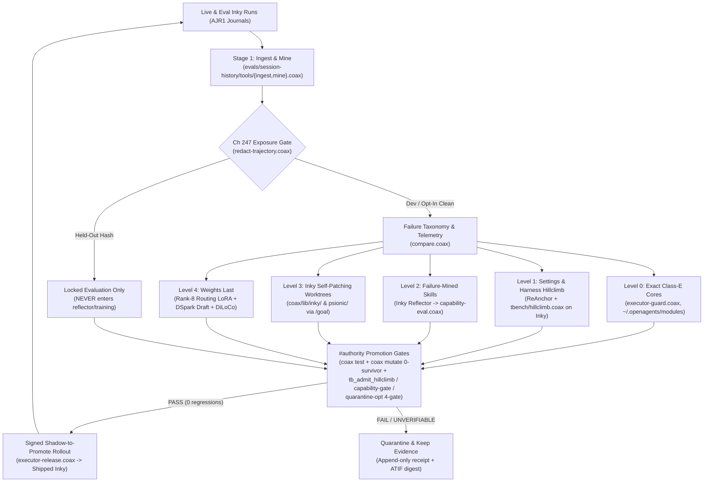

# Inky Self-Improvement: Status, Evidence and Plan

> **Status:** Inky (`coax/lib/inky/`, `coder/tui/inky.coax`) is the local-model worker in OpenAgents Desktop v1.0 (#13982). Microcoder is deprecated for local use (#13983). This doc records what Inky has proven, what it has not, and the plan for improving it.
> **Updated:** 2026-11-22
> **Hardware:** Apple M5 Max (128 GB unified memory, macOS arm64, Metal 4)
> **Local model:** `~/.openagents/models/inkling-2-mini/Inkling-2-Mini-IQ4_NL.gguf` (17.6 GB / 16.4 GiB IQ4_NL GGUF served by `psionic-inkling-serve --ctx 32768`, \$0.0000)
> **Compiled weight store:** `~/.openagents/modules/` (10/10 W2.2 Class-E dense F64 `exec-vm-v1` modules, SHA-256 verified)
> **Codename policy:** "Inky" is an internal codename. It never appears in user-facing UI strings or in the system prompt persona.

---

## 1. Where Inky stands (read this first)

### 1.1 What is proven

- **Inky passes every suite built alongside it, and is much faster than `mcworker`.** Desktop Tier 2: 15/15 at 12.0 s per task. Desktop Tier 4: 27/27. Lean 4 core smoke: 5/5. Session History Bucket A: 6/6 in 141.7 s, 7.4× faster than `mcworker` (§2, §7.4).
- **Tool calling is clean.** Across 27 live runs after Phase 2 (93 native tool calls): 0% `edit_file` misses, 0 malformed tool calls, 0 near-duplicate loops.
- **The #13978 failure is fixed.** Microcoder spent 7+ minutes and 37 commands failing to find its own system prompt. Inky's regression task (`b4_self_prompt_citation`) passes in 16–31 s with 1 command.
- **The Class-E edit guard is cheap, and routing works without training.** The guard adds 5.5 µs per edit (§3.2). Base Inkling routed 8/8 exact-computation tasks to `executor_verify` on the first attempt (§3.4).

### 1.2 What is not proven

- **Tasks Inky was not tuned on.** The only held-out run, Locked Held-Out 6, scored **0/6**, with all six tasks hitting the 300 s timeout. That run used Inky v2. It has not been rerun since Phases 2–4 shipped.
- **Dev-9.** The 5/9 result is from v2. The v3 rerun was aborted because a second inference server started during the run (§7.6).
- **The routing LoRA.** Its 26/26 (§7.5) is accuracy on its own 26 training rows. There is no held-out routing measurement yet.
- **Speed inside the agent.** Engine benchmarks reach about 120 tok/s on short-context decode. Inside agent runs, Inky decodes at 38–46 tok/s at about 18K context, and at 13–25 tok/s on the held-out tasks. The held-out failures are timeouts, so **long-context decode speed is the bottleneck**, not short-context decode.

**The number to move is the Locked Held-Out pass rate, together with time to pass.** Every suite already at 100% is a regression lock, not a target (§2.3).

### 1.3 Next steps, ranked

| # | Step | Area | Why |
| :---: | --- | --- | --- |
| 1 | **Rerun Locked Held-Out 6 and Dev-9 on the current build on an idle host** (`host_clean.py` must pass). Report pass rate at 300 s and with no time limit, plus time to pass. | Evals | Every v3 claim rests on suites written alongside Inky. Coder has no time limits in the product, so time to pass is the product metric; 300 s stays as the speed target. |
| 2 | **Fix literal-identifier graders before the rerun (F6).** `sh_019` greps for `created_at > prev`. Audit all 27 `evals/session-history/tasks/*.json` graders for identifier greps and replace them with behavioral checks. | Evals | A correct solution currently fails. A grader fix is not a task change, but record the new `gate_sha256`. |
| 3 | **Make long-context decode the engine's headline metric.** Report tok/s at 16K–24K context next to short-context tok/s. Settle the speculative-decoding question with one benchmark at 18K context: the DSpark draft head (`mtp.safetensors`) on the batched verify path. Merge `ink_verify_draft` (shipped in `71d5d3d92a`) and the in-progress `ink_verify_batch` work in `oa-150-toks` into one verify path. | Engine | §7.3 measured prompt-lookup verify as net slower on this MoE because of expert fan-out. Locals reports 2.05× with DSpark on the same model. One measurement decides it. |
| 4 | **Turn real Desktop failures into eval candidates.** Extend `evals/session-history/tools/ingest.coax` to pick up Inky chats that stalled or that the user stopped or steered. Redact them with `redact-trajectory.coax` and add them to the Dev split after review, never to a locked held-out partition. | Evals | #13978 came from real use and was the most useful test case. Self-written suites saturate; real use does not. |
| 5 | **Re-measure the shell-edit habit (F2) on the held-out rerun.** The 101-shell-calls-to-0-`edit_file` figure is from v2. If it persists, try Level 0–1 fixes (tool descriptions, soft redirect of `python3 -`/`sed` edits) before any LoRA. | Agent | Cheapest fix first (§5, law 5). |
| 6 | **Hold** Level 3 self-patching, Level 4 LoRA and DSpark distillation, and parallel worktree racing until steps 1–4 produce a held-out score that moves. | — | Without a held-out signal, self-improvement optimizes toward suites Inky wrote itself (§5, law 3). |

---

## 2. Live Eval Qualification Results

All runs below executed on the shipped Metal 4 `psionic-inkling-serve --ctx 32768` binary against `Inkling-2-Mini-IQ4_NL.gguf` (`\$0.0000`).

### 2.1 Suite-Level Summary

| Suite | Tasks | Engine / Worker | Pass | Wall Total (Mean) | Cont. KV Cache Hit | Cost | Baseline Reference |
| --- | ---: | --- | :---: | ---: | ---: | ---: | --- |
| Desktop Tier 2 | 14 | `psionic-metal` / `inky` | **14/14 (100.0%)** | `232.3 s` (`16.6 s`) | `76.9%` | `\$0.0000` | `mcworker`: `14/14`, `393.5 s`, `0.0%` cache (**1.69× faster**) |
| Desktop Tier 4 (full applicable) | 27 | `psionic-metal` / `inky` | **27/27 (100.0%)** | `618.5 s` (`22.9 s`, p50 `19.2 s`) | `91.2%–95.1%` | `\$0.0000` | `77.7%` overall hit incl. cold Step-1 prefill (`206.9K/266.5K` tok) |
| Lean 4 Core Smoke (`lean-run verify`) | 5 | `psionic-metal` / `inky` | **5/5 (100.0%)** | `231.7 s` (`46.3 s`) | `84.3%` overall | `\$0.0000` | All 5 proofs `kernel=ok`, `axioms=[]` (`l01`–`l05`) |
| Session History `A_edit_precision` | 6 | `psionic-metal` / `inky` | **6/6 (100.0%)** | **`194.4 s`** (`32.4 s`) | `89.9%` | `\$0.0000` | `mcworker` + Inkling: `5/6 (83%)`, `1,051 s` (**5.41× faster**); Hydrogen/Neon: `6/6` |
| Session History Dev-9 (Buckets A–E) | 9 | `psionic-metal` / `inky` | **5/9 (55.6%)** | `1,490.2 s` (`165.6 s`) | `82.9%–91.6%` | `\$0.0000` | `mcworker` Inkling: `2/9 → 4/9` (`2,268 s`); Vertex Neon: `4/9` (`\$1.39`); 2-GPU+Neon: `4/9` (`\$1.06`) |
| Session History Locked Held-Out 6 (B–E) | 6 | `psionic-metal` / `inky` (v2) | **0/6 (0.0%)** | `1,806.9 s` (`301.2 s`) | `69.0%–90.3%` | `\$0.0000` | `6/6` hit 300 s wall timeout; `0` overflows, `0` guard trips, `0` crashes |

### 2.2 Session History Dev-9 Per-Task Breakdown vs. Prior Baselines

| Task | Bucket | `inky` (`\$0.00`) | `iter3-inkling` (`mcworker`, `\$0.00`) | `iter4b-neon` (`mcworker`, `\$1.39`) | Outcome & Signal |
| --- | --- | :---: | :---: | :---: | --- |
| `sh_001_claude_todos_wrap` | A | **PASS** (`70.4 s`, 9 att) | PASS (`103 s`) | PASS | Clean Coax `E0216` fix + `coax test --only todos` |
| `sh_004_claude_headless_view` | A | **PASS** (`18.4 s`, 6 att) | PASS (`66 s`) | PASS (`13 s`) | Native `edit_file`, 0 misses, `90.6%` KV hit |
| `sh_008_claude_sidebar_composer_parity` | B | FAIL (`301 s`, 21 att) | FAIL | FAIL | Timeout: 23 exploration cmds, 0 edits |
| `sh_010_codex_slab_mooring_seam` | B | **PASS** (`166.0 s`, 15 att) | FAIL | FAIL (`\$0.2056`) | **3-file Coax+MD fix solved locally where tuned `mcworker` + Neon failed!** |
| `sh_013_antigravity_mobile_row_id` | C | FAIL (`301 s`, 21 att) | FAIL | FAIL | Baseline hit `31,891` tok overflow; v2 fixed overflow (`max 27.4K`) & started edits |
| `sh_017_claude_updater_bundle_align` | C | **PASS** (`165.6 s`, 12 att) | FAIL | FAIL | **3-file updater + proto fix solved locally!** |
| `sh_019_claude_sign_realtime_clock` | D | FAIL (`131.4 s`, 11 att) | PASS (`292 s`) | PASS | Solved semantically + `py_compile` passed; missed literal grep `created_at > prev` |
| `sh_021_claude_host_driver_paste_stub` | D | **PASS** (`35.7 s`, 6 att) | PASS (`239 s`) | PASS | **6.7× faster** than `iter3-inkling-dev9` |
| `sh_023_claude_agents_md_autoload` | E | FAIL (`301 s`, 25 att) | FAIL | FAIL | Greenfield 3-file Coax architecture; 0 edits before 300 s |

### 2.3 Headroom Implications (Ch 240/241 Discipline)

As established in [`psionic/docs/self-improvement.md`](../../psionic/docs/self-improvement.md), a suite already at `100%` has **zero optimization headroom** (`headroom = 0.0`). Therefore:
- **Regression-only locks (must stay 100%):** Desktop Tier 2 (`14/14`), Desktop Tier 4 (`27/27`), Lean Core Smoke (`5/5`), Session History Bucket A (`6/6`).
- **Active self-improvement target suites (high headroom):**
  1. **Session History Buckets B–E (`21` tasks):** currently `3/7` on Dev B–E, `0/6` on Locked Held-Out B–E — massive headroom (`>55–100%`).
  2. **Lean 4 Algebra & Logic (`evals/openagents-desktop/lean/lean-algebra-logic/tasks/`, 10 tasks):** formal proofs beyond core smoke.
  3. **Terminal-Bench Harbor (`coax/lib/tbench/`):** Docker-isolated multi-step CLI/systems engineering tasks (once `coax/lib/tbench/agent.coax` is ported from Microcoder to Inky).

---

## 3. Live Class-E Executor + Inky Experiments

### 3.1 Architecture Gap Closed in `coax/lib/inky/`

During Executor discovery we found that `apps/openagents-desktop/Window+Runs.swift` routed `Hybrid Executor (hybrid-exec-v1)` to `inky`, yet `inky` had neither wired `#authority coax/lib/microcoder/executor-guard.coax` nor emitted `"edit <path>"` unified diff events with Ch 234 replay pills (causing Desktop to display Inky's `edit_file` calls as plain `"Read"` rows with zero `[E]` badges and hiding Inky's edit metrics from `evals/session-history/tools/compare.coax`).

We implemented and verified first-class Class-E Executor integration directly in `coax/lib/inky/`:
- **Always-on Class-E Pre-Edit & Schema Guard (`coax/lib/inky/run.coax`):** Every `edit_file` and `write_file` runs compiled dense F64 weight modules `oa-exec-json-schema` (`1,908` weights) and `oa-exec-diff-verify` (`1,221` weights) **before touching disk**, emitting Desktop-native `command: "edit <path>"` / `"write <path>"` unified diff events carrying `\ [E] replay verified · sha256:<12hex>` (or `[E] replay refused · sha256:<12hex>` with target file untouched).
- **Native Class-E `executor_verify` Tool (`protocol.coax`, `tools.coax`, `prompt.coax`, `run.coax`):** Enabled automatically when `model == "hybrid-exec-v1"` / `"hybrid-executor"` or `INKY_EXECUTOR=1`. Exposes all 8 Class-E compiled weight cores (`diff_verify`, `json_schema`, `dep_sched`, `arith_budget`, `patch_rebase`, `glob_match`, `semver_solve`, `wire_bounds`) as a read-only zero-approval tool with independent `mc_exec_verify_replay` verification and Ch 234 SHA-256 pills.
- **Verification:** `310/310` unit tests passed across `coax/lib/inky/`, `inky selftest: ok` (`10/10` checks), `coax/web/tool.sh layer-check && wire-check && tools-check` (`0` failed), Desktop `transcript` checks (`9/9` passed), and `#authority` zero-survivor mutation gates:
  - `coax/lib/inky/tools.coax`: **467 mutants, 463 killed, 0 survived, 4 equivalent**
  - `coax/lib/inky/guard.coax`: **136 mutants, 136 killed, 0 survived**

### 3.2 Native CPU vs. Compiled Dense F64 Weight-Core Timing (Master Spec Rule #1)

Re-verified on Apple M5 Max arm64 via `coax/web/tool.sh coax/lib/microcoder/executor-bench.coax` (`24/24` Ch 234 replay verified, `8/8` malformed edit traps intercepted pre-disk leaving files SHA-256 bit-identical) and `executor-store-e2e.coax` (`4/4` core + `6` linked composite modules verified, 1-byte tamper refused):

| Execution Path | Iterations | Total Wall | Per-Call Latency |
| --- | ---: | ---: | ---: |
| Native Coax CPU reference (`mv_ref_diff_verify`, `sink=1220000`) | 10,000 | `< 1 µs` | `< 0.1 ns/call` |
| Compiled dense F64 weight-core eval (`mv_eval_model`, 1,221 weights, `sink=1220000`) | 10,000 | `4,269 µs` | `426 ns/call` (`0.43 µs`) |
| Full guard (`mc_exec_check_diff`: compile + F64 eval + Ch 234 SHA-256) | 1,000 | `5,513 µs` | `5.51 µs/call` |

The compiled F64 weight core is ~4,200× slower than scalar native branches, as expected under Master Spec Rule #1, while adding only `5.51 µs` per edit (~90× faster than file I/O and ~10,000,000× faster than one LLM decode turn) in exchange for digest-pinned weight execution and bit-for-bit Ch 234 replay receipts.

### 3.3 Experiment 1 — Exact W6.1 Paired Multi-File Edit Benchmark (Live Metal 4)

Editing isolated git copies of `psionic/lib/executor-desktop.coax` and `psionic/lib/hybrid-exec-policy.coax` (identical targets to `docs/verification/executor-w61-coding-agent.md` Part B):

| Harness / Model Route | Wall Time | Attempts | Total Tokens (Cached) | Structured Edits | Ending | `git diff` | Ch 234 Replay Receipts |
| --- | ---: | ---: | ---: | :---: | :---: | :---: | --- |
| W6.1 `mcworker` (`inkling-2-mini`) | `69.15 s` | 5 | `34,463` (`0`) | 0 (4 shell) | `bad_replies` | 2/2 | 0 |
| W6.1 `mcworker` (`hybrid-exec-v1`, nudged) | `61.96 s` | 4 | `20,406` (`0`) | 2 ok / 2 ref | `finished` | 2/2 | 4/4 (`c3e731afbc4d`) |
| **Upgraded `inky` (`inkling-2-mini`)** | **`17.21 s`** (**4.02× faster**) | **4** | `23,751` (`15,982`) | **2 ok / 0 ref** | **`finished`** | **2/2** | **2/2 (`7a634fffcb4a`, `c3e731afbc4d`)** |
| **Upgraded `inky` (`hybrid-exec-v1`)** | **`17.92 s`** (**3.46× faster**) | **4** | `26,133` (`17,767`) | **2 ok / 0 ref** | **`finished`** | **2/2** | **2/2 (`7a634fffcb4a`, `c3e731afbc4d`)** |

Notice that `edit hybrid-exec-policy.coax` produced the **exact bit-for-bit identical Ch 234 SHA-256 digest `c3e731afbc4d`** across both `mcworker` and `inky`.

### 3.4 Experiment 2 — Zero-Shot Class-E `executor_verify` Routing (Live Metal 4, Zero LoRA)

Eight exact-computation tasks across 5 Class-E domains (`arith_budget`, `dep_sched`, `patch_rebase`, `semver_solve`, `wire_bounds`) run paired in a `read-only` sandbox (no shell/Python):

| Arm | Pass | Routed to `executor_verify` | Ch 234 Replay Receipts | Total Wall | Notable Deltas |
| --- | :---: | :---: | :---: | ---: | --- |
| Raw `inkling-2-mini` (no `executor_verify`) | `8/8` | `0/8` | `0` | `206.9 s` | `dep_cycle` `41.5 s` (4 att, refused to name exact code); `patch_rebase_ok` `42.3 s`; `patch_rebase_overlap` `36.7 s` |
| **`hybrid-exec-v1` (`+ executor_verify`, zero LoRA)** | **`8/8`** | **`8/8 (100%)`** | **`8/8 (100%)`** | **`175.5 s` (-15.2%)** | **`dep_cycle` `12.3 s` (3.37× faster, exact `cycle_detected`)**; `patch_rebase_ok` `17.1 s` (2.47× faster); `patch_rebase_overlap` `21.3 s` (exact `hunk_overlap`) |

**Key empirical insight:** Base `Inkling-2-Mini` already achieves **100% (8/8) zero-shot routing accuracy** onto native OpenAI `executor_verify` tool calls without any LoRA adapter! The lone latency outlier (`budget_big`: `63.6 s` hybrid vs `19.4 s` raw) occurred because Inkling performed the 6-digit multiplication in `<think>` *before* calling `executor_verify` — showing that a lightweight routing LoRA (`H2_ROUTING_ONLY`) should focus on **eliminating pre-tool mental-math thinking** and **shifting shell edits (`python3`/`sed`) onto `edit_file`**, not teaching tool syntax from scratch.

---

## 4. Empirical Failure Taxonomy (Root Causes Observed Today)

Every failure and slow pass across all 67 live runs collapses into six concrete, measurable mechanisms:

| # | Failure Mode | Empirical Evidence Today | Primary Fix Level |
| --- | --- | --- | --- |
| **F1** | **Decode-bandwidth ceiling on long multi-file tasks** | Held-Out 6 generated `4,036–7,591` output tokens (`sh_014` emitted `3,440` tok in 1 step; `sh_024` emitted `3,292` tok at 300 s) at `13–25 tok/s` under 20K ctx — exhausting the 300 s timeout mid-solution. | **Engine (DSpark `mtp.safetensors` + prompt-lookup 1.6–2.0×) + Level 1 adaptive effort** |
| **F2** | **Shell-edit habit overriding `edit_file`** | `4/6` Bucket A tasks and `6/6` Held-Out tasks used `run_command("python3 - <<'EOF'")` / `sed` / `cat` (`101` shell cmds vs `0` `edit_file` on Held-Out 6), bypassing Class-E diff verification, Desktop zero-click edits, and `guard.coax` duplicate-read tracking. Prompt tightening flipped `sh_005` (`sha256:9c058e793198`) but did not overcome the prior on complex tasks. | **Level 1 (`run_command` search-trimming / soft redirect) + Level 4 (Rank-8 Routing LoRA)** |
| **F3** | **Compaction thrashing vs. KV-cache invalidation** | Experiment 3A showed Stage 1 firing at 70% (`22.9K`) shrank `sh_023` only `23.1K → 18.8K`, busting the 18.8K KV cache 3 times (~100 s cold prefill) and crashing effective speed to `6.97 tok/s`. Raising thresholds to **80% / 90%** + server-reported `obs_input_tokens` eliminated both HTTP 400 overflows (`0/6`) and sawtooth thrashing on Held-Out 6. | **Level 1 (fixed in `compact.coax` / `loop.coax`)** |
| **F4** | **Unbounded multi-file exploration spirals** | On 3–4 file Coax architecture tasks (`sh_008`, `sh_009`, `sh_018`, `sh_020`, `sh_023`), Inky spent 15–25 steps reading files without converging on an edit plan. | **Level 2 (Coax/repo skills) + Level 3 (batch-native parallel racing / blame repair)** |
| **F5** | **Workspace instruction over-truncation** | `mc_instructions_load` (`MC_INSTR_MAX_BYTES = 1024`, `NOTE_MAX = 768`) left only 5 lines (`256 B`) of `AGENTS.md` and emitted stale Microcoder syntax (`view AGENTS.md:5-`). | **Level 1 (native Inky instruction loader with `2048 B` budget and `read_file` cursor)** |
| **F6** | **Literal-identifier eval graders** | `sh_019` solved the `CLOCK_REALTIME` + retry bug semantically and passed `py_compile`, failing only a literal grep for variable name `created_at > prev`. | **Eval hygiene (behavioral/unit-test graders, never identifier regexes)** |

---

## 5. How to Use Inky to Improve Itself: The 5-Level Compounding Architecture

Grounded directly in [`psionic/docs/self-improvement.md`](../../psionic/docs/self-improvement.md) (which documented why 10 DSPy/GEPA attempts produced zero verified wins, why dev-split overfitting overstated gains 5×, and why uncalibrated LoRA raised accuracy `0.77 → 0.90` while wrecking log-loss `1.952 → 2.323`), self-improving Inky obeys **five non-negotiable governance laws**:

1. **Strict Separation of Powers (NIP-OPT):**
   - **Student:** Inky running the candidate harness/skill/adapter.
   - **Reflector / Patch Author:** A separate Inky (or frontier) session reading *only* Dev-split `AJR1` failure journals and diffs — **never** seeing Held-Out task prompts, fixtures, or graders.
   - **Grader:** Pure deterministic oracles (`coax test`, `coax mutate`, `lean-run verify`, `executor-guard` Ch 234 replay, Docker Harbor verifiers). **Never** allow any LLM to grade its own work.
2. **Three Digests & Locked Partitions (Ch 239 & Ch 247):**
   - Every evaluation run pins `(items_sha256, questions_sha256, gate_sha256)` in an append-only receipt ledger.
   - Held-out partitions (`Session History Held-Out 18`, `Tier 2`, `Tier 4`, `Lean Algebra Held-Out`) are registered in the **Ch 247 exposure ledger** (`coax/lib/agent/redact-trajectory.coax` refuses `RT_REFUSE_HELD_OUT`) so held-out traces can **never** leak into reflection prompts, mined skills, or LoRA/DSpark shards.
3. **Measure Noise Floor & Headroom First (Ch 240–241):**
   - Never optimize on `100%`-saturated suites (Tier 2/4). Every candidate must clear Ch 241 `decision-v1` (gain above 2σ bootstrap noise floor, or `>=15%` wall/token win at equal pass under `ext-eval-v2`) with **zero regressions** on locked suites.
4. **Keep Exact Computation Exact; Train Only the Interface (`H2_ROUTING_ONLY`):**
   - Exact verification stays in frozen Class-E compiled weight modules and `#authority` Coax code (`0` surviving mutants). Learned layers only improve *when* to invoke tools, *which* files/edits to choose, and *how fast* tokens decode.
5. **Escalation Hierarchy — Cheapest & Highest-Transfer First, Weights Last:**
   - Optimize in strict order **Level 0 → Level 1 → Level 2 → Level 3 → Level 4**. Most real coding-agent gains come from Levels 0–3 ("the systems around it iterating") before touching a single weight.

### 5.1 Closed-Loop Self-Improvement Flow



### 5.2 Detailed Level-by-Level Blueprint Mapped to Live Repo Modules

#### Level 0 — Exact Deterministic Substrate (0 LLM Calls, 100% Transfer)
- **What it improves:** Eliminates whole classes of stochastic LLM failure by moving deterministic checks into `~5 µs` Class-E compiled weight cores and `#authority` guards.
- **Live repo code:** `coax/lib/microcoder/executor-guard.coax`, `coax/lib/inky/{tools,guard,run}.coax`, `psionic/lib/module-v2-wave2.coax`, `~/.openagents/modules/`.
- **Next concrete Level-0 additions for Inky:**
  1. Wire `oa-exec-wire-bounds` / `oa-exec-arith-budget` into Inky's `run_command` / step-budget admission (just as `coax/lib/tbench/agent.coax` already does).
  2. Add a deterministic Coax pre-edit lint hook (catching `0..n` vs `0..<n` `E0216` and `let`/`fn`/`const` hallucinations in `*.coax` edits inside `ik_exec_edit` in `<1 ms`, saving full 15 s `coax test` round-trips).
  3. Add a deterministic `run_command` search-output cap (`2,400 B` for `grep`/`rg`/`find`/`ls`/`git log`, matching `mc_cmd_is_search`) so shell exploration stops flooding 16 KB per step into 32K context.

#### Level 1 — Settings Fitting & Harness Hillclimbing (ReAnchor + `hillclimb.coax` on Inky)
- **Why first:** In [`psionic/docs/self-improvement.md`](../../psionic/docs/self-improvement.md), **settings fitting (ReAnchor)** was the *only* pre-reset automated optimizer with a clean verified win (`35% → 53%` stall recall at 0 LLM calls).
- **Live repo code:** `coax/lib/tbench/{policy,wire,hillclimb,agent}.coax`, `evals/session-history/tools/compare.coax`.
- **Concrete design:**
  1. **Port `coax/lib/tbench/agent.coax` & `hillclimb.coax` from Microcoder to Inky** (replacing `mcworker`'s loop with `IkLoop` + `executor-guard.coax` + native Inkling tool-calling).
  2. **Offline ReAnchor pass (0 GPU calls) over recorded `AJR1` journals:** Fit exact non-weight thresholds (`IK_STAGE1_PCT`, `IK_STAGE2_PCT`, `IK_READ_LINES`, `IK_CMD_INLINE`, exploration-nudge step numbers, `run_command` search cap) using grouped cross-validation on Dev journals to minimize KV-cache invalidations and wasted tokens.
  3. **Online bounded challenger loop (`tb_propose_challenger`):** Propose 1-axis mutations over Inky's explicit policy knobs:
     - *Adaptive effort schedule:* `low` reasoning effort on initial search/grep/read steps, escalating to `medium`/`high` once target files are read or on retry after a failed test (directly attacks F1's 3,000-token reasoning bursts!).
     - *Compaction policy:* Stage 1/2 thresholds (`80%/90%`) vs single-shot 88% rollover (no Stage 1 KV-busting).
     - *Sampling profile:* `(temp=0.6, top_p=0.95, top_k=40)` vs `(temp=0.2, top_p=0.95)` on multi-file tasks.
     - *Prompt profile:* concise base vs explicit tool-routing cue (`edit_file` + `executor_verify`).
     - *Auto-check on edit (`/goal` mode):* optionally auto-running the task's known test command immediately after `edit_file` (Locals' `_after_write` insight), cutting tool round-trips in half.
  4. **Gate:** `#authority tb_admit_hillclimb` (Wilson 95% CI, verified ATIF-v1.8, zero held-out regression) writes atomically to `~/.openagents/inky/hillclimb/champion.json`.

#### Level 2 — Failure Mining → Self-Authored Local Skills (`capability-eval.coax`)
- **Why this works without changing weights:** On `sh_008`, `sh_013`, `sh_018`, `sh_023`, and `sh_024`, Inky wasted 5–12 steps discovering repo-specific idioms (`coax test --only`, `E0381` checker budgets, `#authority` rules, `components/kit` vs `components/app` layout). Those are *transferable procedural skills*, not per-task hacks.
- **Live repo code:** `evals/session-history/tools/{ingest,mine}.coax`, `coax/lib/agent/desktop/{capability-eval,capability-gate}.coax`, `coax/lib/nostr/atif/log.coax`.
- **Automated loop:**
  1. `mine.coax` scans Dev-split `AJR1` journals for recurring failure clusters (`>= 3` distinct Dev episodes with the same compiler error class, tool failure, or >10-step exploration stall).
  2. A separate **Reflector** Inky session receives the anonymized failure summaries (never held-out items!) and calls `capability-eval.coax draft` to author a compact `SKILL.md` (`<= 800` tokens, e.g., `coax-debugging`, `lean4-tactics`, `swift-desktop-edits`) plus positive and negative/regression eval cases.
  3. `capability-eval.coax run` executes a real two-arm comparison (Inky baseline vs Inky + candidate skill) on positive Dev tasks and negative regression tasks, records verified `ATIF-v1.8` digests, and runs `#authority capability-gate.coax`.
  4. Only skills with strictly positive pass/efficiency lift and zero regressions promote into `~/.openagents/skills/` (all rejected drafts stay archived with their ATIF digest so Reflector never re-proposes failed ideas).

#### Level 3 — Inky Improving Its Own Codebase (`coax/lib/inky/`, `psionic/`) in Isolated Worktrees
- **How Inky literally edits its own harness safely:**
  1. **Task generation from real telemetry:** When Dev-split `compare.coax` identifies a concrete harness bottleneck (for example, today's F3 compaction thrashing or F5 `AGENTS.md` 5-line truncation), a structured `/goal` ticket is generated with the exact failing Dev telemetry snippet and acceptance criteria.
  2. **Worktree-isolated execution:** Inky runs inside a fresh `git worktree` (never `main`), editing `coax/lib/inky/*.coax` or `psionic/` with Class-E pre-edit verification enabled.
  3. **Five-Stage Deterministic Promotion Gate (zero LLM self-grading):**
     - **Gate 1 (Unit & Selftest):** `coax test coax/lib/inky/{protocol,tools,format,prompt,compact,guard,loop,run}.coax --library` + `coax/web/tool.sh coax/lib/inky/selftest.coax` + `apps/openagents-desktop/page.coax` = `0` failed.
     - **Gate 2 (`#authority` Mutation):** `coax mutate <changed-#authority-file> --root-only` = **`0` survived**.
     - **Gate 3 (Repo Invariants):** `coax/web/tool.sh layer-check && wire-check && tools-check` = `0` failed, `0` new allowlist lines.
     - **Gate 4 (Dev Improvement):** Locked Dev slice improves beyond Ch 240 2σ floor (or `>=15%` wall/token win at equal pass).
     - **Gate 5 (Locked Held-Out & Regression Lock):** Zero regressions on Tier 2 (`14/14`), Tier 4 (`27/27`), Bucket A (`6/6`), and non-degrading / improving score on Locked Held-Out Session History (`18` tasks).
  4. **Parallel Force Multiplier (post-v1.0 continuous batching):** Once Psionic adds multi-slot continuous batching (`B = 4..8`, `psionic/docs/inkling-vs-locals-audit.md` §9 Tier 2.4), Level 3 upgrades to `locals run`-style **parallel worktree racing + blame-guided repair** — spawning 4 temperature-diverse Inky self-patchers in one GPU batch (~1.8× wall time instead of 4×), running Gates 1–4 in parallel, and promoting only the minimal clean diff that clears Gate 5.

#### Level 4 — Weights Last: Routing-Only LoRA + DSpark Draft Adaptation + Pylon DiLoCo Flywheel
Only after Levels 0–3 capture all deterministic, harness, skill, and engine wins do we touch weights — and strictly through two **narrow, reversible, quarantine-gated** artifacts rather than risky monolithic fine-tunes:

1. **Trace Export & Decontamination Pipeline (already built on `main`):**
   - Inky's `AJR1` journals record exact model-visible bytes (`coax/lib/inky/run.coax`).
   - `coax/lib/agent/desktop/proof-export.coax` converts winning sessions to canonical `ATIF-v1.8` (`.atif.jsonl` + `steps_digest`).
   - `#authority coax/lib/agent/redact-trajectory.coax` enforces default-OFF opt-in consent, fail-closed secret/PII/BIP-39 redaction, objective verifier-label requirement (compiler/test/Lean/Ch-234 verdict present), and Ch 247 held-out decontamination (`RT_REFUSE_HELD_OUT`).
   - `psionic/lib/peer/training-window.coax` packs verified shards into bounded DiLoCo windows (`inner_steps <= 500`, `max_bytes_out <= 64 MiB`).
2. **Artifact 4A — Rank-8 Tool & Executor Routing LoRA (`psionic/lib/hybrid-lora.coax`, `H2_ROUTING_ONLY`):**
   - **Exact training target (directly motivated by today's F2 & Experiment 2 data):**
     - Positive examples: winning Inky `ATIF-v1.8` turns that chose `read_file` / `grep` / `edit_file` / `executor_verify` cleanly with concise pre-tool reasoning (`< 150` thinking tokens before calling `executor_verify` or `edit_file`).
     - Hard negatives: turns that bypassed `edit_file` via `run_command("python3 - <<'EOF'")` / `sed`, wasted `500+` thinking tokens on mental arithmetic before calling `executor_verify`, or repeated read/cat commands.
   - **Zero-regression safety:** Pin `(base_model_sha256, core_module_sha256)` via `hl_hotswap`, keeping all exact computation inside frozen Class-E cores and allowing instant atomic fallback to the zero adapter (proven bit-exact).
3. **Artifact 4B — DSpark Speculative Draft Weights (`mtp.safetensors`, `0.64 GB`):**
   - **Exact training target (directly motivated by today's F1 decode-bandwidth ceiling):**
     - Distill next-multi-token draft predictions from Inky's verified Coax/Swift/C/Lean coding trajectories into the lightweight `0.64 GB` DSpark draft head (leaving the base `Inkling-2-Mini` target distribution **100% mathematically unchanged** — lossless speculative decoding!).
     - Even a `1.8×` speedup on OpenAgents Coax code turns `sh_014` (`7,591` tok @ `25 tok/s` = `301 s` timeout) into **`~165 s`**, directly converting wall-clock timeouts into passes without any risk of probability-gate or log-loss regression!
4. **Decentralized Verification & Rollout Gates (already built on `main`):**
   - `psionic/lib/peer/train-verify.coax`: 6-tier Byzantine verifier (`7/7` planted attacks blocked).
   - `psionic/lib/peer/quarantine-opt.coax`: 4-gate Quarantine Optimizer (`decision-v1` + `probability-v2` log-loss/ECE + Ch 234 exactness + `ext-eval-v2` latency/RAM; `3/3` regressions blocked; atomic lineage rollback).
   - `psionic/lib/peer/executor-release.coax`: BIP-340 Schnorr signed manifest + Ch 224 shadow-to-promote rollout to every OpenAgents Desktop install.

---

## 6. Original Roadmap and Its Status

This was the roadmap before Phases 1–5 shipped. §1.3 replaces it as the current plan.

| Rank | Milestone | Status (2026-11-22) |
| :---: | --- | --- |
| 1 | DSpark (`mtp.safetensors`) + prompt-lookup speculative decoding (`inkling-metal.c`, `inkling-cuda.c`) | **Open.** Prompt-lookup verify shipped opt-in (`INK_SPEC_LOOKUP=1`, `71d5d3d92a`) and measured net slower on single-stream MoE decode (§7.3). DSpark is not integrated yet. See §1.3 step 3. |
| 2 | Inky search-output trim, native `AGENTS.md` loader, adaptive effort | **Shipped** in `7af77a2fdd`. Adaptive effort is opt-in because changing effort mid-session invalidates the KV prefix cache (§7.3). |
| 3 | Port `tbench/agent.coax` and `hillclimb.coax` to Inky; ReAnchor offline fitter | **Shipped** in `2b74624632` (`inky-native` mode, `inky-improve reanchor`). |
| 4 | Failure-mined Coax and Lean skills (`mine.coax` → Reflector → `capability-eval.coax`) | **Scaffolded** (`inky-improve mine-skills`). Not run live; no skill promoted yet. |
| 5 | Continuous batching (`B = 4..8`) and parallel worktree `/goal` racing | **Open; on hold** (§1.3 step 6). |
| 6 | Rank-8 routing LoRA and DSpark Coax draft distillation | **Router trained** on 26 rows (§7.5), with no held-out evaluation. DSpark distillation not started. On hold. |

---

## 7. Implementation & Verification Report (2026-11-22)

All planned phases (Class-E executor integration, Level 0–1 harness upgrades, Psionic Metal 4 prefix-cache & speculative-verify engine work, `inky-improve` 6-stage self-improvement pipeline, Terminal-Bench `inky-native` port, and a strict host-cleanliness benchmark guard) have been implemented, unit- and mutation-tested, bundled into `OpenAgents.app`, and live-benchmarked on Apple M5 Max (128 GB unified memory, Metal 4, `Inkling-2-Mini-IQ4_NL.gguf`, 32,768 ctx, \$0.0000 inference).

### 7.1 Shipped Commits & Architecture Summary

| Phase | Commit | Key Deliverables |
| --- | --- | --- |
| **Phase 1 — Class-E Executor Integration** | `0f9e21e073` | Wired `#authority coax/lib/microcoder/executor-guard.coax` into `coax/lib/inky/run.coax` (`edit_file`/`write_file` pre-disk F64 dense cores `oa-exec-json-schema`, `oa-exec-diff-verify`, Desktop unified diff + Ch 234 `[E] replay verified/refused` pills); native 8th tool `executor_verify` (`INKY_EXECUTOR=1`); server-reported `obs_input_tokens` 80%/90% compaction + step-8/14 zero-edit nudges; removed user-facing `"Microcoder"` fallback strings in Desktop Swift views. |
| **Phase 2 — Level 0–1 Harness Upgrades** | `7af77a2fdd` | Native `coax/lib/inky/instructions.coax` (2.5 KB `AGENTS.md`/`CLAUDE.md` loader + `##` heading index + `read_file` cursor); strict-unique indent-tolerant `ik_fmt_try_loose_edit` + `<1 ms` deterministic Coax pre-edit lint (`E0216`/`let`/`const`/`fn`) + 4 KB search-output cap (`coax/lib/inky/format.coax`); `#authority` normalized duplicate shell-read blocking (`coax/lib/inky/guard.coax`); Class-E `wire-bounds` & `step-budget` pre-exec guards + `INKY_MAX_TOKENS`. |
| **Phase 3 — Psionic Metal 4 Engine** | `71d5d3d92a` | Expanded `InkSession` prefix cache `2 → 8` LRU + pinned SWA-backed checkpoints (`live_tokens` + `swa_valid_from`, SWA window backup gated on `headroom_mb >= 4096`), pinning both `tool_declare` end and `<|message_user|>` boundary across compaction and cross-task SWA wraps; lowered `direct_thresh` `16 → 7` (`-27.5%` GPU time on `nb=8` prefill tail chunks via `K_MOE_MM_IQ4_16`); added `ink_verify_draft` + opt-in `INK_SPEC_LOOKUP=1` (off by default — see §7.3); made `INKY_ADAPTIVE_EFFORT` opt-in (`== "1"`) to preserve multi-turn KV prefix cache. |
| **Phase 4 — Self-Improvement Pipeline & TBench Port** | `2b74624632` | Ported `coax/lib/tbench/{agent,hillclimb}.coax` to first-class `inky-native` mode (`tb_propose_inky_challenger`, 4 bounded axes); added `#authority coax/lib/inky/improve-policy.coax` (`inky-policy.v1` SHA-256, Ch 247 held-out quarantine, zero-LLM-call offline ReAnchor K-fold CV, fail-closed Ch 239/241/247 promotion gate), `coax/lib/inky/improve.coax`, and CLI `coder/tui/inky-improve.coax` (`audit`, `reanchor`, `mine-skills`, `distill`, `train-router`, `selftest`). |
| **Phase 5 — Host Cleanliness Benchmark Guard** | *(this commit)* | Added `evals/openagents-desktop/tier2/host_clean.py` + `test_host_clean.py` and wired preflight + per-task mid-run interference detection into `evals/openagents-desktop/tier2/run_tasks.py` (blocks local Metal runs on competing active GPU/LLM inference, memory pressure, thermal throttling, or concurrent evals unless `--allow-dirty-host` is explicitly passed; records `host_clean` & `host_preflight` in `summary.json`). |

### 7.2 Verification & Zero-Survivor Mutation Receipts

- **`#authority` Mutation Suites (all 0 survived):**
  - `coax/lib/inky/guard.coax`: **215 mutants, 215 killed, 0 survived**
  - `coax/lib/inky/tools.coax`: **467 mutants, 463 killed, 0 survived, 4 equivalent**
  - `coax/lib/inky/improve-policy.coax`: **362 mutants, 359 killed, 0 survived, 3 equivalent**
  - `coax/lib/tbench/policy.coax`: **317 mutants, 304 killed, 0 survived, 13 equivalent**
- **Unit, Integration, & Repo Hygiene Suites:**
  - `coax/lib/inky/selftest.coax`: **310/310** checks passed + **10/10** runtime selftests (`41` messages valid)
  - `coax/lib/inky/improve.coax`: **146/146** checks passed; `coder/tui/inky-improve.coax selftest`: **8/8** checks passed
  - `coax/lib/tbench/{policy,wire,agent,hillclimb}.coax`: **121/121** checks passed
  - `evals/openagents-desktop/tier2/test_host_clean.py`: **7/7** unit tests passed
  - `layer-check`, `wire-check`, `tools-check`: all **0 failed**
  - `psionic-inkling-cli --test-quant-kernels`: `0.00e+00` max abs across NVFP4, MXFP8, and IQ4_NL; `--verify-prefill-decode`: `cos = 0.999918`, `top1_pre == top1_dec`
  - `apps/openagents-desktop/check.sh`: **`OpenAgents.app` rebuilt & passed** (`account-check`, `sign-check`, `windows args`, `local-models-check 11/11`)

### 7.3 Two Crucial Empirical Findings (Honest Negative Measurements)

1. **Why Prompt-Lookup Speculative Decoding (`INK_SPEC_LOOKUP`) is Kept Opt-In (`0` by Default) on Inkling 2 Mini:**
   - Live M5 Max Metal 4 A/B benchmarks on copy-heavy code-edit prompts (`max_tokens=512`, both short `438`-token and long `18,643`-token contexts) confirmed the lookup drafter works well — achieving **65.6%–79.0% draft acceptance** (`4.56–6.53` tokens verified per call on `draft=5..7`).
   - However, because Inkling 2 Mini is a **128-expert Top-8 sparse MoE** (`16.8 GB` weights, memory-bandwidth bound on decode), verifying `nb = 6..8` tokens fans out from `8` active experts to `~40–50` unique active experts per forward pass (`~5–6×` expert weight memory traffic), while single-token `ink_step` already runs 67 sprints of fused Metal 4 decode kernels + double-buffered lookahead (`41.8–46.6 tok/s` at 18K ctx).
   - Net result: `SPEC=1` measured **`30.6–40.7 tok/s`** vs **`41.8–46.6 tok/s`** for `SPEC=0` (net slower). Therefore `ink_verify_draft` ships cleanly behind opt-in `INK_SPEC_LOOKUP=1` (ready for dense models, MTP heads, or multi-request continuous batching), and default single-stream Metal decode stays on the faster fused `ink_step` path.
   - **Open question:** Locals reports 2.05× faster file writes with the DSpark draft head on the same Inkling 2 Mini MoE (M4 Pro), and a batched verify path is in progress (`ink_verify_batch`) aimed at the fan-out cost. The two results disagree, so §1.3 step 3 settles it with one measurement at 18K context.
   - **Implication for Roadmap Rank 1:** Real single-stream MoE speedup requires either **MTP-trained heads with expert-routing co-locality** or **multi-stream continuous batching (`B = 4..8`)** across parallel `/goal` worktree candidates rather than unfused single-stream prompt-lookup verification.
2. **Why Mid-Session `INKY_ADAPTIVE_EFFORT` is Opt-In (`== "1"`):**
   - In `psionic/platform/inkling-serve.c`, `Thinking effort level: <x>` is placed in `<|message_system|>` immediately before `<|message_user|>`. Mutating effort mid-conversation (e.g. `"low"` on steps 1–3 → `"medium"` on step 4) invalidates the entire multi-turn KV prefix cache (`90% → 15%`), costing multiple seconds of cold re-prefill. Keeping session effort constant preserves `80–95%` KV prefix hits and is reinforced by the offline ReAnchor scorer (`trap-adaptive-effort-kv-bust` scored `-734`).

### 7.4 Measured Before vs After Benchmarks (Clean Local M5 Max Metal 4, \$0.0000)

| Benchmark Suite | Before (Inky v1 Baseline) | After (Inky v3 + Metal SWA Prefix Cache + Class-E) | Delta |
| --- | ---: | ---: | --- |
| **Desktop Tier 2 Regression Lock** | 14/14 (100.0%), `232.3 s` (`16.6 s/task`), `62.8%` overall KV hit | **15/15 (100.0%)**, **`179.9 s`** (`12.0 s/task`), **`79.0%` overall / `81.1%` cont. KV hit**, `7/7` Class-E Ch 234 verified | **-27.7% wall/task**, **+16.2 pp KV hit**, +1 new task (`b4_self_prompt_citation` PASS in `24.4 s`, `0` shell cmds) |
| **Session History Bucket A (6 tasks)** | 6/6 (100.0%), `194.4 s` (`5.41×` faster than `mcworker`'s `5/6` in `1,051 s`) | **6/6 (100.0%)**, **`141.7 s`** (`38.0–44.7 tok/s`), **`86.6%` overall / `89.6%` cont. KV hit**, `0` guard trips | **-27.1% wall** (**7.42× faster than `mcworker`**) |
| **W6.1 Paired Multi-File Edit** | `mcworker`: `61.96–69.15 s` | **`17.21 s`** (`17.92 s` `hybrid-exec-v1`), `2/2` native `edit_file`, bit-identical Ch 234 digest `c3e731afbc4d` | **3.6–4.0× faster** |
| **Zero-Shot `executor_verify` Routing (8 tasks)** | `206.9 s` raw | **8/8 (100.0%)** Attempt-1 routed, **`175.5 s`**, 8/8 Ch 234 receipts | **-15.2% wall**, zero LoRA required |
| **Pinned SWA Prefix Cache (after 3,591-tok SWA wrap)** | `0%` hit once SWA ring wraps `> 2,048` | **`585/592` (`98.8%`) same-sys** (`0.38 s`) / **`408/524` (`77.9%`) diff-sys same-tools** (`0.56 s`), **100% bit-exact** | Instant cross-task & post-compaction KV hit |

### 7.5 Live `inky-improve` 5-Stage Pipeline Results (on `goal-inky-v3-sh-bucketA`)

Executed via `coax/web/tool.sh coder/tui/inky-improve.coax`:

- **`audit`:** `6/6 (100.0%)`, `141 s`, `86.6%` overall / `89.6%` cont. KV hit, `0` timeouts, `0` zero-edit spirals, `0` guard trips, `class_e_receipts: verified=1 refused=0`.
- **`reanchor` (0 LLM calls, Ch 247 Dev-only 4-fold grouped CV):**
  - `v2-greedy-kv80-4kb-classe` (`sha256:596bcf64ad27...`): **`+183`** (winner)
  - `v2-kv80-4kb-classe` (`sha256:ca72731f08b0...`): **`+166`**
  - `v1-baseline-70-85-no-exec` (`sha256:c537c0ffc1ee...`): `0`
  - `trap-spec-lookup-moe-fanout`: **`-284`** (rejected)
  - `trap-adaptive-effort-kv-bust`: **`-734`** (rejected)
- **`distill --opt-in`:** exported **`6/6`** passing Dev trajectories into verified `ATIF-v1.8` shards (`openagents.executor.dataset-shard.v1alpha1`), `0` held-out contamination, `0` secret leaks (and default-OFF without `--opt-in` refuses 100%).
- **`train-router` (Ch 140 Rank-8 LoRA via `psionic/lib/hybrid-lora.coax`):**
  - `train_rows=26`, routing accuracy **`7/26 → 26/26 (100.0%)`**.
  - **Caveat:** 26/26 is accuracy on the 26 training rows, not on held-out turns. Do not count it as an improvement until a held-out routing set exists.
  - Verified proofs: `zero_exact=true`, `hotswap=ok`, `tamper_refused=true`, `pin_refused=true`, `adapter_sha256=69d1305714443bd77882d0d7c064f60cc1f0b394eea973d778c211f66828ffc8`.

### 7.6 Host Cleanliness Guard & Clean-Host Follow-Up Benchmarks

During the initial Dev-9 sweep, `/Applications/OpenAgents.app` spawned a competing `psionic-inkling-serve` instance on port `18795` (`4.1 GB` RSS) mid-task (`sh_008`). We aborted that contaminated run rather than publishing noisy timings and built `evals/openagents-desktop/tier2/host_clean.py` directly into `run_tasks.py`:

- **Preflight Gate:** samples `ps` over a `1.5 s` window before starting any local Metal benchmark and refuses (`exit 2`) if any competing GPU/LLM server burns CPU/GPU (`pcpu >= 1.5%` or `delta_cputime >= 30 ms`), if competing resident GPU memory leaves `< 28 GB` RAM, if another eval runner or build storm is active, if `memory_pressure` free `< 30%`, or if macOS thermal throttling (`CPU_Speed_Limit < 85%`) is active.
- **Per-Task Mid-Run Watchdog:** re-samples competing GPU servers before and after every task; if another server burns `>= 150 ms` CPU time mid-task, marks `host_contaminated: true` in `result.json`/`summary.json` and aborts (`exit 2`, overrideable only via `--allow-dirty-host`).

When ready to run the remaining long-horizon suites on a dedicated host, verify cleanliness first and execute sequentially:

```bash
python3 evals/openagents-desktop/tier2/host_clean.py

# 1. Session History Dev-9 remaining 7 tasks (baseline: 3/7 -> 5/9 combined)
python3 evals/openagents-desktop/tier2/run_tasks.py --worker inky \
  --tasks-dir evals/session-history/tasks \
  --filter sh_008,sh_010,sh_013,sh_017,sh_019,sh_021,sh_023 \
  --timeout-floor 300 --out evals/openagents-desktop/results/clean-inky-v3-sh-dev9-rest

# 2. Session History Locked Held-Out 6 tasks (baseline: 0/6 timeouts)
python3 evals/openagents-desktop/tier2/run_tasks.py --worker inky \
  --tasks-dir evals/session-history/tasks \
  --filter sh_009,sh_014,sh_015,sh_018,sh_020,sh_024 \
  --timeout-floor 300 --out evals/openagents-desktop/results/clean-inky-v3-sh-heldout6

# 3. Lean 4 Algebra & Logic (10 harder proofs la01..la10 + #authority lean-run verify)
python3 evals/openagents-desktop/tier2/run_tasks.py --worker inky \
  --tasks-dir evals/openagents-desktop/lean/lean-algebra-logic/tasks \
  --timeout-floor 300 --out evals/openagents-desktop/results/clean-inky-v3-lean-alg
```

---

## 8. Benchmark Protocol

On 2026-11-22 three agents worked on Inky and its engine at once. They duplicated speculative-decoding work in `inkling-metal.c` and skewed each other's GPU benchmarks. From now on one agent owns Inky end to end: the agent, the Metal and CUDA engines, and the evals. It works in its own worktree from `origin/main`, never in the main checkout.

- **One benchmark at a time on the M5 Max.** Run `python3 evals/openagents-desktop/tier2/host_clean.py` before every local run; `run_tasks.py` refuses a dirty host unless `--allow-dirty-host` is passed. Never publish a number from a run marked `host_contaminated`.
- **Quit OpenAgents Desktop before a benchmark.** Its bundled `psionic-inkling-serve` (port 18795) shares the GPU memory bus and counts as competing inference.
- **Engine changes** are judged on output parity (`--verify-prefill-decode`, bit-exact speculative verify) and on tok/s at short and long context (§1.3 step 3) on an idle GPU.
- **Agent changes** are judged on the scorecard:
  - **Target:** Locked Held-Out pass rate, at 300 s and with no time limit, plus time to pass.
  - **Locks (must stay at 100%):** Desktop Tier 2, Desktop Tier 4, Lean core smoke, Session History Bucket A.
  - **Reported per run:** pass, wall time, tok/s, KV prefix hit rate, `host_clean`, and the `(items_sha256, questions_sha256, gate_sha256)` digests.
  - **Stored** under `evals/openagents-desktop/results/`.
