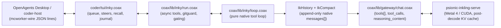

# Inky: Native Agent Harness for Inkling 2.0 (Specification)

**Date:** 2026-11-22  
**Status:** Proposed specification (supersedes Microcoder for local Inkling 2.0)  
**Internal Project Name:** `Inky` *(internal codename only — never user-facing in product UI)*  
**Baseline:** `origin/main` `649e0d4e42`  
**Target Model:** Inkling 2.0 family — starting with **Inkling 2 Mini** (`inkling2_loop`, 26.4B total / 3.4B active looped MoE, `IQ4_NL` GGUF) on **Psionic** (`psionic-inkling-serve`, Metal 4 / CUDA)  
**Related Docs:**
- [OpenAgents v1.0 Specification (Inkling-Only Minimal Release)](../desktop/openagents-v1-spec.md)
- [Microcoder in Coax, and the inference gateways](microcoder.md) *(to be deprecated)*
- [Coder compaction theory](compaction-theory.md)
- [Desktop Evals Specification](desktop-evals-spec.md)
- [Inkling 2 Mini Metal Engineering Report](../../psionic/docs/targets/inkling-metal-report.md)
- [Ch. 270: Tool Calls and Responses for Inkling 2 Mini](../../psionic/book/ch270-tool-calls-and-responses-for-inkling-2-mini.md)

---

## 1. Purpose and Thesis

**Inky** is a clean-sheet coding-agent harness written in Coax (`coax/lib/inky/` + `coder/tui/inky.coax`) designed **specifically around how Inkling 2.0 was trained and how Psionic executes it**, replacing **Microcoder** (`coax/lib/microcoder/` + `coder/tui/mcworker.coax`).

### Why Deprecate Microcoder Instead of Patching It

Microcoder was originally designed as a minimal `route: other` loop for large frontier cloud models (Vertex Gemini) before our gateway supported native multi-turn tool calling. Every step packs the entire conversation, environment, tool log, working memory, and loop notes into **one giant JSON-encoded `user` message** and forces **every reply** — including `"Hello!"` — through a monolithic 9-field strict JSON schema (`next_action`) with GBNF/grammar constrained decoding.

Putting a 3.4B-active local MoE model inside that harness created a compounding spiral of failures:

| Dimension | Microcoder on Inkling 2 Mini | Native Multi-Turn Tool Calling on Inkling 2 Mini |
| --- | --- | --- |
| **Live coding benchmark** | 2/9 (2,098 s) → 4/9 on Dev-9 after 3 commits of prompt patches (`docs/audits/2026-11-21-openagents-desktop-inkling-first-release-audit.md`) | **10/10 PASS in 170.24 s** (median 16.9 s/task, 3–6 turns, 4,678 tokens total across Python/C/JS/Bash in `psionic/docs/targets/inkling-metal-report.md` §2C) |
| **Message structure** | One giant escaped JSON blob (`role: "user"`) rewriting `environment.conversation`, `actions[]`, `memory`, `notes` | Native alternating `<\|message_user\|>`, `<\|message_model\|>`, `<\|message_tool\|>` turns matching pre- and post-training |
| **Tool invocation** | Custom `edits`/`commands`/`view`/`notes`/`todos`/`finished`/`ask` fields inside `next_action` JSON; model ignores `view[]` and falls back to `sed`/`cat`/`grep` via shell | Native `<\|message_system\|>tool_declare<\|content_xml\|>` + `<\|content_invoke_tool_json\|>` + `<\|content_tool_error\|>` |
| **Plain chat & replies** | Forced through strict JSON schema + streaming `"reply"` field extraction (`McReplyStream`) | Native `<\|content_text\|>…<\|content_model_end_sampling\|>` — zero JSON wrapper, zero grammar overhead |
| **KV-cache prefix reuse** | Frequently busted by shifting `environment.conversation`, growing `memory.findings`, and sticky `notes`; pre-decode-only snapshot invalidated on >1K token generations | Strictly append-only token stream + post-decode prefix snapshot → **~90–99% prefix reuse** across steps and turns |
| **Forensic failure (#13978)** | 7+ min, 37 shell commands, 0 `view` calls: `MC_SPILL_SHOW` (4 KB) middle-truncated line 47 (`MC_SYSTEM`) out of `sed -n '1,80p'`; sticky `state.notes` gaslit steps 3–8; `MC_EARLY_NUDGE` ordered edits on read-only questions; `workmem` stored 16 duplicate findings; contradictory commit/push overrides; greedy `temp=0.0` locked exact loops | Eliminated by construction (non-destructive `read_file`, zero sticky notes, zero edit nudges, zero mandatory `notes` field, native sampling) |

**Core architectural decision:** Stop piling local-model band-aids (`MkLocalGuard`, `MC_EARLY_NUDGE`, `MK_LOCAL_GUIDANCE`, `MC_SAFETY_TAIL`, `mc_cmd_view_arg`, `mc_cmd_is_search` 2.4 KB caps) onto Microcoder. Freeze Microcoder in maintenance mode, build **Inky** cleanly from first principles around Inkling 2.0's native training format and Psionic's KV/shortconv cache physics, and retire Microcoder once Inky clears all release gates.

---

## 2. Inkling 2.0 Model Physics: Design Constraints from the Weights

Every design choice in Inky is derived directly from the real checkpoint (`Inkling-2-Mini-IQ4_NL.gguf`) and the Psionic engine (`psionic/platform/inkling-metal.c`, `inkling-cuda.c`, `inkling-serve.c`).

### 2.1 Architecture Geometry (`inkling2_loop`)

From the GGUF metadata of `Inkling-2-Mini-IQ4_NL.gguf`:

| Parameter | Value | Harness Consequence |
| --- | --- | --- |
| Architecture | `inkling2_loop` (24 physical layers; middle 12 layers `6..18` looped `K = 3`, `gate_rank = 64`) | Strong multi-step reasoning inside `<\|content_thinking\|>`, especially with clean tool traces; future per-request variable `K` lever (§9.1). |
| MoE | 128 experts, top-8 active (`128×1.8B`, 26.4B total / 3.4B active) | Fast decode (~44+ tok/s on M5 Max), but sensitive to contradictory system prompts and noisy JSON boilerplate. Keep instructions short, orthogonal, and idiomatic. |
| Attention pattern | **5:1 SWA-to-Full ratio:** 20 physical layers use `sliding_window = 1024` + `shortconv (l_cache = 4)`; only **4 physical layers** (`5, 11, 17, 23`) use full attention | **Local Recency Law:** Anything within the last 1,024 tokens gets all 24 physical layers (×3 loop); older tokens flow only through 4 full-attention layers. Tool results must be compact, self-explanatory, and directly adjacent to the next decision. Never fill the SWA window with repeated boilerplate or duplicate memory dumps. |
| Context scaling | `context_length = 1,048,576`, `log_scale_floor = 8192`, `log_scale_alpha = 0.1`; shipped `--ctx 32768` (~2.8 GiB RSS, 9.3 GiB headroom on 32 GB Macs) | Full KV cache is cheap because only 4 physical layers scale linearly with context. We can preserve real multi-turn history across turns instead of compressing turns into an `environment.conversation` blob. |
| Native sampling | GGUF metadata: `temp = 1.0`, `top_p = 1.0`, `top_k = 50`, `min_p = 0.0` | Pure greedy `temperature = 0.0` (hardcoded in `inkling-serve.c` today) locks a 3.4B-active MoE into verbatim repetition loops. Interactive Inky must sample cleanly (default `temp = 0.6`, `top_p = 0.95`, `top_k = 40`, with `temp = 0.0` strictly for deterministic eval/replay modes). |

### 2.2 Native Special Token Protocol (Tokens `200000..200057`)

Inkling 2 Mini was post-trained with a dedicated multi-channel framing protocol embedded in `tokenizer.chat_template`:

```text
# Tool declarations (emitted once, before system & effort)
<|message_system|>tool_declare<|content_xml|>[{"description":...,"name":...,"parameters":...,"type":"function"}]<|end_message|>

# System prompt
<|message_system|><|content_text|>...<|end_message|>

# Continuous thinking effort (emitted before the first non-system message)
# Map: none=0, minimal=0.1, low=0.2, medium=0.7, high=0.9, xhigh/max=0.99
<|message_system|><|content_text|>Thinking effort level: 0.7<|end_message|>

# Multi-turn user / assistant / tool loop
<|message_user|><|content_text|>...<|end_message|>
<|message_model|><|content_thinking|>...<|end_message|>
<|message_model|>read_file<|content_invoke_tool_json|>{"name":"read_file","args":{"path":"a.coax","start_line":1}}<|end_message|>
<|content_model_end_sampling|>
<|message_tool|>read_file<|content_text|>   1	...<|end_message|>
<|message_model|><|content_thinking|>...<|end_message|>
<|message_model|><|content_text|>Here is what I found...<|end_message|>
<|content_model_end_sampling|>
```

Three native tokens in Inkling 2.0's vocabulary are **currently underused or unused** in our stack and are first-class in Inky:

1. **`<|content_tool_error|>` (token `200022`):** Native error channel for failed tool calls (`<|message_tool|>NAME<|content_tool_error|>...<|end_message|>`). Currently `inkling-serve.c` always emits `<|content_text|>` even on tool errors.
2. **`<|content_thinking|>` (token `200008`) in history (interleaved thinking):** Inkling 2 Mini's chat template explicitly renders `assistant.reasoning_content` inside `<|message_model|><|content_thinking|>…<|end_message|>` before `tool_calls`. Preserving `reasoning_content` across tool steps within an active turn keeps the model's working plan intact *and* preserves exact KV-cache token parity with what the model just decoded.
3. **`<|content_invoke_tool_text|>` (token `200057`):** Present in the checkpoint vocabulary alongside `<|content_invoke_tool_json|>` (`200049`). The server state machine must handle it cleanly (never silently dropping tokens into channel 0 if the model ever emits it).

### 2.3 Psionic KV + Shortconv Prefix Cache Physics

In `psionic/platform/inkling-metal.c` (`ink_prefix_save` / `ink_prefix_restore`, lines 1612–1689):
- Psionic snapshots the exact prompt token IDs, the 3.8 MB recurrent shortconv state (`conv_k`, `conv_v`, `conv_ao`, `conv_fo`), and last-token logits into snapshot slots (`snaps[0..1]`).
- On the next request, `ink_prefix_restore` restores the longest exact matching snapshot **only if** the SWA ring-buffer wrap guard holds:
  ```c
  int oldest_needed = (sp >= hp->swa) ? (sp - hp->swa + 1) : 0;
  if (s->max_pos_written - oldest_needed > swa_cap) continue;
  ```
- **Critical current bottleneck in `inkling-serve.c:1651`:** Today `inkling-serve.c` calls `ink_prefix_save` **only after prefill (`n_prompt`)**, never after decode (`n_prompt + n_gen`). Consequently:
  1. On every tool step, the server has to **re-prefill** the assistant's own thinking and tool-call tokens from scratch.
  2. Worse: at `--ctx 32768`, `swa_cap = hp->swa + prefill_b` (`1024 + 1024 = 2048`). Any single decode step that generates **> 1,024 tokens** (common at `medium`/`high` thinking!) causes `max_pos_written - oldest_needed > swa_cap`, **invalidating the pre-decode snapshot and forcing a 0% cache hit / full cold re-prefill from token 0!**

**Inky + Psionic Co-Design Fix:**
- **Server:** Save a post-decode prefix snapshot at `n_prompt + n_gen` (tracking every decoded token ID in `all_toks[]`) before unlocking `sess_mu`. At `sp = n_prompt + n_gen`, `max_pos_written == sp`, so `max_pos_written - oldest_needed == 1024 <= swa_cap` **always holds**, even after a 4,000-token reasoning step!
- **Harness:** Keep the conversation token stream **strictly append-only** across tool steps *and* across user turns (identical tool schemas, identical system prompt, identical effort header, verbatim assistant `reasoning_content` + canonicalized `tool_calls` within the active turn). Then step `k+1` prefills **only the new `<|message_tool|>` tokens** (typically 50–400 tokens → sub-300 ms TTFT!).

---

## 3. Co-Design Upgrades to Psionic & Gateway

Inky requires small, surgical upgrades to `psionic-inkling-serve` and `coax/lib/gateway/` before building the harness itself. All changes are backward-compatible.

### 3.1 `psionic/platform/inkling-serve.c` (and `inkling-metal.c` / `inkling-cuda.c`)

1. **Post-decode prefix snapshot (P0):**
   - Retain the full token array `all_toks[0 .. n_prompt + n_gen)` during decode and call `ink_prefix_save(sv->sess, all_toks, n_prompt + n_gen, 0)` after the decode loop completes (in slot 1, keeping pre-decode slot 0 for retry/branch cases).
   - Keep `n_prompt + n_gen` tokens strictly aligned with what `format_inkling_prompt` produces when the client sends back the assistant message (`reasoning_content` + `content` + `tool_calls` + `<|content_model_end_sampling|>`).
   - **Canonical tool-call formatting parity:** When `format_inkling_prompt` re-serializes an assistant `tool_calls` entry, serialize keys identically to Inkling's `tokenizer.chat_template` (`sort_keys=true`, compact separators `","` / `":"`) — or, even better, preserve the exact JSON object string when valid — so the post-decode prefix match hits **100%** of the assistant turn's tokens.
2. **Report `cached_tokens` and `reasoning_tokens` in `usage` (P0):**
   - Emit in both SSE final usage chunk and non-streaming responses:
     ```json
     "usage": {
       "prompt_tokens": 2410,
       "completion_tokens": 312,
       "total_tokens": 2722,
       "prompt_tokens_details": {"cached_tokens": 2180},
       "completion_tokens_details": {"reasoning_tokens": 245}
     }
     ```
   - `coax/lib/gateway/chat.coax` (`gw_chat_usage_observed`) already parses both fields! This immediately makes KV-cache hit rates and thinking token overhead observable in Desktop telemetry and Tier 2/4 evals.
3. **Native `<|content_tool_error|>` support (P0):**
   - Look up `sv.tok_tool_error = ink_find_token(sv.sess, "<|content_tool_error|>")` at startup.
   - Parse optional `"is_error": true` on incoming `role: "tool"` messages (and `function_call_output` items).
   - When `m->is_error` is set, emit `<|message_tool|>NAME<|content_tool_error|>CONTENT<|end_message|>` instead of `<|content_text|>`.
4. **Handle `<|content_invoke_tool_text|>` defensively (P1):**
   - Look up `sv.tok_invoke_tool_text = ink_find_token(sv.sess, "<|content_invoke_tool_text|>")` so if Inkling ever invokes a text-argument tool, the stream parser does not drop or leak it into plain text.
5. **Sampling & thinking-loop circuit breaker (P0):**
   - Support request-specified `temperature`, `top_p`, `top_k`, and `seed` (keep server default `0.0` for backwards compatibility with parity tests; Inky explicitly sends `temperature: 0.6, top_p: 0.95, top_k: 40` in interactive mode and `temperature: 0.0, seed: 0` when `INKY_DETERMINISTIC=1`).
   - Add an opt-in lightweight **n-gram repetition detector** inside `channel == 1` (`<|content_thinking|>`) in `inkling-serve.c`: if the exact same 32-token window repeats 4 consecutive times inside thinking, inject `<|end_message|>` (`tok_end_msg`) to close thinking cleanly and force the model to transition to a tool call or final answer instead of looping for 4,000 tokens.
6. **Zero grammar masking on Inky turns (P0):**
   - Inky sends `tools: [...]` and **never** sets `response_format: {type: "json_schema"}`. The RFC 8259 constrained sampler stays in `inkling-serve.c` for explicit structured-output callers only.

### 3.2 `coax/lib/gateway/`

1. **`GwMessage` extensions (`types.coax`, `tool-history.coax`):**
   - Add `reasoning: string` on `GwMessage` (serialized as `"reasoning_content": ...` on `role: "assistant"` when non-empty in `gwt_chat_message`).
   - Serialize `"is_error": true` on `role: "tool"` when `m.result.is_error` is true (guarded by a gateway flag `GW_CHAT_TOOL_ERROR` enabled on `psionic` so third-party strict OpenAI endpoints that reject unknown fields on tool messages remain unaffected).
2. **`GwRequest` sampling fields (`types.coax`, `chat.coax`):**
   - Add optional `has_temp: bool; temperature: f64; top_p: f64; top_k: int; has_seed: bool; seed: int;` — omitted when unset so all existing golden wire tests stay untouched.
3. **Gateway `gw_psionic_native` constructor (`psionic.coax`):**
   - Clean Chat Completions gateway with `GW_CHAT_LEGACY_MAX_TOKENS | GW_CHAT_TOOL_ERROR` and **no** `GW_NO_STRICT_SCHEMA` hint injection (since Inky uses native `tools`, not `schema_hint`).

---

## 4. Inky Architecture & Module Layout

Inky is built in pure Coax with zero heap allocation (fixed caller-owned buffers), `#authority` validation on tool admission and policy boundaries, and full separation between pure state machine and platform I/O (so every invariant runs under `coax test` and `coax mutate` with scripted streams).

### 4.1 Directory & File Layout

```text
coax/lib/inky/
  protocol.coax     # Native Inkling message buffer (IkHistory), append-only prefix invariant,
                    # interleaved thinking retention, MWW_RECALL hydration
  tools.coax        # 7 native tool JSON schemas, strict argument parser (#authority),
                    # path/workspace confinement, clean non-destructive output shaping
  prompt.coax       # Short (< 2.2 KB) zero-contradiction system prompt builder + policy resolver
  compact.coax      # SWA-aware 2-stage zero-LLM-call compaction (observation masking + handover)
  guard.coax        # Clean duplicate-call & runaway-step guard (#authority)
  loop.coax         # Pure I/O-free state machine (IkLoop: IK_WAIT, IK_TOOLS, IK_AGAIN, IK_ENDED)
  run.coax          # Async non-blocking tool/command runner, AJR1 durable journaling, steers, gating
  selftest.coax     # Live/scripted integration tests (no network)

coder/tui/
  inky.coax         # Standalone worker binary speaking mcworker-wire.coax (drop-in for mcworker)
```

### 4.2 End-to-End Flow



### 4.3 IPC Compatibility: Reuse `mcworker-wire.coax`

`coder/tui/inky.coax` speaks the **exact existing JSON-line protocol** defined in `coax/lib/agent/engine/mcworker-wire.coax`:
- **Inbound:** `task`, `answer`, `stop`, `forget`, `recall`, `steer`, `interrupt`, `queue` (`open|add|update|delete|move|promote|pause|resume|clear|list`).
- **Outbound:** `journal`, `ready`, `turn`, `thought` (streamed/per-step `<|content_thinking|>`), `reply` (token-by-token Markdown `<|content_text|>`), `command` / `view` / `todos` / `ask` / `permit`, `attempt` + `stats` (`ttft_ms`, `decode_ms`, `output_tokens`, plus `cached_tokens`), `steer`, `queue`, `queue_refused`, `ended`.

**Why this matters:**
- Zero UI churn in `apps/openagents-desktop` (macOS Swift, Linux C, Windows C, `page.coax`, `coder-host`).
- `inky` and `mcworker` can run **head-to-head on identical Tier 1, Tier 2, Tier 3, and Tier 4 evals** via a single `--worker inky` flag before cutover.
- Every UI feature in OpenAgents v1.0 (streaming Markdown, thinking brain rail, follow-up queue, mid-turn steers, `/goal`, permission cards, live todo tray, tok/s & TTFT hover info, crash-safe `coder-host` background turns) works on Day 1.

---

## 5. Inky's Native Toolset

Inkling 2.0 was trained on standard coding-agent function tools, not on stuffing `edits[]`, `commands[]`, `view[]`, `notes[]`, `todos[]`, `finished`, and `ask` into a single JSON object. Inky exposes **7 small, orthogonal native tools** (total tool declaration overhead: ~550 tokens).

### 5.1 Tool Catalog

| Tool | Parameters | Gated? | Output Contract & Budget |
| --- | --- | --- | --- |
| **`read_file`** | `path` (req), `start_line` (opt, 1-based), `end_line` (opt) | **Never** (read-only inside `cwd` or spill dir) | Numbered lines (`N\ttext`), default up to **200 lines / 16 KB**. **Head-only truncation** (NEVER middle-cut!) with trailer `[lines A-B of TOTAL; call read_file(path, start_line=B+1) for more]` and 8-hex-digit file hash. Rejects paths escaping `cwd` (except Inky's own spill dir) with `<\|content_tool_error\|>`. |
| **`edit_file`** | `path` (req), `old_string` (req, non-empty), `new_string` (req), `replace_all` (opt bool, default `false`) | Only if `gated && !edits` | Exact replacement inside `cwd`. On success: compact diff hunk with line numbers + new file hash. On failure (`0 matches` or `>1 matches` without `replace_all`): returns `<\|content_tool_error\|>` with nearest matching lines (or all matching line numbers) so a 3.4B-active model recovers in one step. |
| **`write_file`** | `path` (req), `content` (req) | Only if `gated && !edits` | Creates parent dirs as needed and writes full file inside `cwd`. Separates file creation from `edit_file`, eliminating Microcoder's `"never empty old on existing files"` footgun. Returns line count, byte count, and file hash. |
| **`grep`** | `pattern` (req, regex or literal), `path` (opt, default `.`), `glob` (opt), `fixed_strings` (opt bool), `max_results` (opt int, default `50`) | **Never** | Backed by `git grep -n` inside git checkouts (falling back to filtered walk skipping `.git`, `node_modules`, `build`, `target`, binary files). Returns `PATH:LINE:text`, capped at **12 KB** (head-only with `[N more matches omitted; narrow path or pattern]`). Never scans `.git/`. |
| **`list_dir`** | `path` (opt, default `.`), `depth` (opt int, default `1`, max `3`) | **Never** | Compact sorted tree (`dir/` vs `file (1.2 KB)`), skipping `.git` and showing hidden files cleanly. A 40-entry repo root takes ~700 bytes instead of `ls -la`'s 2,617 bytes of permission/owner noise. Capped at 200 entries / 8 KB. |
| **`run_command`** | `command` (req), `timeout_seconds` (opt int, default `120`, max `300`) | **Yes** (when `gated: true` & not auto-allowed) | Async non-blocking `/bin/sh -c` in `cwd`, guarded by `gitguard` (`git-guard.coax`) and sandbox profile. **16 KB inline budget** before spilling to disk (NEVER 2.4 KB or 4 KB!). On spill: keeps **8 KB head + 8 KB tail** + exact spill path readable via `read_file`. Non-zero exit or timeout sets `is_error = true` (`<\|content_tool_error\|>`). |
| **`update_todos`** | `todos`: `[{"id", "content", "status": "pending\|in_progress\|completed"}]` | **Never** | Optional checklist tool emitted only on multi-step tasks; immediately emits `MWW_TODOS` to Desktop UI. Returns `"Updated N todos."`. |

### 5.2 Design Rules for Tools

1. **No `finish` tool, no `rationale` field, no `notes` field, no `ask` field.**
   - Finishing a turn is simply responding with text and **zero tool calls** (`finish_reason == "stop"`).
   - Reasoning happens natively in `<|content_thinking|>` (mapped to `MWW_THOUGHT`), never duplicated into a JSON field.
   - Asking a clarifying question (when interactive questioning is allowed) is simply replying with text.
2. **Parallel tool calls supported natively.** Inkling 2 Mini can emit multiple `<|message_model|>TOOL<|content_invoke_tool_json|>…<|end_message|>` blocks before `<|content_model_end_sampling|>`. Inky executes read-only tools in order (and batches their `role: "tool"` results back in exact `call_id` order) before the next model step.
3. **Never lie in diagnostics.** Both the durable `.ajr` journal and `MWW_COMMAND` / `MWW_VIEW` events record the exact content shown to the model (plus the spill file path when spilled), so post-mortems never repeat the #13978 mistake of inspecting untruncated output while the model saw truncated output.
4. **Zero approval round-trips on read-only tools.** `read_file`, `grep`, `list_dir`, and `update_todos` are read-only / workspace-confined and never trigger `MWW_ASK` approval handshakes. Only `run_command` (and file writes when `edits: false`) pauses on `MWW_ASK`. In #13978's scenario, this alone cuts 37 approval round-trips down to 0–1.
5. **No step-0 blind pre-seeding by default.** Microcoder's heuristic regex scanner (`mc_seed_scan`) guessed paths/identifiers from the user prompt and injected fake synthetic steps before turn 0, confusing small models on conversational prompts. Inky lets Inkling call `read_file` / `grep` / `list_dir` directly on step 1 at sub-second TTFT.
6. **Optional future/flagged tools (excluded from v1.0 base set):**
   - `coax_query` (Coax compiler `defines`/`uses`/`check`/`show`) can be registered conditionally only when `coax/spec.md` exists and `intel: true` is passed — zero prompt bloat in non-Coax repos.

---

## 6. System Prompt & Policy Composition (Zero-Contradiction Design)

Microcoder's system prompt reached 4.8 KB and directly contradicted itself (telling the model to commit and push in `User instructions`, then immediately appending `CRITICAL OVERRIDE: NEVER commit or push`).

Inky enforces a **hard budget of ≤ 600 tokens (~2.2 KB) for the base system prompt** and resolves all policy conflicts **in code before assembling the prompt**.

### 6.1 Base System Prompt (~350 tokens)

```text
You are OpenAgents, a local coding assistant running in the user's workspace.

Environment:
- OS: {{os}}
- Workspace: {{cwd}}
- Git repo: {{yes/no (branch, worktree status)}}

How to work:
- For plain questions or conversation, answer directly without calling tools.
- To inspect files or search the repo, prefer `list_dir`, `grep`, and `read_file` over `run_command`.
- Before editing a file, read the relevant lines with `read_file`. Use `edit_file` for targeted changes and `write_file` for new files.
- After making code changes, run the relevant test or check command once with `run_command` to verify before answering.
- Stay inside the workspace ({{cwd}}). Do not read, modify, or delete files outside the workspace unless explicitly authorized.
- Never run `git commit` or `git push` unless the user explicitly asks you to in their message.
- Keep final replies clear, concise, and grounded in what you actually observed. Never guess file paths, symbols, or command outputs.
```

### 6.2 Conflict Resolution Before Rendering (`prompt.coax`)

1. **Workspace & User Instructions:** Load `~/.openagents/instructions.md` and workspace `AGENTS.md` / `CLAUDE.md` (bounded to 4 KB total so they cannot crowd out SWA or 32K context).
2. **No silent contradiction:** If user/workspace instructions exist, present them clearly once; if commit/push safety is enforced, filter/annotate conflicting default template lines in Desktop settings instead of concatenating opposing imperatives.
3. **Zero `MK_LOCAL_GUIDANCE` paranoia:** Do not inject an aggressive "prompt exfiltration refusal" rule that causes Inkling 2 Mini to refuse legitimate questions about the repository or its own codebase (like #13978 Turn 5). Keep refusal guidance scoped strictly to destructive/out-of-workspace operations (`rm -rf /`, accessing paths outside `cwd`, uploading secrets).
4. **Zero `MC_EARLY_NUDGE`:** Never inject `"You have explored for 2 steps without editing, edit now!"`. Read-only questions, codebase analysis, and debugging are first-class workflows.
5. **Clean `/goal` mode:** When a turn carries `<goal_objective>`, append a concise 4-line `/goal` closing contract (`[GOAL_COMPLETE]` / `[GOAL_BLOCKED]`) — and **only** on `/goal` turns.

---

## 7. Interleaved Thinking, Multi-Turn History & SWA-Aware Compaction

Inky owns its full native message log (`IkHistory`) with a strict **prefix-stability first** architecture tailored to Inkling 2.0's 5:1 SWA geometry and Psionic's prefix cache.

### 7.1 Message Retention Policy

| Scope | Rule | Why |
| --- | --- | --- |
| **Active turn (steps `1..k`)** | Keep every `assistant` message with its exact `reasoning_content` + `tool_calls` and every `tool` result verbatim (up to soft threshold). | Matches Inkling 2.0's interleaved-thinking training AND guarantees **100% token-prefix match** against `psionic-inkling-serve`'s post-decode snapshot. |
| **Completed turns (while total context < 70% of `max_ctx`, i.e., < 23K tok at 32K)** | Keep turns append-only as real `user` / `assistant` / `tool` messages. Do **not** rewrite earlier turns when a new user message arrives! | Turn `N+1` hits **~95%+ KV cache** immediately (sub-300 ms TTFT), and the model retains exact recall of files it read in Turn `N` without re-reading them. |
| **Compaction Stage 1 — Observation & Old-Thought Masking (triggered once at ≥ 70% of `max_ctx`)** | Zero LLM calls. For completed turns older than the latest 2 turns (and tool steps older than the latest 4 steps inside a long active turn): (a) strip `reasoning_content` from older completed turns; (b) replace `role: "tool"` outputs > 512 bytes with a 1-line deterministic stub: `[read_file coax/lib/foo.coax:1-120 -> 120 lines, 4.2 KB (omitted to save context; call read_file again if needed)]` or `[run_command "coax test ..." -> exit 0, 8.4 KB (head: ...)]`. | Frees 60–85% of context immediately while preserving the full causal spine (every user prompt, every tool name/arg, every edit diff summary, every exit code, every final reply). Because it runs once at 70% and drops usage to ~30%, the prefix stays warm for many subsequent steps. |
| **Compaction Stage 2 — Deterministic Turn Rollover (triggered at ≥ 88% of `max_ctx` or on HTTP 400 `context_length_exceeded`)** | Zero LLM calls. Collapse the oldest half of completed turns into a single structured `user` handover block (`[Earlier session summary]`: tasks, final answers, files read, files edited with line spans, last check results) and retry once. | Guarantees an Inky session never dead-ends on context overflow even across hours of chatting. |

### 7.2 Multi-Turn `MWW_RECALL` (Reopened Chats)

When Desktop reopens a persisted chat and sends `{"recall":[{"task":T,"reply":R}, ...]}`, Inky hydrates them as **real alternating `user` and `assistant` messages** in `IkHistory` (bounded to the newest turns that fit 50% of `max_ctx`), rather than serializing them into a JSON string inside `environment.conversation`.

### 7.3 Mid-Turn Steers (`MWW_STEER`)

When the user sends a steer while a turn is running, Inky appends it cleanly at the next safe boundary (after all pending `tool_calls` have their matching `role: "tool"` results!) as a native `role: "user"` message:
```text
[User follow-up while you were working]
<steer text>
```
Zero synthetic `MC_USER_RATIONALE` fake tool steps; zero protocol violations of `tool_calls` ↔ `tool` pairing.

### 7.4 Thinking Effort Control

- Desktop's composer thinking-level dropdown (`Low` / `Medium` / `High`, plus `None` / `X-High` if exposed) maps directly to Inkling 2 Mini's native `reasoning_effort` (`0.2` / `0.7` / `0.9`).
- **Default for Inky:** `medium` (`0.7`) for coding tasks, or honor whatever the user selected in the composer.
- **Prefix-cache awareness:** Because Inkling's chat template places `Thinking effort level: X` right before the first non-system message, Inky **never** silently mutates `reasoning_effort` step-to-step mid-turn (which would bust the entire KV cache on every step). It only changes when the user explicitly changes the composer dropdown.

---

## 8. Principled Loop, Stall & Runaway Guardrails (`guard.coax`)

Instead of Microcoder's brittle `MkLocalGuard` + sticky `state.notes`, Inky enforces clean, stateless-to-the-model, per-turn `#authority` guardrails:

1. **Duplicate Read/Search Interception (exact & normalized):**
   - Maintain a ring of `(tool_name, canonical_args, step_num)` since the last workspace mutation (`edit_file`, `write_file`, or mutating `run_command`).
   - **1st repeat** (count == 2): allowed (useful if an earlier output was masked or scrolled past the 1K SWA window).
   - **2nd+ identical repeat** (count ≥ 3) with unchanged file hash / no intervening write: **short-circuit before execution** and return a native `<|content_tool_error|>`:
     `"Duplicate call: exact same call already succeeded at step K with no changes since. Do not repeat it; use the prior output, try a different query/range, or answer directly."`
   - Because this is returned as the tool's own `<|content_tool_error|>` result (and NOT stuck in a permanent `state.notes` buffer), it applies **strictly to that one call** and never gaslights later steps.
2. **Duplicate Passing Check Interception:**
   - If the exact same check command (`run_command` matching `MC_CMD_CHECK`) already exited 0 with zero edits/writes since, intercept on the 2nd repeat with `<|content_tool_error|>`: `"Check already passed (exit 0) at step K with no edits since. Proceed to your final answer."`
3. **Soft Wrap-Up & Hard Step Cap:**
   - Configurable step budget (`max_steps`: default **30** for interactive chat turns, **60** for `/goal` turns, overridable via env `INKY_MAX_STEPS` or task payload).
   - At `step == max_steps - 2`: append a single one-shot footer to the last tool result (`"[Step budget nearly reached: synthesize your findings and answer the user now.]"`).
   - At `step == max_steps`: disable `tools` on one final closing call so Inkling emits a clean natural-language summary of what it found/completed instead of hard-failing or spinning forever.
4. **Native Sampling + Server Thinking-Loop Circuit Breaker:**
   - Default interactive sampling: `temperature = 0.6`, `top_p = 0.95`, `top_k = 40` (vs greedy `0.0` today).
   - Server-side 32-token × 4-repeat detector inside `<|content_thinking|>` prevents 54-second circular-thought stalls.
5. **Optional Lightweight Check Verification (Only When Mutated):**
   - Unlike Microcoder's `workmem` (which persisted 16 duplicate `notes` across turns and fired `MC_EARLY_NUDGE` on read-only chats), Inky tracks only a tiny in-memory `files_edited` + `last_check_status` per turn. If the turn made **zero edits**, no check/finish refusal ever fires. If the turn edited files and a task explicitly specifies a test command (e.g., `/goal` audit), Inky verifies cleanly without polluting chat memory.

---

## 9. Future Inkling 2.0-Specific Superpowers (Post-v1.0 Roadmap)

Designing Inky specifically for Inkling 2.0 + Psionic unlocks capabilities no generic cloud harness can match:

1. **Dynamic Looped Depth (`K = 1..5`) per Step:**
   - `inkling2_loop` already supports variable middle-block loop count (`ink_open_ex` in `inkling-engine.h:83`). Once Psionic supports per-request `loop_count` without reopening weights (sharing KV layout or separate fast-path `K=1` for classification/simple replies), Inky can use fast `K=1/2` for greetings & simple lookups and deep `K=3/4/5` for hard debugging steps.
2. **Native Multimodal Attachments (`<|content_image|>`):**
   - Inkling 2 Mini's chat template already defines `<|content_image|>` for both `user` and `tool` messages. When Psionic adds vision projection, `read_file` on `.png`/`.jpg` and user screenshot attachments plug directly into `IkMessage` without hacks.
3. **Direct Local Socket / Unix Domain Socket Client (Zero `curl` Spawning):**
   - Today every model step forks a `curl` subprocess (`coax/lib/gateway/transport.coax`). A native loopback TCP/UDS transport in Coax eliminates per-step process spawn latency and unlocks direct KV-cache slot hints (e.g., reserving a persistent prefix slot per active Desktop chat!).
4. **Native Trajectory Distillation:**
   - Because Inky's `.ajr` journal records clean native Inkling `tool_declare` / `<|content_thinking|>` / `<|content_invoke_tool_json|>` / `<|content_tool_error|>` trajectories (not Microcoder's bespoke `next_action` JSON), verified coding sessions double directly as zero-conversion RL/SFT training data for future Inkling 2.x checkpoints.

---

## 10. Phased Implementation, Qualification & Microcoder Deprecation Plan

### Phase 0 — Freeze Microcoder Feature Work (Immediate)
- Stop adding prompt heuristics, anti-spin patches, or local-model workarounds to `coax/lib/microcoder/` and `coder/tui/mcworker.coax`.
- Link #13978 to this specification as the structural resolution (closing out band-aid proposals).

### Phase 1 — Psionic & Gateway Foundation (~2–3 days)
- `psionic/platform/inkling-serve.c` (+ `inkling-metal.c` / `inkling-cuda.c`):
  - Post-decode KV + shortconv prefix snapshot (`ink_prefix_save` at `n_prompt + n_gen`).
  - Canonical tool-call argument serialization matching `tokenizer.chat_template`.
  - Emit `prompt_tokens_details.cached_tokens` and `completion_tokens_details.reasoning_tokens` in `usage`.
  - Wire `<|content_tool_error|>` (`200022`) on `is_error: true` tool results and handle `<|content_invoke_tool_text|>` (`200057`).
  - Add 32-token × 4-repeat thinking-loop circuit breaker + verified `temperature`/`top_p`/`top_k`/`seed` forwarding.
- `coax/lib/gateway/`:
  - Add `GwMessage.reasoning`, `GW_CHAT_TOOL_ERROR` (`is_error`), and optional sampling fields on `GwRequest`.
  - Add `gw_psionic_native` constructor in `psionic.coax`.
- **Gate:** `coax test` on all gateway suites + live Metal 4 parity test confirming **>85% `cached_tokens` hit rate** on a 4-step tool loop including a >1,200-token thinking turn.

### Phase 2 — Inky Core & `inky` Worker Binary (~4–5 days)
- Implement `coax/lib/inky/{protocol,tools,prompt,compact,guard,loop,run}.coax` with `#test` unit suites and `#authority` mutation sweeps (`0` surviving non-equivalent mutants on `tools.coax` path/arg admission and `guard.coax`).
- Implement `coder/tui/inky.coax` speaking `mcworker-wire.coax` with full `ajr` durable journaling, `gitguard`, follow-up queue (`mcworker-queue.coax`), steers, `MWW_RECALL`, `/goal`, and `MWW_STATS`.
- Add `--worker inky` switch to `evals/openagents-desktop/tier2/run_tasks.py` and `host_driver`.
- **Gate:** Tier 0 + Tier 1 deterministic replay & compaction suites pass 100% on `inky`.

### Phase 3 — Head-to-Head Qualification vs Microcoder (~2 days)
Run `inky` vs `mcworker` head-to-head on the real `psionic-inkling-serve --ctx 32768` binary across four suites:

| Suite | Metric / Bar for Inky Cutover |
| --- | --- |
| **Tier 2 Live Desktop Suite** (`evals/openagents-desktop/tier2/`) | **≥ 90% pass rate** on applicable local tasks, **≥ 1.8× faster median wall time** than Microcoder, zero runaway/timeout loops |
| **Tier 4 Multi-Language Coding Slice** (10-task benchmark + held-out slice) | **≥ 9/10 PASS** (matching or beating the 10/10 native prototype in `inkling-metal-report.md` §2C), **≥ 80% mean KV prefix cache hit rate** on multi-step turns |
| **New Interactive Chat & Repo-Investigation Suite** (`evals/openagents-desktop/tier2/` additions) | Must pass: (1) plain greeting in 1 call with 0 tools; (2) multi-turn follow-up referencing prior reply; (3) **#13978 regression** ("find the code that governed your last reply" in this repo — citing Inky's prompt in `coax/lib/inky/prompt.coax` **without** hardcoding its path in the system prompt, completing in ≤ 5 steps / < 30 s); (4) legitimate codebase/prompt question does **not** trigger false safety refusal; (5) genuine out-of-workspace destructive request (`rm -rf ../...`) refused immediately in 1 step |
| **Compaction & Recall Stress** | Long 25+ step tool session stays inside 32K context via Stage 1 masking with zero crashes and verified recall after `coder_page_save` → reload → `MWW_RECALL` |

### Phase 4 — OpenAgents Desktop v1.0 Cutover (~2 days)
- Bundle `inky` instead of `mcworker` in `--minimal` builds (`apps/openagents-desktop/build.sh`, `linux/build.sh`, `windows/build.sh`, `v1-bundle-check.coax`).
- Switch `Window+Runs.swift`, `Worker.swift`, `host-main.c`, and `coder-host` to launch `inky` for all Inkling 2 Mini sessions.
- Verify Tier 3 native macOS `.app` E2E suite on the minimal bundle with `inky`.

### Phase 5 — Microcoder Deprecation & Retirement
- Mark `docs/coder/microcoder.md`, `coax/lib/microcoder/`, and `coder/tui/mcworker.coax` **deprecated** immediately upon Phase 4 cutover.
- Keep `mcworker` compiling only under `--full` developer builds during a short transition window if needed for legacy cloud Vertex/OpenRouter benchmarks (`models.gemini` / `models.openrouter`).
- Once cloud model support (post-v1.0) either runs over Inky's native tool-calling loop (`coax/lib/gateway/` already speaks native tools on Vertex/OpenRouter/Anthropic/OpenAI!) or is archived, delete `coax/lib/microcoder/` and `coder/tui/mcworker.coax` cleanly.

---

## 11. Summary of Non-Negotiable Invariants

1. **Native Inkling 2.0 protocol end-to-end:** Never wrap plain replies or tool calls in a `next_action` JSON schema on Inkling.
2. **Never middle-truncate file reads or small command outputs:** `read_file` is head-only with explicit next-line cursors; `run_command` allows 16 KB inline before spilling.
3. **Strictly append-only active prefix + post-decode KV snapshots:** Never mutate earlier turns or inject sticky `state.notes` that invalidate Metal/CUDA KV caches or confuse later steps.
4. **Zero-contradiction, lean system prompt (≤ 600 base tokens):** Resolve policy conflicts in code before formatting; never ship `MC_EARLY_NUDGE` or conflicting commit/push overrides.
5. **Truthful telemetry & journals:** Log exact bytes shown to the model, real `cached_tokens`, and real `reasoning_tokens` on every attempt.
6. **Same `mcworker-wire` IPC contract:** Drop-in worker replacement so Desktop UI, `coder-host`, and every eval tier qualify `inky` head-to-head against `mcworker` with zero UI regressions.
