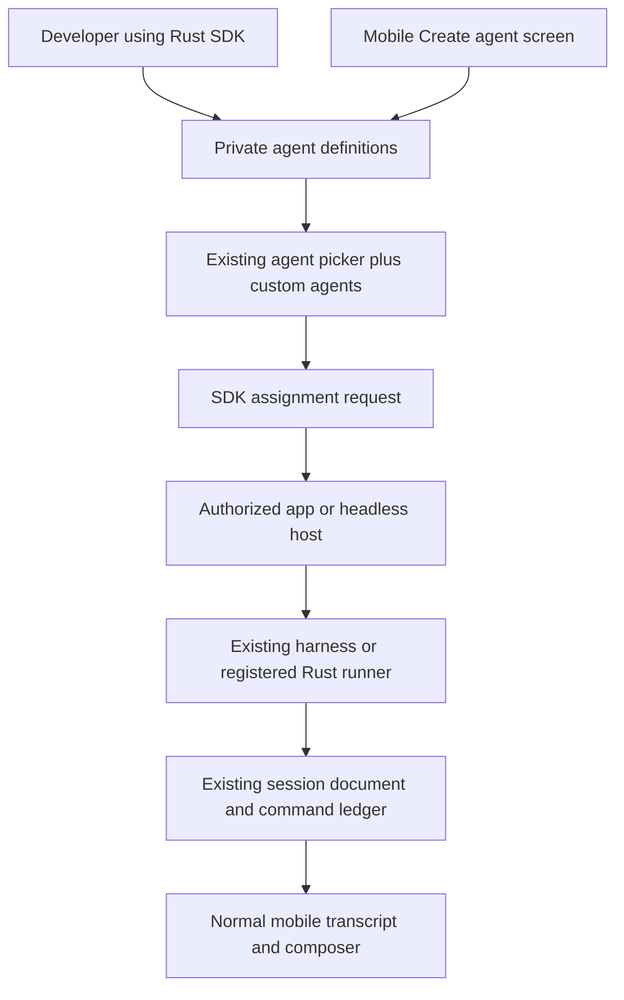

# Custom agents through the OpenAgents SDK

2026-10-16. Implemented under
[#11902](https://github.com/OpenAgentsInc/openagents/issues/11902).
The account API is deployed. The iOS app supports creating, editing, selecting,
and assigning custom agents through the Rust SDK. The original delivery plan
below records the review and intended boundaries; the implementation contract
is [SDK custom agents](sdk/agents.md).

## Delivered behavior and qualification

Use **Create agent…** in the new-session agent picker. Save a name, instructions,
runtime, model, and access settings, then choose a computer and project and send
work. Your agents appear at the top of the picker. Assignments keep the saved
revision, use the existing conversation and controls, and refuse unavailable
runtimes instead of choosing another agent. Editing changes future assignments.
Definitions created through the public Rust SDK appear in that same list.

Supported runtimes are Claude Code, Codex, and an operator-installed Rust SDK
runner. Register an SDK runner in the host's `sdk-runners.json` with an absolute
executable path and SHA-256; a definition selects its name, never a command.
The [runner guide](sdk/agents.md#run-an-independent-rust-agent) describes the contract.
The app host must include this implementation; an older running desktop needs
an update and restart. Android UI, public catalogs, remote code installation,
schedules, and cloud allocation are outside this delivery.

A narrow [NIP-AGENT profile](../nips/openagents/NIP-AGENT.md) is now specified and
has producer/consumer fixtures for private portable exports. It allocates no new
event kind. The mobile account flow uses the deployed HTTP SDK and existing
session transport; it does not publish definitions to Nostr automatically.

[Qualification evidence](sdk/agents-evidence.json) records targeted tests,
staging and production checks, a dedicated-account simulator flow, and a real
Codex/independent-runner scenario. That scenario verifies follow-ups, stop and
child cleanup, pinned revisions, and recovery when an offline host restarts.
Fixtures remove their chats, definitions, assignments, and test computers.
A live Claude assignment and physical iPhone check remain in
[NEEDS_OWNER.md](../NEEDS_OWNER.md); native Claude instruction binding is tested.

People should be able to define an agent through the Rust SDK, see it beside
Claude Code and Codex in the OpenAgents mobile app, and assign work to it through
the same session flow. The phone also needs a **Create agent** screen that saves
the same definition through the SDK. SDK-created and phone-created agents must
be interchangeable.

The target app is [`apps/openagents/`](../apps/openagents/OPENAGENTS.md), including
its Rust mobile core and UIKit shell, followed by Android over that same core.
The October 16 rules in [AGENTS.md](../AGENTS.md) take precedence over older
documents and issue descriptions that place this app in a separate fork.

## What the review found

The [SDK overview](sdk/README.md), [delivery plan](sdk/delivery-plan.md),
[history contract](sdk/chat-history.md), [Computers contract](sdk/computers.md),
and [route inventory](sdk/public-routes.md) establish three separate boundaries:
account clients, execution hosts, and computer providers. Custom agents need
the first two; creating an agent must not allocate a computer.

At review time, the [Rust client](../crates/openagents-sdk/README.md) supplied sign-in,
account access, saved history, and Computers. A custom-agent catalog, assignment
contract, and third-party runner interface were missing; they are now implemented. The
[managed-agent API](api/managed-agents.md) is a broader proposal, not live routes.

The mobile app already has useful integration points:

- `CoreClient::list_harnesses` and `list_models` query the chosen computer.
  Their static fallback is display information, not proof that a runtime is ready.
- `CoreClient::create_session` creates the chat; `SessionHandle` owns sends,
  queueing, questions, and stopping. `NewSession` already separates the execution
  target from the harness/model configuration.
- The host engine runs the agent. Loro session documents and the command ledger
  synchronize through `coder-sync`; no agent executes on the phone.

These points live in the app's `crates/mobile/src/client_ffi/`,
`crates/client/src/catalog.rs`, and `crates/engine/src/sessions.rs`. They are
internal app APIs, not an existing public SDK assignment interface.
The [desktop-to-phone check](mobile/coder-desktop-phone-e2e.md) supplies a
repeatable isolated-host and simulator fixture to extend.

| Reviewed issue | Relationship to this plan |
| --- | --- |
| [#11800](https://github.com/OpenAgentsInc/openagents/issues/11800) | SDK/Computers umbrella; Boat client and web proof are complete, SPACE qualification remains separate. |
| [#11819](https://github.com/OpenAgentsInc/openagents/issues/11819) | Public host SDK boundary and publication conditions. Define a narrow runner port here; do not publish the whole internal host stack. |
| [#11709](https://github.com/OpenAgentsInc/openagents/issues/11709) | Completed typed session configuration and explicit resume work; reuse its distinction between new execution, resume, and context transfer. |
| [#11849](https://github.com/OpenAgentsInc/openagents/issues/11849) | Completed computer-to-phone session/control proof; extend its fixture rather than create another transcript channel. |
| [#11852](https://github.com/OpenAgentsInc/openagents/issues/11852) | Headless app engine on a cloud computer. Later placement option; an online test host is enough for the first test. |
| [#11854](https://github.com/OpenAgentsInc/openagents/issues/11854) | Device channel over NIP-HOST. Preserve the working channel while integrating the current HOST/REACH authority direction. |
| [#11867](https://github.com/OpenAgentsInc/openagents/issues/11867), [#11893](https://github.com/OpenAgentsInc/openagents/issues/11893) | Thread/reply qualification and server-run web chat continuation. Reuse contracts where applicable; saved-history reads cannot start custom-agent work. |
| [#11896](https://github.com/OpenAgentsInc/openagents/issues/11896), [#11898](https://github.com/OpenAgentsInc/openagents/issues/11898) | One conversation list and one home per chat. Changing where an agent runs creates a linked continuation when the home changes. |

Issue states above describe the review date. The linked earlier issues provide
context; delivery is tracked in #11902–#11909.

## Definition, runtime, and assignment

Keep three objects distinct. An agent definition describes behavior. A runtime
binding identifies an implementation available on a particular host. An assignment
records one request to do work with an exact definition revision and binding.

| Object | Proposed contents |
| --- | --- |
| Agent definition | Stable opaque ID, owning account, revision, name, short description, instructions, runtime selector, optional model/settings, supported tool/skill references, and requested permission limits. |
| Runtime binding | Host identity, runtime/adapter ID and version, implementation reference, supported features, instruction handling, and current availability. Credentials and executable paths stay with the host. |
| Assignment | Stable request ID, definition ID/revision, selected host/project, bounded task/context, effective permissions, runtime/model, session/chat ID, status, and result reference. |

Start with private account-owned agents. Workspace sharing needs explicit roles
and is a later extension. Names are labels; two agents may have the same name.
IDs select agents. Updates use an expected revision; concurrent edits return a
conflict. Assignments keep their original instructions and settings when the
definition changes. Deletion removes an agent from future selection and preserves
the definition revision needed to explain existing work. It also blocks pending
assignments that have not started. Stopping active work is a separate explicit
action.

Support two runtime forms in sequence:

1. **Configured agent:** instructions and settings over an existing supported
   harness, initially Claude Code and Codex. This is the fastest phone test.
2. **SDK runner:** a developer implements behavior in Rust and registers it with
   an authorized app/headless host through a small typed runner interface. It
   appears in the same list and receives the same assignment shape. This proves
   the feature extends beyond saved prompts over built-in agents.

An SDK runner needs bounded input, ordered text/status/tool/result events,
cancellation, and explicit feature declarations. The host owns session storage,
queueing, permissions, retries, and process supervision. Reuse existing adapters
behind that boundary; do not build another Claude/Codex transport. Unsupported
resume, steering, questions, or tool approval features stay unavailable.

The runner interface belongs in a separate host-side module/crate reviewed with
#11819. The normal `openagents-sdk` client must build without process harnesses,
server storage, or provider services. Initially, the operator installs and binds
runner code on the host. A definition cannot download or execute arbitrary code,
choose a shell command, or enroll an untrusted endpoint.

## Public SDK and execution flow

Add proposed `openagents::agents` methods for create, list, get, update, delete,
and target availability, plus assignment creation, observation, follow-up, and
stop. Exact Rust signatures follow handler/schema qualification. Ship a runnable
outside-checkout Rust example that creates an agent and assigns work without
calling private app RPC or server APIs.

Provisional HTTP families are `/v1/agent-definitions` and
`/v1/agent-assignments`. These audited route families are now implemented.
Do not overload `/v1/agents`, which already serves activity and agent-account
registration, or `/v1/sessions`, which has a separate voice-service route.
Resolve the older managed-agent proposal's route collisions before implementation.
Publish only implemented operations in OpenAPI.

For the first host-backed flow:

1. The SDK authenticates the account and saves a definition. Saving does not
   launch, install, sign in to a provider, or spend money.
2. The phone combines built-in choices and account definitions in one picker.
   Availability comes from the selected host's supported bindings. Offline or
   incompatible agents remain visible with a short reason.
3. **Assign** submits one keyed request with the exact revision, task, host,
   project, and requested limits. Persist its identity before transmission.
4. The assignment owner checks account access and records the request. The host
   checks current device rights, binding, provider access, project, and limits
   before execution. A durable claim binds the assignment to one session;
   accepted requests survive disconnects without making another session.
5. The host applies the saved instructions through the adapter's supported
   instruction mechanism, separately from the task. Record requested and
   effective configuration. If an adapter cannot enforce the requested mode,
   refuse that configuration rather than silently discard it.
6. Work streams into the normal Loro session transcript. Follow-ups, questions,
   queue actions, reconnect, and stop use the existing session owner/control path.
   The SDK facade addresses that same session, not a second writable transcript.
7. Repeating the request key returns the same assignment. Reusing it with changed
   inputs conflicts. After an uncertain launch, observe the original assignment;
   do not rerun it. A dropped stream does not stop work; stop completes only after
   the host reports the observed result.

The HTTP assignment service and host need a durable handoff/claim protocol;
neither a transient RPC response nor a client-side chat ID supplies that protocol.
Specify it and its restart cases before exporting assignment methods. If tracked
work is involved, link its existing WORK identity; do not create another issue
tracker. Parent-to-agent delegation can use this same assignment service after
the explicit phone path works, with separate child permissions and context limits.

## Mobile creation screen

Add **Create agent** to the agent picker and agent-list management view.
Use a Rust Native form/sheet, with Rust state and validation exposed through the
mobile facade. UIKit and Kotlin render controls and forward actions. Keep the
integration mergeable with upstream and record it in
[`downstream-patches.md`](../apps/openagents/docs/downstream-patches.md).

The first form has **Name**, **Instructions**, **Runs with**, optional **Model**,
and **Access**. **Runs with** offers supported harnesses and registered SDK
runners; it does not ask for a command or private key. **Access** offers only
limits the host can enforce. Select **Runs on** and the project when assigning
work, so the reusable definition is not tied to a phone or absolute folder path.

**Create agent** saves and returns to the picker with the new agent selected.
It does not start a task. The person enters work in the existing composer and
selects **Assign**. The chat header shows the agent name, runtime, and computer;
the transcript and composer remain the normal ones. Editing affects future
assignments. Offer deletion with a clear statement about any active work.

Example first agent: **Review helper**, running with Claude Code, with instructions
to review a selected project and explain findings. Repeat with Codex to establish
that the definition is not a hardcoded Claude option. Show plain errors such as
**This computer is offline** or **Sign in to Codex on this computer**. Offer only
working controls; do not show future scheduling, sharing, or publishing options.

## Does this need a custom NIP?

Recommendation: write a narrow OpenAgents composition profile, provisionally
**NIP-AGENT**, when implementing portable definitions. It should connect existing
contracts without allocating new event kinds or inventing another job, session,
or permission protocol. The first account API and phone test can precede its
Nostr transport implementation; do not claim protocol conformance from CRUD alone.

The review covered the [three NIP sources](../nips/README.md), the
[OpenAgents index](../nips/openagents/README.md), and these relevant contracts:

| Need | Existing contract and decision |
| --- | --- |
| Name, prompt, runtime, model, provider | Block [NIP-AP](../nips/block/NIP-AP.md), kind `30175`, already defines personas. Reuse its meaning for an explicit public export/import. Its content is plaintext, even without a shared tag; it is not private agent storage. |
| Private definition and revision | [Shared contracts](../nips/openagents/contracts.md) provide immutable references and encrypted `3188` artifacts. A new profile must specify definition schema, authorized readers/writers, revision authority, conflicts, deletion, and recovery. The envelope alone supplies none of those lifecycle rules. |
| Runnable implementation and availability | [CAP](../nips/openagents/NIP-CAP.md) already separates definitions, host bindings, grants, and observed presence, including executor/ACP/HTTP/CJ bindings. Map the agent to an exact supported binding. |
| Optional reusable packages | [EXT](../nips/openagents/NIP-EXT.md) and [REG](../nips/openagents/NIP-REG.md) cover immutable components and catalogs. Use existing guidance, schema, and capability components; do not assume an `agent` component kind exists. |
| Persistent conversation and controls | [SESS](../nips/openagents/NIP-SESS.md) owns session configuration, submit, queue, questions, and stop. Its pending October 16 revision must describe Loro rooms and the app channel; do not implement its older transport as a parallel phone stack. |
| Tracked assignment and execution | [WORK](../nips/openagents/NIP-WORK.md) owns delegation intent; [CJ](../nips/openagents/NIP-CJ.md) and [RUN](../nips/openagents/NIP-RUN.md) own admitted attempts and results. An assignment label or received private artifact cannot dispatch work by itself. |
| Host access and disclosure | [HOST](../nips/openagents/NIP-HOST.md), [REACH](../nips/openagents/NIP-REACH.md), and [POL](../nips/openagents/NIP-POL.md) retain grants, routing, approvals, and disclosure. An agent definition cannot widen them. |
| Workflow or autonomous agent | [PRG](../nips/openagents/NIP-PRG.md) fits a bounded workflow; [SOV](../nips/openagents/NIP-SOV.md) adds custody and autonomous lifecycle. Neither is required for a named agent receiving explicit assignments. |

Block [NIP-PMA](../nips/block/NIP-PMA.md) reserves private aggregate kind `30179`
but explicitly requires rejection until privacy, transactional updates, recovery,
and revocation gates are deployed. Do not use it as a shortcut or silently turn
that reservation on. Official [NIP-89](../nips/official/89.md) discovers app
handlers, not runnable agents. The pinned [NIP-90](../nips/official/90.md) is
unrecommended; the existing CJ contracts already cover our job boundary.

The useful new profile is the missing mapping: a private, versioned agent
definition resolves to a verified runtime binding, yields an effective session
configuration, and remains linked to its assignments. Specify exact revisions
and instruction references, explicit public AP export with secret/local-path
removal, import compatibility, and deletion/revocation effects on pending work.
Keep owner account IDs, definition IDs, host keys, and any future agent signing
keys distinct. A saved definition does not need its own Nostr key.

The resulting `NIP-AGENT` is an OpenAgents draft composition profile, not an
official Nostr standard.
Before adding the normative file, check the mapping with two consumers: the
configured harness agent and the custom Rust runner. If existing AP/CAP/SESS
fields express the full mapping, keep it as an application profile in SESS/CAP
instead. Do not add a second persona schema solely to rename AP. Any actual
protocol extension goes spec first, then schemas/validators and fixtures, then
the host/client role. Keep the pinned official and Block files unchanged.

## Delivery sequence and first test

Delivery issues: [#11903](https://github.com/OpenAgentsInc/openagents/issues/11903)
(definitions), [#11904](https://github.com/OpenAgentsInc/openagents/issues/11904)
(assignments), [#11905](https://github.com/OpenAgentsInc/openagents/issues/11905)
(mobile), [#11906](https://github.com/OpenAgentsInc/openagents/issues/11906)
(runners), [#11907](https://github.com/OpenAgentsInc/openagents/issues/11907)
(protocol), [#11908](https://github.com/OpenAgentsInc/openagents/issues/11908)
(qualification), and [#11909](https://github.com/OpenAgentsInc/openagents/issues/11909)
(TestFlight).

| Slice | Deliverable and exit check |
| --- | --- |
| 1. Definition contract | Account-owned store, revisions, CRUD, OpenAPI, and typed SDK methods. Two synthetic accounts cannot read or change each other's agents; conflicting updates and retry recovery pass. |
| 2. Host assignment | Durable assignment handoff into the existing app engine, capability checks, instruction injection, and session linkage. A fake harness verifies exact instructions, limits, deduplication, restart, and confirmed cancellation. |
| 3. Phone creation and selection | Rust Native form and unified picker in `apps/openagents/`. Create, relaunch, edit, assign, observe, follow up, and stop in the simulator using the real SDK/server path. |
| 4. Configured-agent test | On an isolated test host, run Review helper through Claude Code, then Codex, against a disposable Rust project. Confirm its instructions affect the result and all controls report their actual support. |
| 5. Developer runner | Narrow host-side Rust runner interface and outside-checkout example. Register a custom deterministic review agent, discover it on the phone, assign work, read its result, and stop a long task. This slice completes the SDK-defined implementation proof. |
| 6. Portable profile | Resolve the NIP-AGENT decision above, add only necessary normative mappings, and qualify producer/consumer fixtures. Cloud execution follows #11852; shared catalogs and broader publication follow separately. |

Start the near-term test with slices 1–3 and a deterministic harness, extending
the existing isolated-host mobile fixture. Then run slice 4 with a bounded real
task when implementing that flow, and slice 5 to prove independent developer
code. Record app/server/SDK revisions, chosen agent revision/runtime, assignment
and session IDs, outcomes, timings, and cleanup in scrubbed evidence.

Acceptance must also cover response loss after create/assign, concurrent sends,
host restart during dispatch, phone sleep/reconnect, revoked access before queued
work starts, sign-out/account switch with late responses, deleted definitions,
changed runtime versions, offline hosts, unavailable provider login, and invalid
model/settings. No fallback may silently change the selected agent, runtime,
account, computer, or payer. Check that built-in Claude Code/Codex sessions still
work without a custom definition.

Use dedicated test accounts, scratch homes/data/projects, and disposable resources.
Never test on the owner's running desktop or production account. Remove test
definitions and assignments, archive/delete fixture chats, stop child processes,
and delete any test computers. Keep all credentials outside definitions, session
documents, evidence, and public exports. Instructions express behavior; host
policy enforces access. No implicit spending or cloud allocation.

Run affected-crate tests and formatting in each workspace touched by an
implementation, plus focused schema checks and the new mobile scenario. Keep
the [Coder 1.0 freeze](coder/1.0-freeze.md): use additive server/app changes,
with no new frozen CLI binary dependency. Package publication, general external
provider admission, payments, schedules, and store releases remain separate.
