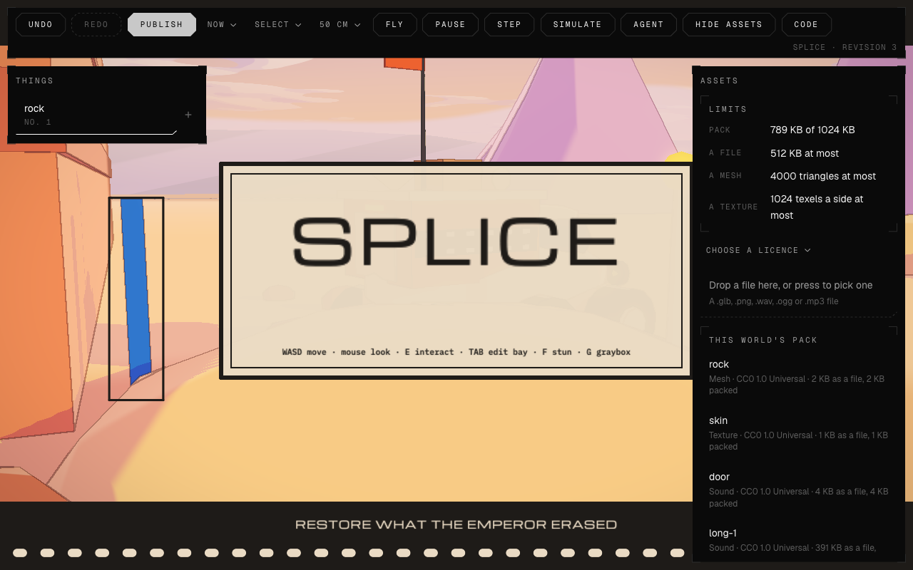

# The Metaverse Engine editor in the browser

Status: spec, 2026-11-12. It pulls together three sessions (the coordinator
thread `feace06f`, the Splice build `eaaf10a3`, and the Unreal comparison and
exporter `81f826d1`), the chat and world-building plan
(`docs/audits/2026-11-12-chat-and-world-building.md`), the AAA program
(#13257), and an inventory of `origin/main` at `2d99d8af62`.

The owner's goal: a browser-based editor for the OpenAgents Metaverse Engine.
Anyone (a person or an agent) can make easy edits to a world, see each change
in the world at once, keep playing while code, shaders, content and assets
reload live, and build a game programmatically.

There is no separate "Forge" product (owner, 2026-11-12). The editor is part
of the Metaverse Engine. The older Aethyrforge spec (`docs/metaverse/aethyrforge.md`)
is superseded where it differs from this one.

## The editor in one paragraph

Any Metaverse Engine page opens in edit mode with `?edit`: Splice, Everglade,
a made realm or a WorldBuilder world. The world keeps running in the middle.
Around it are an outliner of the World's entities, an inspector for the
selected entity and its content rows, and a toolbar: select, move, rotate,
scale, place, terrain, play, pause, step. Along the bottom runs the same
conversation as `/chat`, with your agent in it. Everything is built from the
`/chat` page's components.

Each change is a typed edit in one log, with undo and redo, and it shows in
the world in under a second. That includes a change made in another tab, by
your agent or from the CLI. Saving a code, shader, content or asset file
reloads that part in place. The player stays where they stand, and the game
keeps its state.

## What exists (checked on `origin/main`, 2026-11-12)

| Area | State | Where |
|---|---|---|
| Live channel | **Partial.** `serve` rebuilds on change and pushes over the `/coaxial/live` WebSocket: `wasm` swaps the engine, `wgsl` swaps shaders, `page` reloads, `error` keeps the last good engine. It watches only the top level of the app and host folders (`MAX_WATCH 256`), not shared code in `metaverse-engine/` or `components/`, packs or textures | `coax/web/serve.c`, `coax/web/host.js` `live()` |
| Outside edits on a page | **Exists for Splice (E4, #13413).** A page reads its lane's document once, then takes each saved edit in order through its edit log; the dev server answers the world's routes and tells every tab when it was written | `metaverse-engine/editor/world-follow.coax`, `metaverse/splice-bots/world.coax`, `metaverse/splice-bots/tools/world-local.coax`, `coax/web/world-tabs.coax` |
| Rebuild time | **Good.** A one-line edit is running in about 2.5 s (resident and incremental compiler, #13138, #13142); a dev engine build takes 118-135 ms; type errors show in 0.63 s | `coax/book/ch46-resident-compilation.md` |
| State across a code reload | **Good on the dev server (#13411).** A development module carries its state's field table. A reload that changes the state's layout keeps every field both layouts name, starts new fields from their defaults and names the new and dropped fields in the dev note. Not built: declared migrations (a renamed field) and a rollback when the first frame traps | `coax/web/state-keep.js`, `host.js` `loadEngine`, `metaverse-engine/book/ch082-change-code-while-it-runs.md` |
| One function swapped live | **Experiment.** `door_ease` only, 900 ms from edit to running | `coax/web/fast-edit.*` |
| Agents drive and see | **Exists, no edits.** `coax drive`: `tree`, `state`, `tap`, `type`, `walk-to`, `use`, `clock`, `screenshot`, `logs`, `perf`. It serves `--static`, so it has no live channel, and it has no edit verbs | `coax/web/drive.coax`, `docs/metaverse/agent-clock.md` |
| The scene model | **Partial.** The World (entities, columns, systems, spatial index) is used only by Splice's edit layer. A World saves and loads whole, and a world has an ID, a document, fenced edits and dev and live revisions (E3, #13412). No prefabs | `metaverse-engine/core/world.coax`, `metaverse-engine/editor/world-doc.coax`, `world-edit.coax`, `world-live.coax`, `coax/web/api/worlds.c` |
| Typed edits, undo and redo | **Exists** | `metaverse-engine/editor/edit.coax` |
| Content tables | **Exists, CLI only.** The editor isn't reachable from a page; the page doesn't load the tables yet (#13381) | `metaverse-engine/content/tables.coax`, `metaverse-engine/editor/content-edit.coax` |
| Picking | **Partial.** `query_ray` exists; every editor picks its own way (Everglade by 56 px screen distance) | `metaverse-engine/physics/query.coax` |
| Gizmos, outliner, inspector, fly camera, snapping, asset browser, play/simulate | **Missing** | — |
| In-world editors | **Two in the shell, two separate.** Splice's layer and WorldBuilder run in the editor shell (E13, #13422). Everglade admin EDIT and the realm edit layer with its agent pane are still their own | `metaverse/splice-bots/world.coax`, `worldbuilder-world.coax`, `everglade-edit.coax`, `metaverse/edit/` |
| Programmatic building | **Exists for worlds with an ID (E6, #13415).** The edit verbs are rows of `REALM_COMMANDS`: `realm world`, `world-place`, `world-move` and the rest, each also a `realm_*` MCP tool and a `coax drive` verb. There is no second `world_*` family. Every row has an effect and an approval rule, and answers one result shape | `apps/openagents-cli/commands.coax`, `realm-world.coax`, `metaverse-engine/editor/op-result.coax`, `coax/web/drive.coax` |
| Code changes from a browser | **Exists on the dev server** (E12, #13421): the editor's Code pane opens and saves the realm's own sources, and the dev server checks and rebuilds them. A deployed page has no such path | `coax/web/serve.c`, `metaverse-engine/editor/code-wire.coax` |
| Agents in `/chat` | **Exists.** Claude Code, Codex, Antigravity and Microcoder through the local Coder | `apps/openagents-web/chat-web.coax`, `coder/tui/mcp_http.coax` |
| UI components | **Exist.** The frames set (frame, text, button, field, select, card, row, header, menu, notice, composer, tool call, code block), skinned by `mono.coax`, drawn by the browser through `dom.coax`: real text, Find, selection and screen readers | `components/kit/frames.coax`, `components/skin/mono.coax`, `components/backend/dom.coax` |
| Retained rendering | **Splice's layer only.** Shared retained rendering is P6.1 (#13303) | `metaverse/splice-bots/layer-draw.coax` |

## What the sessions teach

- **The agent must see its own work.** This was the main reason the Splice
  build beat Unreal's (`docs/unreal/2026-11-12-splice-unreal-vs-aethyr-session-audit.md`).
  In the editor, every edit an agent makes returns a frame and the World's
  state, not just "ok".
- **Fail loudly.** A refused edit says why, in words, naming the rule or zone,
  as Splice's checker does. A reload that fails keeps the last good build
  running and shows the error in the editor; it never shows a blank page.
- **Seconds, not minutes.** The 2.5 s code loop and the 118 ms engine rebuild
  are the bar. The waits that hurt (`feace06f`, 11-10: a two-hour release, 84%
  of agent time spent waiting) came from release gates and builds from
  scratch, not from the dev loop. The editor runs on the dev loop.
- **Headless passing is not real Chrome passing** (`feace06f`, 11-07). The
  editor's acceptance includes a real-input run in a real browser, as Splice's
  audit recommends.
- **Never hand-roll** (`docs/reuse.md`, 11-11). WorldBuilder's broken text keys
  came from a hand-made input box. The editor uses only shared components:
  the `/chat` components for UI, and the edit log, World and content tables
  for data.
- **A non-programmer needs a way to bring in a mesh or texture.** Splice's
  audit calls this "the one reason the jam entry stays in Unreal".

## Design

### One World, one edit log, one wire

- **The scene is the World** (`metaverse-engine/core/world.coax`). The editor
  edits entities and their columns: transform, kind (a content ID), collider
  and the realm's own columns. Content rows (pieces, landmarks, creatures,
  spawns) are edited through the content tables.
- **Every change is a typed edit** in `metaverse-engine/editor/edit.coax`'s log,
  with its inverse: spawn, despawn, set a column, move, rotate, scale, set a
  content cell, paint or shape terrain. An edit is a domain event
  (`proto/registry.json`, owned by realm-authoring) with one wire shape,
  `proto/world/edit-v1`.
- **A world has an id and a document:** the World's entities, the content
  revision and the edit log's head, saved and loaded whole
  (`world_save`/`world_load`), with edits fenced by revision (409 on a stale
  one). The server checks every edit with the same Coax the page runs.

### One live channel

`serve`'s WebSocket becomes the editor's only channel in development. In
production the API's event stream plays the same part. It carries:

- **Code.** A rebuilt engine is swapped in, with the state migrated field by
  field. A field that can't migrate starts at its default, and the editor says
  which.
- **Shaders.** Any WGSL that changed, including WGSL generated from Coax.
- **Content.** A new content revision is applied in place.
- **Assets.** Packs and textures that changed are fetched again and swapped by
  content hash.
- **Edits.** Edits made anywhere (another tab, an agent, the CLI) are applied
  through the edit log, so UNDO works on them too.

What `serve` watches is what the build read: the compiler's dependency list,
not a flat folder scan.

### The editor shell

- **The scene stands in a frame.** The bar lies across the top and a pane
  stands the whole height on each side. The canvas is the part of the window
  between them, so the world's own interface is inside the frame and nothing
  of the world is under a pane. On a window too narrow for a frame the panes
  lie over the scene as before.
- **Opening it:** `?edit` on a page, or EDIT for an owner or admin. The shell
  loads with the page's own module; the world module never loads the chat
  module, and the chat never loads a world module (`contexts.txt`).
- **Components:** all panels come from the `/chat` page's components, drawn by
  the DOM backend over the canvas:
  - the outliner is a `k_row` list;
  - the inspector is `k_field`s and `k_select`s inside a `k_card`;
  - the toolbar is `k_button`s and `k_icon_button`s;
  - refusals are `k_notice`s;
  - the agent strip is `k_composer` and the message components.

  New component kinds go into the kit, never into the editor.
- **As built (E7, #13416):** the shell is a module of its own,
  `metaverse-engine/editor/shell.coax`, built as `editor-shell.wasm`. The
  page's host (`coax/web/host.js`) opens it over the canvas with
  `coax/web/dom-host.js` and carries bytes between the two:
  - the page tells the shell what its world holds, as `editor.model.v1`
    ([the shape](../protocol/editor-model-v1.md));
  - the shell asks the page to send a `world.edit.v1` batch or to select a
    thing.

  The shell keeps no world and decides nothing. Its panes, props and facts are
  `components/kit/dock.coax`, shown on `/components`. The editor has no look
  of its own: `coax/web/tool.sh editor-skin-check` fails when an editor file
  names a colour, a size or a face, or loads a skin other than mono. On a
  deployed page the shell opens only for an admin. Splice is the first page.
- **The agent strip is the `/chat` conversation.** The same thread, the same
  agents and the same transcript appear on `/chat` and in the editor. The
  agent gets `world_*` tools plus the editor's selection and "here" (the last
  point tapped).
  As built so far (E9, #13418): Agent in the shell's strip opens a foot whose
  slot holds the chat page's own module (`chat-web`), opened by the page's
  host, so it is the same conversation, components and agents as `/chat`.
  `?edit=agent` opens the editor with the foot open. A local agent's edits
  through the realm commands show in the open editor as any outside edit does.
  On a dev server the one command (`coax/web/serve.sh apps/openagents-web`)
  starts the local API and Coder's local side, so the foot answers with
  Gemini and, when Claude Code is ready on the machine, lists it beside
  Gemini with no setup (#13463, #13465). Settings, This machine, turns the
  local agents off or on for this browser.
  The rest ([the shapes](../protocol/world-turn-v1.md)):
  - Each turn carries the world, the selection and "here". The shell tells
    the conversation (`world.turn.v1`) whenever they change. An agent that
    works by itself is told in words after your message.
  - A Gemini turn in the editor is a hosted world turn: one model call under
    a schema whose steps are the hosted world tools (place, move, turn, size,
    remove, undo, redo). The model's typed answer chooses talk or edit and
    the tools; no code matches words. The steps go to the shell as a plan and
    leave the page as one `world.edit.v1` batch, so the server's rules answer
    it and one undo takes the turn back.
  - On `/chat`, an agent's `realm_world` tool brings the world's card
    (`world.card.v1`, `GET /api/worlds/ID/card`): its name, what it holds and
    a link that opens the editor with the conversation in its foot.

  Not built: world tools for the hosted agent on a Claude account (its runner
  has no realm commands), and a picture on the card.
- **Viewport tools:**
  - picking through `query_ray` against the World's spatial index;
  - move, rotate and scale gizmos that snap to a grid;
  - a fly camera;
  - play, pause and step on the agent clock;
  - "simulate", which runs the World without the player.
- **As built (E8, #13417):** `metaverse-engine/editor/viewport.coax` is the
  one module of the viewport's tools. A realm keeps one `Viewport`, gives it
  the pointer while a tool is picked, and reads back the selection, the edit a
  drag made and the view.
  - A tap picks with `vp_pick`, which is `query_ray` on the realm's colliders,
    and marks the point as "here".
  - Move, Turn and Size are drags on the selected thing that end as one typed
    edit. A move snaps to a grid of 10, 25, 50 or 100 cm, a turn to 15 degrees
    and a size to 5 percent.
  - Fly frees the camera: W, S, A and D move it, Q and E lower and raise it,
    and a drag looks around.
  - Pause stops the World, Step runs one sixtieth of a second, and Simulate
    runs the World with the player's hands off.

  The shell's strip picks the tool, the grid and the rest, and Add places a
  new thing at "here". `coax drive` taps and drags at points of the page
  (`tap X Y`, `drag X0 Y0 X1 Y1`). Splice is the first realm
  (`metaverse/splice-bots/world.coax`, `spv_*`).
- **As built (E10, #13419):** where a realm names the table its kinds are
  rows of, the inspector shows the selected thing's content row as fields. A
  changed cell is a `cell` edit of the world's one log, checked by the server
  through `metaverse-engine/editor/content-edit.coax` and the realm's own
  rules, and saved with the lane's tables. Pages carry the event out in
  place. Splice is the first realm
  ([the cell edit](../protocol/world-edit-v1.md)).
- **As built (E5, #13414):** `metaverse-engine/editor/place.coax` is the one
  placement planner: an anchor, a side as the camera sees it, a spread over a
  disc or a ring, and one thing nudged to where nothing stands. It asks a
  catalogue one thing of a kind (its footprint and whether it grows).
  WorldBuilder fills that from the Quaternius pack and Splice from its
  `pieces` table, and WorldBuilder's own copy is gone. A template is a group
  of things saved as one row of a realm's `templates` table and placed as one
  batch, so one undo takes it back. In the shell, a row's control gathers a
  thing into a group, the group saves under a name, and Add lists the
  templates after the kinds and places several of a kind spread out.
- **Assets:** an asset browser over the realm's pack and the shared kits.
  Drop a glTF, PNG or audio file to add it: it is packed with a declared
  licence (`metaverse-engine/editor/pack.coax`) and appears in the browser.
- **As built (E11, #13420):** a file dropped on the editor becomes an entry
  of the world's import pack, and an imported mesh is a kind to place. The
  dev server takes the file in one request. The API takes it by a direct
  upload to storage ("The production path" below;
  [the shapes](../protocol/world-assets-v1.md)).

  

  - **The importer.** `metaverse-engine/editor/pack-import.coax` (`pi_import`)
    reads a glTF binary's triangles through its nodes' transforms, a PNG and
    a WAV, Ogg or MP3 file, and writes the pack through the existing writer
    (`pack_write`), then reads it back (`pack_read`) before it answers. A
    mesh stands on the ground with its middle over the origin. A file of a
    name the pack has replaces that asset. Skins, morphs and animations are
    not read.
  - **Licence and limits.** `pack-import-policy.coax` (`#authority`) holds
    the licences an import may declare (CC0 1.0, CC BY 4.0, CC BY-SA 4.0,
    chosen by number, never typed) and the limits. Splice's are a 512 KB
    file, a 1,024 KB pack, 4,000 triangles a mesh and 1,024 texels a side
    (`metaverse/splice-bots/pieces.coax`, `sp_import_limits`). Each refusal names
    the file in words.
  - **A pack-mesh kind.** A row of Splice's `pieces` table whose `kit` is
    `pack/NAME` draws that mesh from the world's import pack. The page takes
    the pack as its one data asset, reads it whole or keeps the one it has,
    and writes the mesh into the piece store beside the kits' meshes. The
    server saves such a row only when the pack has the mesh and the row's
    footprint is the mesh's bounds at the row's size.
  - **The dev route.** `GET` and `POST /api/worlds/ID/assets` and
    `GET .../assets/pack` on `coax serve` (`world.assets.v1`,
    `world.asset.import.v1`). The pack and each dropped file are kept by
    content hash under `apps/openagents-web/build/.worlds/`. A saved import
    is told to every tab as the live channel's `asset` message, and each tab
    fetches the pack again by that hash (E1).
  - **The pane.** The shell's Assets button opens a right pane: the pack
    against its budget, the limits, a select of the licences, a drop target
    (`k_drop`, new in the kit with `k_file`, both on `/components`), the
    world's assets and the kinds it places. A file dropped anywhere on the
    page goes to it. The pane refuses a file over the limit before it sends
    anything.
  - **A mesh becomes a kind.** After a mesh imports, the page writes its row
    of the `pieces` table as a `cell` edit (E10), so every open page takes it
    in place and it appears under Add.
  - **Replacing.** A mesh that replaces one the world has pieces of must fit
    where they stand. Its kind's row is tried with the new bounds first, and
    the import is refused in words if a piece would no longer fit.
  - **Measured in headless Chrome on Splice.** A 2 KB glTF binary imported in
    121 ms and was under Add. Placing it took the world from revision 1 to 2
    and added its 36 vertices to the piece store (24,270 to 24,306) with no
    reload. A replacement was drawn 203 ms after Import. A 1,773 KB file, a
    third 391 KB sound (a 1,180 KB pack) and a wider mesh where a piece
    stood were each refused in words.

  **The production path (as built).** It uses no new cloud resource: the
  private bucket `openagentsgemini-project-drops`, the API's own identity and
  the upload opener in `coax/web/api/drops.c` that the project drops use.
  The importer, its limits and its words are the dev server's: both call
  `metaverse/splice-bots/world-assets.coax`.

  1. **The file is named before it is sent.** The page sends
     `POST /api/worlds/ID/assets` with the licence, the file's size and name,
     and its SHA-256 (`world.asset.upload.v1`). Who may ask is who may write
     the world (`world-policy.coax`, `wr_asset_write`: an admin, from this
     site or signed). The file is checked by name, size and licence with the
     importer's own check (`pi_early`), so a refusal comes in the same words
     and nothing is stored. The API then opens an upload for exactly that many
     bytes and that content type at the object
     `PREFIX/worlds/ID/files/SHA256` and answers its address. If the bucket
     has the file already, it answers `kept` and nothing is sent again.
  2. **The bytes go straight to storage.** The page's host `PUT`s the file to
     the address. The API never carries the file's bytes in a request.
  3. **Done.** The page sends the same ask to `POST .../assets/done`. The API
     reads the object back and checks its size and its SHA-256 against its
     name (`wr_asset_stored`). An object that is not the file named is
     deleted and refused. Then it runs the importer on dev's pack and keeps
     the new pack by its hash. A refused import (over budget, a mesh that
     does not fit where its kind stands) leaves the pack as it was, says why,
     and deletes the file from the bucket unless an earlier import kept it.
  4. **Storage** (`migrations/0183_world_assets.sql`). `verse.world_packs`
     holds a pack's bytes by hash, 1 MB at most. A world's row names a pack
     for each lane, as it holds a document for each: an import changes
     dev's, a publish makes live's the same as dev's, and the one before the
     last pin change stays for one release. A pack no lane names is deleted.
     `verse.world_files` has a row for each imported file: its hash, name,
     kind, licence and size. An edit is now checked against the pack dev
     really has (`splice_world_batch_packed`), so a `pieces` row for a pack
     mesh is saved only when that mesh is in it.
  5. **Reading.** `GET .../assets` answers the list (`world.assets.v1`):
     live's, or dev's with `?lane=dev`. `GET .../assets/pack` answers the
     lane's pack, and `?live=SHA256` answers the world's pack of that hash.
     No answer is cached: the API marks every answer `no-store`, so a page
     reads its pack (1 MB at most) from the API each time it loads.
  6. **The shell.** On a deployed page the upload is the three steps above
     (`shell-assets.coax`; the host's `dom_file_step` hashes the file with
     the browser's own SHA-256). The pane shows the limits and the budget
     first, as on the dev server, and says "Sending" through all three steps.
     The shell asks for the list as someone who would import
     (`?lane=dev&write=1`), which the API answers to an admin only, so nobody
     else gets an Assets button. A deployed page has no dev server to tell
     its tabs of a new pack, so the shell tells the page's host the pack's
     hash and the host fetches the pack by that hash and swaps it in.

  **Proved** in two halves. The API's half runs on a build host
  (`coax/web/api/tests/world_checks.coax`, 18 checks named "assets: ...",
  with a fake bucket that keeps each object as a file): who may open an
  upload, the refusals before any upload, the object checked against its
  name and deleted when it is wrong, the import, the pack by lane, a
  `pieces` row held to the pack, the budget, and a publish. The page's half
  ran in headless Chrome on a page that is not the dev server's
  (`http://e11b.localhost:PORT/worlds/splice?edit`), with the API's three
  answers played in the page and the import itself done by the dev server:
  a 2 KB glTF binary was named by the SHA-256 the browser computed, `PUT`
  with no credentials, and imported; the host fetched the pack by its hash
  (1 swap, 1 mesh, 0 refused) and the world went from revision 0 to 1 with
  the mesh as a kind. The same file again was not sent (0 `PUT`s) and
  replaced the mesh. A 1,773 KB file was refused before any request, and a
  third 391 KB sound was refused in the server's words.
  **Not proved:** the three steps against real storage and the deployed
  API together. The dev server answers a world's routes itself, so no local
  page reaches the API's routes.

  **Not built.** Another tab on a deployed page learns of a new pack when it
  opens its Assets pane or reloads, not at once. A visitor who is on the
  page through a publish that adds a pack mesh draws that mesh after a
  reload. Skins, morphs and animations in a glTF file are not read, and
  nothing in Splice uses a texture or a sound yet.
- **Code:** a realm's Coax source opens in a code panel (`k_code`, plus an edit
  field from `components/core/edit.coax`). Saving sends it to the paired Coder,
  which compiles it with the resident compiler; the live channel swaps it in.
  Without a Coder, a hosted build seat does the same (later).
- **As built (E12, #13421):** code from the browser is for the owner and
  admins, on the dev server only (owner decision, 2026-11-13: realm code is
  ours, or arrives as a pull request). The shell has a Code button and a Code
  pane only when the page's host says the dev server serves the page and that
  server lists the realm's files. A deployed page has neither, and its server
  has no such route.
  - **The route.** `POST /coaxial/code` on `coax serve` while it watches
    (`realm.code.v1`, [the shape](../protocol/realm-code-v1.md)). It lists,
    reads and writes the page's own realm sources: the Coax and WGSL files
    under `metaverse/PAGE/` that the page's module or its shaders were built
    from. It refuses every other path, a link, another site and another
    machine.
  - **The pane.** A select of the realm's files, the open file in a code field
    (`k_code_field`, new in the kit and shown on `/components`), and Save. The
    pane is a wide right pane of the dock (`DK_WIDE`). The field is the
    browser's own text area, as every field of the frames set is on the
    browser backend; `components/core/edit.coax` is the edit buffer for
    surfaces the GPU draws, and is not used here.
  - **Save and compile.** A save writes the file and answers with
    `coax check` of the module the file is part of. On Splice the answer came
    in 110 ms with errors and 684 ms without. Errors show as a notice with the
    compiler's words in a code block. The dev server's watch then builds the
    module and the live channel swaps the engine with its state kept (E1,
    E2): 1.9 s from Save to the new engine on Splice. A failed build keeps
    the last good engine running.
  - **Shaders.** `metaverse/splice-bots/gpu/splice.coax`, the Coax that writes
    Splice's WGSL, is in the list. Saving it writes the WGSL again and the
    live channel swaps the shaders.
  - **Not built:** the paired Coder for a deployed page, and a hosted build
    seat for people without a Coder. The realm origin (#13432) is not wired
    in.
  - Checks: `coax/web/tool.sh code-route-check`, the shell's and the codec's
    own checks, and `proto/world/code-v1.json`.
  - Proved in headless Chrome on the dev server
    ([picture](shots/2026-11-13-e12-code-pane.png)): a changed line of
    `splice-game.coax` was live 876 ms after Save with the player where they
    stood and the world's revision unchanged; a compile error showed in the
    pane in 104 ms and the last good build kept running; a changed shader
    constant in `gpu/splice.coax` was swapped in 453 ms after Save.

- **As built (E13, #13422): every realm is a world.** A made realm, and a
  hand-built one with a board, is a world of kind `realm` under its slug
  (migration 0185), with one rule in the authority table for a realm made at
  run time: its owner, its own admins and the site's admins author it.
  `/api/worlds/SLUG` serves its board and settings as content tables and
  takes a switch as a `cell` edit, which the realm's own SQL carries out, with
  undo, redo and one event a switch
  ([the rules](../protocol/world-edit-v1.md#a-realms-world)). The realm pages
  do not open the shell yet: they still edit through `metaverse/edit/edit.coax`
  and `/api/playtest/realms/SLUG/...`.

- **As built (E13, #13422): WorldBuilder in the shell.** `/create-world?edit`
  (the page's EDIT button) opens the shell over WorldBuilder, for anyone: the
  world is the visitor's own, kept in their browser.
  - **Its world is behind `world.edit.v1`.** Every edit of a thing and every
    dab of a brush is a typed edit, checked by the page's own Coax
    (`apps/openagents-web/worldbuilder/worldbuilder-world.coax`) and carried out on the
    engine's edit log. No server holds the world, so there is no route: the
    same codec, the same batch and the same fence by revision, on the page
    ([the rules](../protocol/world-edit-v1.md#worldbuilders-world)). The
    chat's edits of things go the same way.
  - **The land.** WorldBuilder is the first world to take the `terrain` edit.
    The viewport has a Land tool (`viewport.coax`, `vp_dab`), and the shell
    shows it only for a world whose model says its land takes edits: the
    brush's kind, the material it paints, and its radius and strength as
    steppers (`k_stepper`, new in the kit and shown on `/components`).
  - **What the model says more** (`editor.model.v1`): how many things the
    world holds and takes (the shell lists the newest 256 and says so), how
    many kinds it has, that it is kept on this device (no Publish), and its
    land's brushes and materials.
  - **Deleted from WorldBuilder:** its UNDO and REDO buttons, its brush bar
    (tools, layers and two sliders), its own ray from the screen to the
    ground, and its per-frame brush. Undo and redo are the shell's (and
    Cmd/Ctrl+Z and "undo" typed in the line). Picking is `vp_pick`.
  - **Kept:** the chat line. It asks WorldBuilder's own model under the day's
    shared cap with no account; the shell's agent strip is the `/chat`
    conversation and does not do that. The panel with the limits, WALK,
    FRAME and the hints are the game's. The host tells the page the part of
    the window the shell's panes leave free, and the page lays these out
    inside it.
  - Proved in headless Chrome on the dev server
    ([picture](shots/2026-11-13-e13-worldbuilder-shell.png),
    [a phone's size](shots/2026-11-13-e13-worldbuilder-phone.png),
    [a full world](shots/2026-11-13-e13-worldbuilder-full.png)):
    `docs/editor/acceptance/worldbuilder-run.ops` places, selects, moves,
    turns, sizes and removes a cottage and raises and paints the ground; each
    edit of a thing is one revision and shows in the same frame; Undo and
    Redo walk them. A world of 4,096 things kept in the old save's bytes
    loads, one more is refused in words ("This world is full: 4096 things at
    most. Delete some to add more."), and after one is removed the next
    stands.
  - **A phone's size.** The strip's menus lie over the side panes, and on a
    narrow window a menu opens across the strip, so the Land tool and its
    brush can be picked there. Not proved with a finger: the driver's tap on
    a menu row did not register on this page at 390 px wide, though a script's
    click does and the same tap does on Splice.
  - **Not moved:** Everglade's admin EDIT and the realm edit layer. What each
    needs is on #13422.

### Programmatic building

- **CLI and MCP:** rows of `REALM_COMMANDS`, the table the other realm
  commands come from: `openagents realm world`, `world-place`, `world-apply`,
  `world-undo` and the rest, each also a `realm_*` MCP tool
  ([the list](../protocol/world-edit-v1.md)). Coder gets them by default.
  There is no second `world_*` family (2026-11-13).
  - `show` answers entities, content rows, landmarks, kept-clear zones, the
    player's position and "here".
  - `apply` answers the new revision, a frame and any refusal.
- **`coax drive` edits:** `drive` gains edit verbs (`place`, `move`, `set`,
  `undo`) and a live mode against the dev server, so an agent can edit, watch
  the reload and check the result in one session.
- **A realm's code** is still code: the agent edits the Coax and the live
  channel reloads it. Edits handle content and placement; code handles rules
  and behaviour.

### Foes' movement at dawn and dusk (#13466)

An agent in the editor sets how Splice's raiders and Imperial robots move, and
you watch it in the editor.

- **Movement is data.** Each actor has a plan for each time of day: stand,
  dance, sleep, guard, patrol, wander or follow; its route, speed and notice
  range; and what it does on noticing you (chase, call, flee, ignore). The
  rules run with no model call (`metaverse-engine/ai/npc-plan.coax`,
  `ai/plan.coax`). Splice's old fixed movement is the shipped plans, so play is
  unchanged ([the tables](../../metaverse/splice-bots/README.md#foes-plans)).
- **Plans are cells of the world's content tables,** so they go through
  `world.edit.v1` with the server's checks, undo and revisions. A route out of
  the mine, of the wrong shape for its DO, or through a wall is refused in
  words; the wall's refusal names the nearest place a foe can stand.
- **Realm commands:** `world-foes`, `world-plan`, `world-route` and
  `world-time` are rows of `REALM_COMMANDS`, so the CLI, the MCP tools and
  `coax drive` (`foes`, `plan`, `route`, `time`) come from them
  ([the table](../protocol/world-edit-v1.md#from-the-command-line-mcp-and-coax-drive)).
  `world-plan` writes the plan's whole row, its route cut or grown to fit the
  new DO, so one edit always holds.
- **The editor:** a time-of-day menu in the strip (story, dawn, day, dusk,
  night), an Actors list in the editor's side, and the selected actor's plan in the
  inspector (what it does and on noticing as menus, speed, notice and route as
  fields). Picking an actor looks at it from above and draws its route and
  notice ring; the HUD's phase chips follow the editor's time. Simulate runs
  the foes with nobody there for them to see.
- **Outcome replay** checks plans and the clock in the live World and in the
  saved tables (`metaverse/splice-bots/replay.coax`, `PR_PLAN`, `PR_CLOCK`). A kept
  world earns a probe for each plan, and each broken variant fails them.
- **Scripted run:** `docs/editor/acceptance/foes-run.ops` (README, "Foes").

**The live test, part 1: plan data** (2026-11-13, local Claude Code on Haiku
5.5, `claude-haiku-5-5`, the realm commands as its only Bash, 42 turns,
$0.07). The prompt: "At dawn the Imperial robots sweep the village gate in
pairs and the raiders sleep by the fire. At dusk the raiders circle the party
mine and two robots stand guard at the tunnel mouth." What happened:
- The village gate was refused in the server's words: the dome village is a
  stage with no foes. The agent left the dawn robots as they were.
- Raiders 1 to 5 sleep at dawn. At dusk they patrol a four-point loop on the
  party floor, and Imperial 1 and 2 guard the tunnel mouth.
- Many routes were refused as inside a wall before one held. Fixed: the
  refusal now names the nearest place a foe can stand.
- Several of its shell lines (variables, `echo $?`) needed approval it did not
  have. That is the harness, not the editor.
- [Dusk](shots/foes-dusk.png), [dawn](shots/foes-dawn.png) and
  [Simulate at dusk](shots/foes-simulate.png), each with an actor's route
  drawn.

**Part 2: code** (Haiku 5.5, Read, Edit and `coax/bin/coax check` and `test`,
23 turns, $0.11). The prompt asked for something the plan data cannot say: an
Imperial robot that is hit makes the others drop their plans and ring it until
you are far away. The prompt named the realm's files and said that a save
rebuilds. What happened:
- The agent added a `rally` field to `SpGame`, a ring of slots in
  `g_foes_step` and a call from the hit. `coax check` passed first time and
  the realm's tests passed.
- The open editor swapped the engine twice ("swapped in 195 ms") and kept the
  world at revision 19 with its plans and time of day
  ([the editor after the swaps](shots/foes-code-swap.png)).
- The agent's code compiled first time, so it met no compiler error. A
  deliberate error in the same file showed the rest: `coax check` printed the
  compiler's words (`error[E0315]: procedure 'ring_of' is not declared`), the
  server logged them, sent them to the open tab, and kept the last good
  engine. The next good save swapped in.
- The change was not kept: it alters play, and realm code is ours or a
  reviewed PR. Plans stay the first path: they work on a deployed page with
  undo and server checks. Code edits work only on a dev server.

**Part 3: the editor's agent pane** (#13465, Haiku 5.5, 30 steps, 86 s). This
is a headless `/worlds/splice?edit=agent` on a dev server: you choose Claude Code
in the agent menu, which starts on Haiku 5.5, and send the same prompt plus
"Then set the editor's time to dusk so I can watch."
- **First run, on the owner's server and on ours, failed.** The note the page
  added said revision 0. Claude Code's realm tools read production, and every
  write was refused with "log in as an admin". There were three causes:
  - The world's tool on the dev server did not compile after a policy
    change, so the page never loaded the world and the note said revision 0.
  - Coder started `openagents mcp` with no origin, so the tools used the
    CLI's default site.
  - The refusal did not name the site.
- **Fixed:**
  - `coax/web/serve.sh` starts Coder with `CODER_REALM_ORIGIN`, and Coder
    passes `--origin` to the realm tools. A local agent now reads and writes
    the server the open editor is on. That server takes writes from this
    computer with no login, the same rule it applies to the page.
  - The world's `reference` link carries that origin.
  - Against a deployed site the tools use your `openagents` login. A
    refused write now names the site and says that only an admin's login
    can write there.
  - The world's tool compiles again.
- **Second run:**
  - The note said "revision 2", the world's real revision.
  - The agent read the actors and plans and dry-ran its routes. Raiders 1
    to 5 now sleep at dawn and circle a loop in the south of the mine at
    dusk, Imperial 1 and 2 guard the tunnel mouth, and the time is dusk.
  - The open editor followed each edit live, to revision 15, with the
    time menu on dusk
    ([the pane after the turn](shots/foes-pane-haiku.png)).
  - The village gate was refused in the server's words, as in part 1.
  - Several raider loops were refused as passing through a wall before one
    held.
- **Scripted run:** `docs/editor/acceptance/foes-pane-run.ops` answers the
  page's `/local/` requests from `foes-pane/`, a trimmed copy of that turn.
  The drive's edit verbs stand in for the tools, so no model or Coder is
  needed ([the pane](shots/foes-pane-scripted.png)).

### Realm scripts (#13467)

A plan says where an actor walks, how far it sees and what it does on seeing
you. A script is for what a plan cannot say: when it starts, when it gives up,
when it strikes. The Scripts pane writes, builds, runs, swaps, publishes and
reports one without touching the realm's code. The contract is
[realm-script-v1.md](../protocol/realm-script-v1.md), the calls a script makes
are [realm-script-api.md](../protocol/realm-script-api.md), and the server's
side is [world-scripts-v1.md](../protocol/world-scripts-v1.md).

The **Scripts** button is in the strip only where the world's server answers
its script list: Splice, for its admins, and every realm, for its maker and
its admins (#13496).

**In your own realm.** Open `/worlds/SLUG?edit` while logged in as the realm's
maker. The pane starts with a script for your characters, `my-greeter`: one
comes to meet you when you are near and goes home when you leave. A realm has
one lane, so **Run it** reaches everyone in the realm at once. The first run
of a script, or a new version that may do more, asks first: the pane says
what it adds, and **Run with these** runs it with your yes. A script drives
your characters only; with none placed, the pane says so. The realm's page
runs the script itself (`apps/openagents-web/myrealm.coax`, with
`metaverse/edit/realm-page.coax` following the world).

1. **Start from plans.** The pane's first line says so and links to the
   Actors list. Use a script only for what a plan cannot say.
2. **Read the limits.** The pane states them before you build anything
   (table below).
3. **Write.** Give the script a name (lowercase letters, digits and hyphens),
   pick whom it drives (a kind such as Raiders, or one actor by its Actors
   name) and edit the source. The field starts with a short raider script that
   works. A script is one file and may load only `api.coax`. **Open** on a
   row loads that script's source back into the field when the server keeps
   it.
4. **Build.** The server's compile job builds the source. The pane then shows
   what the script is, read from the built module: when it acts, what it may
   do, the calls it makes, its size and its state. A refusal shows the
   compiler's own words and the line it names. Nothing running changes. A
   server with no compile job has no Build button and says so.
5. **Run it.** This writes the script's row (`ID|NAME|HASH|FOR` in the
   `scripts` table) as one cell edit, so undo, the revision fence and the dev
   and live lanes hold as for every edit. The page fetches the module by its
   hash and runs it. The row then shows Running, its costliest call against
   the call budget, its calls and its failed calls, a few times a second.
6. **Swap.** Change the source, build and run again for the same ones. The
   row keeps its place, the page swaps the module with no reload, and the
   things it drives keep their state fields.
7. **Stop.** Takes the row away as one edit. The actors walk their plans.
8. **Publish.** A publish that adds a script, or lets one do more than the
   live one, is refused once. The pane says what each script adds, and
   **Publish with these** sends the same publish with your yes.
9. **Report.** Someone logged in sends a short reason (plain letters, 160 at
   most) about a script. A site admin reads it.

| Limit | Value |
| --- | ---: |
| Scripts one world runs | 8 |
| A built script | 64 KB |
| A script's source | 64 KB |
| Instructions one call may spend (past that the call is undone) | 20,000 |
| Instructions all of a world's scripts may spend in a tick | 400,000 |
| State kept for each thing a script drives | 256 bytes |
| Failed calls in a row before a script is switched off | 3 |
| Builds an author may ask for in a day | 100 |
| Reports an account may send in a day | 20 |

The pane is `metaverse-engine/editor/shell-scripts.coax`, with its checks in
`shell-scripts-checks.coax`. The model's `scripts`, `sk` and `s` lines carry
the rows ([editor-model-v1.md](../protocol/editor-model-v1.md)). On the dev
server the local API compiles only when the server is started with the job
named: `OA_SCRIPT_JOB=$PWD/coax/web/script-job.sh coax/web/serve.sh ...`.

- **Scripted run:** `docs/editor/acceptance/scripts-run.ops` (README,
  "Scripts"), and in a maker's own realm
  `docs/editor/acceptance/realm-scripts-run.ts` (README, "Scripts in your
  own realm"), as a maker with no admin role.

## Gaps, and the issues that close them

Existing issues this builds on:
- **Rendering and assets:** #13303 P6.1 (retained rendering), #13304 P6.2 (one pack reader).
- **Content:** #13381 P4.6 (the page loads content tables), #13293 P4.4 (creature templates).
- **The World:** #13279 P2.6 (broadphase), #13280 P2.7 (cells).
- **Protocol and layout:** #13250 (protocol), #13270 P1.4 (engine layers), #13405 (the rename).

The new issues are in the table below, E1-E14 (#13410-#13423), on project 22. The chat and world-building
plan's slices 0b-7 are folded into them: E5 is slice 0b, E3 is slices 1-2, E6
is slice 3, E4 is slice 4 and E9 is slices 5-6.

| # | Gap | Issue |
|---|---|---|
| E1 | `serve` watches what the build read, recursively, including shared modules, generated WGSL, packs and textures | #13410 |
| E2 | Code reload keeps the game's state, migrating field by field (the ch082 design) | #13411 |
| E3 | A world document: id, save and load of a World, revisions, fenced edits, `proto/world/edit-v1` and its codec | #13412 |
| E4 | Pages apply outside edits from the live channel or the API's events | #13413 |
| E5 | One placement planner (`metaverse-engine/editor/place.coax`) and prefabs: a saved group of entities as a template row | #13414 |
| E6 | `openagents world` CLI and `world_*` MCP tools; `coax drive` edit verbs and a live mode | #13415 |
| E7 | The editor shell on `?edit`, built from the `/chat` components: outliner, inspector, toolbar, notices | #13416 |
| E8 | Viewport tools: ray picking, gizmos, snapping, fly camera, play, pause, step, simulate | #13417 |
| E9 | The agent strip: the `/chat` conversation inside the editor, with `world_*` tools, the selection and "here" | #13418 |
| E10 | Content tables edited in the browser, and a content revision applied live | #13419 |
| E11 | Asset import: drop glTF, PNG or audio, pack it with a licence, browse it, swap it live | #13420 |
| E12 | Code from the browser, owner and admin only: edit a realm's Coax on the dev server, check it on save, swap it live | #13421 |
| E13 | The four editors move onto the shell: Everglade EDIT, WorldBuilder, the realm edit layer and Splice | #13422 |
| E14 | Acceptance: a real-input run of the editor in real Chrome, on a laptop | #13423 |

The acceptance run that repeats is `docs/editor/acceptance/` (E14, #13423): a
file of `coax drive` operations and how to run it. One pass on the dev server
places, moves, turns, edits a content row, removes, undoes and redoes; does
the same kind of edits through the agent in the editor's foot, with the
model's answers scripted; and changes a line of game code and a shader from
the Code pane, each swapped in live with the world's revision and the
player's place kept. On the build it was written against the engine swapped
about 1 s after Save and the shaders in 0.2 to 0.6 s.

## Order

1. **E1 and E2,** the dev loop. These help every realm today, so they come
   first and run in parallel.
2. **E3, then E4 and E6,** so worlds can be reached from outside the page.
3. **E7, then E8,** the shell and its tools.
4. **E9 and E10.**
5. **E5, E11 and E12.**
6. **E13,** when the shell can do what each old editor does. Each old editor's
   own code is deleted once it has moved.
7. **E14** gates "done".

Splice is the first realm through every step (it already has the World,
content tables and a typed edit layer). Everglade is the second.

## Done means

- On a laptop, a person opens `/worlds/splice?edit`, places,
  moves and deletes pieces, edits a content row, and changes a shader and a
  line of game code. Each change shows in under 2 seconds, and the run keeps
  its state.
- From `/chat`, an agent does the same through `world_*` tools and code edits,
  and the person sees each change in the open editor within a second.
- Every edit undoes. A refused edit says why. A failed build keeps the last
  good one running and shows the error.
- The editor's UI has no component of its own: every panel is a `/chat`
  component.
- One real-input run in real Chrome passes, along with the headless checks.
