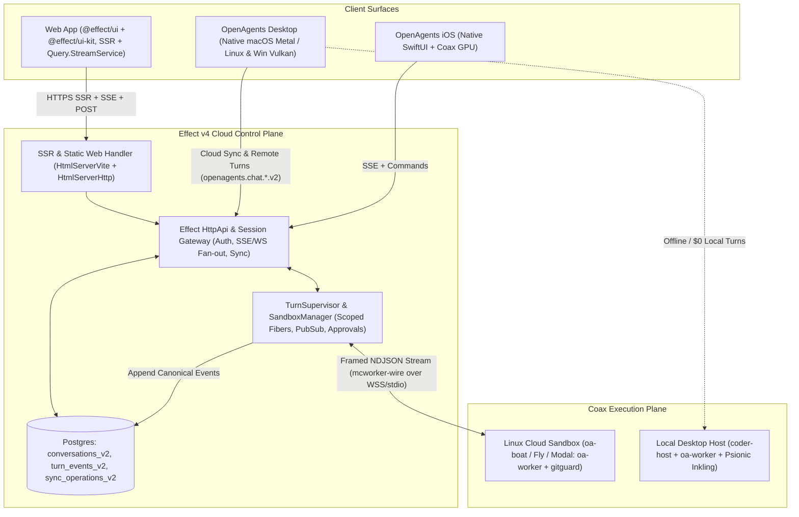

# Full Architecture Spec: Effect v4 + `@effect/ui` Web & Cloud Control Plane over Coax `oa-worker`

> **Status:** Proposed target architecture (gated on [`half-day-sprint.md`](half-day-sprint.md)).
> **Core Principle:** **One Coax coder runtime, one canonical session/event wire, multiple surfaces.** Coax owns the autonomous coding agent and `#authority` policy invariants; Effect v4 owns the Web UI (`@effect/ui`) and Cloud Control Plane; native Desktop (`OpenAgents.app`) and iOS remain native and share the exact same cloud session protocol.

---

## 1. System Topology



### Responsibility Split

| Layer | Owner | Why |
| --- | --- | --- |
| **Agent loop, tools, permissions, compaction, prompt caching, subagents, `gitguard`** | **Coax (`openagents/runtime/oa-worker.coax` + `openagents/core/`)** | ~30k LOC of `#authority` mutation-tested logic already powering Desktop and `oa-boat`. Zero logic drift across Web, Desktop, and Mobile. |
| **Local `$0` GPU inference** | **Coax + Psionic (`psionic-inkling-serve`)** | Native Metal/CUDA inference on Desktop; stays untouched. |
| **Web UI (chat, approvals, diffs, files, settings, billing)** | **Effect v4 + `@effect/ui` + `@effect/ui-kit` + Tailwind v4** | Pure TS/Vite, zero React, zero third-party UI runtime deps, built-in `Query.StreamService`, chat-grade `VirtualList`, `Markdown`, `Story.explore`, and MCP DevTools. |
| **Cloud Control Plane (auth, sessions, Postgres event log, SSE/WS fan-out, sandbox orchestration)** | **Effect v4 (`HttpApi`, `Stream`, `PubSub`, `Scope`, SQL)** | Structured concurrency, typed errors, fiber interruption, and end-to-end `Schema` sharing with `@effect/ui`. |
| **Native Desktop & Mobile UX** | **Existing `apps/openagents-desktop/` & `apps/openagents-ios/`** | Already shipped; syncs with the same cloud Postgres event stream (`openagents.chat.event.v2` / `openagents.chat.sync.v2`). |

---

## 2. Wire Contracts & Zero-Drift Event Mapping

The architecture avoids inventing a second incompatible agent protocol. It bridges two existing Coax-defined contracts:

1. **Execution-plane protocol:** `coax/lib/agent/engine/mcworker-wire.coax` (bidirectional NDJSON over `oa-worker` stdin/stdout).
2. **Canonical client/persistence protocol:** `coax/web/api/account-chat-cloud-wire.coax` (`openagents.chat.event.v2` and `openagents.chat.sync.v2`).

### Upgrading Cloud Sandbox Execution from Single-Turn `--json` to Long-Lived Framed `mcworker-wire`

Today `coax/lib/boat/sandbox-policy.coax` runs single-turn `oa-worker --json --model <M> --prompt-file <P>` (translating output via `fww_session_translate_mww` into `openagents.session.v1` in Allow-All mode). That works for fire-and-forget turns, **but lacks interactive approvals, mid-turn steers, follow-up queues, and warm multi-turn prompt caching**.

In the full architecture, each Cloud Sandbox runs a lightweight **Sandbox Bridge** (a tiny Effect/Node or Coax TCP/WebSocket shim inside the container) attached to a resident `oa-worker` process speaking full `mcworker-wire.coax`:

| Direction | `mcworker-wire.coax` Frame | Canonical Cloud Event (`openagents.chat.event.v2`) / API | Persisted in Postgres? |
| --- | --- | --- | --- |
| Owner → Worker | `MWW_TASK` (`{"task", "session", "cwd", "model", "effort"}`) | `POST /v2/conversations/:cid/turns` → `CC_EV_STARTED` + `CC_EV_USER_MESSAGE` | Yes |
| Owner → Worker | `MWW_RECALL` (`{"recall": [...]}`) | Rehydrates a fresh sandbox `oa-worker` from Postgres history after sandbox eviction/restart | Derived from DB |
| Owner → Worker | `MWW_ANSWER` (`{"answer", "ticket", "why"}`) | `POST /v2/conversations/:cid/approvals/:ticket` → `CC_EV_APPROVAL` (`approved`/`denied`) | Yes |
| Owner → Worker | `MWW_STEER` / `MWW_QUEUE` / `MWW_INTERRUPT` | `POST /v2/conversations/:cid/steer` / `queue` / `interrupt` | Yes |
| Owner → Worker | `MWW_STOP` (`{"stop": true}`) | `POST /v2/conversations/:cid/turns/:tid/cancel` → `CC_EV_CANCELLED` | Yes |
| Worker → Owner | `MWW_THOUGHT` (`{"kind":"thought","text"}`) | `CC_EV_THINKING_DELTA` (coalesced into chunked rows + streamed live) | Coalesced |
| Worker → Owner | `MWW_REPLY` (`{"kind":"reply","text"}`) | `CC_EV_TEXT_DELTA` (coalesced into chunked rows + streamed live) | Coalesced |
| Worker → Owner | `MWW_COMMAND` / `MWW_VIEW` | `CC_EV_TOOL_CALL` + `CC_EV_TOOL_RESULT` (with diff payload when edit/write) | Yes |
| Worker → Owner | `MWW_ASK` / `MWW_PERMIT` | `CC_EV_APPROVAL` (`pending`, with `ticket`, `command`/`options`) | Yes |
| Worker → Owner | `MWW_TODOS` / `MWW_META` | `CC_EV_TOOL_PROGRESS` / `openagents.chat.meta.v2` (title + checklist) | Yes |
| Worker → Owner | `MWW_STATS` / `MWW_ATTEMPT` | `CC_EV_USAGE` (enforcing provenance: `compute == "local" => cost_msat == 0`) | Yes |
| Worker → Owner | `MWW_ENDED` (`{"kind":"ended","ending","text"}`) | `CC_EV_COMPLETED` / `CC_EV_FAILED` / `CC_EV_CANCELLED` | Yes |

**Single-source schema discipline:** Effect `Schema` definitions in `packages/protocol/` mirror the exact field names, enums, and bounds registered in `proto/registry.json` and `account-chat-cloud-wire.coax`, validated in CI against golden fixtures exported by Coax tests.

---

## 3. Effect v4 Cloud Control Plane

The control plane is structured as composable Effect `Layer`s so every service can run in-memory during `Play` tests and scale out in production.

### 3.1 Core Effect Services

1. **`SessionEventStore` (Postgres)**
   - Append-only `chat.turn_events_v2` keyed by `(conversation_id, sequence)` with monotonic `sequence` per conversation.
   - Idempotency receipts (`chat.sync_operations_v2` keyed by `(account, operation)` with payload SHA-256 digest) preserving exact replay/conflict semantics for Desktop write-through sync (`openagents.chat.sync.v2`).
   - Supports cursor replay (`after_sequence` / HTTP `Last-Event-ID`) so dropped browser/mobile connections resume seamlessly without missing a single delta or approval prompt.

2. **`SandboxManager`**
   - Manages the lifecycle of per-workspace Linux sandboxes (GCE `oa-boat` VMs, Fly Machines, or Modal/E2B containers) containing:
     - Pre-baked compiled Linux `oa-worker` + `gitguard` binaries (immutable image per release SHA).
     - Ephemeral short-lived credentials injected via `0600` `/tmp/oa-run-*.env` sourced and immediately unlinked before any user/repo command executes (preserving `coax/lib/boat/sandbox-policy.coax`'s zero-secret-on-disk invariant).
     - Automatic git clone/worktree setup + warm pool & idle hibernation (e.g., 15-minute idle timeout → snapshot/evict, rehydrated on next turn via `MWW_RECALL`).

3. **`TurnSupervisor`**
   - Owns one scoped Effect `Fiber` per active turn (`Scope` + `PubSub` per conversation).
   - Reads framed `mcworker-wire` lines from the sandbox bridge, persists durable milestones (and coalesced text/thinking chunks every ~250 ms or on block boundary) into `SessionEventStore`, and broadcasts live deltas to all attached SSE/WebSocket clients (Web tabs, Desktop, iOS) simultaneously.
   - Enforces turn budgets, approval timeouts, and clean cancellation (`MWW_STOP` → grace period → sandbox process group `SIGKILL`).
   - Survives client disconnects: closing a browser tab never kills a running cloud turn; re-opening the URL replays persisted events and attaches to the live `PubSub`.

4. **`Auth & Metering`**
   - Validates user sessions (HttpOnly cookies on Web; bearer/NIP-98 tokens on Desktop & Mobile).
   - Mints short-lived scoped upstream gateway tokens for the sandbox `oa-worker` — raw provider API keys never enter browser bundles, Effect UI state, or persisted sandbox disks.
   - Records `CC_EV_USAGE` metering & receipts, delegating billing/wallet admission decisions to existing `#authority` Coax policy boundaries (or shared `oa-api` endpoints during coexistence).

### 3.2 Deployment Topology (Serverless Web + Stateful Gateway)

- **Static assets + SSR shell (`HtmlServerVite` with `serverOutDir`):** Emits static client bundles (`dist/client/`) plus a standard Web Handler (`dist/server/index.js` exporting `handler` and `dispose` via `HttpRouter.toWebHandler`). Deployable to **Vercel**, **Cloudflare**, or directly from the Effect Node/Bun container.
- **Long-lived SSE/WS Session Gateway & `TurnSupervisor`:** Must run on a **long-lived container host** (Fly.io, Cloud Run with min-instances/streaming, or GCE alongside `oa-boat`), **not** short-timeout serverless functions, because live coding-agent turns hold open streaming connections to sandboxes and fan out approvals/steers across minutes.
- **Per-request auth SSR rule (per `HtmlServerHttp.ts`):** Do *not* pass user-scoped services into a singleton `HtmlServerHttp.layerHttp` Layer (which shares services across requests). Use `layerHttp` for public/marketing/docs routes (`prerender` + static), and invoke `HtmlServer.renderToHtml` inside an authenticated per-request handler (or render an auth shell + hydrate `Query.StreamService`) for private workspaces.

---

## 4. Effect UI Frontend Architecture (`@effect/ui`)

### 4.1 Component Hierarchy & State Ownership

Because `@effect/ui` re-runs a component's `view` whenever that component handles a `Message`, **state isolation is a first-class architectural invariant**:

```text
App (Router + AuthProvider + ThemeProvider)
├── Sidebar (Query: ConversationList, search filter, new chat)
└── WorkspacePage (keyed by conversationId)
    ├── SessionHeader (title, model/effort badge, branch/sandbox status, Stop/Share)
    ├── TranscriptPane (reads Query.StreamService: SessionStream)
    │   └── VirtualList (contentAlignment: "end", followEnd: true, prepend history)
    │       ├── MessageRow [h.lazy, keyed by msgId] (completed turns — zero re-render on stream)
    │       │   ├── ThinkingBlock (@effect/ui-kit Collapsible)
    │       │   ├── MarkdownBody (@effect/ui/html Markdown.view)
    │       │   └── ToolCallGroup (Collapsible command/view/diff summaries)
    │       └── StreamingTailRow (ONLY row re-rendered on token deltas)
    ├── ApprovalBanner (mounted only when pendingPermit != null; Allow/Deny/Options)
    ├── QueueDrawer (pending steers & queued follow-ups from MWW_QUEUED)
    ├── Composer (ISOLATED Component: own draft Model, attachments FileDrop, Send/Steer/Stop)
    └── InspectorTabs (@effect/ui-kit Tabs — lazy loaded via Component.lazy)
        ├── DiffTab (imperative Shiki/diff renderer wrapped via Mount)
        ├── FileViewerTab (syntax-highlighted file viewer via Mount)
        ├── TerminalTab (optional xterm.js attach via Mount / Html.customElement)
        └── SubagentsTab (live delegated subagent status cards)
```

### 4.2 Key Effect UI Patterns

- **Streaming via `Query.StreamService`:** `SessionStream` owns one shared SSE connection per `conversationId`, automatically reconnecting with `Last-Event-ID` on transient drops and closing after `idleTimeToLive` once the user navigates away.
- **Optimistic UX:** Submitting a prompt or clicking Approve applies an optimistic patch (`Query.StreamService` optimistic updates) while the `Command.Service` (`mode: "queue"` for user sends, `mode: "switch"` for search/filter) completes; reconciled by sequence number when the server event arrives.
- **Imperative IDE widgets without React:** Heavy editor/terminal/diff libraries (CodeMirror 6, Shiki, xterm.js) live behind small `@effect/ui` `Mount` wrappers or `Html.customElement` boundaries — clean lifecycle setup/teardown inside Effect `Scope`, zero framework lock-in.
- **Accessibility & keyboard-first ergonomics:** All dialogs, command palette (`Combobox`), popovers, menus, drawers, tabs, and file pickers come from `@effect/ui-kit`'s 51 Base-UI-grade headless modules styled with Tailwind v4, plus `HtmlSubscription` for global shortcuts (`⌘K` palette, `Esc` interrupt, `⌘Enter` submit).
- **Agent-drivable DevTools & Verification:**
  - `Story` + `Story.check` (Schema property shrinking) + `Story.explore` (exhaustive concurrency race checking across approvals, steers, cancellations, and reconnects).
  - `Play` tests running full multi-component flows in Node on `TestClock` with zero browser overhead.
  - `@effect/ui-devtools` MCP server in dev so OpenAgents' own coding agents can inspect models, scrub time-travel history, and verify UI regressions end-to-end.

---

## 5. Phased Rollout Plan

### Phase 0 — Half-Day Feasibility Spike (4 hours)
Execute [`half-day-sprint.md`](half-day-sprint.md). Pass all Hard Gates before creating production packages or migrating any routes.

### Phase 1 — Production Web Chat & Live Multi-Turn Cloud Sandboxes (2–3 weeks)
- Stand up the Effect v4 workspace (`packages/protocol`, `packages/server`, `packages/web`) with pinned `Effect-TS/ui` SHA (upgrading to npm semver once published).
- Ship the long-lived Sandbox Bridge around Linux `oa-worker` (`mcworker-wire` over authenticated WebSocket/stdio) alongside existing `oa-boat` infrastructure, keeping `oa-worker --json` working for batch/legacy callers.
- Persist canonical `openagents.chat.event.v2` events in Postgres so Desktop (`apps/openagents-desktop/`), iOS (`apps/openagents-ios/`), and the new `@effect/ui` Web app view and control the exact same cloud conversations in real time.

### Phase 2 — Web IDE Parity & Workspace Controls (3–5 weeks)
- Add lazy-loaded (`Component.lazy`) right-hand panes: `DiffTab`, `FileViewerTab`, `SubagentsTab`, `Todos`/`Checkpoints`, and optional `TerminalTab` (xterm.js attached to the sandbox PTY).
- Add Full Auto / Plan Mode / Model & Effort pickers (`@effect/ui-kit` `Select` / `Combobox`), GitHub repo selector, and `Usage` HUD driven by `CC_EV_USAGE` / `MWW_STATS`.
- Add Playwright E2E regression checks (including `VirtualList` `<1px` scroll-anchor check on history pagination).

### Phase 3 — Optional: Sans-I/O `openagents/core/` → `@openagents/coder-wasm` (Only When Earned)
*Do not start Phase 3 until Phase 1–2 are shipped and we observe a concrete latency/cost need for zero-sandbox turns (e.g., pure chat, planning, or SaaS-tool turns that never invoke `Bash` or local git).*
- Extract `oa-worker.coax`'s remaining turn/prompt/compaction orchestration into an I/O-free state machine in `openagents/core/` (`oa_session_step(state_ptr, in_ptr, in_len, out_ptr, out_cap)`), moving multi-MB stack buffers (`FwHist`, `FwBufs`) into caller-owned linear memory.
- Compile `openagents/core/` via `coax c --library` → `clang --target=wasm32-wasip1 -mexec-model=reactor` into a CI-published `@openagents/coder-wasm` package wrapped as an Effect `Layer`.
- Effect v4 interprets the yielded I/O effects (LLM SSE via `HttpClient`, SaaS tools directly, and lazy-booting a Linux sandbox only on the first `Bash`/`Read`/`Edit` tool call) — keeping 100% single-source `#authority` parity with Desktop.

---

## 6. Explicit Non-Goals & Guardrails

1. **No Coax-to-TS rewrite of coder policy:** Permissions, compaction, prompt-cache rules, sandboxing, and provider wire formats stay owned by Coax.
2. **No replacement of native Desktop or iOS with `@effect/ui-native` or `expo/exact`:** `@effect/ui-native` is nascent (Fabric primitives only) and `expo/exact` is pre-1.0 with daily breaking changes. Revisit only after stable 1.0 releases.
3. **No floating `pkg.pr.new/@main` in production:** Always pin exact `Effect-TS/ui` commit SHAs and mirror tarballs/lockfiles in CI until `Effect-TS/ui` merges into `Effect-TS/effect` and ships versioned npm releases.
4. **No raw secrets in browser or sandbox disk:** Provider keys stay in the Cloud Control Plane / retail gateway; sandbox env files remain `0600` and are unlinked before `oa-worker` executes user commands.
5. **Repo boundary hygiene:** When adding TypeScript packages inside this monorepo, keep them cleanly scoped under a dedicated workspace root (e.g., `apps/openagents-effect/` or a dedicated repo) with explicit `tools-check` compliance (`Firm reason:` headers where required) and zero impact on `apps/openagents-desktop/build.sh` or `coax/remote/` green-main gates.
