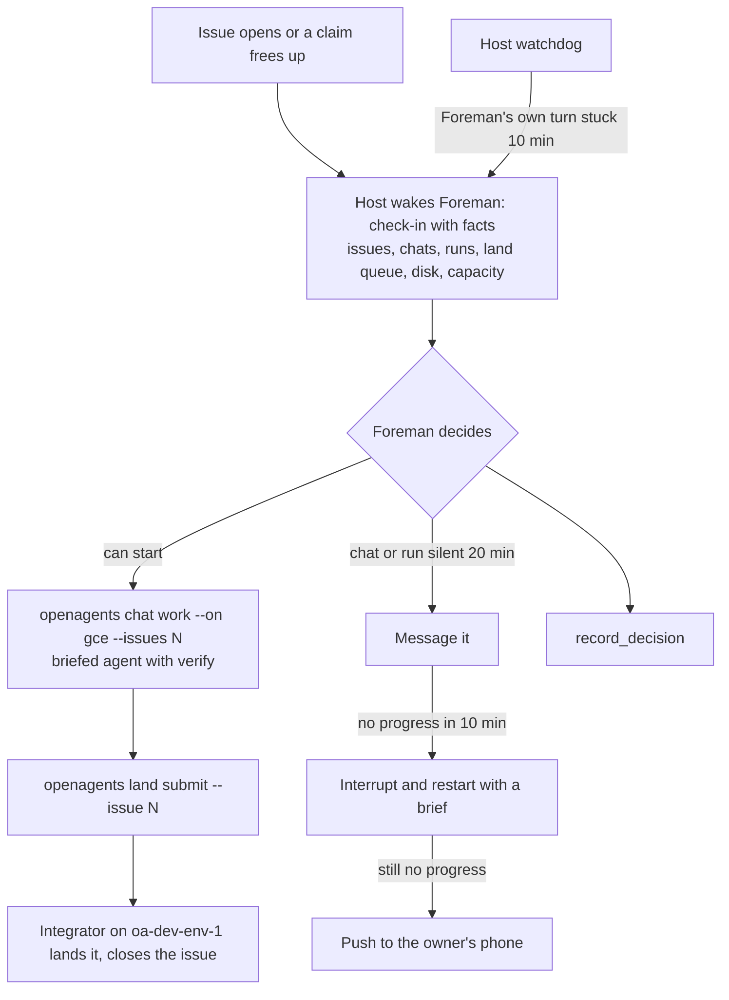

# Foreman roadmap

This roadmap orders the work that would let Foreman run issue work end to
end without a person prompting it, and without a terminal session in the
middle. Every item is a **proposal** unless it says otherwise. Each one ties
back to a lesson in [lessons-learned.md](lessons-learned.md) (L1–L13) and
names the crate or file that would change.

Sizes: **S** is under a day, **M** is one to three days, **L** is a week or
more.

## The target loop

## Phase 1: now

### 1. A host watchdog over Foreman's own turn

- **What:** When Foreman's chat has been `working` with no new output for 10
  minutes, the host interrupts the turn and starts a check-in that says
  which tool call was stuck and for how long. Every shell call Foreman runs
  gets a default timeout.
- **Why:** L2. One `curl` with no timeout froze Foreman from 14:11 to 18:24.
  `Foreman::due` skips check-ins while the chat is busy, so a hung turn
  silences the only alarm.
- **Where:** `apps/openagents/crates/engine/src/foreman.rs` (`due`, a new
  `Stuck` wake reason and `DecisionEntry::Outcome { status: "stuck" }`),
  `doc_host/foreman.rs` (track the last output time from the session rows
  it already watches). The shell timeout goes in the harness settings for
  Foreman's chat and in `crates/agent-lab/src/templates/foreman.md`.
- **Acceptance:** A fake-clock engine test: Foreman's chat stays `working`
  with no output for 10 minutes, the host interrupts it, starts one
  check-in, and logs a `stuck` outcome. A second test: a busy turn that
  keeps producing output is left alone.
- **Size:** S.

### 2. Check-ins and standing authority on by default

- **What:** When the computer has a saved agent named Foreman, the host
  picks its chat and turns 10-minute check-ins and standing authority on.
  The settings card and Foreman's chat say so, and turning either off is one
  tap. When check-ins are off, every Foreman answer starts with one line
  saying so.
- **Why:** L4. #11965 shipped, but no `foreman/` state exists on the owner's
  Mac and Foreman made zero `record_decision` calls on 2026-10-17. The owner
  has already said "Don't ask permission for routine coordination".
- **Where:** `apps/openagents/crates/proto/src/foreman.rs`
  (`ForemanSettings::default`), `doc_host/foreman.rs` (choose the candidate),
  `apps/openagents/crates/ui/src/settings/foreman.rs`. The authority grant
  stays logged as a `DecisionEntry::Authority` entry.
- **Acceptance:** On a fresh test host with the dedicated test account,
  "Use agent" for Foreman leads to a first check-in within 10 minutes with
  no settings change, and the decision log shows the grant. Turning
  authority off makes the next check-in say it can only report.
- **Size:** S.

### 3. Coordinating sessions run as app chats

- **What:** A session that coordinates issues runs as an app chat on the
  desktop engine: Foreman itself, or a chat Foreman starts. The terminal
  gets a way to open one, for example `openagents chat open --project
  openagents "brief"`, which starts an app chat on this computer through
  the control socket and prints its id, so a person in a terminal hands off
  to an app chat instead of coordinating there.
- **Why:** L1. The 71-minute stall and the four-hour integration ran in a
  terminal session that Foreman, the phone, and the website couldn't see or
  steer.
- **Where:** `AGENTS.md` (one rule, replacing ad hoc Task-tool subagents for
  issue work), `crates/openagents-cli/src/chat.rs`, the engine's existing
  `create_chat` path (`apps/openagents/crates/mcp/src/tools.rs`),
  `templates/foreman.md`.
- **Acceptance:** A chat opened from the terminal appears in `list_chats`,
  in the phone's chat list, and on the website, and a message sent from the
  phone reaches it within 10 seconds.
- **Size:** M.

### 4. A stall rule that acts

- **What:** Two new host events. `ChatStalled`: a managed chat is `working`
  with no new output for 20 minutes. `ClaimNoProgress`: a claimed issue has
  had no commit naming it, no push to its branch, and no comment for 20
  minutes. On either, Foreman follows a ladder and records each step:
  message the chat; after 10 more minutes, interrupt it and restart it with
  a brief; after that, tell the owner (item 8). The six-hour stale-claim
  event stays for claims with no chat at all.
- **Why:** L3. At 19:13 Foreman had the right signal and only offered. The
  audit asks for exactly this rule.
- **Where:** `apps/openagents/crates/engine/src/foreman.rs` (the `Event`
  enum, `observe`, `observe_claims`), `templates/foreman.md` (the ladder).
  The `AGENTS.md` claim rule gets one sentence: Foreman may take over a
  claim whose holder made no progress through the ladder.
- **Acceptance:** Fake-clock tests for both events, including no event for a
  chat that is waiting on a build lease (it has output) and one event per
  stall, not one per check-in.
- **Size:** M.

### 5. Dispatch through `openagents chat work --on gce`

- **What:** Foreman starts issue work with the briefed agent on the GCE pool
  instead of `create_chats` with a hand-written brief. It runs `openagents
  cloud up` when the pool has no hosts, and reads runs from `GET /v1/work`.
  `create_chats` stays for work that isn't an issue (an investigation, a
  deploy).
- **Why:** L6 and L8. The briefed agent compiles and tests its own change
  on its own host, so compile errors never reach integration, and nothing
  builds on the owner's Mac. The pool grant was live all day with 0 hosts.
- **Where:** `templates/foreman.md`; a new app tool `work_issues` that wraps
  `POST /v1/work` so Foreman doesn't shell out
  (`apps/openagents/crates/mcp/src/tools.rs`, using the SDK client from
  [sdk-additions.md](sdk-additions.md#s5-work-and-cloud-pool-client)).
- **Acceptance:** On a test repository with the test account, a check-in
  that sees a new startable issue starts one `/v1/work` run, the run shows
  on the OpenAgents Cloud board, and `pgrep -x cargo` on the orchestrating
  computer stays at 0.
- **Size:** M.

### 6. Land through `openagents land submit`

- **What:** Every brief Foreman writes ends with "land with `openagents land
  submit --issue N`; don't push to `main`". Each check-in reads `openagents
  land status` and reports waiting and failed entries. Foreman never asks a
  chat to rebase and push by hand.
- **Why:** L7. The landing queue's integrator hadn't run for five days on
  2026-10-17 while one session hand-merged 11 branches.
- **Where:** `templates/foreman.md`, the brief template in
  `scripts/work/work_issue.py` (it already supports `land: queue`), and a
  `land_status` app tool (item 7).
- **Acceptance:** Over one working day, every code change Foreman dispatched
  reaches `main` through a landing entry, and `land show` has a record for
  each.
- **Size:** S.

### 7. Machine and queue facts in every check-in

- **What:** The host adds a short facts block to each check-in prompt: free
  disk, cargo and build lease counts, the capacity book, landing queue
  entries, GCE pool hosts, and production health from read-only probes. A
  `machine_status` app tool returns the same block on demand.
- **Why:** L5, L8, L10, L11. Foreman's watch was a shell loop that died with
  the harness, used a wrong build count, and wrote to production.
- **Where:** `apps/openagents/crates/engine/src/foreman.rs` (`prompt`),
  `doc_host/foreman.rs` (collect them on the existing 5-minute GitHub
  timer), `crates/coder-lease` (lease counts), `crates/openagents-cli`
  (`capacity`, `land status`, `cloud status` as library calls).
- **Acceptance:** A prompt test that includes the block; disk under 100 GiB
  and builds over the cap become events that wake Foreman.
- **Size:** M.

## Phase 2: next

### 8. Push to the owner's phone

- **What:** A stall that reaches the last rung of the ladder, a disk or
  capacity alarm, and any question Foreman needs the owner to answer send
  one push to the owner's phone. Tapping it opens Foreman's chat.
- **Why:** L1 and L3. The owner found the stall by asking, at 19:30.
- **Where:** `crates/push-gateway` (a new registered wake constant), the
  engine's Foreman module, and the phone's notification handling in
  `apps/openagents/crates/mobile`.
- **Acceptance:** On a test device with the test account, a forced stall
  produces exactly one push, and the push opens Foreman's chat.
- **Size:** M.

### 9. Act on terminal sessions, or refuse them

- **What:** For a claim whose session matches no app chat, Foreman reads the
  local run record (`~/.openagents/runs/<id>/run.json` lists the run's
  harness sessions and root pid), checks the pid, and reads the session's
  last activity (the Claude Code session file's last write, or
  `~/.openagents/activity/<pid>.json` for Coder). If the session is alive
  and progressing, Foreman reports it. If it is dead or silent past the
  stall window, Foreman releases the claim with a note and dispatches the
  issue (item 5). It never types into a terminal.
- **Why:** L1. On 2026-10-17 Foreman worked this out by hand at 19:55 (pid
  98355, started 00:39) after the owner asked.
- **Where:** a `list_runs` app tool over `scripts/dev/agent-run.py`'s run
  records (and a `last_activity` field it writes), `crates/coder-lease/src/claims.rs`
  (claims already record the session's pid and start time),
  `templates/foreman.md`.
- **Acceptance:** Fixture tests with a fake run directory: a live
  progressing run, a live silent run, and a dead run each give the right
  report and action.
- **Size:** M.

### 10. System One judgments for the hard calls

- **What:** Three typed questions, each with a measured baseline:
  "has this session made progress since the last check-in?" (over the last
  output, commits, and build activity), "is this test failure also on
  `main`?" (over two test outputs), and "do these two entries overlap?"
  (over changed paths and packages). Foreman and the integrator ask them
  through `POST /v1/systemone` and record the receipt with the decision.
- **Why:** L3 and L9. The `main` baseline comparison cost about 50 minutes,
  and "is it stalled" was a guess.
- **Where:** `questions/` (one file per set), `crates/jev`, a `judge` app
  tool, `coder::task::land_plan` for overlap. Follow
  `.agents/skills/typesafe-ai/SKILL.md`.
- **Acceptance:** Each question set has a recorded baseline and error rates
  on held-out examples taken from 2026-10-16 and 2026-10-17, written under
  `docs/decision-models/measurements/`.
- **Size:** M each.

### 11. A Foreman dashboard

- **What:** One view, on the website and the phone, of what Foreman sees:
  open issues with who is on each, stall minutes, landing queue entries,
  pool hosts, the last check-in, and the decision log. It's a Rust Native
  view, so desktop, phone, and web share it.
- **Why:** L1 and L13. The owner asked "Status of open issues??????" at
  12:48 and "Tell me the status of them" at 19:30.
- **Where:** a Rust Native view (in `crates/agent-lab` or a new crate), its
  data from the decision log route (item 12) and `GET /v1/work`; the web
  page in `crates/openagents-web`.
- **Acceptance:** The dashboard and a check-in taken at the same minute
  name the same issues, holders, and stalls.
- **Size:** L.

### 12. The decision log on the account

- **What:** The host mirrors `decisions.jsonl` to the account, so the phone,
  the website, and a replacement host read the same log.
- **Why:** L12 and L13. Today the log is a file on one computer
  (`foreman/decisions.jsonl`), and on 2026-10-17 it was empty.
- **Where:** the SDK and a web route (see
  [sdk-additions.md](sdk-additions.md#s7-decision-log)),
  `doc_host/foreman.rs`.
- **Acceptance:** A decision recorded on the test host is readable through
  the SDK from another device within a minute.
- **Size:** M.

### 13. Measure Foreman

- **What:** Two numbers per day, computed from GitHub and chat status:
  minutes from code complete to close for each issue, and stall minutes per
  chat and for Foreman itself. Also: check-ins on time, and actions per
  check-in. `openagents foreman report --day YYYY-MM-DD` prints them.
- **Why:** L13. The 2026-10-17 numbers exist only because an audit counted
  them by hand: 4 h 47 min to 5 h 17 min from code complete to close for the
  coordinator's 11 issues, against 21–35 minutes for Foreman's three fastest
  dispatches that evening.
- **Where:** the engine's Foreman module (it already sees chat status and
  issue events), `crates/openagents-cli`.
- **Acceptance:** The report for 2026-10-17, run against recorded data,
  gives the audit's numbers within five minutes.
- **Size:** M.

## Phase 3: later

### 14. Foreman off the owner's Mac

- **What:** Foreman's chat runs on a headless engine on a cloud host, so a
  desktop restart or a full disk on the Mac can't stop it.
- **Why:** L2, L5, L8. On 2026-10-17 a desktop restart at 18:21 ended
  Foreman's session, and the Mac's disk was the shared bottleneck.
- **Where:** the headless engine on a cloud computer (#11852), NIP-HOST
  grants for Foreman's host, `docs/cloud/computers.md`.
- **Acceptance:** Restarting the owner's desktop app doesn't interrupt a
  Foreman check-in.
- **Size:** L.

### 15. Server-side schedule and a missed check-in alarm

- **What:** The account notices when Foreman's computer misses two check-ins
  in a row and tells the owner. Later, the server ticks the schedule
  itself.
- **Why:** L2 and L5. Ticks run only on the computer today
  (`crates/openagents-web/src/account_schedules.rs`), so a dead computer is
  silent.
- **Where:** `account_schedules.rs`, and the planned schedule actor in
  `docs/architecture/actors.md`.
- **Acceptance:** Stopping the test host produces one notice after two
  missed intervals.
- **Size:** M.

### 16. Machine actions as logged scopes

- **What:** Pruning a build cache and stopping a process become explicit
  scopes beside `Message`, `Create`, `Steer`, and `Stop`, granted and logged
  like them, or go to a chat. Deploys stay with the owner.
- **Why:** L12. Foreman deleted caches and stopped a deploy script with no
  record.
- **Where:** `apps/openagents/crates/proto/src/foreman.rs` (`Scope`),
  `templates/foreman.md`.
- **Acceptance:** A prune Foreman does shows in the decision log with its
  scope; with the scope off, the host refuses it.
- **Size:** S.

### 17. Replay a bad day as a Foreman test

- **What:** An Agent Lab suite that replays 2026-10-17's events (issues
  opening, branches finishing, the disk falling, a silent coordinator) at
  speed, and scores whether Foreman dispatched, landed, and escalated in
  time.
- **Why:** L13. Foreman's current tests check that it reaches its sources,
  not its judgment (`docs/agent-lab/foreman.md`, "Its tests").
- **Where:** `crates/agent-lab` (suites, A5 fixed suites), a fixture under
  `docs/agent-lab/`.
- **Acceptance:** The suite fails a Foreman that only offers on a stall and
  passes one that follows the ladder.
- **Size:** L.

### 18. Foreman for any repository and any harness

- **What:** The same loop through the public SDK, so an outside harness can
  run a Foreman over its own repositories and agents.
- **Why:** The owner is moving from bare Claude Code to the OpenAgents
  harness on cloud infrastructure; the primitives should be public.
- **Where:** [sdk-additions.md](sdk-additions.md).
- **Acceptance:** The SDK Foreman example
  (`crates/openagents-sdk/examples/foreman.rs`) runs a check-in loop against
  a test repository with only SDK calls.
- **Size:** L.

## Order and dependencies

| Order | Item | Depends on |
| --- | --- | --- |
| 1 | Host watchdog | — |
| 2 | On by default | — |
| 3 | App chats for coordination | — |
| 4 | Stall rule | 1, 2 |
| 5 | Dispatch through `chat work` | 2 |
| 6 | Land through the queue | 5 |
| 7 | Facts in every check-in | 2 |
| 8 | Push to the phone | 4 |
| 9 | Terminal sessions | 4 |
| 10 | System One judgments | 4 |
| 11 | Dashboard | 12, 13 |
| 12 | Decision log on the account | 2 |
| 13 | Measurement | 4 |
| 14–18 | Later | Phase 1 and 2 |

Items 1, 2, 3, and 6 are small and independent; together they would have
removed the 71-minute stall, the 4-hour Foreman freeze, and most of the
hand merging on 2026-10-17.
