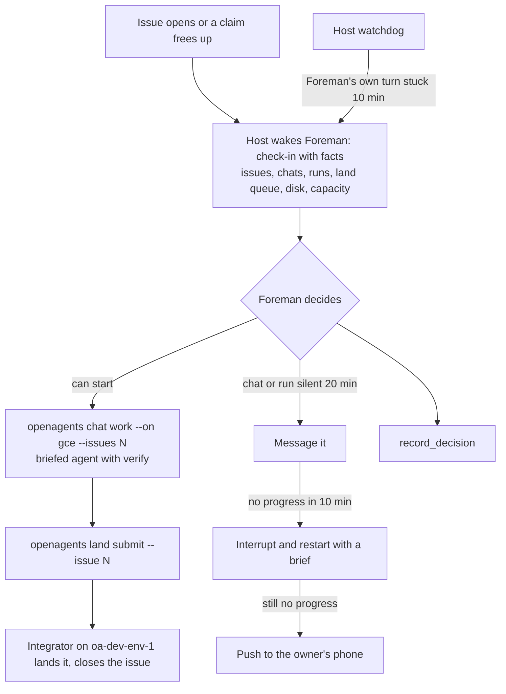

# Foreman roadmap

This roadmap orders the work that would let Foreman run issue work end to
end without a person prompting it, and without a terminal session in the
middle. Every item is a **proposal** unless it says otherwise. Each one ties
back to a lesson in [lessons-learned.md](lessons-learned.md) (L1–L13) and
names the crate or file that would change.

Sizes: **S** is under a day, **M** is one to three days, **L** is a week or
more.

**One rule covers every item:** nothing in this roadmap is built for
Foreman alone. Foreman is a custom agent made of public SDK primitives, and
anyone can fork it ([built-on-the-sdk.md](built-on-the-sdk.md)). So the
watchdog, wakes, stall rule, grants, decision log, dashboard, and phone
notifications below are general agent capabilities that Foreman uses, and a
fork gets them too. Items 19 to 22 remove the Foreman-only code that exists
today.

**Order (revised 2026-10-17 after Foreman's own review of these docs).**
Phase 1 is held to six items and ships before anything else: the watchdog,
on by default, coordination in app chats, the stall rule, machine actions
as logged scopes (moved up from Phase 3), and the bad-day replay (moved up
from Phase 3), which is the acceptance harness for the rest. Making Foreman
forkable is the destination, but it doesn't delay Phase 1: Phase 1 is built
keyed by agent ID with no name checks, and items 19 to 22 generalize what
proves itself. Item numbers are stable IDs, not the order.

## The target loop

## Phase 1: now (ship first)

### 1. A host watchdog over Foreman's own turn

- **What:** When Foreman's chat has been `working` with no new output for 10
  minutes, the host interrupts the turn and starts a check-in that says
  which tool call was stuck and for how long. Every shell call Foreman runs
  gets a default timeout.
- **Why:** L2. One `curl` with no timeout froze Foreman from 14:11 to 18:24.
  `Foreman::due` skips check-ins while the chat is busy, so a hung turn
  silences the only alarm.
- **Where:** `apps/openagents/crates/engine/src/foreman.rs` (`due`, a new
  `Stuck` wake reason and `DecisionEntry::Outcome { status: "stuck" }`),
  `doc_host/foreman.rs` (track the last output time from the session rows
  it already watches). The shell timeout goes in the harness settings for
  Foreman's chat and in `crates/agent-lab/src/templates/foreman/`.
- **Acceptance:** A fake-clock engine test: Foreman's chat stays `working`
  with no output for 10 minutes, the host interrupts it, starts one
  check-in, and logs a `stuck` outcome. A second test: a busy turn that
  keeps producing output is left alone.
- **Size:** S.
- **Status:** built in #12029. The window is `stuck_minutes` in the wake
  settings (default 10); the shell cap is `autonomy.shell_timeout_secs` on
  the agent definition, so any agent can have both.

### 2. Check-ins and standing authority on by default

- **What:** When the computer has a saved agent named Foreman, the host
  picks its chat and turns 10-minute check-ins and standing authority on.
  The settings card and Foreman's chat say so, and turning either off is one
  tap. When check-ins are off, every Foreman answer starts with one line
  saying so.
- **Why:** L4. #11965 shipped, but no `foreman/` state exists on the owner's
  Mac and Foreman made zero `record_decision` calls on 2026-10-17. The owner
  has already said "Don't ask permission for routine coordination".
- **Where:** `apps/openagents/crates/proto/src/foreman.rs`
  (`ForemanSettings::default`), `doc_host/foreman.rs` (choose the candidate),
  `apps/openagents/crates/ui/src/settings/foreman.rs`. The authority grant
  stays logged as a `DecisionEntry::Authority` entry.
- **Acceptance:** On a fresh test host with the dedicated test account,
  "Use agent" for Foreman leads to a first check-in within 10 minutes with
  no settings change, and the decision log shows the grant. Turning
  authority off makes the next check-in say it can only report.
- **Size:** S.
- **Status:** built in #12030, keyed by the definition rather than the name:
  an agent definition's `autonomy` declares `check_ins`, `every_minutes`,
  and `authority`, and the host picks the one declaring chat on the
  computer.

### 3. Coordinating sessions run as app chats

- **What:** A session that coordinates issues runs as an app chat on the
  desktop engine: Foreman itself, or a chat Foreman starts. The terminal
  gets a way to open one, for example `openagents chat open --project
  openagents "brief"`, which starts an app chat on this computer through
  the control socket and prints its id, so a person in a terminal hands off
  to an app chat instead of coordinating there.
- **Why:** L1. The 71-minute stall and the four-hour integration ran in a
  terminal session that Foreman, the phone, and the website couldn't see or
  steer.
- **Where:** `AGENTS.md` (one rule, replacing ad hoc Task-tool subagents for
  issue work), `crates/openagents-cli/src/chat.rs`, the engine's existing
  `create_chat` path (`apps/openagents/crates/mcp/src/tools.rs`),
  `templates/foreman/`.
- **Acceptance:** A chat opened from the terminal appears in `list_chats`,
  in the phone's chat list, and on the website, and a message sent from the
  phone reaches it within 10 seconds.
- **Size:** M.
- **Status (2026-10-17, #12031):** built. `openagents chat open [BRIEF]
  [--project P]` calls the engine's own `create_chat` tool over its local
  connection and prints the chat's ID (`crates/openagents-cli/src/chat_open.rs`;
  `docs/cli/chat.md`). Without `--project` it picks the app project whose
  folder holds the current directory. `AGENTS.md` carries the rule, including
  one claim per working chat (item 23's rule; its enforcement is still open),
  and `templates/foreman/` tells the owner the hand-off for a terminal
  claim. The phone and website timing check is an After-close check.

### 4. A stall rule that acts

- **What:** Two new host events. `ChatStalled`: a managed chat is `working`
  with no new output for 20 minutes. `ClaimNoProgress`: a claimed issue has
  had no commit naming it, no push to its branch, and no comment for 20
  minutes. On either, Foreman follows a ladder and records each step:
  message the chat; after 10 more minutes, interrupt it and restart it with
  a brief; after that, tell the owner (item 8). The six-hour stale-claim
  event stays for claims with no chat at all.
- **Why:** L3. At 19:13 Foreman had the right signal and only offered. The
  audit asks for exactly this rule.
- **Where:** `apps/openagents/crates/engine/src/foreman.rs` (the `Event`
  enum, `observe`, `observe_claims`), `templates/foreman/` (the ladder).
  The `AGENTS.md` claim rule gets one sentence: Foreman may take over a
  claim whose holder made no progress through the ladder.
- **Acceptance:** Fake-clock tests for both events, including no event for a
  chat that is waiting on a build lease (it has output) and one event per
  stall, not one per check-in.
- **Size:** M.
- **Status:** built in #12032. The window is `stall_minutes` (default 20,
  from the definition's `autonomy.stall_minutes`). A claim also counts as
  progressing when its chat produces output or a build runs in a worktree
  named for it. Each rung starts its own check-in, so the replay's 18:25
  stall is messaged at 18:45 and restarted at 18:55.

### 16. Machine actions as logged scopes

- **What:** Pruning a build cache and stopping a process become explicit
  scopes beside `Message`, `Create`, `Steer`, and `Stop`, granted and logged
  like them, or go to a chat. Deploys stay with the owner.
- **Why:** L12. Foreman deleted about 640 GiB of build caches and stopped a
  production deploy script on judgment, with no scope and no record. Both
  were right calls, but powers like these should be scoped and logged
  before Foreman gets any more of them, not after.
- **Where:** `apps/openagents/crates/proto/src/foreman.rs` (`Scope`),
  `templates/foreman/`.
- **Acceptance:** A prune Foreman does shows in the decision log with its
  scope; with the scope off, the host refuses it.
- **Size:** S.
- **Status (2026-10-17, #12033): built.** The scopes are
  `coder_lease::machine::Scope` (`build.prune`, `process.stop`, and
  `host.upgrade` for #12056), granted by the owner per agent ID with
  `openagents lease grant machine CHAT_ID --scope prune,stop`, never by
  the name Foreman. They run through the `machine_action` tool or `openagents
  lease prune|stop`, are refused without the grant, and are logged with the
  agent, size or pid, reason, and Chicago time in `machine-actions.jsonl`
  (`openagents lease actions`). Still to do: showing machine grants beside
  `Message`/`Create`/`Steer`/`Stop` in the standing-authority UI, and
  copying log lines into the decision log, both in
  `proto/src/foreman.rs` and `engine/src/foreman.rs`.
  [leases.md](../coder/runtime/leases.md) ("Machine actions") is the
  operator's page.

### 17. Replay a bad day as a Foreman test

- **What:** An Agent Lab suite that replays 2026-10-17's events (issues
  opening, branches finishing, the disk falling, a silent coordinator) at
  speed, and scores whether Foreman dispatched, landed, and escalated in
  time.
- **Why:** L13. Foreman's current tests check that it reaches its sources,
  not its judgment (`docs/agent-lab/foreman.md`, "Its tests"). 2026-10-17 is
  the ideal fixture: a hung tool call (14:11), a coordinator stall (from
  18:25, flagged 19:13), the disk falling to 32 GiB, and a wrong rollback
  about to fire. This suite is the acceptance harness for items 1 to 7:
  "fixed" means "that day would have gone right".
- **Where:** `crates/agent-lab` (suites, A5 fixed suites), a fixture under
  `docs/agent-lab/`.
- **Acceptance:** The suite fails a Foreman that only offers on a stall and
  passes one that follows the ladder.
- **Size:** M for the first cut (the four events above), L for the full day.

## Phase 2: next

### 5. Dispatch through `openagents chat work --on gce`

- **What:** Foreman starts issue work with the briefed agent on the GCE pool
  instead of `create_chats` with a hand-written brief. It runs `openagents
  cloud up` when the pool has no hosts, and reads runs from `GET /v1/work`.
  `create_chats` stays for work that isn't an issue (an investigation, a
  deploy).
- **Why:** L6 and L8. The briefed agent compiles and tests its own change
  on its own host, so compile errors never reach integration, and nothing
  builds on the owner's Mac. The pool grant was live all day with 0 hosts.
- **Where:** `templates/foreman/`; a new app tool `work_issues` that wraps
  `POST /v1/work` so Foreman doesn't shell out
  (`apps/openagents/crates/mcp/src/tools.rs`, using the SDK client from
  [sdk-additions.md](sdk-additions.md#s5-work-and-cloud-pool-client)).
- **Acceptance:** On a test repository with the test account, a check-in
  that sees a new startable issue starts one `/v1/work` run, the run shows
  on the OpenAgents Cloud board, and `pgrep -x cargo` on the orchestrating
  computer stays at 0.
- **Size:** M.
- **Status (2026-10-17, #12037, #12058):** the template dispatches issue
  work with `openagents chat work --on gce --land queue --agent ID` (the
  briefed agent on Codex on a pool host), and `cloud up` runs only within
  the compute budget granted to the agent's definition ID
  (`openagents cloud budget --agent ID`), on the automation account.
  The `work_issues` app tool and the SDK's `Work`/`Pool` client (S5) are
  [#12062](https://github.com/OpenAgentsInc/openagents/issues/12062).

### 6. Land through `openagents land submit`

- **What:** Every brief Foreman writes ends with "land with `openagents land
  submit --issue N`; don't push to `main`". Each check-in reads `openagents
  land status` and reports waiting and failed entries. Foreman never asks a
  chat to rebase and push by hand.
- **Why:** L7. The landing queue's integrator hadn't run for five days on
  2026-10-17 while one session hand-merged 11 branches.
- **Where:** `templates/foreman/`, the brief template in
  `scripts/work/work_issue.py` (it already supports `land: queue`), and a
  `land_status` app tool (item 7).
- **Acceptance:** Over one working day, every code change Foreman dispatched
  reaches `main` through a landing entry, and `land show` has a record for
  each.
- **Size:** S.
- **Status (2026-10-18, #12038):** briefs use the queue, and each check-in
  calls the public `land_status` app tool. The SDK's `Land` client and
  `/v1/land` routes share the CLI's queue. A stopped integrator is reported
  first. The working-day check is in After-close checks.

### 7. Machine and queue facts in every check-in

- **What:** The host adds a short facts block to each check-in prompt: free
  disk, cargo and build lease counts, the capacity book, landing queue
  entries, GCE pool hosts, and production health from read-only probes. A
  `machine_status` app tool returns the same block on demand.
- **Why:** L5, L8, L10, L11. Foreman's watch was a shell loop that died with
  the harness, used a wrong build count, and wrote to production.
- **Where:** `apps/openagents/crates/engine/src/foreman.rs` (`prompt`),
  `doc_host/foreman.rs` (collect them on the existing 5-minute GitHub
  timer), `crates/coder-lease` (lease counts), `crates/openagents-cli`
  (`capacity`, `land status`, `cloud status` as library calls).
- **Acceptance:** A prompt test that includes the block; disk under 100 GiB
  and builds over the cap become events that wake Foreman.
- **Size:** M.

- **Tool and collection API (#12039):** `machine_status` reads facts for any
  agent ID. Check-in hosts use `machine_status::collect`,
  `Status::prompt_block`, and `coder_lease::machine_status::Alerts`; see
  [Machine facts in app check-ins](../coder/runtime/leases.md#machine-facts-in-app-check-ins).
  Automatic prompt and wake wiring stays with the check-in host's editor.

### 23. One claim per working chat

- **What:** A claim names one working chat or run, and a chat holds at most
  one claim at a time (or a small, declared batch it is actively working).
  A coordinator doesn't claim the issues it hands out; each agent claims its
  own. Foreman treats a claim whose chat has shown no progress as
  unclaimed for planning, and says so.
- **Why:** On 2026-10-17 one coordinator session (`a9366ded`) held 16
  claims. The claims said "someone is working on these" while the real
  state was "nobody is". The landing queue (item 6) fixes the integration
  half, not this.
- **Where:** `openagents issue claim` (`crates/openagents-cli`),
  `coder::claim`, `scripts/dev/issue-board.sh`, `templates/foreman/`.
- **Acceptance:** A second claim from a chat that already holds one is
  refused with a plain message; Foreman's status lists claims with no live
  chat separately. Replaying 2026-10-17's case (one session holding 16
  claims, no live chat progressing on any of them), Foreman treats them as
  unclaimed within the stall window and takes them over.
- **Size:** S.

### 24. What is waiting on the owner, in every check-in

- **What:** A first-class list of what only the owner can do, with how long
  each has waited: production deploys (who may deploy is a fact, read from
  the deploy permissions, not discovered when a deploy fails), App Store and
  TestFlight review, keys, payments, and device checks from
  `NEEDS_OWNER.md` and After-close checks. Every check-in shows it, and
  item 8 pushes new entries to the phone.
- **Why:** On 2026-10-17 nobody, Foreman included, knew a production deploy
  needed the owner's `actAs` permission until one was refused.
- **Where:** the `machine_status.owner_wait` check-in facts (item 7),
  `coder_cloud::owner_status`, and `NEEDS_OWNER.md`. The public reader and
  per-agent new-entry tracker are implemented in #12036; hosts append the
  shared prompt block and use item 8 to notify.
- **Acceptance:** A check-in on a host without deploy permission lists
  "production deploy: owner only" before anyone tries one.
- **Size:** S.

### 8. Push to the owner's phone

- **What:** A stall that reaches the last rung of the ladder, a disk or
  capacity alarm, and any question Foreman needs the owner to answer send
  one push to the owner's phone. Tapping it opens Foreman's chat.
- **Why:** L1 and L3. The owner found the stall by asking, at 19:30.
- **Where:** `crates/push-gateway` (a new registered wake constant), the
  engine's Foreman module, and the phone's notification handling in
  `apps/openagents/crates/mobile`.
- **Acceptance:** On a test device with the test account, a forced stall
  produces exactly one push, and the push opens Foreman's chat.
- **Size:** M.

### 9. Act on terminal sessions, or refuse them

- **What:** For a claim whose session matches no app chat, Foreman reads the
  local run record (`~/.openagents/runs/<id>/run.json` lists the run's
  harness sessions and root pid), checks the pid, and reads the session's
  last activity (the Claude Code session file's last write, or
  `~/.openagents/activity/<pid>.json` for Coder). If the session is alive
  and progressing, Foreman reports it. If it is dead or silent past the
  stall window, Foreman releases the claim with a note and dispatches the
  issue (item 5). It never types into a terminal.
- **Why:** L1. On 2026-10-17 Foreman worked this out by hand at 19:55 (pid
  98355, started 00:39) after the owner asked.
- **Where:** a `list_runs` app tool over `scripts/dev/agent-run.py`'s run
  records (and a `last_activity` field it writes), `crates/coder-lease/src/claims.rs`
  (claims already record the session's pid and start time),
  `templates/foreman/`.
- **Acceptance:** Fixture tests with a fake run directory: a live
  progressing run, a live silent run, and a dead run each give the right
  report and action.
- **Size:** M.
- **Status:** built in #12041. The public `coder_lease::runs` reader and
  `list_runs` app tool report local runs, process start-time checks, and
  last activity. Terminal activity counts toward `ClaimNoProgress`; the
  template reports recent live runs and releases dead or silent holders
  before dispatching. Missing or unreadable local records never prove a
  remote session dead; off-computer heartbeats remain #12053.

### 10. System One judgments for the hard calls

- **What:** Three typed questions, each with a measured baseline:
  "has this session made progress since the last check-in?" (over the last
  output, commits, and build activity), "is this test failure also on
  `main`?" (over two test outputs), and "do these two entries overlap?"
  (over changed paths and packages). Foreman and the integrator ask them
  through `POST /v1/systemone` and record the receipt with the decision.
- **Why:** L3 and L9. The `main` baseline comparison cost about 50 minutes,
  and "is it stalled" was a guess.
- **Where:** `questions/` (one file per set), `crates/jev`, a `judge` app
  tool, `coder::task::land_plan` for overlap. Follow
  `.agents/skills/typesafe-ai/SKILL.md`.
- **Acceptance:** Each question set has a recorded baseline and error rates
  on held-out examples taken from 2026-10-16 and 2026-10-17, written under
  `docs/decision-models/measurements/`.
- **Status:** shipped in #12042 with a fourth set (ready to close). The
  baselines are in
  [2026-10-18-coordination-judgments.md](../decision-models/measurements/2026-10-18-coordination-judgments.md).
  The overlap flag stays off until `land_plan` reads the app workspace's
  package graph.
- **Size:** M each.

### 11. A Foreman dashboard

- **What:** One view, on the website and the phone, of what Foreman sees:
  open issues with who is on each, stall minutes, landing queue entries,
  pool hosts, the last check-in, and the decision log. It's a Rust Native
  view, so desktop, phone, and web share it.
- **Why:** L1 and L13. The owner asked "Status of open issues??????" at
  12:48 and "Tell me the status of them" at 19:30.
- **Where:** a Rust Native view (in `crates/agent-lab` or a new crate), its
  data from the decision log route (item 12) and `GET /v1/work`; the web
  page in `crates/openagents-web`.
- **Acceptance:** The dashboard and a check-in taken at the same minute
  name the same issues, holders, and stalls.
- **Size:** L.

### 12. The decision log on the account

- **What:** The host mirrors `decisions.jsonl` to the account, so the phone,
  the website, and a replacement host read the same log.
- **Why:** L12 and L13. Today the log is a file on one computer
  (`foreman/decisions.jsonl`), and on 2026-10-17 it was empty.
- **Where:** the SDK and a web route (see
  [sdk-additions.md](sdk-additions.md#s7-decision-log)),
  `doc_host/foreman.rs`.
- **Acceptance:** A decision recorded on the test host is readable through
  the SDK from another device within a minute.
- **Size:** M.

### 13. Measure Foreman

- **What:** A daily report, computed from GitHub, chat status, and the
  decision log, printed by `openagents foreman report --day YYYY-MM-DD`:
  - per issue: open → claim → first commit → code complete → close, in
    minutes;
  - stall minutes with no action, per chat and for Foreman's own turn;
  - check-ins on time and late, and actions per check-in;
  - disk-floor breaches (under 100 GiB free) and how long each lasted;
  - probes or checks that wrote data to production or to the owner's
    account (target: zero);
  - what waited on the owner, and for how long (item 24);
  - deploy-permission surprises: a deploy refused for permissions that no
    check-in had listed first (target: zero; 2026-10-17 had one, the
    `actAs` refusal).
- **Why:** L13. The 2026-10-17 numbers exist only because an audit counted
  them by hand: 4 h 47 min to 5 h 17 min from code complete to close for the
  coordinator's 11 issues, against 21–35 minutes for Foreman's three fastest
  dispatches that evening. The takeover went from about 1.5 hours of nothing
  to six closes in 45 minutes. That day is the baseline.
- **Where:** the engine's Foreman module (it already sees chat status and
  issue events), `crates/openagents-cli`.
- **Acceptance:** The report for 2026-10-17, run against recorded data,
  gives the audit's numbers within five minutes.
- **Size:** M.

## Phase 3: later

### 14. Foreman off the owner's Mac

- **What:** Foreman's chat runs on a headless engine on a cloud host, so a
  desktop restart or a full disk on the Mac can't stop it.
- **Why:** L2, L5, L8. On 2026-10-17 a desktop restart at 18:21 ended
  Foreman's session, and the Mac's disk was the shared bottleneck.
- **Where:** the headless engine on a cloud computer (#11852), NIP-HOST
  grants for Foreman's host, `docs/cloud/computers.md`.
- **Acceptance:** Restarting the owner's desktop app doesn't interrupt a
  Foreman check-in.
- **Size:** L.

### 15. Server-side schedule and a missed check-in alarm

- **What:** The account notices when Foreman's computer misses two check-ins
  in a row and tells the owner. Later, the server ticks the schedule
  itself.
- **Why:** L2 and L5. Ticks run only on the computer today
  (`crates/openagents-web/src/account_schedules.rs`), so a dead computer is
  silent.
- **Where:** `account_schedules.rs`, and the planned schedule actor in
  `docs/architecture/actors.md`.
- **Acceptance:** Stopping the test host produces one notice after two
  missed intervals.
- **Size:** M.

### 18. Foreman for any repository and any harness

- **What:** The same loop through the public SDK, so an outside harness can
  run a Foreman over its own repositories and agents.
- **Why:** The owner is moving from bare Claude Code to the OpenAgents
  harness on cloud infrastructure; the primitives should be public.
- **Where:** [sdk-additions.md](sdk-additions.md).
- **Acceptance:** The SDK Foreman example
  (`crates/openagents-sdk/examples/foreman.rs`) runs a check-in loop against
  a test repository with only SDK calls.
- **Size:** L.

These items make the official Foreman and anyone's fork equal. They come
before the dashboard and the decision log on the account, which should be
built once, for every agent.

## Foreman on the SDK, forkable by anyone

These items make the official Foreman and anyone's fork equal. They don't
hold up Phase 1. Phase 1 ships first, with two constraints so nothing needs
rewriting: new state is keyed by agent definition ID, and no new code
branches on the name "Foreman". Items 19 to 22 then generalize what Phase 1
proved, before the dashboard and the decision log on the account, which
should be built once, for every agent.

### 19. Agent wakes and grants for any agent

- **What:** Replace the Foreman-only check-in engine (`engine/src/foreman.rs`,
  `doc_host/foreman.rs`) and `ForemanSettings`'s `Authority` with general
  **agent wakes** (declared events, an interval, a coalescing window) and
  **agent grants** (named scopes over named chats or projects, the same
  never-list for every agent), keyed by agent definition ID.
- **Why:** The owner's rule that Foreman is built from primitives anyone can
  use. Today a fork can't check in or steer.
- **Where:** `apps/openagents/crates/engine`, `proto`, `rpc`; the SDK
  (`agents::set_wakes`, `agents::grant`, [sdk-additions.md](sdk-additions.md) S12).
- **Acceptance:** `git grep -i foreman` in the engine, proto, and RPC finds no
  branch on the name; a fork of Foreman under another name, with the same
  grants, completes a check-in and a steer on a test host.
- **Size:** L.

### 20. A decision log and an autonomy card for any agent

- **What:** `record_decision` loses its "Foreman only" check and writes to the
  calling agent's own log. Settings → General → Foreman becomes an autonomy
  card on every saved agent (its chat, wakes, grants, and log), on the
  desktop, the phone, and the website.
- **Why:** Same rule; and item 12 (log on the account) should be built once.
- **Where:** `apps/openagents/crates/mcp/src/tools.rs`,
  `apps/openagents/crates/ui/src/settings/foreman.rs`, S7.
- **Acceptance:** Two saved agents keep separate logs; the card shows for a
  non-Foreman agent.
- **Size:** M.

### 21. The official Foreman as a published definition

- **What:** Move Foreman's playbook out of one instruction string into Agent
  Lab skills, and publish Foreman as an agent definition with a stable ID and
  revisions. `agent_lab::templates::foreman()` fetches it instead of
  building a Rust constant.
- **Why:** A fork should start from what runs, and see later changes.
- **Where:** `crates/agent-lab/src/templates.rs`, `templates/foreman/`, the
  agent catalog.
- **Acceptance:** The SDK example makes Foreman from the published
  definition; changing the definition needs no app release.
- **Size:** M.

### 22. Fork and publish for every agent

- **What:** `fork` copies a published definition (spec, skills, tests,
  declared wakes, requested grants, never the granted powers) into the
  caller's catalog with `forked_from`; anyone can publish their own. Agent
  Lab's **Start from Foreman** becomes **Fork**, and NIP-AGENT exports carry
  the same data.
- **Why:** Anyone should be able to put their own spin on Foreman, as with
  every custom agent.
- **Where:** `crates/openagents-sdk/src/agents.rs`, the agent catalog
  routes, Agent Lab, [NIP-AGENT](../../nips/openagents/NIP-AGENT.md), S13.
- **Acceptance:** An Agent Lab test forks Foreman, changes its model and
  stall rule, asks for its own grants, and passes Foreman's tests plus a
  check-in, a steer, and a log entry.
- **Size:** L.

## Order and dependencies

| Order | Item | Depends on |
| --- | --- | --- |
| 1 | 1 Host watchdog | — |
| 2 | 2 On by default | — |
| 3 | 3 App chats for coordination | — |
| 4 | 4 Stall rule | 1, 2 |
| 5 | 16 Machine actions as logged scopes | 2 |
| 6 | 17 Replay a bad day (acceptance harness) | — |
| 7 | 23 One claim per working chat | — |
| 8 | 24 Waiting on the owner | 7 |
| 9 | 5 Dispatch through `chat work` | 2 |
| 10 | 6 Land through the queue | 5 |
| 11 | 7 Facts in every check-in | 2 |
| 12 | 8 Push to the phone | 4, 24 |
| 13 | 9 Terminal sessions | 4 |
| 14 | 10 System One judgments | 4 |
| 15 | 13 Measurement | 4 |
| 16 | 19 Agent wakes and grants for any agent | Phase 1 |
| 17 | 20 Decision log and autonomy card for any agent | 19 |
| 18 | 12 Decision log on the account | 20 |
| 19 | 11 Dashboard | 12, 13, 20 |
| 20 | 21 Official Foreman as a published definition | — |
| 21 | 22 Fork and publish | 19, 21 |
| 22 | 14, 15, 18 Later | Phases 1 and 2 |

Phase 1 (items 1, 2, 3, 4, 16, 17) ships before anything else. Items 1 to 4
and 16 would have removed the 71-minute stall, the 4-hour Foreman freeze,
and the unrecorded cache deletion and deploy stop on 2026-10-17; item 17
proves it by replaying that day.
