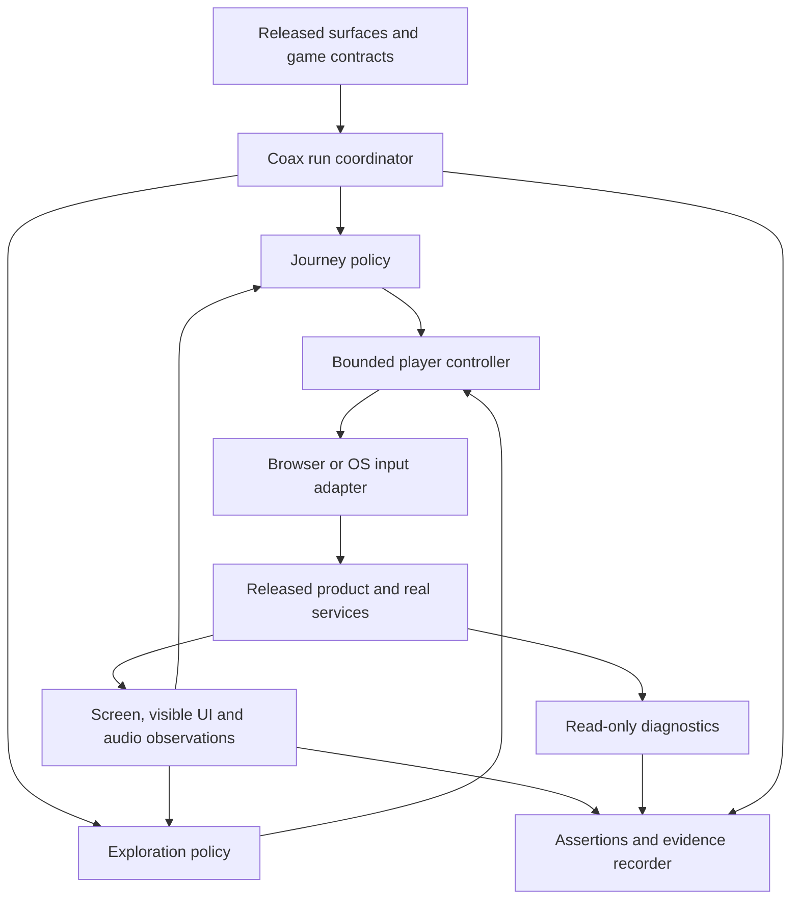

# Automated players for GameBuilder

Written 2026-11-17. Status: live runner implemented; phase 1 is **not yet
qualified**. Required cells, unavailable lanes and first failures remain in
the report; a successful individual journey cannot qualify the website.
Phase 1 tests the whole
live website at `https://gamebuilder.org`. Phase 2 adds the macOS and iOS
apps, including physical iPhones and iPads, using the same journeys,
objectives, verdicts and reports.

### Running the implementation

`scripts/player-test.sh` runs the Coax coordinator in `tools/player-test.coax`.
Chrome is headless by default and uses ordinary wall-clock time and hardware
WebGPU. It does not open a window or take desktop focus. Do not add `--headed`
to unattended runs. Local Safari has no headless mode; without a configured
dedicated WebDriver endpoint its lane returns blocked instead of opening a
window. Simulator/device input must pass its independent fixture before its
gameplay evidence can qualify. This follows the owner's request to keep
testing off their desktop (2026-11-17).

```sh
scripts/player-test.sh --selftest --out build/player-tests/input-check-001
scripts/player-test.sh --gpu-selftest http://127.0.0.1:8819/ --out build/player-tests/local-gpu-001
scripts/player-test.sh --critical --out build/player-tests/critical-001
scripts/player-test.sh --visible-critical --out build/player-tests/visible-001
scripts/player-test.sh --out build/player-tests/chrome-001
scripts/player-test.sh --role ordinary --out build/player-tests/ordinary-001
scripts/player-test.sh --target safari-mac --webdriver http://127.0.0.1:4445 --out build/player-tests/safari-001
scripts/player-test.sh --merge build/player-tests/chrome-001 build/player-tests/ordinary-001 --out build/player-tests/matrix-001
```

The required phase 1 targets are `chrome-mac`, `chrome-phone-emulation`
(412 × 915, DPR 2) and `chrome-tablet-emulation` (1024 × 1366, DPR 2).
The owner approved Chromium emulation on 2026-11-17. These are hardware-WebGPU
Chromium lanes with native browser touch dispatch, not Safari or physical
mobile-device claims. Phone and tablet test portrait and landscape. They do
not emulate Safari browser chrome or a software keyboard.

Safari Mac, iPhone simulator and iPad simulator remain supplementary targets.
Use a dedicated WebDriver endpoint and standard W3C capabilities for these;
local desktop Safari has no headless mode. Dedicated iOS simulators passed
trusted tap, typing, hold/release, multiple contacts and orientation checks,
but `requestAdapter()` returned null on this machine, so their gameplay
cannot qualify. Physical iOS and Safari gameplay remain phase 2 obligations.
Do not activate Simulator or Safari on the owner's desktop.

Run the one-shot qualification batch with:

```sh
scripts/player-test.sh --matrix --out build/player-tests/qualification-001
```

The batch first makes and hashes its own private executable copy. Subsequent
compilations in the checkout cannot replace the executable used by its children.
The input conformance test proves this by replacing a temporary source copy
and successfully executing its frozen sibling. `GB_PLAYER_RUNNER` can also
select a previously frozen executable when reproducing a named release.

It runs three rounds of the three required targets and both roles, each
with a fresh browser profile and real login. It stops on the first unclean
run, retains its evidence, and writes an incomplete merged matrix. It does
not schedule future runs. Inbox pacing persists across restarts: at most
one code request per role every thirteen minutes. Diagnostic `--games`,
`--crates`, `--pointer-only`, `--platformer-entry`, `--capacity-only`,
`--build-agent-only`, `--explore-only` and `--public-only` scopes cannot qualify a full
run. `--reuse-session` is restricted to headless game diagnostics and a
private test-only profile; credentials/cookies are never installed by tests.
The observer-free repeat may also reuse that legitimate session; its report
keeps login coverage blocked and its scope separate from the fresh-profile
full runs. Its purpose is independent corroboration of the visible outcomes.
`--editor --reuse-session` is a short diagnostic for controls and physics,
excluding the capacity stress and all game objectives; it cannot qualify a
full run. `--create-only --reuse-session` isolates real platform creation,
standing, selected-object chat editing, removal and Decide. Its optional
`--repeat-decide` adds two independently cleared-world Decide turns within
the same ten-player-turn budget; it is a diagnostic, never a retry policy for a
full run. `--matrix --role ordinary` or `--role agent-entitled` runs one
independent account queue when sharding a batch. Merge both queues' reports
in chronological order; neither role queue alone can qualify the matrix.

The wrapper loads only the dedicated test inbox from
`GB_PLAYER_SECRETS` (default `~/work/.secrets/auth-test-inbox.env`), with
`AUTH_TEST_INBOX` and `AUTH_TEST_INBOX_PASSWORD`. Never supply a personal
browser profile. The agent-entitled identity has an atomic single-run inbox
lease at `/tmp/gamebuilder-player-inbox.lease`; a stale lease is reclaimed
only after checking its owner PID is dead. The ordinary role has its own private reusable
Mail.tm inbox, UI-created browser profile and atomic lease. A provisioning or entitlement failure is explicit
infrastructure/blocked coverage, not a gameplay pass.

Every fresh output directory contains `report.html`, `report.json`, JUnit,
sanitized action/observation/measurement JSONL, native screenshots and
`player.mp4` when capture and encoding succeed. Serve the private directory
locally to view the HTML report. Existing evidence directories are refused.
No generated evidence, credentials, mailbox contents or private art is
committed. Video starts after secret entry and pauses around account menus.
Capture is bounded to 30 minutes and 1 GiB before encoding; agent requests
are bounded to ten logical player turns and the Codex vision policy to four turns, 512 output tokens per turn and
160,000 total tokens including cached input. Usage and every input image are
retained. This uses the configured Codex subscription; it is not a metered
API dollar-cap claim. The optional Claude adapter sets its SDK budget to $0.30. The router may use select and answer HTTP calls for a logical player turn.
V11 also permits at most one additional empty final-completion call per turn;
it never retries an edit or a nonempty answer. HTTP calls remain subject to
the production service budget. A failed
recorder prevents recording qualification even if a partial video encodes.
`--upload-evidence` uploads an explicit sanitized artifact allowlist to the
private `openagentsgemini-gamebuilder-player-evidence` bucket. Public access
prevention and uniform access are checked before every upload. Passed runs
expire after seven days; failures and diagnostics after thirty. Raw frames
are pruned only after video validation. Credentials, profiles and secret-entry
captures are excluded. `--artifacts-setup` establishes that retention policy.

Background testing minimizes and restores only the dedicated invisible
headless browser window. The recorder first acknowledges that it released
its screencast; Chromium otherwise keeps captured pages visible. Capture
restarts after restoration. `capture-lifecycle.jsonl` records those intervals,
and the video holds its last visible frame while the game is backgrounded.
Before/after screenshots, real hidden/focus states and own-frame motion checks
corroborate release and recovery. No desktop or other application's pixels are
captured. `--focus-selftest` independently calibrates that headless transition.
The before-image is captured before holding input; the lease is renewed and
the watchdog log must remain unchanged through actual visibility loss. A
watchdog release cannot stand in for the game's cancellation behavior.
Chrome 157 retains its focused flag when a protocol key is held in a
minimized window. That journey therefore requires real visibility loss and
automatic input cancellation. A separate same-origin focus fixture uses the
unchanged released client in a frame: a real click on the outside control
blurs that game window, Tab restores it, and the held input must stay stopped
before the driver releases it. That fixture uses native keyboard
input on every lane; phone/tablet gameplay and the visibility transition use
native touch. Chrome's nested-frame touch command timed out after orientation
changes in diagnostics, which remain failed evidence. The fixture does not
claim touch-frame blur coverage. Both supported paths are required by `input.blur`.
The fixture's loaded asset receipts must match the same frozen release.
It runs after the normal player journey: `session.resume` requires measured
movement in the original world immediately after its visibility restoration.
A real object may block a direction: the player tries at most S, W, A and D,
stopping at the first measured motion over 30 cm. Any native-input or image
freshness failure aborts immediately. Every attempt and distance is retained,
and the object count must match the count before backgrounding. No reset,
teleport or corrective edit is allowed. `--lifecycle-only --resume-obstacle
--reuse-session` creates a measured wall through ordinary chat before this
journey, providing a separate regression for a blocked first direction.
`input.blur` remains blocked until both visibility and window-focus checks pass.
`--focus-selftest --frame` calibrates the native frame-focus path independently.
`--lifecycle-only --resize-before --reuse-session` isolates lifecycle behavior
after orientation/layout changes without claiming full coverage.

`web/build.sh` publishes `build/player-catalog.json`; the runner compares
its required cases and hashes with immutable receipts for the exact WASM,
shader and public village-pack bytes loaded by the browser. Missing/mismatched
receipts block provenance. `?observe=1` opts into a read-only own-frame report
(position/feet/ground, camera, keys, selection, gravity, flight and placement
mode). It cannot edit the world or expose account/session data. Visual runs
without it remain separate evidence.

The implemented journeys cover the meadow's four perspectives, medieval
village, credits, direct placement modes, editing, limits, gravity, flight,
agent creation/interaction, account/session, physics/contact, accessibility,
orientation, pointer-lock refusal and recovery. Their presence in source is
separate from successful live qualification of the complete role/device matrix.
Vision exploration uses the existing Coax Codex SDK, a screenshot-only prompt,
a restricted action vocabulary and disabled tools; the model never assigns
a verdict. A separate own-frame judge requires four accepted native actions
and at least one measured pose change. The policy never receives those
diagnostic coordinates. Each request names its action number from one to
four; non-modal chat-access notices do not block walking. An early stop is
inconclusive and prevents qualification. `--explore-only --role ordinary
--reuse-session` isolates exploration. The former `--after-refusal` beta
diagnostic is rejected: the live service now admits every signed-in account.
Provider/quota/tool-policy failures are infrastructure failures.
Native screenshots remain in evidence. A separate browser capture limits the
policy image's longest physical edge to 1,280 pixels without changing the
game's viewport or DPR, keeping tablet exploration inside its token budget.
The Claude SDK adapter remains available for a separately provisioned lane.
The runner deliberately never declares `phase1Complete` from a single run.
`--visible-critical` repeats the account's create/jump/stand/step-off/remove
journey with the diagnostic observer disabled. Its input freshness guard uses
native JPEG scene captures within 300 ms while moving, with recorded capture
latencies; full-resolution checkpoint PNGs remain independent evidence. A
missing, malformed or late movement image releases input and fails the
infrastructure gate. Its observations contain visible text only. A tool-free,
bounded image model extracts foot points and platform-top quadrilaterals from
six chronological screenshots. Coax checks containment for two standing views
and non-containment after stepping off, plus platform appearance/removal.
Low-confidence or malformed geometry fails corroboration. This separate scope
cannot qualify full matrix coverage or replace diagnostic contact checks.
`--critical` runs the short genuine create/play/logout journey. Its provenance
gate binds the five loaded meadow runtime/shader modules; a full run also
requires the village's pack and pack reactor. The report labels this scope,
and a critical run cannot count as a clean full matrix repetition. The live
[execution record](player-testing-results.md) distinguishes verified behavior
from remaining work and failed checks.
The matrix merger preserves failed assertions, excludes desktop pointer-lock
cells from touch targets, checks role obligations and deployment identity, and
requires three consecutive clean reports for every target and role. Missing
cases, missing recordings, mixed deployments, mixed service-policy contracts and unavailable provenance keep
the matrix unqualified. Supply reports in chronological order per target/role.

The qualification snapshot register has 53 cases and eight picker entrances: third person,
first person, top-down, side-scroller, medieval village, crates, platformer and racing.
Crates must solve all three rooms using real keys/touch. Platformer must
exercise fall/respawn and reset, then reach every checkpoint and the finish. Racing must steer and brake,
reset at a checkpoint, finish all three laps in order and race again.
Main has since added drift. Its entrance and twelve-ring objective are both
required contracts; the objective remains blocked until its walkthrough is
implemented. Entering and moving in a new game cannot qualify that objective.
This does not add drift to the immutable eight-entrance qualification snapshot.
These objective walkthroughs are labelled diagnostic-assisted and separate
from screenshot-only exploration. The read-only observer carries only this
client's own frame and objective progress. The world-capacity check uses the public world setting to pause physics
while building, presses the real duplicate control through 1,000 things and
verifies the 1,001st is refused with the visible limit message. It waits for
each accepted count update, then resets the world before the separate normal
physics journey. It also waits for the transient near-full notice to clear
before further clicks, recording the duplicate button's position before and
after that layout transition. No failed edit is retried to obtain a pass.
The capacity result covers building with physics paused; dynamic contact is
verified separately with the normal setting. Browser telemetry begins before the
first navigation and records only event classes, public paths and statuses.
For successful first-party chat responses, it also records bounded structural
metadata: JSON validity, content type/length, completion/reasoning token
counts and a whitelisted finish reason. Response text, headers, cookies and
service identifiers remain absent. Whitelisted route/plan-verb enums and
counts plus leading-whitespace/CR flags diagnose malformed model formatting;
response bodies remain in memory only. These measurements cannot grant a pass.
The direct-edit diagnostic reuses the engine's orbit and viewport projection
to locate an exposed face, checks that native input will not cross a page
control, and requires the same selected object and valid coordinates before
and after a drag. Selected-object chat resizing also requires the same valid
object ID, kind, width, depth and position, with increased height. Numeric
before/after measurements are retained; a replacement or moved object fails.
The screenshot-only policy never receives these coordinates.
Settings gestures first wait for an existing transient limit notice to
actually disappear, within ten seconds: a refused occupied placement can
leave a five-second notice even after another spot succeeds. Its dismissal
moves the panel. They then wait for an uncovered target centre to remain stable for
250 ms, within a 2.5-second bound. A reset is pressed once and must clear that
row's changed marker and reset button within two seconds. Final checks cover
the exact registry rows exercised; unrelated changed things in the world
panel cannot duplicate a material failure as a world-settings failure.
The native conformance fixture proves a moving target settles before one press.
Picker layout checks include every picture, title and description after
fonts/images load; a reachable card with clipped text still fails.

The owner chose **a named release snapshot** for qualification on 2026-11-17,
so main can continue deploying. Publish from a clean, committed candidate:

```sh
scripts/web-deploy.sh --snapshot NEW_RELEASE_NAME
scripts/player-test.sh --matrix --origin https://gamebuilder.org/player-releases/NEW_RELEASE_NAME --out build/player-tests/qualification-NEW_RELEASE_NAME
scripts/player-test.sh --checks
```

Reproduce the eight-entrance candidate using the runner source at
`player-testing/phase1-20261117-v11-runner8` and the live origin
`https://gamebuilder.org/player-releases/phase1-20261117-v11`, or select the
recorded executable with `GB_PLAYER_RUNNER`. The client source is tagged
`player-testing/phase1-20261117-v11`. The current source register includes newer
games; its runner must not be substituted into the older release's qualification.

The public copy lives in a separate asset bucket behind `/player-releases/*`
on gamebuilder.org. The publisher refuses existing names, hashes every file,
and preserves current load-balancer routes when adding that one prefix.
The ordinary browser host mounts UI routes and assets beneath the prefix;
`/api/` still reaches the real first-party login, chat and agent services.
There is no request interception, injected session or simulated clock.
The loaded WASM/shader/pack receipts must match the snapshot catalog, and the
release manifest hash and URL must remain identical throughout the matrix.
A tagged source commit names the client release; service behavior is observed
at run time. Qualifying this release makes no claim about later games or
subsequent main deployments. Failed candidates remain distinct evidence.

The new palette journey uses real Shift-drag on desktop and a long touch
press on phone/tablet, verifies the character stays still, reloads to check
persistence, tests the new shortcut position and restores the default bar.
World settings are enumerated from the shipped engine registry. The agent
offer journey uses the real one-turn job service, checks that nothing starts
before yes and observes its accepted request, status and terminal response.
It adds at most one bounded build-agent job per account run.

Exploration retains native screenshots and supplies a separate browser
capture with a maximum 1,280-pixel edge to the model. This bounds tablet
image usage within the declared token budget without changing the game
viewport, DPR or evidence resolution. Both images are retained.

Related product context: [the web world](web-world.md),
[Scrappers multiplayer](scrappers-multiplayer.md), and
[the SPLICEBOTS port](splice-bots-port.md).

## 1. The result we want

An automated player opens the released product, signs in, finds its way
around, creates things, plays every available game and reports what happened
with a recording someone can watch. It notices a covered button, a character
that cannot move, an agent that says it built something but did not, a match
that never ends, and a mobile keyboard that covers the next action.

The system must work across the entire product, rather than being a script
for today's starting world. Every shipped route, screen, game, mode and
input family has an explicit coverage obligation. New games add a small
player contract and their own journeys; they reuse the runner, perception,
input, recording and failure machinery.

There are two complementary players:

- **Journey player:** repeatable, bounded tasks with explicit assertions:
  log in, pick first person, build a platform, jump onto it, leave and return.
- **Exploration player:** a model chooses goals and actions from what is
  visible, backed by a fast local controller. It explores menus, unfamiliar
  creations and games, attempts their objectives, and turns useful failures
  into candidate regression journeys.

Both operate the released UI. Neither wins by assigning a position, calling
an edit export, advancing a score, installing a login cookie, or replacing a
model response. Existing Coax checks remain the fast proof of rules; these
players prove that a person can reach and use those rules in the live product.

## 2. What exists and what to reuse

This inspection used GameBuilder through `0e12254`, with OpenAgents pinned
at `aa14807d30fab96e0df99db8e8c0edfbcf7bd7e2`. Paths under `vendor/openagents`
refer to that pinned tree; it is read-only. General improvements land in
OpenAgents `main`, then GameBuilder moves its pin.

| Existing part | Use here | Limit to address |
| --- | --- | --- |
| `vendor/openagents/coax/web/drive.coax`, `drive-dom.coax` | Reuse browser sessions, semantic targets, hit tests, taps, typing, screenshots and logs | `--live` currently requires a loopback dev server; add an HTTPS production target. The default agent clock and mutation commands are unsuitable for live qualification |
| `vendor/openagents/coax/lib/net/cdp.coax` | Reuse Chrome DevTools transport and GPU identification | It currently launches headless, muted Chrome; add a headed hardware-GPU session and attach support for a dedicated test browser |
| `vendor/openagents/metaverse-engine/agent/drive.coax` | Reuse entity identities, objective progress and stuck detection where applicable | Its realm commands are not wired into GameBuilder; its entity list is not a visibility guarantee. Live actions must be compiled to browser/OS input, not injected controller state |
| `vendor/openagents/metaverse-engine/ui/trace.coax` | Reuse GPU widget rectangles, overlap, clipping and tap-size checks | GameBuilder's native SwiftUI chrome also needs platform accessibility identifiers; a layout rectangle alone does not prove visible pixels or a successful click |
| `vendor/openagents/components/kit/hotbar.coax` | Reuse slot identities, tool/toggle/action semantics and shared skin in control discovery | Test the real rendered slots and shortcuts, including narrow-screen wrapping and busy/hidden states; extend the shared component when needed |
| `vendor/openagents/apps/shared/app/cases/` | Reuse typed driver machinery, allowlisted observations and case reports where applicable | Controlled clocks and service fakes belong to local regression; these adapters target the shared OpenAgents app, not GameBuilder |
| `vendor/openagents/apps/shared/host/apple/phone-drive.*`, `apps/shared/host/drive.*` | Reuse local diagnostic transport for later native development | Debug socket input bypasses the OS; it cannot qualify a shipping app's touch, keyboard or lifecycle path |
| `web/site.coax`, `web/login.coax`, `web/chat.coax`, `web/blocks.coax`, `web/hud.coax`, `web/hud-glue.js` | Initial web surface and game contracts | No integrated live player runner exists. Hidden world reports are diagnostics, not a player-visible UI |

The runner, scenario logic, controller, coverage accounting and verdicts are
Coax. Thin browser glue may read DOM/WebGPU facts (firm reason 1); a shell
wrapper may invoke the runner (5); a platform SDK bridge needs its applicable
firm reason. Existing external automation servers can be dependencies, with
Coax speaking their protocol. Do not introduce a TypeScript test framework
containing a second set of product rules.

## 3. Coverage is a maintained contract

Add a versioned **surface register** to the build. It enumerates routes,
screens and significant states, user roles, discoverable links/actions, games
and revisions, modes, controls, supported platforms, required journeys and
budgets. A game entry includes its entrance, exit, visible instructions,
objective, progress signals, terminal conditions and expected duration. It
must express exploration games as well as competitive matches: reaching a
landmark and returning is a valid objective; winning is not universal.

Publish the non-secret register and deployment identity with the release.
The runner compares it with the expected release and what it discovers by
visiting links, menus and authenticated screens. It tracks a graph of
`surface + role + state -> action -> next state`, including modal, error,
loading and empty states which do not have addresses. Links leaving the
product have destination/reachability checks, not permission to roam another
service. Unknown paths and invalid addresses have an expected result too.

Every discovered surface or game absent from the register is a coverage
failure. Every registered required case absent from the run is incomplete
coverage. The denominator comes from the register, not the tests that
happened to run. A route crawler alone cannot establish completeness: review
the register against the product's route and action tables at each release.

For games added by creators at runtime, bind discovery to a catalog snapshot
and its timestamp/revision. Run the common entrance/control/exit tests on
every accessible game in that snapshot. A game must supply its objective
contract to qualify for full gameplay coverage. A missing contract is
`unqualified`, with the game named; exploratory play can still find defects.
A continuously changing catalog gets an incremental queue and a stated
freshness window. Never claim timeless coverage of content not visited.

Today the web register starts with home, login, account menu, the picker,
chat, world, hotbar, selected-object panel and world settings; `/`, `/login`
and the legacy `/play` route; redirects from
HTTP and `www`; and the four perspectives (third person, first person,
top-down, side-scroller). The perspectives are configurations of the current
world, not four finished games. Scrappers and SPLICEBOTS currently require
native coverage in phase 2. If either becomes playable on the website, its
web cases become required in the same release. Everglade is not a
GameBuilder game and must not be restored as a test fixture.

Coverage reports distinguish **shipped**, **planned**, **not applicable**,
**unqualified**, and **temporarily unavailable** features. Missing save/undo
on today's web is a recorded product gap, not a broken save test and not a
successful persistence test. Once shipped, save/undo become required.

## 4. Architecture and ownership



The product runs its normal render loop and wall clock throughout a live
run. The coordinator leases accounts and devices, selects cases, starts
clients, manages budgets and collects artifacts. Each client has its own
policy, controller, input ledger and observations. A multiplayer coordinator
uses barriers such as "both see the lobby"; it never synchronizes clients by
freezing their worlds.

Proposed GameBuilder files:

| Location | Responsibility |
| --- | --- |
| `tests/player/catalog.coax` | Product surface register, current capability declarations and coverage obligations |
| `tests/player/journeys/*.coax` | Typed journeys, expected outcomes and tolerances |
| `tests/player/games/*.coax` | Game objectives, control bindings and player tactics; no alternative simulation |
| `tools/player-test.coax` | Coordinator and CLI built on upstream driver libraries |
| `web/observe.coax`, later `coax/observe.coax` | Small allowlisted read-only observations of the actual committed frame/state |
| `build/player-tests/RUN_ID/` | Ignored local evidence, later uploaded to private artifact storage |

Shared browser input scheduling, platform transport, perception schemas and
generic navigation belong upstream. GameBuilder's routes, ownership rules,
create expectations and game-specific test objectives stay here. The new
paths and commands in this document are proposals, not existing interfaces.

## 5. Observe, act, verify

Use three versioned records, serialized as bounded JSON for host transport
and retained as JSONL. Reject schema mismatches and truncation explicitly.

**`player.observation.v1`** contains client ID, monotonic capture time,
observation sequence, presented frame ID when available, deployment/build
and game revision, viewport and scale, screenshot reference, visible text and
controls (stable ID, role, label, clipped bounds, enabled state), focus,
pointer-lock state, and available input capabilities. A visible game view
may add perceived player location, targets and HUD values with confidence
and provenance. Hidden, occluded and offscreen targets cannot enter the
player's perception as if visible. Remembered targets retain their last-seen
time and uncertainty.

**`player.action.v1`** contains action ID, source observation sequence,
intent, bounded duration/deadline, and one or more scheduled input sources:
key down/up, pointer movement/down/up/cancel, relative look, wheel or text.
Pointers have stable contact IDs and coordinates in viewport CSS pixels on
web or logical points on native; adapters own scale/safe-area conversion.
Actions such as click a control first resolve it in the current frame,
scroll it into view through normal input if needed, and check hit testing.
Changed, covered or stale targets trigger re-observation, not a forced click.

**`player.result.v1`** contains the outcome, final observation, every
assertion's expected and actual values, evidence references, coverage cell,
timings and a failure category. Input acknowledgement means "delivered",
never "the game responded correctly". A case passes only after its
observable consequences pass.

Two observation channels stay separate:

- **Player perception:** screenshots, player-visible DOM/accessibility
  content, rendered HUD, on-screen targets and audible cues. This is what
  the exploration model sees. A no-diagnostics journey must always exist for
  entry, basic control, create and exit.
- **Diagnostics:** an allowlist of own position/velocity, camera, object
  transforms, input receipt, physics contact, pending request age, render
  progress, match phase and own/visible scores. The judge may use them to
  verify and explain a failure. They cannot reveal unseen opponents to the
  player policy or become the sole proof of a working renderer.

Initially use existing visible DOM and screen capture; existing hidden
`where`/`things` reports may supplement the judge. Add a minimal observer
only where necessary, in Coax, with host glue carrying bytes. It has no
mutation operations, unrestricted memory reads, credentials or private
opponent state. Correlate page and GPU observations by frame/time; their
asynchronous reports are not automatically one atomic snapshot. A diagnostic
channel failure is recorded separately from a visible product failure.

## 6. How the player actually plays

The slow policy selects a visible target or task: approach the platform,
clear a gap, aim at an opponent, carry the ball toward a goal. A local Coax
controller executes short segments, measures progress and replans. It uses
the real engine's navigation/query primitives where suitable for diagnostic
assistance; live perception-based acceptance does not read a hidden full map
to solve navigation. Do not build a second physics or movement engine.

Initial controller limits, to qualify on hardware:

- Observe motion at 5–10 Hz where capture permits; reevaluate control at
  10–20 Hz using the latest observation. Record the actual rates and age.
- A segment holds inputs for 100–250 ms before feedback; no input may remain
  held beyond a 1 s lease without explicit renewal. Simultaneous movement,
  look and jump/fire must be supported, including independent touch fingers.
- A separate watchdog releases all held keys/buttons/contacts within 300 ms
  of lease expiry, client failure or cancellation. Model latency cannot
  strand a held input. Focus loss, navigation and modal transitions also
  cancel outstanding input through the adapter's normal release path.
- Reject motion control on observations older than 500 ms. Release and
  recapture. A device that cannot sustain that observation rate can qualify
  slower UI journeys, but its fast gameplay cells remain unqualified.
- Start with a stuck condition of less than 0.3 m progress toward a reachable
  target over 2 s, based on upstream `Drive` constants. Allow at most three
  bounded recovery attempts (look again, sidestep, choose another visible
  approach), then retain a stuck failure. Airborne, loading, stunned and
  intentionally stationary states need different progress predicates.

These are harness defaults, not changes to game movement rules. A game
contract can declare tighter timing or another progress metric. Combat
tactics can target a win, loss, score or elimination; the test verifies the
declared event and terminal UI, rather than expecting the bot to win every
match. Some journeys deliberately lose or disconnect to exercise recovery.

The exploration model gets a bounded task, recent perception, allowed
actions and remaining time/cost. It returns typed goals/actions, never code,
JavaScript, HTTP calls or a replacement assertion. Uncertain visual findings
are candidates requiring corroboration; the model cannot declare a release
green. Record its model/version, prompt, observations, decisions and usage.
Use no model calls for fixed menu traversal or fast movement correction.

Exploration coverage is guided by unvisited graph edges, controls, roles,
game objectives and recent changes. A daily pass reaches every registered
game before extra time goes to novelty. Long-tail runs are sharded and their
coverage age remains visible. A discovered failure becomes a reviewed journey
with a concrete outcome, rather than a frozen sequence of pixel coordinates.

## 7. Phase 1: browser execution

Extend the existing Coax CDP driver with a restricted `live-player` mode:

1. Accept the real HTTPS origin, start a clean dedicated browser profile,
   and visit the canonical URL with normal navigation.
2. Use normal time and randomness. Do not append `?agent`, use clip/clock
   mode, override entropy, intercept requests, or enable direct world-edit
   verbs. Reject those operations before a live session starts.
3. Deliver keyboard, pointer, wheel and multi-touch through browser input
   APIs. DOM scripts are read-only inspection; do not call `.click()`,
   dispatch synthetic DOM events, assign field values or call
   `coaxial.send`, `pointerLock(...)` or Wasm exports to produce success.
4. Resolve public controls by accessible role/name with a stable ID fallback,
   then exercise actual hit testing. Check keyboard-only navigation too.
   Canvas actions use observed screen coordinates and normal input.
5. Attach console, exception, navigation, request status/timing, WebSocket
   lifecycle and GPU/device-loss collectors before loading. Redact before
   writing logs. Collect browser/OS/GPU versions and actual adapter type.

CDP supplies key, mouse and touch dispatch; its official
[Input protocol](https://chromedevtools.github.io/devtools-protocol/tot/Input/)
is the implementation reference. Extend the upstream library, not a private
copy. Adapter conformance must first prove key hold/release, simultaneous
sources, browser focus, text/IME, cancellation, coordinates and real user
activation against a small input fixture and then the product.

**Pointer lock needs a separate hardware proof.** Click the first-person
world, observe the browser actually acquiring lock, move the mouse and
observe the camera turn, then exercise Escape, Enter, blur, picker and logout
release. Also test refusal and drag fallback. Headless/browser-protocol
limitations are a runner capability gap, not permission to call the host's
lock stand-in. Provide a headed OS-input adapter when protocol input cannot
produce genuine relative movement or activation; require its calibration on
the test machine before claiming this cell passes.

The owner's approved phase 1 matrix runs headlessly on the hardware GPU.
Preflight must detect omitted/blank canvas pixels; software rendering cannot
qualify visual or performance checks. Record exact OS/browser versions,
adapter identity, viewport, pixel ratio and input engine in every inventory.

| Required target | Input/display coverage |
| --- | --- |
| Chrome stable, hardware-GPU Mac | Mouse and keyboard; 1440 × 900 and 1024 × 768; actual lock, relative look, browser refusal and drag fallback |
| Chromium phone emulation | Native browser touch contacts; 412 × 915, DPR 2; portrait/landscape, typing focus and independent fingers |
| Chromium tablet emulation | Native browser touch contacts; 1024 × 1366, DPR 2; portrait/landscape and independent fingers |

Safari uses `safaridriver` or XCUITest on dedicated machines/devices;
[Apple documents WebDriver setup](https://developer.apple.com/documentation/webkit/testing-with-webdriver-in-safari).
Those supplementary reports stay explicit about unavailable WebGPU adapters.
Chromium emulation makes no Safari, physical-device, software-keyboard,
browser-chrome or mobile performance claim. The new palette exposes flight to touch: test its toggle and level movement;
desktop also tests Space ascent. Desktop lock cases
are also inapplicable to touch lanes; their drag/look family is tested.

Test unsupported WebGPU
and GPU-device-loss behavior explicitly: the website must present its declared
fallback or a recoverable explanation instead of silently claiming a working
world. Additional engines, versions and input devices get their own cells as
the product declares support; reducing support requires an explicit register
change, not a test skip.

## 8. The required web journeys

| Area | Required behavior and evidence |
| --- | --- |
| Entry and navigation | Cold `/`, `/login`, `/play`; signed-in/out results; canonical redirects; Back/Forward/reload; brand/menu links; invalid address behavior; no broken required assets or stuck loading |
| Authentication/account | Real email-code login, wrong-code recovery, cancel/back, session restore in a new tab/relaunch, logout, stale-session recovery, and no access inherited by another test profile |
| Game discovery | Reach every registered game/configuration from the actual UI, see instructions, enter, return to selection/home, enter another; no stranded pointer or keys |
| Four current perspectives | Watch entry through sunrise/grass reveal; move in the promised directions, jump and air-jump where supported; view-specific look/zoom constraints; third-person follow; first-person lock and fallback |
| Create with the agent | Ask for a recognizable platform/stair arrangement near the player; observe one bounded response and actual objects; resize/move/remove and Decide; compare visible geometry with requested outcomes and before/after diagnostics; model prose alone cannot pass |
| Direct create/edit | Pick block/ball tools by click/touch and keys 1/2; verify ground ghost, half-metre snapping, placement and tool toggle-off; key 3 enters edit mode; select, drag, wheel-size, change individual dimensions, duplicate and delete with both panel controls and keys; check bounds/capacity and selection state |
| Settings and shared controls | Open world settings by slot/key 5; drag and keyboard-adjust gravity, observe lower/higher jumps and object falls, reset to 1; ask chat to change gravity and verify the slider follows; key 4 Decide busy state and third-person-only key 5 follow; one tool picked at a time |
| Physical interaction | Walk against a solid wall and around it, jump onto a platform and off, push a small block, compare a heavier one, kick a ball, build a stack and wait for rest; confirm visible contact and movement without falling through the floor |
| Focus/input ownership | Enter opens chat, Escape returns movement; typing movement letters/hotbar digits does not move or change tools; hotbar presses retain movement focus; Escape unwinds selection/edit/tool/settings in order; left-drag places/edits while right-drag still looks; selected-object wheel sizes while empty-world wheel zooms; UI drag/wheel does not turn/zoom the camera; blur releases held controls |
| Agent service failures | The anonymous player reaches the release's sign-in gate without an AI composer; both signed-in QA accounts use real chat and build jobs; a deliberately offline client sees recoverable failure; no duplicate send while pending; successful retry through UI |
| Layout/accessibility | Keyboard reachability, labels, focus visibility, clipped/covered controls, readable transcript, reduced motion, zoom/text scaling; resize and rotate during a journey; hotbar/chat wrapping and selection/settings panels in narrow windows; mobile keyboard dismissal and access to send/menu, closing a panel to reach chat |
| Durability | Today's reload deliberately resets world/chat/gravity and restores the appropriate account/picker behavior; logout resets tools, selection, edit mode and gravity. Once save ships: create/name/save/reload/reopen, browser restart, stale-write conflict and app round-trip become required |
| Session health | Bounded active play and idle/resume, repeated entry/exit, browser background/foreground, reconnect; no crash, permanent black canvas, growing resource leak or irrecoverable held input |
| Every additional game | Contract-driven entrance, every declared mode, primary mechanic, objective progress, terminal result or exploration checkpoint, replay/restart and exit; multiplayer cases whenever offered |

Each journey states its precondition, role, visible setup steps, exact
success predicate, tolerance, time/cost bounds and cleanup. To test today's
physics, create objects through the real hotbar and chat in separate journeys;
keep direct-tool and existing starting-object journeys independent of the
model service. In edit mode, ask "make this one taller" and verify that the
selected object changes, not a different one. With a placing tool active,
verify first-person placement uses the reticle and touch placement follows
the actual finger path. Use relational assertions such as
"bottom rises, feet land on top, then descend" with documented tolerance,
rather than exact cross-browser coordinates. Stable visual checkpoints
require both layout/scene evidence and an actual canvas capture; animated
grass, shadows and sky use masks or temporal predicates rather than brittle
full-screen byte comparisons.

Run deterministic malformed-plan, service-status and expiry permutations
locally with the existing fakes. A separate staging lane can exercise faults
that cannot safely be caused through a production client. These supplement
the live suite and carry distinct labels; they never substitute for a real
production login, response, gameplay event or save.

### First concrete journey: build something and stand on it

Case `web.create.platform`, role `agent-entitled`, starts in an empty browser
profile with a leased account and ends logged out. It uses current shipped
features only, with a ten-minute wall-time limit and at most four agent
requests. These are specification steps for a future typed Coax journey:

| Step | Player action | Required consequence |
| --- | --- | --- |
| 1 | Open the live site, use the email/code fields, pick third person | The authenticated picker gives way to a visible character and world; the entrance finishes in its declared bound |
| 2 | Move, turn, then open chat with Enter | Movement changes the presented scene; chat owns the keys and movement stops while typing |
| 3 | Ask to clear this disposable world, then ask for one platform, 3 squares wide, 3 deep and 0.5 high, on open ground ahead | Real replies arrive; the world visibly clears, then gains one matching platform, which falls and settles; before/after observations agree |
| 4 | Escape, approach the visible platform, jump onto it and release movement | The character rises and lands on the top, staying there at least 1 s; the judge corroborates height/contact with a continuous visual sequence and, in the diagnostic lane, own-foot/object-top measurements within 0.15 m |
| 5 | Jump down, ask the agent to remove the platform | The character returns to ground and the platform visibly disappears, matching the object's removal in diagnostics |
| 6 | Return to the game-type picker, enter first person, leave and log out | Correct camera/input transition, no retained movement or pointer lock, and the logged-out home page appears |

Each step preserves its own deadline and failure evidence. If the model
places the wrong object, the player cannot silently correct it until the test
passes; retain the failed assertion and optionally attempt a separately
reported recovery. The perception-only version verifies the same visible
task without reading hidden fields; uncertainty in landing or geometry is
inconclusive rather than an invented pass.

## 9. Accounts, real services and multiplayer

Provision dedicated ordinary test accounts and a dedicated inbound mailbox.
Use a scoped mailbox reader to retrieve only a fresh code requested by that
run, then type it into the visible field. Do not read the auth database,
preinstall cookies, invent codes or add an auth bypass. Lease each account
and browser profile exclusively; correlate delivery with recipient and
request time so parallel runs cannot consume one another's code. Maintain
both independent fixtures named `ordinary` and `agent-entitled`. These
historical CLI names select credentials and leases; both now have the same
positive agent obligations. Production explicitly admitted all GameBuilder
accounts in OpenAgents commits
[27686bc39a](https://github.com/OpenAgentsInc/openagents/commit/27686bc39a620d2d505fa7feb41dd07aaa09c6d5)
and [46685296b2](https://github.com/OpenAgentsInc/openagents/commit/46685296b2df1d5cf3623b0b908614544d61f5b2).
Reports and the merger bind this expectation as
`expectedServicePolicy: gamebuilder-accounts-27686bc39a-46685296b2`.
Old beta-policy reports cannot qualify this cohort. The case ID
`agent.refusal` now requires an independent fresh anonymous profile to reach
this frozen eight-game client's `/login` from `/play`, with an empty email
field, no code field and no chat composer. Its guarded screenshot contains
no entered credentials. This proves that release's UI access gate;
later main's guest builder requires its own journey.

The mailbox reader and account pool are new operational dependencies, not
assumed available. Missing credentials, mailbox, entitlements, GPU or device
produce a named blocked/infrastructure result and incomplete coverage, never
a pass. Before unattended operation, provision these dependencies through
the normal service owners. Secrets stay in a runner secret store and never
in Git, screenshots, transcripts, model input or exported browser profiles.
Pause/redact recording over email/code entry and scrub cookies, tokens and
authorization headers before artifacts are persisted.

Keep writes in leased test accounts and disposable creations. Discover and
visit public content read-only; editing/clearing must occur in the runner's
own world or copy. Join private test parties/rooms through ordinary invites;
do not send test invitations, chat or reports to unrelated players. Where
public matchmaking cannot isolate test participants, qualify it on an
isolated service lane and list live matchmaking as unqualified until an
ordinary player-accessible private path exists. End every run with release
of input, leaving rooms, UI cleanup and logout/profile destruction; failed
cleanup gets its own outcome and quarantine of the account lease.

Multiplayer requires separate clients, profiles and accounts, not tabs that
share a session. One creates/invites, another finds/accepts, both play; compare
rendered phase, teams, scores, objective changes and the final outcome from
their perspectives. Confirm a change initiated by each reaches the other.
Disconnect a client, rejoin when supported, and exercise leader departure.
Network delay/loss uses a client-side proxy on a separate resilience lane,
with an unshaped real-network control. Do not compare hidden authoritative
state alone or require same-frame agreement between independent clients.

## 10. Verdicts, budgets and evidence

Machine verdicts are `pass`, `product-fail`, `infrastructure-fail`,
`blocked`, `inconclusive`, or `not-applicable`. Known product failures retain
their failure and issue reference. A missing objective contract is
`unqualified` coverage. Only a passing case contributes to passed coverage;
neither skips nor quarantines can make a required matrix green.

Hard assertions cover navigation, visible outcomes, input ownership,
mechanics, terminal states, rendering liveness and error recovery. Visual
models assist with appearance/usability findings, with confidence and
evidence. A blank or frozen canvas, invisible character, missing model or
unusable overlay must fail even if telemetry says the world is healthy.
Frame progress must be tied to presented content where measurable; an idle
screen sleeping is expected, so request visible movement before diagnosing
a rendering freeze.

Initial deadlines, overridden explicitly per journey: 30 s for entry/assets,
120 s for email delivery, 90 s for a model answer, 15 s for post-entry visual
settling, 30 s for a local traversal goal, 30 minutes of capture for the full
journey (authentication pacing and encoding have separate deadlines), and the game's declared match duration plus 60 s for a match.
Use bounded predicate waits on real time, not arbitrary long sleeps.
Every run has maximum wall time, requests, tokens, model spend and writes;
budget exhaustion produces incomplete coverage and lists unfinished cells.
Tune performance budgets per actual device class after baseline measurement;
record p50/p95 frame interval, stalls, input-to-visible-response latency and
memory trend. A 2 FPS screenshot loop cannot qualify camera feel or gameplay
responsiveness.

For each run retain:

- Commit/deployment identity, asset hashes, OpenAgents pin, game/catalog
  revision, scenario revision, browser/OS/GPU/device and viewport, role alias,
  capability preflight and start/end times. Live responses may differ: do
  not claim a pinned build is what was served without evidence.
- Chronological action/observation/result JSONL, input lease cancellations,
  assertion values, redacted console/network/service request IDs and any
  correlated diagnostics. Include observed build changes during a run;
  mixed-deployment results are inconclusive and rerun after settling.
- A real-time recording of the player view, audio for relevant cases,
  screenshots at checkpoints and before/after failure, actual capture rate
  and dropped frames. Existing fixed-step `clip` output can aid reproduction
  locally but is not the recording of a live run.
- HTML summary and JUnit-compatible results, a complete required/attempted/
  passed coverage table with freshness, the first failing step, the shortest
  reproduction known, links to evidence and cleanup outcome.

Keep redacted routine passes seven days and failures thirty days initially,
in access-controlled artifact storage; enforce deletion. Evidence containing
private game art stays private. A missing/corrupt required recording prevents
visual qualification, rather than yielding a silent pass.

Allow one diagnostic rerun after a failure with a fresh session. Preserve the
first failure; a later pass marks a flaky case, not a clean success. Live
replay is best-effort because services, physics timing and players vary.
For deterministic reproduction, replay recorded inputs and sanitized service
responses in an explicitly local lane using the existing agent clock/fakes.
Never replay a mutating request against production just to recover evidence.

## 11. Rollout and acceptance

### Phase 1A: foundation and one genuine live journey

Implement the Coax coordinator, restricted production browser adapter,
account/mailbox leases, provenance, watchdog and evidence bundle. Ship the
surface register and only the observer fields needed by the judge. Prove a
fresh-profile production email login, third-person entrance, movement,
real agent-created platform, interaction, exit and logout on hardware Chrome.
Repeat without the diagnostic observer for the visible outcomes.

Harness conformance checks must detect a covered click target, missing
canvas capture, dropped key-up, stale observation, dead browser, missing
mail, excessive model delay, catalog omission and malformed observer record.
Inject faults in local fixtures or staging, not the live game. Prove the
watchdog with a killed policy process while input is held. No successful run
may use controlled time, a service fake or direct state mutation.
The loopback-only `--gpu-selftest` uses ordinary rendering to destroy and
replace a device, then starts a new document without the WebGPU API and
requires an actual visible explanation. It cannot accept a production URL.
Its fault injection is separate from all live gameplay and matrix evidence.

### Phase 1B: the whole current website

Implement every required web journey and perspective on headless desktop
Chrome and the approved phone/tablet Chromium touch emulations, including
both orientations and independent contacts. Safari and physical devices are
supplementary in phase 1 and required for the native/mobile phase. Validate real pointer lock on supported desktop hardware and
its refusal path. Run role/session, network recovery, layout and exploration
lanes, with an explicit outcome for every register cell. Exercise every game
that is actually playable on the site at this release.

Phase 1 is accepted when all required current-site cells pass on the declared
browser/device matrix, each has evidence and provenance, and three consecutive
full runs have no unexplained failures. A discovered blocker remains visible
and prevents declaring phase 1 complete. Supplementary unsupported-browser
runs have their own reported coverage; they cannot inflate the supported
matrix. Document capabilities the product itself does not support.

After each deploy run a fresh-login critical journey and short entrance/
primary-action/exit check for every deployed game. Nightly run the full
surface/role/game matrix plus bounded exploration; weekly run extended
sessions and network/performance lanes. These are proposed CI schedules,
not automations created by this spec. Coax checks gate code before deployment;
the post-deploy live report qualifies the observed deployment. Failures
preserve evidence and make the release unqualified; rollback follows the
release process, rather than an agent guessing from one flaky run.

### Phase 2A: the macOS app

Reuse the same coordinator, record schemas, scenario intent and verdicts.
Add a native adapter for `com.openagents.gamebuilder`: platform accessibility
for SwiftUI controls, screen/audio capture, and OS keyboard/mouse input into
`ViewportView`. Use XCTest/XCUIAutomation or a thin platform input bridge;
the official [XCUIElement API](https://developer.apple.com/documentation/xcuiautomation/xcuielement)
documents keyboard, pointer and gesture interactions. Keep SDK glue thin and
apply the tools-in-Coax rule to its implementation. Accessibility identity
and read-only Coax diagnostics do not require gameplay mutation hooks.

Test the shipping configuration, real windows and focus, resizing, menu
shortcuts, account flow, editor tools, copy/paste/duplicate, undo/redo,
save/reopen and actual PLAY entry/exit. Add these native surfaces to the
register instead of assuming the web flow describes them. Separate app
state directories and identities; never reuse the owner's personal levels.
Run owner, non-owner and logged-out journeys: only the owner changes a game's
own level; another player can play and make their own copy, then edit that
copy. Verify the original remains unchanged after the non-owner journey.
Debug driver sockets and synthetic result launch flags remain local layout
tests, not proof of completing a match in the release app.

### Phase 2B: the iOS app

Use the XCUITest driver through Appium/WebDriverAgent for OS-level gestures,
launch/background/relaunch and screenshots. Coax can call its WebDriver HTTP
protocol directly. Synchronized pointer sources use W3C Actions; see the
official [Appium gestures guide](https://appium.io/docs/en/latest/guides/gestures/)
and [XCUITest gestures](https://github.com/appium/appium-xcuitest-driver/blob/master/docs/guides/gestures.md).
Qualify sustained joystick hold plus independent look/fire/jump on a real
device before claiming gameplay support. If the adapter serializes touches
or captures too slowly, keep those cells unqualified and improve upstream
input transport; never replace them with `ed_*` calls.

The Safari website lane from phase 1 now also launches the native app, with
native accessibility bindings and platform controls. Include simulator for
fast regression, physical iPhone and iPad for Metal, touch, software keyboard,
safe areas, orientation, audio and lifecycle. Run signed shipping-equivalent
builds against the real services, recording build number and distribution
channel; debug and simulator evidence alone cannot qualify TestFlight.

### Every native game, and future cross-platform games

Scrappers' contract covers Bolt, Boulder and Lumen; Knockouts, Last Stand,
Scrapball and Hoops; 1v1 through 5v5; single-player bots and private parties.
Smoke all selectable combinations, exercise every primary/super mechanic,
finish each mode with observed score/round progression, and cover win/loss/
draw result actions and replay/exit. Run two- and four-person parties,
invitations and capacity refusal, guest loss and leader departure. Today's
rejoin limitation is recorded as such. Do not require ten human seats where
the current party limit is four. UI-only `-gbResult` checks cannot satisfy
the end-of-match gameplay obligation.

SPLICEBOTS' contract covers actual PLAY entry, walk/jump/jetpack/board,
pickups/inventory, Digger follow/stay and Travel through the imported route,
then exit and reentry. Distinguish private-pack and box-fallback builds;
release qualification requires the real packs. Art is never copied into
this repository or public evidence. Keep the jam's rules unchanged.

Run the complete supported platform/input matrix for every new game, and
web/native mixed-client sessions wherever the product offers cross-play.
Reuse objective-level journeys across platforms while binding each to the
controls actually exposed there. Web/native worlds need not be feature-equal;
report each feature's availability and tested behavior explicitly.

## 12. Implementation order and open dependencies

Build small vertical slices in this order: upstream live/browser input and
watchdog; GameBuilder catalog and one journey; real login infrastructure;
recording and assertions; all current web surfaces; the approved Chromium web
devices; bounded exploration and multiplayer contracts; native adapters and
native game journeys. Each behavior change carries Coax checks in its owning
module. A spec-only change does not implement any of these slices.

Before unattended runs can be enabled, assign owners and provision the
dedicated GPU Mac, mobile devices/signing, test mailbox and accounts,
model/spend limit and private artifact storage. Validate the
headed pointer-lock adapter, mobile gesture concurrency and capture rates
in early spikes. These are explicit acceptance risks, not assumed working
capabilities. The first implementation deliverable is a recording of one
real live journey plus its machine verdict; the final phase-1 deliverable
is a current, complete coverage report for gamebuilder.org.
