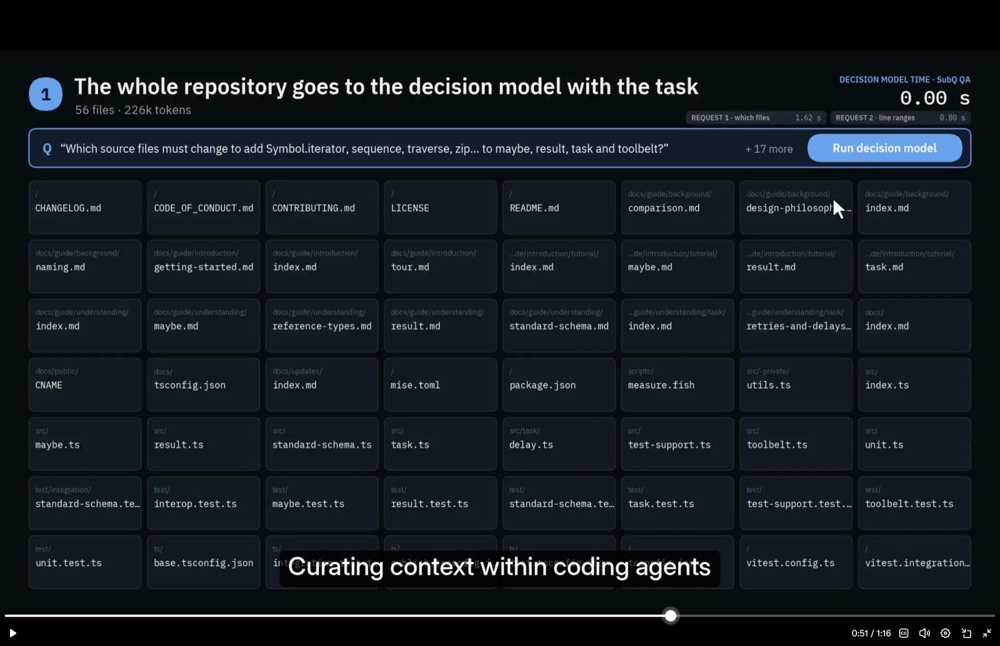
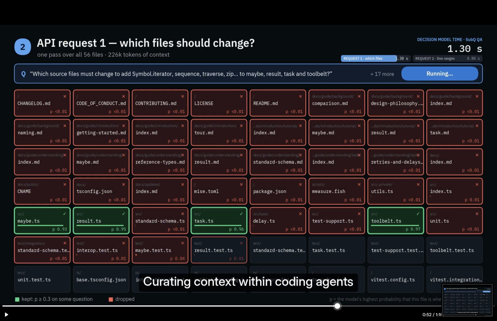
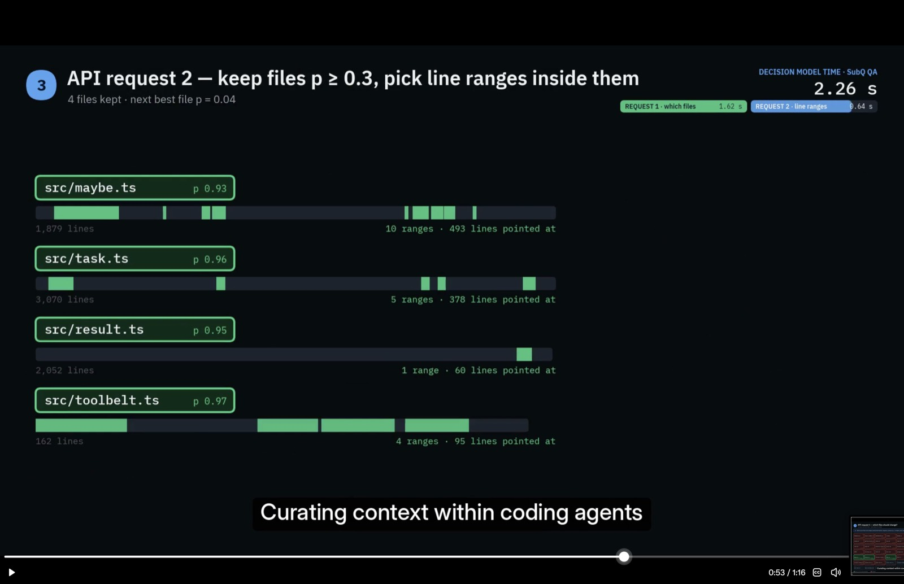
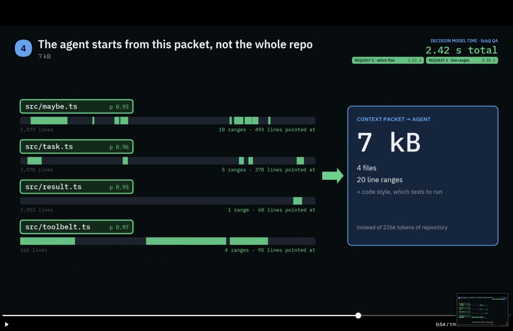

# SubQ's context curation for coding agents, and what it means for our briefing

Status: notes from SubQ's demo video "Curating context within coding agents"
(2026-10-12), shown with their SubQ Snap decision model (`subq-snap-preview`).
The evaluation of Snap itself on our data is
[subq-snap.md](subq-snap.md). This page records the approach the demo shows,
because it is almost exactly the briefing step we have been building
(filefind, the code brief, the solver's Briefer), done a different way.

## What the demo does

A task arrives: add `Symbol.iterator`, `sequence`, `traverse`, `zip` and
others to `maybe`, `result`, `task` and `toolbelt` in a small TypeScript
library (56 files, about 226k tokens).

**1. The whole repository goes to the decision model with the task.** No
search or ranking first. All 56 files, in full, are the `state`.

**2. Request 1 asks which files should change.** One API call over all 226k
tokens. The headline question, "Which source files must change to add
Symbol.iterator, sequence, traverse, zip… to maybe, result, task and
toolbelt?", travels with 17 more questions in the same request. Each file
gets a probability that a change belongs there. A file is **kept when p ≥ 0.3
on some question** (the union across questions) and dropped otherwise.

- Kept: `src/maybe.ts` 0.93, `src/result.ts` 0.95, `src/task.ts` 0.96,
  `src/toolbelt.ts` 0.97.
- Everything else is below 0.01 to 0.04: docs, configs, `src/index.ts`
  (0.01), and the tests. `test/maybe.test.ts` scores 0.04 and
  `test/task.test.ts` 0.02.
- Decision-model time: about 1.3 to 1.6 s for 226k tokens.

**3. Request 2 picks line ranges inside the kept files.** Only the four kept
files go in. The model points at the ranges a change touches:

| File | Lines | Ranges | Lines pointed at |
|---|---|---|---|
| `src/maybe.ts` | 1,879 | 10 | 493 |
| `src/task.ts` | 3,070 | 5 | 378 |
| `src/result.ts` | 2,052 | 1 | 60 |
| `src/toolbelt.ts` | 162 | 4 | 95 |

Decision-model time: about 0.6 to 0.8 s.

**4. The agent starts from a 7 kB context packet, not the whole repository.**
The packet holds 4 files and 20 line ranges, plus the code style and which
tests to run, instead of 226k tokens. Total decision-model time: **2.42 s**
(1.62 s for files and 0.80 s for ranges).

## How this compares with our briefing

| | SubQ demo | Ours today |
|---|---|---|
| **Candidates** | Every file, in full | filefind: deterministic stages over git history (embeddings, symbols, co-change, similar past fixes, pairs, directory, recency), then a learned scorer, top about 40 (`crates/coder-new/src/issue_run/decide.rs`, #11210) |
| **The file judgment** | One request, all files in context together, many questions at once | One decision request **per file** (`file_questions`), each seeing only that file's **first 80 lines**. Or the solver's Haiku Briefer, which reads files with tools. Or the Haiku briefer arm (#11323). |
| **Keep rule** | p ≥ 0.3 on any question (union) | p ≥ 0.35 on the single relevance question; at least 3 files kept |
| **Inside a file** | A second request picks line ranges | Excerpts chosen by the briefing generator (`issue_run_briefing.py`), not by the model |
| **Tests** | Scored low (0.02 to 0.04) and dropped. The packet adds "which tests to run" separately. | A deterministic "pair" stage adds each changed file's tests and the crate's test folder |
| **Output to the agent** | A 7 kB packet: files, ranges, style, tests | A briefing in the system prompt: plan, files with excerpts, similar past changes, checks, repo rules (about 15–20k characters) |
| **Time** | About 2.4 s total | Finder about 8–12 s; decisions per file; Briefer 30 s or more when used |

## What we can learn

1. **Judge the files together, not one at a time.** We ask "does the fix need
   this file?" once per file, with only its first 80 lines. That throws away
   two things the demo uses: every file's full body, and the files'
   relation to each other. A long-context model that keeps compute per token
   constant makes one request over all candidates cheap. Our monorepo is far
   larger than 226k tokens, so filefind still has to narrow first. But the
   top 30–40 candidates, *in full*, would fit in one request.
2. **Many narrow questions in one request, kept by union.** The demo
   decomposes the task (one question per added operator or module) and keeps
   a file if any question puts it at p ≥ 0.3. This is the "one judgment per
   question, ask related questions together" rule from the decisions
   guidance, and it raises recall on multi-part issues. That is exactly where
   our briefed agent misses sibling files (the hb1 pilot's #10074 and #10301
   misses, #11323).
3. **A second, narrower request for line ranges.** We pass whole files or
   excerpts the generator picks by heuristics. Asking the model for the line
   ranges inside kept files gives the coding agent a far smaller and sharper
   start (7 kB here). It's a cheap extra call, since only the kept files go in.
4. **Keep tests out of the "which files change" question, and add them
   deterministically.** The model rightly scores tests low as "where the
   change belongs", but the agent still needs them. The packet adds "which
   tests to run" separately. Our pair stage already does this; keep it.
5. **Make the packet the agent's starting point.** The demo's claim is that
   the agent starts from 7 kB instead of the repository. Our briefing is
   already this idea, but larger and less targeted. Measuring briefing size
   against acceptance is worth doing: smaller and sharper may also fix the
   judge-quality gap #11309 found, where the briefed agent was 12 points
   below bare Claude Code.

## What to try

These go through the same frozen-candidate bench as the ba1 briefer arms
(`scripts/bench/briefed-ab/briefer_arms.py`, results in
[briefer-arms.md](briefer-arms.md)):

- **`subq-full` arm:** the frozen ba1 candidates, top 12 to 40, with full
  file bodies in one `state`, the issue split into several questions, kept by
  union at p ≥ 0.3. Measure accuracy, top-1 and fix recall against Haiku
  (0.888), hosted Clef (0.766) and local Clef (0.735). Then rerun our current
  per-file Clef/Jev door with full bodies instead of 80-line heads, to
  separate the effect of the model from the effect of the context.
- **Line ranges:** a second request over the kept files for ranges, with a
  briefing built from ranges only. Compare briefing size, the coder's
  out-of-briefing reads (`opened_outside_briefing` in the run summary) and
  acceptance.
- **Wiring:** if it wins, put `decide.rs`'s file step behind
  `--decisions subq` and a "joint" mode (one request, all candidates in full)
  next to the per-file mode, keeping filefind as the narrowing stage for
  large repositories.

Caveats: SubQ Snap is a public preview with variable latency, and their
numbers are from their own demo. Sending repository source to a hosted API
needs its data-retention settings checked first; [subq-snap.md](subq-snap.md)
covers that. The demo repository is small (56 files) and single-language.

## First test on our codebase (ps1, 2026-10-12)

The idea adapted to our monorepo, which is far bigger than 226k tokens.
filefind ranks 200 files for the issue at the fix's parent commit. They are
packed into a token budget: first a symbol outline of every ranked file
(Rust items, Markdown headings and `//!` lines, with line numbers), as many
as fit, then the top-ranked files are upgraded to full text while the budget
allows. One Choice question with the packed files as options asks "Which one
of these repository files must change to fix the issue?". The score is
recall@5 and recall@10 against the fix commit's own files, on 12 of the ba1
bench issues. Script: `scripts/bench/briefed-ab/packed_select.py`; rows in
`scripts/bench/briefed-ab/results/packed-select-ps1/`.

| Arm | Pack | Recall@5 | Recall@10 | Top pick is a fix file | Median time |
|---|---|---|---|---|---|
| filefind order alone | — | 0.44 | 0.63 | — | — |
| **SubQ Snap**, about 231k tokens | 200 files | 0.61 | **0.83** | 0.75 | 2.9 s |
| SubQ Snap, about 16k tokens | about 22 files | 0.67 | 0.81 | **0.83** | 0.75 s |
| Jev, about 16k tokens | about 22 files | 0.67 | 0.74 | 0.75 | 0.45 s |
| SubQ Snap, Clef-sized (about 14k, 26 files at most) | about 18 files | **0.70** | 0.79 | **0.83** | 0.79 s |
| Clef-Flash (local), Clef-sized | about 18 files | 0.56 | 0.73 | 0.75 | 20 s |
| Jev, Clef-sized | about 18 files | 0.62 | 0.75 | 0.75 | 0.47 s |

Clef's server takes at most 16,384 tokens and 26 options, so it failed 5 of
12 issues at the 16k pack. The Clef-sized rows give all three the same pack.

What it says:

- **Any of these models on a packed repository beats filefind's order by
  itself:** recall@5 rises from 0.44 to 0.56–0.70, and recall@10 from 0.63
  to 0.73–0.83.
- **SubQ Snap is the best of the three at the same small pack:** recall@5
  0.70 against Jev's 0.62 and Clef's 0.56, and its top pick is a fix file in
  10 of 12 issues against 9 for the others. It is also 25 times faster than
  local Clef.
- **The 226k pack helps recall@10 (0.83, the best), not recall@5.** Packing
  200 files lets the model find fix files that filefind ranked low (#10283:
  filefind recall@10 0.25, Snap 1.0), but the extra files also compete for
  the top five.
- **One Choice is the wrong question for multi-file fixes.** A Choice spreads
  one unit of probability over the files, so a fix touching 4–6 files can't
  have them all near the top. This is why the demo asks about 18 narrower
  questions and keeps a file if any question puts it at p ≥ 0.3. That is the
  next test.
- **Cost:** SubQ used 3.1M input tokens over all its arms here, which is
  **$0.16**. A full 226k pack is about $0.012 per issue.

Next: about 4–8 narrower questions per issue (one per part of the change,
written from the issue text by a model), kept by union at p ≥ 0.3, at the
226k pack. Then a second request for line ranges in the kept files, and
measuring a briefing built from that packet end to end.
