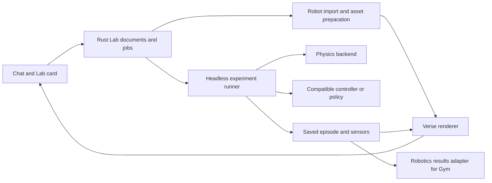

# Robot Lab: robots and experiments inside chat

Status: local implementation, 2026-10-14. The [private document store](../../crates/robot-lab/README.md),
SO-101 import and inspection, [LeRobot reader and export](../../crates/robot-data/README.md),
[MuJoCo runner](../../crates/robot-sim/README.md), [chat workbench](../../crates/robot-workbench/README.md),
[ACT, SmolVLA, and policy services](../../crates/robot-policy/README.md),
[robotics Gym results](../gym/README.md#inspect-robot-experiments), and
[Verse room](../../crates/verse-zone-robotlab/README.md) are implemented.
Phone presentation and authorized remote execution remain tracked below.
The [LeRobot companion](lerobot-in-verse.md) covers the data, vision gap,
Rust articulated-joint spike, and room. Controlled recordings and numerical
policy checks establish integration; the current trajectory-imitation policy
and scripted baseline both scored 0/10 on the cube-placement validation task.

Robot Lab lets you bring an open robot into an environment, see it in 3D,
change the experiment by talking, and compare what happens. The chat is the
workbench. A lab opens as a room in Verse, using the same documents,
robot definitions, and saved runs.

Example: “Put an SO-101 on a table with a red cube.” The conversation shows a
3D card. “Move the cube farther away” creates another scene version.
“Replay this demonstration” shows the arm's motion. Once simulation and a
compatible controller are available, “Try picking it up ten times, then
compare with the old position” starts a bounded experiment and shows both
results, with a replay of each failure.

## The connection to Video Lab

[Issue #11581](https://github.com/OpenAgentsInc/openagents/issues/11581)
specifies the Video Lab MVP: versioned documents, local render jobs, chat
tools, an inline player, comparisons, and notes. Its
[design](../video-lab/README.md) provides the interaction pattern for Robot Lab.

Reuse the shared concepts and, when implemented, their storage and job
interfaces. Add robotics document kinds and a 3D viewer; keep video editing
and robot execution in their own handlers. Video Lab's MVP does not establish
that a live 3D chat surface or a robotics runner already exists. Robot
inspection can ship without waiting for its full video editing pipeline.

| Video Lab concept | Robot Lab equivalent |
| --- | --- |
| Cut, shot, and scene versions | Robot definition, environment, and experiment versions |
| Render job | Preview capture or simulation run |
| Inline video player | Orbitable 3D view, with a video fallback |
| Frame at a time | Robot pose, sensor readings, and contacts at a simulation step |
| Compare versions | Compare scenes or runs under the same test conditions |
| Timestamped notes | Notes attached to a version, episode, and step |

## What the repository already provides

| Foundation | Reuse | Limit relevant to robots |
| --- | --- | --- |
| [Verse Engine](../../crates/verse-engine/README.md) | Headless scheduling, entity lifetimes, asset packs, animation, and presentation contracts | Skeletal animation does not establish articulated robot dynamics. |
| [Verse rendering](../../crates/verse-pbr/Cargo.toml) | wgpu, PBR materials, glTF assets, and native drawing surfaces | Robot description import and link-to-mesh bindings need new code. |
| [Shared physics](../../crates/physics/src/lib.rs) | Fixed steps, rigid bodies, contacts, friction, sensors, traces, debug overlays, and limited servoed hinge and slider joints | The joint spike passes its small MuJoCo comparisons; robot import and a complete manipulation backend remain separate work. |
| [Physics Lab](../verse/physics-lab.md) | Live scenarios, pause, reset, single-step, parameter controls, and offscreen captures | This is a local teaching and regression zone, with generated geometry; it does not load arbitrary robots. |
| [Gym](../gym/README.md) | Pinned test suites, recorded evidence, comparisons, and replay conventions | Decision-door evaluation is not a robot environment API. Robotics needs a separate runner and result adapter. |
| [Verse Gym](../verse/gym.md) | A place to browse results and observe recorded work | New robot results need an explicit integration. |
| [Rust Native](../../crates/rust-native/docs/spec.md) | Semantic chat cards, typed controls, registered drawing surfaces, and lifecycle rules | An inline robot renderer must be registered and mounted by each adapter. |
| [Shared UI architecture](../coder/rust-native/architecture.md) | Rust-owned application state with native presentation | Platform GPU handles remain in the adapter. |

The [Genesis roadmap](../physics/2026-09-27-genesis-port-roadmap.md)
explicitly excludes robot control, IK, and manipulation or locomotion RL
from the existing port. Robot Lab is new work over these foundations.
The [Grid robot](../verse/grid-robot.md) is an animated game character;
its patrol is not a robotics control benchmark.

## Three different things called a model

The catalog distinguishes these assets instead of treating a Hugging Face
URL as a runnable robot:

| Asset | Contains | Enables |
| --- | --- | --- |
| Robot description | Links, joints, limits, inertial properties, collision geometry, and visual meshes; commonly URDF or MJCF | Inspection, pose changes, and simulation when its physical definition is supported |
| Policy checkpoint | Weights, configuration, preprocessing, observation layout, and action layout | Learned control for an explicitly compatible robot and task |
| Dataset | Recorded observations, actions, timestamps, and task descriptions | Demonstration viewing, evaluation references, and later training |

[LeRobot](https://huggingface.co/docs/lerobot) supplies robotics tooling,
policies, and datasets on Hugging Face. Its
[SO-101 guide](https://huggingface.co/docs/lerobot/so101) and
[The Robot Studio's descriptions](https://github.com/TheRobotStudio/SO-ARM100)
are starting points for the small-arm workbench. Source formats and exact
robot variants must be checked at the revision imported.

[MuJoCo Menagerie](https://github.com/google-deepmind/mujoco_menagerie)
provides simulation descriptions, including SO-101 and Franka arms, along
with quadrupeds and humanoids. It is a useful second catalog source. Each
model directory has its own license; the repository's general license is
not a substitute for checking that model's XML and meshes.

[SmolVLA](https://huggingface.co/docs/lerobot/smolvla) is a candidate policy
family. It consumes camera images, robot state, and an instruction, and
produces action chunks. The
[base checkpoint](https://huggingface.co/lerobot/smolvla_base) lists
Apache-2.0 licensing. Loading those weights does not establish that the
policy solves a chosen simulated task. A demo needs a compatible checkpoint,
its preprocessing and normalization, and an explicit sensor/action mapping.

Start with one SO-101 description and one table scene. Add a Franka scene
as a second import fixture. Walking robots and whole-world navigation follow
after the manipulation path works.

## The inline workbench

Each card shows the robot and environment, the scene version, and whether
you are inspecting, replaying, or simulating. The initial controls are
**Orbit**, **Reset view**, a joint selector, and a joint position control.
Motion replay adds **Play**, **Pause**, and a timeline. Simulation adds
**Run**, **Stop**, and **Step** when those operations work.

Selecting a robot link highlights it and opens a small inspector with its
joint, position, and limits. Camera choices include the overall scene and
any recorded or configured robot camera. Optional overlays show collision
shapes, axes, contacts, and the target. Numerical readouts and controls have
accessible text; a GPU image alone cannot explain a robot to a screen reader.

An expanded view provides more room without losing the conversation.
Comparison shows two labeled versions or episodes at the same simulation
time, with a shared camera and independent playback available. A note attaches
to the selected episode and step, rather than whichever preview finishes last.

The assistant explains changes in one short sentence and lets the card carry
the result. Examples of visible text: “Cube moved 10 cm to the right”,
“7 of 10 attempts succeeded”, or “This policy expects a wrist camera”.
Do not show controls for unavailable operations.

Web uses the Rust/WASM Verse renderer in an inline canvas, starting with
the supported browser rendering profile. Desktop and phone use registered
Rust Native surfaces with Verse's GPU renderer. Plain terminals show a poster
and a link to a local player. An adapter without interactive 3D shows a saved
preview and working playback controls instead.

Offscreen cards suspend drawing and sensor subscriptions. Only the selected
card runs an interactive renderer initially; other cards show posters.
Closing a view releases GPU resources without silently cancelling a recorded
job. A standalone local inspection simulation pauses when its view closes;
an explicitly started batch job continues until stopped or completed.

## Documents and tools

A lab belongs to an existing OpenAgents project. Store private robot files,
checkpoints, episodes, and previews in its configured file store, outside git.
Check in schemas and small redistributable fixtures. Every edit creates a new
version with its parent, author, summary, and content hash. A run pins its
inputs even if the chat edits the scene while it runs.

| Proposed document | Required content |
| --- | --- |
| `robot.v1` | Source repository and immutable revision, file hashes, license notices, link/joint tree, units, source axes, visual bindings, and supported capabilities |
| `robot-scene.v1` | Robot instances, environment assets, placements, materials, colliders, lights, cameras, and initial state |
| `robot-experiment.v1` | Scene version, task, controller or policy version, backend/build, fixed timestep, control/sensor rates, seed list, stop conditions, and resource limits |
| `robot-episode.v1` | Experiment reference, episode seed, step-indexed states and actions, sensor references, outcome, timings, and failure reason |

Use the shared Lab operations for opening, showing, editing, rendering,
comparing, versions, and notes. Proposed robotics extensions are:

| Tool | Purpose |
| --- | --- |
| `robot_import(source, revision)` | Fetch a supported description and return a checked import report and preview |
| `robot_pose(robot, joints)` | Create an inspection pose within the declared limits |
| `robot_replay(dataset, episode)` | Open a supported recording with its mapping and timestamps |
| `robot_run(experiment)` | Start the exact pinned experiment with bounded episodes and runtime |
| `robot_stop(job)` | Stop at a step boundary and keep the partial episode |
| `robot_inspect(episode, step)` | Return pose, action, contacts, and selected sensor data |

Names are proposed, not existing commands. The chat model selects typed
tools; keyword matching does not select robot operations. Tools return typed
card references and concise summaries. Edits validate dimensions, limits,
asset references, and controller compatibility before saving. A patch names
its base version so concurrent edits cannot overwrite another change.

## Runtime and physics

Keep all new product state, import logic, tools, execution control, storage,
and UI behavior in Rust. Do not add a TypeScript app or a Python robotics
service. Existing Python training tooling can provide offline evidence;
it is not the Lab's product runtime.

Proposed ownership: `robot-lab` owns documents and orchestration;
`robot-description` owns portable link, joint, and asset definitions;
`robot-data` reads recorded motion. These crates exist.
`robot-sim` owns the implemented headless runner and backend interface. Keep renderer integration
in Verse adapters and result presentation in Gym adapters. Avoid making the
generic physics crate depend on chat, projects, or Hugging Face.

Inspection uses forward kinematics to place visual links. Replay uses recorded
states. Neither requires pretending that rendered meshes have physical joints.

The first dynamic manipulation backend uses MuJoCo through its C API,
behind a Rust wrapper with explicit model/data ownership. Its
[modeling documentation](https://mujoco.readthedocs.io/en/stable/modeling.html)
describes MJCF and URDF loading, including URDF's more limited expressiveness.
The wrapper qualifies Linux x86-64 with pinned SO-101 and Franka inputs, and
Apple silicon Macs with the SO-101 and contact tests, and refuses other
platforms until tested. Native hosts run simulation first;
web and phone can render recorded or streamed poses without linking MuJoCo.

Verse draws each link from the backend's body transforms. One backend owns all
contacts in an experiment, including robot-to-table and robot-to-object contact.
Do not simulate the robot in MuJoCo and the cube in Verse physics separately.
Visual scenery may remain outside the simulation; task-relevant geometry needs
checked collision proxies in the selected backend.

The shared `physics` crate remains useful for existing lab scenarios and
simple environments. Its articulated-joint spike adds motorized joints,
limits, inertia checks, neighboring-link filters, and small MuJoCo comparison
fixtures. A complete native robot backend still needs import and manipulation
evidence; it is not required for first inspection.

Simulation steps at a declared fixed rate. Control and sensors run at declared
step intervals. Action chunks carry their originating observation step and
expiry; the runner rejects stale or invalid actions and records the event.
Batch evaluation pauses simulation while waiting for inference, so GPU speed
does not change the observation/action sequence. Interactive operation uses an
explicit timeout policy and reports when it cannot keep up.

Policy cameras use the checkpoint's dimensions, intrinsics, preprocessing, and
camera names. The orbit camera is separate. Native ACT and SmolVLA inference and an explicitly configured policy service
implement the same checked observation/action contract. Initial delivery uses pose edits and recorded
motion; learned-policy support does not depend on adding a Python runtime.

## Import and reproducibility

Imports accept data files, not executable repository setup scripts. Resolve
all referenced meshes under the fetched asset root; bound bytes, mesh counts,
texture dimensions, and nesting. Refuse path escapes and unsupported features
with a useful reason. Expand Xacro offline into checked URDF before import;
do not execute arbitrary macros from a chat tool.

Preserve the source definition. Record explicit conversions into meters and
the runtime's Y-up coordinates, including joint axes, inertia tensors, mesh
scales, and camera frames. Verse asset packs use Z-up source coordinates;
cross this boundary once through the pack conversion rather than rotating
some links twice. Unsupported transmissions, mimic joints, or closed chains
produce an import report; they never silently disappear from a physics model.

Cache imports by source hashes and converter version. Cache captures by scene
or episode hash, renderer build, camera, and quality. Pin backend builds,
policy weights, normalization, sensor configuration, seed lists, and task
definitions in each experiment. Recorded pose replay is the stable viewing
path; rerunning GPU inference or another simulator build does not promise
bit-identical outcomes. Declare tolerances for numerical comparisons.

## Gym experiments

Add a robotics result adapter without making a robot policy answer
`POST /v1/systemone`. The runner saves episodes; the adapter supplies Gym with
versioned suites, metrics, comparison inputs, and links to replay evidence.
Inspect the existing Gym contracts before choosing the result schema.

The first scored task is moving a cube into a target region. Define success
from simulated state: the cube is inside the region, released, and stable for
a declared duration before the time limit. Record success count and total,
completion time, collisions, limit violations, inference latency, and failure
reasons. A kinematic replay is labeled as a demonstration, not scored as a
successful physics-controlled grasp.

Compare controllers over the same pinned scene and seed list. Keep scene
changes separate from controller comparisons. Start with a scripted baseline,
then qualify a learned policy against it. Report sample counts and uncertainty;
one successful clip is a demonstration, not benchmark evidence. Later training
uses separate training, validation, and held-out tests. Publishing a result is
an explicit action; an experiment does not automatically upload recordings.

## Delivery slices and acceptance

Implementation issues: import and inspection [#11594](https://github.com/OpenAgentsInc/openagents/issues/11594),
documents [#11603](https://github.com/OpenAgentsInc/openagents/issues/11603),
chat cards [#11604](https://github.com/OpenAgentsInc/openagents/issues/11604),
recorded motion [#11605](https://github.com/OpenAgentsInc/openagents/issues/11605),
MuJoCo [#11606](https://github.com/OpenAgentsInc/openagents/issues/11606),
Rust joints [#11607](https://github.com/OpenAgentsInc/openagents/issues/11607),
ACT [#11608](https://github.com/OpenAgentsInc/openagents/issues/11608),
SmolVLA and policy services [#11609](https://github.com/OpenAgentsInc/openagents/issues/11609),
Gym [#11610](https://github.com/OpenAgentsInc/openagents/issues/11610),
dataset export [#11611](https://github.com/OpenAgentsInc/openagents/issues/11611),
Verse room [#11612](https://github.com/OpenAgentsInc/openagents/issues/11612),
and other devices [#11613](https://github.com/OpenAgentsInc/openagents/issues/11613).

1. **Import and inspect.** One pinned SO-101, a table and cube, checked source
   notices, forward kinematics, joint limits, and an offscreen capture. Verify
   known poses, axes, scale, and rejected imports with small fixtures.
2. **Chat card and versions.** Open, pose, edit, preview, notes, and comparison
   in local chat. Verify that a reopened chat restores the selected version,
   old cards keep their subjects, and hidden cards release rendering resources.
   Show a terminal fallback link. This is the first usable MVP.
3. **Recorded motion.** Import one licensed demonstration with an explicit
   robot mapping. Scrub joint states and camera frames together. Verify timing,
   missing-frame behavior, and that replay never starts a controller.
4. **Simulation.** Qualify the native MuJoCo wrapper and one arm scene. Run a
   scripted controller, pause, step, reset, stop, and replay its saved episode.
   Verify contacts and limits; stopping retains partial evidence.
5. **Policy and Gym.** Qualify one compatible checkpoint and Rust runtime or
   configured policy service. Run a pinned seed set against the scripted
   baseline, inspect failures, and compare recorded metrics in Gym.
6. **Verse room and other devices.** Mount the same lab in a Verse room, then
   qualify phone presentation and remote execution. Cloud training, fleet
   experiments, and physical hardware control are later projects.

Initial UX targets, to measure on a named machine: a cached inspection opens
within 2 seconds; orbiting reaches 30 frames per second at the default preview
size; a cached pose edit updates within 200 ms. A cold import shows download
and preparation progress. On `coderos-4080`, headless Chromium 152 at a
960 × 860 viewport measured a 0.44-second cached open, 39 frames per second,
and a 108-ms pose update on 2026-10-14. This local walkthrough also checked
saved notes, comparison restoration, and GPU release when a card is hidden.

The owner walkthrough for the first MVP is: open a chat, load SO-101, orbit
the table, move a joint, move the cube, compare the two scene versions, add a
note, close the chat, and reopen the same lab. A later simulation walkthrough
adds a ten-episode run, a stop, and replay of a failed attempt.

The SO-101 import spike pins The Robot Studio's description and meshes at
`a758567c3978dfeefe282ede0500085a48fe8f78`, with Apache-2.0 notices.
Run `cargo run -p verse --no-default-features --features capture --example
robot_lab_capture -- OUTPUT.png shoulder_lift=0.6` for an inspection capture.
Add `--dataset FOLDER --mapping FILE --episode N --frame N` for recorded poses.
The mapping names the exact description and its units or calibration ranges.
