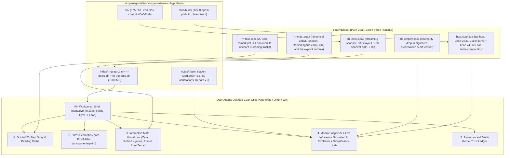

# Riemann Hypothesis Workbench Specification (OpenAgents Desktop Gym)

**Date:** 2026-11-21
**Status:** Specification, ready to build on top of the Lean Gym (`docs/lean/spec.md`)
**Target surfaces:** `apps/openagents-desktop/page/` (`gym-lean.coax`, new `gym-rh-*.coax` views), `coax/lib/lean/` (`rh-index.coax`, `rh-tour.coax`, `rh-math.coax`, `rh-simplify.coax`), `coder/tui/lean-run.coax` (`lean-run rh ...`), `apps/openagents-desktop/` (Foreman API + `OA-SHOW`), `proto/`.

Companion documents: [riemann-hypothesis-2026.md](riemann-hypothesis-2026.md) · [README.md](README.md) · [spec.md](spec.md) · [wire-and-artifacts.md](wire-and-artifacts.md) · [verification-and-security.md](verification-and-security.md) · [roadmap.md](roadmap.md).

---

## 1. Product Vision & The 17-Million-Line Problem

On November 20–21, 2026, Levent Alpöge and Claude released — and the Lean FRO and Mathlib Initiative formally certified — a complete Lean 4 proof of the **Riemann Hypothesis** and **GRH for Dirichlet $L$-functions** ([riemann-hypothesis-2026.md](riemann-hypothesis-2026.md)).

Yet the proof's raw artifact is **human-hostile to explore with ordinary tools**:

- **175,187 `.lean` files** (~1.03 GB of text, **17,374,215 lines**, **zero comments**).
- **818,755 theorems/lemmas** and **242,067 definitions**, every single file in the import closure of `Main.lean`.
- **4.94 GB** compressed prebuilt Lake cache (**99.27 GB** unpacked `.olean`/`.ilean` files); **61.57 GB** unpacked raw NDJSON export (`solution.ndjson`).
- **Two Lean toolchains:** built on **Lean `v4.33.1`** (`--tstack=400000`, `maxHeartbeats = 4000000`, `-j1`), judged by independent verified kernels on **Lean `v4.36.0`** (`lake comparator`, `con-leche --compare`, `con-ron`, `nanoda`).

Opening this repository in a standard IDE or asking a generic chat agent to "read the proof" immediately stalls, OOMs, or yields hallucinations from pretraining priors.

**Our goal:** Build a flagship **Riemann Hypothesis Proof Workbench** inside the OpenAgents Desktop **Gym** (`Gym -> Lean -> Riemann Hypothesis`) where anyone — mathematician, student, engineer, or AI researcher — can:

1. **Navigate & Visualize** the 175,187-module dependency architecture at 60 fps with semantic zoom from the 5 headline theorems down to any single lemma.
2. **Learn** the mathematical argument interactively through a guided 20-step tour linking `alpo.ge/remark.pdf` directly to real Lean namespaces, backed by live mathematical plots (critical strip, Dirichlet $L$-functions, Robin/Lagarias divisor inequalities, $\sqrt{X}$ theta-lift chains).
3. **Interact & Inspect** any module with live Lean `v4.33.1` tactic goals (`$/lean/plainGoal`), hover types, reverse-dependency cones, and a **Grounded AI Explainer** that turns zero-comment Lean into rigorous, citation-checked mathematical exposition.
4. **Verify & Simplify** — audit cryptographic provenance & multi-kernel verdicts (`con-leche`, `con-ron`, `nanoda`, `lean4lean`, `lake comparator`), attach personal Markdown+LaTeX annotations, and experiment with **shortening/simplifying individual lemmas** while verifying drop-in signature preservation against `Main.lean`!

---

## 2. Three-Tier Storage & Activation Model (Laptop-Friendly)

A critical design requirement: **a user on a 16–32 GB laptop must be able to explore, visualize, and learn the proof within 2 minutes without downloading 99 GB of `.olean`s or needing 100 GB RAM.**

| Tier | Disk Footprint | RAM Needed | Setup Command / Action | What Works |
| --- | --- | --- | --- | --- |
| **Tier A — Source + Coax Atlas Index** *(Default on open)* | ~1.35 GB (`1.03 GB` source + `~300 MB` Coax binary index) | `< 400 MiB` | `lean-run rh fetch --mode source && lean-run rh index` | Full 175,187-module semantic-zoom Proof Atlas, `< 10 ms` search across 818,755 theorems & 242,067 defs, shortest-path-to-`Main.lean`, 20-step guided tour, all interactive math visualizers, zero-comment source reading, Grounded AI Explainer, Provenance & Multi-Kernel Trust Ledger, local Markdown/LaTeX notes. **Zero Lean toolchain required for Tier A!** |
| **Tier B — Live Interactive Lean `v4.33.1` LSP** *(Opt-in)* | ~5 GB compressed cache -> **Selective** (1–10 GB) or **Full** (~99 GB extracted `.lake/build`) | 2–8 GiB (bounded by `oa-leanhost`) | `lean-run rh fetch --mode cache [--slice MODULE]` | Everything in Tier A **plus** live `$/lean/plainGoal`, `$/lean/plainTermGoal`, hover types, jump-to-definition, speculative `Try Tactic…`, and **Lemma Simplification Sandbox** (re-elaborating & verifying a single module or neighborhood via `oa-leanhost` with `--tstack=400000`, `maxHeartbeats = 4000000`). |
| **Tier C — Full Independent Kernel Replay** *(Workstation / Remote Host)* | +70 GB unpacked NDJSON (`solution.ndjson` + `challenge.ndjson`) | 50–100 GiB | `lean-run rh audit --remote` (via `coax/remote/`) or local on >= 64 GB Mac/Linux | Runs `con-leche --compare` (Lean `v4.36.0`, ~3m15s on 64 threads / 50 GB RAM), `nanoda`, or `lake comparator` against the pinned `challenge.ndjson` (`bd484ac9...b2b9`) and `solution.ndjson` (`5ea74b91...244e`) directly from `math.mit.edu/~drew/grh/` or a fresh sandboxed build. |

**Honest UI labeling:** The workbench header always displays the active tier (`Tier A: Indexed Source`, `Tier B: Live Lean v4.33.1 LSP`, or `Tier C: Kernel Audited`) and clearly warns before downloading the 4.94 GB / 99 GB extracted cache (never auto-downloading gigabytes silently).

---

## 3. System Architecture & Coax Corpus Indexer



### 3.1 Pure Coax Streaming Indexer (`coax/lib/lean/rh-index.coax`)

Because scanning 175,187 files on every launch would take minutes, `lean-run rh index` performs a single bounded streaming pass in Coax (zero Python, zero external database daemon) and writes immutable, memory-mappable binary index files under `~/.openagents/lean/corpora/riemann-hypothesis/index/`:

1. **`rh-modules.bin` (`rh-index.v1`):** Fixed-stride records for all `175,187` modules:
   - `module_id: u32`, `library_id: u8` (`0..9`), `domain_id: u16` (e.g., `Formalism`'s 116 folders, `GroundTheory`'s 12 sub-packages), `path_offset: u32`, `line_count: u32`, `byte_count: u32`, `theorem_count: u16`, `def_count: u16`, `depth_from_main: u16` (BFS distance to `Main.lean`), `in_degree: u32`, `out_degree: u32`, `atlas_x: f32`, `atlas_y: f32` (precomputed hierarchical Sugiyama/radial cluster coordinates so the GPU atlas opens in `< 50 ms`!), `flags: u16` (e.g., `HAS_METAPROG`, `HAS_NOTE`, `HAS_OLEAN`).
2. **`rh-edges.bin`:** Compressed Sparse Row (CSR) adjacency arrays (`import_offsets[175188]`, `import_targets[]` and `rev_offsets[175188]`, `rev_targets[]`) for instant `< 1 ms` upstream prerequisite traversal, downstream impact cones, and BFS shortest path between any two modules (`lean-run rh path A B`).
3. **`rh-decls.bin` + `rh-search.idx`:** Compact table of all `818,755` theorems/lemmas and `242,067` definitions (`decl_id`, `module_id`, `kind`, `line`, `name_offset`, `sig_preview_offset`) indexed by ASCII-folded prefix/trigram buckets (reusing `components/core/match.coax` `match_rank` on top candidates) for `< 15 ms` fuzzy search across over **1 million declarations**!
4. **Integrity check:** Index header stores the root source tree digest + file count (`175,187`), refusing stale/corrupt index files and rebuilding cleanly on demand.

---

## 4. Five Interactive Workbench Views (`apps/openagents-desktop/page/gym-rh*.coax`)

Inside `Gym -> Lean`, a corpus selector pill at the top-left lets the user switch between **My Runs / Lake Projects** and **`Riemann Hypothesis (2026)`**. Selecting `Riemann Hypothesis (2026)` activates five sub-tabs inside the Coax GPU canvas (running identically on **macOS, Linux, and Windows**):

```
┌────────────────────────────────────────────────────────────────────────────────────────────┐
│ GYM  [ Benchmarks ] [ PLE 3D ] [● Lean ]   Corpus: [Riemann Hypothesis (2026) ▾]  Tier A/B  │
│ [ 1. Tour ] [ 2. Proof Atlas ] [ 3. Math Visuals ] [ 4. Module & Explainer ] [ 5. Trust ]  │
├────────────────────────────────────────────────────────────────────────────────────────────┤
│                                  Active View Canvas (Coax GPU)                             │
└────────────────────────────────────────────────────────────────────────────────────────────┘
```

### View 1: Guided 20-Step Story & Learning Tracks (`page/gym-rh-tour.coax`)

Bridges the gap between Alpöge's 4-page human sketch (`alpo.ge/remark.pdf`) and the 17.37M-line formalization:

- **Three Curated Reading Tracks** selectable at the top:
  1. **Overview (15 min — Intuition):** What RH & GRH say, why Mathlib's definition excludes $s = 1$ and $-2(n+1)$, how `Robin1984` connects RH to $\sigma(n)$, and the high-level arc from Stepanov's finite-field proof to $\sqrt{X}$ iterated theta lifts.
  2. **The 20 Pillars (Deep Dive — `remark.pdf` -> Lean):** Interactive timeline of all 20 milestones from `remark.pdf` (Oct 6 to Nov 16, 2026), each card displaying:
     - Mathematical summary + LaTeX equations (rendered via `page/rich.coax`)
     - Direct clickable **Anchor Lean Modules** (e.g., Pillar 1 -> `PositivityTheory`; Pillar 8 -> `GroundTheory.HeightsAndTheta` / `Formalism.FormalDegreeBessel`; Pillar 13 -> `Formalism.HarderNarasimhan` / `HermitianCurvature`; Pillar 17 -> `Formalism.GaloisCohomology`; Pillar 19 -> `Formalism.BehrendSets`; Pillar 20 -> `Development.AutomorphicArithmetic.CharacterBoxes.MainConclusion` -> `Supplements.Kernels.MainTheorems` -> `Main.lean`)
     - **"Jump to Atlas"** (highlights that pillar's subgraph in View 2) and **"Ask Explainer"** (opens View 4 pre-loaded with that pillar's modules).
  3. **Top-Down Verification Walk (From `Main.lean`):** Interactive reverse-dependency tree starting at `Main.riemannHypothesis`, expanding one layer at a time (`rhOfAll` -> `Formalism.VW.rh_of_every` + `allChi` -> `UpperTheory.FinalTheorems.everyCharacter` -> ...), letting a reader peel back the proof like an onion without ever getting lost.

### View 2: Multi-Scale 60 fps GPU Proof Atlas (`page/gym-rh-atlas.coax`)

Draws the 175,187-module proof graph natively on the GPU using `components/paint/list.coax` with strict per-frame primitive budgets (semantic zoom / level-of-detail culling — never attempting to draw 175k quads simultaneously):

- **LOD 0 — Macro Library Map (10 nodes + weighted flow ribbons):** Shows `GroundTheory`, `GroundTheoryFields`, `Lemmata`, `PositivityTheory`, `ReciprocityTheory`, `CompanionTheory`, `Formalism`, `Development`, `Supplements`, and `Main.lean`, scaled by log(lines) or module count, showing cross-library import flow.
- **LOD 1 — Domain Constellation (~150–250 cluster nodes):** Zooming into any library (e.g., `Formalism`'s 116 domain directories or `GroundTheory`'s 12 sub-packages) reveals domain clusters arranged topologically from foundations (bottom) to `Main.lean` (top).
- **LOD 2 — Local Module & Declaration Cone (up to 400 visible nodes):** Selecting any module or theorem renders its exact upstream prerequisites (`depth 1..3`) and downstream dependents + the highlighted **shortest dependency chain to `Main.riemannHypothesis`**!
- **Color Overlays:** Toggle coloring by:
  - *Library* (categorical palette)
  - *Theorem Density* (heatmap)
  - *Explanation Coverage* (green = annotated in local/community notes, dim = raw zero-comment)
  - *Metaprogramming Audit* (highlights the exact 6 static-scan sites like `kexactB`, `kcopy`, `CutCptCopy` so skeptics can visually inspect where they sit in the graph)
  - *Cache Status* (bright = `.olean` cached locally for instant LSP, dim = source-only)
- **Interactions:** Smooth pan/zoom (reusing `components/core/scroll.coax` / affine transform), instant omnibox search (`⌘K` scoped to 1M+ RH declarations), click node -> inspect side card -> double-click -> open in View 4 (Module & Explainer).

### View 3: Interactive Mathematical Visualizers (`page/gym-rh-math.coax`)

Pure Coax numerical computation (`coax/lib/lean/rh-math.coax`, double-precision `f64`, zero external plotting libraries) rendered directly on the GPU canvas via `components/paint/list.coax`, with every plot directly cross-linked to the corresponding Lean theorem in `Main.lean` or `Robin1984`:

1. **Critical Strip & Zeta / Dirichlet $L$-Function Explorer:**
   - Plots the critical strip $0 < \mathrm{Re}(s) < 1$, the critical line $\mathrm{Re}(s) = 1/2$, the Hardy $Z$-function $Z(t)$ along $\mathrm{Re}(s) = 1/2$ (marking the first 50 nontrivial zeros $\rho_k = 1/2 + i\gamma_k$), the pole at $s = 1$, and trivial zeros at $-2, -4, -6, \dots$.
   - Character picker for small moduli $N \in \{1, 3, 4, 5, 7, 8, 12\}$ and primitive vs imprimitive Dirichlet characters $\chi \bmod N$ — visually demonstrating why imprimitive characters add extra Euler-factor zeros on $\mathrm{Re}(s) = 0$ (which `LFunction_eq_zero_re` excludes via $0 < \mathrm{Re}(s) < 1$, directly explaining the comment in `verification/NOTES.md`!).
   - Clicking any region highlights the exact formal theorem in `Challenge.lean` that governs it (`riemannHypothesis`, `LFunction_ne_zero_of_half_lt_re`, `LFunction_eq_zero_re`, `LFunction_eq_zero_re_of_isPrimitive`).
2. **Robin & Lagarias Divisor-Sum Visualizer (`Robin1984` Cross-Check):**
   - Interactive scrubber over $n \in [1, 100{,}000]$ (plus curated colossally abundant numbers $n = 2, 6, 12, 60, 120, 360, 2520, 5040, 55440, 720720, \dots$) plotting $\sigma(n) / (e^\gamma n \log \log n)$ against the constant ceiling $1.0$ (highlighting the last equality/exception at $n = 5040$, above which `robin_inequality` proves the curve stays strictly below $1$ forever) and Lagarias's ratio $\sigma(n) / (H_n + e^{H_n} \log H_n) \le 1$.
   - Shows why this cross-check is philosophically powerful: a concrete elementary arithmetic inequality verified by `con-leche` and `nanoda` without depending on Mathlib's complex `riemannZeta` definition.
3. **Primes from Zeros (von Mangoldt's explicit formula):**
   - Plots Chebyshev's $\psi(x)$, the exact prime staircase, against $x - \sum_\rho x^\rho/\rho - \ln 2\pi - \tfrac12\ln(1 - x^{-2})$ summed over the first $0, 1, 2, 3, 5, 10, 20$ or $30$ zeros, for $x$ up to 30, 60 or 100. Adding zeros bends the curve into the staircase, which shows why the zeros control the primes.
   - This tab replaced an earlier "theta-lift chain versus the $2/3$ barrier" chart. That chart drew hard-coded curves: `remark.pdf` names the $\sqrt{X}$ chain of theta lifts and the $2/3$ count but gives no formula, so nothing could be plotted from it honestly. The 3D flythrough's stop 4 shows only what the note states.

### View 4: Zero-Comment Module Inspector, Grounded AI Explainer & Simplification Lab (`page/gym-rh-inspect.coax`)

A 3-column learning and interactive-research workspace:

- **Left Column (Source & Live Lean Infoview):**
  - Displays the selected `.lean` module (reusing `components/zeron/editor.coax` / `page/filepane.coax` read-only up to 256 KB; editable in Sandbox mode).
  - Top breadcrumb shows **shortest path to `Main.lean`** (`this_mod -> ... -> MainConclusion -> MainTheorems -> Main.lean`, every hop clickable) + upstream import chips + downstream user count.
  - **Tier B Live Infoview Drawer** (docked under source when `.olean`s are cached): click any line/tactic -> `oa-leanhost` (`lake serve` on Lean `v4.33.1`) displays exact `$/lean/plainGoal`, `$/lean/plainTermGoal`, and hover types!
- **Right Column (Split: Grounded AI Explainer + Local Notes / Simplification Lab):**
  - **Grounded AI Explainer Chat** (reusing OpenAgents' embedded Coax chat component / `mcworker` + `lean-run mcp`):
    - Automatically injects a **grounding context header** containing:
      1. Canonical facts from `docs/lean/riemann-hypothesis-2026.md` (explicitly preventing the model from hallucinating "RH is unsolved").
      2. The active module's exact file path, theorem signatures, direct upstream import signatures (from `rh-decls.bin`), and shortest dependency chain to `Main.lean`.
    - Quick-prompt chips: **`Explain (Undergrad)`**, **`Explain (Analytic NT)`**, **`Map Proof Steps`**, **`Why Does Main Need This?`**, **`Suggest Simplification`**.
    - Every generated exposition can be saved with one click as a local Markdown+LaTeX note (`~/.openagents/lean/corpora/riemann-hypothesis/notes/<module>.md`, schema `rh-note.v1`), lighting up that module green in View 2's *Explanation Coverage* overlay!
  - **Lemma Simplification Lab (Tier B):**
    - Clicking **"Simplify Lemma in Sandbox"** copies the target module into an isolated scratch overlay (`~/.openagents/lean/runs/rh-simp-<id>/`), opens it for human or AI-agent editing, and provides one-click **Verify Drop-In Replacement**:
      1. Compiles the shortened module under Lean `v4.33.1` against existing cached dependencies.
      2. Runs `#authority` `coax/lib/lean/rh-simplify.coax` + `con-leche --compare` (or `lake comparator`) comparing the original module's exported theorem signatures against the simplified module's signatures, verifying:
         - **Exact kernel-level signature identity** (every exported theorem/def used downstream keeps its identical type)
         - **Zero `sorryAx` / forbidden axioms**
         - **Honest line/declaration reduction metrics** (`-412 lines`, `-9 helper lemmas`, `receipt_sha256`).
      3. Exports passing simplification trajectories to ATIF-v1.8 (`lean-run export-atif`) and optionally exports a clean `.patch` file to contribute back to community simplification efforts!

### View 5: Provenance & Multi-Kernel Trust Ledger (`page/gym-rh-trust.coax`)

An interactive, verifiable audit console so users never have to take anyone's word on faith:

- **Four-Criterion Buzzard/Xena Checklist Card:** Live green/amber/red status per criterion (1. Statement matches Mathlib, 2. Compiles cleanly, 3. Proves stated theorem via `comparator` & `con-leche --compare`, 4. Valid under independent verified kernels `con-leche`, `con-ron`, `nanoda`, `lean4lean`).
- **Local vs Published SHA-256 Verifier:** One-click button hashes local `lean.tar.gz`, `src/` tree (vs root commit `40e56bab`), `challenge.ndjson`, `solution.ndjson`, and `Main.olean` against the pinned hashes in `riemann-hypothesis-2026.md` and `math.mit.edu/~drew/grh/SHA256SUMS`.
- **Metaprogramming Audit Inspector:** Lists all 6 localized metaprogramming sites (`BuildAid/D1..D5`, `CutCptCopy.lean`, `kexactB` [67 files], `kcopy`, `run_tac` [33], `@[positivity]`) with click-to-open-source buttons and explains why inert NDJSON replay eliminates elaborator trust.
- **Reproduce Check Actions:**
  - Local fast checks (`Audit.lean` `#print axioms`, single-module `lake build`, `Robin1984` equivalence check).
  - Heavy full-export check (`con-leche --compare challenge.ndjson solution.ndjson` or `lake comparator`) with upfront hardware pre-check (warns honestly if RAM < 50 GB / disk < 70 GB and offers **Run on Remote Host** via `coax/remote/remote.sh`).

---

## 5. CLI, MCP, Chat Steering & Wire Extensions

All RH workbench capabilities are accessible programmatically from chats, scripts, MCP clients, and Foreman — extending `lean-run` (`coder/tui/lean-run.coax`) and `coax/lib/lean/`:

### 5.1 `lean-run rh` Subcommands

| Command | Behavior |
| --- | --- |
| `lean-run rh fetch [--mode source\|cache] [--dir DIR]` | Clones `leanprover-community/riemann-hypothesis` into `~/.openagents/lean/corpora/riemann-hypothesis` (verifying root commit `40e56bab` / `alpo.ge` archive SHA-256). `--mode cache` explicitly opts into `lake exe cache get` (4.94 GB download, printing exact disk/RAM requirements and security disclaimer that community caches are for fast browsing, not independent trust). |
| `lean-run rh index [--dir DIR]` | Runs pure Coax streaming indexer (`rh-index.coax`) over all 175,187 files, writing `index/rh-{modules,edges,decls,search}.bin` + summary stats. |
| `lean-run rh search QUERY [--kind theorem\|def\|module] [--limit N]` | `< 15 ms` search over 818,755 theorems, 242,067 defs, and 175,187 modules. |
| `lean-run rh path FROM [TO]` | Shortest import path from module `FROM` to `TO` (default `Main`), printed with intermediate theorem counts. |
| `lean-run rh cone MODULE [--dir up\|down] [--depth N]` | Lists upstream prerequisites or downstream dependents within `N` hops. |
| `lean-run rh tour [STEP_1_TO_20]` | Prints the `remark.pdf` pillar summary and its anchored Lean modules/declarations. |
| `lean-run rh audit [--verify-hashes] [--remote]` | Checks local SHA-256 digests against pinned provenance (`alpo.ge`, `math.mit.edu/~drew/grh/`), runs `#print axioms` if Tier B is active, or launches `con-leche --compare` on a capable machine / remote host. |
| `lean-run rh simplify FILE.lean --theorem NAME [--out RUN_DIR]` | Runs the Lemma Simplification Lab verifier (Lean `v4.33.1` compile + signature-preservation check + `con-leche`/`leanchecker` replay) and emits `rh-simplify-receipt.v1` + `OA-SHOW` card! |
| `lean-run gym --corpus rh [--view tour\|atlas\|math\|inspect\|trust] [--module MOD] [--decl NAME] [--pillar 1..20]` | Steers the Desktop RH Workbench directly from a chat or `foreman-ctl gym lean`. |

### 5.2 MCP Tools (`lean-run mcp` / `openagents mcp --domains lean`)

Add typed read-only exploration & simplification tools so Microcoder, Claude Code, Codex, and Antigravity can research the 17M-line proof effortlessly without running blind `grep` across 175,187 files:

- `rh_search(query, kind?, limit?)`
- `rh_module_info(module)` (imports, reverse-imports, shortest path to `Main`, theorem list, saved notes)
- `rh_dependency_path(from_module, to_module?)`
- `rh_tour_pillar(step)`
- `rh_save_note(module, markdown)`
- `rh_verify_simplification(file, theorem)`

### 5.3 Inline Chat Visualization Cards (`OA-SHOW`)

When a user asks in chat *"Show me how `BehrendSets` connects to `Main.riemannHypothesis`"* or *"Plot Robin's inequality around n=5040"*, `lean-run rh` renders a static summary image (dependency path card or plot card via `coax/lib/image/jpeg_enc.coax`) and prints `OA-SHOW` / `OA-SHOW-CAPTION` / `OA-SHOW-OPEN` lines (`page/shows.coax`). Clicking the card jumps straight into the corresponding module/view in the Desktop Gym!

### 5.4 New Registered Wire Shapes (`proto/registry.json`, `owner: "coder"`)

| Schema ID | File / Profile | Codec | Purpose |
| --- | --- | --- | --- |
| `rh-index.v1` | `proto/coder/rh-index-v1.json` | `coax/lib/lean/rh-index.coax` | Binary index header, module/edge/decl record layout, pinned corpus digest |
| `rh-note.v1` | `proto/coder/rh-note-v1.json` | `coax/lib/lean/rh-tour.coax` | Persistent user/agent Markdown+LaTeX annotations tied to `(module, decl, source_sha256)` |
| `rh-simplify-receipt.v1` | `proto/coder/rh-simplify-v1.json` | `coax/lib/lean/rh-simplify.coax` (`#authority`) | Cryptographic proof that a simplified lemma preserves exact downstream signatures, uses only standard axioms, and passes kernel replay |

---

## 6. Handling Real-World Engineering Edge Cases

| Challenge Specific to the RH Corpus | Engineering Mitigation |
| --- | --- |
| **175,187 files overwhelm naive recursive directory crawls & `git status`** | Never scan `src/` on the UI thread or inside `GymDiscovery.swift`. Build the binary index once via `lean-run rh index` in a background process; all UI views query the binary index in `< 10 ms`. |
| **`lakefile.toml` requires `--tstack=400000` and `maxHeartbeats = 4000000`** | `oa-leanhost` reads `lakefile.toml` options faithfully and passes `-j1` on single-module Lean compilations (as documented in `verification/CACHE.md`, because `LEAN_NUM_THREADS=1` alone does not cap Lean `v4.33.1`'s shell threads). |
| **Two Lean versions (`v4.33.1` build vs `v4.36.0` judge)** | `oa-leanhost` supports dual-toolchain dispatch explicitly: `v4.33.1` for `lake serve` / `lake build` / `lean4export`, and `v4.36.0` for `lake comparator` / `con-leche` / `con-ron` / `nanoda`. `lean-run doctor --corpus rh` reports both versions honestly. |
| **Community cache is untrusted (`CACHE.md` disclaimer)** | UI explicitly labels Tier B cache-backed browsing as *"Prebuilt Community Cache (Interactive Browsing — Not Independent Verification)"*; independent verification badges appear **only** from Tier C clean build / kernel replay (`con-leche`, `nanoda`, `lake comparator`). |
| **LLM agents hallucinating that RH is still unsolved** | Every Grounded Explainer chat session prepends the verified facts and SHA-256 provenance from `docs/lean/riemann-hypothesis-2026.md` plus exact module source from disk, ensuring agents explain and simplify the real proof instead of arguing it cannot exist. |
| **Zero-comment source is dense and unreadable** | Automatic symbol signature pretty-printing + upstream declaration hover + one-click layered AI exposition (Undergrad / Grad / Formal) + persistent note-sharing (`rh-note.v1`) gradually turns the 17M-line corpus into a human-annotated living textbook inside OpenAgents. |

---

## 7. Phased Implementation Plan (RH-0 to RH-4)

Builds directly on top of the general Lean Gym Phases 0–2 in [roadmap.md](roadmap.md):

| Phase | Deliverables | Real `Done` Criteria |
| --- | --- | --- |
| **RH-0 — Corpus Fetcher & Pure Coax Indexer** | `coax/lib/lean/rh-index.coax`, `lean-run rh fetch/index/search/path/cone/audit`, `rh-index.v1` golden checks | Indexes all **175,187 real `.lean` files** of `leanprover-community/riemann-hypothesis` in pure Coax (`< 60 s`), confirms exact counts (`818,755` theorems, `242,067` defs), verifies root commit `40e56bab` SHA-256, and answers `rh search` / `rh path` in `< 15 ms`. |
| **RH-1 — Guided 20-Step Tour, Trust Ledger & Math Visualizers** | `coax/lib/lean/rh-tour.coax`, `rh-math.coax`, `page/gym-rh-{tour,math,trust}.coax` | All 20 `remark.pdf` pillars resolve to real indexed Lean modules; Critical Strip, Dirichlet $L$-function, `Robin1984` $\sigma(n)$, and Theta-Lift visualizations render at 60 fps on macOS/Linux/Windows with Tier 0 Coax unit tests + Tier 3 screenshot verification (zero tofu glyphs). |
| **RH-2 — 60 fps Semantic-Zoom Proof Atlas** | `page/gym-rh-atlas.coax` (LOD 0 Libraries -> LOD 1 Domains -> LOD 2 Local Cone + Shortest Path to `Main.lean` + overlays) | Smooth 60 fps pan/zoom over the real 175,187-module index with `< 400 MiB` RSS; clicking any node resolves its exact path to `Main.riemannHypothesis` and opens source. |
| **RH-3 — Grounded AI Explainer, Notes & Tier B Live Infoview** | `page/gym-rh-inspect.coax`, `rh-note.v1`, `lean-run mcp` RH tools, `oa-leanhost` Lean `v4.33.1` selective-cache LSP integration | Opens any module in `Formalism` / `Development` / `Main.lean` with live `$/lean/plainGoal` (when Tier B cache present), generates citation-checked exposition via embedded Coax chat, persists & reloads Markdown+LaTeX notes, and reflects coverage in the Atlas. |
| **RH-4 — Lemma Simplification Lab & Tier C Multi-Kernel Audit** | `#authority` `coax/lib/lean/rh-simplify.coax` (0 surviving mutants), `lean-run rh simplify`, `con-leche --compare` / `lake comparator` local + `coax/remote/` orchestration | Successfully simplifies a real non-trivial helper lemma in the RH repository, proves exact signature preservation via Lean `v4.33.1` + `con-leche --compare` (Lean `v4.36.0`), rejects a deliberately tampered signature (`statement_mismatch`), and exports a verified ATIF-v1.8 trace! |
