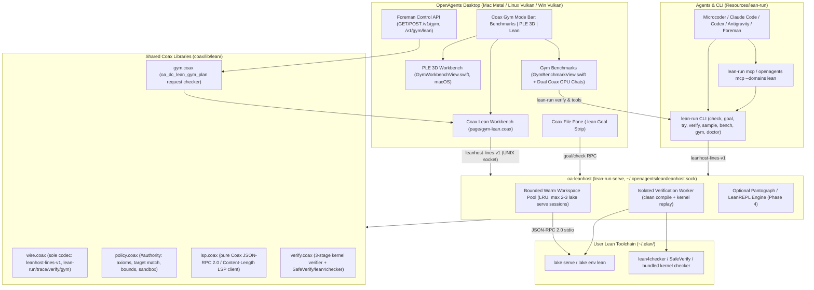

# Lean 4 Gym Specification

**Date:** 2026-11-21
**Status:** Specification, ready to build
**Scope:** `coax/lib/lean/` (new shared Coax library), `coder/tui/lean-run.coax` & `lean-run-mcp.coax` (new CLI, helper daemon, and MCP server), `apps/openagents-desktop/` (lifted Coax Gym mode bar, `page/gym-lean.coax`, `page/filepane.coax` goal strip, `GymWorkbenchView.swift`, `GymBenchmarkView.swift`, `Window+Gym.swift`, `ForemanOperator.swift`, `Window+ForemanAPI.swift`, `build.sh`), `coax/lib/agent/desktop/worker.coax`, `apps/openagents-cli/mcp.coax`, `proto/`, `evals/openagents-desktop/`.

Companion documents: [README.md](README.md) · [evaluation.md](evaluation.md) · [wire-and-artifacts.md](wire-and-artifacts.md) · [verification-and-security.md](verification-and-security.md) · [roadmap.md](roadmap.md).

---

## 1. System Architecture

Lean in OpenAgents Desktop follows the same Coax-first, out-of-process helper pattern proved by the iOS Simulator ([docs/desktop/ios-simulator-spec.md](../desktop/ios-simulator-spec.md), `coax/lib/agent/device/`, `coder/tui/oasim.coax`) and the PLE Gym ([docs/desktop/steer-ple-from-chat.md](../desktop/steer-ple-from-chat.md), `ple-run.coax`, `coax/lib/agent/desktop/gym.coax`).



### Bounded Context & Dependency Placement

Per [docs/architecture/contexts.md](../architecture/contexts.md) and [proto/README.md](../../proto/README.md):

- **Owning context:** `coder` (`coax/lib/lean/` is loaded by `coder/tui/lean-run.coax`, `coax/lib/agent/desktop/`, and `apps/openagents-desktop/`).
- **Strict downward dependencies:** `coax/lib/lean/` depends ONLY on `coax/lib/` (`json/`, `sys/`, `crypto/` SHA-256, `text/`, `nostr/atif/`). It never loads `apps/`, `components/`, `metaverse-engine/`, or `everglade/`.
- **Platform effects stay thin:** Process spawning, UNIX sockets, and filesystem I/O use the existing Coax system libraries (`coax/lib/sys/proc.coax`, `fs.coax`, `clock.coax`, `cxsock_*` — identical to `coder/tui/oasim.coax`). Desktop UI host bridges only forward socket lines and file-system read/write effects through `host.c` / `Window+Gym.swift` / `linux/main.c` / `windows/main.c`.

---

## 2. The Shared Coax Library (`coax/lib/lean/`)

| File | Role | Authority / Checks |
| --- | --- | --- |
| `coax/lib/lean/README.md` | Module inventory and local check commands (mirrors `coax/lib/agent/device/README.md`) | — |
| `coax/lib/lean/policy.coax` | **`#authority;`** Verification admission rules: axiom allowlist (`propext`, `Quot.sound`, `Classical.choice`), forbidden axiom/attribute detection (`sorryAx`, `Lean.ofReduceBool`, `Lean.trustCompiler`, custom axioms, `unsafe`/`implemented_by`/`extern`), theorem-signature match verdict, workspace/RAM/timeout caps, path containment, untrusted `#eval` sandbox gate | Zero surviving mutants (`coax mutate --root-only`) |
| `coax/lib/lean/wire.coax` | Sole codec for `leanhost-lines-v1`, `lean-run.v1`, `lean-trace.v1`, `lean-verify.v1`, `lean-gym-request.v1`, `lean-gym-state.v1` | Pinned golden tests in `proto/coder/lean-*-v1.json` |
| `coax/lib/lean/lsp.coax` | Pure Coax JSON-RPC 2.0 + `Content-Length` framing over child stdio pipes: `initialize`, `didOpen`, `didChange`, `didClose`, `publishDiagnostics`, `$/lean/fileProgress`, `$/lean/plainGoal`, `$/lean/plainTermGoal`, `textDocument/hover`, `textDocument/definition`, version-barrier settling | Unit + recorded Lean 4 LSP transcript fixtures |
| `coax/lib/lean/goal.coax` | Parses Lean 4 `plainGoal` / `plainTermGoal` strings into structured goals (`case_name`, `hypotheses[]`, `target`), computes goal counts, goal diffs between consecutive steps, and builds the Proof State DAG (`LeanNode`, `LeanEdge`) | Unit + property tests (`#forall`) |
| `coax/lib/lean/verify.coax` | Orchestrates the 3-stage kernel verification pipeline (clean compile -> statement equality + axiom audit -> kernel replay), writes `verify.json` (`lean-verify.v1`) and step snapshots into `~/.openagents/lean/runs/<id>/` | Unit + live `Init`-only kernel test |
| `coax/lib/lean/host.coax` | `oa-leanhost` server loop (`lean-run serve`): UNIX socket `~/.openagents/lean/leanhost.sock` (0600), multi-client multiplexing, bounded warm `lake serve` LRU pool, file-progress event push to subscribed UI clients, RSS watchdog, 10-minute idle shutdown | Scripted mock-LSP integration tests |
| `coax/lib/lean/gym.coax` | Pure Coax validator & planner for `lean-gym-request.v1` (`dc_lean_gym_plan`, exported from `desktop-core.coax` as `oa_dc_lean_gym_plan`), rejecting unknown keys and invalid ranges | Unit + mutation checks |
| `coax/lib/lean/unicode.coax` | Bounded table (~120 entries) mapping Lean backslash abbreviations (`\to`, `\forall`, `\exists`, `\<`, `\>`, `\N`, `\R`, `\|-`, `\le`, `\ge`, `\ne`, etc.) to canonical UTF-8 sequences | Unit tests |
| `coax/lib/lean/atif.coax` | Projects a verified `lean-run.v1` + `lean-trace.v1` + `lean-verify.v1` into canonical ATIF-v1.8 using `coax/lib/nostr/atif/{log,digest}.coax` | Verified by `atif_verify_log` |
| `coax/lib/lean/pantograph.coax` | *(Phase 4)* JSON-lines client for `pantograph-repl` / `LeanREPL` branching tactic search (`goal.start`, `goal.tactic`, `env.inspect`), emitting `lean-trace.v1` DAG nodes | Scripted REPL fixture tests |

---

## 3. Helper Daemon (`oa-leanhost` via `lean-run serve`)

### 3.1 Lifecycle and Ownership

`oa-leanhost` owns all warm Lean processes for the current user — **neither** the desktop window **nor** individual agent workers spawn long-lived `lake serve` instances directly:

- **Socket path:** `~/.openagents/lean/leanhost.sock` (mode `0600`, parent dir `~/.openagents/lean/` mode `0700`; override via `OA_LEAN_SOCKET` / `OA_LEAN_HOME` for isolated tests).
- **Single-instance startup:** Any client (Desktop app, `lean-run` CLI, `lean-run mcp`) connects to the socket; if nothing answers, it acquires `~/.openagents/lean/leanhost.lock` (`flock`), spawns `lean-run serve` detached (`proc_detach`), and retries up to 5 s — identical to `os_connect` in `coder/tui/oasim.coax:71-93`.
- **Version handshake:** First line from the helper is `hello` with `protocol: "leanhost-lines-v1"`, `version`, `pid`, and detected toolchain summary. A newer client encountering an older daemon version sends `quit` and starts its own.
- **Idle exit:** Exits cleanly after 10 minutes with zero connected clients and zero in-flight verification jobs, cleanly terminating all child `lake serve` processes (`SIGTERM`, escalating to `SIGKILL` after 2 s).

### 3.2 Warm Workspace Pool

- Keyed by `(canonical_project_root, sha256(lean-toolchain_contents))`.
  - A standalone `.lean` file with no enclosing `lakefile.lean` / `lakefile.toml` binds to a lightweight shared `Init`-only scratch workspace under `~/.openagents/lean/scratch/<toolchain-hash>/`.
- **Pool capacity:** Default `OA_LEAN_MAX_WORKSPACES = 2` (hard cap `4`). Opening a third workspace evicts the least-recently-used idle workspace (never evicting one with a subscribed UI client unless all slots are subscribed).
- **Memory watchdog:** Polls child RSS every 10 s; if aggregate Lean RSS exceeds `OA_LEAN_MAX_RSS_MIB` (default `6144 MiB`, adjustable by user), evicts the oldest idle workspace and emits a `pool_pressure` event to subscribers.
- **Path discovery:** `dc_worker_path` (`coax/lib/agent/desktop/worker.coax:36`) and `oa-leanhost` both prepend `~/.elan/bin` (alongside `~/.local/bin`, `/opt/homebrew/bin`, `/usr/local/bin`) so GUI-launched macOS apps find `elan`/`lake`/`lean` reliably.
- **Elaboration settling:** For any `check`, `goal`, or `try` request on document version `V`, `oa-leanhost` tracks `$/lean/fileProgress` notifications for that URI and waits (up to `timeout_ms`, default `15000 ms`) until `processing` is empty for version `V` before returning diagnostics/goals — guaranteeing zero stale reads.

### 3.3 Speculative Tactic Probing (`try`)

Agents and humans frequently want to test a candidate tactic without clobbering the file on disk:

- `try` (`lean-run try FILE.lean LINE COL "simp [Nat.add_comm]"`) opens an ephemeral in-memory scratch URI (`file:///<project>/.openagents-probe-<id>.lean` or virtual overlay buffer in `lake serve`), splices the candidate tactic at `(LINE, COL)`, waits for `$/lean/fileProgress` to settle, queries `$/lean/plainGoal` right after the spliced tactic, closes the scratch buffer (`didClose`), and returns:
  - `ok`: whether the tactic elaborated without error
  - `goals_before`, `goals_after`, `goals_closed` (boolean: `goals_after.count == 0` and no errors)
  - `diagnostics`: exact tactic error message if it failed
  - `elapsed_ms`
- In Phase 4 with Pantograph enabled, `try` routes directly to `goal.tactic(state_id, goal_id, tactic)` with zero buffer re-elaboration.

---

## 4. Desktop Gym UI Specification

### 4.1 Multi-Tab Gym Mode Bar (Lifted Into Coax)

Today `GymWorkbenchView.swift:267` renders a 36 pt AppKit bar with `["Benchmarks", "PLE 3D"]`. To support Lean cross-platform (macOS, Linux, Windows) while keeping existing macOS `Benchmarks` and `PLE 3D` working untouched:

1. **Extend `CoderPage` (`apps/openagents-desktop/page/state.coax`):**
   - Add `gym_mode: int;` (`CP_GYM_BENCH :: 0`, `CP_GYM_PLE :: 1`, `CP_GYM_LEAN :: 2`) and `lean: [1] CpLeanGym;`.
   - Export `coder_page_gym_mode` / `coder_page_gym_set_mode` (`cd_gym_mode` / `cd_gym_set_mode` in `host.h`/`host.c`).
2. **Draw the 36 pt Gym Mode Bar in Coax (`apps/openagents-desktop/page/gym.coax`):**
   - Placed at `(left, cp_bar(s), window_w - left, CP_GYM_BAR_H)` whenever `s[0].gym_open == true`.
   - Left side: `GYM` label + segmented tabs: **`Benchmarks`** | **`PLE 3D`** | **`Lean`** (`coder.gym.tab.bench`, `coder.gym.tab.ple`, `coder.gym.tab.lean`).
   - Right side (when `Lean` is active): toolchain pill (e.g., `Lean v4.19.0 · 1 warm` in green, or `Lean not installed — Setup` in amber when `doctor` reports `no_toolchain`).
3. **Host rect handoff (`layout.coax`):**
   - When `gym_mode == CP_GYM_BENCH` or `CP_GYM_PLE`: `gym_y = (gy + CP_GYM_BAR_H) * sc`, `gym_h = (h - gy - CP_GYM_BAR_H) * sc`. On macOS, `Window+Gym.swift` mounts `GymWorkbenchView` in that rect and hides `GymWorkbenchView`'s legacy duplicate `modeBar`, syncing `benchmarkView` vs PLE 3D from `cd_gym_mode(page)`. On Linux/Windows, Coax renders an explicit notice ("PLE 3D Metal and macOS Metal Benchmarks are currently macOS-only; Lean Proof Workbench runs natively here").
   - When `gym_mode == CP_GYM_LEAN`: `coder_page_gym_rect` returns `false` (hiding the macOS AppKit view automatically), and `cp_gym_lean(s, f, left, gy + CP_GYM_BAR_H, gw, gh - CP_GYM_BAR_H)` draws the entire Lean Workbench directly onto the GPU surface!

### 4.2 Lean Proof Workbench Layout (`page/gym-lean.coax`)

The Lean Workbench mirrors the exact visual grammar and ergonomics of PLE's workbench (`GymWorkbenchView.swift`) and Zeron/Coder's monochrome palette (`components/skin/`):

```
┌──────────────────────────────────────────────────────────────────────────────────────────┐
│ GYM   [ Benchmarks ] [ PLE 3D ] [● Lean ]          Lean v4.19.0 (Init + Mathlib) · Warm  │  36 pt (Coax)
├────────────────────┬─────────────────────────────────────┬───────────────────────────────┤
│ Lean Runs & Repos  │ Proof Source (Solution.lean)        │ Tactic Infoview (Line 14:8)   │
│ [Refresh] [Open…]  │ [Verify] [Edit/RO] [Diff] [ATIF]    │                               │
│ [● Live] Watching  │ 11  theorem add_zero_right          │ case succ                     │
│ Compare: [None ▾]  │ 12    (n : Nat) : n + 0 = n := by   │ n : Nat                       │
│                    │ 13 ✓  induction n with              │ ih : n + 0 = n                │
│ ● add_zero (sample)│ 14 ▶  | zero => rfl                 │ ⊢ (n + 1) + 0 = n + 1         │
│   Init · 1/1 ✓     │ 15 ●  | succ k ih =>                │                               │
│   minif2f-1732..   │ 16      simp [Nat.add_succ, ih]     │ [Try Tactic…               ]  │
│   7/10 · 1 sorry   │                                     ├───────────────────────────────┤
│   my-lake-repo/    │                                     │ Proof State Tree (DAG)        │
│   Lake · 4 files   │                                     │   [S0: 1 goal]                │
│                    │                                     │    └─ induction n ──┬─[zero✓] │
├────────────────────┤                                     │                     └─[succ✓] │
│ [Obligations (0)]  ├─────────────────────────────────────┼───────────────────────────────┤
│ [Diagnostics]      │ Timeline Scrubber (38 pt)           │ Kernel Verification Receipt   │
│ ✓ parse  ✓ elab    │ [▶][◀][▶|] ━━━●━━━━ 4/4 · step_003 │ ✓ No sorry   ✓ Target match   │
│ ✓ no_sorry         │   0 goals left · [Pin]              │ ✓ Axioms: propext, Quot.sound │
│ ✓ axioms_ok        │                                     │ ✓ Kernel replay (lean4checker)│
│ ✓ target_match     │                                     │ sha256: 9f4a…c21e   [Copy]    │
│ ✓ kernel_replay    │                                     │                               │
└────────────────────┴─────────────────────────────────────┴───────────────────────────────┘
   Left Rail (268 pt)          Center Source & Timeline           Right Inspector (360 pt)
```

#### Region-by-Region Specification

1. **Left Rail (268 pt fixed default, collapsible on narrow windows `< 980 pt`):**
   - **Header row:** `"Lean Gym"`, **Refresh** (`coder.gym.lean.refresh`), **Open…** (`coder.gym.lean.open` — chooses a `.lean` file or Lake project directory).
   - **Live row:** **Live** toggle (`coder.gym.lean.live`), status dot, and status text (`Live off` / `Subscribed (LSP)` / `Updated HH:MM:SS`). When Live is on, subscribes to `oa-leanhost` push events (`trace_step`, `diagnostics`, `verify_done`) and auto-advances to new agent steps while preserving scroll if the user scrolled away.
   - **Compare row:** Baseline run selector (`None` or any other discovered Lean run). Selecting a baseline activates **Diff mode** in the center pane using `components/app/diff.coax` (`app_diff_view`), plus a compact summary chip (`+2 solved · -1 sorry · -4 tactics`).
   - **Run / Project List:** Discovered from:
     1. Bundled `Init`-only sample pack (`Resources/fixtures/lean-samples/` or `evals/openagents-desktop/lean/samples/`).
     2. `~/.openagents/lean/runs/` (agent runs, `lean-run sample`, `lean-run bench`, `lean-run verify`).
     3. Active working folder (if it contains `lakefile.lean`, `lakefile.toml`, or `.lean` files).
     Each row displays run/theorem title, source + toolchain badge (`Init` / `Lake` / `Bench`), and honest status (`SOLVED ✓`, `1 sorry`, `2 errors`, `UNVERIFIED`, `NO TOOLCHAIN`).
   - **Bottom Rail Drawer (2 tabs: `Obligations (N)` | `Diagnostics`):**
     - **`Obligations (N)`** (mirrors PLE's `Clashes (N)`): lists every error, warning, `sorry` site, unsolved goal, and forbidden axiom violation. Clicking any row jumps the center editor caret to that exact `(line, col)` and refreshes the Tactic Infoview at that position!
     - **`Diagnostics`** (mirrors PLE's `Diagnostics`): renders per-gate status pills (`parse`, `elaborate`, `no_sorry`, `axioms_ok`, `target_match`, `kernel_replay`), run metrics (`steps`, `elapsed_ms`, `axioms`, `goals_remaining`), a file picker (`verify.json`, `trace.jsonl`, `run.log`, `Parsed Summary`), Copy button, and scrollable log view.

2. **Center Pane (Proof Source + 38 pt Timeline Scrubber):**
   - **Toolbar:** Active file/theorem name, **Verify** button (triggers authoritative `lean-run verify`, never faking results), **Edit / Diff** toggle, **Export ATIF** button (`lean-run export-atif`, writes `.atif.jsonl` and copies path), **Open in Default App**.
   - **Source Editor / Viewer:**
     - Reuses `components/zeron/editor.coax` (`UiEditor`) + line-number gutter pattern from `apps/openagents-desktop/page/filepane.coax` for files `<= EB_TEXT` (16 KB) and `<= 512` lines, with Lean backslash Unicode expansion (`coax/lib/lean/unicode.coax`).
     - Files `16 KB .. 256 KB` open in virtualized read-only mode (same `cp_fp_read_view` pattern) with click-any-line goal inspection.
     - **Gutter annotations per line:**
       - Blue animated bar while `$/lean/fileProgress` includes that line range.
       - Red circle on error lines; amber triangle on `sorry` / warning lines; green check on fully closed theorem declarations.
     - Clicking or moving the caret sends a debounced (75 ms) `goal` RPC to `oa-leanhost` for `(caret_line, caret_col)`.
   - **Timeline Scrubber (38 pt bottom bar, identical UX to PLE Stage 4):**
     - Controls: `▶` / `⏸` playback, `◀` prev step, `▶|` next step, continuous slider over `step_000 .. step_NNN` from `trace.jsonl` (or pinned live captures), step label (`4/9 • step_003 • 1 goal left`), and **`Pin`** button.
     - Scrubbing loads that step's exact buffer snapshot and recorded goal state (without mutating the live file on disk) and highlights the corresponding node in the Proof State Tree!

3. **Right Inspector (340–460 pt, resizable):**
   - **Section 1 — Tactic Infoview:**
     - Shows `$/lean/plainGoal` at the active caret or selected timeline step: each goal rendered with its `case` tag, local context hypotheses (`h : T`), and highlighted turnstile target (`⊢ P`). Also shows `$/lean/plainTermGoal` when cursor is in term mode, plus `"Goals accomplished ✓"` ONLY when both `goals == []` and zero errors precede the cursor.
     - Compact inline **`Try Tactic…`** single-line input (`UiEditor`) at the bottom of the Infoview: typing a tactic (e.g., `ring` or `simp [ih]`) and pressing Enter runs `oa-leanhost` `try` and previews the resulting goal diff before offering a one-click **`Insert`**.
   - **Section 2 — Proof State Tree (DAG):**
     - Rendered natively via `components/paint/list.coax` (rounded rects, orthogonal/cubic edges, pan/zoom scroll) from `trace.jsonl` nodes (`LeanNode` / `LeanEdge`).
     - Color-coded nodes: green = closed (`0` remaining goals), amber = open (`>= 1` goals), red = failed tactic attempt, white ring = currently selected timeline step.
     - Clicking any node jumps the Timeline Scrubber, source view, and Infoview to that exact state.
   - **Section 3 — Kernel Verification Receipt Card:**
     - Always truthful: displays `UNVERIFIED (LSP only)` until an authoritative `lean-run verify` completes on the exact current file SHA-256!
     - Once verified, displays exact green/red badges (`No Sorry`, `Target Match`, `Axioms`, `Kernel Replay`), the explicit list of axioms detected (e.g. `propext`, `Quot.sound`), Lean toolchain version, and receipt SHA-256.

4. **Missing Toolchain Empty State ("No UI That Lies"):**
   - If `lean-run doctor` reports `elan`/`lean`/`lake` missing, the Lean Workbench displays an explicit, clear onboarding card showing:
     - Exact checked paths (`~/.elan/bin`, `PATH`) and what is missing
     - One-click **Copy install command** (`curl https://elan.lean-lang.org/elan-init.sh -sSf | sh`)
     - **Re-check (`Doctor`)** button
   - All **Verify** and **Run Sample** actions stay explicitly disabled with tooltip `"Install Lean 4 (elan) first"` — never fabricating a passing proof.

### 4.3 Lean Right-Hand File Pane Goal Strip (`page/filepane.coax`)

When a user clicks any `.lean` path inside a normal chat transcript, it opens in the existing right-hand File Pane (`page/filepane.coax`). If `oa-leanhost` is available and the file ends in `.lean`:

- A compact 110 pt collapsible **Goal Strip** docks at the bottom of `cp_filepane` displaying the `$/lean/plainGoal` at the current caret line, error count, and an **"Open in Lean Gym"** button (`CP_ASK_OPEN_LEAN_GYM`).

---

## 5. Lean Benchmark Track Inside Gym `Benchmarks` (`GymBenchmarkView.swift`)

Tab 0 of the Gym (`GymBenchmarkView.swift`) already runs head-to-head live agent races between **Psionic Metal** (`psionic-inkling-serve`) and **`llama.cpp` Metal** (`llama-server`), displaying real-time reasoning, tool chips, and check verdicts in two embedded OpenAgents Coax GPU chat views (`GymChatSurfaceView`).

Phase 3 extends `GymBenchmarkView` cleanly without breaking existing coding suites:

### 5.1 New Selectable Suites in `suitePopup`

| Suite | Tasks | Dependencies | Typical Runtime (2 sides) |
| --- | --- | --- | --- |
| `Lean Core Smoke (5 Theorems · Init-only)` | 5 self-contained Lean 4 theorems (arithmetic induction, list reverse involution, De Morgan / propositional logic, modular arithmetic, binary tree mirror) | `lean` (`Init` only; zero Mathlib) | ~1–3 min |
| `Lean Algebra & Logic (10 Theorems · Init/Std)` | 10 harder multi-step Lean 4 theorems requiring helper lemmas, `omega`/`simp`/induction/case splits | `lean` (`Init` only) | ~4–8 min |
| `MiniF2F Valid Slice (10 Theorems · Mathlib)` | 10 pinned competition math problems from MiniF2F-Lean4 | `lake` + cached Mathlib `.olean`s (explicitly gated by `doctor` check; disabled if cache missing) | ~8–20 min |

### 5.2 Agent Tools During Lean Benchmark Runs

Alongside `Read`, `Write`, and `Bash` (`GymBenchmarkView.swift:1338-1363`), Lean benchmark tasks provide three structured low-latency tools routed through `oa-leanhost`:

- `LeanCheck(path)` -> fast LSP diagnostics + elaboration status (`50–300 ms`)
- `LeanGoal(path, line, col)` -> exact tactic & term goals at cursor
- `LeanTry(path, line, col, tactic)` -> non-destructive speculative tactic probe

### 5.3 Authoritative Grading & Cross-Linking

- Every task fixture contains a pristine immutable `Spec.lean` (theorem signature) and editable `Solution.lean` (initially containing `sorry`).
- When an agent finishes (or hits max turns), `GymBenchmarkView` grades via `lean-run verify Solution.lean --spec Spec.lean --theorem TARGET --out RUN_DIR/verify.json` — checking `parse`, `elaborate`, `no_sorry`, `axioms_ok`, `target_match`, and `kernel_replay`.
- `GymBenchTaskRowView` displays `Lean 4` in `langBadge` (matching `Python`, `Bash`, `C/Make`, `JS/Node`), per-side wall time & PASS/FAIL bars, and adds a right-click / button action **"Inspect in Lean Workbench"** that switches to Tab 2 (`Lean`) loaded on that exact task's run directory (complete with its `trace.jsonl` Proof DAG and `verify.json` receipt!).
- Persisted separately at `~/.openagents/gym/last-lean-benchmark.json` (never clobbering `last-benchmark.json` from coding runs) and exportable to ATIF-v1.8 (`lean-run export-atif`) for Psionic W3.2 verified-trace distillation (#13918) and W3.1 LoRA hot-swap comparison (`Psionic Base` vs `Psionic + Lean LoRA`)!

---

## 6. CLI, Chat Integration, MCP Server, and Foreman API

### 6.1 `lean-run` Coax Binary (`coder/tui/lean-run.coax`)

Built by `apps/openagents-desktop/build.sh` into `OpenAgents.app/Contents/Resources/lean-run` (and Linux/Windows bundle equivalents) beside `ple-run`, `oasim`, and `proof-export`.

| Command | Behavior |
| --- | --- |
| `lean-run serve` | Runs `oa-leanhost` daemon on `~/.openagents/lean/leanhost.sock` |
| `lean-run doctor [--project DIR]` | Checks `elan`, `lake`, `lean`, toolchain version, `lean4checker`/`SafeVerify`, Mathlib `.olean` cache, active daemon status; outputs structured JSON + human summary |
| `lean-run check FILE.lean [--project DIR]` | Warm LSP check (waits for `$/lean/fileProgress` settle); prints structured diagnostics, `sorry` count, elapsed ms |
| `lean-run goal FILE.lean LINE COL [--project DIR]` | Returns `$/lean/plainGoal` and `$/lean/plainTermGoal` at 1-based `LINE`, 0-based `COL` |
| `lean-run try FILE.lean LINE COL TACTIC` | Speculative non-destructive tactic probe; prints `goals_before`, `goals_after`, `goals_closed`, error |
| `lean-run hover FILE.lean LINE COL` | LSP `textDocument/hover` type & docstring |
| `lean-run def FILE.lean LINE COL` | LSP `textDocument/definition` file/line location |
| `lean-run search QUERY [--project DIR]` | Searches indexed local declarations (and optional Loogle / `#check` when configured) |
| `lean-run verify FILE.lean [--spec SPEC.lean] [--theorem NAME] [--run-dir DIR]` | **Authoritative 3-stage kernel verification**: clean compile + axiom audit + target match + kernel replay; writes `verify.json` (`lean-verify.v1`) and emits `OA-SHOW` card lines |
| `lean-run sample [--name NAME] [--out DIR]` | Runs a real local Lean 4 check + tactic trace + kernel verification on the bundled `Init`-only sample into `~/.openagents/lean/runs/<name>/`; refuses honestly with exit 2 if `lean` is not installed |
| `lean-run bench start [--suite NAME] [--project DIR] [--name NAME]` | Detached background benchmark run (mirrors `ple-run kit start`: `run.pid`, `run.log`, `bench-run.json`) |
| `lean-run bench status NAME\|DIR` / `lean-run bench stop NAME\|DIR` | Checks progress / results or stops detached benchmark |
| `lean-run gym [RUN\|latest] [--line N] [--step N\|last] [--tab obligations\|diagnostics\|tree\|diff] [--live on\|off] [--no-open]` | Steers the Desktop Lean Gym via `~/.openagents/lean/gym-request.json` -> `gym-state.json` |
| `lean-run export-atif RUN_DIR --out OUT.atif.jsonl` | Exports a kernel-verified Lean run to canonical ATIF-v1.8 (`coax/lib/nostr/atif/`) |
| `lean-run mcp` | Stdio JSON-RPC 2.0 MCP server exposing typed Lean tools (same table-driven `OmTool` architecture as `coder/tui/oasim-mcp.coax`); also wired into `openagents mcp --domains lean` (`apps/openagents-cli/mcp.coax`) |

### 6.2 Telling Chats About `lean-run` (`dc_tools_note`)

Extend `dc_tools_note` in `coax/lib/agent/desktop/worker.coax:53-69` (currently taking `ple_run: string`) to accept `lean_run: string` as well (when Experimental features are on). This lets any Microcoder chat answer *"prove this theorem in Lean and show me in the Gym"* immediately without needing a new agent protocol.

### 6.3 Inline Chat Proof Cards (`page/shows.coax`)

Reuses the **exact existing** `OA-SHOW` protocol (`page/shows.coax:1-56`) with zero page-level special cases for Phase 0–2:

- `lean-run verify` and `lean-run sample` render a crisp, high-DPI dark-mode proof summary card PNG/JPEG in pure Coax (`coax/lib/image/jpeg_enc.coax` or simple bitmap rasterizer, matching `ple-run`'s zero-window rendering!) showing theorem signature, step count, gate pills (`Parse`, `Elab`, `No Sorry`, `Axioms`, `Kernel Replay`), and status badge, and print:
  ```text
  OA-SHOW: /Users/.../.openagents/lean/runs/sample-1732200000/card.jpg
  OA-SHOW-CAPTION: add_zero_right · VERIFIED ✓ (0 sorry, axioms: propext, 4 steps)
  OA-SHOW-OPEN: /Users/.../.openagents/lean/runs/sample-1732200000/Solution.lean
  ```
- Pressing the card opens `Solution.lean` in the right-hand File Pane (with the Lean Goal Strip) or jumps to the Lean Gym run when `OA-SHOW-OPEN` points to a `lean-run.json` manifest!

### 6.4 Foreman Control API (`ForemanOperator.swift`, `Window+ForemanAPI.swift`, `foreman-ctl`)

Preserve `GET /v1/gym` and `POST /v1/gym` byte-for-byte backwards-compatible for existing PLE callers (`ple-gym-request.v1` / `ple-gym-state.v1`), and add:

| Route | Principal | Body / Returns |
| --- | --- | --- |
| `GET /v1/gym/lean` | `any` | Returns `lean-gym-state.v1`: `ok`, `open`, `active_mode`, `toolchain`, `run`, `file`, `line`, `step`, `steps`, `goals_remaining`, `verified`, `axioms`, `live`, `tab`, `status` |
| `POST /v1/gym/lean` | `any` | Accepts `lean-gym-request.v1`: `{id?, open?, run?, file?, line?, step?, tab?, live?, verify?}` checked by `oa_dc_lean_gym_plan`; returns updated `lean-gym-state.v1` |
| `foreman-ctl gym lean ...` | `any` | CLI wrapper calling `GET`/`POST /v1/gym/lean` |

Additionally, `GET /v1/gym` adds a non-breaking additive field `"mode": "benchmarks" | "ple" | "lean"` so external operators can inspect which Gym tab is currently visible without breaking existing v1 consumers.

---

## 7. Failure Modes & Honest Degradation

| Failure Mode | System Behavior |
| --- | --- |
| `elan` / `lean` / `lake` not installed | `lean-run doctor` returns `ok: false, code: "no_toolchain"`; Workbench shows setup instructions and disables `Verify` / `Sample`; never simulates a pass. |
| Project requires a Lean version not installed in `~/.elan/toolchains/` | `oa-leanhost` refuses to download silently during an agent turn unless `OA_LEAN_ALLOW_ELAN_DOWNLOAD=1` is explicitly set; returns `code: "toolchain_missing"` with the exact `lean-toolchain` string and `elan toolchain install ...` command. |
| Mathlib `.olean` cache missing (would trigger 45-min source build) | Pre-flight check detects missing `.lake/packages/mathlib/.lake/build/lib/` oleans; refuses to stall `lake serve` and returns `code: "mathlib_cache_missing"` advising `lake exe cache get`. |
| `lake serve` crashes or OOMs | `oa-leanhost` detects EOF on child pipe, marks workspace `crashed` with stderr tail, emits `workspace_crashed` event to UI, and lazily restarts on the next request (with backoff: max 3 restarts in 60 s). |
| Infinite loop / slow elaboration (`simp` / `omega` / `decide` hang) | Per-request timeout (`check`/`goal`/`try`: default 15 s; `verify`: default 120 s) sends LSP `$/cancelRequest` first, then recycles the stuck worker if uncancellable, returning `code: "timeout"`. |
| Proof compiles with `sorry` or `native_decide` or tampered theorem statement | `lean-run verify` exits non-zero, writes `verified: false` with exact `refusal_code` (`sorry_used`, `forbidden_axiom`, `statement_mismatch`, `kernel_replay_failed`), and displays red gate badges in the Gym and Benchmarks. |
| File > `EB_TEXT` (16 KB) opened in Lean Workbench | Opens cleanly in read-only virtualized scroll view with full click-to-inspect goal infoview and explicit banner; never silently truncates a user's `.lean` file on save. |
| `oa-leanhost` unreachable or Desktop app closed during `lean-run gym` | `lean-run gym` removes its unanswered request file after `--wait` (default 20 s) so no stale action runs on next launch (matching `ple-run-gym.coax:124`). |
