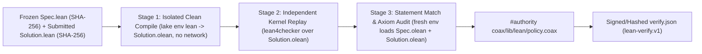

# Lean Verification Soundness, Security & Acceptance Testing

**Date:** 2026-11-21
**Companion documents:** [README.md](README.md) · [evaluation.md](evaluation.md) · [spec.md](spec.md) · [wire-and-artifacts.md](wire-and-artifacts.md) · [roadmap.md](roadmap.md)

This document defines the `#authority` verification rules, the 3-stage kernel replay pipeline, the sandboxing boundary for untrusted Lean elaboration, and the 5-tier acceptance testing program. It enforces two non-negotiable repository rules from [AGENTS.md](../../AGENTS.md):

1. **Done means the real thing works** — no toy checkers, no `sorry`-accepting builds, no self-written fake verifier passing without a real Lean kernel.
2. **No UI that lies** — a proof is never shown as `Verified` unless an independent kernel replay passes on the exact current file digest.

---

## 1. The `#authority` Verification Policy (`coax/lib/lean/policy.coax`)

`coax/lib/lean/policy.coax` begins with `#authority;` and gates every verification verdict, axiom audit, workspace limit, and sandbox admission decision. Its first landing must reach **zero surviving mutants** under `coax/bin/coax mutate coax/lib/lean/policy.coax --root-only` (and changed procedures thereafter per [INVARIANTS.md](../../INVARIANTS.md)).

### 1.1 Axiom Allowlist & Refusal Precedence

Given a parsed verification report from the kernel replay stage, `lp_admit_verdict` enforces these checks in deterministic precedence order:

| Order | Gate | Rule | Refusal Code |
| ---: | --- | --- | --- |
| 1 | `toolchain_ok` | Real `lean`/`lake` executed with exit `0`; `toolchain` string non-empty | `no_toolchain` / `compile_failed` |
| 2 | `parse` & `elaborate` | Zero compiler errors in fresh isolated build | `elaboration_failed` |
| 3 | `target_match` | Every required theorem in `target_theorems` exists in the compiled `.olean` with **exact matching constant name, declaration kind (`thmInfo`), universe parameters, and kernel type** against the pristine frozen `Spec.lean` | `statement_mismatch` |
| 4 | `no_sorry` | `sorryAx` does not appear anywhere in the transitive axiom closure of any target theorem (and zero `declaration uses 'sorry'` diagnostics) | `sorry_used` |
| 5 | `no_unsafe_compiler_trust` | Neither `Lean.ofReduceBool` (`native_decide`), `Lean.trustCompiler`, nor any `unsafe` / `@[implemented_by]` / `@[extern]` dependency appears in any target theorem's kernel closure | `forbidden_axiom` |
| 6 | `axioms_ok` | Every axiom in every target theorem's transitive closure is in the configured allowlist (default: `["propext", "Quot.sound", "Classical.choice"]`; constructive profile: `[]`; benchmark mode **never** permits expanding beyond the three standard axioms) | `forbidden_axiom` |
| 7 | `kernel_replay` | Independent kernel replay (`lean4checker` or bundled standalone `KernelReplay` checker) replayed every declaration in the submitted `.olean` with zero kernel errors | `kernel_replay_failed` |
| 8 | `digest_bound` | `spec_sha256` matches the frozen `Spec.lean`, `solution_sha256` matches `Solution.lean` on disk, and `olean_sha256` matches the replayed `.olean` | `digest_mismatch` |

Only when **all 8 gates hold** may `policy.coax` emit `verified: true`.

### 1.2 Resource & Path Containment Authority

`policy.coax` also owns the numeric and path bounds enforced by `oa-leanhost`:

- **Workspace pool:** `1 <= max_workspaces <= 4` (default `2`).
- **Memory ceiling:** `1024 <= max_rss_mib <= 32768` (default `6144`).
- **Request timeouts:** interactive `check`/`goal`/`try`: `1000..60000 ms` (default `15000 ms`); authoritative `verify`: `5000..600000 ms` (default `120000 ms`).
- **File size limits:** editable buffer `<= EB_TEXT` (`16384` bytes); read-only inspection `<= 262144` bytes; LSP request line `<= 262144` bytes.
- **Path containment:** `check`, `goal`, `try`, and `verify` refuse paths containing `..` traversal or symlinks escaping the declared workspace root (and refuse reading `~/.openagents/coder`, `~/work/.secrets`, or Keychain files).

---

## 2. Three-Stage Authoritative Kernel Verification Pipeline

LSP (`lake serve`) is **fast feedback, not ground truth**. Every time a user clicks **Verify**, an agent runs `lean-run verify`, or `GymBenchmarkView` grades a benchmark task, `coax/lib/lean/verify.coax` executes three isolated stages:

### Stage 1 — Isolated Clean Compile
- Copies `Spec.lean` (from pristine benchmark fixture when present) and `Solution.lean` into an ephemeral verification directory (never mutating the interactive `.lake/build` cache used by `lake serve`).
- Compiles `Spec.lean` -> `Spec.olean` and `Solution.lean` -> `Solution.olean` using `lake env lean -o ...` under the sandbox profile (Section 3) with deterministic flags (`-DwarningAsError=false` so warnings are inspected structurally rather than hiding `sorryAx`).
- Computes `spec_sha256`, `solution_sha256`, and `olean_sha256` using `coax/lib/crypto/`.

### Stage 2 — Independent Multi-Kernel Replay (`lake check --paranoid`, `con-leche`, `con-ron`, `nanoda`)
- Since **Lean `v4.35.0` / `v4.36.0`** ([Leonardo de Moura, Oct 15, 2026](https://leodemoura.github.io/blog/2026-10-15-lean-now-ships-with-verified-kernels/)), Lean ships natively with sandboxed **`lake check`**, **`lake check --paranoid`**, **`lake comparator`**, and independent/verified kernels:
  - **`leanchecker` / `leanchecker-paranoid`** (official C++ kernel + hardened allocator)
  - **`nanoda`** (independent Rust kernel)
  - **`lean4lean`** (Lean-in-Lean kernel)
  - **`con-leche`** (Lean kernel **formally proven consistent** relative to set theory) and **`con-ron`** (Rust translation **formally proven via Aeneas** to refine `con-leche`)
- `coax/lib/lean/verify.coax` invokes `lake check --paranoid` / `lake comparator` / `con-leche --compare` on an **inert export** (e.g., `lean4export` NDJSON) whenever Lean `v4.35+` is installed — matching the exact four-criterion protocol certified by the Lean FRO & Mathlib Initiative for the November 2026 Riemann Hypothesis proof ([riemann-hypothesis-2026.md](riemann-hypothesis-2026.md)) — and falls back to `lean4checker` or our bundled zero-dependency `OpenAgentsVerify.lean` kernel-replay script on earlier toolchains.
- Catches both elaborator/metaprogramming bypasses (`kexactB`, `addDecl` misuse, custom macros) and single-kernel implementation bugs.

### Stage 3 — Frozen Statement Equality & Transitive Axiom Audit (`lake comparator` / `con-leche --compare` / `SafeVerify`)
- Compares an isolated challenge export (importing only Mathlib / `Init` with `sorry` proofs) against the submitted solution export using **`lake comparator`** and/or **`con-leche --compare`** (or our bundled zero-dependency `OpenAgentsVerify.lean` comparator on older Lean toolchains):
  1. Confirms each required `target_theorems[i]` is present as a `.thmInfo` (never downgraded to `axiomInfo`, `opaqueInfo`, or `defnInfo`).
  2. Confirms exact equality of `levelParams` and `type` against the pristine frozen `Spec.lean` / `Challenge.lean` (preventing weakened preconditions, altered types, or renamed targets).
  3. Collects the full transitive axiom set via `Lean.CollectAxioms.collect` over the compiled `.olean` / export for each target theorem.
  4. Emits machine-readable JSON for `coax/lib/lean/policy.coax` to evaluate.

### Why Native Lean `v4.36+` Verified Kernels + Bundled Zero-Mathlib Fallback?
- On modern Lean `v4.35+` / `v4.36.0`, `lake check --paranoid`, `lake comparator`, `con-leche`, `con-ron`, and `nanoda` provide industrial-grade, formally verified multi-kernel checking out of the box.
- Shipping a small (~120-line) auditable fallback script (`resources/lean-checker/OpenAgentsVerify.lean`) using only Lean's built-in `Lean` core library guarantees Stage 2 + Stage 3 also work cleanly on older project-pinned toolchains (such as Lean `v4.33.1`, which requires exporting with `lean4export` and judging with `v4.36.0` for `lake comparator`).
- Every `verify.json` records the exact toolchain and checker versions executed (`checker` field), never overstating which kernels ran.

---

## 3. Security Threat Model: Untrusted Lean Elaboration

Lean 4 is both a theorem prover and a general-purpose compiled programming language whose elaborator executes arbitrary `IO` at compile time (`#eval`, custom `elab` commands, `macro`, `System.FilePath`, `IO.Process.spawn`, `IO.FS.readFile`).

Therefore, we enforce a strict **two-tier trust boundary**:

| Mode | When Used | Trust & Isolation |
| --- | --- | --- |
| **Interactive Workspace Mode** | User's own local Lake project in the Lean Workbench or active chat worktree | Same trust boundary as `mcworker`'s shell commands (`danger-full-access` on macOS, [apps/openagents-desktop/README.md](../../apps/openagents-desktop/README.md)). `oa-leanhost` still refuses paths outside the workspace and never passes API keys/secrets (`CODER_CLAUDE_KEY`, OpenRouter, Vertex, Spark mnemonic) into `lake serve`'s environment. |
| **Benchmark & Untrusted Verification Mode** | `GymBenchmarkView`, `lean-run bench`, `lean-run verify --sandbox`, or checking proofs written by models / external contributors | **Mandatory confinement:** (1) Clean scrubbed environment (`env -i` keeping only `HOME` -> temp dir, `PATH` -> elan/system bins, `ELAN_HOME` read-only); (2) **macOS:** `sandbox-exec` Seatbelt profile denying all network sockets (`(deny network*)`) and denying reads outside `/usr`, `/System`, `/Library`, `~/.elan` (read-only), the Mathlib cache (read-only), and the ephemeral task temp dir (read/write) — matching `oa-simhost`'s confinement in [ios-simulator-spec.md](../desktop/ios-simulator-spec.md); (3) **Linux:** `bwrap` (`--unshare-net --ro-bind` for toolchain/Mathlib, tmpfs workdir) or Docker/Harbor container for Phase 4 full benchmark suites. |

**Environment hygiene (always enforced in both modes):**
- `oa-leanhost` strips `ANTHROPIC_API_KEY`, `CLAUDE_CODE_OAUTH_TOKEN`, `CODER_CLAUDE_KEY`, `OPENROUTER_API_KEY`, `GEMINI_API_KEY`, `GOOGLE_APPLICATION_CREDENTIALS`, and `HF_TOKEN` from every child `lake` / `lean` process environment.
- `verify.json`, `trace.jsonl`, and `run.log` never embed environment variables or host credentials.

---

## 4. Five-Tier Acceptance & Qualification Plan

Aligned with [docs/coder/desktop-evals-spec.md](../coder/desktop-evals-spec.md) and `AGENTS.md`:

### Tier 0 — Pure Coax Logic, Wire Goldens & Mutation Gates (Deterministic, `< 5 s`, No Lean Toolchain Required)
- `coax/bin/coax mutate coax/lib/lean/policy.coax --root-only` -> **0 surviving mutants**.
- `coax/bin/coax test coax/lib/lean/lsp.coax --library` -> `Content-Length` framing, chunked reads, `$/lean/fileProgress` settling, `$/lean/plainGoal` + `$/lean/plainTermGoal` parsing, cancellation.
- `coax/bin/coax test coax/lib/lean/goal.coax --library` -> structured hypotheses/targets, multi-goal splits, Proof DAG parent/child branching, failed-branch tracking.
- `coax/bin/coax test coax/lib/lean/gym.coax --library` -> `dc_lean_gym_plan` valid plans, unknown-key refusal, out-of-range lines/steps, buffer overflow refusal.
- `coax/bin/coax test coax/lib/lean/unicode.coax --library` -> backslash abbreviation expansion & UTF-8 boundary safety.
- `coax/web/tool.sh coax/lib/lean/wire-checks.coax proto/coder/lean-*-v1.json` -> exact byte round-trip for every registered schema.
- `coax/bin/coax test apps/openagents-desktop/page.coax --library` -> Coax Gym mode bar (`Benchmarks | PLE 3D | Lean`), `page/gym-lean.coax` layout, semantic rows, Obligations jump, Timeline scrub, Compare diff toggle, missing-toolchain honest empty state, and `filepane.coax` Lean Goal Strip.
- `coax/web/tool.sh wire-check`, `layer-check`, `components-check`, `tools-check` -> **0 failures, 0 allowlist increases**.

### Tier 1 — Scripted Fake-LSP & Daemon Integration (Deterministic, `< 15 s`, No Lean Toolchain Required)
- A small Coax fake-LSP responder (`coax/lib/lean/tests/fake-lsp.coax`) replays recorded real Lean 4 JSON-RPC transcripts (`fileProgress` -> `publishDiagnostics` -> `plainGoal` -> `hover`).
- Exercises `oa-leanhost` (`lean-run serve`) over an isolated temporary UNIX socket (`OA_LEAN_SOCKET`):
  - Single-instance lock, `hello` handshake, concurrent client multiplexing (`subscribe` + `check` + `goal` + `try`).
  - Workspace LRU eviction at `OA_LEAN_MAX_WORKSPACES = 2`.
  - Crash recovery (`fake-lsp` exits mid-request -> `workspace_crashed` event -> clean restart).
  - Timeout cancellation (`$/cancelRequest` sent and timeout refusal returned).
  - `lean-run mcp` JSON-RPC 2.0 tool discovery (`tools/list`) and tool execution (`tools/call`).

### Tier 2 — Real Lean 4 Kernel & Anti-Cheat Suite (Requires Real `lean` / `lake`, `< 60 s`)
Executed against the real `lean` binary on pure `Init`-only fixtures (zero Mathlib download):

1. **Positive proof:** `lean-run sample` proves `add_zero_right`, checks via warm `lake serve` (`< 300 ms` after warm-up), runs 3-stage `lean-run verify`, produces `verified: true` with `axioms: ["propext"]` (or `[]`), and passes `lean-run export-atif` -> `proof-export verify`.
2. **Adversarial anti-cheat matrix (every single case MUST return `verified: false` with the exact refusal code):**
   - `cheat_sorry.lean`: proof contains `sorry` -> refused `sorry_used`.
   - `cheat_custom_axiom.lean`: declares `axiom magic : False` -> refused `forbidden_axiom`.
   - `cheat_native_decide.lean`: closes goal using `native_decide` -> refused `forbidden_axiom` (`Lean.ofReduceBool`).
   - `cheat_statement_weaken.lean`: changes theorem type from `n + 0 = n` to `True` -> refused `statement_mismatch`.
   - `cheat_wrong_name.lean`: renames theorem -> refused `statement_mismatch`.
   - `cheat_tamper_after_verify.lean`: modifies 1 byte of `Solution.lean` after `verify.json` was written -> UI/CLI reports `STALE` / `digest_mismatch`, never `verified: true`.
   - `cheat_sandbox_escape.lean`: `#eval IO.FS.readFile "/etc/passwd"` or network connect under `--sandbox` -> blocked by Seatbelt / `bwrap`, never leaks host files.

### Tier 3 — Desktop GUI & End-to-End Driving (`OpenAgents.app` + Linux/Windows Smoke)
- Launch built `OpenAgents.app` with `--gym` and Experimental features enabled:
  - Switch across `Benchmarks` -> `PLE 3D` -> `Lean`; verify PLE 3D still renders and responds to `ple-run gym` with zero regression.
  - Drive the Lean Workbench via `lean-run gym` and `foreman-ctl gym lean`: load `sample`, step timeline `1 -> last`, jump to an obligation line, verify Tactic Infoview renders Unicode (`∀`, `∃`, `→`, `⊢`, `ℕ`) with **zero tofu boxes**, trigger live Verify, capture screenshot and verify layout at `1200x800` and `960x700`.
  - Verify `OA-SHOW` card from a chat running `lean-run sample` renders inline and opens the proof on click.
  - Verify `apps/openagents-desktop/windows/build.sh --check` and Linux build compile cleanly with `page/gym-lean.coax`.

### Tier 4 — Live Model Proof Benchmarks (Real Local / Cloud Models, Opt-In)
- Run `Lean Core Smoke (5 Theorems)` inside `GymBenchmarkView` racing **Psionic Metal** vs **`llama.cpp` Metal** on Inkling 2 Mini (`Inkling-2-Mini-IQ4_NL.gguf`).
- Verify real end-to-end tool execution (`LeanCheck` / `LeanGoal` / `LeanTry` / `Write`), authoritative `lean-run verify` grading, persisted `~/.openagents/gym/last-lean-benchmark.json`, transcript replay in both embedded Coax GPU chat views, and ATIF-v1.8 export of solved tasks.
- Optional Mathlib run on `MiniF2F Valid Slice` when `lake exe cache get` is populated.

---

## 5. Reporting Discipline (Closing Criteria)

Per [AGENTS.md](../../AGENTS.md):
- Any implementation issue for Phases 0–4 may be closed **only** when its real commands (including Tier 2 real `lean` kernel runs for backend/verifier issues and Tier 3 real app verification for UI issues) have actually executed and passed, with verbatim command + output quoted in the closing comment.
- If `elan`/`lean` is not yet installed on the machine executing a task, stop and report the blocker explicitly (and log an owner step if external installation is required) — never substitute a mocked verifier to close a live-kernel issue.
