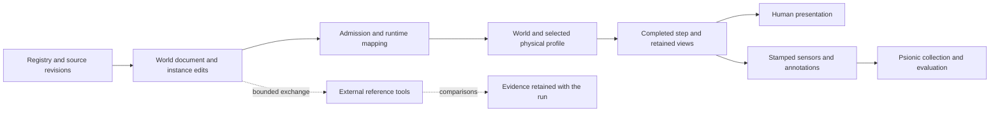

# Metaverse Engine and Omniverse: useful work to carry forward

**Reviewed:** November 15, 2026. **Repository baseline:** `0d77c05945`.
**Status:** comparison and proposed engine work; no new importer, backend,
sensor, collaboration mode or robotics capability is qualified here.

The strongest opportunity is a shared, inspectable world that people and
agents can assemble, validate, simulate, observe and reproduce. Our engine
already has much of the foundation for that workflow. Omniverse adds useful
examples of asset composition, explicit producer/consumer boundaries,
simulation-content validation and sensor/data tooling. These are relevant to
games and world creation as well as the selected robotics projects.

The recommendation is to extend our existing World, editor, registry and
render/physics owners. Preserve Coax product logic and the owned runtime.
OpenUSD exchange and independently retained NVIDIA reference tools can help
without making a vendor's scene runtime our engine's source of truth.

## What NVIDIA supplies, and where it maps

Current [Omniverse documentation](https://developer.nvidia.com/omniverse)
describes composable libraries alongside its other tools. A broad Omniverse
label is less useful than identifying the exact component and release.

| NVIDIA/OpenUSD component | Relevant capability | Existing OpenAgents owner and opportunity |
| --- | --- | --- |
| [OpenUSD](https://openusd.org/dev/intro.html) | Scene description with layers, references, payloads, variants and instancing | Editor/document/assets, chapters 51–55: reusable assemblies and explicit instance overrides; bounded exchange with DCC/CAD tools |
| [ovstage](https://github.com/NVIDIA-Omniverse/ovstage) | Shared scene arrays, completed updates and change tracking across consumers | `core/world.coax`, admitted physics scenes and render resource owners: explicit mapping and retained, stamped views of completed work |
| [ovphysx](https://github.com/NVIDIA-Omniverse/PhysX/tree/main/ovphysx) | USD physics through a C interface and tensor exchange | Physics chapters 17–22/31/35–37: an optional independent comparison path for admitted cases; continue the owned solvers |
| [ovrtx](https://github.com/NVIDIA-Omniverse/ovrtx) | RTX rendering and sensor simulation | Renderer and chapters 33–34: qualify observation outputs separately from the human viewport; retain reference captures where useful |
| [SimReady Foundation](https://github.com/NVIDIA/simready-foundation) | Versioned content requirements and workflow-specific validation | Asset registry, pack admission and physical import: readiness reports tied to an exact asset, intended use and backend |
| [Replicator](https://docs.omniverse.nvidia.com/extensions/latest/ext_replicator.html) | Synthetic-data annotators and writers | Observation rendering, seeded generation and Psionic datasets: one scene sample produces consistent images, IDs and metadata |
| [Connectors/Nucleus](https://docs.omniverse.nvidia.com/connect/latest/developing-connectors.html) | Cross-application exchange and collaborative synchronization | Existing revision-fenced edits, immutable sources, publication and forks; preserve our operation/authority semantics |
| [NuRec](https://docs.nvidia.com/nurec/basics/how-nurec-works.html) | Reconstruction and rendering from recorded sensor data | Captured-world inspection and the existing Splat Lab work; separate reconstructed appearance from collision and measured physical properties |
| [ovstream](https://github.com/NVIDIA-Omniverse/ovstream) | Streams rendered media, messages and input to interactive clients | Optional remote inspection beside local rendering; reuse host/media/transport ownership rather than replacing the browser engine |
| [Agent workflows](https://docs.nvidia.com/learning/physical-ai/physical-ai-agent-bootcamp/latest/meet-omniverse-libraries.html) | Focused tools compose validation, simulation, rendering and inspection | Existing CLI/MCP and editor: bounded edits followed by reproducible checks and headless evidence |

The checked [ovstage](https://raw.githubusercontent.com/NVIDIA-Omniverse/ovstage/main/README.md)
and [ovrtx](https://raw.githubusercontent.com/NVIDIA-Omniverse/ovrtx/main/README.md)
READMEs label their SDKs proprietary and
pre-release. A public repository, a C entry point and OpenUSD data do not
establish an open, portable binary runtime. Record artifact-specific terms,
dependencies and build/device requirements before using a reference. These
links are a dated research map, not pinned implementation inputs.

## What our current plans already cover

The [engine registry](../../metaverse-engine/book/chapters.json), source and
recorded profiles take precedence over old prose:

- `core/world.coax` supplies checked entities, component columns, declared
  system access and a spatial index; whole-game adoption remains incomplete
  in chapter 103. `physics/sim/scene.coax` admits a separate bounded physical
  scene profile. New integrations need an explicit mapping
  and one authoritative writer per field, rather than another general World.
- Chapters 51–55 already have document/edit/pack/publication/fork components.
  Made-world publication pins the engine and served asset identities. Release
  gates and broader publication cases remain incomplete; the claim that no
  engine pin exists is stale.
- Shared resource, host, streaming and renderer code already has lifetime,
  budget and asynchronous-completion rules. Extend those owners for scene
  views and readback instead of creating a parallel resource manager.
- Physics chapters 17, 18, 20 and 21 have bounded CPU components. General
  articulation/contact, batching, sensors, observation images and model
  import in 19/22/31/33–35 remain drafts. A static Microduck assembly is
  evidence for the visual import path, not those simulation capabilities.
- [Splat Lab](2026-11-03-splat-lab.md) records an existing Gaussian rendering
  experiment. It does not qualify a NuRec importer, reconstruction training
  or physical geometry. Its old app-local owners need reuse review before
  another captured-world implementation is written.

The physics plan's Psionic chapters are useful algorithmic reading. Engine
product code cannot load Psionic. Reusable numerics move into a deliberate
lower owner with their checks, or values cross an explicit caller boundary.
This follows the [context map](../architecture/contexts.md), not a new
exception to it.

## 1. Reusable assemblies and changes that survive reimport

OpenUSD's composition model suggests a useful editor improvement: keep the
source asset immutable, then express placement, appearance and permitted
physical changes as explicit instance overrides. A room, robot assembly or
workcell can reference the same source without copying its editable files.

Extend chapters 51–55 and the registry to distinguish source revision,
assembly/instance identity, authored overrides and derived runtime assets.
Reuse the existing edit log, inverses, revision checks, forks and publication.
Do not build a second undo stack or silently switch concurrent edits to a
last-writer-wins property stream. Preview which source and override supplies
a value, and report conflicting reimports before changing the saved world.

USD paths are not globally stable object IDs. Keep an explicit import mapping
to our authoring identities and runtime `EntityId`s, including revision and
generation. A rename or removed source part needs a supported remap or a
refusal. Existing generated names such as `trees:3` are not automatically
durable identities for parts in an imported assembly.

The current made-world document is a bounded format with centimetre-valued
positions; it is not already a general CAD hierarchy. New precision,
hierarchy and assembly fields need a specified owning shape and a new
published version where required. Preserve existing V1 records and codecs.
Full USD composition and an editor-wide layer system are later profiles.

## 2. OpenUSD exchange, starting with export

Start with a **bounded USDA export of an already resolved scene**. That is
useful before a general USD importer: a builder can inspect one of our
assemblies in another tool, and a reference can consume the same fixture.
Keep glTF/VPK1 as the existing runtime asset path.

The first proposed exchange profile contains static mesh triangles,
transforms, repeated instances, a declared material subset, cameras and
lights. State units, up axis, handedness, transform order, normal handling,
camera conventions and exactly which properties survive export. Unsupported
shaders, rigs, physics or composition features must produce named diagnostics
or an explicit lossy export report, never an implied round-trip guarantee.

Package a closed asset dependency set from the shared registry with hashes,
relative paths and source notices. Bound bytes, objects, hierarchy depth and
geometry work; refuse escaping paths, cycles and missing dependencies. No
arbitrary URL fetch, executable asset plugin or app-private source copy is
needed to inspect the package offline.

Check the export with a pinned independent OpenUSD reader on a build host.
Later, admit one resolved import subset in Coax with the same bounds. Keep
USDC/USDZ decoding, composition, USD Physics and material networks as
separately declared support. An external reference may resolve a complex
source into inert comparison data; that does not qualify our own full USD
reader. URDF/MJCF articulation work in chapter 35 continues independently.

## 3. Asset readiness tied to the intended use

SimReady's useful lesson is that readiness is a named set of requirements.
Extend registry/pack/import validation with independent results for:

| Intended use | Additional evidence beyond a picture |
| --- | --- |
| Visual inspection | Source identity, permitted assets, units, geometry/material support and budgets |
| Game collision | Declared collision representation, scale, filters and independent query/contact fixtures |
| Robot simulation | Admitted articulation, inertias, limits, actuator parameters and their provenance |
| Sensor training | Calibrated camera/sensor conventions, semantic mapping and observation output checks |
| Manufacturing | Editable source, process/BOM, tolerances and measured part/assembly evidence |

A readiness report should name the source revision, target profile, validator
version, requirement, field/location, severity and evidence. Reuse present
admission rather than duplicating hash, parser or bounds rules. Keep geometry
corrections as derived revisions with a reviewable difference; do not rewrite
the immutable source or infer friction/mass from appearance without provenance.

Our report would be an OpenAgents qualification record. Claim compatibility
with a particular SimReady profile only after checking that exact profile and
validator independently. A visual or sensor-ready asset is not automatically
manufacturable or appropriate for a physical robot.

## 4. Completed world views for physics, sensors and presentation

The `ovstage` [update documentation](https://raw.githubusercontent.com/NVIDIA-Omniverse/ovstage/main/docs/concepts/overview.rst)
makes an important distinction: an update ordinal is not a time unit, and a
completion watermark is neither transactional publication nor retained
history. Applications still check individual writes and coordinate readers.
Those distinctions also matter to our owned engine.

Make the integration contract explicit around existing World/Scene and
resource owners. A consumer view identifies world revision, runtime epoch,
completed simulation step, source identities and retained resource leases.
Physics publishes its accepted update once. Presentation may interpolate the
declared previous/current states; a sensor samples a declared state/time and
calibration. Neither advances physics to obtain a picture.

Render frequency, sensor sampling and physics substeps are distinct schedules
on the existing clock contract. A state-only/headless run can omit drawing.
GPU work, readback and external observers retain buffers through completion;
device replacement or a late callback cannot relabel an old view as current.
If required writes fail, consumers must not receive a partly updated scene.
If history is no longer retained, report that fact rather than inventing a
snapshot from the latest values. This is proposed integration work, not a
claim that a new scene-view API already exists.

## 5. One observation sample, several consistent outputs

Extend chapters 33–34 using shared geometry, camera and render owners.
Start with one small camera and analytic shapes, then add multiple cameras
and environments. Capture RGB, axial depth or explicitly named range,
normals, semantic/instance IDs, visibility and a validity mask from the same
declared sample. State color space, exposure/tone mapping, frame conventions,
layouts, precision and background treatment. Labels refer to stable source
objects through the epoch's runtime mapping; a recycled slot is not an ID.

Use the same sample manifest for images and annotations: asset/world/engine
identities, camera calibration, logical environment, episode, step, seed and
randomization values. A writer publishes a complete admitted sample or a
refusal. A plausible screenshot cannot stand in for depth, label or timestamp
correctness. Host-copy counts and end-to-end latency are measured properties,
not promises inherited from a tensor interface.

Seed variations by logical identity, preserving solo/batch invariance within
the named backend. Keep synthetic descendants in their parent's dataset
split; Psionic owns exposure, training and outcome evaluation. Start with
geometry-grounded lighting/placement changes. Learned visual augmentation
needs its own lineage and must not overwrite contact or label truth.

## 6. Agents, reconstruction and remote review

The Omniverse agent workflow is relevant to our editor: inspect a world,
propose a bounded change, validate it, run a declared check and show what
changed. Reuse the existing CLI/MCP operation path and permissions. Changes
target an expected revision and preserve inverses. A stale result refuses.
Use existing headless shot/drive tooling for evidence and the shared
components for the inspector, timelines and differences.

Keep authored, running and durable state separate. An agent editing a scene
does not write the character record, inventory ledger, frozen evaluator or
hardware authority. A change to simulated transforms becomes an authored
edit only through an explicit supported operation, not automatic backflow.

NuRec suggests a later capture-to-world route: inspect a permitted room or
workbench recording, retain camera poses and source rights, add reconstructed
appearance, then author and validate collision/task geometry separately.
Reuse Splat Lab where applicable. A NuRec USDZ can refer to learned Gaussian
checkpoint data; loading its outer USD file does not establish support for
that representation. Do not call this a robot digital twin until the relevant
geometry, parameters, calibration and measured responses agree.

Remote rendering can later give a weak client access to a heavy inspection
job. Keep local browser/native execution as a complete path. A remote-view
profile needs measured encode/network/decode latency, session/input fencing,
privacy, resource limits and disconnection behavior. Video reception grants
no world-edit or motor authority, and a server-side GPU remains a dependency.

## Proposed delivery slices

These are planning labels, not protocol IDs or new GitHub issues. None is a
prerequisite for completing the current playable-world or small collector
route unless that route actually consumes it.

| Slice | Owner and first consumer | Smallest reviewable result and gate |
| --- | --- | --- |
| OV-00: shared fixture and ledger | Chapters 37/51–54; editor inspection | One authored bench/room with two instances, a camera and known dimensions; map every required field to its current owner and list unsupported values |
| OV-01: reusable assembly edits | Chapters 51–55; maker workcell and repeated game props | Source plus two instance overrides survives save/fork/reload; editing one leaves the other intact; stale edits and incompatible reimport refuse |
| OV-02: readiness reports | Chapters 16/35/53 and registry; the same fixture | Named visual/collision profiles pass independent valid/broken assets; a failed derivation installs nothing and preserves source identity |
| OV-03: bounded USD exchange | Chapter 53 export; chapter 35 import later | Export fixture read by an independent USD tool with matching supported geometry/transforms/cameras and explicit losses; closed dependencies work offline |
| OV-04: completed runtime views | Existing World/Scene, clocks, render/host owners; editor and first sensor | A failed late producer cannot publish mixed state; retained old view remains readable or explicitly expires; late callbacks and replacement cannot cross epochs |
| OV-05: sensor/data slice | Chapters 33–34/36–37; Microduck perception and workcell camera | Small analytic RGB/depth/ID sample matches an independent projection/ray oracle; sampling changes no physics state; solo/batch, masks, timing and complete publication checked |
| OV-06: agent evidence loop | Editor/CLI/MCP and chapter 83; same fixture | Agent inspects, edits, validates, records a headless result and undoes through the same operations; every refusal keeps the prior valid revision |
| OV-07: captured-world inspection | Asset/import/render owners; one permitted capture | Source pose/units and visual representation checked; collision is explicit and independently tested; no inferred physical qualification |
| OV-08: remote review | Existing host/media/transport owners; an inspection workload that exceeds the client's budget | Named remote-view profile with measured latency, retained-buffer cleanup, reconnect/input fencing and an independently usable local route |

Begin with OV-00 and the narrow assembly/readiness/export work it exposes.
OV-04/05 extend the already selected physical scene and sensor roadmap; they
must not create a second simulator or block state-only learning on a renderer.
Reconstruction and streaming follow consumers, not a desire to match the
whole NVIDIA catalog. RTX comparison captures do not become a prerequisite
for the owned rendering route.

Every new stored/exchanged shape starts with its specification, owning
context, new version where required, registry row and one codec. Tools and
product logic are Coax; C/Swift hosts perform platform effects. References
remain independent, pinned and untrusted until inspected, and their scripts
do not run on the owner's Mac. Use the existing build hosts and checks.

## Evidence and interpretation

The external links above were read for this comparison on November 15.
NVIDIA's descriptions establish advertised component roles and the cited
release limitations, not performance or interoperability in our repository.
The proposed slices and priority judgments are our engineering analysis.

Local sources: [engine plan](../../metaverse-engine/book/PLAN.md),
[engine overview](../../metaverse-engine/README.md),
[editor](../../metaverse-engine/editor/README.md),
[render owners](../../metaverse-engine/render/README.md),
[asset registry](../../assets/registry/README.md),
[editor product plan](aethyrforge.md),
[robotics platform](../nvidia/open-robotics-platform-2026-11-15.md) and
[Microduck specification](../nvidia/microduck-pipeline-2026-11-15.md).
Chapter status and qualification stay in the existing registries and receipts;
this plan promotes none of them.
