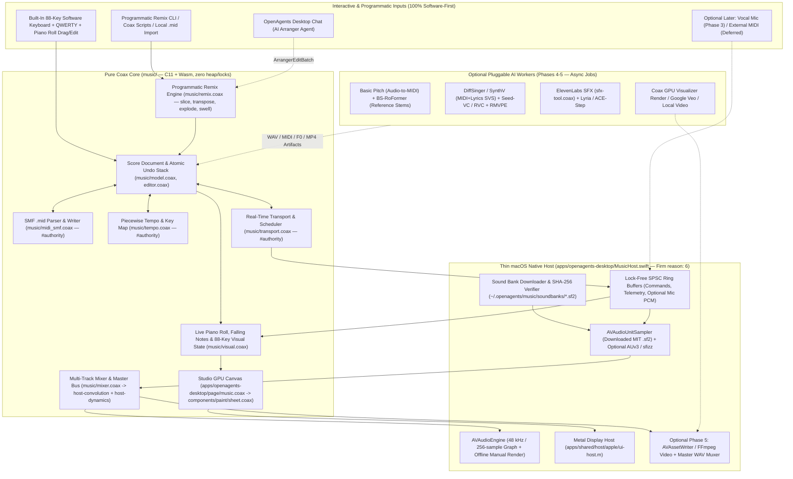

# Coax Music Production Studio: Orchestral Arrangement, Software Visualizer, Programmatic Remix & Music Video Specification

**Date:** 2026-11-22 (updated 2026-11-22: locked 4-song *Phantom* mashup suite, 100% built-in software keyboard + programmatic remixing with no external MIDI hardware required, auto-downloaded open SoundFont bank, vocal/video choices deferred to Phases 3–5)  
**Status:** Proposed specification (Phase 0 & Phase 1 decisions locked; ready to implement)  
**Target Deliverable:** A 4-song symphonic mashup suite combining ***All I Ask of You***, ***The Phantom of the Opera***, ***The Music of the Night***, and ***Past the Point of No Return*** — arranged, visualized, remixed programmatically and interactively in Coax, with optional human + AI vocals and music video assembled later once the arrangement is locked.  
**First Milestone (Phase 1):** Download an open orchestral/piano/organ SoundFont bank automatically, pull in MIDI sources programmatically or via drag-and-drop, remix/transpose/slice/move notes visually on a live Coax GPU piano roll, play sounds with the built-in software keyboard, and watch notes and keys illuminate in real time.  
**Proposed Scope:** `proto/openagents/music/v1alpha1/`, `music/` (new bounded context), `metaverse-engine/audio/` (shared DSP/mixer kernel), `coax/lib/agent/desktop/flags.coax` (`DC_FLAG_MUSIC`), `apps/openagents-desktop/` (macOS CoreAudio/`AVAudioUnitSampler` + AUv3 + Metal GPU UI host), optional `apps/openagents-web/` AudioWorklet mirror.

**Related Repo Docs & Existing Foundations:**
- [`metaverse-engine/audio/score.coax`](../../metaverse-engine/audio/score.coax) — deterministic 960-PPQ beat grid, keys, triads, automation, stereo/reverb buses
- [`metaverse-engine/audio/synth.coax`](../../metaverse-engine/audio/synth.coax) — integer Q16 oscillators, MIDI pitch table (`AU_TOP_MHZ`), ADSR, panning, Schroeder reverb
- [`metaverse-engine/audio/epic.coax`](../../metaverse-engine/audio/epic.coax) — multi-part cinematic orchestral score timed to video scene cues (`units.Quantity`)
- [`metaverse-engine/audio/host-pcm.coax`](../../metaverse-engine/audio/host-pcm.coax), [`host-convolution.coax`](../../metaverse-engine/audio/host-convolution.coax), [`host-dynamics.coax`](../../metaverse-engine/audio/host-dynamics.coax) — `#authority` 48 kHz PCM voice mixer, partitioned stereo FFT convolution reverb, stereo-linked bus compressor & brickwall limiter
- [`metaverse-engine/audio/wav.coax`](../../metaverse-engine/audio/wav.coax) & [`measure.coax`](../../metaverse-engine/audio/measure.coax) — WAV encoding, `wav_hash`, ITU-R BS.1770-4 / EBU R128 LUFS loudness metering, `meas_outline` waveform peaks
- [`metaverse-engine/audio/SOURCES.md`](../../metaverse-engine/audio/SOURCES.md) & [`sfx-tool.coax`](../../metaverse-engine/audio/sfx-tool.coax) — audio provenance hygiene and ElevenLabs SFX + Vertex AI judge workflow
- [`metaverse-engine/host/apple/PageAudio.swift`](../../metaverse-engine/host/apple/PageAudio.swift) & [`apps/openagents-desktop/Window+Voice.swift`](../../apps/openagents-desktop/Window+Voice.swift) — macOS `AVAudioEngine` live/offline playback and microphone capture
- [`components/gpu-components.md`](../../components/gpu-components.md), [`components/paint/sheet.coax`](../../components/paint/sheet.coax), [`components/backend/gpu.coax`](../../components/backend/gpu.coax) — 60/120 Hz Metal GPU display-list rendering & hit-testing
- [`coax/native.md`](../../coax/native.md), [`docs/voice/coax-native-voice.md`](../voice/coax-native-voice.md), [`docs/reuse.md`](../reuse.md), [`docs/architecture/contexts.md`](../architecture/contexts.md) — Coax-first ownership, bounded storage, and context boundaries

---

## 1. Purpose, Delivery Order & Design Rules

We want a native, low-latency, **software-first** music production and programmatic remix studio inside OpenAgents Desktop built with Coax. You should never need to plug in external keyboard hardware to compose, visualize, remix, or audition orchestral arrangements: the piano, orchestral instruments, visualizer, and programmable remix primitives live directly inside the app.

The concrete project driving every feature is a **4-song symphonic mashup suite** from Andrew Lloyd Webber's *The Phantom of the Opera*:
1. ***All I Ask of You***
2. ***The Phantom of the Opera*** (Title Song)
3. ***The Music of the Night***
4. ***Past the Point of No Return*** (*The Point of No Return*)

Work is sequenced so the music and interactive visual workbench come alive immediately, while vocal blending and music-video direction stay cleanly decoupled until the orchestral mashup sounds right:

1. **Phase 1 — Interactive Notes, Built-In Software Keyboard, Downloaded Sound Bank & Programmatic Remix (Build First):** Auto-download an MIT-licensed orchestral + piano + pipe organ `.sf2` SoundFont bank, pull in `.mid` sources programmatically (CLI, Coax scripts, or OpenAgents chat) or via drag-and-drop, slice/transpose/layer/move notes visually on a 60/120 Hz Metal GPU piano roll, audition directly on the built-in 88-key software keyboard, and watch notes + piano keys illuminate in real time as the score plays.
2. **Phase 2 — Full Orchestral Arrangement & 4-Movement Mashup Workbench:** Scale up sound realism with optional macOS Audio Units (Spitfire BBC Symphony Orchestra Discover, Decent Sampler Gothic Pipe Organ / Rhodes) or open SFZ libraries (`sfizz`), shape breathing orchestral swells (`CC1`/`CC11`/`CC64`), sculpt rubato and cross-song tempo/key transitions across all 4 movements, unify everything in an Opera Hall convolution reverb, and iterate rapidly with the OpenAgents AI Arranger agent.
3. **Phase 3 — Human Vocal Recording, Live Pitch Overlay & Comping *(Flexible / Opt-In)*:** Record 48 kHz vocals over the arrangement with latency compensation, see live sung pitch (`F0`) plotted directly on top of the vocal MIDI melody notes, and comp takes.
4. **Phase 4 — AI Vocal Co-Production, Audio-to-MIDI & Theatrical SFX *(Flexible / Opt-In)*:** Explore vocal blending once the arrangement is ready — layer AI soprano/choir parts (Synthesizer V / local DiffSinger) or voice-converted choir harmonies (Seed-VC / RVC), transcribe hummed ideas with Basic Pitch, and add theatrical SFX/atmosphere.
5. **Phase 5 — Beat-Locked Music Video Pipeline & Master Export *(Flexible / Opt-In)*:** Choose your visual direction later (Coax GPU falling-note / gothic audio-reactive visuals, AI cinematic scenes via Veo, live footage, or a hybrid), anchor cues to exact bars/beats, master to `-14 LUFS`, and export 1080p/4K MP4.

### Core Architectural Rules

1. **Coax owns the score, timing, remix transforms, editing, mixing math, and UI layout; the host owns audio output and plugin hosting.** Per [`coax/native.md`](../../coax/native.md) and [`docs/voice/coax-native-voice.md`](../voice/coax-native-voice.md), Swift/ObjC/C shims stay thin and carry `Firm reason: N (...)` headers.
2. **Zero allocation and zero locks on real-time audio threads.** Coax has no garbage collector, no hidden heap allocation, and no mutable globals. Calling Coax procedures over caller-owned fixed arrays and views guarantees deterministic real-time execution with bounded step counts verified by `coax test --steps`.
3. **Visual editing and programmatic remixing share one exact command model.** Every mouse drag on the piano roll AND every CLI / Coax script / AI-agent remix command emits the exact same typed `ArrangerEditBatch` operations — giving both workflows instant live visual updates, real-time audio audition, and atomic 1-click Undo/Redo.
4. **Deterministic offline bounce.** Given the same project document, sound bank, stems, and PRNG seeds, the Coax mixer/reverb/dynamics pipeline renders reproducible WAV output verified by `wav_hash` and `measure.coax`.
5. **"Use, never depend" on external AI models and commercial plugins.** The Studio always opens, plays, visualizes, remixes, and renders locally using the downloaded open `.sf2` bank + built-in Coax DSP.
6. **Feature-flagged (`DC_FLAG_MUSIC`) in OpenAgents Desktop.** Per [`apps/openagents-desktop/README.md`](../../apps/openagents-desktop/README.md), the Studio lives behind `flag.music` (off by default in `--minimal` Inkling releases; enabled via `--flag music`, `OA_FLAGS=music`, or `experimentalFeatures`).
7. **Zero copyrighted third-party music committed to the repo.** *Phantom* MIDI files, scores, reference recordings, and personal vocal takes stay strictly in local user storage (`~/.openagents/music/projects/`), never in git.

---

## 2. Research: Built-In Software Instrument Engine, Downloaded Sound Banks & Programmatic Orchestral Remixing

### 2.1 Software-First Workflow (Zero External MIDI Hardware Required)

**Decided (2026-11-22):** No physical electric piano is plugged into the Mac. Everything is built directly into the software so you can visualize, click-play, pull in musical material programmatically, remix sections rapidly, and hear orchestral/piano/organ sounds immediately:

```text
  [ Programmatic Inputs ]                 [ Interactive Software UI (Metal GPU) ]
   • Local .mid / .musicxml files          • 60/120 Hz Piano Roll (drag/draw/resize/slice)
   • Coax remix scripts / CLI commands     • Built-in 88-key Software Keyboard (click/drag + QWERTY)
   • OpenAgents AI Arranger chat           • Live Falling-Notes & Active-Note Illumination
   • Basic Pitch audio-to-MIDI (later)     • 4-Movement Mashup Timeline + Tempo/Key Curves
                 │                                            │
                 └──────────────► ArrangerEditBatch ◄─────────┘
                                  (One Unified Coax Core)
                                           │
                                           ▼
                       OpenAgents Music Engine (48 kHz CoreAudio)
                       • Phase 1: Downloaded MIT .sf2 Bank via AVAudioUnitSampler
                       • Phase 2: Optional SFZ (sfizz) / AUv3 (BBCSO Discover, Decent Sampler)
                       • Shared Opera Hall Convolution Reverb + Master Bus Dynamics
                                           │
                                           ▼
                            Mac Speakers / Headphones / Offline WAV Bounce
```

- **Built-in playable instruments:** Click/drag directly on the vertical or horizontal 88-key software keyboard, or play chords/melodies with the Mac QWERTY keyboard (`A W S E D F T G Y H U J K`, `Z`/`X` octave shift, `C`/`V` velocity step, `Tab` sustain hold).
- **Audio output & latency:** CoreAudio runs at **48 kHz** with a **256-sample** default buffer (`5.33 ms`, reducible to `128` samples / `2.67 ms`) feeding native macOS speakers or headphones. *(CoreMIDI hardware keyboard input remains an optional future add-on — zero Phase 1 dependency.)*
- **Why `CC1` (Mod Wheel) and `CC11` (Expression) still matter in software:** Even without a physical keyboard, bowed orchestral strings, brass, woodwinds, and choir sound lifelike only when their intensity swells and breathes *during* sustained notes rather than staying flat. Because everything is programmable in Coax, our Studio can both **draw** `CC1`/`CC11` curves visually in the Piano Roll AND **generate** musical phrasing swells programmatically (`apply_cc_swell`, `crescendo`, `duck_under_vocal`)!

### 2.2 Auto-Downloaded Sound Bank & Four-Tier Sound Engine Stack

**Decided (2026-11-22):** On first enable of `flag.music`, OpenAgents Desktop downloads an open-licensed `.sf2` SoundFont bank into `~/.openagents/music/soundbanks/` with live progress and SHA-256 verification (using the exact same download/verify pattern that [`apps/openagents-desktop/README.md`](../../apps/openagents-desktop/README.md) uses for local models) and records its license in `~/.openagents/music/soundbanks/SOURCES.json`.

| Tier | Engine / Host Path | Format | Recommended Open / Free Banks & Licenses | Role in Studio |
| :--- | :--- | :--- | :--- | :--- |
| **Tier 0** (Built-in) | Coax [`synth.coax`](../../metaverse-engine/audio/synth.coax) + [`epic.coax`](../../metaverse-engine/audio/epic.coax) | Pure Coax DSP | Built-in metronome, sketch synth, deterministic CI fixtures | Zero downloads, bit-exact offline CI tests & metronome click |
| **Tier 1** (**Phase 1 Default — Auto-Downloaded**) | Apple native **`AVAudioUnitSampler`** (built into macOS `AVFoundation`, zero third-party installs!) | **SoundFont 2 (`.sf2`)** | **`MuseScore_General.sf2`** (**MIT License**) and/or **`FluidR3_GM.sf2`** (**MIT License**), plus optional **`GeneralUser GS.sf2`** (~30 MB lightweight bank). Covers Grand Piano (`0`), Electric Piano (`4`/`5`), Celesta (`8`), Tubular Bells (`14`), **Church / Pipe Organ (`19`)**, Harp (`46`), Timpani (`47`), Strings (`40`–`49`), Choir (`52`), Brass (`56`–`61`), Woodwinds (`68`–`73`), Percussion | Works on day one on every Mac with zero plugin setup; loads full multi-track 4-song *Phantom* orchestra instantly at <5 ms latency |
| **Tier 2** (Open Sample Upgrade) | **`sfizz`** (C++ library or macOS AU) | **SFZ (`.sfz` + WAV)** | **Virtual Playing Orchestra (VPO)**, **Sonatina Symphonic Orchestra (SSO)**, **Versilian VSCO 2 Community Edition** | Plain-text human-readable mappings + open uncompressed WAV samples; native Apple Silicon; deeper orchestral articulation |
| **Tier 3** (Pro macOS Audio Units) | Apple `AVAudioUnitMIDIInstrument` (**AUv3 / AUv2**) | macOS `.component` / AUv3 | **Spitfire BBC Symphony Orchestra Discover** (free AU — 34 orchestral instruments + grand piano), **Decent Sampler** (free AU — community Gothic Pipe Organs, Rhodes/Wurlitzer electric pianos, celestas, haunting choirs), **Spitfire LABS** (free AU), **Surge XT** (free open-source AU) | Studio-grade cinematic realism for the final *Phantom* mix once the arrangement and mashup structure are locked |

**Recommended Sound Bank Bootstrap for Phase 1:**
- Primary auto-download: **`FluidR3_GM.sf2`** (MIT, ~141 MB) or **`MuseScore_General.sf2`** (MIT) into `~/.openagents/music/soundbanks/`, verified by pinned SHA-256 digest.
- Instant offline fallback while downloading: macOS built-in DLS bank (`/System/Library/Components/CoreAudio.component/Contents/Resources/gs_instruments.dls`) + Coax Tier-0 `synth_poly.coax`, so the Studio opens and makes sound immediately even with no network!

### 2.3 Programmatic Orchestral Arranging & Remix Primitives

Because you want to **pull in material programmatically, visualize it, and remix it**, the Studio exposes composable orchestral/remix operations callable from **three places** (GUI toolbar/menus, Coax/CLI remix scripts via `coax/web/tool.sh music-remix`, and the OpenAgents Desktop AI Arranger chat):

| Remix Primitive | Signature / Action | What It Does |
| :--- | :--- | :--- |
| **Pull in MIDI / Slice** | `import_midi_slice(file, src_tracks, src_bars, dst_bar, dst_track_map)` | Pulls specific tracks and bar ranges from any local `.mid` file straight onto the 4-song timeline without overwriting other movements |
| **Transpose Region** | `transpose(track_or_sel, semitones, scale_snap)` | Shifts pitch cleanly (e.g., `transpose("point-of-no-return", -3)` to audition *Point of No Return* in `D minor` directly on top of *Phantom*'s organ riff!) |
| **Tempo Ramp / Bridge** | `tempo_ramp(bar_start, bar_end, bpm_from, bpm_to)` | Inserts drift-free accelerando/ritardando transitions (e.g., `72 -> 122 BPM` lifting *Music of the Night* into *Phantom*) |
| **Explode Piano Chords to Orchestra** | `explode_chords(src_track, bars, [violins1, violins2, violas, celli, bass])` | Splits dense keyboard voicings top-to-bottom across classical string/brass ranges automatically |
| **Voice Doubling & Octave Layer** | `double_track(src_track, bars, dst_track, octave_shift, vel_scale, ms_offset)` | Doubles a cello line an octave down in Contrabass + Pipe Organ Pedals, or doubles a vocal melody in Solo Flute / Celesta |
| **Counterpoint / Mashup Overlay** | `layer_motif(src_clip, dst_bar, time_scale, gain_vel)` | Overlays one song's motif in half-time or double-time over another song's groove (e.g., *All I Ask of You* melody soaring over *Point of No Return* or *Phantom*) |
| **Orchestral Expression Swell** | `apply_cc_swell(track, bars, cc, shape, min_val, max_val)` | Generates smooth `CC1` / `CC11` crescendos, hairpins (`< >`), or automatic orchestral ducking whenever the vocal track is active |
| **Humanize & Bow Offset** | `humanize(track, bars, timing_ms, vel_jitter, seed)` | Adds deterministic seeded micro-timing/velocity life and negative bow-attack offset (-30 ms) so legato strings bloom right on the beat |
| **Concert Seating & Hall Mix** | `apply_pit_seating(preset="phantom-broadway-29")` | Configures realistic orchestral panning (Violins L `-0.55`, Horns L `-0.35`, Harp `-0.45`, Woodwinds center, Celli R `+0.25`, Contrabass/Trombone R `+0.35`) and Opera Hall convolution reverb sends (`15%–45%`) |

---

## 3. First Deliverable Blueprint: 4-Song *Phantom of the Opera* Symphonic Mashup Suite

**Decided (2026-11-22):** The target arrangement mashes up **four iconic songs** from *The Phantom of the Opera*:
1. ***All I Ask of You***
2. ***The Phantom of the Opera*** (Title Song)
3. ***The Music of the Night***
4. ***Past the Point of No Return*** (*The Point of No Return*)

### 3.1 Original Pit Orchestra Reference (1986 West End / 1988 Broadway)

Andrew Lloyd Webber's original Broadway pit used **29 players** (27 in London), blending a lush Romantic opera orchestra with gothic pipe-organ/synthesizer keyboards and theatrical rock-opera percussion:

| Section | Original Broadway Pit Forces | Role in Our 4-Song Mashup |
| :--- | :--- | :--- |
| **Keyboards (2)** | Grand Piano, Electric Piano / Synth Pads, Gothic Pipe Organ, Celesta, Harpsichord | **Core skeleton & gothic hook:** delicate piano/celesta in *All I Ask* & *Music of the Night*; massive descending chromatic pipe organ in *Phantom* |
| **Strings (12–13)** | Violins I–VIII (7–8), Violas (2), Cellos (2), Contrabass (1) | Warm chamber solo cello + sweeping legato beds (*All I Ask*, *Music of the Night*); sharp staccato ostinati (*Phantom*, *Point of No Return*) |
| **Woodwinds (5 doubling)** | Flute/Piccolo, Flute/Clarinet, Oboe/English Horn, Clarinet/Bass Clarinet, Bassoon | Solo clarinet opening (*All I Ask*), murky low bassoon (*Music of the Night*), sultry darting woodwinds (*Point of No Return*) |
| **Brass (6)** | 3 French Horns, 2 Trumpets, 1 Bass Trombone | Warm heroic swells bridging movements; thunderous brass tuttis on *Phantom* and *Point of No Return* climaxes |
| **Harp (1)** | Concert Pedal Harp | Shimmering arpeggios linking *All I Ask* and *Music of the Night* and smoothing key pivots |
| **Percussion (2)** | Timpani, Crash/Suspended Cymbals, Tubular Bells, Glockenspiel, Gong, Castanets, Drum Kit + Electric Bass (Title Song) | Timpani rolls for tempo/key lifts, rock-opera groove in *Phantom*, castanets/bolero drive in *Point of No Return* |

### 3.2 Why These Four Songs Fit Together Harmonically (Music Theory Map)

These four songs form an extraordinary natural harmonic wheel — you can weave them seamlessly with minimal jarring transpositions, AND the finale directly mirrors Andrew Lloyd Webber's own Act II structural payoff:

| Song | Original Key | Approx. Tempo & Meter | Signature Texture | Harmonic Link to the Other Three |
| :--- | :--- | :--- | :--- | :--- |
| **1. All I Ask of You** | **D♭ Major** (`5♭`) | ~60–63 BPM, 4/4 *Heartfelt* | Solo clarinet + solo cello dialogue, warm strings, harp | **Exact same key as *Music of the Night*** (`D♭ Maj`), and literally the **`♭VI` chord of *Point of No Return*** (`F minor`)! |
| **2. The Music of the Night** | **D♭ Major** (`5♭`) | ~72 BPM, 4/4 *Andante* (rubato) | Low strings + bassoon mystery, celesta shimmer, soaring legato climax | **Exact same key as *All I Ask of You*** (`D♭ Maj`); sits a dramatic **chromatic half-step below *Phantom*** (`D♭ → Dm`)! |
| **3. The Phantom of the Opera** | **D Minor** (`1♭`) | ~120–124 BPM, 4/4 *Allegro* | Descending chromatic pipe organ (`D–C♯–C–B–B♭`), driving bass/drums, staccato strings | **Half-step shock above D♭ Major**; **chromatic mediant** of *Point of No Return* (`Dm ↔ Fm`, sharing common tone `F`)! |
| **4. Past the Point of No Return** | **F Minor** (`4♭`) | ~132 BPM, 4/4 *Allegretto* | Sultry tango/bolero drive, castanets, plucked strings, tense woodwinds | Shares **6 of 7 pitch classes** with `D♭ Major` (`F minor`'s `♭VI` = `D♭ Maj`); in Act II it literally crashes straight into the *All I Ask of You* reprise! |

```mermaid
flowchart LR
  M1["I. All I Ask of You (Db Maj · 64 BPM · Piano, Clarinet, Cello, Harp)"]
  M2["II. Music of the Night (Db Maj · 72 BPM · Same Key · Strings, Bassoon, Celesta)"]
  M3["III. Phantom of the Opera (D Min · 122 BPM · +1 Semitone Lift · Pipe Organ)"]
  M4["IV. Past the Point of No Return (F Min · 132 BPM · or -3st in Dm overlay)"]
  FIN["V. Grand Reprise Finale (Fm to bVI Db Maj to Dm · All I Ask + Music + Organ)"]

  M1 -- "Same key Db Maj · lift 64 to 72 BPM" --> M2
  M2 -- "Chromatic half-step Db Maj to D Min · 72 to 122 BPM" --> M3
  M3 -- "Chromatic mediant Dm to Fm via common tone F" --> M4
  M4 -- "Canonical Act II pivot Fm to bVI Db Maj" --> FIN
```



### 3.3 Four-Movement Arrangement & Remix Blueprint (~5:00–6:00 Suite)

This serves as our default **Mashup Project Template** (`phantom-4-suite`), with instant toolbar jump markers `[1]`–`[4]` and `[FIN]`:

| Movement | Time / Approx. Bars | Key & Tempo | Orchestration & Mashup Craft | Programmatic Remix Tricks to Try |
| :--- | :--- | :--- | :--- | :--- |
| **I. Intimate Light** (*All I Ask of You*) | ~0:00–1:00 (Bars 1–16) | **D♭ Major**, `64 BPM` (rubato) | Exposed Electric/Grand Piano, Solo Clarinet, Solo Cello, delicate Harp | Foreshadow *Phantom* by slipping a barely audible low `D♭–C–B–B♭` pedal tone into Contrabass/Organ on bar 15 |
| **II. Velvet Seduction** (*The Music of the Night*) | ~1:00–2:15 (Bars 17–40) | **D♭ Major**, `64 → 72 BPM` | Seamless zero-modulation handoff: low Celli & Bassoon enter on `D♭`; legato Violins bloom with `CC1` swells; Celesta shimmer | **Dual-theme counterpoint:** programmatically layer a soft Solo Violin / Flute echo of *All I Ask of You* over *Music of the Night*'s second phrase — both fit `D♭ Major` natively! |
| **III. The Descent** (*The Phantom of the Opera*) | ~2:15–3:30 (Bars 41–76) | **D Minor**, `72 → 122 BPM` | 2-bar timpani + brass swell + tempo ramp lifts +1 semitone straight into the thunderous **D-minor Pipe Organ riff** (`D–C♯–C–B–B♭`), driving staccato strings & percussion | Test overlaying *Music of the Night*'s sweeping chorus melody in half-time over the driving D-minor organ/string groove |
| **IV. Obsession** (*Past the Point of No Return*) | ~3:30–4:45 (Bars 77–116) | **F Minor** (or **D Minor** `-3 st`), `122 → 132 BPM` | Sustained common-tone `F` in Horns pivots up a minor third to `F minor`; plucked strings, castanets, urgent woodwinds, dramatic back-and-forth energy | **A/B Remix Toggle:** audition Mode A (original `F minor` dramatic lift) vs Mode B (`transpose(-3)` into `D minor` to superimpose *Point of No Return*'s melody directly over the *Phantom* pipe organ bassline!) |
| **V. Grand Reprise Finale** (*All I Ask* × *Music of the Night* × *Phantom*) | ~4:45–5:45 (Bars 117–136) | **F Minor → D♭ Major → D Minor**, `132 → 68 BPM` | Deceptive cadence from `F minor` onto `♭VI` (**D♭ Major**) unleashes full brass + soaring strings + choir on the tragic *"All I Ask of You"* Act II reprise woven with *"Music of the Night"*, dying down to a solo piano + distant pipe-organ D-minor final echo | Automatic `tempo_ramp(132 -> 68)` + massive Opera Hall convolution reverb tail (`4.5 s` decay) |

### 3.4 Copyright, Publishing & Repo Hygiene

*The Phantom of the Opera* (Andrew Lloyd Webber / Charles Hart / Richard Stilgoe) is copyrighted and administered by The Really Useful Group:
- **Personal / private creation:** Arranging, remixing, visualizing, and rendering locally on your Mac is unconstrained.
- **Public distribution:** YouTube cover/mashup uploads are often subject to Content ID claims/revenue share, while commercial or cross-platform distribution of a medley/mashup (a derivative work) requires synchronization and derivative arrangement clearance from the rights holder.
- **Repository boundary:** Never commit copyrighted MIDI files, sheet music, reference audio stems, or private recordings into `openagents`. All user song projects live strictly outside git under `~/.openagents/music/projects/<slug>/` with an auto-generated `SOURCES.json` provenance ledger modeled on [`metaverse-engine/audio/SOURCES.md`](../../metaverse-engine/audio/SOURCES.md).

---

## 4. Research: Optional AI Co-Production Modules (Deferred Until Arrangement Is Locked)

Since vocal blending and music-video direction are intentionally open until the 4-song orchestral arrangement is playing and feeling great, every AI capability sits behind a **modular, decoupled async job adapter** consuming/emitting standard `.mid`, 48 kHz `.wav`, and `.mp4` files:

### 4.1 Getting Notes & Reference Structures Into the Piano Roll
- **Standard MIDI (`.mid`) & MusicXML import:** Cleanest programmatic entry point for Phase 1–2.
- **Spotify Basic Pitch (Apache 2.0, local):** Lightweight CNN audio-to-MIDI transcription — hum a harmony or drop an audio sketch to generate editable Piano Roll MIDI tracks.
- **BS-RoFormer / Mel-Band RoFormer & Demucs v4 (open-source local):** Reference stem isolation purely for harmonic/arrangement study (never bouncing copyrighted masters into final tracks).

### 4.2 Vocal Recording & AI Vocal Blending Options (Phase 3–4 — Decide Later)
Once the orchestral suite sounds inspiring, you can experiment freely with any combination on non-destructive vocal tracks:
1. **Your Own Recorded Vocals + Live Pitch Guide:** 48 kHz mic capture over the arrangement with real-time Coax YIN `F0` (and offline **RMVPE**) pitch contour drawn directly over the vocal MIDI melody notes on the piano roll, plus swipe take comping.
2. **MIDI + Lyrics Singing Synthesis (Duet Partner / Cathedral Choir):** Export any vocal MIDI + lyric track straight to **Synthesizer V Studio** (commercial benchmark), **DiffSinger** (open-source local diffusion SVS), or **ACE Studio** to render a high soprano duet partner or full gothic SATB choir, re-imported automatically into the same Opera Hall reverb bus.
3. **Voice Conversion / Choir Doubling:** Sing guide harmonies yourself so phrasing and emotion are 100% yours, then pass takes through **Seed-VC** (zero-shot) or **RVC / Applio** (open-source local) to stack contrasting operatic voices or choral layers.

### 4.3 Theatrical Atmosphere & Music Video Options (Phase 4–5 — Decide Later)
- **Theatrical SFX (already wired in repo):** Reuse [`metaverse-engine/audio/sfx-tool.coax`](../../metaverse-engine/audio/sfx-tool.coax) (**ElevenLabs SFX** + Gemini audio judge + `measure.coax` loudness normalization) for subterranean water, chandelier creaks/crash, distant thunder, and opera-house ambiance.
- **Optional Generative Music Textures:** **Google Lyria (`lyria-002` / Lyria 3 on Vertex AI)** or local open-weights **ACE-Step** (MIT/Apache 2.0) for supplemental atmospheric beds (noting single-turn API generation & SynthID watermarking on Vertex AI).
- **Music Video Paths (Beat-Locked to the Exact Coax Tempo Map):**
  - **Path A — Built-In Coax GPU Visualizer Video:** Render the Studio's own Metal GPU falling-note / glowing-orchestra / waveform visualizer directly to 60 fps video (zero external video model needed — works immediately once Phase 1–2 plays!).
  - **Path B — AI Cinematic Scenes:** Anchor bar-locked storyboard prompts to **Google Veo (Vertex AI)** or local open-weights **Wan / LTX-Video** (candlelit canal, chandelier, masked silhouettes, gothic organ pipes).
  - **Path C — Live Performance + Hybrid Composite:** Sync camera footage with GPU visuals and/or AI scenes, muxed with the deterministic `-14 LUFS` 48 kHz WAV master via Apple `AVAssetWriter` (`VideoToolbox`) or `ffmpeg`.

---

## 5. Existing OpenAgents Foundation & Reuse Plan

Per [`docs/reuse.md`](../reuse.md), OpenAgents already ships a rich Coax audio & Metal GPU UI foundation that we compose directly:

| Existing Module / File | What It Already Provides | How Music Studio Reuses It | New Work Needed |
| :--- | :--- | :--- | :--- |
| [`metaverse-engine/audio/score.coax`](../../metaverse-engine/audio/score.coax) | `AU_PPQ = 960`, drift-free `au_grid_sample`, keys/scales/triads, automation breakpoints, 4-bus stereo + reverb send routing | Canonical `960 PPQ` resolution; scale/chord helpers for Piano Roll scale highlighting & programmatic `explode_chords` | Extend single-BPM `Grid` into piecewise-constant/linear `TempoMap` (`music/tempo.coax`) for the 4-song tempo curve (`64 -> 72 -> 122 -> 132 -> 68`) |
| [`metaverse-engine/audio/synth.coax`](../../metaverse-engine/audio/synth.coax) | Integer Q16 oscillators, `AU_TOP_MHZ` MIDI table (`0..131`), ADSR, one-pole filter, constant-power pan, saturation, Schroeder reverb | Tier-0 zero-dependency polyphonic fallback synth, metronome click, and deterministic CI audio fixtures | 32-voice polyphonic MIDI voice allocator (`music/synth_poly.coax`) |
| [`metaverse-engine/audio/host-pcm.coax`](../../metaverse-engine/audio/host-pcm.coax) & [`host-voice.coax`](../../metaverse-engine/audio/host-voice.coax) | `#authority` 48 kHz multi-voice PCM carrier, rate interpolation, equal-power pan, smooth fade stops | Playback engine for bounced stems, vocal takes, AI vocal layers, and theatrical SFX clips | Non-destructive clip trim/offset/fades + 3-band biquad EQ (`music/mixer.coax`) |
| [`metaverse-engine/audio/host-convolution.coax`](../../metaverse-engine/audio/host-convolution.coax) | `#authority` partitioned stereo FFT convolution reverb (`ac_open`, `ac_block`) over `psionic/lib/spectral.coax` | Shared **Opera House / Concert Hall** reverb bus unifying all 4 movements, instruments, and voices | Load open Opera Hall stereo impulse response `.wav` into `AudioConvolution` |
| [`metaverse-engine/audio/host-dynamics.coax`](../../metaverse-engine/audio/host-dynamics.coax) | `#authority` 6 ms lookahead stereo-linked bus compressor + `-1 dBFS` brickwall limiter | Master bus glue compression and peak ceiling protection | Add configurable HPF and vocal strip parameters |
| [`metaverse-engine/audio/wav.coax`](../../metaverse-engine/audio/wav.coax) & [`measure.coax`](../../metaverse-engine/audio/measure.coax) | 16-bit WAV writer, `wav_hash`, ITU-R BS.1770-4 / EBU R128 integrated & momentary LUFS, peak dBFS, `meas_outline` waveform peaks | Stem & master WAV export, `-14 LUFS` loudness verification, clip waveform rendering | Add 24-bit PCM / 32-bit float WAV read/write support |
| [`metaverse-engine/audio/sfx-tool.coax`](../../metaverse-engine/audio/sfx-tool.coax) | ElevenLabs SFX generation + Gemini audio judge + normalization | Phase 4 theatrical SFX generation into project clip pool | Wire as Studio async job with `SOURCES.json` logging |
| [`metaverse-engine/host/apple/PageAudio.swift`](../../metaverse-engine/host/apple/PageAudio.swift) & [`apps/openagents-desktop/Window+Voice.swift`](../../apps/openagents-desktop/Window+Voice.swift) | `AVAudioEngine` live 48 kHz playback, deterministic `offline` block capture, mic discovery & capture tap | Blueprint for `apps/openagents-desktop/MusicHost.swift` (`AVAudioUnitSampler` `.sf2` + AUv3 + offline render + later vocal mic tap) | Add `AVAudioUnitSampler` multi-track bank routing, SoundFont downloader, AUv3 host, and offline bounce |
| [`components/paint/sheet.coax`](../../components/paint/sheet.coax), [`surface.coax`](../../components/paint/surface.coax), [`kit/frame.coax`](../../components/kit/frame.coax), [`backend/gpu.coax`](../../components/backend/gpu.coax), [`apps/shared/host/apple/ui-host.m`](../../apps/shared/host/apple/ui-host.m) | 60/120 Hz Metal GPU display-list rendering (`Sheet`, `UiFrame`, `UiSurface`), hit-testing (`SheetHit`), semantic rows, skin roles | Renders the entire Piano Roll, built-in 88-key live keyboard, falling-note visualizer, 4-movement timeline, and mixer natively in Metal | Add dedicated Studio canvas (`apps/openagents-desktop/page/music.coax`) |
| [`coax/lib/agent/desktop/flags.coax`](../../coax/lib/agent/desktop/flags.coax) | `#authority` 28-flag desktop capability registry | Add `DC_FLAG_MUSIC` (`"music"`, bit 28, `default_on = false`) so `--minimal` Inkling release stays untouched | Update `DC_FLAG_COUNT` and desktop sidebar/menu/palette entries |
| [`coax/web/audio-host.js`](../../coax/web/audio-host.js) & [`audio-worklet.js`](../../coax/web/audio-worklet.js) | Browser 48 kHz `AudioWorklet` + `OfflineAudioContext` mirror | Optional future web playback/review surface sharing the exact same Coax score & mixer code | Preserved automatically by keeping `music/` platform-independent Coax |

---

## 6. System Architecture: Coax Music Production Studio

### 6.1 Bounded Context & Layer Diagram

We add a new bounded context **`music/`** registered in `contexts.txt` and [`docs/architecture/contexts.md`](../architecture/contexts.md). Its dependencies point strictly downward (`metaverse-engine/audio/`, `coax/lib/`, `components/`, `proto/` codecs); it never depends on Everglade, Pay, Nostr, or host Swift code.



### 6.2 Real-Time Three-Thread & Lock-Free Memory Contract

Removing physical MIDI hardware as a Phase 1 requirement simplifies the real-time engine to **three clean, rock-solid threads** (with optional CoreMIDI or vocal mic capture plugging cleanly into the same SPSC ring later):

| Thread | Cadence / Priority | What Runs Here | Strict Prohibition |
| :--- | :--- | :--- | :--- |
| **1. CoreAudio Render Thread** | Every 256 frames (`5.33 ms` @ 48 kHz; configurable to 128 frames / `2.67 ms`), real-time priority | Drains SPSC Ring A (live software-keyboard note-ons & transport commands); calls Coax `music_transport_step()` to emit scheduled track MIDI events with exact sample offsets into each track's cached `AUMIDIEventListBlock` (`AVAudioUnitSampler` / AUv3); runs Coax `music_mix_block()` (`host-convolution.coax` + `host-dynamics.coax`); publishes atomic `MusicTelemetry` (sample clock, active note 128-bit masks per track, peak/RMS meters) | Zero heap allocation, zero file I/O, zero locks, bounded Coax step count (`coax test --steps`) |
| **2. Main UI Thread** | 60/120 Hz Metal display link | Reads atomic `MusicTelemetry`, processes pointer/keyboard/software-piano interactions and incoming programmatic `ArrangerEditBatch` patches, runs Coax `music_ui_frame()` onto `UiSurface` (`Sheet`), renders via `components/backend/gpu.coax` + `ui-host.m` | Never mutates audio-thread score buffers in place; swaps snapshots cleanly via double-buffered generation handoff |
| **3. Background Worker Queue** | Asynchronous | SoundFont bank download + SHA-256 verification, `.oamusic`/`.mid`/`.wav` disk I/O, `AVAudioEngine.enableManualRenderingMode(.offline)` deterministic WAV bounce, CLI/script remix execution, and optional Phase 4–5 AI/video jobs | Never mutates UI state directly; delivers completions into serialized app dispatch |

### 6.3 Core Coax Data Model & Bounded Capacities (`music/model.coax`)

Consistent with [`coax/native.md`](../../coax/native.md), every Studio project uses explicit, caller-owned bounded capacities — amply sized for a 5–6 minute, 35+ track 4-song symphonic suite:

| Resource | Constant | Capacity | Rationale |
| :--- | :--- | ---: | :--- |
| Ticks per quarter note | `MUSIC_PPQ` | `960` | Identical to `metaverse-engine/audio/score.coax` (`AU_PPQ`); divides evenly by 2, 3, 4, 5, 6, 8, 12, 16, 24, 32, 64 |
| Tracks | `MUSIC_MAX_TRACKS` | `64` | Full 29-piece pit orchestra + pipe organ + pianos + vocal/AI/SFX/cue tracks |
| MIDI notes (project pool) | `MUSIC_MAX_NOTES` | `65,536` | Comfortably holds a dense 6–10 minute 4-song symphonic mashup (~1.6 MB contiguous flat pool) |
| CC / pitch-bend points | `MUSIC_MAX_CC` | `131,072` | Smooth `CC1` mod wheel, `CC11` expression, `CC64` sustain, and pitch-bend automation |
| Tempo map segments | `MUSIC_MAX_TEMPO_PTS` | `512` | Expressive rubato (*All I Ask*, *Music of the Night*) + cross-song tempo ramps (`64 -> 72 -> 122 -> 132 -> 68`) |
| Key / time-sig / section markers | `MUSIC_MAX_MARKERS` | `256` | 4-movement markers, key shifts (`Db Maj -> D min -> F min -> Db Maj`), bridge loop regions |
| Non-destructive audio clips | `MUSIC_MAX_CLIPS` | `512` | Vocal takes, AI stems, theatrical SFX |
| Lyric / phoneme events | `MUSIC_MAX_LYRICS` | `4,096` | Optional vocal guide & singing-synth export |
| Video storyboard cues | `MUSIC_MAX_VIDEO_CUES` | `256` | Optional Phase 5 bar-locked visual scenes |
| Undo / redo command ring | `MUSIC_MAX_UNDO` | `256` | Bounded atomic edit batches covering both visual drags and programmatic remix transforms |

**Coax struct sketch (`music/model.coax`):**

```jai
#module "openagents.music.model";

MUSIC_PPQ :: 960;                 // matches metaverse-engine/audio/score.coax AU_PPQ
MUSIC_SAMPLE_RATE :: 48000;       // matches metaverse-engine/audio/host-pcm.coax
MUSIC_MAX_TRACKS :: 64;
MUSIC_MAX_NOTES :: 65536;
MUSIC_MAX_CC :: 131072;
MUSIC_MAX_TEMPO_PTS :: 512;
MUSIC_MAX_MARKERS :: 256;
MUSIC_MAX_CLIPS :: 512;

TrackKind :: enum u8 {
  midi_instrument = 0;            // SF2 / SFZ / AUv3 / Coax Tier-0 synth
  audio_vocal = 1;                // optional human vocal or comp lane (Phase 3)
  audio_stem = 2;                 // optional AI vocal, SFX, or bounced stem (Phase 4)
  video_cue = 3;                  // optional beat-locked visual cue track (Phase 5)
}

InstrumentBackend :: enum u8 {
  coax_synth = 0;                 // Tier 0: metaverse-engine/audio/synth.coax
  sf2_sampler = 1;                // Tier 1 (Phase 1 default): AVAudioUnitSampler (.sf2/.dls)
  sfz_engine = 2;                 // Tier 2: sfizz (.sfz)
  au_plugin = 3;                  // Tier 3: macOS AUv3 / AUv2 (BBCSO Discover, Decent Sampler)
}

MidiNote :: struct {
  id: u32;                        // stable monotonic identity across visual & programmatic edits
  track: u8;                      // 0..<MUSIC_MAX_TRACKS
  pitch: u8;                      // MIDI 0..127 (A0=21, C4=60, A4=69, C8=108)
  velocity: u8 = 96;              // 1..127
  channel: u8;                    // 0..15
  flags: u8;                      // bit 0: selected, bit 1: muted, bit 2: active_now
  start_tick: s64;                // >= 0, in MUSIC_PPQ units
  dur_tick: s64;                  // >= 1
}

MidiCcPoint :: struct {
  id: u32;
  track: u8;
  cc: u8;                         // 1=Mod, 11=Expr, 64=Sustain, 128=PitchBend
  curve: u8;                      // 0=step, 1=linear
  tick: s64;
  value: s32;                     // 0..127 for CC; -8192..8191 for PitchBend
}

TempoPoint :: struct {
  tick: s64;                      // strictly increasing; point 0 always tick == 0
  bpm_milli: s32 = 120000;        // milli-BPM (integer deterministic; 72000 = 72.000 BPM)
  ramp: bool;                     // false=step change, true=linear ramp to next point
  start_sample: s64;              // precomputed exact cumulative sample at `tick`
}

KeyMarker :: struct {
  tick: s64;
  tonic: u8;                      // 0=C, 1=C#/Db, 2=D, ..., 5=F, ..., 11=B
  minor: bool;                    // matches score.coax Key
  num: u8 = 4;                    // time signature numerator
  den: u8 = 4;                    // time signature denominator
  section_slot: u8;               // 0=none, 1..5 = toolbar movement jump buttons [1]..[5]
  label: [48] u8;
  label_n: u8;
}

TrackState :: struct {
  active: bool;
  kind: TrackKind;
  backend: InstrumentBackend;
  section: u8;                    // 0=Keys/Organ, 1=Strings, 2=Winds, 3=Brass, 4=Perc, 5=Vocal, 6=AI/SFX
  color_role: u8;                 // skin palette index (zero raw hex in components)
  midi_channel: u8;
  gm_program: u8;                 // 0=Grand Piano, 4=Elec Piano, 19=Church Organ, 46=Harp, 48=Strings
  transpose_preview: s8;          // non-destructive playback/remix transpose (-24..+24 semitones)
  mute: bool;
  solo: bool;
  ghost_visible: bool;
  gain_db: f32 = 0.0;             // -60.0 .. +12.0 dB
  pan: f32 = 0.0;                 // -1.0 (L) .. +1.0 (R)
  reverb_send: f32 = 0.25;        // 0.0 .. 1.0 send to Opera Hall convolution bus
  name: [48] u8;
  name_n: u8;
  bank_ref: [64] u8;              // e.g. "MuseScore_General.sf2" or "FluidR3_GM.sf2"
  bank_n: u8;
}
```

#### Drift-Free Piecewise Tempo Map (`music/tempo.coax`, `#authority`)

[`metaverse-engine/audio/score.coax`](../../metaverse-engine/audio/score.coax) guarantees zero drift at a single constant BPM. For the 4-song *Phantom* suite (`64 → 72 → 122 → 132 → 68 BPM`), `music/tempo.coax` extends this invariant to arbitrary piecewise tempo maps:

- On every tempo edit, `music_tempo_bake()` computes each segment's exact cumulative `start_sample` in `f64` from segment `0` forward:
  - **Constant segment** (`bpm_milli` = $B_0$): $\Delta t = \frac{\Delta \text{tick}}{\text{PPQ}} \cdot \frac{60}{B_0}$.
  - **Linear BPM ramp** from $B_0$ to $B_1$ over $\Delta \text{tick}$: exact analytical integral $\Delta t = \frac{60 \cdot \Delta \text{tick}}{\text{PPQ}} \cdot \frac{\ln(B_1 / B_0)}{B_1 - B_0}$ (falling back to constant formula when $|B_1 - B_0| < 1$ milli-BPM).
- Both `music_tick_to_sample(map, tick)` and its inverse `music_sample_to_tick(map, sample)` use binary search + closed-form inversion, with monotonicity proven via `#forall` and round-trip accuracy `<= 1` sample across a 15-minute piece with 500 tempo changes.

### 6.4 Proto-First Project & Programmatic Remix Contract (`proto/openagents/music/v1alpha1/music.proto`)

Per `AGENTS.md` and [`proto/README.md`](../../proto/README.md), both the project file and the programmatic remix / AI Arranger edit protocol start in `proto/` and register in [`proto/registry.json`](../../proto/registry.json):

```protobuf
syntax = "proto3";
package openagents.music.v1alpha1;

// Registered in proto/registry.json as "openagents.music.project.v1"
message MusicProject {
  uint32 schema_version = 1;      // 1
  string project_id = 2;
  string title = 3;
  uint32 ppq = 4;                 // 960
  uint32 sample_rate = 5;         // 48000
  string default_soundbank = 6;   // e.g. "FluidR3_GM.sf2"
  string concert_hall_ir_ref = 7; // Opera Hall convolution IR WAV
  repeated Track tracks = 10;
  repeated MidiNote notes = 11;
  repeated MidiCcPoint cc_points = 12;
  repeated TempoPoint tempo_map = 13;
  repeated KeyMarker markers = 14;
  repeated AudioClip clips = 15;
  repeated LyricEvent lyrics = 16;
  repeated VideoCue video_cues = 17;
}

// Registered as "openagents.music.edit.v1" — shared by GUI, CLI remix scripts, and AI Arranger
message ArrangerEditBatch {
  string batch_id = 1;
  string description = 2;         // shown in Undo history ("Transpose Point of No Return -3st")
  repeated EditOp ops = 3;
}

message EditOp {
  oneof op {
    MidiNote add_note = 1;
    uint32 remove_note_id = 2;
    MidiNote update_note = 3;
    MidiCcPoint add_cc = 4;
    TempoPoint set_tempo = 5;
    KeyMarker set_marker = 6;
    Track upsert_track = 7;
    VideoCue upsert_video_cue = 8;
  }
}
```

**Programmatic Pull-In & Remix Interoperability:**
- **`.oamusic`** — canonical binary protobuf project (instant deterministic load/save via `#import_proto`).
- **`.oamusic.json`** — optional human/LLM-readable JSON dump & hot-reload watch mode so you (or an agent/script) can edit or generate sections programmatically and watch the live Coax dashboard update on the next frame!
- **`.mid` (SMF Type 0 / Type 1)** — pure-Coax import and export (`music/midi_smf.coax`) preserving track names, tempo maps, time/key signatures, GM program changes, notes, and CC curves.
- **`.musicxml`** — Phase 2 importer for orchestral scores / MuseScore files.
- **`.wav` (48 kHz 24-bit / 32-bit float)** — per-track stems and mastered stereo output.

---

## 7. Dashboard UI, Live Visualizer & Programmatic Remix Workbench (Coax GPU)

The Music Studio mounts as a dedicated full-window mode inside OpenAgents Desktop (`apps/openagents-desktop/`, enabled via `--flag music` / `DC_FLAG_MUSIC`), drawn 100% through [`components/paint/sheet.coax`](../../components/paint/sheet.coax) and [`components/backend/gpu.coax`](../../components/backend/gpu.coax) on Metal at 60/120 Hz. Every color and spacing token reads from `components/skin/`.

### 7.1 Workspace Layout Wireframe

```text
┌────────────────────────────────────────────────────────────────────────────────────────────────┐
│ [▶ Play] [■] [⟳ Loop] [♩ Click] │ 041:01:000  02:15.400 │ 122 BPM Dm │ Bank:[FluidR3 GM ● OK]  │
│ Jump:[1 All I Ask][2 Music Night][3 Phantom][4 Pt No Return][5 Finale] Snap:[1/16▾] [Export ▾] │
├─────────────────────┬─────────────────────────────────────────────────────┬────────────────────┤
│ TRACKS (Orchestra)  │ 4-SONG MASHUP TIMELINE & TEMPO/KEY MAP              │ REMIX & AI ARRANGER│
│ ▾ Keys & Organ      │  [1 All I Ask·Db] [2 Music·Db] [3 Phantom·Dm] [4 Fm]│ (CLI / Chat / Log) │
│  ● Pipe Organ   MS  │  Tempo: 64────72───╱122──────────╱132─────╲68       │                    │
│  ● Elec Piano   MS  │  Organ:         [█████][████████████][███████████]  │ You: "Pull bars    │
│  ● Celesta      MS  │  Strgs: [██████][████████████████████████████████]  │ 1-16 of point.mid  │
│ ▾ Strings           │  Harp:  [██████][██████████]           [█████████]  │ into bar 77, try   │
│  ● Violins I    MS  ├────┬────────────────────────────────────────────────┤ -3st in D minor    │
│  ● Violins II   MS  │ C5 │      ▓▓▓▓▓▓▓▓▓            ║                    │ under the Phantom  │
│  ● Violas       MS  │ B4 │                 ▓▓▓▓▓     ║  ▒▒▒▒ (ghost)      │ organ riff"        │
│  ● Celli        MS  │ A4 │   ▓▓▓▓▓▓▓                 ║                    │                    │
│  ● Contrabass   MS  │ G4 │       ▓▓▓▓▓▓▓▓▓▓▓         ║  ▓▓▓▓▓▓▓ (ACTIVE!) │ Agent: Applied 142 │
│ ▾ Winds/Brass/Perc  │ F4 │                           ║                    │ notes to Bars 77-92│
│  ● Solo Clari   MS  │ E4 │   ▓▓▓▓▓▓▓▓▓▓▓             ║  ▓▓▓▓▓▓▓▓▓         │ [Undo] [Loop 77-92]│
│  ● French Hrn   MS  │ D4 │ ▓▓▓▓▓▓▓▓▓▓▓▓▓▓▓▓▓         ║  ▓▓▓▓▓▓▓▓▓▓▓▓▓▓▓▓▓ │                    │
│  ● Harp         MS  │ C4 │            (Playhead ─────╝ lights keys live!) │ [ Remix / Prompt… ]│
│  ● Timpani/Kit  MS  ├────┴────────────────────────────────────────────────┤                    │
│ [+ Import .mid]     │ LANES: [Velocity] [CC1 Mod] [CC11 Expr] [CC64]      │                    │
│ [+ Add Track]       │   │  │  │   │   ╱‾‾‾‾‾‾‾╲   │   │   │  │  │  │   │  │                    │
├─────────────────────┴─────────────────────────────────────────────────────┴────────────────────┤
│ [Live 88-Key Keyboard] [Falling-Notes View] [Mixer Console]    CPU: 11%  Out: -14.1 LUFS       │
│ ┌─┬─┬─┬─┬─┬─┬─┬─┬─┬─┬─┬─┬─┬─┬─┬─┬─┬─┬─┬─┬─┬─┬─┬─┬─┬─┬─┬─┬─┬─┬─┬─┬─┬─┬─┬─┬─┬─┬─┬─┬─┬─┬─┬─┬─┬─┐  │
│ │ │█│ │█│ │ │█│ │█│ │█│ │ │█│ │█│ │ │█│ │█│ │█│ │ │█│ │█│ │ │█│ │█│ │█│ │ │█│ │█│ │ │█│ │█│ │  │
│ │ │ │ │ │ │ │ │ │ │ │ │ │ │ │▒│▒│▒│ │ │ │ │ │ │ │ │ │ │ │ │ │ │ │ │ │ │ │ │ │ │ │ │ │ │ │ │ │  │
│ └─┴─┴─┴─┴─┴─┴─┴─┴─┴─┴─┴─┴─┴─┴─┴─┴─┴─┴─┴─┴─┴─┴─┴─┴─┴─┴─┴─┴─┴─┴─┴─┴─┴─┴─┴─┴─┴─┴─┴─┴─┴─┴─┴─┴─┴─┘  │
└────────────────────────────────────────────────────────────────────────────────────────────────┘
```

### 7.2 Interactive Piano Roll, Built-In Keyboard & Falling-Notes Visualizer

The visual feedback loop ("move notes around, pull in stuff programmatically, and see the notes playing") is Phase 1's centerpiece:

- **Three synchronized visual views of the exact same live score:**
  1. **Horizontal Piano Roll (Main Canvas):** Smooth 60/120 Hz Metal playhead; every sounding note illuminates with a brightened edge + glow quad while `[start_tick, start_tick + dur_tick)` straddles `playhead_tick`. Ghost-note silhouettes show other orchestral sections behind the active track, and **Scale Highlighting** dynamically shifts row shading at each movement's `KeyMarker` (`D♭ Maj` → `D min` → `F min` → `D♭ Maj`).
  2. **Built-In Playable 88-Key Keyboard (Vertical Rail + Bottom Horizontal Strip):** Driven by per-track 128-bit active-note bitmasks so keys light up live in each orchestral section's accent color during playback — AND clickable/draggable (or playable via QWERTY keys) to audition chords, test voicings, or step-enter notes without any external keyboard.
  3. **Toggleable Falling-Notes ("Piano Roll Cascade") Visualizer:** Renders upcoming notes streaming down onto the 88-key keyboard in real time, color-coded by orchestral section (Organ, Strings, Winds, Brass, Harp, Piano) — both a joy to watch while arranging and directly reusable later if you want a GPU visualizer music video!
- **Direct note manipulation gestures:**

| Gesture / Shortcut | Behavior | Audition & Snap |
| :--- | :--- | :--- |
| **Click / Double-click** empty grid (or Pencil `B`) | Create note at `(tick, pitch)` with last-used duration & velocity | Immediate SoundFont audition; snapped to grid |
| **Drag note body** | Move selected note(s) in time and/or pitch (`Shift` locks axis; `Option+Drag` duplicates) | Auditions pitch whenever drag crosses a semitone |
| **Drag note left / right edge** | Resize start or duration (`>= 1` grid step; `Cmd` bypasses snap temporarily) | Live bar:beat:tick duration readout |
| **Drag empty space** (Select `V`) | Marquee box multi-select (`Shift` adds/toggles) | Highlights selected notes + linked velocity stalks |
| **`↑` / `↓` · `Shift+↑` / `Shift+↓`** | Transpose selection ±1 semitone / ±1 octave | Auditions transposed chord immediately |
| **`←` / `→`** | Nudge selection by 1 grid step (`1/4`..`1/32`, triplet, off) | Atomic undo entry |
| **`1`–`5`** | Jump playhead directly to Movement 1–5 marker (or `Shift+1`–`5` to loop that movement) | Zero-click seamless loop audition of transitions |
| **`Q` / `Cmd+Z` / `Cmd+Shift+Z`** | Quantize selection / Atomic Undo / Redo (covers GUI drags AND programmatic remix batches!) | Restores byte-identical `MidiNote` & `MidiCcPoint` state |
| **`Space` / `L` / `F`** | Play-Pause / Toggle Loop / Follow-Playhead auto-scroll | Draggable loop braces on bar ruler |
| **QWERTY Software Piano** (`A W S E D F T G Y H U J K`, `Z`/`X` octave) | Audition & step-record notes directly from Mac keyboard | Uses exact same `MusicMidiEv` queue as score playback |

### 7.3 GPU Performance & Bounded Sheet Capacity

Using [`components/paint/sheet.coax`](../../components/paint/sheet.coax) (`UiSurface` + [`components/backend/gpu.coax`](../../components/backend/gpu.coax)):
- **Viewport culling:** `music_ui_frame()` emits `sheet_box` quads *only* for notes intersecting `[view_tick_lo, view_tick_hi]` × `[view_pitch_lo, view_pitch_hi]` (typically 50–800 quads = <0.2 ms CPU layout + single Metal pass).
- **Zoom-out LOD coalescing:** When zoomed out across all 136 bars of the 4-song suite (1 px > 240 ticks), adjacent same-row notes coalesce into density bars so `Sheet` stays well inside bounded capacity (`MUSIC_SHEET_UNDER :: 16384`, `MUSIC_SHEET_OVER :: 4096`, `MUSIC_SHEET_HITS :: 4096`) with `sheet.lost == 0` on every frame.
- **Stable semantic IDs:** Toolbar buttons, movement jump chips, track controls, and active selection expose stable `El` rows for VoiceOver and `apps/shared/host/drive.c` automated UI verification.

---

## 8. Implementation Roadmap (Phased Delivery Order)

### Phase 0 — Contracts, Feature Flag & Context Skeleton
- **Deliverables:**
  - Add `DC_FLAG_MUSIC` (`"music"`, bit 28, `default_on = false`) to [`coax/lib/agent/desktop/flags.coax`](../../coax/lib/agent/desktop/flags.coax).
  - Create `proto/openagents/music/v1alpha1/music.proto` and register `openagents.music.project.v1` and `openagents.music.edit.v1` in [`proto/registry.json`](../../proto/registry.json).
  - Create `music/` bounded context skeleton (`README.md`, `INVARIANTS.md`) and register it in `contexts.txt` and [`docs/architecture/contexts.md`](../architecture/contexts.md).
- **Exit Gate:** `coax test coax/lib/agent/desktop/flags.coax`, `coax mutate coax/lib/agent/desktop/flags.coax` (0 survivors), `coax/web/tool.sh wire-check` green.

### Phase 1 — Interactive Piano Roll, Downloaded Sound Bank, Live Visualizer & Programmatic Remix *(First Shippable Milestone — Unblocked Now!)*
- **Deliverables:**
  - Pure Coax core modules:
    - `music/model.coax` (bounded project state, 4-movement markers, non-destructive `transpose_preview`, undo ring)
    - `music/tempo.coax` (`#authority` piecewise tempo map & exact tick/sample conversions)
    - `music/midi_smf.coax` (`#authority` SMF Type 0/1 `.mid` parser & writer)
    - `music/remix.coax` (`#authority` programmatic remix primitives: `import_midi_slice`, `transpose`, `tempo_ramp`, `explode_chords`, `double_track`, `layer_motif`, `humanize`, `apply_pit_seating`)
    - `music/editor.coax` (piano roll hit-test, move/draw/resize/snap/quantize/undo)
    - `music/transport.coax` (`#authority` real-time sample-accurate scheduler, loop, metronome, active-note 128-bit masks)
    - `music/synth_poly.coax` (Tier-0 32-voice fallback synth over [`metaverse-engine/audio/synth.coax`](../../metaverse-engine/audio/synth.coax))
    - `music/visual.coax` (viewport culling, zoom/scroll math, live 88-key & falling-notes layout)
  - Programmatic CLI tool (`coax/web/music-remix.coax` via `coax/web/tool.sh music-remix`): pull in local `.mid` files, slice/transpose/combine tracks into a `.oamusic` project, and trigger live reload in the open Studio window!
  - Thin macOS host (`apps/openagents-desktop/MusicHost.swift` + `music-bridge.c`, `Firm reason: 6`):
    - **Auto Sound Bank Downloader:** downloads verified MIT `.sf2` (`FluidR3_GM.sf2` or `MuseScore_General.sf2`) into `~/.openagents/music/soundbanks/` with progress bar, SHA-256 check, and instant macOS built-in DLS fallback.
    - **`AVAudioEngine` + per-track `AVAudioUnitSampler`:** 48 kHz multi-track SoundFont playback with instant software-keyboard audition and deterministic offline WAV bounce.
  - Coax GPU UI (`apps/openagents-desktop/page/music.coax`):
    - Transport bar, 4-movement jump chips (`[1]`–`[5]`), Track list, Interactive GPU Piano Roll, Built-In 88-key live keyboard, Falling-Notes toggle, Velocity lane, `.mid` Import/Export, `.oamusic` / `.oamusic.json` Save/Load/Hot-Reload.
- **Exit Gate (User Experience):** Launch OpenAgents Desktop with `--flag music`; SoundFont downloads automatically; pull in `.mid` files for the 4 *Phantom* songs via UI or `music-remix` CLI; slice, transpose, and drag notes on the Piano Roll; press Space and watch the playhead, notes, falling cascade, and 88-key keyboard light up in real time with full piano, pipe organ, and orchestral sounds!

### Phase 2 — Full Orchestral Polish, AUv3 Hosting, Opera Hall Reverb & AI Arranger
- **Deliverables:**
  - Optional macOS Audio Unit (`AVAudioUnitMIDIInstrument`) hosting for **Spitfire BBC Symphony Orchestra Discover**, **Decent Sampler** (Gothic Pipe Organ / Rhodes / Choir), and **`sfizz`** SFZ libraries.
  - Editable `CC1` (Mod), `CC11` (Expression), `CC64` (Sustain), and Pitch Bend lanes + programmatic `apply_cc_swell`.
  - Arrangement Timeline with visual Tempo Map curve editor, Ghost Notes, and per-bar Scale Highlighting (`Db Maj` / `D min` / `F min`).
  - `music/mixer.coax` (`#authority`) routing all orchestral tracks into [`metaverse-engine/audio/host-convolution.coax`](../../metaverse-engine/audio/host-convolution.coax) (Opera Hall IR) + [`host-dynamics.coax`](../../metaverse-engine/audio/host-dynamics.coax) + deterministic offline WAV stem/master bounce + [`measure.coax`](../../metaverse-engine/audio/measure.coax) LUFS metering.
  - **AI Arranger Chat Bridge:** Wire OpenAgents Desktop's chat pane directly to `music/remix.coax` (`ArrangerEditBatch`) so you can remix and orchestrate conversationally with 1-click Undo.
- **Exit Gate:** Render the full 5–6 minute 4-song instrumental *Phantom* mashup suite to a `-14 LUFS` stereo 48 kHz WAV + isolated section stems.

### Phase 3 — Human Vocal Recording, Live Pitch Overlay & Comping *(Decoupled / Opt-In)*
- Synchronized 48 kHz vocal recording via `AVAudioEngine` input tap (extending [`apps/openagents-desktop/Window+Voice.swift`](../../apps/openagents-desktop/Window+Voice.swift)) with latency compensation, punch-in loop, live Coax YIN + offline `RMVPE` pitch overlay over vocal MIDI notes, and swipe take comping.

### Phase 4 — AI Vocal Co-Production, Audio-to-MIDI & Theatrical SFX *(Decoupled / Opt-In)*
- Background job adapters (`music/jobs.coax`) for Basic Pitch (audio-to-MIDI), BS-RoFormer (reference stem study), DiffSinger / Synthesizer V (MIDI+lyrics soprano duet & cathedral choir), Seed-VC / RVC (guide-vocal choir conversion), and ElevenLabs SFX ([`sfx-tool.coax`](../../metaverse-engine/audio/sfx-tool.coax)) — ready whenever you decide on your vocal blend.

### Phase 5 — Beat-Locked Music Video Pipeline & Final Render *(Decoupled / Opt-In)*
- `music/video_cue.coax` storyboard track + GPU visualizer direct-to-video exporter + optional Google Veo / local video / live camera muxing via `AVAssetWriter` (`VideoToolbox`) or `ffmpeg` locked to the mastered 48 kHz WAV — ready whenever you pick your visual style.

---

## 9. Verification, Testing & Invariants

Per `AGENTS.md` and [`INVARIANTS.md`](../../INVARIANTS.md), every core Coax module ships with inline `#test` and `#forall` checks before UI wiring, and `#authority` modules must kill 100% of mutants (`coax mutate` with zero survivors):

| Module | Authority / Gate | Specific Invariants Verified |
| :--- | :--- | :--- |
| `music/tempo.coax` | `#authority` + `coax mutate` (0 survivors) | Strictly monotonic `tick -> sample`, closed-form ramp integral matches numerical Riemann oracle within `< 1` sample across `64 -> 72 -> 122 -> 132 -> 68 BPM`, refuses `bpm_milli <= 0` or unsorted ticks |
| `music/midi_smf.coax` | `#authority` + `coax mutate` (0 survivors) | Lossless SMF Type 1 round-trip encode/decode; running status, VLQ overflow, truncated chunks, and hostile track lengths refused cleanly without OOB reads |
| `music/remix.coax` | `#authority` + `coax mutate` (0 survivors) | `transpose` clamps/refuses out-of-range pitches (`0..127`), `explode_chords` preserves total note energy/count, every transform emits a reversible `ArrangerEditBatch` |
| `music/transport.coax` | `#authority` + `coax test --steps` | Bounded worst-case step count per 256-sample audio callback; zero stuck MIDI notes on loop wrap, stop, movement jump, or tempo ramp |
| `music/editor.coax` | `#test` + `#forall` | Drag/resize preserves `dur_tick >= 1` and `pitch in 0..127`; `apply -> undo -> redo` restores exact byte-identical `MidiNote` pool; capacity overflow refuses atomically |
| `music/mixer.coax` | `#authority` + deterministic WAV fixture | Offline render through Tier-0 `synth_poly.coax` + `host-convolution.coax` + `host-dynamics.coax` produces stable `wav_hash` and obeys `-1.0 dBFS` ceiling via `measure.coax` without opening audio hardware (matching `PageAudio.swift`'s `offline` rule) |
| `apps/openagents-desktop/page/music.coax` | `apps/shared/host/drive.c` UI journey | Headless drive verifies `--flag music` opens Studio, `sheet.lost == 0` under 4,000-note fixture, dragging a note updates its tick/pitch, undo restores it, and default `--minimal` build leaves all music UI/audio listeners completely inactive |

---

## 10. Decision Log

All Phase 0 & Phase 1 decisions are locked — nothing blocks starting implementation.

| # | Decision | Status | Outcome |
| :--- | :--- | :--- | :--- |
| **1** | **Mashup song lineup** | **Decided (2026-11-22)** | **4-song symphonic suite:** *All I Ask of You* (`D♭ Maj`), *The Music of the Night* (`D♭ Maj`), *The Phantom of the Opera* (`D min`), and *Past the Point of No Return* (`F min`, with `-3 st` `D min` A/B remix toggle) |
| **2** | **Keyboard / input model** | **Decided (2026-11-22)** | **100% built-in software keyboard + visual Piano Roll + programmatic remixing** (no physical electric piano plugged into the Mac; external CoreMIDI deferred as optional future add-on) |
| **3** | **Phase 1 orchestral/piano sound bank** | **Decided (2026-11-22)** | **Auto-download open MIT SoundFont bank** (`FluidR3_GM.sf2` / `MuseScore_General.sf2`) into `~/.openagents/music/soundbanks/` with SHA-256 verification and instant macOS built-in DLS fallback, played natively via `AVAudioUnitSampler` |
| **4** | **Vocal recording & AI vocal blend** | **Deferred (Explore in Phases 3–4)** | Keep decoupled behind optional vocal tracks & pluggable adapters (human mic + pitch guide, DiffSinger/SynthV, Seed-VC/RVC) until the 4-song orchestral arrangement is locked |
| **5** | **Music video visual style** | **Deferred (Explore in Phase 5)** | Keep decoupled behind beat-locked storyboard cues; Phase 1's Metal GPU falling-notes visualizer provides an immediate built-in visual baseline, with Veo / live footage / hybrid options pluggable later |
