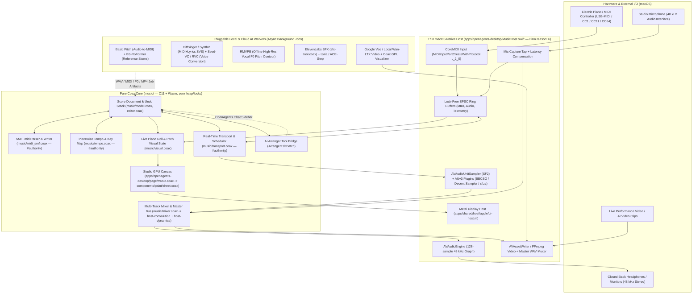

# Coax Music Production Studio: Orchestral Arrangement, Electric Piano Live Input, Vocal Layering & Music Video Specification

**Date:** 2026-11-22  
**Status:** Proposed specification (Research, Architecture & Phased Plan; Phase 1 ready to implement)  
**Target Deliverable:** A finished orchestral + vocal music video mashing up two songs from Andrew Lloyd Webber's *The Phantom of the Opera*, arranged, recorded, mixed, and assembled in a Coax-powered music production dashboard inside OpenAgents.  
**First Milestone (Phase 1):** Import or play music from an electric piano, move and edit notes on a live Coax GPU piano roll, hear orchestral/piano sounds at low latency, and watch notes and piano keys play in real time.  
**Proposed Scope:** `proto/openagents/music/v1alpha1/`, `music/` (new bounded context), `metaverse-engine/audio/` (shared DSP/mixer kernel), `coax/lib/agent/desktop/flags.coax` (`DC_FLAG_MUSIC`), `apps/openagents-desktop/` (macOS CoreMIDI + CoreAudio/AUv3 + Metal GPU UI host), optional `apps/openagents-web/` AudioWorklet mirror.

**Related Repo Docs & Existing Foundations:**
- [`metaverse-engine/audio/score.coax`](../../metaverse-engine/audio/score.coax) — deterministic 960-PPQ beat grid, keys, triads, automation, stereo/reverb buses
- [`metaverse-engine/audio/synth.coax`](../../metaverse-engine/audio/synth.coax) — integer Q16 oscillators, MIDI pitch table (`AU_TOP_MHZ`), ADSR, panning, Schroeder reverb
- [`metaverse-engine/audio/epic.coax`](../../metaverse-engine/audio/epic.coax) — multi-part cinematic orchestral score timed to video scene cues (`units.Quantity`)
- [`metaverse-engine/audio/host-pcm.coax`](../../metaverse-engine/audio/host-pcm.coax), [`host-convolution.coax`](../../metaverse-engine/audio/host-convolution.coax), [`host-dynamics.coax`](../../metaverse-engine/audio/host-dynamics.coax) — `#authority` 48 kHz PCM voice mixer, partitioned stereo FFT convolution reverb, stereo-linked bus compressor & brickwall limiter
- [`metaverse-engine/audio/wav.coax`](../../metaverse-engine/audio/wav.coax) & [`measure.coax`](../../metaverse-engine/audio/measure.coax) — WAV encoding, `wav_hash`, ITU-R BS.1770-4 / EBU R128 LUFS loudness metering, `meas_outline` waveform peaks
- [`metaverse-engine/audio/SOURCES.md`](../../metaverse-engine/audio/SOURCES.md) & [`sfx-tool.coax`](../../metaverse-engine/audio/sfx-tool.coax) — audio provenance hygiene and ElevenLabs SFX + Vertex AI judge workflow
- [`metaverse-engine/host/apple/PageAudio.swift`](../../metaverse-engine/host/apple/PageAudio.swift) & [`apps/openagents-desktop/Window+Voice.swift`](../../apps/openagents-desktop/Window+Voice.swift) — macOS `AVAudioEngine` live/offline playback and microphone capture
- [`components/gpu-components.md`](../../components/gpu-components.md), [`components/paint/sheet.coax`](../../components/paint/sheet.coax), [`components/backend/gpu.coax`](../../components/backend/gpu.coax) — 60/120 Hz Metal GPU display-list rendering & hit-testing
- [`coax/native.md`](../../coax/native.md), [`docs/voice/coax-native-voice.md`](../voice/coax-native-voice.md), [`docs/reuse.md`](../reuse.md), [`docs/architecture/contexts.md`](../architecture/contexts.md) — Coax-first ownership, bounded storage, and context boundaries

---

## 1. Purpose, Delivery Order & Design Rules

We want a native, low-latency music production studio inside OpenAgents Desktop built with Coax, structured around shipping one concrete creative project first: **an orchestral + vocal music video mashing up two *Phantom of the Opera* songs**, combining live electric-piano playing, pit-orchestra arrangement, the owner's own sung vocals, optional AI vocal/sound/video models, and a unified visual timeline.

To avoid building an unfocused DAW monolith, work is strictly sequenced in the exact order needed to produce the music video:

1. **Phase 1 — Interactive Notes, Electric Piano & Live Visual Playback (Build First):** Get MIDI music in (import `.mid` or play live on an electric piano), drag/draw/resize/transpose notes on a responsive GPU piano roll, hear real piano/organ/orchestral sounds immediately, and watch the playhead sweep while active notes and piano keys illuminate in real time.
2. **Phase 2 — Full Orchestral Arrangement & Mashup Workbench:** Host multi-timbral orchestral instruments (SF2, SFZ, macOS Audio Units like Spitfire BBC Symphony Orchestra Discover), edit continuous expression (`CC1`/`CC11`/`CC64`), shape rubato & mashup tempo/key transitions, add concert-hall convolution reverb, and collaborate with an OpenAgents AI Arranger agent directly on the score.
3. **Phase 3 — Human Vocal Recording, Live Pitch Overlay & Comping:** Record 48 kHz vocals over the orchestral mix with latency compensation, see live sung pitch (`F0`) plotted directly on top of the vocal MIDI guide notes, and comp the best phrases into a polished vocal chain.
4. **Phase 4 — AI Vocal Co-Production, Audio-to-MIDI & Theatrical SFX:** Layer AI singing harmonies/duets (Synthesizer V / DiffSinger) or voice-converted choir doubles (Seed-VC / RVC) alongside real vocals, transcribe hummed/played ideas with Basic Pitch, and add theatrical SFX/atmosphere.
5. **Phase 5 — Beat-Locked Music Video Timeline & Master Export:** Sync live performance video, AI cinematic scenes (Google Veo / local video models), and Coax GPU audio-reactive visuals to exact bar/beat markers, master to `-14 LUFS`, and export a finished 1080p/4K MP4.

### Core Architectural Rules

1. **Coax owns the score, timing, editing, mixing math, and UI layout; the host owns hardware I/O and third-party audio units.** Per [`coax/native.md`](../../coax/native.md) and [`docs/voice/coax-native-voice.md`](../voice/coax-native-voice.md), Swift/ObjC/C shims stay thin and carry `Firm reason: N (...)` headers.
2. **Zero allocation and zero locks on real-time MIDI/audio threads.** Coax has no garbage collector, no hidden heap allocation, and no mutable globals. Calling Coax procedures over caller-owned fixed arrays and views guarantees deterministic real-time execution with bounded step counts verified by `coax test --steps`.
3. **Deterministic offline bounce.** Given the same project document, audio stems, and PRNG seeds, the Coax mixer/reverb/dynamics pipeline renders bit-identical WAV output across runs, verified by `wav_hash` and `measure.coax`.
4. **"Use, never depend" on external AI models and commercial plugins.** Every external instrument plugin (AUv3/SFZ) and AI model (SynthV, DiffSinger, Seed-VC, Veo, Lyria, ElevenLabs) sits behind a clean file/job adapter. The studio always opens, plays, edits, and renders offline using built-in Coax synthesis + local `.sf2` banks.
5. **Feature-flagged (`DC_FLAG_MUSIC`) in OpenAgents Desktop.** Per [`apps/openagents-desktop/README.md`](../../apps/openagents-desktop/README.md), the studio lives behind `flag.music` (off by default in `--minimal` Inkling releases; enabled via `--flag music`, `OA_FLAGS=music`, or `experimentalFeatures`).
6. **Zero copyrighted third-party music committed to the repo.** *The Phantom of the Opera* MIDI files, scores, reference recordings, and personal vocal takes stay strictly in local user storage (`~/.openagents/music/projects/`), never in git.

---

## 2. Research: Orchestral Arrangement & Playing Sounds with an Electric Piano

### 2.1 Physical Hardware & macOS Signal Path

Modern electric pianos, digital stage pianos (Yamaha P-series/CP, Roland FP/RD, Kawai ES, Nord, Casio Privia), and MIDI controller keyboards connect directly to a Mac with minimal hardware:

```text
  [ Electric Piano / MIDI Keyboard ]          [ Vocal Mic (Condenser / Dynamic) ]
    • USB-MIDI (class-compliant, no driver)     • XLR -> USB Audio Interface (48 kHz / 24-bit)
    • Or 5-pin MIDI DIN -> USB-MIDI cable       • Direct zero-latency headphone monitor toggle
    • Sustain Pedal (CC64)                      • Closed-back headphones (zero orchestral bleed!)
    • Optional Expression Pedal (CC11) / Mod Wheel (CC1)
                  │                                           │
                  ▼                                           ▼
     macOS CoreMIDI (UMP / MIDI 2.0)               macOS CoreAudio (AVAudioEngine)
     MIDIInputPortCreateWithProtocol(._2_0)        128-sample I/O buffer (2.67 ms @ 48 kHz)
                  │                                           │
                  └──────────────► OpenAgents Studio ◄────────┘
                                   (Coax Core + AU/SF2)
                                           │
                                           ▼
                           Headphones / Studio Monitors (Stereo 48 kHz)
```

**Practical setup checklist for macOS:**
- **USB-MIDI verification:** Connect the electric piano via USB and check macOS *Audio MIDI Setup* (`Window > Show MIDI Studio`) to confirm it appears as an active source. Class-compliant USB-MIDI devices require no driver installation.
- **Buffer size & latency target:** Run CoreAudio at **48 kHz** with a **128-sample buffer** (`2.67 ms` hardware latency; ~`5–8 ms` total round-trip feel — indistinguishable from an acoustic piano). On Apple Silicon M-series Macs, 64 samples (`1.33 ms`) is feasible during solo keyboard tracking, stepping up to 256–512 samples during heavy full-orchestra mixing.
- **Why closed-back headphones matter:** When recording vocals over an orchestral arrangement, open-back headphones or speakers bleed the orchestra into the microphone, ruining reverb and vocal pitch processing. Closed-back studio headphones (e.g., Sony MDR-7506, Audio-Technica ATH-M50x, Beyerdynamic DT-770) keep the vocal stem dry and clean.
- **The #1 orchestral MIDI secret — `CC1` (Mod Wheel) and `CC11` (Expression):** On a piano, key velocity alone controls both loudness and tone because the hammer strikes once and the note decays. Orchestral strings, brass, woodwinds, and choir sustain continuously and swell or fade *after* the note starts. Playing notes with an electric piano captures pitch, rhythm, and initial attack (`velocity` + `CC64` sustain), and a quick second pass riding a mod wheel (`CC1`), expression pedal (`CC11`), or drawing an expression curve in the piano roll turns static MIDI notes into breathing orchestral phrasing.

### 2.2 Four-Tier Sound Engine & Sample Library Stack

To make Phase 1 work on day one with zero friction while scaling cleanly to concert-hall orchestral realism in Phase 2, the studio supports four instrument tiers behind one uniform track instrument abstraction:

| Tier | Engine / Host Path | Format | Best Free / Open Orchestral & Piano Banks | Latency & Tradeoffs |
| :--- | :--- | :--- | :--- | :--- |
| **Tier 0** (Built-in) | Coax [`synth.coax`](../../metaverse-engine/audio/synth.coax) + [`epic.coax`](../../metaverse-engine/audio/epic.coax) | Pure Coax DSP | Built-in metronome, sketch piano/organ/strings/brass/choir/taiko | Zero downloads, bit-exact deterministic CI & tests; synthetic timbre (sketch/test only) |
| **Tier 1** (Phase 1 Default) | Apple native `AVAudioUnitSampler` (or C `TinySoundFont`) | **SoundFont 2 (`.sf2`)** / DLS | **GeneralUser GS**, **Merlin Symphony / Merlin Vienna**, **FluidR3 GM**, dedicated free **Gothic Pipe Organ** `.sf2` banks | Zero third-party plugin installs on macOS; instant load, <5 ms latency, good sketch & multi-track playback |
| **Tier 2** (Open Sample Engine) | **`sfizz`** (C++ library or macOS AU) | **SFZ (`.sfz` + WAV)** | **Virtual Playing Orchestra (VPO)**, **Sonatina Symphonic Orchestra (SSO)**, **Versilian VSCO 2 Community Edition** | Plain-text human-readable mappings + open WAV samples; native Apple Silicon; expressive orchestral sections |
| **Tier 3** (Pro macOS Audio Units) | Apple `AVAudioUnitMIDIInstrument` (**AUv3 / AUv2**) | macOS `.component` / AUv3 | **Spitfire BBC Symphony Orchestra Discover** (free, 34 orchestral instruments + grand piano), **Decent Sampler** (free — community pipe organs, Rhodes/Wurlitzer electric pianos, celestas, choirs), **Spitfire LABS** (free electric pianos/strings), **Surge XT** (free open-source synth/EP); optional pro upgrades (BBCSO Core, Orchestral Tools SINE/Layers, Pianoteq) | Studio-grade cinematic realism; supports native plugin UI sheets and full `CC1`/`CC11` dynamic layers + keyswitches |

**Recommended starting kit for the *Phantom* mashup (all free on macOS):**
1. **Strings, Woodwinds, Brass, Harp, Timpani, Grand Piano:** *Spitfire Audio BBC Symphony Orchestra Discover* (AU — pre-seated in Maida Vale Studio 1 stereo space; zero manual panning guesswork).
2. **Gothic Pipe Organ, Electric Piano (Rhodes/Wurlitzer), Celesta, Choir Pads:** *Decent Sampler* (AU) with free Pianobook/Decent Samples pipe organ & electric piano libraries, or *GeneralUser GS / Merlin Symphony* `.sf2` inside `AVAudioUnitSampler` during Phase 1.
3. **Open Offline Fallback:** *Virtual Playing Orchestra (VPO)* SFZ via `sfizz` + *FluidR3/Merlin* `.sf2` so projects stay portable and reproducible without proprietary accounts.

### 2.3 Orchestral Arranging Workflow from an Electric Piano

Most modern film and theatre orchestrators compose directly from an 88-key keyboard using a four-pass workflow that our Coax dashboard is explicitly built to accelerate:

1. **Pass 1 — Piano Reduction & Guide Melody:** Record or import a 2-hand piano reduction + single-line vocal melody guide. Use the electric piano to lock in phrasing, rubato, and mashup transition timing.
2. **Pass 2 — Voice Explosion onto Orchestral Seating:** Split chord voicings across orchestral sections (manually in the piano roll, via a one-click **Explode Chords** action, or via the AI Arranger agent), respecting classical frequency separation and stage seating:
   - **Sub / Low Foundation (30–200 Hz, center-to-right):** Pipe Organ Pedals, Contrabass (`pan +0.35`), Celli (`pan +0.25`), Bassoon (`pan +0.10`), Bass Trombone (`pan +0.30`), Timpani (`pan -0.15`).
   - **Mid Harmony & Warmth (150–1,200 Hz):** Violas (`pan +0.05`), French Horns I–III (`pan -0.35`), Pipe Organ Manuals (`stereo`), Electric/Grand Piano (`stereo`), Clarinet (`pan -0.15`), Harp (`pan -0.45`).
   - **High Melody & Sparkle (500–8,000 Hz):** Violins I (`pan -0.55`), Violins II (`pan -0.25`), Flute/Piccolo (`pan -0.20`), Oboe/English Horn (`pan +0.15`), Celesta & Tubular Bells (`pan +0.35`), Lead & Harmony Vocals (`pan 0.0` lead, `±0.40` doubled harmonies).
3. **Pass 3 — Articulation & Dynamic Shaping:** Apply bow/breath onset micro-offsets (legato strings naturally bloom 25–60 ms slower than piano hammers), draw or play `CC1`/`CC11` swells, and carve space whenever the lead vocal enters (drop orchestral mid-range 2–4 dB around 1–3 kHz or thin out Violins I so the voice shines effortlessly).
4. **Pass 4 — Shared Acoustic Space:** Route all orchestral tracks, electric piano, and vocal stems into a single shared Opera House / Concert Hall convolution reverb bus (`metaverse-engine/audio/host-convolution.coax`) with varied wet sends (dry lead vocal ~12–18%, close strings ~20%, distant brass/percussion/organ ~35–45%) so every real and synthetic element inhabits one cohesive room.

---

## 3. First Deliverable Blueprint: *The Phantom of the Opera* Mashup & Music Video

### 3.1 Original Pit Orchestra Reference (1986 West End / 1988 Broadway)

Andrew Lloyd Webber's original Broadway pit used **29 players** (27 in the original West End pit) combining a Romantic opera orchestra with gothic pipe-organ/synthesizer keyboards and theatrical rock-opera percussion:

| Section | Original Broadway Pit Forces | Role in Our Arrangement |
| :--- | :--- | :--- |
| **Keyboards (2)** | Grand Piano, Gothic Pipe Organ patches, Celesta, Harpsichord, Synth String/Choir Pads | **Anchor section:** played directly on the electric piano; pipe organ carries the iconic descending chromatic motif |
| **Strings (12–13)** | Violins I–VIII (7–8), Violas (2), Cellos (2), Contrabass (1) | Sweeping Romantic legato beds (*Music of the Night*, *All I Ask of You*) + aggressive staccato ostinati (*Phantom* title theme) |
| **Woodwinds (5 doubling)** | Flute/Piccolo, Flute/Clarinet, Oboe/English Horn, Clarinet/Bass Clarinet/E♭ Clarinet, Bassoon | Intimate countermelodies (solo clarinet & oboe), murky low-register mystery (bassoon/bass clarinet) |
| **Brass (6)** | 3 French Horns, 2 Trumpets, 1 Bass Trombone | Warm heroic swells (Horns) and menacing gothic tuttis (Trombone/Trumpets) |
| **Harp (1)** | Concert Pedal Harp | Shimmering arpeggios linking vocal phrases and softening modulations |
| **Percussion (2)** | Timpani, Crash/Suspended Cymbals, Snare/Bass Drum, Tubular Bells, Glockenspiel, Vibraphone, Gong, Castanets | Dramatic transitions, chandelier hits, rhythmic pulse (plus optional electric bass & rock kit on the title theme) |

### 3.2 Candidate *Phantom* Songs: Keys, Tempos & Mashup Affinity

| Song | Original Key | Approx. Tempo & Meter | Signature Orchestration | Mashup Role |
| :--- | :--- | :--- | :--- | :--- |
| **The Phantom of the Opera** (Title Song) | **D minor** (modulates upward near finale) | ~120–124 BPM, 4/4 *Allegro* | Iconic descending chromatic pipe organ riff (`D–C♯–C–B–B♭`), driving bass/drums, dramatic orchestral hits | High-energy climax, gothic rhythmic anchor |
| **The Music of the Night** | **D♭ major** | ~72 BPM, 4/4 *Andante* (heavy rubato) | Murky low strings + bassoon opening, celesta shimmer, harp countermelodies, soaring legato strings; baritone/tenor up to A♭5 | Atmospheric opening, expressive solo vocal showcase |
| **All I Ask of You** | **D♭ major** | ~60–63 BPM, 4/4 *Heartfelt* | Chamber-like solo clarinet + solo cello dialogue, lush warm strings, harp | Natural same-key duet partner with *Music of the Night* |
| **The Point of No Return** | **F minor** | ~132 BPM, 4/4 *Allegretto* | Sultry tango/bolero pulse, castanets, plucked strings/guitar, tense woodwinds | Dramatic rhythmic partner to the Title Song |
| **Think of Me** | **D major** | ~116–126 BPM, 4/4 *Allegretto* | Light classical strings, woodwind filigree, soaring soprano cadenza | Bright parallel-major contrast to D minor Title Song |
| **Angel of Music** | **C major** (E♭/G in variants) | ~55–84 BPM, 6/8 *Adagio* | Haunting music-box celesta, delicate strings | Eerie intro/outro motif |
| **Masquerade** | **A major** (G/B♭ in variants) | Fast theatrical march | Full brass/percussion fanfare, choral ensemble | Grand theatrical set-piece |

### 3.3 Recommended Mashup Structures (What Our Studio Must Support)

Depending on which two songs the owner selects, the arrangement requires specific studio features:

1. **Mashup Option A — *The Music of the Night* × *The Phantom of the Opera* (Title Song) [Recommended Dramatic Arc]:**
   - *Harmonic bridge:* *Music of the Night* sits in **D♭ major** (~72 BPM); *The Phantom of the Opera* hits in **D minor** (~122 BPM) — a **chromatic half-step upward lift** (classic Andrew Lloyd Webber theatrical shock!).
   - *Arc:* Begin hushed on electric piano + low celli/harp in D♭ major (solo vocal). Build a sustained A-dominant pedal with timpani roll and accelerating tempo ramp (`72 → 122 BPM` across 2 bars via the **Tempo Map**). Drop straight into the thunderous D-minor pipe organ riff (`D–C♯–C–B–B♭`), then weave *Music of the Night*'s lyrical melody in half-time over the D-minor driving ostinato (or alternate sections into a final grand reprise).
   - *Studio requirements exercised:* Piecewise tempo map, mid-song key-signature shift (`D♭ Maj → D min`), pipe organ + strings + percussion layering, human lead + AI soprano/choir climax.
2. **Mashup Option B — *The Music of the Night* × *All I Ask of You* [Same-Key Intimate Duet]:**
   - *Harmonic bridge:* Both songs share **D♭ major** and slow, expressive tempos (~72 vs ~63 BPM), unifying cleanly around **68 BPM** with rubato tempo points.
   - *Arc:* Solo human vocal on *Music of the Night* phrases answered in counterpoint by an AI soprano or layered harmony vocal singing *All I Ask of You* over electric piano, solo cello, solo clarinet, harp, and swelling strings.
3. **Mashup Option C — *The Phantom of the Opera* × *The Point of No Return* [Dark Minor-Key Drive]:**
   - *Harmonic bridge:* Transpose *The Point of No Return* down 3 semitones (`F minor → D minor`) or exploit the dramatic chromatic-mediant pivot (`D minor ↔ F minor`), unified at ~124 BPM.

### 3.4 Copyright, Publishing & Provenance Hygiene

*The Phantom of the Opera* (music by Andrew Lloyd Webber, lyrics by Charles Hart / Richard Stilgoe) is copyrighted and administered by The Really Useful Group:
- **Personal / experimental creation:** Arranging, practicing, and rendering privately on your own machine requires no special repo artifacts.
- **Publishing a cover/mashup music video publicly:** On YouTube, standard cover videos are typically handled via Content ID revenue sharing when eligible, though mashups/medleys constitute derivative works and commercial/monetized distribution across platforms requires synchronization + derivative/arrangement clearances from the publisher.
- **Repository boundary:** Never commit copyrighted MIDI files, sheet music, reference audio stems, or private vocal recordings into `openagents`. All user song projects live outside git under `~/.openagents/music/projects/<project-id>/` with an auto-generated `SOURCES.json` provenance ledger modeled on [`metaverse-engine/audio/SOURCES.md`](../../metaverse-engine/audio/SOURCES.md) recording every sample bank, plugin, recording, and AI model run (model ID, prompt, seed, timestamp, license).

---

## 4. Research: AI Models for Vocals, Transcription, Stems & Music Video

Following OpenAgents' *"use, never depend"* rule ([`docs/voice/coax-native-voice.md`](../voice/coax-native-voice.md)), AI capabilities plug into the Studio as **asynchronous background job adapters** that consume or emit standard open formats (`.mid`, 48 kHz `.wav`, `.mp4`, JSON curves). Every AI pass lands on its own non-destructive track so you can solo, mute, trim, remix, or delete it cleanly.

### 4.1 Getting Notes & Reference Structures Into the Piano Roll

| Capability | Recommended Tool / Model | License / Runtime | How It Plugs Into OpenAgents Studio |
| :--- | :--- | :--- | :--- |
| **Sheet Music / Score Import** | Standard MIDI (`.mid`) & MusicXML (`.musicxml`/`.mxl`) | Open standards (pure Coax SMF parser in Phase 1) | Drag-and-drop `.mid` directly into multi-track Piano Roll |
| **Audio-to-MIDI Transcription** | **Spotify Basic Pitch** | Apache 2.0, lightweight local Python/ONNX | Record a rough electric piano jam or hum a vocal countermelody → run Basic Pitch → editable MIDI notes + pitch bend appear on a new track |
| **Reference Stem Separation** | **BS-RoFormer / Mel-Band RoFormer** (gold standard) or **Demucs v4** | Open-source local | Isolate vocals/strings/organ from reference recordings purely for harmonic study & ear-training (never bounced into final output) |

### 4.2 Human Singing + AI Vocal Co-Production

The best-sounding vocal productions blend **real human emotional phrasing** with **targeted AI vocal layering** rather than replacing the singer completely:

1. **Human Lead Vocal + Live Pitch-Guide Overlay:**
   - Sing your own lead vocal while the Studio plays the orchestral backing and renders your real-time fundamental frequency (`F0`) directly over the MIDI vocal melody bars on the piano roll.
   - Fast zero-latency live display uses a pure-Coax YIN/autocorrelation pitch estimator (`music/pitch.coax`); post-take high-accuracy pitch curves use **RMVPE** (Robust Model for Vocal Pitch Estimation) in the background for crystal-clear tuning feedback and visual comping.
2. **MIDI + Lyrics Singing Synthesis (Duet Partner & Cathedral Choir):**
   - For parts outside your natural vocal range (e.g., Christine's high operatic soprano duet lines or an 8-voice SATB gothic choir), author the MIDI notes + lyric syllables right in the Studio's Piano Roll and export to:
     - **Synthesizer V Studio (Dreamtonics):** Commercial benchmark for lifelike singing synthesis with detailed pitch, vibrato, breath, tension, and vocal-mode curves.
     - **DiffSinger:** Open-source local diffusion singing synthesizer taking MIDI + phonemes + F0 contours — ideal for an offline Coax-orchestrated job pipeline!
     - **ACE Studio:** Fast alternative vocal synthesizer with large multi-voice catalog.
   - Re-import the rendered dry 48 kHz vocal WAV automatically onto a locked Studio audio track, then place it into the same Concert Hall convolution reverb as your real voice.
3. **Voice Conversion & Harmony Doubling (Keep Your Own Emotion, Transform Timbre):**
   - **Seed-VC** (zero-shot voice conversion) and **RVC / Applio** (open-source Retrieval-based Voice Conversion): sing a harmony or falsetto guide take yourself so the timing, breathing, and dramatic emotion are 100% yours, then convert the timbre into a contrasting operatic voice or stacked choir harmonies to blend underneath your natural lead vocal.

### 4.3 Theatrical Atmosphere, Sound Effects & Generative Music Beds

- **Theatrical Sound Effects (Already in Repo!):** Reuse [`metaverse-engine/audio/sfx-tool.coax`](../../metaverse-engine/audio/sfx-tool.coax) (**ElevenLabs `eleven_text_to_sound_v2`** + Gemini audio judge + `measure.coax` normalization) to generate bespoke gothic opera atmosphere: subterranean boat oars on water, echoing footsteps, distant thunder, chandelier crystal creaks/crash, stage curtain swells.
- **Optional Generative Music / Texture Sketches:** **Google Lyria (`lyria-002` / Lyria 3 on Vertex AI)** or local open-weights **ACE-Step** (MIT/Apache 2.0) for rapid inspiration sketches or ambient textural drones. Note that Vertex AI Lyria operates single-turn (non-editable timeline) and embeds SynthID watermarks, making it a supplemental texture/ideation tool rather than a replacement for note-level orchestral MIDI arrangement.

### 4.4 Music Video Generation & Beat-Synced Compositing

The finished music video works best as a **three-layer hybrid** timed directly to the Coax Studio's beat grid (just like [`metaverse-engine/audio/epic.coax`](../../metaverse-engine/audio/epic.coax) anchors hits to exact video scene seconds):

1. **Live Performance Footage:** Record yourself singing and playing the electric piano (Mac camera / iPhone / mirrorless), synced to the project via a 2-bar clap/count-in marker on the timeline.
2. **AI Cinematic B-Roll:** Define bar-locked **Video Storyboard Cues** inside the Studio (e.g., Bar 1–16: *candlelit misty subterranean canal*; Bar 33–48: *soaring Paris Opera chandelier igniting on the D-minor organ drop*), dispatched to **Google Veo (Vertex AI)** or local open-weights video models (**Wan / LTX-Video**), with duration calculated automatically from the exact Coax Tempo Map!
3. **Coax GPU Audio-Reactive / Metaverse 3D Visuals:** Render deterministic 60 fps overlays or full visual cuts driven directly by live MIDI note events, stem RMS levels, and vocal pitch — e.g., an atmospheric monochrome/gold falling-note piano-roll silhouette, flickering candlelight particles, or a camera flythrough from `metaverse-engine/shot/` — then mux video + mastered 48 kHz audio via `AVAssetWriter` (`VideoToolbox`) or `ffmpeg`.

---

## 5. Existing OpenAgents Foundation & Reuse Plan

Per [`docs/reuse.md`](../reuse.md), OpenAgents already has a remarkably complete, tested audio & GPU UI stack in Coax. We extend and compose these owners instead of building parallel engines:

| Existing Module / File | What It Already Provides | How Music Studio Reuses It | New Work Needed |
| :--- | :--- | :--- | :--- |
| [`metaverse-engine/audio/score.coax`](../../metaverse-engine/audio/score.coax) | `AU_PPQ = 960`, drift-free `au_grid_sample`, keys/scales/triads, automation breakpoints, 4-bus stereo + reverb send routing | Keep `960 PPQ` as the canonical project tick resolution; reuse scale/chord theory helpers for Piano Roll scale highlighting & AI harmonization | Extend single-BPM `Grid` into piecewise-constant/linear `TempoMap` (`music/tempo.coax`) for rubato and mashup tempo ramps |
| [`metaverse-engine/audio/synth.coax`](../../metaverse-engine/audio/synth.coax) | Integer Q16 oscillators, `AU_TOP_MHZ` MIDI table (`0..131`), ADSR, one-pole filter, constant-power pan, saturation, Schroeder reverb | Tier-0 zero-dependency polyphonic preview synth + sample-accurate metronome click generator + deterministic CI audio fixtures | Wrap in a 32-voice polyphonic MIDI-driven voice allocator (`music/synth_poly.coax`) |
| [`metaverse-engine/audio/host-pcm.coax`](../../metaverse-engine/audio/host-pcm.coax) & [`host-voice.coax`](../../metaverse-engine/audio/host-voice.coax) | `#authority` 48 kHz multi-voice PCM carrier, rate interpolation, equal-power pan, smooth fade stops | Playback engine for recorded vocal takes, AI vocal stems, and theatrical SFX clips | Add sample-accurate clip trim/offset/fade-in/fade-out and per-track 3-band biquad EQ (`music/mixer.coax`) |
| [`metaverse-engine/audio/host-convolution.coax`](../../metaverse-engine/audio/host-convolution.coax) | `#authority` partitioned stereo FFT convolution reverb (`ac_open`, `ac_block`) using `psionic/lib/spectral.coax` | Shared **Opera House / Concert Hall** stereo reverb bus unifying electric piano, sampled orchestra, human vocals, and AI voices | Load user/bundled Opera Hall stereo impulse response `.wav` into `AudioConvolution` |
| [`metaverse-engine/audio/host-dynamics.coax`](../../metaverse-engine/audio/host-dynamics.coax) | `#authority` 6 ms lookahead stereo-linked bus compressor + `-1 dBFS` brickwall ceiling limiter | Master bus glue compression and peak protection + vocal track dynamics | Add vocal high-pass filter (`80–100 Hz`) and configurable threshold/ratio parameters |
| [`metaverse-engine/audio/wav.coax`](../../metaverse-engine/audio/wav.coax) & [`measure.coax`](../../metaverse-engine/audio/measure.coax) | 16-bit WAV writer, `wav_hash`, ITU-R BS.1770-4 / EBU R128 integrated & momentary LUFS, peak dBFS, `meas_outline` waveform peaks | Stem & master export, real-time/export loudness verification (`-14 LUFS` target for YouTube), waveform rendering on audio clips | Add 24-bit PCM / 32-bit float WAV read/write support for lossless vocal takes and master export |
| [`metaverse-engine/audio/sfx-tool.coax`](../../metaverse-engine/audio/sfx-tool.coax) | ElevenLabs SFX generation + Gemini audio judge + normalization | Phase 4 theatrical SFX generation straight into project clip pool | Expose as a Studio background job with automatic project `SOURCES.json` provenance logging |
| [`metaverse-engine/host/apple/PageAudio.swift`](../../metaverse-engine/host/apple/PageAudio.swift) & [`apps/openagents-desktop/Window+Voice.swift`](../../apps/openagents-desktop/Window+Voice.swift) | `AVAudioEngine` live 48 kHz source node, deterministic `offline` block capture, mic discovery & input tap | Blueprint for `apps/openagents-desktop/MusicHost.swift` combining CoreMIDI, `AVAudioUnitSampler`/AUv3, mic capture, and offline bounce | Add CoreMIDI (`MIDIInputPortCreateWithProtocol`), `AVAudioUnitSampler`, AUv3 hosting, and latency-compensated vocal recording |
| [`components/paint/sheet.coax`](../../components/paint/sheet.coax), [`surface.coax`](../../components/paint/surface.coax), [`kit/frame.coax`](../../components/kit/frame.coax), [`backend/gpu.coax`](../../components/backend/gpu.coax), [`apps/shared/host/apple/ui-host.m`](../../apps/shared/host/apple/ui-host.m) | 60/120 Hz Metal GPU display-list rendering (`Sheet`, `UiFrame`, `UiSurface`), hit-testing (`SheetHit`), semantic rows, skin roles | Renders the entire Piano Roll, live 88-key keyboard, arrangement timeline, waveforms, pitch curves, and mixer console natively in Metal | Add dedicated Studio canvas page (`apps/openagents-desktop/page/music.coax`) with viewport-culled note/waveform painting |
| [`coax/lib/agent/desktop/flags.coax`](../../coax/lib/agent/desktop/flags.coax) | `#authority` 28-flag desktop capability registry | Add `DC_FLAG_MUSIC` (`"music"`, bit 28, `default_on = false`) to gate the Studio cleanly out of the `--minimal` release | Update `DC_FLAG_COUNT` and desktop sidebar/menu/palette entry points |
| [`coax/web/audio-host.js`](../../coax/web/audio-host.js) & [`audio-worklet.js`](../../coax/web/audio-worklet.js) | Browser 48 kHz `AudioWorklet` + `OfflineAudioContext` Coax audio mirror | Optional later web playback/review surface sharing the exact same Coax score & mixer code | Out of scope for Phase 1–5 macOS focus; preserved by keeping `music/` strictly platform-independent Coax |

---

## 6. System Architecture: Coax Music Production Studio

### 6.1 Bounded Context & Layer Diagram

We propose a new bounded context **`music/`** registered in `contexts.txt` and [`docs/architecture/contexts.md`](../architecture/contexts.md). Its dependencies point strictly downward: `music/` may load `metaverse-engine/audio/`, `coax/lib/`, `components/`, and `proto/` codecs; it never loads Everglade, Pay, Nostr, or host Swift code.



### 6.2 Real-Time Four-Thread & Lock-Free Memory Contract

To guarantee glitch-free sub-10 ms keyboard playing while animating a 120 Hz Metal piano roll:

| Thread | Cadence / Priority | What Runs Here | Strict Prohibition |
| :--- | :--- | :--- | :--- |
| **1. CoreMIDI Thread** | Event-driven, real-time priority | `MIDIInputPortCreateWithProtocol(._2_0)` converts UMP / MIDI 1.0 packets into fixed 16-byte `MusicMidiEv` records and pushes to SPSC Ring A (Audio) and SPSC Ring B (UI/Recorder) | Zero locks, zero Swift allocations, zero `DispatchQueue.main` |
| **2. CoreAudio Render Thread** | Every 128 frames (`2.67 ms` @ 48 kHz), real-time priority | Drains Ring A (live electric piano MIDI Thru); runs Coax `music_transport_step()` to emit scheduled track MIDI events with exact sample offsets (`0..<128`) into each track's cached `AUMIDIEventListBlock`; captures mic PCM into SPSC Ring C; runs Coax `music_mix_block()` (`host-convolution.coax` + `host-dynamics.coax`); publishes atomic `MusicTelemetry` (sample clock, active note bitmasks, per-track peak/RMS) | Zero heap allocation, zero file I/O, zero locks, bounded Coax step count (`coax test --steps`) |
| **3. Main UI Thread** | 60/120 Hz Metal display link | Reads atomic `MusicTelemetry`, drains Ring B (recorded MIDI notes) & Ring C (waveform/YIN live pitch), commits Coax `music_ui_frame()` onto `UiSurface` (`Sheet`), renders via `components/backend/gpu.coax` + `ui-host.m` | Never mutates audio-thread buffers in place; publishes score edits via double-buffered generation swap / command queue |
| **4. Background Worker Queue** | Asynchronous | Disk persistence (`.oamusic`, `.mid`, `.wav`), `.sf2` loading, offline deterministic bounce (`AVAudioEngine.enableManualRenderingMode(.offline)`), AI model jobs, FFmpeg/`AVAssetWriter` video muxing | Never touches UI state directly; delivers completions into serialized app dispatch |

### 6.3 Core Coax Data Model & Bounded Capacities (`music/model.coax`)

Consistent with [`coax/native.md`](../../coax/native.md), every Studio project declares explicit, caller-owned bounded capacities. No hidden allocator exists; exceeding a limit returns an explicit refusal without corrupting committed state.

| Resource | Constant | Capacity | Rationale |
| :--- | :--- | ---: | :--- |
| Ticks per quarter note | `MUSIC_PPQ` | `960` | Identical to `metaverse-engine/audio/score.coax` (`AU_PPQ`); divides evenly by 2, 3, 4, 5, 6, 8, 12, 16, 24, 32, 64 (triplets, quintuplets, 64th notes) |
| Tracks | `MUSIC_MAX_TRACKS` | `64` | Covers full 29-piece pit orchestra + pipe organ + electric piano + 8 vocal/comp lanes + AI stems + SFX |
| MIDI notes (project pool) | `MUSIC_MAX_NOTES` | `65,536` | ~10+ minutes of dense full-orchestra score (~1.6 MB flat struct pool) |
| CC / pitch-bend points | `MUSIC_MAX_CC` | `131,072` | Smooth `CC1` mod wheel, `CC11` expression, `CC64` sustain, and pitch-bend automation |
| Tempo map segments | `MUSIC_MAX_TEMPO_PTS` | `512` | Expressive rubato (*Music of the Night*) and mashup tempo ramps (`72 -> 122 BPM`) |
| Key / time-sig / section markers | `MUSIC_MAX_MARKERS` | `256` | Mashup boundaries, modulations (`Db Maj -> D min`), rehearsal letters |
| Non-destructive audio clips | `MUSIC_MAX_CLIPS` | `512` | Multi-take vocal comping, AI choir/duet stems, theatrical SFX |
| Lyric / phoneme events | `MUSIC_MAX_LYRICS` | `4,096` | Vocal guide display + DiffSinger / Synthesizer V export |
| Video storyboard cues | `MUSIC_MAX_VIDEO_CUES` | `256` | Bar-locked camera cuts, Veo prompts, GPU visualizer presets |
| Undo / redo command ring | `MUSIC_MAX_UNDO` | `256` | Bounded atomic edit batches (including multi-note AI Arranger edits) |

**Coax struct sketch (`music/model.coax`):**

```jai
#module "openagents.music.model";

MUSIC_PPQ :: 960;                 // matches metaverse-engine/audio/score.coax AU_PPQ
MUSIC_SAMPLE_RATE :: 48000;       // matches metaverse-engine/audio/host-pcm.coax
MUSIC_MAX_TRACKS :: 64;
MUSIC_MAX_NOTES :: 65536;
MUSIC_MAX_CC :: 131072;
MUSIC_MAX_TEMPO_PTS :: 512;
MUSIC_MAX_MARKERS :: 256;
MUSIC_MAX_CLIPS :: 512;

TrackKind :: enum u8 {
  midi_instrument = 0;            // SF2 / SFZ / AUv3 / Coax Tier-0 synth
  audio_vocal = 1;                // recorded human voice or comp lane
  audio_stem = 2;                 // AI vocal, SFX, or bounced stem
  video_cue = 3;                  // beat-locked storyboard cue track
}

InstrumentBackend :: enum u8 {
  coax_synth = 0;                 // Tier 0: metaverse-engine/audio/synth.coax
  sf2_sampler = 1;                // Tier 1: macOS AVAudioUnitSampler (.sf2/.dls)
  sfz_engine = 2;                 // Tier 2: sfizz (.sfz)
  au_plugin = 3;                  // Tier 3: macOS AUv3 / AUv2 (BBCSO, Decent Sampler, etc.)
}

MidiNote :: struct {
  id: u32;                        // stable monotonic identity across edits/undo
  track: u8;                      // 0..<MUSIC_MAX_TRACKS
  pitch: u8;                      // MIDI 0..127 (A0=21, C4=60, A4=69, C8=108)
  velocity: u8 = 96;              // 1..127
  channel: u8;                    // 0..15
  flags: u8;                      // bit 0: selected, bit 1: muted, bit 2: active_now
  start_tick: s64;                // >= 0, in MUSIC_PPQ units
  dur_tick: s64;                  // >= 1
}

MidiCcPoint :: struct {
  id: u32;
  track: u8;
  cc: u8;                         // 1=Mod, 11=Expr, 64=Sustain, 128=PitchBend
  curve: u8;                      // 0=step, 1=linear
  tick: s64;
  value: s32;                     // 0..127 for CC; -8192..8191 for PitchBend
}

TempoPoint :: struct {
  tick: s64;                      // strictly increasing; point 0 always tick == 0
  bpm_milli: s32 = 120000;        // 120.000 BPM in milli-BPM (integer deterministic)
  ramp: bool;                     // false=step change, true=linear ramp to next point
  start_sample: s64;              // precomputed exact cumulative sample at `tick`
}

KeyMarker :: struct {
  tick: s64;
  tonic: u8;                      // 0=C, 1=C#/Db, 2=D, ..., 11=B
  minor: bool;                    // matches score.coax Key
  num: u8 = 4;                    // time signature numerator (e.g. 4, 6)
  den: u8 = 4;                    // time signature denominator (e.g. 4, 8)
  label: [48] u8;
  label_n: u8;
}

TrackState :: struct {
  active: bool;
  kind: TrackKind;
  backend: InstrumentBackend;
  section: u8;                    // 0=Keys/Organ, 1=Strings, 2=Winds, 3=Brass, 4=Perc, 5=Vocal, 6=AI/SFX
  color_role: u8;                 // skin palette index (never raw hex in component logic)
  midi_channel: u8;
  gm_program: u8;                 // 0..127 (e.g., 19=Church Organ, 48=String Ensemble, 0=Grand Piano)
  mute: bool;
  solo: bool;
  record_arm: bool;
  ghost_visible: bool;
  gain_db: f32 = 0.0;             // -60.0 .. +12.0 dB
  pan: f32 = 0.0;                 // -1.0 (L) .. +1.0 (R)
  reverb_send: f32 = 0.25;        // 0.0 .. 1.0 send to Opera Hall convolution bus
  name: [48] u8;
  name_n: u8;
  patch_ref: [96] u8;             // SF2 preset / SFZ path / AU component ID
  patch_n: u8;
}
```

#### Drift-Free Piecewise Tempo Map (`music/tempo.coax`, `#authority`)

[`metaverse-engine/audio/score.coax`](../../metaverse-engine/audio/score.coax) guarantees zero cumulative drift at a single constant BPM via `au_grid_sample`. For *Phantom* mashups (rubato ballads accelerating into the 122 BPM title theme), `music/tempo.coax` extends this invariant to arbitrary piecewise tempo maps:

- Every time `TempoPoint` entries are edited, `music_tempo_bake()` computes each segment's exact cumulative `start_sample` in `f64` from segment `0` forward:
  - **Constant segment** (`bpm_milli` = $B_0$): $\Delta t = \frac{\Delta \text{tick}}{\text{PPQ}} \cdot \frac{60}{B_0}$.
  - **Linear BPM ramp** from $B_0$ to $B_1$ over $\Delta \text{tick}$ (accelerando / ritardando): exact analytical integral $\Delta t = \frac{60 \cdot \Delta \text{tick}}{\text{PPQ}} \cdot \frac{\ln(B_1 / B_0)}{B_1 - B_0}$ (falling back to constant formula when $|B_1 - B_0| < 1$ milli-BPM).
- Both `music_tick_to_sample(map, tick)` and its inverse `music_sample_to_tick(map, sample)` use binary search over `TempoPoint` and closed-form inversion, so:
  - Monotonicity (`tick_a < tick_b => sample_a <= sample_b`) is proven via `#forall`.
  - Round-trip accuracy (`sample -> tick -> sample`) stays within `<= 1` sample across a 15-minute piece with 500 tempo changes.

### 6.4 Proto-First Project & Agent Edit Schema (`proto/openagents/music/v1alpha1/music.proto`)

Per `AGENTS.md` and [`proto/README.md`](../../proto/README.md), the persistent project format and AI Arranger edit contract start in `proto/` and register in [`proto/registry.json`](../../proto/registry.json):

```protobuf
syntax = "proto3";
package openagents.music.v1alpha1;

// Registered in proto/registry.json as "openagents.music.project.v1"
message MusicProject {
  uint32 schema_version = 1;      // 1
  string project_id = 2;
  string title = 3;
  uint32 ppq = 4;                 // 960
  uint32 sample_rate = 5;         // 48000
  string concert_hall_ir_ref = 6; // relative/hash ref to convolution IR WAV
  repeated Track tracks = 10;
  repeated MidiNote notes = 11;
  repeated MidiCcPoint cc_points = 12;
  repeated TempoPoint tempo_map = 13;
  repeated KeyMarker markers = 14;
  repeated AudioClip clips = 15;
  repeated LyricEvent lyrics = 16;
  repeated VideoCue video_cues = 17;
}

// Registered as "openagents.music.edit.v1" — used by both GUI actions and AI Arranger agent
message ArrangerEditBatch {
  string batch_id = 1;
  string description = 2;         // shown in Undo history ("Explode piano chords to Strings")
  repeated EditOp ops = 3;
}

message EditOp {
  oneof op {
    MidiNote add_note = 1;
    uint32 remove_note_id = 2;
    MidiNote update_note = 3;
    MidiCcPoint add_cc = 4;
    TempoPoint set_tempo = 5;
    KeyMarker set_marker = 6;
    Track upsert_track = 7;
    VideoCue upsert_video_cue = 8;
  }
}
```

**Interoperability Formats (all non-destructive, zero lock-in):**
- **`.oamusic`** — canonical protobuf project file (fast binary load/save via `#import_proto`).
- **`.mid` (SMF Type 1)** — pure-Coax import and export (`music/midi_smf.coax`) preserving track names, tempo map, time/key signatures, GM program changes, notes, and CC1/CC11/CC64/pitch bend.
- **`.musicxml`** — Phase 2 importer (via thin helper tool) so published/public-domain orchestral scores and MuseScore arrangements open cleanly as multi-track projects.
- **`.wav` (48 kHz 24-bit / 32-bit float)** — per-track stem bounce and mastered stereo output.

---

## 7. Dashboard UI & Interactive Piano Roll Specification (Coax GPU)

The Music Studio mounts as a dedicated full-window mode inside OpenAgents Desktop (`apps/openagents-desktop/`, enabled via `--flag music` / `DC_FLAG_MUSIC`), drawn 100% through `components/paint/sheet.coax` and `components/backend/gpu.coax` on Metal at 60/120 Hz. Every color and spacing token reads from `components/skin/` — never hardcoded hex values in component code.

### 7.1 Workspace Layout Wireframe

```text
┌───────────────────────────────────────────────────────────────────────────────────────────────┐
│ [▶ Play] [■] [● Rec MIDI] [🎙 Rec Vox] [⟳ Loop] [♩ Click] │ 017:02:480  00:46.250 │ 72 BPM Db │
│ MIDI In: [Yamaha P-125 ● Ready]  Snap:[1/16 ▾]  Scale:[Db Maj ▾]  Out: -14.2 LUFS [Export ▾]  │
├────────────────────┬──────────────────────────────────────────────────────┬───────────────────┤
│ TRACKS (Orchestra) │ ARRANGEMENT & MASHUP TIMELINE (collapsible)          │ AI ARRANGER       │
│ ▾ Keys & Organ     │  [Music of the Night · 72 BPM]   [Bridge] [Phantom]  │ (OpenAgents Chat) │
│  ● Pipe Organ  MS● │  Tempo: ───────────────╱───────────────────────────  │                   │
│  ● Elec Piano  MS  │  Organ: [█████][█████] [██████████████████████████]  │ You: "Explode the │
│ ▾ Strings          │  Vox:       [~~wave~~~]        [~~~wave~~~~]         │ piano chords in   │
│  ● Violins I   MS  │  Video: [Candle Canal ][Chandelier][Organ Silhouette]│ bars 17-32 to     │
│  ● Violins II  MS  ├────┬─────────────────────────────────────────────────┤ Violins, Violas,  │
│  ● Violas      MS  │ C5 │      ▓▓▓▓▓▓▓▓▓             ║                    │ and Celli with    │
│  ● Celli       MS  │ B4 │                 ▓▓▓▓▓      ║  ▒▒▒▒ (ghost)      │ soft CC1 swells"  │
│  ● Contrabass  MS  │ A4 │   ▓▓▓▓▓▓▓                  ║                    │                   │
│ ▾ Winds & Brass    │ G4 │            ╔══════════╗    ║  ▓▓▓▓▓▓▓ (ACTIVE!) │ Agent: Applied 84 │
│  ● Solo Clari  MS  │ F4 │  ~~~~~~~~~~║Vocal F0  ║~~~~║~~~ (pitch curve)   │ notes + CC1 curve │
│  ● French Hrn  MS  │ E4 │            ╚══════════╝    ║                    │ [Undo] [Solo Str] │
│ ▾ Vocals & AI      │ D4 │ ▓▓▓▓▓▓▓▓▓▓▓▓▓▓▓▓▓          ║  ▓▓▓▓▓▓▓▓▓▓▓▓▓▓▓▓▓ │                   │
│  ● Lead Vocal  MS🎙│ C4 │             (Playhead ─────╝ lights keys live!) │ [ Ask Arranger… ] │
│  ● AI Soprano  MS  ├────┴─────────────────────────────────────────────────┤                   │
│  ● Choir (RVC) MS  │ LANES: [Velocity] [CC1 Mod] [CC11 Expr] [CC64] [Lyr] │                   │
│  [+ Add Track]     │   │  │  │   │   ╱‾‾‾‾‾‾‾╲   │   │   │  │  │  │   │   │                   │
├────────────────────┴──────────────────────────────────────────────────────┴───────────────────┤
│ [Mixer Console] [Live 88-Key Keyboard] [Video Preview]   CPU: 14%  Buf: 128 smp (2.7 ms)      │
│ ┌─┬─┬─┬─┬─┬─┬─┬─┬─┬─┬─┬─┬─┬─┬─┬─┬─┬─┬─┬─┬─┬─┬─┬─┬─┬─┬─┬─┬─┬─┬─┬─┬─┬─┬─┬─┬─┬─┬─┬─┬─┬─┬─┬─┬─┬─┐ │
│ │ │█│ │█│ │ │█│ │█│ │█│ │ │█│ │█│ │ │█│ │█│ │█│ │ │█│ │█│ │ │█│ │█│ │█│ │ │█│ │█│ │ │█│ │█│ │ │
│ │ │ │ │ │ │ │ │ │ │ │ │ │ │ │▒│▒│▒│ │ │ │ │ │ │ │ │ │ │ │ │ │ │ │ │ │ │ │ │ │ │ │ │ │ │ │ │ │ │
│ └─┴─┴─┴─┴─┴─┴─┴─┴─┴─┴─┴─┴─┴─┴─┴─┴─┴─┴─┴─┴─┴─┴─┴─┴─┴─┴─┴─┴─┴─┴─┴─┴─┴─┴─┴─┴─┴─┴─┴─┴─┴─┴─┴─┴─┴─┘ │
└───────────────────────────────────────────────────────────────────────────────────────────────┘
```

### 7.2 Interactive Piano Roll & Live Visual Feedback ("Move Notes & See Them Playing")

The Piano Roll (`apps/openagents-desktop/page/music.coax` + `music/editor.coax` + `music/visual.coax`) is the centerpiece of Phase 1:

- **Live visual playback feedback:**
  - Smooth GPU vertical playhead interpolated between audio telemetry ticks at 60/120 Hz.
  - Every note whose `[start_tick, start_tick + dur_tick)` straddles the playhead switches to an illuminated active style (brightened border + subtle bloom quad) as it sounds.
  - Both the **vertical piano roll keyboard** (left rail) and the optional **bottom horizontal 88-key performance keyboard** light up in real time from two merged 128-bit bitmasks:
    - `playback_active_mask[track]` (notes currently sounding from the score, color-coded by section/track).
    - `live_input_mask` (keys currently held down on your physical USB electric piano or virtual QWERTY keyboard, highlighted distinctly so you can play along over an existing arrangement and immediately see chord clashes or harmonies!).
  - Optional **Falling-Notes / Synthesia preview mode** in the bottom/preview panel using the exact same Coax note pool and playhead — reusable in Phase 5 as a music-video visual layer!
- **Direct note manipulation gestures:**

| Gesture / Shortcut | Behavior | Audition & Snap |
| :--- | :--- | :--- |
| **Click / Double-click** empty grid (or Pencil `B`) | Create note at `(tick, pitch)` with last-used duration & velocity | Plays immediate short note preview through track instrument; snapped to grid |
| **Drag note body** | Move selected note(s) freely in time and pitch (`Shift` locks axis; `Option+Drag` duplicates) | Auditions new pitch whenever vertical drag crosses a semitone |
| **Drag note left / right edge** | Resize start or end duration (`>= 1` grid step; `Cmd` temporarily bypasses snap) | Live tooltip shows exact bar:beat:tick & duration |
| **Drag empty space** (Select `V`) | Marquee rectangle multi-selection (`Shift` adds/toggles) | Highlights selected notes + linked velocity stalks |
| **`↑` / `↓` · `Shift+↑` / `Shift+↓`** | Transpose selection ±1 semitone / ±1 octave | Auditions transposed chord |
| **`←` / `→`** | Nudge selection by 1 grid step (`1/4`, `1/8`, `1/16`, `1/32`, triplet, off) | Deterministic undo entry |
| **`Q`** | Quantize selected notes (configurable strength 0–100% and swing) | Non-destructive via undo stack |
| **`Cmd+Z` / `Cmd+Shift+Z`** | Atomic Undo / Redo (single drag, multi-note paste, or full AI Arranger batch) | Restores exact `MidiNote` & `MidiCcPoint` state |
| **`Space` / `R` / `L` / `F`** | Play-Pause / Record MIDI (with count-in) / Toggle Loop / Follow-Playhead auto-scroll | Loop braces draggable on bar ruler |
| **Virtual QWERTY Piano** (`A W S E D F T G Y H U J K`, `Z`/`X` octave) | Audition and live-record notes even when disconnected from the electric piano | Same `MusicMidiEv` path as CoreMIDI |

- **Arranging aids built directly into the Piano Roll:**
  - **Scale Highlighting:** Reads the active `KeyMarker` at each bar and softly shades in-scale rows (`D♭ major` during *Music of the Night*, switching automatically at the bridge bar to `D minor` for *The Phantom of the Opera*!).
  - **Ghost Notes:** Toggle the eye icon on any track to view its notes as translucent background silhouettes behind the currently edited track (e.g., see the vocal melody and organ bass while writing violin countermelodies).
  - **Synchronized Controller Lanes:** Bottom lane switches between Velocity stalks, Mod Wheel (`CC1`), Expression (`CC11`), Sustain (`CC64`), Pitch Bend, and Lyric Syllables — directly aligned pixel-for-pixel under the piano roll timeline.
  - **Live Vocal Pitch Overlay (Phase 3):** Draws the singer's continuous `F0` curve right over the MIDI rows, shifting hue smoothly when within ±15 cents vs sharp/flat, so you can rehearse and comp vocals visually against the exact melody notes.

### 7.3 GPU Performance & Sheet Capacity Budget

Using [`components/paint/sheet.coax`](../../components/paint/sheet.coax) (`UiSurface` + `backend/gpu.coax`):
- **Viewport culling:** `music_ui_frame()` performs a single binary-searched or filtered sweep over `notes[0..<note_count]`, emitting `sheet_box` quads *only* for notes intersecting `[view_tick_lo, view_tick_hi]` and `[view_pitch_lo, view_pitch_hi]`.
- **Zoom-out LOD coalescing:** When zoomed out so that 1 pixel exceeds `240` ticks (dense orchestral overview), adjacent same-row notes coalesce into density bars so even a 65,536-note symphony stays well below the bounded `Sheet` capacity (`MUSIC_SHEET_UNDER :: 16384`, `MUSIC_SHEET_OVER :: 4096`, `MUSIC_SHEET_HITS :: 4096`), maintaining `sheet.lost == 0` on every frame.
- **Stable semantic IDs:** Every toolbar button, track row, mute/solo/arm toggle, and selected note exposes a stable `El` semantic row so both macOS VoiceOver accessibility and automated `drive` tests can operate the Studio without brittle coordinates.

---

## 8. Implementation Roadmap (Phased Delivery Order)

### Phase 0 — Contracts, Feature Flag & Context Skeleton
- **Deliverables:**
  - Add `DC_FLAG_MUSIC` (`"music"`, bit 28, `default_on = false`) to [`coax/lib/agent/desktop/flags.coax`](../../coax/lib/agent/desktop/flags.coax).
  - Create `proto/openagents/music/v1alpha1/music.proto` and register `openagents.music.project.v1` and `openagents.music.edit.v1` in [`proto/registry.json`](../../proto/registry.json).
  - Create `music/` folder with `README.md`, `INVARIANTS.md`, and add the `music` context row in `contexts.txt` and [`docs/architecture/contexts.md`](../architecture/contexts.md).
- **Exit Gate:** `coax test coax/lib/agent/desktop/flags.coax`, `coax mutate coax/lib/agent/desktop/flags.coax` (0 survivors), `coax/web/tool.sh wire-check` green.

### Phase 1 — Interactive Piano Roll, Live Playback & Electric Piano Input *(First Shippable Milestone)*
- **Deliverables:**
  - Pure Coax modules:
    - `music/model.coax` (bounded project state, tracks, notes, CC, markers, undo ring)
    - `music/tempo.coax` (`#authority` piecewise tempo map & tick/sample conversions)
    - `music/midi_smf.coax` (`#authority` SMF Type 0/1 `.mid` parser and writer)
    - `music/editor.coax` (piano roll hit-test, drag/resize/draw/snap/transpose/quantize/undo)
    - `music/transport.coax` (`#authority` real-time sample-accurate scheduler, loop, metronome, count-in, live MIDI Thru, active-note bitmasks)
    - `music/synth_poly.coax` (Tier-0 32-voice fallback synth over `metaverse-engine/audio/synth.coax`)
    - `music/visual.coax` (viewport culling, zoom/scroll math, live keyboard & active-note highlights)
  - Thin macOS host (`apps/openagents-desktop/MusicHost.swift` + `music-bridge.c`, `Firm reason: 6`):
    - CoreMIDI `MIDIInputPortCreateWithProtocol(._2_0)` with hot-plug device discovery and SPSC ring buffers.
    - `AVAudioEngine` at 48 kHz / 128 samples with per-track `AVAudioUnitSampler` loading `.sf2` SoundFonts (auto-discovering `~/.openagents/music/soundbanks/*.sf2` and macOS built-in DLS fallback).
  - Coax GPU UI (`apps/openagents-desktop/page/music.coax`):
    - Transport bar, Track list, Interactive GPU Piano Roll, Vertical + Horizontal live-lighting 88-key keyboard, Velocity lane, Virtual QWERTY fallback, `.mid` Import/Export, `.oamusic` Save/Load.
- **Exit Gate (User Experience):** Open OpenAgents Desktop with `--flag music`, plug in an electric piano (or import a `.mid` file), hear orchestral/piano SoundFont audio at <10 ms latency, record a take, drag/resize/transpose notes on the piano roll, press Space, and watch the playhead glide while notes and piano keys illuminate smoothly at 60/120 fps.

### Phase 2 — Full Orchestral Arrangement, AUv3 Hosting & AI Arranger
- **Deliverables:**
  - macOS Audio Unit (`AVAudioUnitMIDIInstrument`) hosting for **Spitfire BBCSO Discover**, **Decent Sampler**, **Spitfire LABS**, and **`sfizz`** SFZ orchestral libraries (including native AU plugin editor window toggle + state persistence).
  - Full editable `CC1` (Mod), `CC11` (Expression), `CC64` (Sustain), and Pitch Bend lanes.
  - Arrangement Timeline with **Tempo Map curve editor**, **Key/Section Mashup Markers**, **Ghost Notes**, and **Scale Highlighting**.
  - `music/mixer.coax` (`#authority`) wiring per-track fader/pan/EQ into [`metaverse-engine/audio/host-convolution.coax`](../../metaverse-engine/audio/host-convolution.coax) (Opera Hall IR) + [`host-dynamics.coax`](../../metaverse-engine/audio/host-dynamics.coax) + deterministic offline WAV stem/master bounce + [`measure.coax`](../../metaverse-engine/audio/measure.coax) LUFS report.
  - **AI Arranger Agent Tool Bridge:** Expose typed `music_inspect_score` and `music_apply_edit_batch` (`ArrangerEditBatch`) tools to the OpenAgents Desktop chat pane so you can prompt *"explode bars 1–16 piano chords to Violins/Violas/Celli, add a 2-bar timpani + horn swell into bar 17, and transpose Track 5 from F minor to D minor"* with 1-click Undo!
- **Exit Gate:** Arrange and offline-bounce the full instrumental orchestral mashup of two *Phantom of the Opera* songs to a `-14 LUFS` stereo 48 kHz WAV + isolated section stems.

### Phase 3 — Human Vocal Recording, Live Pitch Overlay & Comping
- **Deliverables:**
  - Synchronized 48 kHz 32-bit float vocal recording in `MusicHost.swift` (extending [`apps/openagents-desktop/Window+Voice.swift`](../../apps/openagents-desktop/Window+Voice.swift)) with measured round-trip latency compensation, punch-in loop recording, and automatic take lanes.
  - Pure-Coax real-time YIN `F0` pitch tracker (`music/pitch.coax`) + background `RMVPE` high-resolution contour job, rendered directly over the vocal MIDI melody notes on the piano roll.
  - Non-destructive take comping (swipe-select best phrases across takes with automatic 10 ms crossfades), vocal channel strip (HPF, compression, de-esser, hall reverb send).
- **Exit Gate:** Record live vocal takes over the *Phantom* orchestral arrangement while watching real-time pitch alignment, comp a clean lead vocal, and bounce a full Orchestra + Lead Vocal mix.

### Phase 4 — AI Vocal Co-Production, Transcription & Theatrical SFX
- **Deliverables:**
  - Background job runner (`music/jobs.coax` + host worker launcher) with explicit `SOURCES.json` provenance logging:
    - **Basic Pitch** adapter (drop WAV/mic hum → MIDI notes onto track).
    - **BS-RoFormer** adapter (reference stem inspection).
    - **DiffSinger / Synthesizer V** bridge (export selected MIDI + `LyricEvent` track → import rendered dry 48 kHz AI soprano/choir WAV locked to the exact bar/tick).
    - **Seed-VC / RVC (Applio)** bridge (feed your own guide vocal take → import converted choir/harmony stems aligned sample-for-sample).
    - **ElevenLabs SFX** bridge (reusing [`metaverse-engine/audio/sfx-tool.coax`](../../metaverse-engine/audio/sfx-tool.coax)) for gothic opera atmosphere.
- **Exit Gate:** Layer an AI soprano duet or multi-voice cathedral choir + theatrical SFX seamlessly alongside your real human vocal in the same Opera Hall convolution space.

### Phase 5 — Beat-Locked Music Video Timeline & Final Render
- **Deliverables:**
  - `music/video_cue.coax` + Storyboard strip in the Arrangement Timeline anchoring video clips, live performance camera angles, AI video prompts (**Google Veo** / local **Wan / LTX-Video**), and **Coax GPU audio-reactive visualizer** presets to exact project bars/ticks.
  - Camera clap/timecode sync helper for live electric-piano & vocal footage.
  - Final render pipeline: deterministic Coax 48 kHz stereo master (`-14.0 LUFS`, `-1.0 dBTP`) + `AVAssetWriter` (`VideoToolbox`) / `ffmpeg` 1080p/4K H.264/HEVC MP4 muxer.
- **Exit Gate:** Export and play back the complete *Phantom of the Opera* mashup music video with sample-locked audio/visual synchronization.

---

## 9. Verification, Testing & Invariants

Per `AGENTS.md` and [`INVARIANTS.md`](../../INVARIANTS.md), every core Coax module ships with inline `#test` and `#forall` checks before UI wiring, and `#authority` modules must kill 100% of mutants (`coax mutate` with zero survivors):

| Module | Authority / Gate | Specific Invariants Verified |
| :--- | :--- | :--- |
| `music/tempo.coax` | `#authority` + `coax mutate` (0 survivors) | Strictly monotonic `tick -> sample`, closed-form ramp integral matches numerical Riemann oracle within `< 1` sample, refuses `bpm_milli <= 0` or unsorted ticks |
| `music/midi_smf.coax` | `#authority` + `coax mutate` (0 survivors) | Round-trip lossless SMF Type 1 encode/decode; running status, VLQ overflow, truncated chunks, and hostile track lengths refused cleanly without OOB reads |
| `music/transport.coax` | `#authority` + `coax test --steps` | Bounded worst-case step count per 128-sample audio callback; zero dropped note-offs on loop wrap, stop, or tempo ramp (never leaves stuck MIDI notes!) |
| `music/editor.coax` | `#test` + `#forall` | Drag/resize preserves `dur_tick >= 1` and `pitch in 0..127`; `apply -> undo -> redo` restores exact byte-identical `MidiNote` pool; capacity overflow refuses atomically |
| `music/mixer.coax` | `#authority` + deterministic WAV fixture | Offline render through Tier-0 `synth_poly.coax` + `host-convolution.coax` + `host-dynamics.coax` produces stable `wav_hash` and obeys `-1.0 dBFS` ceiling via `measure.coax` without opening audio hardware (matching `PageAudio.swift`'s `offline` rule) |
| `apps/openagents-desktop/page/music.coax` | `apps/shared/host/drive.c` UI journey | Headless drive verifies `--flag music` opens Studio, `sheet.lost == 0` under 4,000-note fixture, dragging a note updates its tick/pitch, undo restores it, and default `--minimal` build leaves all music UI/audio listeners completely inactive |

---

## 10. Open Decisions Needed Before Starting Phase 1

Before writing Phase 1 code, five quick owner choices will tune the defaults directly to your studio setup and creative vision:

| # | Decision | Recommended Default | Why It Matters |
| :--- | :--- | :--- | :--- |
| **1** | **Which two *Phantom of the Opera* songs for the first mashup?** | *The Music of the Night* (D♭ Maj, 72 BPM) × *The Phantom of the Opera* Title Song (D min, 122 BPM) | Exercises both lush rubato arrangement and explosive chromatic half-step tempo/key bridging (or *Music of the Night* × *All I Ask of You* if you want an intimate same-key duet first) |
| **2** | **What electric piano / MIDI keyboard & mic hardware do you have today?** | Any class-compliant USB-MIDI keyboard + sustain pedal (`CC64`), plus USB mic/interface + closed-back headphones | Lets us pre-tune default velocity curves, pedal CC mappings, and input latency presets |
| **3** | **Phase 1 default SoundFont bank?** | Auto-download an open-licensed GM/Orchestral `.sf2` (e.g., *GeneralUser GS* or *Merlin Symphony*) + a free Pipe Organ `.sf2` into `~/.openagents/music/soundbanks/` on first enable, with instant macOS DLS fallback | Gives rich piano, pipe organ, and orchestral strings in Phase 1 with zero manual plugin installation before Phase 2 adds Spitfire BBCSO Discover AU |
| **4** | **Preferred AI vocal blend alongside your singing?** | Human lead vocal + AI soprano duet / cathedral backing choir (DiffSinger local or Synthesizer V export), with optional Seed-VC/RVC choir doubling from your own guide takes | Determines which Phase 4 adapter we wire first |
| **5** | **Primary visual style for the music video?** | Hybrid: live footage of you playing electric piano & singing + AI gothic opera scenes (Google Veo) + subtle Coax GPU audio-reactive piano/candlelight visuals | Shapes the Phase 5 Storyboard cue schema and live-camera sync workflow |
