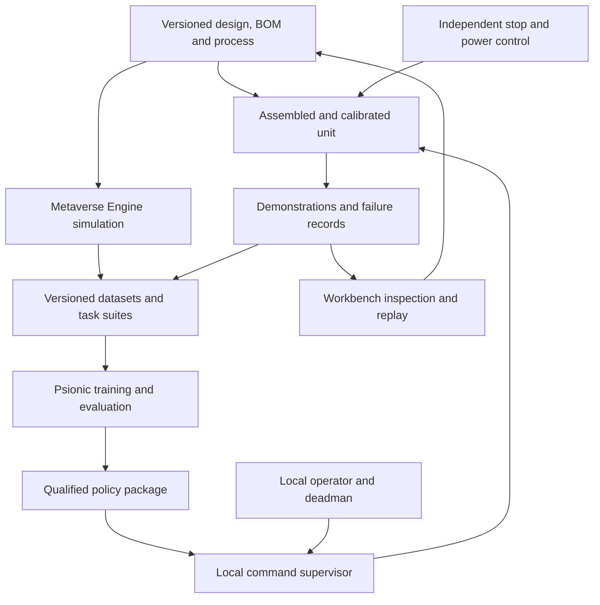

# An open robotics platform OpenAgents can carry forward

**Date:** November 15, 2026. **Status:** proposal; no new hardware, model,
backend, manufacturing process or deployment is qualified by this document.
Repository baseline: `742e50a2af`.

## 1. The goal and the first product

Assume, as a planning exercise, that NVIDIA stops operating: new hardware,
driver maintenance, hosted downloads and engineering support disappear.
OpenAgents should preserve the useful robotics development loop and make it
possible for people to build, repair, teach and sell robots themselves.

The best starting product is **a reproducible tabletop robot workcell**:
an open arm, a simple gripper, cameras, a rigid mounting surface and printable
task fixtures. A buyer can assemble it, see its digital counterpart, calibrate
it, demonstrate a task, train a small policy, compare it with a conventional
controller and reproduce a failure. The same platform can later support
mobile bases, two arms, better hands and specialized machines.

OpenAgents supplies the connection between the pieces: Coax, Psionic, the
Metaverse Engine, the shared application components, agent tools, identity,
compute and Bitcoin payments. We sell reliable kits, interchangeable parts,
assembly, calibration, support and useful services while publishing the
materials needed to reproduce the platform.

The first measurable task should be **sorting known blocks into a printed
tray in a fixed tabletop workspace**. Begin with taught waypoints and a fixed
camera or fiducials; introduce learned perception and imitation against that
baseline. Fixtures, lighting and presentation can vary in held-out tests.
This gives us printable products, demonstration data and a clear success
predicate before attempting general household autonomy.

The long-term ambition is broad: an open development platform spanning
design, manufacture, simulation, learning, deployment and maintenance. The
first release must complete that loop for one affordable embodiment.

## 2. What we already have, and the limits that matter

This assessment follows the [Psionic chapter registry](../../psionic/book/chapters.json),
its [status and adoption rules](../../psionic/book/README.md), the
[engine registry](../../metaverse-engine/book/chapters.json), and current
chapter evidence. A chapter marked implemented qualifies its named profile;
it does not establish a general-purpose robotics product.

| Foundation | Recorded capability | Work needed for the platform |
| --- | --- | --- |
| Coax and numerical execution | Native C11 output, Wasm, CPU/CUDA/Metal components, mutation testing, initial quantities and affine point/vector types | Finish the relevant frame transforms, clock contracts, resource proofs and deployment profiles; qualify every new device target |
| Psionic model execution | Original Elephant/Mammoth decision paths, original model artifacts, selected CUDA/Metal inference and bounded interchange | Package a usable robotics inference API; publish exact model, operator, device, dtype and request support |
| Learning and training | Autodiff and graph transforms; small CPU module/trainer workflows; a useful-scale CUDA decoder training profile | General policy composition, missing trainable operators, GPU vision/action training and portable training backends |
| Classical robot control | Chapter 167 has fixed Panda kinematics, Jacobians, IK, orientation/pose queries, reference timing, PD/gravity control and finite no-contact response experiments | Generic imported embodiments, collision-aware planning, full constrained dynamics, real-time scheduling and hardware evidence |
| Small imitation | Chapter 168 trains an owned two-axis Cartesian point policy and admits a bounded original SingleArm excerpt | Real motors, images and contact are separate; the point policy's scales are not a Panda or SO-101 adapter |
| Original GR00T | Chapter 169 executes a pinned N1.7-LIBERO network on Metal, including vision, language and a 16-by-7 action adapter | Other embodiments, lengths, backends, adaptation/training and remaining numerical diagnostics |
| Closed-loop evaluation | Chapter 170 runs original GR00T, Coax preparation/control and a MuJoCo 3.3.1 LIBERO/Panda scene; six frozen cases produced three successes | A complete owned articulated/contact/rendering backend; physical control and broader evaluation |
| Owned Panda integration | Fixed-model mass, bias, actuation, fluid and unconstrained Euler components; a later owned-controller-query neural prefix executes nine action rows and two model calls, with exact recorded-control replay | The prefix retains SDK geometry, contacts, integration and rendering; task success is false and it is not an SDK-free episode |
| Locomotion learning | Chapter 171 implements GAE/PPO primitives, Gaussian components and a scalar LQR actor experiment | A physical quadruped, general neural actor/critic, batched device physics, terrain evaluation and transfer |
| Engine physics | CPU scene/free-body components, broad/narrow collision and bounded particle/material solver profiles | General articulation and robot contact solving, batching, sensors, observation rendering, model import and complete world replay |
| Speech and interaction | Original Parakeet transcription has a resident Metal profile; original streaming ASR has a separate Linux CUDA profile | Robot interaction and device integration; Mac streaming and natural learned TTS remain separate work |
| Verification and improvement | Suite identities, noise floors, three-way verdicts, exposure-controlled training rows, replay classes and budgeted improvement loops | Bind them to physical tasks, production parts, calibration and interventions |
| Application and economy | Shared components, world editor, Projects, Coder, Nostr identities, Pylons and Bitcoin wallet rules | A robotics workbench, device admission, manufacturing orders and fulfillment; compute payment intent is not completed marketplace settlement |

The most useful starting references are [167](../../psionic/book/ch167-command-a-robot.md),
[168](../../psionic/book/ch168-imitation-before-robotics-scale.md),
[169](../../psionic/book/ch169-execute-a-groot-policy.md),
[170](../../psionic/book/ch170-close-the-simulated-control-loop.md),
[171](../../psionic/book/ch171-learn-a-gait-in-many-worlds.md), and
[250](../../psionic/book/ch250-can-someone-use-psionic-instead-of-pytorch.md).
Chapter 250 distinguishes recorded small workflows from a complete framework;
chapter 129's useful CUDA training result does not close its general training
gaps or qualify Metal training.

Two details affect the roadmap directly:

1. The owned-query neural prefix reports 0.45 simulated seconds against
   10.3489 seconds of live-loop wall time, including 8.9717 seconds of
   inference. Its 500 Hz servo and 20 Hz action schedule describe simulation
   time. A physical robot needs asynchronous inference, measured deadlines
   and local handling of stale results.
2. Several earlier plans still call all engine physics chapters drafts.
   Current chapters 17, 18, 20, 21 and several material chapters have bounded
   CPU implementations. Chapters 19 and 22, and 31–37, still have the larger
   articulated/contact/batching/integration work ahead. Use the current
   registry and source, rather than treating the older
   [Genesis parity plan](../../psionic/docs/genesis-parity.md) as a completion ledger.

The existing learned-network diagnostic failures, failed controller studies
and limited reset distributions remain part of the evidence. Preserve them
when adding support.

## 3. What to carry forward from NVIDIA

The [NVIDIA report](robotics-report-2026-11-15.md) maps a large portfolio.
We should support the capabilities most useful to our products, with open
interfaces that let individual implementations be replaced.

| NVIDIA capability | OpenAgents continuation | Priority and approach |
| --- | --- | --- |
| Isaac Sim / Omniverse | Robot workbench and digital counterpart in the Metaverse Engine | First product: author, inspect, replay and compare one workcell |
| PhysX / Newton / Warp | Owned engine solvers and Coax compute; preserved reference evidence | Extend current rigid/collision modules into articulation/contact; qualify CPU first, then devices |
| Isaac Lab | Environment, observation/action, reward, reset, collector and evaluation interfaces | Connect Psionic's learner to one actual simulated arm; qualify reset isolation before large batches |
| GR00T | Portable VLA inference and an owned policy-learning route | Preserve the selected licensed artifact; add small policies trained on our workcell before large adaptation |
| Capture / Teleop | Synchronized demonstrations from leader arm, jog controls and cameras | Early; every demonstration retains calibration, embodiment and operator provenance |
| Replicator / MimicGen | Engine-generated observations, task variations and geometric trajectory augmentation | Add after task/contact validation; generated samples retain their parent episode |
| Cosmos / DreamGen | Optional world-model prediction and data augmentation | Later; complete one original path only if it improves a frozen task evaluation |
| cuMotion / cuRobo | Shared FK/Jacobian/IK, joint trajectories, collision checks and motion planning | Early classical baseline; generalize existing control mathematics instead of copying it |
| cuVSLAM / nvblox / perception | Calibrated cameras, stereo/depth, pose estimation, reconstruction and localization | Fixed camera/fiducials first; mobile localization and mapping follow a mobile-base consumer |
| Jetson / TensorRT | CPU control and Psionic inference on independently qualified compute | Existing Metal is a useful escape path; CUDA remains an optional installed-hardware backend |
| Isaac ROS / Isaac OS | A bounded local execution graph, device gateway and optional ROS 2 interoperability | Core control works locally without ROS, cloud services or a GPU; bridge existing fleets where useful |
| OSMO / data factory | Versioned jobs, artifacts, datasets, budgets and evaluation workers | Reuse Projects, Coder and Pylon components; extend beyond decision jobs deliberately |
| Mission Control / cuOpt / Mega | Missions, reservations, facility simulation and fleet evaluation | After one mobile robot works; local obstacle handling remains on the robot |
| Halos / IGX | Explicit fault models, local supervision, independent shutdown and release evidence | Required before actuated product release; software evidence alone does not establish a complete safety system |
| PhysicsNeMo / DoMINO | Parameter identification, small physical surrogates and later design optimization | Reuse 109/111 and 156–160 for a measured mechanical or thermal problem |
| MotionBricks / humanoid research | Motion conventions, retargeting and later embodiment-specific motion learning | Useful for virtual agents now; real-weight motion and physical feasibility need separate qualification |

The desktop workcell, repaired hardware and modular parts are our additional
contribution. They turn the software platform into something a person can
own and reproduce.

## 4. Surviving the loss of a vendor

Preserve four things independently: **source, model artifacts, build inputs
and qualification evidence**. A copy of a Git repository is insufficient if
its release needs an unavailable asset server, driver download or license
activation service.

For each selected dependency, record exact revision and file hashes,
license/notices, build dependencies, device requirements, downloadable assets,
reference outputs and a named maintenance owner. Keep an explicit distinction
between local retention, redistribution rights and the right to publish
modifications. Gated access and company closure grant no new rights. Archive
only material we may lawfully retain or distribute; publish acquisition
instructions and hashes when the bytes must remain private.

Newton and Warp are open-source projects, but their current GPU execution
depends on NVIDIA's stack. Newton's compatibility documentation explicitly
lists macOS as CPU-only. Preserving those sources is valuable; adopting them
as the production runtime would retain a substantial dependency and introduce
the Python runtime that our shipped Coax architecture excludes.
Use independently built references and frozen numerical evidence while
continuing the owned implementation. See [Newton](https://github.com/newton-physics/newton),
[its compatibility matrix](https://newton-physics.github.io/newton/stable/guide/compatibility.html)
and [Warp](https://github.com/NVIDIA/warp).

MuJoCo's [Apache-2.0 C/C++ implementation](https://github.com/google-deepmind/mujoco)
is particularly useful as an independent simulator and comparison backend.
Our existing SDK evaluation remains usable. The production owned-backend
track should continue to remove that dependency in small checked components,
as the [owned-loop plan](../../psionic/docs/physics/owned-control-loop.md)
describes.

Proposed independence gates:

- A clean machine builds and runs the small workcell reference with CPU
  control and no NVIDIA service, CUDA installation or NVIDIA device.
- At least one useful learned-policy inference path runs on a non-NVIDIA
  target, with its own latency and task evidence. The existing GR00T Metal
  path is a foundation, not automatic support for the new arm.
- Demonstration capture, calibration, replay, conventional task execution
  and repair documentation remain usable offline.
- Published artifacts can be mirrored by another maintainer; rebuilds name
  every permitted external input and require no private registry.
- GPU acceleration, model hubs, remote compute and official OpenAgents
  hosting are optional capabilities above this floor.

Continue using existing NVIDIA hardware where useful, but plan for failures
and replacement. CPU/Metal support exists in specific profiles; an AMD,
Vulkan-compute, WebGPU-compute, ARM-SBC or microcontroller target requires new
compiler/runtime and measured workload qualification. Vulkan rendering and
Wasm compilation alone establish none of those compute/control claims.

## 5. The modular hardware family

### Start from a reproducible open arm

The [SO-101 ecosystem](https://huggingface.co/docs/lerobot/so101) is a strong
first candidate: the [upstream hardware repository](https://github.com/TheRobotStudio/SO-ARM100)
publishes STEP/STL designs, parts information and an Apache-2.0 license.
Its [printing instructions](https://github.com/TheRobotStudio/SO-ARM100/blob/main/3DPRINT.md)
distinguish individual printable parts from the whole-arm reference assembly.
Pin the exact design and its notices before deriving a commercial kit.
Motor selection, board variant, calibration and actual batch sourcing still
need qualification; the candidate is not an approved OpenAgents BOM.

For a later higher-capability arm, [OpenArm hardware](https://github.com/enactic/openarm_hardware)
publishes CAD, BOM and wiring information under CERN-OHL-S-2.0. Its
[hardware license](https://github.com/enactic/openarm_hardware/blob/main/LICENSE.txt)
has source-sharing obligations that differ from its software's terms.
Preserve those obligations when evaluating derivatives and physical sales.
OpenArm is a separate embodiment and cost class, rather than a drop-in
mechanical upgrade for an SO-101.

Begin with one pinned arm plus accessories. Introduce an OpenAgents module
interface around the base, tool attachment, sensors and wiring. Preserve the
upstream arm's native joints and servo mounts until a replacement has an
actual engineering and supply-chain advantage.

### Products we can print and sell

| Module | Printable content | Purchased or fabricated content | First value to a buyer |
| --- | --- | --- | --- |
| Task kit | Sorting trays, blocks, part nests, alignment fixtures, calibration holders | Printed markers or measured references where needed | A reproducible task and evaluation environment |
| Gripper kit | Fingers, compliant pads, jaw adapters, guarded covers | Qualified actuator, bearings, pins, fasteners and optional force sensing | Cheap replacement and task-specific gripping |
| Sensor kit | Wrist/overhead camera mounts, light brackets, strain relief | Cameras, lights, cables and any depth/IMU sensor | Known extrinsics and repeatable observation |
| Repair kit | Covers, cable guides, approved sacrificial elements, fit coupons | Inserts, connectors, screws, belts and bearings | Keep a robot operating after wear or a minor collision |
| Teleoperation kit | Leader-arm parts or jog enclosure, handles and mounting adapters | Encoders/servos, input controls and deadman device | Collect useful demonstrations locally |
| Base and mounting kit | Cable organizers, mounting adapters, alignment aids | Rigid plate/extrusion, clamps and rated fasteners | A stable, dimensioned workcell |
| Joint module, later | Enclosure and selected qualified mechanical pieces | Motor, gearbox, encoder, bearings, brake where needed, driver and thermal path | Replace one joint without replacing the arm |
| Mobile-base kit, later | Sensor mounts, body panels, bumpers and cable routing | Frame, wheels, motors, encoders, battery, protection and power electronics | Reuse the same software and selected tools on a mobile embodiment |

Servo torque, gearbox quality, bearing stiffness, wiring, assembly and support
will often dominate the full kit. Printing enables customization and repair;
it does not remove those costs. Joint modules and mobile bases follow measured
loads and repeatable production, rather than preceding the accessory catalog.

### Define compatibility in four separate layers

1. **Mechanical:** coordinate datum, bolt pattern, alignment features,
   mating dimensions and tolerances, tool envelope, retention, cable sweep,
   mass, centre of mass and allowed wrench envelope. Choose dimensions after
   checking existing interfaces and candidate hardware. A shared bolt pattern
   alone does not establish payload compatibility.
2. **Electrical:** connector and pinout, voltage/current ranges, polarity,
   fuse/protection, grounding, shielding and isolation. Prevent incompatible
   power classes from mating. The first kits should use purchased protected
   supplies and established drivers.
3. **Communication:** a separately versioned USB/serial or CAN profile with
   discovery, capabilities, sequencing, monotonic timestamps, acknowledgments,
   explicit faults and measured bandwidth. Command traffic and motor-power
   shutdown are separate mechanisms. Pick the first bus from the selected
   actuator; defer another bus until a consumer needs it.
4. **Embodiment:** joint order, sign, zero, gear ratio, encoder conversion,
   limits, control mode, tool transform, inertia, calibration, sensor timing
   and command semantics. Changing a tool, motor or gearbox can change the
   valid control and learned-policy profile even when the plug fits.

Publish compatibility by exact assembly revision. A replacement part's
catalog identity is stable; its geometry and manufacturing revision are
immutable. A physical unit has a serial identity and measured calibration.
Keep design identity, produced-unit identity and calibration identity distinct.

## 6. A manufacturing release is more than an STL

Each saleable module needs one versioned release containing:

- Editable design source, neutral STEP assembly where applicable, and
  printable mesh/3MF exports with explicit units, orientation and quantity.
- An assembly BOM with exact revisions, approved substitutes, supplier
  identifiers, drawings, wiring, fastener/insertion instructions and tools.
- Print process: machine/nozzle class, material specification, orientation,
  layer height, walls, infill, supports, inserts, finishing, and critical
  dimensions. A change of material or orientation changes the process revision.
- Fit coupons and go/no-go gauges; dimensional, mass, load, wear and thermal
  acceptance appropriate to the part; rejection criteria and retained results.
- Expected replacement interval or inspection method, repair instructions,
  known failure modes, permitted use and a record linking a shipped unit to
  its production lot and release.
- Matching visual geometry, collision geometry, inertial estimates and
  measurements for simulation. State which values came from CAD, an assumed
  density, identification or direct measurement.

Use existing authoring tools for editable CAD instead of starting a new
solid-modeling kernel. [FreeCAD](https://github.com/FreeCAD/FreeCAD) is an open
parametric-authoring candidate. Authoring software is an external design tool;
our product runtime and new orchestration logic remain Coax. Retain editable
source and exchange exports so a proprietary cloud CAD account is not needed
to maintain a part. [3MF](https://github.com/3MFConsortium/spec_core) is a
candidate manufacturing exchange format; a vendor-specific project file is
not the only published representation.

Printed strength depends on process and direction; dimensional fit does not
establish fatigue, thermal or impact performance. Start the catalog with
fixtures, mounts, covers and gripper accessories. Load-bearing joints need
their own tests and may require metal, commercial gears or machined parts.
Publish measured operating envelopes, including orientation and duty cycle.

For electronics we design later, publish editable schematics/board source,
manufacturing outputs, test points, firmware identity and programming/recovery
instructions. Component substitutions change an approved build, rather than
silently inheriting its qualification.

Extend the existing [asset registry](../../assets/registry/README.md) for
design provenance, immutable sources and derived geometry. Add the missing
manufacturing metadata deliberately; today's artwork catalog is not already
a manufacturing system. Use the shared `~/.openagents/assets/` store and pinned
catalogs, with no app-private CAD source copies. A game asset's visual license
or geometry does not establish permission or suitability for physical sale.

## 7. One platform architecture, with reusable owners

The control path and learning path have different deadlines. A local
supervisor admits a command using fresh state, the active embodiment,
controller/policy identity, limits, authority epoch, sequence and expiry.
It owns the hardware-facing decision. An agent, model, browser or Pylon can
propose a task or bounded action chunk; network arrival grants no motor authority.

| Owner | Responsibility and reuse |
| --- | --- |
| `coax/` and `coax/lib/` | Compiler guarantees, checked units/frames/clocks, common formats, crypto, transport and truly generic shared math |
| `metaverse-engine/` | Scene, geometry, articulated/contact physics, sensors, rendering and deterministic simulation; extend the existing physics modules |
| `psionic/` | Models, preprocessing, training, policies, uncertainty, evaluation and existing robot-control mathematics in `lib/robotics/` |
| Proposed robotics integration context | Device registry, assembly/embodiment admission, calibration, local scheduling, command authority, recovery and hardware adapters; propose its ownership in the context map before code lands |
| `components/` and Coax Native apps | Workbench controls, timelines, tables, inspection, documentation and embedded scene views; reuse the editor edit log and shared controls |
| Projects, Coder and Pylon components | Experiment records, constrained agent jobs, build/evaluation workers and compute discovery |
| `assets/registry/` | Source provenance, pinned design releases and qualified derived assets, extended with manufacturing records |
| `proto/` and owning codecs | New device, calibration, episode, package and order contracts; registered/versioned before implementation |
| `pay/` | Wallet, price/budget, order settlement and payout decisions; host adapters perform effects |

The [context rules](../architecture/contexts.md) keep the engine below
Psionic, apps and product contexts. Do not make the engine load Psionic's
training or Panda modules because an older book describes tensor prerequisites.
Share required numerical components through a deliberate lower-level
extraction with preserved tests, or an explicit caller-owned boundary. Keep
model-control orchestration above the simulator. Follow [reuse.md](../reuse.md)
for controls, parsers, cameras, hashes, physics and model calls.

All new product policy and tools are Coax. C/Swift hosts handle device/file/
network/GPU effects only. Python/PyTorch/LeRobot and external simulators may
provide inert interchange or independently specified development references;
they do not become hidden production dependencies. Add a non-Coax SDK adapter
only under the repository's explicit host/tooling rules.

## 8. The software capabilities to build

### Robot descriptions and a shared digital counterpart

Deliver a strict, published URDF subset first, following
[Coax R17](../../coax/book/ch34-robot-models.md) and
[engine chapter 35](../../metaverse-engine/book/ch035-bring-in-robots-and-meshes.md).
Admit one arm's links, joints, axes, frames, limits, inertias and asset hashes;
compare every supported value with an independent parser. Refuse unsupported
features by name. MJCF and USD are separate profiles, not format aliases.

Use explicit SI/frame conventions with a named conversion into the engine's
view convention. ROS [REP 103](https://raw.githubusercontent.com/ros-infrastructure/rep/master/rep-0103.rst)
uses right-handed frames, SI units and a distinct optical-camera convention.
CAD millimetres, robot metres, raw encoder counts and visual skeleton motion
must not cross this boundary as unlabeled numbers.

Generalize fixed Panda mathematics through admitted model data and shared
operators, carrying its evidence. Preserve the original Panda profile while
adding the first kit's profile. Its measured link masses, gearbox compliance,
backlash and motor behavior need their own identification; the simplified
LIBERO parameters are not physical Franka measurements or data for a printed arm.

### Simulation and classical control

The shortest useful owned simulation path is scene → free bodies →
articulations → collision → constraints/contact → motors/limits → sensors →
rendered observations → replay. Extend engine chapters 17–22 rather than
starting a robotics-only physics engine. Qualify one deterministic CPU
workcell before optimizing batch throughput or adding more material families.

Keep the existing MuJoCo path as an independent comparator. Compare FK,
Jacobians, mass/bias, unconstrained response, contact behavior and closed-loop
outcomes separately. Different contact models may warrant frozen error
budgets; exact cross-engine trajectories are not a universal acceptance rule.
Record iteration/residual failures instead of silently accepting a partial solve.

The conventional task baseline uses joint-space trajectories, IK where
necessary, collision checks and bounded execution. Add RRT-Connect or another
planner when obstacle cases require it, with failure/timeout as ordinary
results. Keep reference trajectory limits separate from measured plant
velocity, acceleration and force. Later tactile/compliant manipulation,
deformables and differentiable contact get their own consumers and gates.

### Capture, datasets and learning

Record synchronized camera frames, joint feedback, requested and applied
commands, controller state, human interventions, clocks, calibration, assembly,
task and outcome. Preserve missing frames and uncertainty as explicit facts.
A demonstration's device timestamps and the host's receipt timestamps have
different meanings. A real-world recording reproduces the information the
controller saw; it does not permit physically replaying a robot by assumption.

Support a pinned [LeRobot dataset interchange profile](https://huggingface.co/docs/lerobot/lerobot-dataset-v3)
because existing users already collect that kind of data. Its current format
uses tabular metadata and video; our tiny SingleArm reader is not a general
Parquet/video implementation. Specify exactly what an importer/exporter
supports, independently check conversion and keep the core episode record
available without a hosted Hub or a Python runtime.

Use whole tasks, objects, sessions and physical units as appropriate split
groups. Related frames and synthetic descendants stay in their parent split.
Reuse [chapter 247's exposure ledger](../../psionic/book/ch247-outcomes-become-training-rows.md).
Keep operator consent, private video and redistribution rights with the data;
upload is optional and permissions are explicit.

Learning proceeds in increasing cost:

1. Reproduce the classical sorting task, then learn a small state-based
   imitation policy from our own demonstrations.
2. Add a small visual encoder or frozen visual features, train the action
   head and compare held-out task success and interventions with the baseline.
3. Add action chunking, temporal context and asynchronous inference with
   measured state age and validated command expiry.
4. Port one useful open policy architecture and qualify its complete
   observation/action path. ACT-style policies are a candidate to evaluate,
   not currently claimed Psionic support.
5. Adapt a larger VLA only after training operators, memory budgets, licenses
   and the new embodiment are complete. The LIBERO/Panda GR00T head cannot be
   relabeled as an SO-101 policy.
6. Add simulation randomization and RL with real contact/reset behavior.
   Generalize chapter 171's learner from scalar LQR only when the actor,
   critic and physical environment exist.

Use [chapter 250's audit](../../psionic/book/ch250-can-someone-use-psionic-instead-of-pytorch.md)
to drive missing operators into the shared framework. Package a usable
define/train/evaluate/save/deploy route before claiming a framework replacement.
Model weights stay once under `~/.openagents/models/`.

### Perception, motion, speech and world models

Fixed calibration, markers and known task geometry provide the first
perception baseline. Next add object pose, depth and workspace occupancy.
VSLAM, dense reconstruction and navigation belong to a mobile-base milestone,
with recorded sensor corpora and independent trajectory/map error measures.
Avoid duplicating the engine's spatial search and geometry libraries.

[C-RADIO](../../psionic/book/ch144-see-with-c-radio.md) already has a bounded
CPU original-weight encoder; its downstream retrieval and trained-head work
is unfinished. The reference code and model weights have different terms,
as [the earlier survey](../../psionic/docs/targets/nvidia-breadth.md) records.
Use the owned implementation and retain artifact-specific rights.

[Parakeet](../../psionic/book/ch153-transcribe-with-parakeet.md) can support
local task instructions and documentation. Voice/text instructions become
bounded proposals reviewed by the same task policy; they do not bypass the
local control and stop path. Natural learned TTS is still a separate gap.

[MotionBricks](../../psionic/book/ch149-execute-motionbricks.md) and
[the Metaverse handoff](../../psionic/book/ch150-put-generated-motion-in-verse.md)
are useful for virtual characters and future retargeting. Full original-weight
motion generation, full-body mapping and robot dynamics remain distinct.
The current synthetic clip path cannot qualify a humanoid's balance or actuators.

[Cosmos3-Edge](../../psionic/book/ch166-one-complete-cosmos3-edge-path.md)
currently combines real-weight slices with a synthetic-weight complete path.
Finish its original operators only against a selected consumer. Generated
video can add visual variation; collision, force and task truth remain checked
against geometry, physics and physical measurements. PhysicsNeMo-style
surrogates can later accelerate identified thermal or mechanical calculations;
they do not certify printed parts.

### Workbench, agents and interoperability

The workbench needs assembly instructions, BOM/revision inspection, calibration,
joint jog/teleoperation, demonstrations, synchronized plots/video, simulation,
task evaluation and a comparison of failed runs. Compose the shared components
and editor with engine scene views. Keep a local native device gateway between
browser UI and actuators; page reload, focus loss and disconnection have
explicit local outcomes.

Coder can prepare a part variant, inspect a dataset, propose controller settings,
run a simulation and summarize evidence. Its tools should return typed records
and refusals through the existing agent capability system. Running generated
code, model output or an uploaded asset never grants control authority. Freeze
the qualification suite before allowing automated optimization to inspect it.

ROS 2 is an interoperability boundary for existing robots, rather than a
requirement for the kit. Evaluate [ros2_control](https://github.com/ros-controls/ros2_control)
through a separately maintained adapter/profile, with mapped units, clocks,
joint identities and transport loss behavior. This preserves useful ecosystem
compatibility without introducing a second control-policy implementation.

Metaverse OS can host the workbench, camera services, local models and jobs.
Its existing compositor/update/CPU-GPU controls are useful reuse, not evidence
of an RTOS, microcontroller target or a motor safety controller. Keep the
machine running the UI and experiments separate from the final actuator
supervision boundary until their contention has been measured.

## 9. Physical deployment and qualification

The first hardware bridge is a new integration with its own qualification.
The current simulated-device roadmap does not grant it automatically.
Follow [R18](../../coax/book/ch35-sensors-and-actuators.md),
[R19](../../coax/book/ch36-fault-scenarios.md), and the
[bounded-controller audit](../../psionic/docs/physics/panda-bounded-control.md).

Use three control rates with separate budgets: actuator feedback/servo,
trajectory or goal updates, and learned-policy inference. Select their real
rates from the actual motor interface and measurements. The simulated Panda's
500/20 Hz convention is not a generic hardware requirement. Inference may run
on a workstation or remote worker; motor feedback, watchdog and command
admission continue locally through lost packets, stalled GPU work or a crash.

Qualify a local command lease, stale-state refusal, sequence/epoch fencing,
deadman and explicit arming. A disconnect or power failure needs an appropriate
mechanical outcome: gravity can make an unpowered arm fall, so removing torque
alone is not universally a safe stop. Determine braking, support and power
behavior for the exact mechanism. Independent stop hardware must work without
the application, network or model.

The frozen fault corpus should include stale/reordered/duplicated samples,
bad calibration, encoder discontinuity, NaNs, saturation, joint-limit approach,
bus loss, brownout, hot motors, missed deadlines, stalled inference, lost UI
and a replayed old command. Each case names its expected refusal or recovery.
Mutation of the responsible policy must break a relevant check. Money,
admission and command-authority rules are `#authority` and pass the repository's
mutation gates.

Publish a capability record per assembly/controller/policy/backend profile:

| Support level | Evidence required |
| --- | --- |
| Inspected | Source/format/license inventory; no execution claim |
| Component-qualified | Independent numerical/format comparisons and malformed-input refusals |
| Simulated | Complete observations, control, physical response, outcome and fault cases on a named simulator profile |
| Hardware-qualified | Named unit/process/calibration, measured timing/load/thermal behavior, stop/fault results and operator procedure |
| Saleable release | Reproducible manufacturing, independent assembly, final QA, repair/support process and release-specific product requirements |

Support is a matrix across these levels and dimensions. Importing an ONNX
file is not execution of all operators; successful model inference is not
training support; a hardware smoke test is not a saleable product.

Use [suite identities](../../psionic/book/ch239-a-suite-is-three-digests.md),
[noise floors](../../psionic/book/ch240-how-far-a-metric-moves-by-itself.md) and
[unverifiable verdicts](../../psionic/book/ch241-gates-that-can-say-unverifiable.md).
Report task success, interventions, recovery, P50/P95/P99 and highest observed
latency, sensor/command age, peak memory/power/temperature, calibration drift,
wear and cost per completed useful task. Measured worst cases retain their
load and test duration; they are not universal deadline proofs.

Exact replay applies to a declared deterministic computation/backend. Physical
rollouts are repeatability experiments with tolerances and uncertainty.
Signed receipts identify who attested to a record; they do not prove that a
physical task happened or that a machine is safe.

## 10. A sustainable open business and maker network

Sell the convenience and evidence surrounding reproducible designs:

- Printable task/accessory bundles, spares and approved replacement parts.
- BOM-complete kits, preassembled/calibrated workcells and upgrade bundles.
- Assembly/calibration services, repair, training and institutional support.
- Hosted experiments, storage and verified compute where they add value.
- Commissioned task fixtures and specialized workcells with published
  compatibility and qualification.

Let customers print their own parts or choose another manufacturer. Publish
source releases and fair compatibility tests; an OpenAgents-tested badge
identifies a tested release/process and must not imply exclusive access to
the platform. Existing derivative licenses remain attached; choose explicit
licenses separately for new CAD, electronics, firmware, datasets and models.

For a maker network, an order names a pinned release, quantity, permitted
process, delivery terms and acceptance evidence. A maker advertises process
capability; a buyer selects a maker and an offer. A received lot gets physical
inspection before acceptance. Photographs, signatures and hashes support
traceability; they cannot replace dimensional or load checks. Maintain
defect reports, replacement handling and a clear dispute path.

Keep inventory and manufacturing orders separate from the game's Item ledger.
Use existing identity, Projects and wallet services with new versioned product
contracts. Bitcoin/Lightning/Spark are the payment rails. Reuse `pay/` for
budget and settlement policy; refunds, partial delivery, shipping, duplicates,
disputes and failed payments need explicit states. [Chapter 238](../../psionic/book/ch238-pay-for-verified-work.md)
currently produces bounded payment intents; it does not already settle
physical orders or perform a trustless escrow service.

Unit economics must count machine occupancy, failed prints, purchased parts,
assembly, calibration, QA, packaging, shipping, fees, returns and support.
For illustration only, a kit with 400 accounting units of revenue and 300 of
all variable costs contributes 100, or 25%, before engineering and fixed
overhead. Those are hypothetical inputs, not a BOM quotation or selling price.
Quote Bitcoin amounts explicitly and freeze the quote's validity; do not
silently inherit a changing exchange rate during fulfillment.

Pylons can eventually sell simulation, training and validation work in
addition to decisions. Add each job type with resource admission, privacy,
artifact identity, cancellation and a checker appropriate to the work.
Large training runs cannot be validated by pretending a hash proves quality.
Keep private camera data local unless its owner authorizes transfer.

## 11. Delivery sequence and acceptance gates

These are ordered engineering milestones, not calendar or cost commitments.
Preserve Elephant/Mammoth delivery and other existing obligations; initial
robotics work should reuse their foundations and avoid another broad rewrite.

| Milestone | Concrete deliverable | Gate before expansion |
| --- | --- | --- |
| M0: baseline and continuity | Capability/dependency inventory, pinned first arm candidate, frozen sorting task and BOM/process draft | Every claim points to evidence; required inputs/rights identified; deterministic CPU reference route builds without NVIDIA |
| M1: accessories and local workbench | Printable tray, fixtures, mounts and repair parts; design registry; instructions and an inspectable digital assembly | A second builder reproduces dimensions/assembly from public files; cost/yield recorded; no powered-motion claim needed |
| M2: robot model and conventional task | Strict first-arm model, fresh sensor records, simulated controller and independent conventional baseline | Geometry/limits match references; task/fault suite frozen; unsupported features refused; repeatable simulation outcomes |
| M3: authorized physical workcell | Protected power, local gateway/supervisor, deadman/stop path, calibration and taught sorting task | Measured timing, limits, power-loss/stop/fault behavior and held-out physical trials on the named build |
| M4: owned small policy | Demonstrations, shared-trainer operator completion, state/vision imitation, policy package and deployment | Beats or usefully complements the conventional baseline under a predeclared task/cost/intervention gate; otherwise retain the baseline |
| M5: reproducible kit sales | BOM-complete production release, QA/serial records, spares, documentation, order/refund process | Independent build and repair; production sample passes its process envelope; unit economics and support workload justify sale |
| M6: broader platform | General articulated/contact backend, batch/reset/sensors, non-NVIDIA acceleration for the bottleneck, higher-capability arm or mobile base | One new embodiment and one new backend pass their own complete profiles; unchanged profiles retain prior evidence |
| M7: advanced learning and ecosystem | Large-policy adaptation, world-model augmentation, tactile/compliant manipulation, fleet missions and distributed manufacture | Each branch has a paying or product consumer and improves a frozen outcome/cost measure |

Initial work packages should be small and separately reviewable:

1. Add a support ledger linking the robotics capability matrix to chapter,
   source, artifact, target and qualification records. Record stale-plan
   discrepancies without rewriting historical receipts.
2. Specify one proposed assembly/embodiment release and one manufacturing
   release using existing registry and protocol conventions. Define codecs
   only after their schemas and ownership are registered.
3. Produce the first task-fixture/mount design release with editable source,
   dimensioned interface and an independent print/assembly procedure.
4. Implement the strict robot import slice and reuse/generalize the existing
   FK/Jacobian/control components for that admitted model.
5. Close local clocks, stale-command policy and refusal/fault handling on a
   simulated consumer, with a separately qualified physical gateway later.
6. Connect one collector, small learner and frozen task evaluator end to end.
   Complete missing shared operators driven by that model.
7. Integrate the owned engine articulation/contact/sensor path one checked
   component at a time, keeping the current simulator comparator available.
8. Package the public route, then introduce kit production and order handling.

Use a small persistent core across mechanics/manufacturing, controls/embedded,
simulation/numerics and product/ML. Responsibilities can overlap in a small
team, but each released module needs an identifiable maintainer and a second
builder/reviewer. Parallel progress is useful only where the interface and
acceptance gate are already clear.

The broadest branches should earn their place through a consumer: large
Cosmos training, general humanoids, autonomous vehicles, surgical autonomy,
new GPU silicon, custom motors and a complete CAD kernel require very
different resources. A first workcell, shared arm/tool/sensor modules and
honest support records can grow into many applications without making those
branches prerequisites.

## 12. What success looks like

A customer can download a release, print the allowed parts, source ordinary
components, assemble and calibrate a robot, reproduce our baseline task,
teach a useful variation, inspect why it failed and replace a worn part.
Another maker can manufacture compatible modules. Another maintainer can
rebuild the software and preserve the artifacts without OpenAgents or NVIDIA
hosting. OpenAgents earns money by delivering dependable hardware and services
around that reproducible platform.

That is the portion of NVIDIA's robotics work most worth carrying forward:
the complete development and improvement loop, extended into open physical
products people can own.

## Reading and evidence map

The review covered the Psionic book's contents/status registry and the
relevant numerical, training, modality, robotics, interchange and evaluation
branches. The following sources establish the principal boundaries used here:

- [Psionic book](../../psionic/book/README.md), [contents](../../psionic/book/SUMMARY.md),
  [registry](../../psionic/book/chapters.json), and [completion criteria](../books/completion.md).
- [Framework composition](../../psionic/book/ch117-models-are-compositions-of-modules.md),
  [trainer](../../psionic/book/ch118-one-trainer-for-every-model.md),
  [GPU training](../../psionic/book/ch129-train-a-whole-model-on-one-gpu.md),
  [framework audit](../../psionic/book/ch250-can-someone-use-psionic-instead-of-pytorch.md),
  [ONNX import](../../psionic/book/ch220-read-a-bounded-onnx-graph.md) and
  [export](../../psionic/book/ch221-write-a-bounded-onnx-graph.md).
- [Function transforms](../../psionic/book/ch107-transform-functions-not-just-tensors.md),
  [owned physical system](../../psionic/book/ch109-learn-a-physical-system.md),
  [system identification](../../psionic/book/ch111-recover-the-physics-from-the-motion.md),
  [geometry fields](../../psionic/book/ch158-a-field-around-a-shape.md),
  [control](../../psionic/book/ch167-command-a-robot.md),
  [imitation](../../psionic/book/ch168-imitation-before-robotics-scale.md),
  [GR00T](../../psionic/book/ch169-execute-a-groot-policy.md),
  [closed loop](../../psionic/book/ch170-close-the-simulated-control-loop.md) and
  [learning prerequisites](../../psionic/book/ch171-learn-a-gait-in-many-worlds.md).
- [GR00T source contract](../../psionic/docs/targets/groot.md),
  [LIBERO evaluation evidence](../../psionic/fixtures/robotics/libero-panda/README.md),
  [owned-query runtime evidence](../../psionic/fixtures/robotics/panda-query-runtime/README.md),
  [owned solver sequence](../../psionic/docs/physics/owned-control-loop.md) and
  [compiler boundedness audit](../../psionic/docs/physics/panda-bounded-control.md).
- [Engine book](../../metaverse-engine/book/README.md),
  [physics roadmap](../../psionic/docs/genesis-parity.md),
  [Coax physical-world roadmap](../../coax/ROADMAP.md),
  [initial quantities](../../coax/QUANTITIES.md) and [spatial types](../../coax/SPATIAL.md).
- [Repository invariants](../../INVARIANTS.md), [reuse catalog](../reuse.md),
  [glossary](../books/glossary.md), [context boundaries](../architecture/contexts.md),
  [protocol registry rules](../../proto/README.md), [asset registry](../../assets/registry/README.md),
  [shared components](../../components/spec.md), [Metaverse OS](../os/2026-11-02-verse-os.md)
  and [wallet architecture](../lightning/README.md).

External links in the relevant sections are primary-source research checked
for this proposal on November 15, 2026. They identify candidate designs and
interfaces; a future implementation must pin exact revisions and artifacts.
