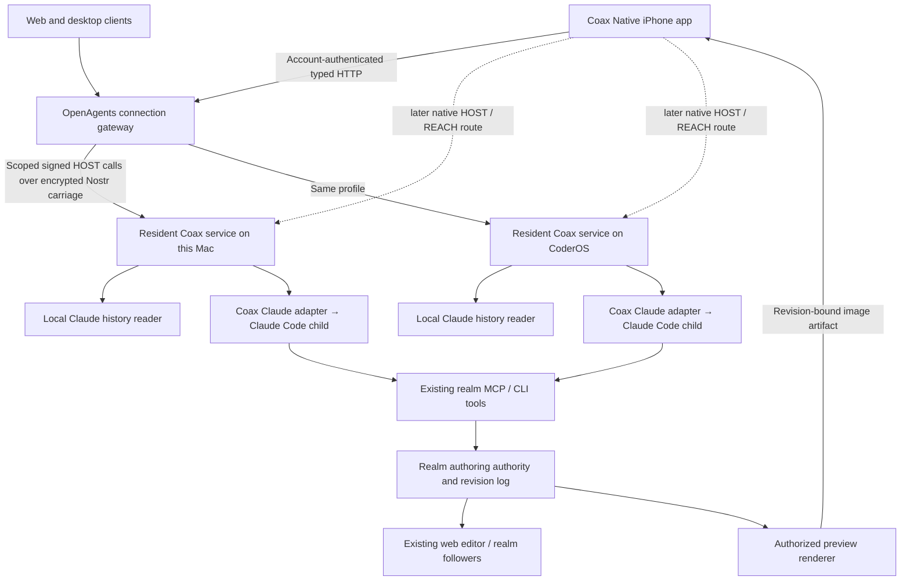

# Environments, Claude Code and realm authoring from every OpenAgents app

Written 2026-11-13. **Status: specification for implementation; no connection,
service or new wire contract is deployed by this document.** Source review is
pinned to `94abb1f338`. This is one application profile of the
[OpenAgents Protocol](openagents-protocol-spec.md), implemented in Coax and
presented through Coax Native. It does not replace that protocol or the NIPs.

## 1. The result and the delivery order

The iPhone app shows **Mac**, **CoderOS** and **Account chats**. Opening either
computer shows its Claude Code conversations, including conversations started
outside OpenAgents. A conversation says where it lives, whether its history is
current and whether the phone can control it. The phone can start a supervised
Claude conversation in an approved workspace, send another message, read tool
activity, answer an admitted question/approval and stop its turn. Claude uses
the login on the selected computer. Nothing silently switches to a hosted
model or another machine when that computer is unavailable.

Next, the same conversation can be attached to a realm being edited. Claude
uses the existing realm tools. The app shows the resulting revision and a
visualization produced from that revision, while the existing web editor sees
the same edits. Chat completion, a saved edit and a rendered frame remain
different facts.

| Milestone | Required result | Deliberately deferred |
| --- | --- | --- |
| **1A: see both computers** | Enroll this Mac and `coderos-4080`; list and page their authorized Claude histories in the app, with source and freshness | Fleet allocation, provider switching, terminal takeover |
| **1B: use Claude** | New managed conversation, follow output/tools, send next turn, explicit Stop, approvals/questions, reconnect and resume | General remote shell UI, automatic migration, arbitrary control of another terminal |
| **2A: edit and see** | Bind that conversation to one existing realm; edit through the shared tools; show a native revision-labelled preview; observe the same change in the web editor | New editor protocol, general multiplayer/game streaming |
| **2B: richer viewport** | Native interactive Metaverse Engine viewport using the same realm binding and revisions | A prerequisite for 1A/1B or the first useful visualization |

Implementation lands these as vertical slices. Protocol completeness means the
consumed slice has schemas, one codec, fixtures, authority and failure tests;
it does not mean implementing every historical service before a phone can
read its first conversation. This task specifies the slices; it does not enroll
the computers or implement them.

## 2. Existing contracts and conflicts resolved

The master spec's pre-reset “Implemented” labels describe historical services.
They do not establish that the removed Rust services run today. The current
source, [proto guide](../../proto/README.md), [context map](../architecture/contexts.md)
and [glossary](../books/glossary.md) determine implementation placement.

| Existing language or implementation | Decision in this specification |
| --- | --- |
| `environment.v1`, [NIP-ENV](../../nostr/nips/openagents/NIP-ENV.md) | Keep definitions, adoption, leases, materialization, execution attachments and cleanup. An app's computer card is an **environment endpoint view**, not a redefinition of an ENV lease. |
| `host.v1`, [NIP-HOST](../../nostr/nips/openagents/NIP-HOST.md) | Keep host identity, enrollment, grant/epoch checks and the typed device-operation boundary. New session methods require a negotiated profile; no generic execute-JSON tunnel. |
| `reach.v1`, [NIP-REACH](../../nostr/nips/openagents/NIP-REACH.md) | Keep identity separate from routes, presence and discovery. A hostname or tailnet connection does not grant access. |
| [NIP-WS](../../nostr/nips/openagents/NIP-WS.md) / planned `workspace.v1` | Own workspace references, snapshots, worktrees and conditional file changes. A repository name or client-supplied path is not a workspace grant. |
| `session.v1`, [NIP-SESS](../../nostr/nips/openagents/NIP-SESS.md) | Own conversation lineage, adapter features, commands, interactions, generations and native continuity. Keep it distinct from login sessions and `openagents.session.v1`, Coder's existing transcript-log identifier. |
| [NIP-RUN](../../nostr/nips/openagents/NIP-RUN.md), POL and CAP | Keep durable intent, controller fencing, effect/recipient admission and exact approval. A ready computer or accepted send does not prove execution finished. |
| SESS/HOST's October live-session decision | Preserve Loro rooms on `coder-sync` as the intended replicated live view, with HOST authority. CRDT changes cannot become an unvalidated execution queue. Current Coax implementation gaps are explicit below. |
| Frozen [`host/v1/host.proto`](../../proto/openagents/host/v1/host.proto) and [`reach/v1/reach.proto`](../../proto/openagents/reach/v1/reach.proto) | Do not add meanings to their recovered phone task bridge, grant fields or cursor. The old phone projection refuses scoped grants; it is not the new session implementation. |
| [`coder.session-reader.v1`](coder-session-reader-v1.md) | Reuse its shared Claude transcript reader and inert-history rules. Its bounded text/warnings are not lossless native history, live attachment or write authority. |
| Account-saved chats and the hosted runner | Keep `openagents.chat.thread.v1`, `openagents.chat.history.v1` and `agent.managed.v1alpha1` unchanged. An environment session is another explicit conversation target, not an account-chat ID reinterpreted as a native Claude ID. |
| [`world.turn.v1`](world-turn-v1.md), [`world.edit.v1`](world-edit-v1.md), [`realm.result.v1`](realm-result-v1.md) | Reuse context, edits, results, tools and the existing revision/undo log. Do not invent a second mobile scene-edit format or a second `world_*` MCP family. |
| [`WorldRef`](../../proto/openagents/verse/common/v1alpha1/refs.proto) | Reuse it inside a new authoring target carrying authority and lane. Do not change its existing fields or treat missing revision as revision zero. |
| [T3 audit](../research/t3code/README.md) | Adopt the execution-host boundary, durable sends and capability-aware adapters. Keep our HOST/ENV/SESS language and carriages; do not import T3's RPC wire or provider-instance vocabulary. |

“Host” below means the **NIP-HOST principal/service**, not a new name for the
glossary's deployment VM, room or shard. An **engine session** means a SESS
conversation, not an account login, process, room or realm. An **adapter binding**
selects an engine implementation plus the computer's credential/configuration
scope; it is not called an instance.

## 3. System boundary



The resident service owns native processes, canonical workspace roots, native
session bindings, command receipts, pending interactions and source cursors.
It runs as the operator's existing OS user. Credentials stay in the selected
computer's provider store. Launchd on macOS and a user systemd service on
CoderOS keep the service alive independently of the phone. No root service,
OS reinstallation or new cloud VM is required for milestone 1.

The gateway owns account-to-connection metadata and the explicitly delegated
broker credentials described in §6. It routes to a specific enrolled host; it
does not infer a target from a conversation title, a repository remote, a local
IP address or “the first online machine.” The agent never executes on the phone.

The first service extends/reuses [`coder host`](../../coder/tui/host.coax), the
[HOST carriage](../../coax/lib/nostr/host/browser.coax) and its
[admission code](../../coax/lib/nostr/host/admit.coax). That current slice is a
bounded browser/realm-job service: jobs use an empty directory/read ceiling,
and replies are smaller than the broad HOST specification. It does **not**
already enumerate all Claude chats or provide general workspace sessions.
Those capabilities must be implemented and tested, not inferred from its name.

## 4. Identity and ownership

| Identity | Rule |
| --- | --- |
| Environment endpoint | Keyed by the enrolled HOST public key. “Mac” and “CoderOS” are editable labels. A new process/address does not mint a new computer identity; a replaced key needs explicit re-enrollment. |
| ENV resource/lease | Separate optional references for observed/adopted execution. New runtime materialization has a new generation. Never synthesize `env_` resources from endpoint labels. |
| Workspace | Host-assigned stable ID and WS binding. The root's canonical path/filesystem identity stays local unless separately disclosed. |
| Adapter binding | Host-assigned ID, declared engine/adapter version, effective configuration and local account scope. No API key, refresh token or config-directory content in a descriptor. |
| Engine session | `(host public key, common session ID)` is its application identity. Native Claude UUID/path is a private adapter mapping. Two computers with the same native ID still have separate sessions. |
| Generation | SESS runtime/native-binding generation. Reconnect alone does not increment it; replacing a runtime or native binding does. Old interactions/cursors cannot become current by reconnecting. |
| Command | Stable caller command ID plus complete command fingerprint under the existing session scope. Timeout/fallback never creates a new ID for uncertain work. |
| Realm | Existing world ID inside an authority-and-lane target. Same slug at local development and production is not the same target. |

The app may merge rows for display; it never merges their authority, cursor or
native lineage. Account chats keep their own IDs and owner checks. An explicit
conversation-target union discriminates `account_chat` from `engine_session`.
No “send” API guesses which one the user meant.

## 5. Proto definitions and publication

### 5.1 Scope of the schema work

The following are **draft proto definitions and field allocations for this
specification**, not published `.proto` files or registered live shapes.
The protocol plan explicitly permits a design to remain prose until it has a
consumer. Implementation starts by landing the consumed schemas under `proto/`,
then codecs/fixtures, before any producer or route. Do not create placeholder
registry rows or grow the wire allowlist to call this work complete.

| Proposed source/package | Owns | Does not duplicate |
| --- | --- | --- |
| `proto/openagents/environment/access/v1alpha1/access.proto` / `openagents.environment.access.v1alpha1` | Computer endpoint/catalog and available workspaces/adapter bindings | ENV allocation/lease state, HOST grants, REACH proofs |
| `proto/openagents/environment/v1alpha1/environment.proto` | Faithful consumed projection of the existing NIP-ENV adoption/materialization/binding records | A replacement `environment.v1` or a new provisioner |
| `proto/openagents/session/v1alpha1/session.proto` | Consumed SESS command/admission/state/interaction records | Coder log v1, account chats, raw Claude wire |
| `proto/openagents/session/access/v1alpha1/access.proto` | Session list/history/live-view projections and their bounded pages | New execution semantics or a second transcript parser |
| `proto/openagents/host/access/v1alpha1/session.proto` | Versioned typed method binding to HOST `app.rpc` and broker enrollment | New rights inferred from method strings or a generic shell |
| `proto/openagents/verse/authoring/v1alpha1/session.proto` | Authoring target, conversation binding and result correlation | `world.edit.v1`, world tables, undo or publish rules |
| `proto/openagents/verse/preview/v1alpha1/preview.proto` | Revision/build/camera-bound preview request and frame | Realm simulation/room replication or a second renderer |

SESS and ENV projections must follow their complete normative NIP artifacts,
including `requires`, source/authorization references and unknown/refusal
semantics. The abbreviated proto sketches in the master spec are not sufficient
to generate a conformant implementation. Unconsumed families can wait; every
consumed artifact has a complete definition, not an untyped metadata bag.

### 5.2 Environment endpoint view

This draft is the concrete application meaning of “proto environments.” It
composes HOST/REACH/ENV rather than redefining any of them:

```proto
syntax = "proto3";
package openagents.environment.access.v1alpha1;
import "openagents/common/v1/refs.proto";

message EnvironmentRef {
  string host_pubkey = 1; // exact enrolled NIP-HOST key, lowercase 64 hex
}
enum ConnectionState {
  CONNECTION_STATE_UNSPECIFIED = 0;
  CONNECTION_STATE_NOT_ENROLLED = 1;
  CONNECTION_STATE_CONNECTING = 2;
  CONNECTION_STATE_ONLINE = 3;
  CONNECTION_STATE_OFFLINE = 4;
  CONNECTION_STATE_AUTH_REQUIRED = 5;
  CONNECTION_STATE_INCOMPATIBLE = 6;
  CONNECTION_STATE_REVOKED = 7;
}
enum Support {
  SUPPORT_UNSPECIFIED = 0;
  SUPPORT_NATIVE = 1;
  SUPPORT_EMULATED = 2;
  SUPPORT_UNSUPPORTED = 3;
}
message FeatureSupport {
  string feature = 1; // closed SESS feature name, never an executable method
  Support support = 2;
  openagents.common.v1.ArtifactRef semantics = 3;
  openagents.common.v1.ArtifactRef evidence = 4;
}
message AdapterBinding {
  string binding_id = 1;
  string adapter_id = 2; // e.g. claude-code, with negotiated version/evidence
  string display_name = 3;
  string engine_version = 4;
  repeated FeatureSupport features = 5;
  openagents.common.v1.ArtifactRef effective_configuration = 6;
  bool authenticated = 7; // observation only, not permission to start work
  bool authentication_known = 8;
}
message WorkspaceSummary {
  string workspace_id = 1;
  string display_name = 2;
  openagents.common.v1.ArtifactRef binding = 3; // exact WS binding
}
message EnvironmentEndpoint {
  EnvironmentRef environment = 1;
  string display_name = 2;
  ConnectionState connection_state = 3; // never NIP-ENV lease State
  string runtime_generation = 4;
  repeated string supported_profiles = 5;
  repeated WorkspaceSummary workspaces = 6;
  repeated AdapterBinding adapters = 7;
  int64 observed_at_ms = 8;
  optional openagents.common.v1.ArtifactRef environment_binding = 9;
  optional openagents.common.v1.ArtifactRef reach_evidence = 10;
  bool inventory_complete = 11;
}
message ListEnvironmentsRequest { uint32 max_items = 1; string cursor = 2; }
message ListEnvironmentsResponse {
  repeated EnvironmentEndpoint environments = 1;
  string next_cursor = 2;
  bool complete = 3;
}
message DescribeEnvironmentRequest { EnvironmentRef environment = 1; }
service EnvironmentAccessService {
  rpc ListEnvironments(ListEnvironmentsRequest) returns (ListEnvironmentsResponse);
  rpc DescribeEnvironment(DescribeEnvironmentRequest) returns (EnvironmentEndpoint);
}
```

The authenticated caller, not an account field in the request, selects the
catalog. `ONLINE` means authenticated contact with the expected host and
compatible profile; it is not an ENV readiness or execution-admission claim.
An incomplete inventory must not display as “no chats” or “no Claude installed.”
Route secrets and invitation credentials are never returned in this view.
`runtime_generation` identifies the observed runtime/materialization; it is not
a cast of REACH's presence counter or SESS's integer session generation.
The current generation for an operation comes from its own authoritative scope.

### 5.3 Session-facing definitions

Allocate these new view messages in `session.access.v1alpha1`; full SESS
artifacts retain their existing meaning. Field lists below give field numbers
and types, including the required unions:

| Message | Fields |
| --- | --- |
| `SessionRef` | `1 EnvironmentRef environment`, `2 string session_id` |
| `SessionScope` | `1 SessionRef session`, `2 uint64 generation` |
| `SessionSummary` | `1 SessionRef session`, `2 string workspace_id`, `3 string adapter_binding_id`, `4 string title`, `5 SessionOrigin origin`, `6 SessionControl control`, `7 int64 updated_at_ms`, `8 ArtifactRef state`, `9 bool history_complete`, `10 repeated ProjectionWarning warnings` |
| `SessionOrigin` | Closed enum: unspecified, observed-native, managed, imported; imports retain source evidence |
| `SessionControl` | Closed enum: unspecified, observe-only, available, busy-elsewhere, needs-claim, incompatible |
| `ListSessionsRequest` | `1 EnvironmentRef environment`, `2 optional string workspace_id`, `3 uint32 max_items`, `4 string cursor` |
| `ListSessionsResponse` | `1 repeated SessionSummary sessions`, `2 string next_cursor`, `3 bool complete`, `4 string snapshot_id`, `5 repeated ProjectionWarning warnings` |
| `ReadSessionRequest` | `1 SessionRef session`, `2 string cursor`, `3 uint32 max_items`, `4 uint32 max_bytes`, `5 uint32 wait_ms` |
| `SessionPage` | `1 SessionScope scope`, `2 uint64 sequence`, `3 repeated TimelineItem items`, `4 string next_cursor`, `5 bool caught_up`, `6 bool resnapshot_required`, `7 repeated ProjectionWarning warnings` |
| `ObservedHistoryScope` | `1 SessionRef session`, `2 string source_epoch`, `3 ArtifactRef source_cut` |
| `ObservedHistoryPage` | `1 ObservedHistoryScope scope`, `2 uint64 sequence`, `3 repeated TimelineItem items`, `4 string next_cursor`, `5 bool caught_up`, `6 bool resnapshot_required`, `7 repeated ProjectionWarning warnings` |
| `ReadSessionResponse` | Required `oneof page`: `1 SessionPage managed`, `2 ObservedHistoryPage observed` |
| `TimelineItem` | `1 string item_id`, `2 uint64 sequence`, `3 optional string turn_id`, `4 optional string parent_item_id`; `oneof body`: `10 MessageProjection`, `11 ToolProjection`, `12 ArtifactRef interaction`, `13 ArtifactRef turn_result`, `14 ArtifactRef authoring_result`, `15 ProjectionGap` |
| `MessageProjection` | `1 MessageRole role` (user, assistant, context, reasoning), `2 string text`, `3 bool complete`, `4 optional ArtifactRef original`, `5 uint64 content_offset`, `6 bool more_content`; chunks are at UTF-8 boundaries |
| `ToolProjection` | `1 string call_id`, `2 string name`, `3 ToolState state` (started, waiting, completed, failed, unknown), `4 optional ArtifactRef input`, `5 optional ArtifactRef output`, `6 optional string parent_call_id`; tool content is inert |
| `ProjectionWarning` / `ProjectionGap` | Stable closed code, bounded explanation, affected source/item reference and missing range when known. No invented empty output |
| `OpenSessionRequest` | `1 EnvironmentRef environment`, `2 ArtifactRef request`; exact SESS open artifact whose workspace, adapter binding and authorization must agree with the target |
| `DispatchSessionCommandRequest` | `1 SessionScope scope`, `2 ArtifactRef command`; the command is the exact SESS command, not arbitrary executable JSON |
| `RespondInteractionRequest` | `1 SessionScope scope`, `2 ArtifactRef response`; exact SESS/POL response, recipient and native-request binding preserved |

Observed histories may lack a live SESS generation. Their read projection uses
a separately identified **source epoch**, not a fabricated live session scope;
`ReadSessionResponse` therefore uses the required `oneof` of managed
`SessionPage` and `ObservedHistoryPage`. The latter has the same pagination
fields but a `SessionRef`, source epoch and source digest/cut instead of
`SessionScope`. Execution requests accept only a real admitted `SessionScope`.
The first schema patch must preserve this union, not coerce observed rows into
the managed branch.

The consumer can request complete text by paging `original` under the same
source authority. It must not join arbitrary local paths or treat old
2,048-byte excerpts as the whole original. Extend the shared Claude reader for
this access profile; do not write a second JSONL parser. The existing v1 reader
and its output bytes stay frozen.

`ConversationTarget` has a required `oneof target`: field 1 is the existing
account-chat ID (`string account_chat_id`), field 2 is `SessionRef engine_session`.
The account branch keeps its existing account-authenticated interpretation.
`SessionService` owns open, command and interaction semantics.
The environment service only catalogs/routes; it cannot mint a substitute
session receipt.

### 5.4 Authoring and preview definitions

The new authoring package composes the existing `WorldRef`; all references to
`ArtifactRef` below mean `openagents.common.v1.ArtifactRef`:

```proto
syntax = "proto3";
package openagents.verse.authoring.v1alpha1;
import "openagents/verse/common/v1alpha1/refs.proto";
import "openagents/common/v1/refs.proto";

enum Lane { LANE_UNSPECIFIED = 0; LANE_DEV = 1; LANE_LIVE = 2; }
message AuthoringTarget {
  string authority = 1; // configured authority ID, not a fetch-this-URL instruction
  openagents.verse.common.v1alpha1.WorldRef world = 2;
  Lane lane = 3;
}
message AuthoringBinding {
  string binding_id = 1;
  AuthoringTarget target = 2;
  openagents.common.v1.ArtifactRef session_scope = 3;
  openagents.common.v1.ArtifactRef workspace_binding = 4;
  openagents.common.v1.ArtifactRef authorization = 5;
  openagents.common.v1.ArtifactRef build = 6;
  repeated string permitted_operations = 7; // rows of REALM_COMMANDS
  uint64 generation = 8;
}
message AuthoringEffect {
  string binding_id = 1;
  string command_id = 2;
  string tool_call_id = 3;
  AuthoringTarget before = 4;
  AuthoringTarget after = 5;
  openagents.common.v1.ArtifactRef result = 6; // exact realm.result.v1
}
```

`AuthoringBinding` is immutable evidence of the target/disclosure/mutation
scope. Its current generation/revocation is checked independently. Selecting a
thing updates a turn context, not the grant. Rebinding to another authority,
realm, lane or workspace needs a new binding and explicit client action.

| Preview message (`verse.preview.v1alpha1`) | Fields |
| --- | --- |
| `PreviewRequest` | `1 AuthoringTarget target`, `2 ArtifactRef build`, `3 ArtifactRef camera`, `4 uint32 max_width`, `5 uint32 max_height`, `6 optional string after_frame`; requested world revision must be present |
| `PreviewFrame` | `1 AuthoringTarget rendered_target`, `2 ArtifactRef build`, `3 ArtifactRef image`, `4 string frame_id`, `5 uint64 frame_sequence`, `6 int64 rendered_at_ms`, `7 uint32 width`, `8 uint32 height`, `9 ArtifactRef camera`, `10 string renderer_host_pubkey`, `11 ArtifactRef render_evidence` |
| `PreviewState` | Required union of frame, pending, unavailable, refused; pending/unavailable name a stable reason and optional last frame |

The rendered target names the **actual** revision. A requested revision copied
into a screenshot response is not render evidence. Image bytes are separately
retrieved authenticated artifacts, never HTML or executable app code. Existing
`world.card.v1` keeps its frozen meaning; a preview does not add keys to it.

### 5.5 Encoding and compatibility

Before publication, every message gets the repository's data-class, maximum
bytes/counts, presence, numeric/unit and grammar annotations. Proto3 does not
make a scalar semantically required: validators enforce it. Revision zero is
valid when present; absence is unpinned. Keys/IDs/cursors are validated before
allocation or effects. Unknown commands/union arms/required profiles refuse.

Use protobuf binary where the carrier supports it and canonical ProtoJSON at
new HTTP edges: 64-bit integers use their defined string form, bytes use
base64, and oneofs/presence survive. Existing hand-packed/JSON profiles retain
their own numeric/order rules. Signed NIP originals are retained and verified
before any typed projection; never reconstruct signed bytes from protobuf.
An `ArtifactRef` or parsed `SignedEvent` is not proof of verification.

Add consumed files to a `modules.json` profile; generate descriptors with the
existing tooling; import descriptors into the one owning Coax codec; pin
exact bytes and cross-carriage fixtures; register every new wire/stored shape
and domain event. Run proto, wire, layering and authority gates before a
consumer ships. Published numbers/names/limits never change in place.

## 6. Connect the two existing computers

### 6.1 First carriage: an explicitly trusted account broker

For the fastest useful phone path, use the existing authenticated native HTTP
service on openagents.com. New typed routes live under
`/api/chat/environments/v1/`, keeping within the installed native route boundary.
They use the definitions above and preserve domain ownership. This path does
not depend on adding Nostr/iroh sockets or a new signer to the phone first.

The gateway terminates these HTTP calls and acts through a **separately
enrolled broker key per account, app-login/device binding and host**. Keys are
server-protected, not in app/OTA code; each has its own revocable HOST grant
and scoped method/workspace/source binding. The host operator explicitly
authorizes this broker to act for that account/device. Account login alone
never adds a computer or its transcripts. Changing account, device binding,
host identity or source roots requires new enrollment.

This broker can read the proxied chats and issue the delegated operations.
It is trusted with that scope; this is **not end-to-end encryption against
openagents.com**. NIP-44 protects the broker-to-host carriage. Claude/provider
tokens never pass through the broker. Keep this tradeoff explicit in the
connection's details rather than falsely describing the broker as a blind relay.

The current app uses bearer access sessions with device-bound refresh. Its
P-256 device key is not a Nostr/secp256k1 key and does not sign every ordinary
HTTP call. Do not relabel refresh binding as per-command proof or derive a
HOST identity by hashing a P-256 key. Host trust in an authenticated gateway
assertion is explicit broker delegation. Stronger direct-device commands use
a qualified native signing/transport capability in a later runtime.

Prototype routes: authenticated `GET .../environments/v1/` for the catalog;
typed `POST .../connect`, `.../call` and `.../read` for enrollment, allowlisted
operations and bounded projections. A request cannot supply a provider token,
shell command, filesystem root, alternate recipient or arbitrary endpoint URL.
The gateway rechecks account ownership on reads as well as writes.

### 6.2 Enrollment and grants

1. On each computer, the resident service reuses its retained HOST key or
   initializes one in the shared `~/.openagents/` layout with restricted file
   permissions. It discovers a configured Claude installation/account without
   launching a model turn or showing a browser.
2. A local operator action opens a short-lived pairing request naming the
   intended account/device, broker, allowed Claude source roots and workspaces.
   The app/CLI cross-check host key and code. A label/code alone is not ownership
   evidence; retain the original host-signed enrollment result.
3. The host grants observe/operate only for the implemented session profile,
   and separately admits allowed interaction responses. No terminal, access
   administration, world joining or world-authoring authority is implied.
4. Store its broker grant and exact scope before showing connected. Renew and
   revoke under HOST's epoch/lifetime rules. A revoked response ends operations
   on every route; transport fallback cannot evade it.

The current narrow grant validators/old phone projection cannot pretend to
support a full scoped grant. New scoped binding/dispatcher validation is part
of this implementation and is advertised only when enforced. An older host
refuses the new profile rather than accepting its broad legacy `operate` grant
as sufficient. Protect against direct calls to other HOST methods too, not
just the gateway UI's method list.

The account connection catalog is a projection of these enrollments. It is not
a replacement owner-signed REACH directory: the gateway cannot publish or amend
that directory without the actual owner authority. Email login does not give
the phone or gateway custody of the owner Nostr key.

The operator can grant a source for history without granting execution in it.
Approving a tool requires an explicitly admitted approver/recipient in addition
to session control; `operate` alone does not appoint one. A broker acting as
that recipient retains the initiating authenticated account/device assertion.
Revocation stops new control, new disclosure and pending approval delivery;
already-running effects require an observed stop or remain unknown.

### 6.3 Routes and live synchronization

Begin with the existing outbound encrypted Nostr carriage, which works without
opening a public port on either computer. The current implementation's reply
limits must be raised only through a new negotiated profile or accommodated
with smaller pages, not by sending oversized legacy packets. Later HOST/REACH
direct routes, including qualified tailnet/iroh routes, use the same session
identities and commands. No new application WebSocket protocol is introduced.

Loro/coder-sync remains the intended live replicated view from the existing
decision. It carries normalized projections and submitted command intents;
the host arbitrates commands and publishes receipts. Client document edits,
last-writer-wins order and possession of a room token cannot execute a turn or
approve a tool. In milestone 1, bounded HOST reads/short polling are the
bootstrap/snapshot/catch-up path while the Coax Loro implementation is absent
or unqualified. Advertise that limitation; do not claim the removed Rust sync
service exists. Both paths consume the same typed projections and cursor law.

The installed phone's HTTP bridge supports whole responses, not SSE. Use
cancelable short polls bounded to 10 seconds and the carrier's smaller page
size. Add SSE/server streaming only when both sides advertise it. An HTTP
request cancellation closes observation; it is not Claude Stop. Backgrounding
the phone stops polling/preview work without killing the agent.

## 7. Engine-session behavior

### 7.1 Discover and observe existing Claude chats

The computer scans only operator-admitted Claude roots, using the existing
[shared reader](../../coax/lib/agent/observe/claude-history.coax) and
[session-reader command](../../coder/tui/session-reader.coax). Keep Claude
configuration homes/account scopes distinct. No grep of process arguments,
remote arbitrary file read or scan of every user's home is required.

Persist a stable mapping from native source identity to common session ID.
Retain source epoch, file identity and prefix/cut evidence so append, truncation,
rotation, compaction and replacement are distinguishable. Map native message
UUID plus part identity where available; never dedupe by title or text. Native
history, host projections and account-saved transcripts are separate stores.

History is inert. A Markdown link, tool log or quoted instruction never becomes
an operation. Missing tool outputs, invalid/oversized records and clipped
projections remain explicit warnings/gaps. An incomplete scan is not a
confirmed empty list. Live terminal history can be followed read-only where
source validation holds; a process found by `ps` is not an attached session.

The first screen merges authorized summaries from both hosts with source
labels and independent loading/error/freshness states. It can show cached
history offline, clearly marked stale. One unavailable host does not block
the other. Global sort is a display projection, not a global ordering of
commands or a promise of synchronized machine clocks.

### 7.2 Managed Claude execution

Reuse [`coax/lib/agent/claude/`](../../coax/lib/agent/claude/PARITY.md), its
stream-json/control transport and the existing agent/session engine. The
implementation is Coax, not a new Node Agent SDK service. Host C/Swift performs
process, filesystem, socket/TLS and platform effects only.

Before executing, resolve the configured executable/home/workspace, record the
effective adapter/runtime/configuration and provider recipient, and admit the
existing-resource **adopt** ENV binding. Cleanup is detach/stop-owned-processes,
never delete this Mac, the CoderOS machine, their workspaces or native history.
Use a local allocator for the required lease/materialization/attachment facts;
do not introduce cloud provisioning for these owned computers.

The initial assurance is shared-user local execution, not hermetic isolation or
remote attestation. Pin/observe the closure the admitted profile promises;
native credentials and ambient home contents are not serialized artifacts.
If required materialization/recipient/enforcement evidence cannot be established,
refuse execution or negotiate a separately declared weaker profile. Do not label
the endpoint ENV-ready by omitting required fields. Observing history does not
require fabricating a compute lease.

New managed conversations default to native supervised permission mode with
the explicit question/permission handler. Full access or automatic review is
a separate requested/effective policy, never inherited from an unrelated
terminal or inferred from HOST `operate`. Resolve the selected account/home
and strip parent-agent session/messaging credentials and conflicting ambient
provider overrides before launch. Repository instructions, hooks and setup
files are executable input, not host policy; their startup effects must fit
the admitted configuration and disclosure. A sign-in failure asks for local
provider setup rather than exporting a Claude credential to the phone.

Opening then durably records SESS admission. A native process restart or changed
configuration follows SESS generation/re-admission, not a silent reuse of old
approval callbacks. Preserve provider-specific feature support and exact installed
version evidence; a schema containing a method does not advertise its implementation.

### 7.3 Existing terminal sessions and exclusive control

The app cannot type into an arbitrary interactive Claude terminal merely because
it can read the transcript. Default such rows to observe-only/busy-elsewhere.

- Resume a native conversation only after separately authorized admission and
  verified exclusive native-session ownership. A lock in our daemon alone
  cannot exclude a CLI that does not honor it. If the adapter cannot establish
  exclusivity, refuse same-lineage execution.
- A supported native fork starts an independent lineage and records its source.
  The CLI option exists in the shared options model, but that alone is not
  qualified fork support; require a real fixture/live capability check.
- Otherwise offer an explicit related conversation with a disclosed portable
  context projection. Preserve truncation/loss evidence; do not call it native
  resume or silently send missing history to another provider.

Managed sessions created through the resident service can be used from phone,
web and desktop clients through the same host controller. Joining a view does
not create another Claude process or RUN controller.

### 7.4 Commands, durability and requests for human input

Keep the existing SESS law: current rights, generation, expected revision,
expiry, adapter support and recipient/effect bounds are checked at admission.
Commit command fingerprint/receipt, state transition and dispatch intent
atomically before acknowledging. Retries return the saved result; changed
payload under the same ID conflicts. Accepted means recorded, not completed.

Milestone 1B needs submit, interrupt, question and approval response. Submitting
to a busy session conflicts unless explicit enqueue is implemented; it never
secretly means steer. Queue/reorder and native or cancel-and-continue steering
are separately advertised. A lost send acknowledgment is reconciled using the
same command ID, including after a route changes. No automatic replay after a
receipt's recovery horizon. Model, hook or transport failures retain partial
output and unknown effects.

The Coax Claude query currently expects some reverse requests to be answered
before another `cl_next`, and defaults unanswered requests to refusal. Extend
that shared request owner to copy borrowed data into bounded storage, persist
the presentation/reference, wait without blocking the service and keep the
native response slot alive. It must not poll past an unresolved slot and send
the default refusal before the phone can answer.

A pending question/approval names the exact session generation, turn, native
request, recipient, choices/schema, expiry and response capability. Two phones
cannot both win. Claim the first authorized response durably before upstream
delivery; unknown delivery is reconciled only when the adapter permits it.
Provider exit/restart invalidates a live callback. A message-response question
is a separate capability and may survive the process; never reinterpret a dead
native callback as that kind. Tool approval is distinct from realm approval,
publishing or a credential prompt. Secret inputs use a separately admitted
secret broker, not ordinary chat text.

### 7.5 Catch-up and recovery

Keep one connection/poll owner per environment and shared subscriptions per
session. Persist the applied projection and cursor atomically. A cursor is
opaque and binds host, session/source epoch or generation, cut/sequence and
source digest; it cannot be reused on another host. Replaced/truncated/pruned
history produces an explicit resnapshot requirement. Do not advance the
cursor for a partial/failed update.

An empty read cursor begins a stable snapshot cut. Page cursors retain that cut
and the source/generation binding until snapshot completion; catch-up then
continues after the cut. A newer projection upserts a stable item ID at its
newer sequence, never appends a second copy of the same streamed message.
Partial text chunks validate their content offset and UTF-8 boundary. Duplicate
or older updates cannot overwrite newer text, and a reset replaces the scoped
projection atomically. Use the existing WS projection law for removals/markers
when those features are implemented, rather than a CRDT deletion as authority.

Use host-owned durable projections and a bounded replay log, with separate
command tombstones. Loro is a replicated view, not proof of native state, and
the replay window is not claimed to rebuild the entire database. Restart
reconciles active/unknown executions; it does not blindly replay tools. An
interrupt acknowledgment or quiet socket is not quiescence. Pending child work
must be disposed or remain visible before the next queued turn is promoted.

The app keeps a bounded durable send outbox with target, exact command identity,
fingerprint and payload. Offline text remains a draft/unsent item until a
clearly admitted queue operation; reconnect never converts it into a new paid
turn without that operation's admission. Logout/revocation removes live access
and protected local cache under the account's cache policy.

## 8. Realm editing through the same Claude conversation

### 8.1 Bind a real target

The user chooses a realm and its authoring authority in the conversation.
Attach a `AuthoringBinding` to the admitted session/workspace and capability
scope. Use the existing world spec/model for available kinds, selected thing,
last picked position, declared build and current revision. The turn context
uses [`world.turn.v1`](world-turn-v1.md) and its existing words projection;
attachment listings disclose metadata first, with bounded authorized reads.

The binding references the realm authority explicitly: a local `coax serve`
development store and openagents.com's production store with the same ID must
not be confused. Local development's “everyone on this computer is admin” rule
does not extend to a phone, relay or public endpoint. Published URLs are display
links; they cannot redirect a higher-trust credential or choose a new authority.

Realm edit permission is the intersection of HOST/session admission, the
binding's operation/lane scope and the existing realm owner/admin policy.
The HOST `world` right is for joining a served world, not authoring rights.
Neither it nor `operate` bypasses `world-policy.coax`. Account/game-account/
Nostr identities require their actual verified mapping; no matching email or
display name creates it. World API credentials remain in the authorized tool
adapter and are scoped to the selected recipient/realm where supported.

The first narrowly scoped world-only profile reuses the existing realm-tool
ceiling: no arbitrary Bash or workspace writes, with effects carried by the
scoped realm tool adapter. Attaching a realm to an already-general coding
conversation does not retroactively confine its approved shell or hide the
owner credentials that OS-user code could reach. Either re-admit the narrower
profile after quiescence, with the appropriate generation/configuration change,
or retain and disclose the broader shared-user policy. A source-root or MCP
allowlist is not an OS sandbox; stronger confinement requires an actual
enforcement/credential-broker profile before it is advertised.

### 8.2 Execute existing tools and follow existing events

Expose tools from `REALM_COMMANDS` with their existing effect/approval metadata.
The first useful set is `realm_world`, place/move/turn/remove, apply, undo,
redo and why. These keep using `world.edit.v1` through
[`world-edit.coax`](../../metaverse-engine/editor/world-edit.coax) and
[`realm-world.coax`](../../apps/openagents-cli/realm-world.coax). The model's
words do not become a parsed plan unless it is the existing explicitly typed
hosted-model path. Claude calls tools; the phone does not scrape its prose.

Read the target's revision, validate a dry run where supported and submit one
bounded batch against that expected revision. The authority validates the same
Coax rules as the page and commits document/content changes, inverse/undo step
and `realm-authoring.world.edited.v1` events together. Conflicts trigger re-read
and replan; do not automatically rebase a destructive operation or replay a
lost acknowledgment. Preserve each world's supported operations/constraints.

The existing world write profile has revision fencing but is not a universal
new-command dedupe ledger. Record the host/tool effect identity and retain the
returned `realm.result.v1`. If the API committed but its answer was lost,
reconcile against authoritative revision/events and known batch before retry;
when that cannot prove the result, report unknown rather than duplicate a spawn
or undo. A future server idempotency extension needs its own version/profile.

Correlate tool call, session command, authoring binding, exact before/after
revisions and realm result. A `202` visitor proposal or `needs-approval` is not
a saved edit. `done` does not mean a frame rendered. The app reuses the shared
tool/article components and shows the result state the tool actually returned.

The web/native follower uses the existing document/content/event protocol and
[`world-follow.coax`](../../metaverse-engine/editor/world-follow.coax). Apply
only the next revision; a gap/incompatible event reloads the authoritative
snapshot. Preserve camera, selection and player/run state where the existing
follower supports it. Do not create another mobile edit/event log or let
Loro merge world edits around the realm's revision authority.

### 8.3 Visualization that proves what is being shown

Milestone 2A is an **in-app native preview panel** alongside chat. A renderer
on the Mac or CoderOS loads the authorized realm and follows its saved revision.
It uses the existing Metaverse Engine/page, driver and fast-shot infrastructure,
not a newly written renderer. Reuse headless shared browser sessions when that
is the qualified renderer; never open a visible browser or play audio. GPU
availability is measured, not inferred from a machine label.

After the page/engine actually applies the requested revision, waits for the
appropriate frame completion and reads back the image, return a `PreviewFrame`
with actual revision, build/content identity, camera and renderer evidence.
The native panel verifies artifact size/digest and displays that revision.
A frame for a different authority, lane, realm, binding generation or build
cannot satisfy the pending request. A newer compatible revision may be shown
as newer, never relabelled as the requested old one.

Start with bounded still frames, at most one per second, coalescing old preview
requests. Chat and edits do not wait behind image delivery. Stop capture/polling
when the view is hidden or the phone backgrounds; keep the last image marked
stale. If rendering fails after an edit was saved, show **saved, preview
unavailable**, not a rollback or fabricated success. Camera/selection operations
are typed and read-only; they do not imply world mutation rights.

This is an initial visualization, not a claim of interactive 3D parity. The
next installed runtime can add the shared Metaverse Engine's native Metal
viewport, consuming the same target/build/revision protocol. The current UIKit
runtime has no general image-preview/GPU realm service: this panel requires a
native capability and TestFlight build. It cannot be added merely by sending
an arbitrary HTML page or native executable through OTA.

Frame bytes do not travel inside the small HOST control reply or the Loro
document. Reuse bounded authenticated artifact transfer: the renderer uploads
the image to an admitted private object destination and returns its digest/ref;
the phone retrieves it through its authorized artifact adapter. Enforce account,
source/binding and expiry on reads, plus encoded and decoded byte ceilings.
A signed URL is a separately bounded bearer grant, never a substitute for the
current HOST/session grant. Transfer cancellation retains resource ownership
until the platform effect completes.

### 8.4 Code, scripts, publishing and scope

First edit existing realm data. Code changes remain ordinary Coax workspace
changes: build/check the changed modules, verify the build identity and render
the private development result. Existing stored-script/module checks and
hash-bound confirmation remain mandatory where that path is used. A model
saying “approved” or a Bash approval cannot confirm a new module's effects.

The owner [shelved unreviewed public realm code](../metaverse/realm-origin.md)
on 2026-11-13. Preserve that decision: public-site code is ours or reviewed in
the repository before shipping. This profile does not reopen a public arbitrary
code uploader, revive the shelved separate-origin project or bypass review via
Claude's tool credentials. Private previews do not publish to visitors.

Publishing is a distinct effect/approval and uses the realm's existing live/dev
rules. Some realms apply changes at once and refuse publish; describe that
before admission. Some operations affect players or spend money; keep their
actual command metadata and approvals. Realm-authoring modules do not gain
access to character/item ledgers or payments by sharing this connection.

## 9. Limits, runtime delivery and failure vocabulary

Initial application limits, tightened further by the carrier/host's actual
capabilities:

| Boundary | Initial ceiling / rule |
| --- | --- |
| Catalog/list | 64 rows per page, at most 256; explicit completeness and cursor |
| Session command text | 16 KiB UTF-8, nonblank/no NUL; smaller limits remain enforceable |
| Legacy relay path | Fit current `HS_REPLY_MAX` 16 KiB replies and 32-step bound using smaller pages; a new profile may negotiate larger limits |
| Native HTTP | Stay within installed 64 KiB request / 1 MiB response and GET/POST; do not loosen authority through app-provided URLs |
| Short poll | At most 10 s, cancelable, one owner per environment; back off offline/blocked |
| Preview | At most 2048×2048 and 512 KiB compressed/frame, at most 1 fps, default 8 MiB/minute budget; adapt size/rate, drop stale frames and retain byte credits through completion |
| History/artifact read | Bounded pages/chunks with explicit gaps/cuts; no silent truncation or whole-home download |
| Approval | Native/host expiry is authoritative; expiry refuses, never auto-approves |

Use existing refusal domains/codes where applicable. New alpha view reasons
must be pinned closed values with retry meaning: not-enrolled, auth-required,
offline, incompatible, source-incomplete, cursor-reset-required, busy-elsewhere,
native-claim-required, stale-generation, revision-conflict, request-expired,
outcome-unknown and preview-unavailable. Do not redefine the frozen
`common.v1.Refusal` or collapse these into “no saved chats.”

Milestone 1 UI/protocol work can use signed OTA on the current native profile
when it only consumes its existing authenticated HTTP and semantic controls.
The broker/host/schema work is still a server/computer deployment. Direct
device Nostr/REACH/iroh, new native signing and preview/Metal controls need a
qualified installed capability and likely a TestFlight build. Target the exact
released runtime; do not recompute a new fingerprint and send it to an old
binary. Updates deliver compatible application code, not missing SDK services.

## 10. Implementation sequence and completion gates

| Step | Work and owner boundary | Gate |
| --- | --- | --- |
| **P0** | Add the consumed proto profiles, codec/fixture/registry entries and capability descriptions in Protocol + Coder; keep published baselines byte-exact | `scripts/proto.sh check`, generated descriptor/Coax roundtrips, exact JSON fixtures, wire-check; no allowlist increase |
| **P1** | Extend the resident Coax host with scoped broker enrollment and source/workspace catalog; run it on Mac and CoderOS | Explicit local host approval; cross-account/host/root denial, revocation and offline tests |
| **P2 / 1A** | Gateway routes plus Coax Native environment/session list/history, reusing the shared reader/components | A known existing Claude chat from each computer appears with correct text/source, page/gap/freshness behavior; account chats remain intact |
| **P3 / 1B** | Adopted execution binding, one managed Claude session and request owner on each computer; durable app sends and catch-up | Phone → host → real Claude → tool/request → phone; next turn, stop and relaunch verified on both machines |
| **P4 / 2A** | Bind an existing realm; typed tool/result correlation and existing followers; native preview service/build | One phone instruction changes an allowed thing; phone preview and web editor show the committed revision; one undo reverses the batch |
| **P5 / 2B** | Native interactive viewport, direct route and live-view improvements | Same identity/authority/command tests over each newly advertised carrier; no protocol fork |

No new scripts in another language to substitute for shared tools. Product
state machines/authority/codecs are Coax; platform adapters do platform effects.
Put admission, source scope, command/request ownership and preview/artifact
policy in the appropriate owning `#authority` modules, with checks written
first and mutation runs with zero survivors. Engine modules never load up into
Coder, app, API or authoring context; adapters carry the cross-context work.

Minimum conformance scenarios:

1. Same native UUID on both computers stays two rows; wrong-account requests,
   forged host descriptors, changed roots and revoked bindings fail.
2. Observed Terminal chat is readable while running; phone cannot become a
   second writer. New managed chat works without stealing that session.
3. Lost send response plus identical retry starts one turn; conflicting retry
   fails. Route fallback/restart retains command identity and unknown outcomes.
4. Concurrent clients race at one expected revision; one wins. A stale Stop or
   approval cannot target a replacement turn/generation.
5. Approval takes human time without the Coax reader auto-declining it on the
   next poll. Rejection performs no forbidden write. Provider death invalidates
   the live request; it does not turn it into a durable message question.
6. Suspend/relaunch the phone during output, reconnect after history pruning,
   truncate/rotate a native transcript, and return explicit catch-up/reset/gap
   state without duplicate items or a false empty list.
7. A scoped realm edit is saved once; stale revision refuses; lost response is
   reconciled before retry. Visitor proposal/approval-required is not shown as
   applied. Web and phone follow the same authoritative revisions.
8. A rendered frame is tied to actual realm/lane/build/revision. Reject stale,
   cross-authority and corrupt frames. A rendering failure retains the saved
   edit and shows preview unavailability; undo uses the existing single log.
9. No Claude credential or seed/token appears in phone/OTA state, transcript,
   metadata or logs. Broker trust is accurately described. World publishing,
   reviewed code, native services and money retain their independent gates.

Record real Mac/CoderOS/provider versions, negotiated profiles, native runtime,
exact fixture transcripts and the limits of each passing result. Read-only
discovery is not a live execution test; a passing dry run is not a published
edit; a screenshot is not evidence of correct authority. Physical phone
acceptance belongs in `NEEDS_OWNER.md` when implementation is ready.

## 11. Source map for implementation

| Area | Reuse / authoritative reference |
| --- | --- |
| Protocol baseline/versioning | [Root protocol](openagents-protocol-spec.md) §§18, 22–24, 31–35; [proto guide](../../proto/README.md); [wire registry](../../proto/registry.json) |
| HOST/REACH/SESS/ENV | [NIP-HOST](../../nostr/nips/openagents/NIP-HOST.md), [NIP-REACH](../../nostr/nips/openagents/NIP-REACH.md), [NIP-SESS](../../nostr/nips/openagents/NIP-SESS.md), [NIP-ENV](../../nostr/nips/openagents/NIP-ENV.md); current Coax [host service](../../coder/tui/host.coax), [carriage](../../coax/lib/nostr/host/browser.coax), [admission](../../coax/lib/nostr/host/admit.coax) |
| Native account boundary | [Starter capabilities](../../coax/native/README.md), [AppAuth](../../apps/shared/host/apple/AppAuth.swift), [DeviceKey](../../apps/shared/host/apple/DeviceKey.swift), [native host](../../apps/shared/native/NativeHost.swift) |
| Native history and process semantics | [Reader contract](coder-session-reader-v1.md), [reader](../../coax/lib/agent/observe/claude-history.coax), [Claude parity](../../coax/lib/agent/claude/PARITY.md), [options](../../coax/lib/agent/claude/options.coax), [engine](../../coax/lib/agent/engine/claude.coax), [local inventory](local-inventory-v1.md) |
| Account chat/hosted compatibility | [Account-chat fixture](../../proto/coder/account-chat-v1.json), [history fixture](../../proto/coder/chat-history-v1.json), [managed runner schema](../../proto/openagents/agent/managed/v1alpha1/session.proto) |
| Existing world-edit chat | [Turn context](world-turn-v1.md), [edit/events](world-edit-v1.md), [result/effect/approval](realm-result-v1.md), [command table](../../apps/openagents-cli/commands.coax), [CLI tools](../../apps/openagents-cli/realm-world.coax), [web tool projection](../../apps/openagents-web/chat/chat-tools.coax) |
| Authoring implementation | [Shared edit codec](../../metaverse-engine/editor/world-edit.coax), [follower](../../metaverse-engine/editor/world-follow.coax), [API](../../coax/web/api/worlds.c), [authority](../../coax/web/api/world-policy.coax), [script contract](world-scripts-v1.md), [code-publication decision](../metaverse/realm-origin.md) |
| Shared presentation and machines | [Components](../../components/spec.md), [reuse inventory](../reuse.md), [Metaverse OS/CoderOS](../os/2026-11-02-verse-os.md), [T3 audit conclusions](../research/t3code/07-openagents-path.md) |

This profile leaves the existing environment, host, account, session and realm
contracts in their owning contexts. The first buildable result is both
computers' Claude chats in the phone; the same session and authoring references
then carry editing and visualization without replacing the underlying system.
