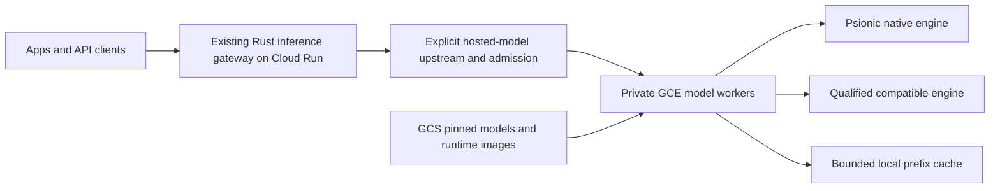

# What Psionic should learn from DeepInfer

Reviewed on 2026-10-20. DeepInfer source revision:
[`774ce244b87cc0eb8d4b94ab9f5de2ab22049f01`](https://github.com/deepseek-ai/DeepInfer/tree/774ce244b87cc0eb8d4b94ab9f5de2ab22049f01).
Psionic comparison revision: `83fe8b7f6b3cd437ae9b7af213cf9f04875dd793`
in this monorepo. Recommendations below are engineering judgments from source
inspection, not measured performance improvements for Psionic.

The follow-up [DeepSeek support plan](deepseek-support-plan.md) expands this
review to official Rust protocol components, model-specific MLA/MoE and sparse
attention work, and a pinned kernel/device compatibility matrix. It records
FlashMLA's removal of older model/Hopper support and DeepEP's newer NCCL-based
implementation so future work does not rely on older infrastructure descriptions.

## Recommendation

Use DeepInfer as a reference for making Psionic's existing serving paths work
together efficiently. Prioritize real device batching, CPU/device overlap,
batch-independent correctness, and cheaper structured output processing. Build
on Psionic's Rust runtime and backend interfaces. A Python/PyTorch runtime port
would introduce another implementation without making our current paths faster.

| Order | Work | Why it belongs here |
| --- | --- | --- |
| 1 | Establish device batching and synchronization measurements | Some Psionic batch entry points currently execute complete requests sequentially. |
| 2 | Add batch-invariance qualification beside seeded replay | A request seed cannot prevent numerical changes caused by batch-dependent kernels. |
| 3 | Move grammar compilation off the decode path and reuse compiled state | Psionic already enforces constraints, but its fallback repeatedly classifies candidate text. |
| 4 | Extend speculative verification after batched target execution works | Psionic has a CPU Qwen3.8 MTP path; confidence-based verification needs more runtime and model support. |
| 5 | Improve cache recovery and MoE placement for measured workloads | DeepInfer's replay approximation and scale-up topology require model-specific and hardware-specific evidence. |

## What the release actually contains

DeepInfer's README describes an offline inference release for
DeepSeek-V4.1-Flash, supporting NVIDIA SM100 GPUs and Huawei Ascend 950 NPUs.
Its NVIDIA setup requires Linux, Python 3.12, GCC 13 or later, and CUDA 13.
The implementation combines Python orchestration, C++ engine code, and
accelerator kernels, including TileLang and separately versioned kernel
submodules. This is a different deployment target from Psionic's CPU, Metal,
and CUDA GGUF serving paths. [D1] [D2]

The release includes engine allocation and cache machinery: for example,
`csrc/engine/block_manager.hpp` manages device blocks. The complete service's
persistent KV cache system, prefill/decode disaggregation deployment, and
load balancing across replicas are excluded. Distinguish those missing service
components from the released engine's cache interfaces and scheduling code.
The deployment Q&A describes additional infrastructure; descriptions there
are not proof that the corresponding implementation ships in this clone.
[D1] [D3] [D4]

The checkout was cloned without initializing vendor submodules. Review covered
the checked-in engine, model runtime, tests, examples, and deployment notes.
No dependencies or model weights were installed, and no inference or GPU
benchmarks were run. The public benchmark plots use four SM100 GPUs for prefill
and 64 for decode within a scale-up domain. They do not establish a speedup on
our RTX 4080 or Apple devices. [D1]

DeepSeek's own description of the production service around DeepInfer,
including the cache storage and load balancers the release omits, is
summarized in the [V4.1-Flash inference system note](../research/deepseek/2026-10-20-v41-flash-inference-system.md).

## Start from Psionic's actual execution paths

The [Psionic overview](README.md) describes the imported serving workspace.
Source inspection shows several useful foundations, with narrower execution
support than their names alone might suggest:

| Area | Existing implementation | Consequence for this work |
| --- | --- | --- |
| Scheduling | `GenerationSchedulerPolicy` budgets prefill and decode separately. The shared `run_continuous_batch_generation_requests` function interleaves active requests and records scheduler metrics. [P1] [P2] | Extend the existing policy and metrics instead of introducing another scheduler API. Interleaving alone does not prove a fused device batch. |
| Qwen batching | CUDA, CPU, and Metal Qwen services expose `generate_continuous_batch`, but these implementations iterate over requests and call `generate` to completion, returning default aggregate scheduler metrics. [P3] | Real batching in these model paths is a concrete prerequisite for adopting DeepInfer's batch-level optimizations. This finding does not describe every Psionic model family. |
| Sampling and constraints | `GenerationOptions` carries a seed and structured output request. `GenerationSampler` compiles a matcher and caches decoded token suffixes for candidate filtering. Seeded and exact bounded-candidate parity tests exist. [P2] [P4] | Preserve those contracts while adding batch-level numerical qualification and reducing matcher work. |
| Speculation | The opt-in CPU Qwen3.8 MTP implementation drafts one token per iteration, verifies it with the target, and restores state after rejection. It rejects non-greedy and structured output requests. [P3] | Extend a real but limited implementation; do not describe speculative decoding as absent or already accelerated across backends. |
| Cache and graphs | Shared prefix compatibility includes model, weight, tokenizer, template, backend, and tenant identities. CUDA paths expose capture/replay and readback metrics. [P2] [P5] | Preserve compatibility checks and measure actual graph hits and synchronization before expanding reuse. |
| Distributed experts | `psionic-cluster` has sparse expert inventory, placement, scheduling, and realization code. [P6] | Compare execution behavior with DeepInfer's load-driven placement, rather than creating a second cluster abstraction. |

## 1. Make batching and CPU/device overlap explicit

DeepInfer separates scheduling, forward execution, sampling, and result
processing. Its asynchronous path prepares later work while earlier device
work runs. `WorkerStepState`, callbacks, sequence remapping, and explicit copy
events carry the dependencies between stages. Its CUDA graph runner captures
a bounded set of batch sizes and selects the smallest captured size that can
hold the current workload. [D5] [D6] [D19]

For Psionic, first make the Qwen batch path maintain multiple active request
states and execute a real device batch. Then overlap CPU preparation and
completed-result processing with the next device step. Doing only the second
part leaves the current request-at-a-time bottleneck intact.

Use the existing runtime policy for admission and prefill/decode budgets.
Add measured device duration, host scheduling duration, host wait duration,
readback bytes, and effective batch size. Evaluate time budgets alongside
token caps: an equal number of tokens at different context lengths can have
different attention costs. The deployment Q&A describes cost-based prefill
chunking; treat its fitted policy as a design reference, not a released
cross-replica load balancer to import. [P1] [D4]

Keep the overlap implementation backend-specific behind shared Rust contracts.
An event that marks a buffer ready must also define when its storage can be
reused. Exercise cancellation, EOS, admission, and cache release between steps;
an early stop can arrive after the next step has already been prepared.

Psionic already reduces logits readback through argmax and bounded-candidate
paths. Carry those optimizations forward, and measure remaining synchronization
instead of assuming a smaller copy removes the dependency. DeepInfer's
`forbid_cuda_sync` tests provide a useful development pattern for detecting
accidental host waits. Their global debug switch can miss a forbidden sync
while another thread allows one, so it is a diagnostic aid, not a proof of
overlap. [P3] [D7]

For graph reuse, start with measured batch-size buckets and bounded memory.
Retain Psionic's artifact, shape, decode-mode, cache-encoding, and allocation
identity checks. Report padding work, capture cost, misses, and eager execution
alongside replay hits. Avoid speculative graph capture for every possible
request shape. [P5] [D6]

## 2. Test numerical invariance separately from random sampling

DeepInfer distinguishes batch-invariant model computation from deterministic
sampling. Its documented deterministic mode combines batch invariance, a fixed
per-sequence seed, and disabled variable-length MTP verification. Those
restrictions matter: enabling a seed alone is not the advertised guarantee.
[D1]

Its batch-invariance test compares token IDs, log probabilities, and top-token
results for batched and single-request execution. The single-request replay
uses `golden_token_ids` from the batched run, so the test checks computation
along the same trajectory rather than independently proving seeded sampling.
Its sampler test separately uses randomized probability integral transforms
and Kolmogorov–Smirnov checks. [D8] [D9]

Extend Psionic's existing parity tests with two distinct checks:

- **Numerical qualification:** teacher-force the same trajectory while varying
  batch size, request order, neighboring sequence lengths, prefill chunks, and
  graph padding. Compare logits or log probabilities at the supported precision.
- **Sampling qualification:** generate with a fixed request seed across those
  variations. Check stochastic distributions separately when changing a sampler
  or adding speculative acceptance. Scope exact replay claims to a qualified
  model, backend, precision, and execution mode.

Do not require bitwise equality between CPU, CUDA, and Metal by default.
Define per-backend tolerances and record them. Keep random streams independent
of request position and other requests' completion or cancellation.

## 3. Compile constraints once and advance matcher state

DeepInfer compiles JSON schemas, regexes, and EBNF through XGrammar. Its matcher
builder uses background workers and futures; each request receives its own
matcher over compiled grammar state. Runtime masks constrain sampling, and
matcher rollback supports speculative verification. The compiler exposes a
byte limit and a cache-disable switch. The offline builder rejects serialized
grammars supplied by callers. [D10] [D11] [D20]

Psionic already supports structured output constraints, including JSON schema,
regex, and GBNF. Its fallback compiles within `GenerationSampler::new`, then
classifies generated text plus candidate suffixes. The suffix and leading
character caches reduce work, but are not the same as incrementally advancing
a token-aware automaton. [P2] [P4]

Preserve the public request types and add reusable compiled grammars, keyed by
constraint content, tokenizer identity, and compiler version. Keep mutable
matcher state request-local. Bound compilation work, cache bytes, and queue
length, and measure cold compilation separately from per-token filtering.
Evaluate this first with repeated tool schemas and large vocabularies.

A Rust implementation should preserve Psionic's accepted grammar subset and
errors. Adding an XGrammar adapter is a separate dependency decision; the
lesson does not require a Python service or immediate EBNF support. Before
combining constraints with MTP, verify that rejection restores both model state
and matcher state, including partially emitted UTF-8 and stop conditions.

## 4. Schedule verification by useful work per unit of time

DeepInfer's DSpark model includes a confidence head. `MTPVarlen::schedule`
orders estimated acceptance rates and chooses a verification budget using a
measured decode-time curve plus runtime corrections. It distinguishes older
feedback used to choose the total budget from newer feedback used to assign
per-request lengths. With asynchronous execution, device code corrects the
per-request mapping. [D12] [D13]

The transferable objective is:

`expected committed output tokens / (draft + target verification + sampling + scheduling time)`

Include all of those costs in Psionic measurements even when a scheduler's
local model estimates only part of them. A higher acceptance rate alone does
not establish a speedup. Nor does a CPU implementation that runs target
verification token by token demonstrate the benefit of batched verification.

Extend the CPU Qwen3.8 MTP path in this order:

1. Retain exact greedy output and rejection-state checks as a reference.
2. Add multi-token target verification and measure total target work, draft
   work, snapshot memory, rollback work, and committed tokens.
3. Compare speculation off with fixed draft lengths on a qualified backend.
4. Evaluate adaptive budgets only after fixed-length verification wins.

DeepInfer's confidence head is trained model functionality. It cannot be
replaced by an arbitrary probability threshold on Psionic's existing logits.
Without a compatible head, measured historical acceptance can inform an
experimental policy, but that is a new heuristic requiring evaluation.
Correct target verification must remain the authority for accepting tokens.

Do not transplant DeepInfer's performance-cache key unchanged. It includes
model name, graph sizes, parallel sizes, and time units. Psionic should also
bind a stored curve to artifact identity, device and topology, precision,
kernel build, and runtime version, with invalidation when those change.
[D14]

## 5. Separate recoverable cache state from approximate reconstruction

DeepInfer's YOCO implementation compacts query-aligned state at a model-defined
producer/consumer boundary. Its C++ metadata preparation checks that retained
tokens cover the attention window plus maximum backtracking. This is more
specific than truncating an arbitrary decoder's prompt or KV cache. [D15]

The deployment Q&A explicitly describes bounded SWA replay as constructing
**approximate** state by limiting attention to the replayed suffix. Do not
assume that covering a window makes multi-layer reconstruction exact. The
README's suggested 140-token suffix is a V4.1 setting, not a Psionic default.
[D4] [D1]

For Psionic, first classify each model's reusable state: full-attention KV,
sliding-window KV, recurrent state, and any cross-layer shared state. Extend
existing prefix compatibility and ownership accounting rather than weakening
them. Distinguish a cache hit, exact restoration, exact recomputation, and
approximate reconstruction in execution reports.

Only evaluate bounded replay for a model whose dependency structure supports
it. Compare against full prefill on long-context tasks, log probabilities,
structured outputs, and cache-boundary cases. Keep approximate results out of
an exact prefix cache unless the cache identity explicitly distinguishes that
mode. Persistent or remote cache work additionally needs measured transfer
cost, tenant isolation, eviction, and failure recovery; DeepInfer's unreleased
storage system does not supply those components for us.

## 6. Treat expert placement and hardware layout as a coupled decision

DeepInfer's expert policy assigns redundant copies to hot logical experts,
then distributes physical copies using observed per-expert load. Its maps
distinguish logical model identity from physical placement. This is useful
input for Psionic's existing sparse expert placement code. [D16] [P6]

Measure per-expert demand, slowest-rank time, spare weight memory, and migration
cost before implementing periodic rebalancing. Keep expert routing semantics
unchanged when moving or replicating weights. Account for transfer time and
placement stability when choosing an update interval.

Wide expert parallelism inside a high-bandwidth scale-up domain does not
justify routing token-level expert calls across ordinary Pylon links.
Likewise, SM100-specific quantization and kernels need capability checks and
independent qualification on other NVIDIA devices. DeepInfer's platform and
kernel dispatch split is worth studying; an Ascend backend is not a prerequisite
for applying these lessons. [D2] [D17]

## Smallest useful experiments

Keep these as scoped follow-up changes, not a framework rewrite. Each should
retain a source revision, model and tokenizer digests, device description,
runtime build, request set, and raw measurements.

| Experiment | Comparison | Evidence needed to continue |
| --- | --- | --- |
| Qwen device batching | Current sequential method versus active-request batching; then overlap off versus on | Actual device batch sizes, timeline overlap, output parity, queue-inclusive time to first token, inter-token latency, memory, and completed tokens per second. |
| Batch independence | Single request versus mixed batches, reorderings, and graph sizes | Teacher-forced numerical comparisons and separate seeded-generation results for each supported backend. |
| Grammar reuse | Current fallback versus cached compilation and incremental matching | Equivalent accepted outputs, bounded memory, compilation latency, filtering time per token, and rejection/cancellation behavior. |
| MTP verification | Speculation off, fixed lengths, then adaptive lengths | Greedy parity; sampled distribution checks if enabled; committed throughput after draft, verification, rollback, and synchronization costs. |

Use short and long prompts, warm and cold caches, repeated and unique schemas,
and several concurrency levels. Report p50, p95, and p99 request latency
alongside throughput. Add an arrival-rate workload after offline batches to
expose queueing and overload behavior. Keep CPU, Metal, and CUDA results separate.
An optimization proceeds only if it improves the relevant latency/throughput
tradeoff without violating its declared output contract.

DeepInfer's sweep scripts are a useful reporting reference, but inspect their
units: `plot_pareto.py` converts fixed-length decode steps to estimated output
tokens using a caller-supplied acceptance factor,
`tau = 1 + nextn * draft_acceptance`. It rejects variable-length data for that
plotting mode. Psionic should count actually committed output tokens and label
estimates separately; do not compare projected speculative throughput with
measured non-speculative throughput as if both were observed. [D18]

## GCP deployment proposal (2026-10-20)

This is a deployment proposal, based on the [read-only project snapshot](assets/gcp-inventory-2026-10-20.json)
and the deeper Q&A/source review at DeepInfer `774ce244`. It adds no serving
implementation and makes no new throughput claim. Native R1-distill work
(DS0) remains a separate implementation; a working external engine does not
qualify a native Psionic decoder.

The owner's subsequent priority is [reliable personal serving, one generation
at a time](deepseek-support-plan.md#personal-serving-first-one-generation-at-a-time).
That implementation order supersedes the first-worker production scope below:
start with a pinned small model, serial execution and failure recovery, then
one private cloud worker. Gateway integration, multiuser scheduling and replicas
are later work, not prerequisites for the first answer.

### What the deployment Q&A changes

The useful lesson is to budget the whole service: scheduling, cache placement,
communication, recovery and protocol processing together. DeepSeek separates
vision, prefill and decode; its efficient deployment example uses 64 GPUs
for prefill plus 64 for decode. It budgets about 400 Gbps between stages per
eight GPUs and retains persistent cache outside the compute fleet. These are
scale-specific choices, not prerequisites for our first service. [D4]

Several tempting optimizations have conditions. Cache-independent routing
relies on a shared cache accessible to every worker. Bounded SWA replay is
approximate. Variable-length speculation has a trained confidence head and
wins at some concurrency levels but loses at the smallest published point.
The current release still omits the complete persistent-cache, disaggregated
service and replica-balancing implementation. [D1] [D4] [D18]

Our immediate inference from that review: start with complete requests on
one GPU, measure queueing and reuse, and split stages only when the measured
benefit exceeds transfer, scheduling and failure-recovery cost.

### What is actually available to plan around

The automation account could inspect `openagentsgemini`: 78 GCE VMs, three
listed GKE clusters and 48 Cloud Run services at collection time. These counts
include unrelated applications and stopped machines. They are not an inference
fleet. The snapshot contains observation times, commands and access gaps.

| Running GPU VM | Shape | Current role |
| --- | --- | --- |
| `clef-decisions-h100`, `us-central1-a` | Spot H100 80 GB | Production Clef decision pool |
| `clef-decisions-a100`, `us-central1-b` | Standard A100 40 GB | Production Clef decision pool |
| `oa-pylon-gpu-1`, `us-central1-a` | Standard L4 24 GB | Network Pylon |

Two older H100 experiment VMs were stopped. Neither those machines nor the
three running services were changed. In particular, an existing production
GPU is not spare capacity. Their existing decision performance measurements
remain in [GPU options](../inference/gpu-options.md); they do not predict chat
decode throughput.

| Reported quota | Relevant observation | Planning consequence |
| --- | --- | --- |
| A100 40 GB: 16 standard / 64 spot per region | `us-central1` standard usage 1 | A separate A100 is a plausible durable small-model worker; 15 standard GPU units remained in that counter. |
| L4: 16 standard / 16 spot per region | `us-central1` standard usage 1 | Low-cost small-model replicas; leave the existing Pylon intact. |
| H100, H100 Mega, H200, B200: 64 spot per family/region | Positive Cloud Quotas values in the inspected US regions and `europe-west4` | Larger experiments are quota-plausible. GPU-family standard quota fields did not report a positive value. |
| RTX PRO 6000: 16 spot per region | Separate from virtual-workstation quota | A full G4 GPU is an interesting 96 GB single-device candidate. |
| A100 80 GB | Standard and spot regional counters were zero | Do not substitute A2 Ultra for the available 40 GB A100 tier. |
| TPU v6e spot | 1,536 in `us-central1`, `us-east1`, `europe-west4`; values unset in `us-east4`/`us-east5` | Candidate for a separate qualified TPU engine, not today's native Psionic runtime. |
| TPU7x spot; Cloud Run GPU | No positive values confirmed in inspected regions | No Ironwood or Cloud Run GPU deployment assumption. GCE GPU quota does not grant Cloud Run GPU capacity. |

The global GPU quota reported 3,000. This is only another ceiling. Committed
or zone-only unlimited counters do not grant hardware. Reservations, successful
allocation, quota consumption at start time and compatible runtime execution
still need checking. Staging was visible as a project, but listing its VMs
returned a permission warning despite CLI exit zero; the empty result is not
proof of an empty staging environment.

The live machine catalog lists A4/B200, A3 Ultra/H200 and G4 in
`us-central1-b`; A4 and G4 also appeared in other queried zones. The same
machine descriptions returned not-found in `us-central1-a`. A type appearing
in the catalog does not prove that spot capacity is available. Google lists
[8 × 180 GB usable HBM for A4](https://docs.cloud.google.com/compute/docs/gpus)
and 96 GB GDDR7 for a full G4 GPU. Do not budget a B200 using its nominal
192 GB physical figure or treat G4 PCIe peer-to-peer as NVLink.

### Models and a sensible first deployment

The following are memory-planning candidates, not new qualified endpoints.
Use pinned converted weights and tested context/output caps; include KV,
workspace, concurrent requests and replacement headroom in the actual plan.
The [official R1 release](https://github.com/deepseek-ai/DeepSeek-R1) lists the
distills separately from the full MoE model.
The existing [Pylon measurements](../compute/pylon.md#choose-another-text-model)
are local single-request evidence, not cloud speed estimates.

| Worker | Candidate workload | Execution boundary |
| --- | --- | --- |
| L4 24 GB | Gemma 4 E4B, Qwen3.5 4B/9B, small R1 distills; a 14B Q4 artifact may fit with bounded context | Native CUDA only for the families it actually supports; otherwise explicit compatible engine. |
| A100 40 GB | R1-Distill-Qwen-32B Q4, smaller models with more KV/batch space, Nemotron Nano 30B-A3B Q4 | Checkpoint-specific template/reasoning/EOS checks; Qwen2 distill ancestry is not native Qwen3.5 CUDA support. |
| G4 96 GB or H100 80 GB | R1-Distill-Llama-70B Q4, or higher-precision 32B with a bounded KV budget | Qualify device build and model independently. G4 is not the SM100 hardware target of this DeepInfer release. |
| One A4 node, eight B200s | V4.1-Flash offline EP8 experiment, then a separately engineered service | Upstream's offline example supports `--ep 8`; checkpoint, memory, kernels and GCP runtime still need an actual run. This is external-engine research, not native Psionic support. |
| TPU v6e | Small dense/distilled models in a qualified TPU engine; Clef has a separate [TPU plan](../inference/clef-tpu-survey.md) | No native Psionic TPU backend exists. A CUDA model result does not qualify this path. |

For dense full R1/V3 at 671B, raw four-bit weights alone have a 335.5 GB
lower bound, before scales and runtime state: eight 40 GB A100s are insufficient
even at that ideal bound. Multi-GPU H200/B200 memory is more plausible, but
that does not establish native decoder, quantization or fabric compatibility.
Distills are the practical first DeepSeek product; active MoE parameter counts
are never the total resident-weight budget.

Recommend one separately budgeted A100 worker for the first durable endpoint,
with a spot G4 pilot as the larger-model cost comparison. Use the A4 node only
as a time-bounded offline experiment after a concrete model-quality target and
budget are set. The published [Google spot pricing](https://cloud.google.com/spot-vms/pricing)
is a starting point, not a project quote; price GPU, CPU/RAM, disks, idle time,
spares and egress together. Historical Clef prices are dated measurements.
Google inference credits and the Coder build-pool budget do not establish a
GPU-serving budget or eligibility for compute credits.

### Shape of our backend

Proposed, not currently deployed:

Keep authentication, tenant accounting, model capabilities, routing, response
storage and fallback in `crates/inference`/`crates/gateway`. Reuse their event
codec, meter, first-output gate and HTTP adapters. The current Cloud Run
`coder` service already has Direct VPC egress to the production subnet;
`openagentsgemini-decision-throughput` already holds model/runtime artifacts.
Start with separately tagged GCE workers and a small model registry, using the
existing deployment/health-check patterns rather than placing model weights
inside the web service. GKE is a later operational choice, not a prerequisite.
Authenticate the gateway's workload identity or use mTLS at the hosted ingress;
a private IP alone is not request authentication. Keep tenant attribution and
the admitted model, token and deadline bounds attached to each job.

Add an explicit hosted upstream instead of pointing `PSIONIC_BASE_URL` at
GCE. [`LocalPsionic`](../../crates/inference/src/upstream/psionic.rs) is opt-in
`local/*`, has local privacy/cost semantics, and currently collects a complete
non-streamed response. The [Chat Completions adapter](../../crates/inference/src/upstream/chat.rs)
already has translation, SSE handling and reasoning-chunk normalization to
extend; model-specific thinking options still need an explicit dialect.
A hosted model's streaming, tools, JSON constraints and reasoning behavior must
be independently advertised and checked. The backend executes inference;
the existing agent/tool owners execute tools.

Pylon remains useful for contributor text jobs, but its present 32-turn,
16 KiB, whole-answer transport and 90-second provider deadline do not substitute
for a general long-context streaming hosted API. Its gateway registration also
requires the earnings ledger and exchange-rate configuration. Do not bypass
those conditions or relabel an operator worker as local to route around them.

For the first personal worker, permit one active generation, no waiting
generation queue, and tested context/output bounds. Hold its slot through
actual completion or confirmed process exit after a timeout. For later shared
serving, admit by estimated KV bytes, prefill cost, output cap and queue delay,
then add real device batching and overlap preparation/readback. Preserve
cancellation and sampler/cache identity rules. Scale replicas on queue-inclusive
TTFT, inter-token latency and actual completed-token throughput. Pending
requests can fail over after a spot loss; a stream already started must fail
visibly unless an independently qualified exact-state handoff exists.

Start with tenant-scoped local prefix caching and soft affinity while caches
are local. Key reuse by model weights, tokenizer/template, mode, backend/kernel,
KV format and tenant identity. GCS is suitable for immutable weights and
artifacts; it is not a low-latency mutable KV block store. A future persistent
cache needs its own consistency, encryption, deletion and recovery contracts.
Hybrid prefix reuse must include recurrent and other model-specific state,
not only attention tensors. No-retention routes must disable cross-request
retention unless their declared policy explicitly permits it.
Implement exact recomputation before evaluating V4.1's approximate SWA replay.
The existing VPC is not a confidential-computing claim; attested serving follows
its separate [private-inference path](../security/private-inference.md).

### When a larger DeepInfer-style system becomes justified

First measure prefill and decode separately on real agent/chat traffic,
including cold starts, prefix reuse, repeated schemas and long reasoning.
Only then consider separate worker pools and an authenticated KV/state transfer
contract. Place a fast expert-parallel group inside a qualified local fabric;
use ordinary networks for complete requests or measured pipeline stages.

The 64-B200 regional spot ceiling permits at most eight eight-GPU A4 nodes
before other consumers and constraints. It does not provide the Q&A's efficient
64-prefill-plus-64-decode deployment in one region, spare capacity, or a
64-GPU NVLink scale-up domain. A4 has eight-GPU NVLink within a VM; its
[Cloud RDMA setup](https://docs.cloud.google.com/compute/docs/gpus/create-gpu-vm-a3u-a4)
and NCCL/DeepEP compatibility across VMs need qualification. Moving expert calls
across regions to add quotas is not a substitute. An EP8 offline prototype is
a valid smaller question; reproducing the published EP64 decode economics is
a different project.

Promotion should require pinned artifacts, independent prompt/token fixtures,
final/reasoning separation, cancellation and truncation checks, measured memory,
and queue-inclusive p50/p95/p99 latency at an arrival rate. Count committed
output tokens, including billed reasoning; do not turn draft-step estimates
or Clef input-prefill rates into claimed chat output rates. Before splitting
P/D, demonstrate a gain after KV transfer and failover costs. Before retaining
remote KV, demonstrate a hit-rate and avoided-prefill benefit that covers its
storage, network and operational cost. Keep always-on baseline capacity separate
from revocable spot expansion, with an enforced spend/TTL limit per experiment.

## Sources

DeepInfer links below are pinned to the reviewed revision. Psionic links point
to the monorepo files inspected at the comparison revision above.

[D1]: https://github.com/deepseek-ai/DeepInfer/blob/774ce244b87cc0eb8d4b94ab9f5de2ab22049f01/README.md
[D2]: https://github.com/deepseek-ai/DeepInfer/blob/774ce244b87cc0eb8d4b94ab9f5de2ab22049f01/.gitmodules
[D3]: https://github.com/deepseek-ai/DeepInfer/blob/774ce244b87cc0eb8d4b94ab9f5de2ab22049f01/csrc/engine/block_manager.hpp
[D4]: https://github.com/deepseek-ai/DeepInfer/blob/774ce244b87cc0eb8d4b94ab9f5de2ab22049f01/doc/inference_deployment_qa.md
[D5]: https://github.com/deepseek-ai/DeepInfer/blob/774ce244b87cc0eb8d4b94ab9f5de2ab22049f01/deepinfer/worker/worker.py
[D6]: https://github.com/deepseek-ai/DeepInfer/blob/774ce244b87cc0eb8d4b94ab9f5de2ab22049f01/deepinfer/worker/cuda_graph_runner.py
[D7]: https://github.com/deepseek-ai/DeepInfer/blob/774ce244b87cc0eb8d4b94ab9f5de2ab22049f01/tests/test_cuda_sync_guards.py
[D8]: https://github.com/deepseek-ai/DeepInfer/blob/774ce244b87cc0eb8d4b94ab9f5de2ab22049f01/tests/models/test_batch_invariant.py
[D9]: https://github.com/deepseek-ai/DeepInfer/blob/774ce244b87cc0eb8d4b94ab9f5de2ab22049f01/tests/models/test_sampler.py
[D10]: https://github.com/deepseek-ai/DeepInfer/blob/774ce244b87cc0eb8d4b94ab9f5de2ab22049f01/deepinfer/structure_output/so_matcher_builder.py
[D11]: https://github.com/deepseek-ai/DeepInfer/blob/774ce244b87cc0eb8d4b94ab9f5de2ab22049f01/deepinfer/structure_output/compiler.py
[D12]: https://github.com/deepseek-ai/DeepInfer/blob/774ce244b87cc0eb8d4b94ab9f5de2ab22049f01/csrc/engine/mtp_varlen.hpp
[D13]: https://github.com/deepseek-ai/DeepInfer/blob/774ce244b87cc0eb8d4b94ab9f5de2ab22049f01/deepinfer/model_executor/models/mtp/dflash.py
[D14]: https://github.com/deepseek-ai/DeepInfer/blob/774ce244b87cc0eb8d4b94ab9f5de2ab22049f01/deepinfer/worker/decode_perf_cache.py
[D15]: https://github.com/deepseek-ai/DeepInfer/blob/774ce244b87cc0eb8d4b94ab9f5de2ab22049f01/csrc/engine/input_metadata/prepare_tensor_input_v4.cpp
[D16]: https://github.com/deepseek-ai/DeepInfer/blob/774ce244b87cc0eb8d4b94ab9f5de2ab22049f01/deepinfer/model_executor/eplb/policy.py
[D17]: https://github.com/deepseek-ai/DeepInfer/blob/774ce244b87cc0eb8d4b94ab9f5de2ab22049f01/deepinfer/platform.py
[D18]: https://github.com/deepseek-ai/DeepInfer/blob/774ce244b87cc0eb8d4b94ab9f5de2ab22049f01/examples/sweep/plot_pareto.py
[D19]: https://github.com/deepseek-ai/DeepInfer/blob/774ce244b87cc0eb8d4b94ab9f5de2ab22049f01/deepinfer/worker/zos_status.py
[D20]: https://github.com/deepseek-ai/DeepInfer/blob/774ce244b87cc0eb8d4b94ab9f5de2ab22049f01/deepinfer/structure_output/matcher.py
[P1]: ../../crates/psionic/crates/psionic-runtime/src/lib.rs
[P2]: ../../crates/psionic/crates/psionic-serve/src/lib.rs
[P3]: ../../crates/psionic/crates/psionic-serve/src/qwen35.rs
[P4]: ../../crates/psionic/crates/psionic-runtime/src/structured_output.rs
[P5]: ../../crates/psionic/crates/psionic-serve/src/psion_rvllm_cuda_graph_pool.rs
[P6]: ../../crates/psionic/crates/psionic-cluster/src/sparse_expert_sharded.rs

DeepInfer is Apache-2.0 licensed. Any future source or kernel adaptation needs
its applicable license and attribution retained, including separate dependency
notices. This review adds recommendations only; it imports no product code.
