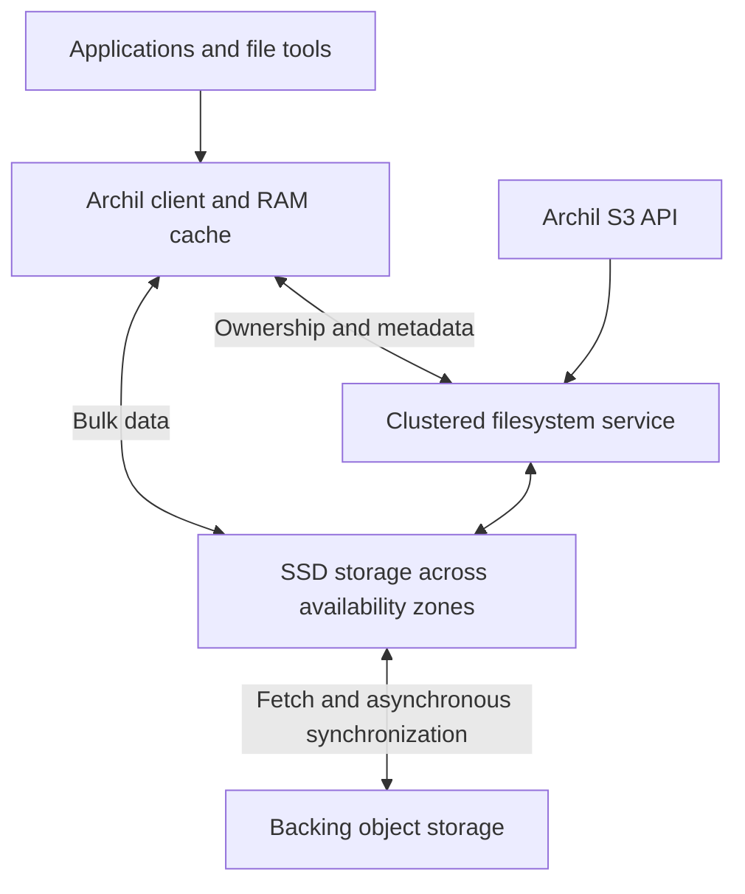

# Archil: architecture, capabilities, and tradeoffs

**Archil is a distributed filesystem and durable storage platform that combines a shared SSD storage layer, object storage for inactive data, and compute that runs close to those files.** Its current product includes serverless command execution, persistent sandboxes, filesystem branches, search, and SQLite access. That makes it relevant both as storage infrastructure and as a foundation for agent workspaces. [Archil](https://docs.archil.com/details/architecture?utm_source=chatgpt.com)

**My assessment:** the architecture is particularly attractive for coding agents, persistent development environments, and applications where many short-lived machines repeatedly access the same working set. Its main engineering advantage is allowing a client that owns a file or directory to perform many operations locally while Archil handles distributed persistence.

The details that determine whether it fits your application are **write ownership, client caching, synchronization to the backing bucket, and the cost of moving data to external compute**.

This report reflects the sources available on **October 18, 2026**. I reviewed the linked architecture page, the operational documentation, founder engineering posts, public SDK source, pricing, and primary documentation for competing systems. The performance results below are Archil’s published measurements; I did not run an independent benchmark.

---

## 1. The core architecture

Archil separates three things that applications often bundle into one machine:

- **Compute:** the process running your application, database, build, or agent.
- **Active storage:** the fast working set and recently committed writes.
- **Backing object storage:** the longer-lived, lower-cost representation of the data.

The founder’s architectural thesis is that many cloud products repeatedly assemble these same components, then build application-specific machinery to coordinate them. Archil aims to provide that machinery through a general filesystem interface. [archil.com](https://archil.com/post/building-the-last-wal-on-s3?utm_source=chatgpt.com)

### A logical view



This is a logical reconstruction of the published design. Archil describes a clustered metadata service and direct client access to storage servers, but does not publish a complete specification of its internal service boundaries. [archil.com](https://archil.com/post/s3-files-deep-dive?utm_source=chatgpt.com)

### The client has a substantial role

The client caches file contents, attributes, directory listings, and optional extended attributes in memory. Consequently, a read can take three paths:

| Where the requested data is found | What happens |
|---|---|
| Client cache | The operation can complete locally. |
| Archil’s shared storage layer | The client retrieves it over the network from Archil. |
| Backing object storage | Archil fetches the missing data and caches it for subsequent access. |

The client cache is **per mount**. Its default maximum is the smaller of one-quarter of available RAM and 2,048 MiB, with a target of 75% of that maximum. Sequential reads trigger configurable read-ahead, defaulting to 4 MiB. Prefetching fills this same bounded cache asynchronously. [Archil](https://docs.archil.com/details/caching?utm_source=chatgpt.com)

This explains a useful distinction: **mounting a large dataset does not require downloading the entire dataset first**, but accessing bytes that are absent from every cache still requires fetching those bytes. “Instant access” describes avoiding whole-dataset preparation; it does not eliminate network latency.

### The shared storage layer is durable

Archil’s server-side storage holds both frequently accessed data and newly committed writes. It replicates committed data across multiple availability zones.

A successful `fsync()` means the write has been committed redundantly to that storage layer. Copying the changes into the backing bucket happens afterward. Archil publishes design targets of **99.999% durability for newly written data before synchronization** and **99.99% availability**, with negotiated availability SLAs for Enterprise customers. [Archil](https://docs.archil.com/details/architecture?utm_source=chatgpt.com)

That design choice gives Archil responsibility for protecting data during the interval before object-storage synchronization. Its engineering discussion explicitly identifies this responsibility as the price of providing low-latency durable writes. [archil.com](https://archil.com/post/how-to-store-data-safely?utm_source=chatgpt.com)

---

## 2. Why its custom protocol can improve filesystem performance

The most interesting part of Archil is **ownership of files and directories**.

Suppose a build creates thousands of files in a directory used by one worker. Coordinating every individual mutation with a remote server introduces substantial overhead. If that worker has exclusive authority over the directory, many operations can instead be buffered and acknowledged locally.

Archil’s engineering explanation centers on exploiting this common pattern: clients usually work on different files or subdirectories, so the system can grant ownership of those portions of the namespace. [archil.com](https://archil.com/post/understanding-file-storage?utm_source=chatgpt.com)

### Two sources of inspiration

The founder identifies:

- **AFS-inspired ownership:** clients check out portions of the filesystem for exclusive writes.
- **Lustre-inspired data access:** clients communicate directly with storage servers for bulk data, while a clustered metadata service handles namespace coordination.

He also acknowledges the tradeoff: **under heavy contention on the same paths, ownership handoffs can cost more than NFS operations**. [archil.com](https://archil.com/post/s3-files-deep-dive?utm_source=chatgpt.com)

An illustrative calculation shows why ownership matters. If 10,000 serialized operations each require a 0.5 ms network round trip, the round trips alone consume five seconds. Eliminating most of those trips can transform an interactive workload even without increasing raw disk throughput. This is an explanation of the mechanism, not an Archil measurement.

### What “the last WAL on S3” means

In the August 2026 engineering post, the founder describes a filesystem view constructed from a persistent base representation plus a journal of changes. The interface accepts filesystem operations and preserves concepts such as inodes and directory entries.

The post discusses several ways to scale this design: separate data transfer from ordered log updates, batch commits, and partition work among multiple logs. It also discusses selectable durability and data-placement configurations.

**Those discussions are not a complete implementation specification.** The public material does not establish the exact deployed log format, partitioning scheme, consensus protocol, or availability of every proposed configuration as a public setting. [archil.com](https://archil.com/post/building-the-last-wal-on-s3?utm_source=chatgpt.com)

My interpretation is that Archil’s ambition is to make a reusable storage foundation for software that would otherwise need its own object-storage journal, SSD cache, recovery process, and synchronization system. Application-specific behavior—database replication, Git ref updates, conflict resolution—still requires application logic.

---

## 3. Consistency: distinguish the server, the client, and the bucket

“Strong consistency” needs qualification here.

### The write lifecycle

A typical mounted-client write proceeds through these stages:

1. The application writes through the filesystem interface.
2. The client may retain the changes in local memory.
3. `fsync()` or background flushing commits the changes to Archil.
4. Archil subsequently synchronizes them to the backing bucket.

Other clients’ requests to the Archil server observe committed changes, but a mounted client may answer a read from its own cache. [Archil](https://docs.archil.com/details/consistency?utm_source=chatgpt.com)

For Linux shutdown, the documented procedure is **`archil unmount`**. It waits for pending writes to flush; ordinary `umount` does not provide the same documented behavior. Forced unmount explicitly skips flushing outstanding writes. [Archil](https://docs.archil.com/reference/archil-cli?utm_source=chatgpt.com)

### There are three visibility domains

| View | Documented behavior |
|---|---|
| Archil server | Strong read-after-write consistency for committed changes; atomic rename. |
| Mounted client | Cached contents or directory information can lag behind another writer. |
| Backing bucket accessed directly | Asynchronous synchronization adds a separate delay. |

The consistency documentation describes client-cache delays of seconds, Archil-to-bucket propagation taking tens of seconds, and new objects written directly to the bucket sometimes taking minutes to appear through Archil. [Archil](https://docs.archil.com/details/consistency?utm_source=chatgpt.com)

If an application needs both filesystem access and an object API against current committed state, Archil recommends **its own S3 endpoint**. That endpoint accesses the Archil disk rather than waiting for the backing bucket to catch up. [Archil](https://docs.archil.com/protocols/s3-api?utm_source=chatgpt.com)

The practical implication is that these are separate questions:

- Has the writer durably committed its changes?
- Has the reader refreshed its cached view?
- Has the backing bucket received the changes?

An application handoff should account for whichever of those conditions it actually requires.

---

## 4. Shared writes require explicit attention

This is the biggest difference I found between the engineering narrative and the current operating instructions.

The blog describes adaptive ownership behavior. The current **Sharing Disks** documentation says fully dynamic delegation management is future work and that users currently manage delegations themselves. [archil.com](https://archil.com/post/understanding-file-storage?utm_source=chatgpt.com)

### Current Linux mount modes

| Mode | Behavior |
|---|---|
| Default exclusive | Claims ownership of the mounted root for one client. |
| `--shared` | Writing generally requires a delegation on the relevant path; certain create/open operations grant limited ownership automatically. |
| `--conditional` | Executes unowned operations remotely; explicit checkout can still accelerate a subtree. |

A delegation is an exclusive write claim on a file or directory and its descendants. Another client’s conflicting filesystem or Archil S3 write cannot simply bypass it. Removing a file requires appropriate ownership of its parent directory.

If a client crashes, its delegation can remain orphaned and require explicit revocation. Forcefully taking ownership can discard the previous client’s unflushed writes. [Archil](https://docs.archil.com/concepts/shared-disks?utm_source=chatgpt.com)

For an agent platform, I would favor clearly assigned directories, independent task branches, or separate disks. A collection of agents freely editing the same directory tree is a substantially harder workload than independent workers sharing reference data.

---

## 5. POSIX compatibility and object-storage interoperability

### Filesystem compatibility is broad, with meaningful limits

Archil documents support for random writes, appends, symbolic and hard links, atomic renames, open-but-unlinked files, permissions, ownership, and optional extended attributes. It says it tests behavior using the XFS filesystem test suite.

The important qualifications are:

| Area | Current FUSE-mounted disk behavior |
|---|---|
| `flock` / `fcntl` | Coordinate processes on one client; locks are not shared across separate mounted clients. |
| File ACLs | Not supported. |
| `renameat2` flags | Unsupported flags fail with `EINVAL`. |
| OverlayFS upper directory | Not supported on an additional Archil FUSE mount. |
| S3-synchronized paths | Subject to the 1,024-byte object-key limit, including prefix; names must be valid UTF-8. |

Persistent sandboxes have an **ext4 root filesystem**, which supports Linux features missing from the FUSE mounts, including Docker `overlay2`. Keep Docker’s storage directory on that root filesystem. [Archil](https://docs.archil.com/details/support?utm_source=chatgpt.com)

Running a database on one machine with exclusive ownership is therefore a different proposition from having several independent database processes open the same files across machines. Shared storage alone does not provide a database’s multiwriter coordination.

### What actually appears in the backing bucket

Archil preserves regular file contents as ordinary objects at corresponding keys. Other filesystem information is represented differently:

| Filesystem element | Backing representation |
|---|---|
| Regular file | Ordinary object containing file bytes. |
| Modes, ownership, extended attributes | Tracked internally by Archil. |
| Symbolic link | Text containing the target path. |
| Hard link | A full copy of the linked contents. |

Consequently, native object format provides content portability, but does not by itself establish a complete metadata-preserving filesystem backup. [Archil](https://docs.archil.com/concepts/data-sources?utm_source=chatgpt.com)

Additional synchronization constraints matter:

- Multiple writes are coalesced before object uploads.
- There is no documented user command to force backing-bucket synchronization.
- Concurrent direct-bucket and filesystem edits to the same file or directory can cause corruption or data loss.
- Directory operations can appear partially propagated when observed directly through the bucket.
- During a bucket outage, cached reads continue and writes buffer durably up to a fixed limit; beyond that, writes stop. Cache-miss reads wait for the source. [Archil](https://docs.archil.com/concepts/data-sources?utm_source=chatgpt.com)

---

## 6. Branches, compute, search, and databases

Archil has expanded substantially beyond mounted storage.

### Filesystem branches and checkpoints

A checkpoint captures immutable filesystem state. A branch is an independently writable fork starting at a checkpoint. These are generally available in AWS regions; support for customer-owned backing buckets requires Enterprise.

Two limitations are especially consequential:

- **Branches share disk credentials.** They separate changes, not access rights.
- **Deleting individual branches and checkpoints is currently documented as unsupported.**

Distinct disks are the appropriate boundary for mutually untrusted tenants. [Archil](https://docs.archil.com/concepts/branches-and-checkpoints?utm_source=chatgpt.com)

The founder has written about extending this toward task-sized transactions and merging. I would treat that as product direction. The published branching interface does not establish Git-style merge behavior or automatic transactional isolation for arbitrary shell commands. [archil.com](https://archil.com/post/building-file-system-transactions-for-agents?utm_source=chatgpt.com)

### Serverless execution

`disk.exec()` runs Bash, Python, Node, and other tools in a Linux microVM colocated with the data. The filesystem persists between calls; the execution environment is created for the command.

It supports multiple disks in one execution, including read-only or subdirectory-restricted mounts. That is useful for combining reference material with a separate writable workspace.

Current limits include:

- Five minutes per command.
- The trailing 128 KiB of stdout and stderr in the response.
- Hundreds of concurrent commands, with higher limits available by arrangement.

Default shared-mode execution still requires attention to write ownership. [Archil](https://docs.archil.com/compute/serverless-execution?utm_source=chatgpt.com)

This moves the application toward “send an operation to the files and receive the result,” which can reduce the amount of data transferred to an agent’s control process.

### Persistent sandboxes

Persistent sandboxes are x86-64 Firecracker microVMs with their own Linux kernel, configurable from **1–32 vCPUs and 0.25–64 GiB RAM**.

Their lifecycle distinguishes:

- **Stop/start:** retain the filesystem; restart processes.
- **Pause/resume:** retain memory and process state.
- **Host failure:** lose in-memory state, with recovery by booting from disk.

Sessions run up to 24 hours before pausing. Ports are private until exposed; public exposure accepts unauthenticated connections, with port tokens available for private HTTP access.

**Forking does not automatically fork every attached disk.** The fork gets its own root filesystem, but additional mounted disks are reused. Sandboxes with additional mounts must be stopped before forking. [Archil](https://docs.archil.com/compute/sandboxes/introduction?utm_source=chatgpt.com)

Archil’s launch post explicitly recommends other providers for attached GPUs, Windows/macOS execution, and very large compute fleets. It also states that Archil remains usable as storage beneath external sandbox platforms such as E2B and Daytona. [archil.com](https://archil.com/post/introducing-persistent-sandboxes?utm_source=chatgpt.com)

### How the compute architecture relates to storage

A June engineering post sketches a scheduler using capacity reports, a distributed lookup store, cached host mappings, and selection among a small random sample of hosts. Prepared runtime shapes and remotely accessible images reduce dependence on a particular host’s local image cache.

The architectural benefit is straightforward: if every suitable host can access the same image and workspace efficiently, scheduling needs less locality information.

The post’s “million sandboxes per second” title should be read as a scalability design argument. It does not provide an empirical production benchmark establishing that launch rate. [archil.com](https://archil.com/post/launching-a-million-sandboxes-per-second-in-constant-time?utm_source=chatgpt.com)

### Parallel file search

`disk.grep()` distributes listing and matching across ephemeral workers. This is described as parallel file scanning, rather than an inverted index or vector database.

You can limit runtime, result count, and concurrency. Those limits mean results may be partial; callers need to distinguish a completed search from one stopped early. Archil’s “up to 10× faster than ripgrep” claim lacks a reproducible benchmark methodology on that feature page. [Archil](https://docs.archil.com/compute/search-files?utm_source=chatgpt.com)

The SDK exposes `stoppedReason`, including `completed`, `deadline`, `max_results`, and error-related incomplete states. An early result set reflects whichever workers returned first. [Archil](https://docs.archil.com/sdks/typescript?utm_source=chatgpt.com)

### SQLite

There are two distinct ways to use SQLite:

1. Run a normal SQLite process on an appropriately owned filesystem.
2. Use Archil’s serverless SQLite integration.

The second offers a TypeScript API for queries and transactions, with concurrent readers and coordinated exclusive writes. [Archil](https://docs.archil.com/compute/sqlite?utm_source=chatgpt.com)

The public package README explains the implementation: queries run through Archil’s multi-disk `exec()` mechanism; write operations request a writable mount, and nested database paths acquire parent-directory ownership for journal/WAL sidecars. Transactions execute as a single remote SQLite transaction.

That is a concrete serverless wrapper around SQLite files. The source does not describe a separate distributed SQL engine. [GitHub](https://github.com/archil-data/archil-sdk/blob/main/packages/sqlite/README.md?utm_source=chatgpt.com)

---

## 7. Developer interfaces and integration

| Interface | Main purpose |
|---|---|
| Linux `archil` client | Mount disks and control ownership, caching, synchronization, and filesystem branches. |
| npm `disk` | Manage disks, objects, executions, search, and sandboxes through JavaScript/TypeScript. |
| PyPI `archil` | Python access to the platform, including synchronous and asynchronous calls. |
| `@archildata/native` | Lower-level access to the filesystem protocol for custom Node runtimes. |
| Archil S3 API | Read and modify files using compatible object-storage clients. |

The normal TypeScript SDK is pure JavaScript and requires Node.js 22.19 or later. It does not mount a filesystem; the native client is a separate interface. Python support requires Python 3.10 or later. [Archil](https://docs.archil.com/sdks/typescript?utm_source=chatgpt.com)

A minimal example illustrates how the object and execution interfaces meet:

```typescript
import * as archil from "disk";

const { disk } = await archil.createDisk({
  name: "agent-workspace",
});

await disk.putObject("notes.txt", "Persistent context");

const result = await disk.exec("cat notes.txt");
console.log(result.stdout);
```

Credentials and region can be supplied through SDK configuration or environment variables. [Archil](https://docs.archil.com/sdks/typescript?utm_source=chatgpt.com)

### S3 compatibility has a defined scope

The S3 endpoint supports listing, range reads, writes, deletes, multipart uploads, and an append extension. It uses path-style addressing and per-disk SigV4 credentials.

It is not the entire AWS S3 service API: for example, `CopyObject` and `ListBuckets` are unsupported. Active write delegations also constrain conflicting object writes. [Archil](https://docs.archil.com/protocols/s3-api?utm_source=chatgpt.com)

### Kubernetes and infrastructure management

The CSI driver supports static and dynamic provisioning. `ReadWriteOnce` maps to exclusive mounting; `ReadWriteMany` maps to shared mode, carrying the same ownership requirements described above. Requested PVC capacity is informational because the disk is elastic. Terraform manages disks and related configuration. [Archil](https://docs.archil.com/reference/csi-driver?utm_source=chatgpt.com)

### Desktop access

The macOS client supports **macOS 26 Tahoe and later** through a menu-bar application. Archil positions it primarily for occasional inspection and debugging, and warns that desktop-to-cloud latency can exceed 100 ms. A laptop mount is therefore a poor benchmark for colocated cloud workloads. [Archil](https://docs.archil.com/mounting/macos?utm_source=chatgpt.com)

---

## 8. Performance: what the evidence supports

### Published specifications

Archil documents:

- Sub-millisecond time to first byte for cached operations.
- Typical uncached S3 reads of 10–30 ms.
- Mounting in approximately 100 ms.
- Default per-disk limits of **10 GB/s and 10,000 IOPS across connected clients**, with higher limits available by request. [Archil](https://docs.archil.com/details/performance?utm_source=chatgpt.com)

These describe different measurements. Cached access latency, durable write completion, and full application transaction latency should not be treated as interchangeable.

### Archil’s October 15, 2026 EFS benchmark

| Workload | Archil | Amazon EFS |
|---|---:|---:|
| React repository clone | 9.8 s | 81.5 s |
| React tag checkout | 1.06 s | 46.9 s |
| `npm ci` | 7.6 s | 86.3 s |
| SQLite: 10,000 transactions, `FULL` | 23.9 s | 523 s |
| SQLite: 1 million rows, one transaction | 11.0 s | 1.7 s |
| Sequential writes | 194 MB/s | 590 MB/s |
| 4 KiB random writes | 953 IOPS | 2,976 IOPS |

The tests used the same `c7gn.2xlarge` host in Virginia, medians of three runs, Archil v0.9.2 with default mounting and **no configured data source**, and EFS General Purpose/Elastic/Standard. Git mirrors and npm caches were prepopulated locally. [Archil](https://docs.archil.com/details/comparison?utm_source=chatgpt.com)

The results show a strong advantage for several developer workflows, while EFS wins the large SQLite transaction and both write-throughput examples.

The benchmark’s “cold” fio reads followed host cache clearing and remounting. That does not establish performance with a cold Archil storage layer retrieving from S3. No EBS/local-NVMe comparison or variance data accompanies the table. [Archil](https://docs.archil.com/details/comparison?utm_source=chatgpt.com)

### What I would measure for your workload

I would benchmark three separate cache conditions: client-hot, server-hot/client-cold, and backing-object-cold. I would also measure the actual mount mode you intend to deploy.

For coding agents, time the sequence that matters: attach workspace, inspect repository, install dependencies, edit files, build, persist results, and hand the workspace to another worker.

Include persistence in the measurement. Archil’s own performance guidance notes that dependency-install completion can precede durable flushing and recommends `archil sync` when durability is required before continuing. [Archil](https://docs.archil.com/details/performance-tips?utm_source=chatgpt.com)

---

## 9. Pricing and the economic model

Current public Developer and Team rates are:

| Resource | Published rate |
|---|---:|
| Active storage | $0.20/GiB-month |
| Managed archive storage | $0.025/GB-month |
| Serverless tool calls | $0.05 per 1,000 |
| Persistent sandbox CPU | $0.055/vCPU-hour |
| Persistent sandbox memory | $0.020/GiB-hour |
| Transfer out of Archil | $0.07/GB |
| Transfer within Archil | Free |

The units deliberately preserve Archil’s distinction between **GB and GiB**. [archil.com](https://archil.com/pricing?utm_source=chatgpt.com)

Plans have monthly minimums of **$0 Free, $10 Developer, $500 Team, and custom Enterprise**. Free includes five disks up to 10 GB each, 1,000 serverless calls, and 30 minutes of sandbox compute, but excludes external mounts and BYOB. [archil.com](https://archil.com/pricing?utm_source=chatgpt.com)

The paid minimum is a floor against usage, not an additional subscription charge. Serverless execution is included in the per-call rate; persistent sandboxes have separately metered CPU and memory. Managed archive storage is additional, while BYOB customers pay their bucket provider. Model inference is excluded. [Archil](https://docs.archil.com/administration/billing?utm_source=chatgpt.com)

### Active storage depends on access patterns

Active usage is sampled each minute and averaged over the billing period. Read data remains active for up to an hour after its last access; written data can remain active after flushing.

Prefetching and repeated overwrites can increase the active footprint. Metadata reads do not activate file contents, but metadata mutations count as 32 KiB per operation until propagation; ownership allows many small updates to be coalesced.

Branches use copy-on-write accounting: shared base data is billed once, with unique changes added. [Archil](https://docs.archil.com/concepts/metering?utm_source=chatgpt.com)

### Illustrative costs

Calculated from the published rates:

- One million serverless calls: **$50**, before storage and transfer.
- A running 2-vCPU, 4-GiB sandbox: **$0.19/hour**.
- One TiB continuously active: **$204.80/month**.
- Ten decimal TB delivered to external compute: **$700 in Archil egress**. [archil.com](https://archil.com/pricing?utm_source=chatgpt.com)

My assessment is that the economics depend heavily on **working-set reuse and compute placement**. A small active fraction of a large dataset can be attractive. Repeatedly streaming large amounts to external machines can make transfer charges dominate. Enterprise private networking has separate arrangements. [Archil](https://docs.archil.com/administration/billing?utm_source=chatgpt.com)

---

## 10. Deployment, regions, security, and isolation

### Deployment choices

| Model | Where the storage resides |
|---|---|
| Managed | Archil owns the backing bucket and operates the active storage layer. |
| Bring your own bucket | You own the bucket; active data still passes through Archil’s storage layer. |
| Full self-hosting / BYOC | Filesystem and storage layers run in your cloud account. |
| Encrypted shared storage | Filesystem layer runs in your account; encrypted data goes to Archil’s storage layer. |

**BYOB does not mean that active data stays exclusively in your account.** Full self-hosting is the documented option that keeps disk data there. Enterprise pricing also lists on-premises deployment, although I did not find a public installation and hardware-sizing runbook. [Archil](https://docs.archil.com/details/security?utm_source=chatgpt.com)

### Regions

Public storage regions include AWS Virginia, Oregon, and Ireland, plus GCP Iowa. GCP Oregon is preview; Azure is available through private deployments.

Serverless execution and search are documented in the three public AWS regions, rather than across every storage region. [Archil](https://docs.archil.com/reference/regions?utm_source=chatgpt.com)

### Security claims and boundaries

Archil publishes AES-256 encryption at rest, TLS 1.2+ in transit, SOC 2 Type II audits, and Enterprise DPA/BAA support. I did not inspect its underlying audit report. [Archil](https://docs.archil.com/details/security?utm_source=chatgpt.com)

Its operational guidance makes the **disk the unit of tenant isolation**. Disk credentials cover its branches and checkpoints, and POSIX permissions should not be used as the security boundary between untrusted tenants. Account-level management credentials should remain in the administrative layer. [Archil](https://docs.archil.com/administration/best-practices?utm_source=chatgpt.com)

There is also a residency distinction: file contents, paths, and attributes remain in the selected cloud/region, while AWS hosts account-related disk metadata such as disk names, authorized-user lists, and billing information. [Archil](https://docs.archil.com/legal/subprocessors?utm_source=chatgpt.com)

---

## 11. How it compares with the main alternatives

These are architectural comparisons, rather than independently measured rankings.

| Alternative | Main distinction |
|---|---|
| **Direct S3 access** | A natural fit when the application already operates on objects. Archil adds value when ordinary filesystem tools and shared mutable workspaces matter. |
| **Mountpoint for S3** | An S3-oriented filesystem adapter with deliberately constrained filesystem semantics. Evaluate those semantics against the application’s actual operations. |
| **EFS / Amazon S3 Files** | AWS-managed shared file access through NFS. S3 Files now combines EFS with synchronized S3 data and working-set storage, making it a direct comparison. |
| **EBS / local NVMe** | Appropriate when block-device behavior and predictable local access matter. Sharing, provisioning, and recovery remain separate design concerns. |
| **JuiceFS** | Separates filesystem metadata into a metadata engine and stores data as internal chunks/blocks in object storage. Its Community architecture is publicly documented and supports several metadata databases. |
| **External sandbox providers plus Archil** | Lets you use Archil’s storage while choosing compute independently, including for workloads outside Archil’s sandbox capabilities. |

Sources: AWS Mountpoint semantics, AWS S3 Files documentation, EBS documentation, JuiceFS architecture, and Archil’s sandbox announcement. [GitHub](https://github.com/awslabs/mountpoint-s3/blob/main/doc/SEMANTICS.md?utm_source=chatgpt.com)

### Two comparisons deserve extra care

**S3 Files is now a real alternative.** AWS documents bidirectional synchronization, preservation of POSIX permissions in object metadata, and an explicit conflict policy that favors the bucket’s version. Its synchronization model should be compared directly with Archil’s—not treated as plain S3 mounting. [Amazon Simple Storage Service](https://docs.aws.amazon.com/AmazonS3/latest/userguide/s3-files-synchronization.html?utm_source=chatgpt.com)

**Archil’s NFS criticism is broader than the standard warrants.** NFSv4.1 itself includes delegations and parallel data access. Archil’s relevant distinction is its implemented combination of subtree ownership, buffering, and direct storage access—not the proposition that all NFS systems lack caching or parallelism. [rfc-editor.org](https://www.rfc-editor.org/rfc/rfc8881.html?utm_source=chatgpt.com)

Likewise, EBS is not universally single-attach: certain `io1`/`io2` volumes support Multi-Attach in one availability zone. That still requires suitable application or clustered-filesystem coordination. [Amazon EBS](https://docs.aws.amazon.com/ebs/latest/userguide/ebs-volumes-multi.html?utm_source=chatgpt.com)

---

## 12. Company, adoption, maturity, and unanswered questions

### Company background

Archil was founded in 2024 by **Hunter Leath**, is based in San Francisco, and participated in YC’s Fall 2024 batch. It was originally called Regatta Storage and announced the Archil name in March 2025. [Y Combinator](https://www.ycombinator.com/companies/archil?utm_source=chatgpt.com)

Felicis announced a **$6.7 million seed round in June 2025**. Its account describes Leath’s background as an early EFS engineer, subsequently an EFS product leader, followed by cloud-storage work at Netflix. [Felicis](https://www.felicis.com/blog/investing-in-archil?utm_source=chatgpt.com)

Archil announced an **$11 million Series A led by Standard Capital in April 2026**, reporting **$18 million total funding**. [archil.com](https://archil.com/post/series-a?utm_source=chatgpt.com)

The original 2024 launch used NFSv3 while its custom protocol was under development. Older descriptions of an NFS front end therefore reflect an earlier product architecture. [Hacker News](https://news.ycombinator.com/item?id=42174204\&utm_source=chatgpt.com)

### Adoption evidence

Felicis identified Depot and Fly.io as customers working with Archil in 2025. That establishes a historical relationship, not their present implementation details. [Felicis](https://www.felicis.com/blog/investing-in-archil?utm_source=chatgpt.com)

A more concrete September 2026 engineering account comes from **Transilience AI**. It describes Modal for ephemeral compute, Archil for persistent working documents and repositories, S3 for canonical evidence and accepted outputs, and Cloudflare Durable Objects for current structured state.

That is a useful example of integrating Archil without making every kind of application state a filesystem concern. The article explicitly omits production measurements. [Transilience AI](https://www.transilience.ai/blog/why-we-added-archil-to-an-ephemeral-agent-platform?utm_source=chatgpt.com)

### What is public—and what remains undisclosed

The public GitHub materials include MIT-licensed SDKs, a Terraform provider, and filesystem-testing material. I did not find public source for the core storage engine. [GitHub](https://github.com/archil-data/archil-sdk?utm_source=chatgpt.com)

The public engineering posts do not fully specify:

- The consensus and fencing protocols.
- Replica counts and exact quorum requirements.
- The metadata database and partitioning scheme.
- Cross-partition operation handling.
- Corruption detection and repair behavior.
- Quantified recovery time under network partitions or regional failures.

The durability article discusses erasure coding and copysets, but its examples do not establish that Archil deploys a particular replication count or coding configuration. [archil.com](https://archil.com/post/how-to-store-data-safely?utm_source=chatgpt.com)

### Signs of rapid evolution

The client release notes reach v0.9.3 and include recent fixes for stale file sizes, concurrent-create races, and S3 path-length failures. That makes the client version part of a meaningful evaluation. [Archil](https://docs.archil.com/reference/client-release-notes?utm_source=chatgpt.com)

Documentation alignment is also imperfect. Besides the ownership discrepancy, the sandbox introduction assigns custom network policies to Team+, while current pricing includes them on Developer. The metering page discusses deleting checkpoints, while the checkpoint guide says individual deletion is not yet supported. These should be resolved before designing around the affected features. [Archil](https://docs.archil.com/compute/sandboxes/introduction?utm_source=chatgpt.com)

---

## 13. What this would mean for OpenAgents

**I would evaluate Archil first as the persistent workspace and data-access layer for OpenAgents.**

The most promising use is to let an agent resume useful work on fresh compute without reconstructing its entire filesystem environment. Source trees, documents, generated artifacts, and selected database files can persist while execution environments come and go.

A practical design would have:

1. **A disk per tenant or access boundary.**
2. **A task branch for parallel attempts within the same trust boundary**, or separate disks where access must be isolated.
3. **Read-only shared reference material** where many workers consume the same inputs.
4. **Explicit ownership and persistence at handoff points.**
5. **OpenAgents-owned control state** for users, permissions, task scheduling, approvals, billing, and accepted outcomes.

The disk and branch choices follow Archil’s own isolation guidance; the broader division is my architectural recommendation. [Archil](https://docs.archil.com/administration/best-practices?utm_source=chatgpt.com)

For your Git and software-factory interests, filesystem branches could preserve substantially more than a Git checkout: dependencies, build outputs, local databases, and prepared environments. Git would still handle source history and source-level merges. The value would be reducing the amount of environment reconstruction and storage machinery OpenAgents needs to own.

I would make the pilot answer four concrete questions:

- Does a fresh worker become productive faster on your real repositories and datasets?
- Do ownership and cache rules fit your agent handoff model without excessive coordination?
- Can you recover the state you care about after worker termination and storage-service disruption?
- Does the complete bill—including active data, retained branches, compute, and egress—improve the economics?

**The strongest reason to take Archil seriously is the combination of filesystem compatibility, durable shared storage, and execution near the data.** The principal uncertainty is how well that combination behaves under your actual contention, failure, and working-set patterns. Its public architecture is compelling enough to justify a focused evaluation; its current documentation is specific enough to show exactly which assumptions that evaluation needs to test.

