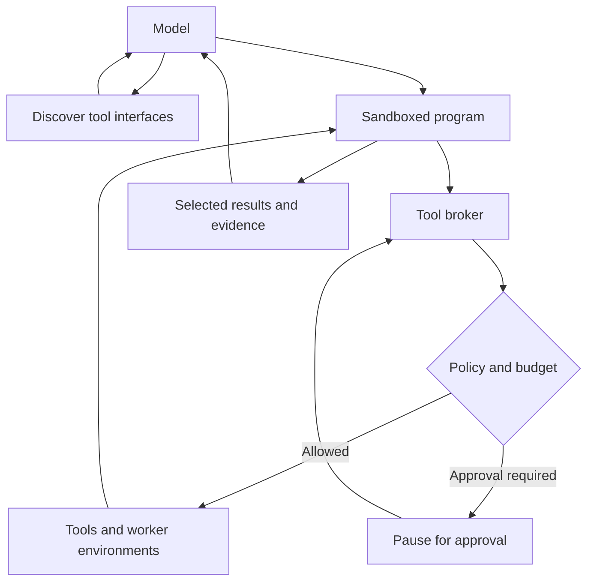

# Code mode for coding agents: architecture, adoption, frameworks, and tradeoffs

**Code mode is an agent execution pattern in which the model writes a program that calls tools, processes their results, and controls what information returns to the model.** The program becomes the agent’s action for that step.

My assessment: **code mode deserves a first-class place in a coding-agent platform, particularly one with a large tool ecosystem.** Its strongest uses are coordinating many operations, processing large intermediate results, and orchestrating other agents. A good implementation keeps direct tool calls available and chooses the execution path according to where the model needs to exercise judgment.

The research below reflects official documentation, release notes, source code, and papers available through **October 17, 2026**. There are substantial differences between implementations—including their permission checks, persistence, and sandbox guarantees.

---

## 1. What “code mode” means

A conventional tool-using agent commonly follows this loop:

1. The model chooses a tool and supplies arguments.
2. The application executes the tool.
3. The model receives the result.
4. The model decides what to do next.

With code mode, the model can express several of those operations as one program:

1. Discover the relevant functions and their interfaces.
2. Generate a script containing tool calls, conditions, loops, and transformations.
3. Execute the script.
4. Return selected results or errors to the model.
5. Let the model decide whether another program or a final answer is needed.

Cloudflare’s implementation exposes tools as typed APIs; the broader CodeAct research formulation uses executable Python as an agent’s action language. These belong to the same family, although their runtimes and interfaces differ. [blog.cloudflare.com](https://blog.cloudflare.com/code-mode/?utm_source=chatgpt.com)

### A concrete coding-agent example

Suppose the task is:

> Inspect up to 20 open pull requests and report which have failed checks.

Using hypothetical repository and CI tool bindings, the model could generate:

```javascript
const prs = await repo.listOpenPullRequests({ limit: 20 });
const failures = [];

for (let i = 0; i < prs.length; i += 4) {
  const batch = await Promise.all(
    prs.slice(i, i + 4).map(async pr => {
      const checks = await ci.listChecks({ sha: pr.headSha });

      return {
        pr: pr.number,
        sha: pr.headSha,
        url: pr.url,
        failures: checks
          .filter(check => check.conclusion === "failure")
          .map(check => ({
            name: check.name,
            url: check.url
          }))
      };
    })
  );

  failures.push(...batch.filter(result => result.failures.length));
}

return { inspected: prs.length, failures };
```

The script expresses bounded concurrency, joins repository information with CI information, filters the results, and preserves links and commit identifiers.

The model does not need to read every successful check. It receives the failures it needs to explain.

**One visible code-execution call can still produce 21 underlying tool requests.** Code mode changes how those requests are orchestrated and observed; their API costs, permissions, and side effects remain relevant.

### Three optimizations often get bundled together

| Optimization | What it changes | Does it require code execution? |
|---|---|---|
| **On-demand tool discovery** | Loads only relevant tool definitions into context | No |
| **Programmatic orchestration** | Executes known control flow without repeatedly sampling the model | Yes, for this pattern |
| **Intermediate-result processing** | Filters, joins, aggregates, or stores results before the model sees them | Can also be provided by purpose-built tools |

This distinction matters when evaluating claims. A code tool that includes an enormous SDK declaration in its description can still have a large context footprint. Conversely, an agent using ordinary function calls can already benefit from tool search and parallel batches. Anthropic explicitly introduced Tool Search and Programmatic Tool Calling as separate features. [anthropic.com](https://www.anthropic.com/engineering/advanced-tool-use?utm_source=chatgpt.com)

### Relationship to adjacent concepts

- **MCP** supplies a protocol for exposing tools and other capabilities. Code mode can operate over MCP. A server can expose discovery and execution as ordinary MCP tools.
- **CodeAct** describes the broader code-as-action agent formulation.
- **Programmatic Tool Calling, or PTC,** is Anthropic’s terminology for its API implementation.
- **A coding agent’s shell** already provides programmable execution. Explicit code mode adds a structured bridge to the agent’s other tools.
- **Skills and reusable workflows** supply instructions or procedures. Generated programs can become reusable procedures after a separate review and promotion step.

The term also appears in IDEs to mean a mode that edits source files. That product setting does not, by itself, establish programmatic tool orchestration.

---

## 2. Why it matters specifically for coding agents

Coding agents have two different kinds of work:

**Reasoning work:** understand requirements, interpret unfamiliar failures, choose an implementation, assess a security implication, or resolve an architectural disagreement.

**Mechanical work:** enumerate files, fetch related records, run known checks, traverse dependency data, compare structured outputs, or collect results from parallel workers.

Code mode gives the agent a convenient way to program the mechanical work while retaining model checkpoints for reasoning.

Representative workflow designs include:

| Coding workflow | Useful work inside a program | Useful model checkpoint |
|---|---|---|
| CI investigation | Fetch runs, group failures, extract relevant log sections | Decide what caused an unfamiliar failure |
| Repository exploration | Inspect manifests, locate symbols, collect references | Interpret architecture and select the relevant subsystem |
| Dependency migration | Enumerate packages, apply a known transformation, run checks | Decide how to handle breaking behavior |
| Cross-system debugging | Join issues, commits, deployments, and incidents | Form and evaluate a causal explanation |
| Large refactor | Dispatch isolated subtasks and gather verification results | Resolve conflicting changes and assess overall correctness |

An agent already comfortable with Bash and Python can accomplish some of this without a named code-mode feature. The incremental value comes from making the **existing tool ecosystem callable through a consistent interface**, with reusable authentication, schemas, result handling, and execution policies.

The limiting factor is whether intermediate decisions can be specified in advance. “Retry this read on a transient error” is straightforward to encode. “Decide whether this failing test reveals a bad implementation or an incorrect requirement” usually needs fresh model reasoning.

A program can invoke a model or subagent at that point, but the inference cost then occurs inside the program.

---

## 3. Where the idea came from—and who uses it now

### Research lineage

The underlying idea predates the recent “Code Mode” terminology:

- **Code as Policies, 2022:** language models generate programs that compose perception and control APIs.
- **PAL, 2022:** the model generates intermediate programs and delegates computation to an interpreter.
- **CodeAct, February 2024:** executable code becomes a general action interface for multi-turn agents.
- **smolagents, December 2024:** Hugging Face makes code-action agents accessible through a lightweight framework. [arxiv.org](https://arxiv.org/abs/2209.07753?utm_source=chatgpt.com)

Cloudflare introduced its specific MCP-oriented Code Mode approach on **September 26, 2025**. Anthropic followed with its code-execution-with-MCP architecture article on **November 4**, and its PTC API announcement on **November 24**. [blog.cloudflare.com](https://blog.cloudflare.com/code-mode/?utm_source=chatgpt.com)

### Documented industry implementations

| System | Publicly documented implementation | Architectural significance |
|---|---|---|
| **Cloudflare API MCP** | Launched February 20, 2026, around the core operations `search` and `execute`. Current versions include additional helper tools. | A server can make a very large API available through discovery and sandboxed code. [Cloudflare Blog](https://blog.cloudflare.com/code-mode-mcp/?utm_source=chatgpt.com) |
| **Stainless** | Its generated MCP servers switched to Code Mode-only on January 13, 2026: documentation search plus execution against a TypeScript SDK. | Existing SDK quality becomes part of the agent interface. [stainless.com](https://www.stainless.com/changelog/mcp-servers-now-support-code-mode-only/?utm_source=chatgpt.com) |
| **Anthropic API** | PTC lets Python call application-provided tools from a hosted code runtime. Anthropic also identified Claude for Excel as a shipping application using PTC. | The model can work with large datasets without reading every intermediate record. [Claude Platform Docs](https://platform.claude.com/docs/en/agents-and-tools/tool-use/programmatic-tool-calling?utm_source=chatgpt.com) |
| **Claude Code** | Dynamic workflows, introduced May 28, 2026 and now marked generally available, use generated JavaScript to coordinate many subagents. | The callable unit can be an entire agent, extending code orchestration beyond individual API functions. [Claude by Anthropic](https://claude.com/resources/articles/introducing-dynamic-workflows-in-claude-code?utm_source=chatgpt.com) |
| **Amp** | Current Plugin API documentation explicitly describes `tool_search` and `code_exec`, with MCP servers exposed as deferred code-mode modules. | This is documented native integration. Its first code-mode release date was not established by the sources reviewed. [Amp Docs - Amp](https://ampcode.com/docs/plugin-api?utm_source=chatgpt.com) |
| **Pi** | Version 0.99.0, released September 29, 2026, introduced code mode and tool search using QuickJS. | Scripts can compose ordinary tools and invoke classifier models; nested calls have explicit parent relationships. [GitHub](https://github.com/earendil-works/pi/releases/tag/v0.99.0?utm_source=chatgpt.com) |
| **OpenAI Codex** | Public source implements JavaScript `exec` cells, nested tool dispatch, and a `wait` lifecycle. The configuration reference still labels code-mode configuration under development and off by default. | There is an inspectable implementation, but that does not establish uniform enablement across clients or models. [GitHub](https://github.com/openai/codex/blob/main/codex-rs/core/src/tools/code_mode/execute_handler.rs?utm_source=chatgpt.com) |
| **Docker Agent** | `code_mode_tools` wraps tools in `run_tools_with_javascript`. Version 1.147.0 added promises, top-level `await`, and parallel execution. | A concrete Go-hosted implementation using the goja JavaScript engine. Its permission granularity deserves special attention. [Docker Docs](https://docs.docker.com/ai/docker-agent/features/code-mode/?utm_source=chatgpt.com) |
| **Redocly** | Its September 17, 2026 announcement describes code mode for documentation MCP and its AI Assistant. | Its documented application focuses on processing documentation results; calling customers’ actual APIs was described as a future extension. [Redocly](https://redocly.com/blog/mcp-code-mode?utm_source=chatgpt.com) |

There is enough direct evidence to treat this as a real implementation pattern across the industry. However, generic shell access or MCP support is insufficient evidence that a product implements it.

### Claude Code’s evolution is especially relevant

Claude Code’s dynamic workflow runtime exposes primitives such as `agent()`, `parallel()`, and `pipeline()`. The orchestration script itself has no direct filesystem or shell access; subagents perform those operations through their tools and retain applicable session permissions. [Claude Code Docs](https://code.claude.com/docs/en/workflows?utm_source=chatgpt.com)

That is a useful architectural separation: a small language runtime coordinates workers that have richer development environments.

It also shows why “code mode saves tokens” is incomplete. A script that launches 100 agents can perform much more work and consume substantially more total tokens. Anthropic’s announcement explicitly acknowledges this. [Claude by Anthropic](https://claude.com/resources/articles/introducing-dynamic-workflows-in-claude-code?utm_source=chatgpt.com)

---

## 4. Frameworks and libraries that implement it

These packages operate at different layers. Some supply the agent loop, some transform an MCP server, and others supply an interpreter plus tool bridge.

| Framework or library | Implementation | Best fit and caveat |
|---|---|---|
| **Cloudflare `@cloudflare/codemode`** | Typed tool bindings, pluggable executors, framework adapters, and a newer connector-based durable runtime. | Strong reference for hosted TypeScript systems. Code Mode remains experimental. [GitHub](https://github.com/cloudflare/agents/blob/main/packages/codemode/README.md?utm_source=chatgpt.com) |
| **Hugging Face smolagents** | `CodeAgent` generates Python actions; `ToolCallingAgent` supplies the conventional alternative. Supports external execution backends. | Good for learning and experimenting with code-action agents. Its built-in local executor is explicitly not a security sandbox. [GitHub](https://github.com/huggingface/smolagents?utm_source=chatgpt.com) |
| **FastMCP CodeMode** | A server transform replaces the exposed catalog with discovery, schema retrieval, and Python execution using Monty by default. | A practical way to retrofit an existing MCP server without modifying every tool. The transform is experimental. [FastMCP](https://gofastmcp.com/servers/transforms/code-mode?utm_source=chatgpt.com) |
| **Pydantic AI Harness CodeMode** | Selected tools become functions inside `run_code`, backed by Monty, with state, nested instrumentation, and durability integrations. | A detailed Python implementation with explicit tool selection. Approval and deferred tools require an appropriate inline resolver. [Pydantic Docs](https://pydantic.dev/docs/ai/harness/code-mode/?utm_source=chatgpt.com) |
| **LangChain Deep Agents / QuickJS integration** | Interpreter middleware exposes selected tools through `tools.*` and can expose subagent dispatch through `task(...)`. | Useful within LangGraph-based systems. Nested PTC calls do not automatically receive the usual per-call human approval handling. [GitHub](https://github.com/langchain-ai/deepagents/blob/main/libs/partners/quickjs/README.md?utm_source=chatgpt.com) |
| **TanStack AI Code Mode** | `createCodeMode()` creates `execute_typescript` and its prompt. Separate drivers support several isolation environments. | Useful for TypeScript applications that want to keep runtime choice flexible. Drivers include isolated-vm, QuickJS, Cloudflare, E2B, and Daytona. [GitHub](https://github.com/tanstack/ai/blob/main/docs/code-mode/code-mode.md?utm_source=chatgpt.com) |
| **LlamaIndex `CodeActAgent`** | A prebuilt code-action agent accepts a supplied `code_execute_fn`. | Convenient if you already use LlamaIndex. Executor isolation and persistence remain integration responsibilities. [Developer Documentation](https://developers.llamaindex.ai/python/examples/agent/code_act_agent/?utm_source=chatgpt.com) |
| **Bifrost Code Mode** | A gateway exposes virtual tool files and four discovery/execution tools, running Python-like Starlark inside Go. | Particularly relevant to model/tool aggregators. Starlark is a restricted language rather than full Python. [Bifrost](https://docs.getbifrost.ai/mcp/code-mode?utm_source=chatgpt.com) |
| **UTCP Code Mode** | Libraries, a CLI, and an MCP-facing interface expose connected tools through generated code and discovery. | Broad integration surface spanning MCP and other tool transports. Inspect the executor’s actual trust boundary before adoption. [GitHub](https://github.com/universal-tool-calling-protocol/code-mode?utm_source=chatgpt.com) |
| **mcp-use** | `codeMode: true` exposes search and execution, with replaceable executors. | An approachable MCP-client integration. Its documentation distinguishes the default Node `vm` option for trusted environments from E2B for untrusted code. [mcp-use](https://docs.mcp-use.com/typescript/client/code-mode?utm_source=chatgpt.com) |

**TaskWeaver** is also historically relevant: Microsoft built a code-first, stateful analytics agent framework around Python and plugins. Its repository was archived in March 2026, so I would treat it primarily as an architectural reference. [GitHub](https://github.com/microsoft/TaskWeaver?utm_source=chatgpt.com)

### An execution service is only one component

E2B, Modal, Docker, QuickJS, and similar systems can supply an execution environment. An agent platform still needs to provide:

- Tool discovery and interfaces.
- Authentication and authorization.
- The model execution loop.
- Result normalization.
- State management.
- Tracing and budgets.

A sandbox product and a complete code-mode implementation solve different portions of the problem.

---

## 5. The main architectural choices

### A. Where does the code run?

There are four useful deployment patterns.

| Pattern | Location of orchestration | Consequence |
|---|---|---|
| **Agent-hosted** | Inside the coding agent’s runtime infrastructure | Can compose tools across the agent’s entire available toolset |
| **MCP-server-hosted** | Inside a server exposing discovery and execution tools | Ordinary MCP clients can use it without supplying a sandbox |
| **Model-provider-hosted** | Inside a provider’s managed execution environment | Simplifies runtime integration, but data passes through that provider’s execution infrastructure |
| **Agent-orchestration runtime** | A dedicated runtime whose callable functions launch agents | Supports large parallel workflows while delegating actual development work to workers |

Cloudflare and FastMCP illustrate server-side wrapping; Anthropic PTC illustrates provider-hosted execution; Claude Code workflows illustrate agent orchestration. [Cloudflare Agents docs](https://developers.cloudflare.com/agents/model-context-protocol/codemode/?utm_source=chatgpt.com)

A server-side implementation naturally has access to the capabilities that server exposes. Composing tools across unrelated servers requires an agent-side runtime or a gateway that connects them.

There can also be multiple code-mode layers: an agent’s script calls a server’s code-execution tool. That can work, but adds another language boundary, output policy, timeout, and error format. I would choose the main composition layer deliberately.

### B. A robust reference architecture

The following is a recommended design; individual products omit or implement some components differently.



The **tool broker** is the critical boundary. Generated code should receive callable capabilities, while credentials, permission evaluation, argument validation, and access to external systems stay under host control.

Cloudflare’s executor, for example, uses RPC-backed tool access and blocks direct outbound networking by default. Applications can explicitly supply additional outbound capabilities, so the effective boundary still depends on configuration. [Cloudflare Agents docs](https://developers.cloudflare.com/agents/tools/codemode/api-reference/?utm_source=chatgpt.com)

### C. Typed interfaces need useful output contracts

Input schemas tell the agent how to invoke a tool. Output schemas tell its program how to compose that tool with other tools.

For coding workflows, useful contracts should specify:

- Whether an identifier is a branch name, commit SHA, repository ID, or URL.
- Pagination behavior and whether results are complete.
- Whether an empty result means “none found” or “permission denied.”
- Error representation and retryability.
- Whether outputs contain structured data, text, binary content, or references.
- Whether an operation changes state.

Missing output information creates code that guesses at response shapes. Pydantic AI explicitly warns when wrapped tools lack return schemas, because their generated signatures then expose `Any`. [Pydantic Docs](https://pydantic.dev/docs/ai/harness/code-mode/?utm_source=chatgpt.com)

**Type declarations also do not automatically imply type checking.** Some implementations provide TypeScript declarations to guide generation, then execute JavaScript. Others add compilation or validation. And even a fully type-correct program can use the wrong units, join on the wrong identifier, or perform operations in the wrong order.

### D. Provider-hosted PTC still has application round trips

Anthropic’s PTC flow is particularly instructive:

1. Claude generates Python.
2. The execution runtime starts it.
3. A call to an application tool pauses the program.
4. The application receives and fulfills that call.
5. The program resumes without another model inference between those operations.

Thus the savings concern **model inference and model-visible context**. The application still services the underlying tool requests. [anthropic.com](https://www.anthropic.com/engineering/advanced-tool-use?utm_source=chatgpt.com)

Current Anthropic documentation uses `allowed_callers` to control the invocation interface. It also lists restrictions, including unsupported `strict: true` tools and the inability to directly call tools supplied by its hosted MCP connector programmatically. An application can build its own bridge, but the two interfaces are not automatically interchangeable. [Claude Platform Docs](https://platform.claude.com/docs/en/agents-and-tools/tool-use/programmatic-tool-calling?utm_source=chatgpt.com)

---

## 6. State, suspension, and recovery are separate design problems

“Stateful code mode” can refer to several mechanisms:

| Mechanism | What persists | What it provides |
|---|---|---|
| **Explicit store** | Selected serializable values | Reuse across otherwise disposable executions |
| **Persistent REPL** | Variables, imports, functions, and interpreter state | Incremental work without reconstructing everything |
| **Suspended execution** | A paused program and its execution state | Continuation after an external operation completes |
| **Durable journal and replay** | Source, recorded calls, results, and execution status | Reconstruction after approvals or interruptions |

Pydantic AI keeps REPL state across code calls within a run; persistence across separate runs requires a configured store. Monty also supports serialized idle sessions and suspended executions, with distinct restoration paths and compatibility constraints. [Pydantic Docs](https://pydantic.dev/docs/ai/harness/code-mode/?utm_source=chatgpt.com)

These distinctions affect operations. A persistent interpreter alone does not establish recovery after a process crash. Saving variables does not establish that a pending remote request can safely be repeated.

### Cloudflare’s durable runtime is a useful case study

Its newer runtime records connector calls and can pause when a method needs approval. Approval causes the same program to run again, with recorded results substituted for already applied calls.

That introduces concrete requirements:

- Replayed calls must occur in the same sequence with the same arguments.
- Time and randomness may need recording through `codemode.step()`.
- Concurrent call arrival can change replay order; Cloudflare cautions against `Promise.all()` when an execution may pause.
- Rollback calls optional compensation handlers.
- Rejecting a later action does not undo earlier effects. [Cloudflare Agents docs](https://developers.cloudflare.com/agents/tools/codemode/how-it-works/?utm_source=chatgpt.com)

This durable SDK runtime is a separate component from Cloudflare’s public API MCP service; their capabilities should not be conflated.

### The unresolved-write problem

Consider:

1. A remote service creates a deployment.
2. The host crashes before recording the successful response.
3. The program is retried.

A journal alone cannot tell whether repeating the request creates a duplicate deployment.

Production write paths need some combination of downstream idempotency keys, reconciliation, deduplication, or explicit treatment of uncertain outcomes. Compensation addresses a different problem: attempting to reverse effects that already happened.

Timeout and cancellation likewise do not guarantee that an external service stopped processing a request.

---

## 7. What the performance evidence actually says

The evidence supports code mode for some workloads. It does not support a universal speedup or cost-reduction percentage.

| Source and workload | Reported result | Correct interpretation |
|---|---|---|
| **CodeAct, M³ToolEval** | GPT-4-1106-preview: **74.4%** success with code versus **52.4%** with JSON; average turns **5.5 versus 7.6** | A substantial gain on 82 curated composed-tool tasks using an older model—not a repository-coding benchmark. [arxiv.org](https://arxiv.org/html/2402.01030v4?utm_source=chatgpt.com) |
| **CodeAct, atomic API-Bank tasks** | Same model: **76.7%** with code versus **82.7%** with JSON | Code was worse for this single-operation setting. [arxiv.org](https://arxiv.org/html/2402.01030v4?utm_source=chatgpt.com) |
| **Cloudflare API catalog** | Approximately **1.17 million → 1,000 tokens**, advertised as **99.9% reduction** | An initial tool-description footprint comparison, not total task cost. [Cloudflare Blog](https://blog.cloudflare.com/code-mode-mcp/?utm_source=chatgpt.com) |
| **Anthropic MCP architecture example** | **150,000 → 2,000 tokens**, or **98.7% reduction** | An illustrated context/discovery setup, not a broad productivity evaluation. [anthropic.com](https://www.anthropic.com/engineering/code-execution-with-mcp?utm_source=chatgpt.com) |
| **Anthropic internal 75-tool project-management benchmark** | Approximately **38% fewer billed input tokens**, unchanged accuracy | A workload-specific vendor evaluation; “75 tools” describes the catalog. [Claude Platform Docs](https://platform.claude.com/docs/en/agents-and-tools/tool-use/programmatic-tool-calling?utm_source=chatgpt.com) |
| **Anthropic τ²-bench evaluation** | Unchanged scores, approximately **8% higher cost** | Sequential tasks with one or two calls per turn did not benefit. [Claude Platform Docs](https://platform.claude.com/docs/en/agents-and-tools/tool-use/programmatic-tool-calling?utm_source=chatgpt.com) |

An independent 2026 CE-MCP study also found efficiency benefits across selected MCP tasks. Its evaluation used ten servers, a small constructed task set, and model-based quality judges. It is useful supporting evidence, but has limited power to predict performance on real software changes. [arxiv.org](https://arxiv.org/html/2602.15945v1?utm_source=chatgpt.com)

### Why the gains can be large

There are three main sources:

**Fewer model decisions.** A program handles a loop or known conditional without sampling the model at each iteration.

**Less data in context.** A script can inspect many records and return a small, relevant subset.

**More efficient computation.** Joining records, sorting, counting, and checking predicates are straightforward interpreter operations.

### Why the gains can disappear

Code mode adds its own overhead:

- Generating the program.
- Starting or checking out an execution environment.
- Discovering interfaces.
- Handling syntax and runtime errors.
- Serializing data across boundaries.
- Repairing an incorrect program.
- Running any models or subagents invoked inside it.

The comparison should also account for a competent native-tool baseline. That baseline may already use parallel calls, on-demand discovery, cached prefixes, compact results, and server-side aggregation.

### Input tokens, dollars, and latency can move differently

A system can reduce input tokens while generating more output tokens. It can reduce model round trips while spending more on runtime or subagent execution. It can improve average latency while producing a worse long tail.

For an operating business, I would use:

\[
\text{Cost per accepted task}
=
\frac{
\text{model charges}+\text{runtime charges}+\text{tool charges}+\text{retry costs}
}{
\text{number of accepted completed tasks}
}
\]

“Accepted” should include correctness and completeness. Silently dropping half the records can produce an impressively small result and an incorrect answer.

---

## 8. The important disadvantages and failure modes

### 8.1 Execution isolation and tool authority are independent

There are two questions:

1. What can arbitrary generated code access?
2. What can the functions exposed to that code do?

A restricted interpreter might have no filesystem or networking, yet expose a tool capable of deleting production resources. Conversely, narrowly scoped tools do not make an unsafe evaluator suitable for untrusted code.

Node’s documentation explicitly states that `node:vm` is not a security mechanism for running untrusted code. Hugging Face similarly warns that smolagents’ local Python executor supplies best-effort restrictions rather than a security boundary. [Node.js v26.12.0 Documentation](https://nodejs.org/api/vm.html?utm_source=chatgpt.com)

Even runtimes designed for this purpose have different boundaries. Monty describes its OSS implementation as a language-level sandbox; its guarantees come from what the interpreter permits, rather than a container or OS sandbox. [Pydantic Docs](https://pydantic.dev/docs/monty/concepts/security/?utm_source=chatgpt.com)

### 8.2 Permission handling can change when tools move inside code

This is one of the most consequential implementation differences.

**Docker Agent:** its documented behavior checks approval on the outer script. Inner calls do not receive another permission pass, including patterns that would otherwise request approval or deny an ordinary tool call. Recent source changes add nested-call visibility while retaining that granularity. [Docker Docs](https://docs.docker.com/ai/docker-agent/features/code-mode/?utm_source=chatgpt.com)

**LangChain’s QuickJS integration:** nested PTC calls are observable but do not pass through `ToolNode` or automatically receive per-call human approval. The configured PTC allowlist remains the relevant control boundary. [GitHub](https://github.com/langchain-ai/deepagents/blob/main/libs/partners/quickjs/README.md?utm_source=chatgpt.com)

For a platform implementation, I would enforce permissions inside the host dispatcher for every privileged operation. Reviewing the outer program is useful, but dynamically computed arguments and branches make it an incomplete substitute.

### 8.3 Successful execution can conceal incorrect work

A program can run without exceptions and still:

- Join records using the wrong identifier.
- Confuse cents and dollars.
- Inspect an old commit.
- Omit another page of results.
- Reverse the order of transformations.
- Interpret an error response as an empty dataset.

RubricRefine’s research provides a concrete example: generated code used valid tool signatures and types, terminated normally, and still returned the wrong answer because it composed operations incorrectly. [arxiv.org](https://arxiv.org/html/2605.09730v5?utm_source=chatgpt.com)

Syntax checking, type checking, and execution feedback help with different classes of errors. They do not establish that the task was completed correctly.

### 8.4 Filtering can remove evidence the model needed

Filtering is a central benefit, but the generated filter can embody a mistaken assumption.

For example, keeping only lines containing `ERROR` might discard a preceding warning that explains the failure. Keeping only failed tests might hide a suspiciously low number of executed tests.

A good result contract therefore includes evidence references, counts, scope, truncation status, and a route back to the underlying material.

### 8.5 Privacy improves only under an appropriate deployment

Keeping intermediate records outside the model context can reduce model exposure. Those records may still pass through:

- The execution host.
- A model provider’s managed runtime.
- Tool servers.
- Logging and tracing systems.
- Persistent execution storage.

For an on-premises requirement, the relevant design is an on-premises runtime and tool broker with controlled outbound results. “Code mode” by itself does not establish that deployment boundary.

It also does not eliminate prompt injection. Retrieved documentation and selected outputs can still influence the model, while overly broad tools can still provide an unauthorized data-transfer path.

### 8.6 Long-running programs need runtime-owned lifecycle management

Programs can create many operations before the model next sees a result. That increases the importance of:

- Bounded concurrency.
- Per-call and overall deadlines.
- Tool-call and spending budgets.
- Cancellation propagation.
- Partial-result collection.
- Clear reporting of operations that may still be running.

I would avoid requiring repeated model decisions merely to keep a healthy background job alive. The host should own job completion and reconciliation; the model should become involved when there is something to interpret or decide.

### 8.7 Larger programs reduce opportunities to adapt

A long program commits to more assumptions before seeing results. When a task is exploratory, small programs with deliberate model checkpoints can outperform one ambitious script.

The practical boundary is **how much of the next step can be expressed reliably before observing its inputs**.

---

## 9. What I would build for OpenAgents

For OpenAgents, I would implement code mode as a capability of the execution platform, with a shared tool system underneath both direct and programmatic invocation.

The following is my proposed design.

### 1. Build one canonical tool registry

Every tool should expose:

- Input and output schemas.
- A stable identity and version.
- Authorization requirements.
- Side-effect and idempotency information.
- Error and pagination semantics.
- Cost and concurrency characteristics where known.

Generate model-facing declarations and discovery documents from this registry. Both invocation paths should use the same underlying dispatcher.

That prevents a gradual divergence where direct calls receive one set of protections and code calls receive another.

### 2. Support both direct actions and bounded programs

Keep direct calls available for isolated operations, interactive tasks, and steps that require the model to interpret new evidence.

Use code mode when the task benefits from a known sequence, repeated operations, local transformations, or parallel collection.

I would make this selection depend on the workflow, not permanently classify all shell or editing tools into one path. A permissioned shell call can be useful inside a program; a single file read may be simpler as a direct call.

### 3. Separate orchestration from the development environment

The orchestration runtime usually needs a small capability surface. The development worker may need a repository, package manager, compiler, test runner, and shell.

For your Rust/BEAM direction, I would keep coordination, policy, accounting, and worker supervision in the host, and run generated programs behind an explicit execution boundary. The program would call tools that operate on development workers.

This lets you change the interpreter without rewriting the tool implementations.

My runtime shortlist would be:

- **JavaScript/TypeScript:** study Cloudflare, Pi, and TanStack.
- **Python:** study Pydantic AI with Monty.
- **Gateway-oriented execution:** study Bifrost’s restricted-language design.

These are alternative implementation starting points, not reasons to support every language immediately.

### 4. Preserve a trace for every nested call

The user may see one compact result, but the platform should retain enough information to reconstruct what happened:

- Program source and runtime version.
- Tool identity and arguments.
- Parent execution and nested call IDs.
- Authorization decision.
- Result or a reference to it.
- Timing, cost, retries, and outcome.
- Side effects and uncertain completion states.

That supports debugging, billing, replay analysis, and user trust without filling model context with every record.

Pi’s parent-call relationships and Pydantic’s nested instrumentation are useful concrete references for this separation between model-visible output and execution visibility. [GitHub](https://github.com/earendil-works/pi/releases/tag/v0.99.0?utm_source=chatgpt.com)

### 5. Promote successful programs into reviewed procedures

Generated programs can become reusable infrastructure, but successful execution alone should not authorize promotion.

A promotion path should check that the program:

- Accomplishes the intended task.
- Handles representative failures.
- Has clear inputs and bounded outputs.
- Uses stable interfaces.
- Preserves the correct permissions.
- Can be invalidated when dependencies change.

Cloudflare’s runtime makes snippet promotion an application operation rather than something the model automatically approves for itself. [Cloudflare Agents docs](https://developers.cloudflare.com/agents/tools/codemode/how-it-works/?utm_source=chatgpt.com)

For OpenAgents, this could connect code mode to a useful knowledge and plugin ecosystem: validated procedures with measurable outcomes, provenance, and explicit capability requirements.

### 6. Evaluate the components separately

I would start with a four-way comparison:

| Configuration | Purpose |
|---|---|
| Native calls, eager tool definitions | Establish the basic baseline |
| Native calls, on-demand discovery and parallelism | Establish a strong practical baseline |
| Code mode, equivalent upfront interfaces | Isolate the effect of programmatic execution |
| Code mode plus on-demand discovery | Measure the combined design |

Keep the model, tools, task set, permissions, and success criteria constant.

For a coding-agent evaluation, include:

- Repository exploration.
- CI and log investigation.
- Cross-repository inventory.
- Repetitive migrations.
- Tasks with unexpected intermediate failures.
- Stateful operations with interrupted or partially completed execution.

Measure accepted-task rate, completeness, cost, latency distributions, model turns, nested tool requests, retries, and policy behavior.

**My first rollout would be repository and infrastructure inspection workflows with structured outputs and verifiable evidence.** They exercise the main benefits while giving you a clear baseline. Stateful operations can follow once the execution lifecycle and uncertain-outcome handling are established.

---

## 10. Research directions worth following

Three newer directions extend the basic pattern.

### Recursive Language Models

RLMs place long inputs in an external environment and let the model write code to inspect, partition, and recursively process selected portions. This connects code execution to context management, beyond tool orchestration. The original paper was submitted in December 2025. [arxiv.org](https://arxiv.org/abs/2512.24601?utm_source=chatgpt.com)

For coding agents, the relevant question is how much repository or execution history can remain available as programmatically accessible data without continuously occupying the model’s context.

### Harness as a Language / JAZ

The September 2026 JAZ paper generalizes code-mode loops through a recursive `invoke` primitive. Inputs and interaction history are available as values in the execution environment, allowing programs to coordinate further model calls. This is an emerging research direction rather than evidence of established deployment. [arxiv.org](https://arxiv.org/abs/2609.26891?utm_source=chatgpt.com)

### Pre-execution semantic checking

RubricRefine examines checking generated tool programs before they execute. Its broader lesson is that correctness depends on contracts between operations, including ordering and data provenance. Incorrect documentation can undermine the checker as well as the generator. [arxiv.org](https://arxiv.org/html/2605.09730v5?utm_source=chatgpt.com)

For a focused reading path, I would prioritize:

1. [CodeAct](https://arxiv.org/abs/2402.01030) for the foundational action-interface argument.
2. [Cloudflare’s runtime architecture](https://developers.cloudflare.com/agents/tools/codemode/how-it-works/) for execution, approvals, and replay.
3. [Pydantic AI CodeMode](https://pydantic.dev/docs/ai/harness/code-mode/) for a detailed Python integration.
4. [Claude Code workflows](https://code.claude.com/docs/en/workflows) for orchestration at the subagent level.
5. [CE-MCP](https://arxiv.org/abs/2602.15945) and [RubricRefine](https://arxiv.org/abs/2605.09730) for evaluation and failure analysis.

The most valuable engineering work is in the interfaces around generated code: reliable tool contracts, capability enforcement, lifecycle management, and outcome verification. Those determine whether a short script becomes dependable infrastructure.

