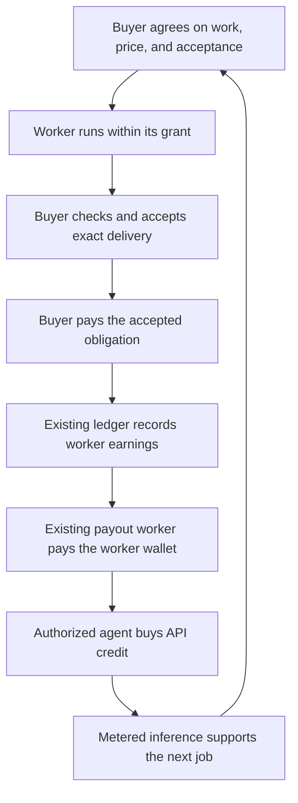

# Proposal: agents that earn and pay for useful work

Status: proposed implementation and experiments, 2026-10-15. This accompanies
the [interview analysis](analysis.md). It draws on the
[episode archive](../../transcripts/README.md), current runtime guides, and
existing commercial plans. This review ran no live jobs or payments. The
milestones below are recommendations, not newly supported features or permission
to spend money.

## Recommendation

Build one complete economic loop: a buyer orders useful work, an agent delivers
it, the buyer accepts it, the worker receives Bitcoin, and the agent buys the
inference needed for its next job from those earnings. Then measure whether
specialization and reusable components make that loop cheaper and more useful.

This gives us a concrete version of Bansal's idea. We can test whether agents
cover their costs without deciding whether they are alive or predicting which
currency autonomous software will eventually prefer. OpenAgents already has
much of the infrastructure. The work is connecting it under a supported job
profile, proving recovery, and finding repeat buyers.

Keep Coder as the first execution vehicle and the general agent as the entry
point. A single customer workflow should lead implementation. We should not
restart the five-market launch sequence or make a new network a prerequisite.

## What our earlier work teaches

The archive records experiments, scripts, announcements, and reported results
from several repository generations. These establish motivation and lessons;
the maintained runtime guides establish the implementation boundaries below.

| Earlier work | Connection to Bansal | Implementation consequence |
| --- | --- | --- |
| [037: Flow of Funds](../../transcripts/037.md), [094: Recap & Roadmap](../../transcripts/094.md), [100: Looking Ahead](../../transcripts/100.md) | Paying builders and splitting revenue have been central since the first agent store. Episode 100 reports revenue sharing alongside a shortage of agents people want to buy. | Finish one useful purchase, delivery, and payout before expanding the catalog. Money moving is insufficient evidence of customer value. |
| [174: GPUtopia 2.0](../../transcripts/174.md), [213: Agent Markets](../../transcripts/213.md), [214: Compute Market](../../transcripts/214.md) | Selling idle compute predates this interview. The series explicitly recalls excess sellers and insufficient buyers. | Buy capacity for an actual task. Separate paid demand from project-sponsored traffic and availability rewards. |
| [215: Data Market](../../transcripts/215.md) | People can earn from inputs as well as execution. | Start with a small, inspected, licensed bundle when a buyer needs it. Access to a conversation does not grant permission to sell it or train on it. |
| [237: You Must Construct Additional Pylons](../../transcripts/237.md) | The accepted outcome, contribution payouts, and cost per useful result are the project's own earlier economic thesis. The record includes prepared remarks and broader ambitions. | Define acceptance before execution. Keep deliverable, check, buyer acceptance, collection, and worker payout separately inspectable. Measure energy only when actually metered. |
| [239: Let's Make Money](../../transcripts/239.md) | It explicitly asks agents to earn enough to keep paying for compute and identifies the missing buy side. | Close earnings-to-spending and report subsidies. Referral income is a separate source of revenue, not evidence of useful labor. |
| [266: Single Points of Failure and Nostr Markets](../../transcripts/266.md), [267: Immortal Infrastructure](../../transcripts/267.md) | Open negotiation and replaceable coordination address dependence on one operator. | Reuse client, relay, provider, checker, and settlement boundaries. Ship a runnable provider and client together; a specification cannot supply an operating market. |
| [284: Gamifying Coder](../../transcripts/284.md) | Specialization and a visible world can make productive participation understandable. | Let the existing Verse display verified jobs and earnings. Keep XP separate from money and avoid rewarding token consumption or manufactured activity. |
| [286: System One in Coding Agents](../../transcripts/286.md), [287: Building a System One Coding Agent](../../transcripts/287.md) | Cost pressure motivates typed decisions, smaller executors, useful context, and shared components. | Compare whole-task policies. Include cache rebuilds, routing, failed cheap attempts, and escalation. Episode 287's after-the-fact best-choice portfolio is a hypothesis for a router, not a deployed router result. |
| [Archive measurement corrections](../../transcripts/README.md#the-latest-measurement-arc-revises-its-own-success-story) | A cheap success can reflect fitting the task rather than a transferable improvement. | Freeze comparisons before running them, exclude source tasks, retain failures, and require independent confirmation before default adoption or improvement rewards. |
| [288: Three DevDays Later](../../transcripts/288.md), [289: OpenAgents](../../transcripts/289.md) | A composable agent with paid contributors is the existing product direction. | Extend the current release, evaluation, discovery, purchase, and payout path. Keep the interface short even when the underlying agreement has many records. |

The [Test-Time Capabilities essay](../../essays/2026-09-29-test-time-capabilities.md)
and [general-agent essay](../../essays/2026-10-01-the-return-of-the-general-agent.md)
supply the useful synthesis: a general agent can compose specialized members,
but each member needs evidence that it improves the task. Bansal's narrow-agent
prediction fits that architecture without requiring the user to manage dozens
of separate agents.

## What exists, and what still needs joining

Some source documents describe an earlier state. In particular, the opening
of the [labor plan](../../agents/market-infrastructure.md) describes the original
free-only fixture; the current runtime guide additionally documents a bounded
paid profile. The historical [compute survey](../../compute/compute-for-bitcoin.md)
still contains statements that Pylon is absent, while the current Pylon guide
documents its return. Use the narrower current implementation descriptions
below when choosing work.

| Area | Existing foundation | Gap for this proposal |
| --- | --- | --- |
| Agent entry | [Self-registration](../../agents/self-registration.md): proof of work, an agent account and scoped API key, bounded free use, claiming, revocation, and a signed Lightning-credit callback. [Readiness evidence](../../agents/readiness.md#2026-10-14-agents-register-themselves-authmd-passes) records production signup and free-tier behavior. | Check the configured top-up resource and `pay.available` before describing paid entry as live. An API agent account has no website session or general host authority. |
| Persistent identity | [Agent identity and engrams](../../verse/agent-identity-and-engrams.md): host-held agent key, owner relationship, private memory, steering, usage records, and model budgets. | Bind that agent explicitly to its API account and earnings beneficiary. The existing steering loop forbids paying; a spend adapter requires a separately admitted profile. |
| Useful labor | [Recoverable coding orders](../../coder/runtime/free-labor.md): agreement, separate execution grant, artifacts, protected checking, and signed acceptance. Its paid profile joins accepted work and authenticated central funding to worker earnings. | The paid fixture uses synthetic source, one bounded patch, a pinned `cmp` checker, and fake funding. Broader useful repairs, independently operated workers, real collection, and payout remain to be qualified. |
| Receiving and paying | [Payment plan](../../payments/agent-payments.md), [payments guide](../../payments/README.md), and `crates/x402`, `crates/wallet`, and `crates/pay-ledger`: receiver, payer, replay handling, shares, payout recovery, and private earnings views. | Connect a settled worker payout to an agent-controlled purchase under an explicit budget. Do not treat a payable share, an API credit, and wallet funds as interchangeable. |
| Shared compute | [Pylon runtime](../../compute/pylon.md): free text and decision jobs, checks, paid direct and brokered paths, and a test-network agent-market experiment. | Paid paths have fixture coverage, but live-wallet qualification remains. The P4 experiment uses local acceptance and does not exchange the complete LAB delivery/acceptance records. It cannot substitute for the coding-order host. |
| Cheap decisions | Pylon's [decision guide](../../compute/pylon.md#answer-decisions-clef) records Jev-first operation and Pylon fallback/shadow behavior after weak router measurements. | Improve measured latency and answer quality before changing that priority. Owning hardware does not make it the cheapest qualified decision service. |
| Reuse | [Shared KB](../../coder/design/knowledge-base.md), [signed bundles](../../coder/runtime/knowledge-bundles.md), [frozen studies](../../coder/runtime/knowledge-studies.md), and plugin release/evaluation work. | Demonstrate benefit on new tasks and agree on compensation before paid use. Historical KB screening cannot authorize automatic promotion. |
| Commercial operation | [Revenue roadmap](../../sales/revenue-roadmap.md), [later-market profiles](../../payments/later-markets.md), and [owner qualification work](../../../NEEDS_OWNER.md). | Find a consenting buyer and an outside provider, qualify the chosen payment path, and measure repeat use and complete costs. Existing plans already own these requirements. |

## Relevant NIPs and remaining contract work

Review, 2026-10-15: the [OpenAgents NIP directory](../../../nips/openagents/README.md)
contains 33 specifications plus shared contracts and JSON schemas. Together
they already describe most of this proposal. We should implement a supported
subset of that composition before proposing another NIP or allocating kinds.
Most remaining gaps are host enforcement, application bindings, and evidence
that independent participants can complete the whole flow.

The [implementation backlog](https://github.com/OpenAgentsInc/openagents/issues/11729)
tracks remaining Rust roles and their dependencies. The status inventory was
corrected in #11730: X402, PYLON, ATT, device-only VAULT, and the bounded local
SOV lifecycle have implementations. Read a contract's requirements separately
from the supported role and its runtime evidence; this review does not certify
deployed conformance.

### Contracts for the first economic loop

| Contract | What we can reuse | What the implementation must supply |
| --- | --- | --- |
| [SOV: treasury, earnings, and purchases](../../../nips/openagents/NIP-SOV.md#treasury-earnings-and-purchases) | The existing composition for a durable agent that earns, buys resources, retains goals, and declares custody. The profile already references governance, custody, disclosure, and treasury policies. | A supported treasury-policy schema and adapter binding the agent, account, authorizer, destinations, payment profiles, exact units, fees, limits, and reconciliation authority. Verified income changes allowance only if that policy explicitly permits it. A null treasury permits no spending. |
| [MKT](../../../nips/openagents/NIP-MKT.md) and [LAB](../../../nips/openagents/NIP-LAB.md) | Immutable offerings, private RFQ/quote/order/confirmation, exact labor terms, independently pinned checking, buyer acceptance, payment instructions, and payment evidence. | Connect the useful-job profile to current execution and settlement owners. Keep provider, worker, reviewer, resolver, and payment receiver identities explicit. The central-receive route must retain its admitted receiver/payee relationship; a generic provider listing cannot authorize it. |
| [X402](../../../nips/openagents/NIP-X402.md) | Upfront purchase of an exact operation, a pinned receiver, separate price/fee reservations, durable proof consumption, and paid-result recovery. Standard HTTP, MCP, and native Nostr bindings are distinct. | Use the existing HTTP top-up resource first. X402 pays for that operation; the account service separately creates credit after verifying its callback. The protocol itself defines no credit balance. Native `nostr:openagents:1` requires explicit support from buyer, provider, and facilitator. |
| [CAP](../../../nips/openagents/NIP-CAP.md), [PRG](../../../nips/openagents/NIP-PRG.md), and [CJ](../../../nips/openagents/NIP-CJ.md) | Exact operation descriptions, separate host bindings and grants, locked typed workflows, and conversation/decision/execution jobs. | Publish only supported interfaces, retain the complete executable closure, and independently admit execution and `spend`. CJ events are ephemeral; retain authoritative job state elsewhere. PRG's bounded acyclic workflow is not an indefinite agent lifecycle or a generic wait for commercial payment. |
| [CTX](../../../nips/openagents/NIP-CTX.md) and [POL](../../../nips/openagents/NIP-POL.md) | Task/source revisions, recipient-specific evidence, immutable action subjects, single-use approvals, routing, and actual-versus-estimated usage records. | Bind the credited account and purchase to the exact approved action. Check provider eligibility before disclosure. Record failed routes and escalation costs, and keep learned preferences from widening permissions. Device pairing is not purchase approval. |
| [COORD](../../../nips/openagents/NIP-COORD.md) and [RUN](../../../nips/openagents/NIP-RUN.md) | Shared reservations, atomic claims, dispatcher fencing, one authoritative controller, ordered outcomes, and unknown-effect recovery. | `coordination-host` now provides native admitted proposals/claims, fenced CJ intake, shared child call allowances, independent checks, conditional Git integration, and finite read-only observations (#11775). Cover every participating child, host, and wallet under the authoritative allowance. Preserve reservations through crashes, period changes, and migration. RUN explicitly makes no exactly-once execution claim; durable identities and reconciliation prevent an unknown effect from becoming permission to repeat it. |
| [WORK](../../../nips/openagents/NIP-WORK.md), [AUTO](../../../nips/openagents/NIP-AUTO.md), and [ENV](../../../nips/openagents/NIP-ENV.md) | Persistent objectives, finite scheduled/source-triggered/checked continuation, actual environment materialization, execution attachments, and cleanup accounting. | `work-host` and `openagents work` now provide native admitted work history, source import proposals, scoped views, bounded pure delegation, independent checks, and an actual LAB-book link (#11734). `env-host` signs ENV leases, exact local materializations, and one admitted attachment per lease that a worker checks before dispatch, with accounted cleanup (#11736). Start with an explicitly operated order. Add unattended work only under a finite admitted plan, an independent continuation check, current execution attachment, and aggregate budget. Unresolved effects block continuation; earning money does not renew an expired plan. |
| [DEC](../../../nips/openagents/NIP-DEC.md), [OPT](../../../nips/openagents/NIP-OPT.md), and [EVAL](../../../nips/openagents/NIP-EVAL.md) | Typed decisions, frozen implementation studies, protected confirmation, complete cost accounting, and scoped adoption evidence. | Measure the actual routing policy on new task groups. Keep acceptance, permissions, and protected checkers outside optimization. A decision probability, report, or selected candidate cannot approve payment or activate itself. |
| [KB](../../../nips/openagents/NIP-KB.md), [EXT](../../../nips/openagents/NIP-EXT.md), and [REG](../../../nips/openagents/NIP-REG.md) | Versioned knowledge, exact signed releases, licenses, dependencies, revocation, and independently curated discovery. EXT already carries a signed per-call `fee_msat` and payout destination. | `crates/plugin-registry` and `openagents registry` now implement signed inert catalogs, explicit curator trust, bounded equivalent transports, and independently verified member selection (#11732). Reuse the supported plugin payment path. A registry recommendation does not install or grant execution. A paid software license or general knowledge royalty needs an explicit terms/fulfillment profile; these contracts do not create one automatically. |
| [ATIF](../../../nips/openagents/NIP-ATIF.md) | Exact trajectory bytes, parent/child links, private carriage, and separately authorized public derivatives. | `crates/atif-nostr` and `openagents trajectory` now supply bounded public/private sharing and verified retrieval (#11731). Use local traces first; disclose each recipient and public derivative separately. RUN remains authoritative for effects, LAB for commercial acceptance, and wallet evidence for settlement. |
| [PYLON](../../../nips/openagents/NIP-PYLON.md) | Opt-in compute beacons, service receipts, recomputable pool totals, trusted check verdicts, and a public representation of useful supply. | Qualify the selected service and wallet path, use the proof-free acknowledgment profile below, and preserve network distinctions. A buyer's `accepted` service receipt is not signed LAB acceptance, verified worker income, or proof of profit. |

The [shared contracts](../../../nips/openagents/contracts.md) supply exact
references, closed schemas, explicit effects and units, versioned required
features, and the encrypted private artifact envelope (`3188`). New
account/purchase bindings can use pinned schemas behind CAP operations and
private artifacts. Do not put execution restrictions in inert `meta`, add
unchecked fields to closed CJ/SOV bodies, or make a public balance tag.

### Relevant supporting contracts

| Contract | When it matters | Boundary to preserve |
| --- | --- | --- |
| [HOST](../../../nips/openagents/NIP-HOST.md), [CTRL](../../../nips/openagents/NIP-CTRL.md), and [REACH](../../../nips/openagents/NIP-REACH.md) | Existing clients inspect, steer, or stop the worker; a permitted client locates its host. | Enrollment, observation, and reachability neither appoint a POL approver nor grant spending. SOV controller transfer additionally needs real dispatcher fencing; finding another host cannot transfer authority. |
| [SESS](../../../nips/openagents/NIP-SESS.md), [WS](../../../nips/openagents/NIP-WS.md), and [TERM](../../../nips/openagents/NIP-TERM.md) | Reuse engine adapters, retain histories, expose repairable views, or inspect a worker interactively. | `workspace-host` now supplies a conditional Git document source, scoped native snapshot/delta views and clients, exact retries, and checkpoint/restoration runs (#11733). `session-host` admits managed sessions over in-process adapters with ENV-bound turns, durable queues, native/emulated steering, interactions, and history export/import (#11737). A session, work item, execution, commercial order, and wallet purchase keep separate identities. A screen or terminal status cannot establish acceptance or settlement. The first loop needs no new terminal protocol. |
| [MV](../../../nips/openagents/NIP-MV.md) and [XP](../../../nips/openagents/NIP-XP.md) | Project useful work into Verse and recognize checked contributions. | World state and XP are presentation/reputation. Neither funds a wallet nor proves earnings, task quality, or independent demand. |
| [ATT](../../../nips/openagents/NIP-ATT.md#implementation-status) | A later job's disclosure policy requires an attested inference workload. Its status records Google Confidential Space/Intel TDX support, with specific remaining gaps. | Verify the exact release and endpoint evidence under the supported platform. Attestation does not establish answer correctness or wallet custody. Public sealed-job receipts and several verification/publication features remain unfinished. |
| [VAULT](../../../nips/openagents/NIP-VAULT.md#implementation-status) | A later workflow needs private stored customer inputs. Device-only tier `user` is implemented; `sealed` and `operator` tiers are designed. | Do not assume the device-only vault permits unattended remote agents to decrypt inputs. Complete and qualify the required key-release tier and disclosure policy before admitting that workflow. |
| [LIVE](../../../nips/openagents/NIP-LIVE.md) | Future jobs use screen, audio, camera, or device input. | Media consent and fresh observations require their own admitted profile; `live-host` now implements that controller role over explicit adapters (#11738). They are not prerequisites for a public-repository repair or text inference purchase. |

Block OA/AA/AE/AM and official NIP-01/42/44/47 remain the underlying identity,
encryption, memory, metrics, and wallet-transport pieces referenced by these
contracts. They do not fill the application gaps themselves. In particular,
NWC connectivity does not prove a wallet can enforce a fee ceiling or recover
an ambiguous payment.

### Missing bindings and compatibility work

1. **Define the private account and treasury binding.** SOV states the required
   relationships but does not define our API-account-to-worker-earnings mapping
   or a concrete reinvestment policy. Pin a supported schema that identifies
   the agent and current policy revision, verified API-account control, worker
   beneficiary, wallet/account adapter, allowed top-up resource, exact caps,
   expiry, and revocation/recovery authority. Each owning service verifies its
   side. Specify whether confirmed income can replenish a finite allowance;
   default to no automatic increase. Publish fixtures and exact CAP interfaces
   for the supported profile without claiming full SOV conformance.
   `sov-treasury` now pins that schema and enforces it over `pay-ledger`, the
   wallet adapter, and the X402 router and buyer ledger (#11741).
2. **Join settlement to credit fulfillment.** Link the accepted LAB obligation,
   authenticated receive, worker payout attempt, confirmed wallet income,
   X402 purchase, account-credit callback, and metered use through their
   original identities. Define the top-up recovery response when payment is
   real but the callback or credit acknowledgment is lost. Keep proof
   consumption, credit creation, usage, and payout separate. A new invoice,
   callback retry, or restored host must not create another credit or charge.
3. **Use the proof-free Pylon receipt.**
   [#11721](https://github.com/OpenAgentsInc/openagents/issues/11721) resolves
   the PYLON/X402 conflict: receipt, aggregate, and policy v2 require a signed
   seller/broker acknowledgment, keep proofs private, and count reported paid
   amounts only from explicitly trusted issuers, once per settlement reference.
   Direct sellers acknowledge the exact receipt against their private purchase
   and job store; brokers supply the private payment hash separately for
   facilitator lookup before financial settlement. The old public-proof format
   is replaced without compatibility support. Qualify the real wallet path
   separately; a signature remains an issuer's claim rather than independent
   proof of collection, quality, or customer demand.
4. **Make the economic statement a typed view.** The existing
   [payment receipt schema](../../../nips/openagents/schemas/payment-receipt.v1.json)
   intentionally excludes invoices and preimages. It describes a payment, not
   worker acceptance, an earnings allocation, or a spendable account balance.
   Define the private statement's source references, units, observation cut,
   coverage, and unknowns. Its projection must not create another ledger.
   Apply separate consent to a public export; plaintext prompt digests can
   disclose guessable inputs. For sealed work, ATT requires ciphertext digests.
5. **Specify paid component terms where existing fees do not fit.** EXT's
   plugin per-call fee is already part of its signed release; reuse it.
   SOV explicitly leaves general software licensing and royalty fulfillment
   to a supported domain profile. If we sell a KB bundle or an improvement,
   pin license, delivery, price, beneficiary, attribution, and acceptance under
   that profile and the existing later-market owners. EVAL success and XP
   alone create no financial obligation.
6. **Complete the cross-contract recovery fixtures.** MKT's Lightning profile
   admits `regtest`; X402 v1 admits only Bitcoin mainnet and testnet. Choose a
   common supported network for the loop rather than aliasing one into another.
   Test income spoofing, duplicate credit, wrong beneficiaries, concurrent
   children, fee-cap refusal, lost wallet/callback replies, period rollover
   with unknown liabilities, and restored or competing controllers. A signer
   or NWC adapter without required fee/recovery support must refuse that role.

The protocol changes needed now are narrow supported schemas and qualification
of the public receipt profile that excludes payment proofs. General escrow,
additional currencies, threshold custody, a new agent-credit token, and a global reputation oracle remain outside
this first loop. SOV already distinguishes guardians from key custody; ordinary
operator-held custody with explicit limits is sufficient for the first profile.

## Implementation shape

Use a small Rust coordinator over the existing owners. Start with a private
operator workflow exposed through the existing CLI; add native controls after
the flow works. Keep money behavior in the payment and ledger crates, coding
execution in the task owner and labor host, account behavior in tenancy and
the gateway, and presentation in the product surfaces. Do not create another
wallet, market protocol, or spendable balance in the coordinator.

The diagram shows the proposed central-receive route. An accepted job can remain
unpaid; accrued earnings can remain awaiting payout; a purchase can remain
unresolved. Those states must remain visible without advancing the next step.

### Link identities without granting new rights

Create an explicit, revocable operator-approved binding among the host agent
key, the scoped API agent account, the worker's earnings party, and the
authorized wallet principal. Each system verifies its own side. Names and
public payment activity cannot establish ownership. Creating or claiming an
API account must not automatically attach an earnings account or wallet.

Use a new dedicated test worker for the first loop. Preserve Alice's current
policy. If we later support an earning profile for Alice or another crew
member, the owner explicitly enables that profile and its narrow purchasing
adapter; model-written memory cannot turn it on.

The first version remains operator-controlled. The host or resident signer
holds the keys. Describe that custody plainly; self-registration is not proof
of independence from OpenAgents, the host administrator, or an API provider.

### Reserve purchases before calling a wallet

Reuse the existing payment policy and reservation machinery. An authorized
purchase pins the agent, merchant/resource, account credited, exact quote,
network, amount, fee ceiling, deadline, and stable purchase identity. Reserve
principal and fees across concurrent jobs and children before dispatch. Apply
both per-purchase and daily limits at the authoritative payer.

Initially allow only the configured inference-credit resource, with a small
operator-selected ceiling and expiry. The model can request credit; Rust
checks whether it may buy it. A balance report, NIP-AM usage record, or Jev
answer does not authorize a payment. Existing usage budgets are useful inputs,
but a budget checked after a model call cannot replace a wallet reservation.

On a lost reply, reconcile the original payment and credit callback. Do not
issue a new purchase while the original outcome is unknown. API key revocation
and the wallet grant have separate revocation paths; the operator's stop
control must disable future actions through both. Previously accepted worker
obligations remain owed.

### Keep earnings, cash, and service credit distinct

Join existing records for a private per-agent statement:

- Accepted jobs, earned amounts, collected funding, payable worker shares,
  payout attempts, and confirmed wallet receipts.
- Wallet purchases, routing and receiving fees, purchased credit, remaining
  credit, and actual metered service consumption.
- Execution, checking, coordination, failed attempts, and known or unknown
  external costs, plus opening capital and explicit subsidies.

The statement is a read model over the owning books. It cannot spend or create
earnings. An accrued share is not available cash; bought service credit cannot
be withdrawn as earnings. The existing
[compute balance](../../cloud/compute-balance.md) is also a separate product
account, not an automatic alias for agent API credit.

Track cash flow and economic cost separately. Buying credit moves money into
a prepaid asset; consuming that credit creates service expense. Do not count
both as inference expense. Keep exact BTC amounts and the recorded USD quote
or usage basis; leave unavailable conversion or energy measurements unknown.

### Preserve the commercial boundary

LAB pays an agreed worker obligation after acceptance; x402 purchases an input
before service. One does not stand in for the other. Postacceptance payment
leaves the worker exposed to buyer nonpayment. Start with bounded trusted
counterparties, explicit payment deadlines, and a maximum unpaid exposure.
Escrow and automated dispute resolution are separate work. Buyer acceptance
connects payment to the agreed result; it does not establish that the buyer's
goal benefits everyone. Execution permissions and human control still matter.

Use the current durable accounting and recovery paths rather than inferring
success from a relay acknowledgment. A crash may leave execution or payment
unknown. Keep its reservation until the owning subsystem resolves it. Changing
relays must preserve the job, terms, artifact, and payment identities.

## Suggested delivery order

These are local planning stages, not new issue numbers. Reuse the existing
labor, revenue, payment, and compute backlogs when filing implementation work.
Each stage should land in small changes with its own targeted checks.

### 1. Make one agent's economics inspectable

Build the identity binding and private joined statement first. Select one
buyer-needed public-repository task and freeze its deliverable, acceptance,
price, provider expense ceiling, and payment terms. Record opening capital and
any free-tier use. Inspect the chosen deployment's credit availability and
existing owner qualification requirements. Implement the supported SOV/POL
treasury-policy and account-binding schemas described above; income must not
silently raise a spending limit.

Done when synthetic fixtures connect an order, acceptance, funded earnings,
payout, credit purchase, and inference usage without changing any balance twice.
Wrong-account bindings, revoked access, concurrent reservations, and unknown
payments must remain distinguishable. This stage spends no real money.

### 2. Prove useful delivery between operators

Extend the labor host's supported profile for one real task family: for example,
a bounded regression fix in a public Rust repository. Explicitly admit the
executor, instructions, permitted model recipient, source access, and checker.
Replace the fixture's expected-byte comparison only with the checker this
family needs; keep it outside provider writes. Specify whether human review is
part of acceptance. A patch request does not also grant merge or push rights.

Ship the client and runnable provider together. Rehearse with two independently
operated participants before payment. Exercise restart, cancellation, duplicate
delivery, stale base, unavailable buyer, and relay loss with synthetic funds.

Done when the buyer accepts useful work under the frozen terms and can recover
its complete order after an outage. Two keys controlled by one operator do not
satisfy the independent-operator milestone.

### 3. Close earn, receive, buy, and work again

Qualify the selected real receiver, payout destination, and payer through the
existing owner process. Then run one small funded order. Confirm the worker's
payout at its wallet before enabling the bounded inference-credit purchase.
The same dedicated agent uses the resulting credit for a subsequent admitted
job. Keep initial expenses funded by declared opening capital or the free tier.
Use the explicitly authorized reinvestment rule and original purchase identity;
recover a lost credit callback before considering another purchase.

Done when real incoming and outgoing payments settle, the credit lands once,
actual usage is charged once, and the second job's records link back to the
earned funds. Report remaining cash, unused credit, expenses, fees, and subsidy.
This establishes an earnings-funded purchase, not profitability or perpetual
operation. Repeat profitable jobs without new subsidy before claiming the agent
pays its operating costs.

Publish only a consented export: task/result references, acceptance, amounts,
fees, durations, and sanitized receipt references. Exclude private source,
conversations, credentials, payment preimages, recovery secrets, and raw
payment proofs. Public proofs of activity need not expose private purchases.

### 4. Test cheaper execution under a real budget

In parallel with stages 2–3, compare a fixed capable executor with a specialist
or cheaper executor plus a declared escalation policy. Use the current routing
baseline, deterministic probes, code graph, and narrow typed judgments where
they add measured value. Do not replace Jev-first routing merely to generate
demand for our own pylons.

Freeze task families, checks, configuration, quality tolerance, spend limits,
and escalation conditions before the comparison. Count all failed attempts,
cache rebuilds, context preparation, checks, and final repair. An evaluator
cannot change acceptance to improve the cheaper policy's score.

Done when new tasks show comparable accepted-work quality and a lower complete
cost or useful latency improvement. Otherwise keep the simpler baseline for
that family. Lower inference cost alone is insufficient.

### 5. Buy one useful shared resource or component

Choose the next input from actual bottlenecks. For inference, qualify the
existing Pylon paid path for a suitable workload and compare it with the
current API path, including checks, retries, availability, and provider costs.
Keep text inference, decision quality, and coding labor as separate products.
Use PYLON v2 and explicitly configure trusted payment issuers before publishing
and counting paid receipts.

For reusable knowledge or a plugin, pin its release and rights, compare with
and without it on tasks outside its source groups, and price the author's fee
before use. Use the current plugin fee and split path when its supported
execution envelope fits. Verify a real author payout separately from worker
earnings. Do not invent royalties for every retrieved entry or confuse
registered use with a measured causal contribution.

Done when another operator can use the resource or component at a known total
price and reproduce its scoped benefit. The existing
[later-market profiles](../../payments/later-markets.md) already describe
separate worker, training, and optimization obligations; extend those owners
only when this workflow needs them.

### 6. Expand from repeat purchases

Add a short **Offer work / Pause** flow, quotes, acceptance review, and private
earnings/expense views to the existing clients. Reuse Verse's job and compute
views for optional visualization. Show useful statuses such as **Working**,
**Ready for review**, **Payment pending**, and **Paid**. Hide unavailable
controls. Keep protocol terms in the inspector and technical documentation.

Expand to another provider and task family when repeat buyers and sustainable
provider earnings justify it. Exercise a second relay operator, and eventually
a compatible second client, without making these a new market launch. Follow
the [revenue roadmap](../../sales/revenue-roadmap.md) for acquisition and
customer support rather than building a separate sales system for this study.
Before enabling unattended continuation, add the supported finite AUTO/SOV
lifecycle, ENV execution attachment, and RUN/COORD recovery for this profile.
Keep an expired or unresolved plan stopped even when its wallet has funds.

## Experiments and decisions

The sample sizes, quality tolerances, and spending caps must be chosen before
each study. These rows define what to learn, not numerical production defaults.

| Experiment | Comparison and measurements | Decision it informs |
| --- | --- | --- |
| Earnings-funded operation | Trace one worker's opening funds, receipts, top-ups, actual consumption, accepted jobs, and closing funds; then repeat without fresh sponsorship. | Can this task family cover operating cost, and which expense prevents it? Separate one successful payment loop from sustainable operation. |
| Specialization | Fixed capable executor versus a frozen specialist-plus-escalation policy on unseen jobs; accepted fraction, total cost per acceptance, latency, and intervention time. | Which tasks deserve a cheaper path? Retain failures and unknown costs in the report. |
| Paid shared compute | Qualified Pylon versus the current provider on the same permitted workload, including transport, checker cost, retries, energy when metered, and seller margin. | Does buying outside compute improve delivery, and can the provider earn at that price? |
| Reusable capability | Pinned KB snapshot or plugin on/off using the existing study discipline, excluding all source tasks/groups; quality, marginal cost, author fee, and regressions. | Is there enough transferable value to adopt and pay for the component? |
| Paid registration alternative | Keep proof of work as the control; optionally offer a separately verified small payment after the purchase loop works. Compare completed legitimate signups, abuse, payer cost, and total free-tier expense. | Does payment improve entry for agents that already hold sats? Preserve a path for unfunded agents and retain aggregate abuse limits. |
| Demand | Track sponsored and outside buyers separately: accepted jobs, repeat paid orders, buyer review time, collection delays, and provider net earnings. | Should we expand supply, improve the workflow, or stop this offer? More signups or self-payments do not establish demand. |

The economic report should show collected revenue, outstanding receivables,
full known delivery cost, unknown costs, cash available, and unused prepaid
credit separately. Report both BTC and the supported USD accounting basis.
Include setup, model calls, decisions, checks, coordination, failed attempts,
support, and rail fees. Subscription capacity and owned hardware have costs
even when no per-call invoice arrives. If material costs are unknown, mark
profitability unknown.

Use isolated fixtures first, then frozen replay or a small declared cohort,
then the funded workflow's existing qualification. Production checks use the
dedicated test account and clean up their resources. They must not leave chats,
projects, computers, or drafts on the owner's account. Real funds, deployment,
and device checks follow existing authority and qualification; this proposal
does not authorize them.

## Work to defer

Paid packet routing, a new mesh network, general data markets, distributed
training, liquidity products, and automated escrow are not dependencies for
this loop. Buy or implement them when an observed customer bottleneck warrants
it. A narrow licensed data purchase or independently checked evaluation job can
come earlier when it directly supports delivery.

Taproot Assets may eventually help agents budget in dollars on Bitcoin rails,
but the payment plan still treats that adapter as future work. Asset issuance,
custody, redemption, and freeze policies need separate evaluation. Bitcoin
transport does not by itself remove issuer or operator control. We should not
repeat the analysis's implication that a dollar asset on Bitcoin automatically
has Bitcoin's resistance to seizure. Start with sats and explicit quote terms.

Keep life, metabolism, the end of intellectual property, and inevitable
hyperbitcoinization out of the implementation criteria and product copy. Use
the practical promise only when demonstrated: an agent can earn from useful
work and use those earnings to buy what its next task needs.

## First changes to make

1. Add the supported SOV/POL treasury policy, private identity binding, and
   read-only per-agent economic statement, with synthetic joins and recovery
   checks over existing books.
2. Extend one labor execution/checker profile for a buyer-needed public Rust
   repair and ship an independent-operator no-spend rehearsal.
3. Connect confirmed worker payouts to narrowly authorized API-credit purchases,
   with concurrent-budget, lost-reply, and credit-callback recovery fixtures.
   Then qualify and record one real earn/receive/buy/work cycle through the
   existing owners. Qualify the PYLON v2 acknowledgment path separately before
   adding real paid compute publication.

Those changes address the missing connection first. Subsequent work should
follow measured cost and customer demand, with the current
[networked Coder plan](../../coder/design/networked-coder-plan.md) and
[market infrastructure plan](../../agents/market-infrastructure.md) continuing
to own the broader roadmap.
