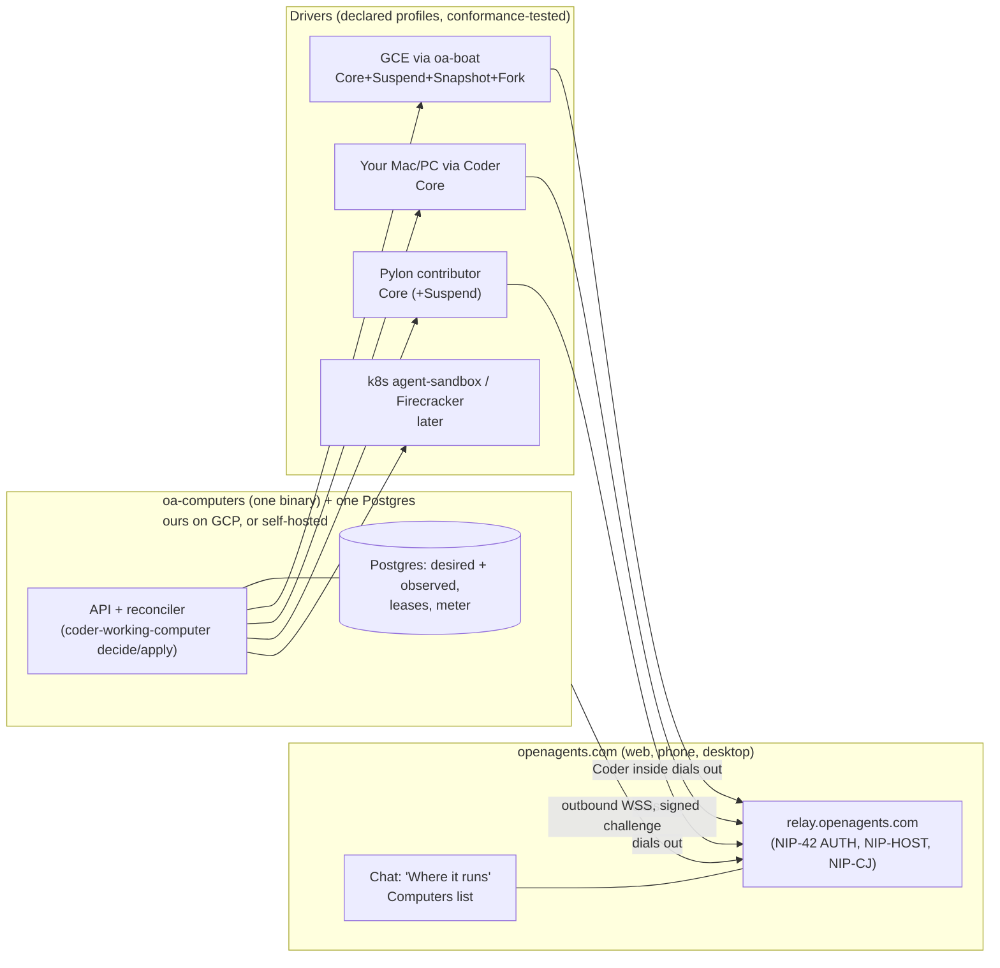

# Factory OpenCompute, and our version of it (2026-10-14)

Owner request: read Factory's "Introducing OpenCompute"
(<https://factory.com/news/opencompute>, 2026-10-14), study its diagrams, and
plan our own version now, because it is close to what we are already
building. The source-by-source facts, the diagram descriptions and redraws,
and notes on the systems they name are in [opencompute.md](opencompute.md).

Baseline for our side: `origin/main` at `50d9ac520c`, plus
[the computers-for-chats audit](../../audits/2026-10-14-computers-for-chats-audit.md)
written the same day, which is the best map of where we are.

## Plain summary

- **What it is.** OpenCompute is a program a company runs in its own cloud
  or data center that creates, watches, suspends and deletes sandbox
  computers for Factory's Droid agent. It dials out to Factory (no inbound
  ports), proves who it is with a key, keeps its records in the company's
  own Postgres, and talks to each kind of machine (Kubernetes, EC2, Lambda
  microVMs, Google's Agent Sandbox and Agent Substrate) through a small
  plug-in called a driver. Every driver must pass a test suite for the
  basic profile ("Core") and may also pass optional ones (Suspend, Snapshot,
  Fork).
- **It is not open source.** It is in private preview. Factory says it
  *plans* to open-source the contracts, conformance tests and driver model.
  No repo, spec or license exists today; their GitHub org has 22 public
  repos and none of them is OpenCompute. "Open" currently means "runs in
  your infrastructure", not "source you can read". The name also collides
  with the Open Compute Project hardware consortium.
- **We already have most of the parts.** Our own Boat-shaped sandbox
  service on our Google Cloud (`oa-boat`) already does create, stop/resume,
  fork and image snapshots. A chat's own computer with a pure
  decide-and-apply lifecycle core (`coder-working-computer`) is written and
  tested. Immutable environment builds exist. Coder on a person's own Mac or
  PC already takes work from the web. Our host protocol (NIP-HOST) already
  enrolls machines by public key with signed grants. What we lack is the
  join: one lifecycle layer over all of them, with durable state in
  Postgres, declared driver profiles, a conformance suite, a warm pool, and
  billing switched on.
- **Our version.** One Rust binary, `oa-computers`, with one Postgres, that
  owns every computer's desired and observed state and reconciles it
  through drivers: our GCE (through `oa-boat`) first, then the person's own
  Mac or PC (Coder), then Pylon contributors' machines paid in sats, then
  Kubernetes agent-sandbox or Firecracker. It is public in `crates/` from
  the first commit, so it is open source on day one. The product word stays
  "computer"; we do not add a brand.
- **First three steps:** (1) a driver contract with Core/Suspend/Snapshot/Fork
  profiles and a black-box conformance suite, run against `oa-boat` and the
  fake provider; (2) a Postgres store and a reconcile loop for
  `coder-working-computer`, behind a durable-intent API; (3) chats wired to
  their own computer through that layer, listed in one "Computers" list.

## What they built (short)

Full table with verified/inferred markers: [opencompute.md §3](opencompute.md#3-what-they-built-architecture).

Verified from the post and docs:

- Self-hosted Go control plane, deployed and operated by the customer.
- Outbound TLS WebSocket to Factory; no public endpoint, no inbound port.
- Enrollment by public key; a fresh signed challenge on every connection;
  key optionally in a cloud KMS.
- Each sandbox also makes its own outbound connection to Factory (the same
  mechanism as their Remote Control computers, which run `droid daemon
  --remote-control` through `relay.factory.ai`).
- Desired and observed state in Postgres; creating a computer records
  durable intent and returns; a reconciler drives toward the desired state
  and survives restarts.
- Immutable Builds; S3-compatible storage for build artifacts and snapshot
  payloads.
- Activity signals plus per-computer lifecycle settings decide suspend or
  terminate.
- One gRPC driver service per provider (create, observe, exec, destroy);
  provider details stay out of the control plane; no mandatory guest agent.
- Conformance profiles: Core required; Suspend, Snapshot, Fork optional;
  black-box tests; unsupported requests rejected "before durable state
  changes".
- Own API, CLI and admin panel; "vendor-neutral", Factory is "one client
  among possible clients".
- Built agent-first: the first on-prem driver was written by an agent run
  on the flight to the customer; six weeks from prototype to first
  deployment.

Inferred or unknown: the API shape, CLI verbs, state names and gRPC proto
are unpublished; there is no mention of warm pools or compute metering; the
per-sandbox credential is not described.

## The diagrams

Described and redrawn in [opencompute.md §4](opencompute.md#4-the-diagrams).
In one line each:

1. **Remote Control versus OpenCompute.** Left: incoming alerts, PRs and
   tasks feed three fixed connected machines (workstation, private VM, GPU
   machine), "persistent capacity", with extra work queued. Right: alerts,
   delegations and automations feed a grid of sandboxes that are created
   per job: "provision → work → suspend / terminate".
2. **The reconcile loop.** 01 read desired state → 02 claim work → 03 call
   driver → 04 observe backend → 05 persist state → 06 repeat and recover,
   around "desired ⇄ observed".
3. **Architecture.** Factory side (backend with "Create computer", client
   for sessions) and customer VPC (Kubernetes cluster holding the
   OpenCompute API + reconciler, Postgres with "desired + observed state",
   and gRPC driver services for Kubernetes, Lambda microVMs and EC2, each
   owning pods, microVMs or instances). Both arrows point outward from the
   customer to Factory.

Our version of diagram 3, for comparison:

## Side by side

| OpenCompute | Ours today | Status |
| --- | --- | --- |
| Self-hosted control plane (Go) | `oa-boat` (Rust/axum, Cloud Run, one instance) owns GCE sandboxes; `coder-working-computer` owns per-chat lifecycle as a library. The old `oa-codex-control`/`oa-node`/`oa-workroomd` control plane was deleted in `dabc08102f` (2026-09-18). | Partial |
| Outbound-only connection | Coder sync, Solver dispatcher (`crates/solver-box/src/dispatch.rs`: "the site never reaches the dispatcher"), Mac jobs, Pylon and NIP-HOST hosts all dial out. But `oa-boat` reaches its VMs *inbound* over SSH inside our VPC. | Partial |
| Public-key enrollment, signed challenge per connection | NIP-HOST (`crates/coder-host`, `coder-access`): secp256k1 host keys, signed grants, reverse enrollment with an 8-character code; NIP-42 AUTH on our relay is a signed challenge. Cloud workers still use shared bearers (`OPENAGENTS_WORK_HOST_TOKEN`, `oa-boat-api-key`). | Partial (exists for hosts, not for cloud workers) |
| Per-sandbox outbound connection | Not for cloud sandboxes; yes for Coder hosts. | Partial |
| Desired/observed state in Postgres + reconciler | Pure `decide::decide` and `transition::apply` with an `Outcome::Unknown` that waits for a definite observation (`coder-working-computer`); stores are files with a lease and revision fence. `oa-boat` keeps state in GCE labels. `crates/actors` gives us Postgres-backed durable, leased work, used today by Mac jobs. | Partial (the logic exists, the Postgres store does not) |
| Durable intent, request returns at once | Work runs and Mac jobs are queued records; sandbox create is a held request. | Partial |
| Immutable builds | Environment versions are immutable GCE images built clean and verified on a fresh machine (`coder-environment-build`, `coder-environment-verify`); daily `oa-coder-host` image. | Exists |
| Snapshots in S3-compatible storage | GCE disk snapshots and images. | Different, fine on GCP |
| Activity-based suspend/terminate | `oa-boat`: idle stop 30 min, TTL 1 h, 24 h backstop. `coder-working-computer`: heartbeat 30 s, stale after 90 s, idle and absolute bounds, boot circuit breaker. | Exists, not joined |
| Warm pool | None; instance groups at 0. | Missing |
| Drivers per provider | In-process Rust traits: `coder_working_computer::provider::Provider` (+ `Commands`, `Images`), `coder-cloud::Backend`, `retail-cloud::provision::Provider`. Three overlapping traits. | Partial |
| Conformance profiles + black-box tests | Boat SDK contract tests and NIP-HOST fixtures only. | Missing |
| Rejected before state changes | `transition::apply` returns a `Refusal` before any write. | Exists in the core |
| Own API, CLI, admin panel | Boat API; `GET/DELETE /v1/computers`; `openagents computer` CLI; `/environments` page (admin only). | Partial |
| Metering and billing | `oa-boat` usage seconds; `retail-cloud` meter; price book 40 msat/s (144 sats/h); `pay-ledger` compute account. Nothing is charged; checkout off; plan meter in `/tmp`. | Partial |
| Open source | Our whole repo is public. | Ahead |

## Where we are ahead

- **Open source today.** Everything above is in a public repo now,
  including the lifecycle core, the sandbox service, the host protocol
  (with its NIP text) and the build pipeline. Factory's is a promise.
- **Contributors' machines, paid in Bitcoin.** Pylon (`crates/pylon`)
  already enrolls contributor machines by key, takes jobs, and has a
  Lightning-paid job path (NIP-X402, test sats today, mainnet behind the
  owner's grant) with provider sweeps through `pay-ledger`. Today it runs
  inference jobs, not sandboxes, but the identity, payment and "owner's
  work comes first" lease (`coder-lease`) are the hard parts of a
  community compute driver. Factory has nothing like a two-sided market.
- **Verse and Desktop.** Our phone and desktop apps already list, pair and
  drive computers over NIP-HOST/NIP-REACH, with terminals (NIP-TERM) and
  direct iroh or relay routes. The Verse plan
  (`docs/compute/verse-compute.md`) makes contributed compute a place you
  can see, with every number backed by signed records. Factory's surface is
  web, CLI and app, and its fleet is invisible.
- **Your own Claude plan.** Coder on a person's own machine uses their own
  `claude` login, and the cloud path can run Claude Code on a saved
  credential (API key, Bedrock, Vertex, Foundry, or a `claude
  setup-token`). Honest caveat: stored plan tokens are owner-only until
  Anthropic approves in writing (`docs/cloud/claude-code-byo.md`); API keys
  work for everyone, and a kept per-chat computer lets plan users sign in
  once, which the terms allow.
- **Coder on your own machine, from the web, for everyone.** "Coder on
  {computer}" in the web composer is live for any signed-in account
  (`crates/openagents-web/src/composer_row.rs`). This is Factory's Remote
  Control, already shipped.
- **One sandbox service with all four profiles already.** `oa-boat` does
  create, stop/resume, fork and image snapshots on our own GCP. Factory
  says its drivers "differ in maturity".

Where they are ahead: a single lifecycle layer that every surface goes
through, durable intent in Postgres, a driver contract with profiles and a
conformance suite, a self-hosted deployment story, and customers using it.

## Our version, now

### Name and home

- **Name: none new.** The product word is "computer" (`docs/cloud/managed-computers.md`
  already says not to introduce another product name). Users see "Your
  computers" and "Where it runs".
- **Crates, in `openagents/crates`, Rust** (AGENTS.md: product code is Rust):
  - `computer-driver`: the driver contract (trait, wire types, profiles,
    `Outcome`), lifted out of `coder_working_computer::provider` so there is
    one trait instead of three.
  - `computer-conformance`: the black-box suite, a library plus a test
    binary that takes a driver endpoint.
  - `oa-computers`: the binary. API + reconciler + Postgres store. Our GCP
    instance and a self-hosted customer instance are the same binary.
  - `coder-working-computer` stays the pure lifecycle core (decide/apply);
    `oa-boat` stays our GCE driver.
- **One binary, one Postgres** (the immortal/relay rule, also
  `docs/architecture/actors.md` §2.11): `oa-computers` links our drivers in
  process. No broker, no cache, no second database.
- **Out-of-process drivers speak the Boat API.** We already have a
  generated schema (`crates/boat/schema/boat-v1.yaml`), a client (`crates/boat`), a
  server (`oa-boat`) and contract fixtures. A third-party or Kubernetes
  driver is any HTTP service that serves the Boat subset its profiles
  claim, plus a new `GET /capabilities`. That replaces Factory's gRPC with
  an API we already own and test, and keeps drivers outside the binary
  when they must be (a customer's in-house platform).

### 1. One lifecycle layer: intent and reconcile, durable

- `POST /v1/computers` writes a desired-state row (owner, chat, environment
  version, size, driver, lifecycle policy) and returns the id at once.
- The reconciler loop is the existing `driver::Driver` run over every
  computer: read desired → claim with a lease (`SELECT … FOR UPDATE SKIP
  LOCKED`, or `crates/actors` fenced leases) → `decide` → call the driver →
  record the `Outcome` (`Done`, `Failed`, or `Unknown` until observed) →
  persist with the revision fence → repeat. This is their diagram 2 with
  code we already have.
- Swap `coder_working_computer::store::Store` (files) for a `Store` trait
  with a Postgres implementation; keep the file store for tests and local
  runs.
- All callers go through it: chats ("Claude Code in {repo}"), Solver boxes
  (replace the dispatcher's direct `oa-boat` calls), Environments setup
  machines, and later scheduled work.

### 2. Driver contract and conformance profiles

| Profile | Operations | Ours that already pass in spirit |
| --- | --- | --- |
| Core (required) | create (idempotent), inspect/observe, exec command (sync + detached), files put/get, apply credentials, delete, meter | `oa-boat`, Coder own-machine (create = attach) |
| Suspend | stop, resume (same disk), activity signal | `oa-boat` stop/resume |
| Snapshot | checkpoint to an image or disk snapshot, restore into a new computer of the same owner | `oa-boat` named snapshots; `coder-working-computer` checkpoints |
| Fork | copy a running/stopped computer into a new one | `oa-boat` `/fork` |

- Each driver declares its profiles; `transition::apply` refuses a command
  the driver did not declare *before* writing anything.
- `computer-conformance` runs black-box cases per profile: idempotent
  create under retry, delete is final and metered, unknown outcomes resolve
  by observation, resume keeps files, a restored checkpoint never reaches
  another owner (`admit_checkpoint_use`), credentials never land in an
  image, and so on. It runs in CI against `FakeProvider` and on demand
  against staging `oa-boat`.
- A bounded contract plus a suite is exactly the kind of task our own
  Coder/Solver can take ("make driver X pass Core"), as Factory found.

### 3. Outbound-only enrollment with signed challenges

- Every party that runs compute dials out. A self-hosted `oa-computers`,
  each cloud computer's Coder, each own machine and each Pylon holds a
  secp256k1 key and connects to `wss://relay.openagents.com` (or the
  web API) with NIP-42 AUTH, which is a fresh signed challenge per
  connection.
- Enrollment reuses NIP-HOST: invitation QR or reverse enrollment with the
  8-character approval code for headless machines. A self-hosted control
  plane enrolls like a headless host, with an "operator" grant.
- Each cloud computer gets its own host key at create time and dials out
  as a NIP-HOST host. That gives cloud computers the same identity, list,
  terminal and phone/desktop reach as your own Mac, and closes the audit's
  "two identity systems" gap.
- Retire shared bearers (`OPENAGENTS_WORK_HOST_TOKEN`, the static
  `oa-boat-api-key`) in favour of signed requests from enrolled keys.
- `oa-boat`'s inbound SSH stays as an internal driver detail inside our VPC
  only; nothing outside reaches a computer.

### 4. Drivers, in order

1. **GCE, ours (`oa-boat`)**: all four profiles today. Add `/capabilities`,
   pass the suite, add a GPU size later if the owner wants one.
2. **Your own Mac or PC (Coder)**: Core only. Create = attach an enrolled
   host; delete = detach; meter = zero cost. This folds "Coder on
   {computer}" into the same list and lifecycle.
3. **Pylon contributors**: Core, then Suspend. Needs real isolation on the
   contributor's machine (a VM or container per computer, not a bare
   shell), the `coder-lease` owner-first rule, and per-second pay in sats
   through the Pylon broker and `pay-ledger`. Only for work the buyer marks
   as fine to run on someone else's machine.
4. **Kubernetes agent-sandbox, then Firecracker microVMs**: agent-sandbox's
   `SandboxWarmPool`/`SandboxClaim` maps cleanly onto our warm pool; a
   Firecracker driver (we ran one on a nested-virtualization GCE host
   before the reset, about 1 s boot) for untrusted work and faster starts.
   These are also what a self-hosting customer is most likely to bring.

### 5. Immutable builds from Environments

Keep what exists: an Environment version is an immutable GCE image, built
clean and verified on a fresh machine. Add a driver-neutral build record
(image digest per driver: GCE image name+id now, OCI digest for
Kubernetes, rootfs+snapshot for Firecracker), add Environment delete, and
let `oa-computers` refuse a create whose build has no artifact for the
chosen driver.

### 6. Activity-based suspend and resume, and a warm pool

- Activity = turn heartbeats (already 30 s), open terminals, detached
  commands, and live previews. Per-computer policy: idle-stop after N
  minutes, delete stopped disks after M days, absolute cap.
- Warm pool per popular build: keep K computers created and stopped
  (`oa-boat` resume is far faster than a 1 to 4.5 minute cold insert),
  claim one on request, refill in the background. Pool size is a row in
  Postgres the reconciler reads like any other desired state. Retire the
  three idle instance groups.

### 7. Metering and billing

- The driver's `meter` reports seconds by size; the reconciler writes
  readings to Postgres (off `/tmp`), and settlement debits the
  `pay-ledger` compute account at the price-book rate (40 msat/s today) or
  counts against the Pro plan hours.
- Pylon-run computers credit the contributor's share and sweep in sats.
- Bitcoin rails only (Lightning; plan checkout as already designed). No
  new rails.

## Build order (smallest first)

S = a day or less, M = a few days, L = a week or more.

1. **Driver contract + conformance suite (M).** Create `computer-driver`
   from `coder_working_computer::provider` (one trait, profile
   declaration, refusal before state change); create `computer-conformance`
   with Core/Suspend/Snapshot/Fork cases; pass with `FakeProvider` in CI
   and `BoatProvider` against staging `oa-boat`; add
   `GET /capabilities` to `oa-boat`.
2. **Postgres store + reconcile loop (M).** A Postgres `Store` for
   `coder-working-computer` (lease, revision fence, desired/observed), the
   `oa-computers` binary running the loop, and `POST /v1/computers`
   returning an id immediately. Same Postgres as the account DB in
   production.
3. **Chats on their own computer, one Computers list (M).** The audit's
   steps 1 and 2 through the new layer: `chat_work::begin` creates or
   restores the chat's computer; `GET /v1/computers` lists own and cloud
   computers together; credentials through `release_turn` in memory.
4. **Warm pool + activity policy (M).**
5. **Metering to the ledger and Pro plan hours (M)**, then open the admin
   gate to paying accounts (S), with the owner's pricing call.
6. **Signed enrollment for cloud computers and workers (M).** A host key per
   cloud computer; replace shared bearers with NIP-42/NIP-HOST signatures.
7. **Own-machine driver (S).** Coder hosts as Core computers in the same
   list.
8. **Solver and Environments setup onto `oa-computers` (S each).** Remove
   their direct `oa-boat` calls.
9. **Self-hosted mode (L).** Package `oa-computers` + Postgres for a
   customer's GCP project or Kubernetes cluster; outbound-only enrollment;
   CLI and a small admin page.
10. **Pylon computer driver (L)**, with isolation and sats payouts.
11. **Kubernetes agent-sandbox driver (L), Firecracker driver (L).** The
    opt-in [SPACE driver and GCE spike](../../cloud/space.md) passed Core and
    Suspend; native snapshot readiness measured 319 ms p50, while the Kind
    HTTP path still cold-boots. Production adoption remains deferred (#11728).

## Open questions

- **Self-hosting: who is it for, and when?** Our first customer is us on
  our own GCP. Do we want enterprise self-hosting this quarter, or only
  keep the binary self-hostable?
- **Key custody for self-hosters.** NIP-42 and NIP-HOST use BIP-340
  Schnorr signatures; Google Cloud KMS, as far as we know, does not sign
  BIP-340 Schnorr. Options: a file key with mode 600 (today's pattern), a
  secp256k1 ECDSA enrollment key in KMS that certifies a short-lived
  Schnorr session key, or a hardware signer. Needs a decision before
  self-hosted mode.
- **Postgres in production.** Same database as the account store (actors
  already uses it), or a separate one for compute? The one-Postgres rule
  says same database per product; confirm `oa-computers` is part of the
  openagents.com product rather than a product of its own.
- **Driver wire.** Boat API over HTTP (our recommendation) versus adopting
  Factory's driver contract if and when they publish it. If theirs ships
  open and is good, a Boat-to-theirs adapter is cheap; we should not wait.
- **Pylon isolation.** What isolation does a contributor's machine need
  before we put a stranger's repository on it, and what does the buyer
  see about where it ran?
- **Warm pool size and idle defaults** (shared with the audit): how many
  stopped computers per build we pay for, and how long a stopped disk is
  kept.
- **Claude plan tokens** for everyone still need Anthropic's written
  approval; until then, "sign in once per computer" is the plan-user path.

## Sources

- Factory: <https://factory.com/news/opencompute>,
  <https://docs.factory.com/opencompute/overview>,
  <https://docs.factory.com/remote-control>,
  <https://docs.factory.com/environments/overview>,
  <https://factory.com/news/droids-now-have-a-fleet-of-sandboxes>,
  <https://factory.com/news/automations>, <https://github.com/Factory-AI>.
- Others: see [opencompute.md §5](opencompute.md#5-the-systems-they-name).
- Ours: `docs/audits/2026-10-14-computers-for-chats-audit.md`,
  `docs/cloud/README.md`, `docs/cloud/oa-boat.md`,
  `docs/cloud/managed-computers.md`, `docs/cloud/solver-on-gcp.md`,
  `docs/cloud/claude-code-byo.md`, `docs/cloud/compute-balance.md`,
  `docs/cloud/2026-10-02-cloud-parallel-execution-audit.md`,
  `docs/architecture/actors.md`, `docs/compute/pylon.md`,
  `nips/openagents/NIP-HOST.md`; crates `oa-boat`, `boat`,
  `coder-working-computer`, `coder-environment*`, `coder-host`,
  `coder-sync`, `solver-box`, `pylon`, `actors`, `retail-cloud`,
  `pay-ledger`; removed crates `oa-node`, `oa-workroomd`,
  `oa-codex-control` (at `dabc08102f^`).
