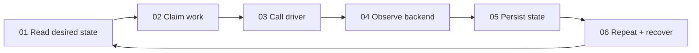
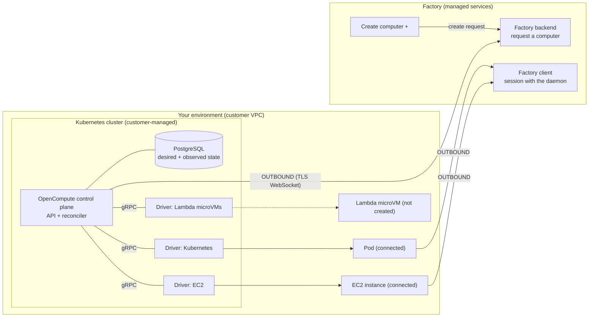

# Factory OpenCompute: what they built, the diagrams, and the landscape (2026-10-14)

Companion to [README.md](README.md). This file holds the source-by-source
facts and the redrawn diagrams; the README holds the comparison with our
stack and our plan.

Primary source: Factory, "Introducing OpenCompute", Walker Hildebrand and
Sherry Bai, 2026-10-14, <https://factory.com/news/opencompute>. Short quotes
below are attributed to that post unless another source is named.

Status markers used throughout:

- **[V] verified**: stated in Factory's post or docs, or seen in their diagrams.
- **[I] inferred**: our reading of what the post implies, not stated outright.
- **[U] unknown**: not stated anywhere we could find.

## 1. Is it open?

Not today. **[V]** The post says Factory *plans* to open-source OpenCompute,
"with an emphasis on" the contracts, conformance tests and driver model. No
license is named. **[V]** The docs page
(<https://docs.factory.com/opencompute/overview>) says "Private Preview"
and access is by contacting a Factory account team. **[V]** We listed all 22
public repos in the `Factory-AI` GitHub org on 2026-10-14
(`gh api orgs/Factory-AI/repos`): none is OpenCompute, a driver, a spec or
a conformance suite. The closest is `vfs` ("The filesystem for agents", a
fork of `tursodatabase/agentfs`). A GitHub search for `opencompute` only
finds the unrelated Open Compute Project (OCP, the Facebook-founded
hardware consortium) and hobby projects.

So "open" today means *runs in your infrastructure* and *vendor-neutral
contract*, not *source you can read*. **[I]** The name also collides with the
Open Compute Project, a 15-year-old hardware standard body, which will make
it hard to search for.

## 2. Product context (Factory's own lineup)

| Factory product | What it is | Source |
| --- | --- | --- |
| Droid | Their coding agent (CLI + web + app). | **[V]** post |
| Remote Control (Apr 2026) | Connect a machine you already run (Linux, macOS, Windows) to Droid. `droid daemon --remote-control`; register with `droid computer register [name]`; outbound through `relay.factory.ai` / `relay.eu.factory.ai`; "No inbound ports need to be opened." Also `droid computer ssh` and `port-forward` over the relay. Auth is the user's `/login`; no per-machine key is described. | **[V]** <https://docs.factory.com/remote-control> |
| Droid Computers | Persistent Factory-hosted machines; files and config survive across sessions. Can be created from a Ready Environment. | **[V]** remote-control and environments docs |
| Environments (GA 2026-10-12) | Saved dev setups (repos + setup commands). Factory "builds a reusable snapshot with the code cloned and tools installed", rebuilds every few hours, validates and promotes only good builds. The Environment is "the baseline, not a shared working directory". Successor to "Cloud Templates". | **[V]** <https://docs.factory.com/environments/overview>, <https://factory.com/news/droids-now-have-a-fleet-of-sandboxes> |
| Automations (2026-09-30) | Trigger (schedule, Slack, GitHub, webhook) + instructions + model + computer. Runs "locally, on a connected machine you provide, or on a Factory-managed Droid Computer". | **[V]** <https://factory.com/news/automations> |
| Missions | Multi-agent long tasks; worker agents each on their own Environment instance. OpenCompute itself was built "agent-first" starting from a Mission. | **[V]** post, environments docs |
| OpenCompute (2026-10-14, private preview) | Self-hosted orchestrator that provisions Environment sandboxes inside the customer's infrastructure. | **[V]** post, docs |

Their docs compare three compute options: Factory-managed (their infra,
they operate it, on demand), OpenCompute (your accounts, your team operates
it, on demand within your capacity), Remote Control (machines you manage,
limited to connected machines). **[V]**

## 3. What they built (architecture)

| Element | Claim | Status |
| --- | --- | --- |
| Problem | Remote Control is one persistent machine per user; Factory-managed computers had provisioning, suspend and resume, self-hosted ones did not. Enterprises had to run their own fleets. | **[V]** |
| Deployment | Runs in the customer's environment (cloud account, data center, Kubernetes). Customer operates it: upgrades, monitoring, patching, capacity, cost. | **[V]** docs |
| Connection | Outbound TLS WebSocket to Factory; no public endpoint, no inbound firewall port. "Connect outward, execute inside." | **[V]** |
| Enrollment | Deployment registers a public key with Factory; on each connect it signs a fresh challenge. Private key stays with the customer, optionally in a cloud KMS. | **[V]** |
| Per-sandbox link | Each sandbox opens its own outbound connection to Factory, the same way a Remote Control computer does. | **[V]** |
| Data placement | Where the sandbox runs is separate from where inference and session storage happen; keeping session data local depends on inference and sync settings. | **[V]** |
| Language | Control plane written in Go. | **[V]** |
| State | Desired and observed computer state in Postgres, on the customer side ("Lifecycle state stays on your side", architecture diagram). | **[V]** |
| Durable intent | Creating a computer records intent instead of holding a request open; a control-plane restart does not lose unfinished work. | **[V]** |
| Reconciler | Continuously drives computers toward requested state: provision, observe, retry recoverable failures, perform supported transitions. | **[V]** |
| Builds | Computers launch from immutable Builds; environment preparation is separate from machine creation. | **[V]** |
| Storage | S3-compatible object storage for build artifacts and snapshot payloads. | **[V]** |
| Lifecycle policy | Activity signals plus per-computer lifecycle settings decide keep-running versus suspend or terminate. | **[V]** |
| Drivers | Each provider is a standalone gRPC driver service mapping common operations (create, observe, execute commands, destroy) to the backend. Provider-specific behavior stays out of the control plane's DB and reconcile logic. No mandatory guest agent. | **[V]** |
| Conformance | Required **Core** profile; optional **Suspend**, **Snapshot**, **Fork**. Black-box tests verify what each driver claims. Unsupported requests are rejected "before durable state changes" instead of failing mid-provision. | **[V]** |
| Interfaces | Own API, CLI and admin panel. Vendor-neutral: Factory is "one client among possible clients"; drivers do not depend on Factory features. | **[V]** |
| Drivers built/evaluated | AWS Lambda MicroVMs, Kubernetes, EC2, Agent Sandbox, Agent Substrate, others "experimental"; maturity differs. | **[V]** |
| First customer | On-prem data center with an in-house provider API. Driver written by a Mission on the flight over; first sandbox after two days on site; six weeks prototype to first deployment; hardening continued after. | **[V]** |
| Uses | Interactive sessions, scheduled Automations, incident investigations, delegated work. | **[V]** |
| API shape, CLI verbs, state names, gRPC proto, warm pools, metering | Not published. | **[U]** |
| Warm pool | Not mentioned. Environments "ready before the Droid arrives" suggests prebuilt images, not pre-booted machines. | **[I]** |
| Auth inside the sandbox | Each sandbox connects outward like Remote Control, so it presumably runs the Droid daemon with some per-sandbox credential minted at create time. | **[I]** |
| Billing | Customer pays its own infra; Factory bills seats/usage. No compute metering described. | **[I]** |

## 4. The diagrams

The post has three diagrams plus a cover image. We downloaded them to a
scratch directory, looked at them, and did not keep them; Factory's images
are not ours to redistribute. Note: the file names on their site do not
match the alt text order (the "remote-control" image is the Remote Control
versus OpenCompute comparison, and the "close-the-gap" image is the
reconcile loop). Descriptions and redraws follow.

### 4.1 Remote Control versus OpenCompute (`remote-control-*.png`)

Two side-by-side panels.

- **Left, "REMOTE CONTROL".** A row labelled "INCOMING WORK" with six chips
  (ALERT, PR, TASK, then a greyed TASK, PR, ALERT, meaning queued work that
  has nowhere to go). Three of them feed down into three fixed machines,
  each a terminal icon marked "CONNECTED": **Workstation**, **Private VM**,
  **GPU machine**. Footer: "PERSISTENT CAPACITY". The point: a fixed set of
  hand-registered machines; extra work waits.
- **Right, "OPENCOMPUTE".** Three sources, **ALERTS**, **DELEGATIONS**,
  **AUTOMATIONS**, merge into one line that fans into a grid of ten sandbox
  cubes: seven solid with a dot (running), three faint (not yet created or
  suspended). Footer: "PROVISION → WORK → SUSPEND / TERMINATE". The point:
  elastic capacity created per piece of work and retired after.

```text
REMOTE CONTROL                          OPENCOMPUTE
incoming: [ALERT][PR][TASK] (TASK)(PR)(ALERT)   [ALERTS] [DELEGATIONS] [AUTOMATIONS]
             |     |    |   (waiting)               \        |         /
     [Workstation] [Private VM] [GPU machine]                 v
       connected     connected    connected       [#][#][#][#][#]   # running
                                                  [#][#][.][.][.]   . not running
       PERSISTENT CAPACITY                  PROVISION -> WORK -> SUSPEND/TERMINATE
```

### 4.2 The reconcile loop (`close-the-gap-*.png`)

Six boxes in two rows, joined in a ring, with "desired ⇄ observed" in the
middle. Step 05 has a heavier border (it is the step that makes the loop
safe to crash).



Our reading **[I]**: "claim work" is a lease or row lock in Postgres so
several reconciler replicas (or a restarted one) never act on the same
computer twice; "persist state" writes the observed state back before the
next pass, so a crash replays from durable state rather than memory.

### 4.3 Architecture (`architecture-*.png`)

Two regions.

- **Left, "FACTORY / Managed services".** A **Factory backend** box
  ("CONTROL", "Request a computer") above a black **Create computer +**
  button joined by "create request". Below, a **Factory client** box
  ("SESSION", "Interact with the daemon").
- **Right, "YOUR ENVIRONMENT / Customer VPC".** Inside a dashed
  "KUBERNETES CLUSTER / Customer-managed" box: the **OpenCompute** control
  plane ("API + reconciler", with a spinner), a **PostgreSQL** box
  ("Desired + observed state", caption "Lifecycle state stays on your
  side"), and three **DRIVER SERVICE** boxes joined to the control plane by
  a line labelled **gRPC**: **Kubernetes**, **Lambda microVMs**, **EC2**.
  Each driver points to its compute: a **Pod** ("1", connected), a
  **Lambda microVM** ("0", dashed, "not created"), an **EC2 instance**
  ("2", connected).
- **Arrows.** Two arrows, both labelled **OUTBOUND**, both pointing from
  the customer side to Factory: control plane → Factory backend, and a line
  collecting the running computers → Factory client. Nothing points into
  the customer VPC.



### 4.4 Cover

Title card "Introducing OpenCompute"; no technical content.

## 5. The systems they name

| System | What it is | Lifecycle verbs | Notes for us |
| --- | --- | --- | --- |
| Kubernetes **agent-sandbox** (`kubernetes-sigs/agent-sandbox`, SIG Apps) | CRDs: `Sandbox` (one stateful pod, stable identity, persistent storage) in `agents.x-k8s.io/v1alpha1`; extensions `SandboxTemplate`, `SandboxWarmPool`, `SandboxClaim` in `extensions.agents.x-k8s.io`. gVisor by default, Kata optional on GKE. | create, claim from warm pool, pause/resume (scale to 0) | Open source. Its WarmPool/Claim split is the cleanest public model for a warm pool. <https://github.com/kubernetes-sigs/agent-sandbox>, <https://kubernetes.io/blog/2026/03/20/running-agents-on-kubernetes-with-agent-sandbox> |
| Google **Agent Substrate** (open source, Sept 2026; GKE Agent Sandbox GA May 2026) | Builds on Agent Sandbox but decouples agent state from pods: `Actor`, `ActorTemplate`, `Worker`, `WorkerPool`. Idle actors are suspended and RAM + files snapshotted to Cloud Storage; restore onto a warm Worker "in under a second". Evaluation status; production by allowlist. | suspend, snapshot, restore | Repo `github.com/agent-substrate/substrate`. Closest public analogue to "Suspend + Snapshot" profiles. <https://docs.cloud.google.com/kubernetes-engine/ai-ml/about-agent-substrate> |
| **AWS Lambda MicroVMs** (2026-06-22) | Firecracker VM per session, up to 8 h, auto-suspend when idle (no compute charge while suspended, state kept), resume on traffic; per-VM HTTPS endpoint with bearer tokens; Arm/Graviton only, five regions; per-second billing. | run, auto-suspend/resume | Inbound endpoint model, unlike OpenCompute's outbound model. <https://theburningmonk.com/2026/06/what-you-need-to-know-about-lambda-microvms>, <https://infoq.com/news/2026/06/aws-lambda-microvms> |
| **E2B** | Hosted Firecracker sandboxes; pause/resume of the same sandbox (~1 s); session caps by plan. | create, pause, resume | Third-party comparisons only; not vendor-verified here. |
| **Daytona** | Hosted sandboxes; container class by default, VM class with snapshots and fork. | create, snapshot, fork (VM class) | Sources conflict on which class supports fork. |
| **Modal** | Hosted sandboxes with GPUs; snapshot is a filesystem image and restore makes a new sandbox. | create, snapshot-to-image | Snapshot ≠ suspend. Good reminder that "Snapshot" and "Suspend" are separate profiles. |

The E2B/Daytona/Modal rows come from 2026 third-party comparisons (e.g.
<https://www.tensorlake.ai/blog/suspend-vs-snapshot>,
<https://www.beri.net/article/e2b-vs-modal-vs-daytona-agent-sandbox-pricing-isolation-2026>)
and should be checked against vendor docs before we rely on them.

## 6. What the post gets right (worth copying as ideas)

1. Lifecycle intent is durable and the request returns immediately.
2. Capabilities are declared per driver and checked *before* any state
   change; "unsupported" is a clean refusal, not a half-built machine.
3. Conformance is black-box and per profile, which makes a new driver a
   bounded task an agent can do (their on-the-plane driver story).
4. Outbound-only from the customer side, with key possession proved on
   every connect.
5. Builds are immutable and separate from machine creation.
6. Suspend/Snapshot/Fork are optional, so a dumb backend (a bare VM, a
   laptop) can still be Core-conformant.
