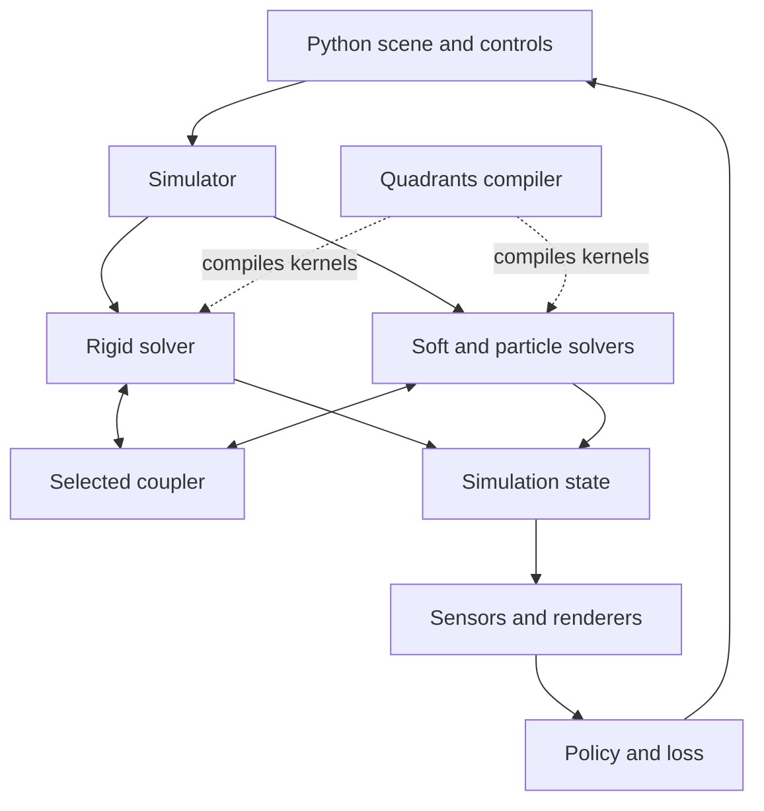

# Genesis World: full technical report

**Genesis is worth taking seriously as a robotics simulator, a platform for coupled physics, and a source of compiler-design ideas.** Its strongest combination is GPU batching, several physical representations in one scene, robot controls and sensors, and integration with machine learning.

For your **Coax, Psionic, and interactive 3D-world work**, I would study **Genesis’s physics architecture and its Quadrants compiler as separate projects**. They offer useful ideas at different layers of your stack.

The project is now called **Genesis World**. As of **October 31, 2026**, its latest published engine release is **1.4.5, released October 22**. This matters because descriptions from its original 2024 launch miss substantial architectural changes. [GitHub](https://github.com/Genesis-Embodied-AI/genesis-world/releases/tag/v1.4.5)


Three qualifications run through the report:

- **The physics engine and compiler are open source; the entire advertised company stack is not publicly available as source.**
- **Differentiability depends on the solver, contact model, and configuration.**
- **Large throughput figures aggregate many independent environments; they do not describe the speed of one large interactive world.**

---

## 1. Project status and maturity

Genesis began as an academic project in **December 2024** and is now developed with support from **Genesis AI**. The main repository is [Genesis-Embodied-AI/genesis-world](https://github.com/Genesis-Embodied-AI/genesis-world). Its current public snapshot showed approximately **30,100 stars and 2,900 forks**. More useful than those popularity figures is the continuing release activity. [GitHub](https://github.com/Genesis-Embodied-AI/genesis-world)

### Release progression

| Milestone | Date |
|---|---|
| Original academic Genesis project | December 2024 |
| Quadrants fork from Taichi | June 2025 |
| Genesis World 1.0.0 | May 27, 2026 |
| Genesis World 1.3.0 | July 29, 2026 |
| Genesis World 1.4.0 | September 6, 2026 |
| Genesis World 1.4.5 | October 22, 2026 |

The release history shows steady development through 2026. [PyPI](https://pypi.org/project/genesis-world/)

Recent engineering work is concrete: version 1.4.5 improves collision performance for complicated geometry, caching, asset reuse, and trajectory recording; fixes AMD GPU failures; and adds runtime screw constraints. It also explicitly includes **breaking changes** to differentiable tensor handling. **Pin versions and validate upgrades, including patch releases.** [GitHub](https://github.com/Genesis-Embodied-AI/genesis-world/releases/tag/v1.4.5)

Version 1.4.0 added portable scene-and-trajectory archives and `gs replay`, initially for rigid simulation. Its bit-exact replay capability concerns replaying recorded trajectories; it should not be expanded into a promise that separate simulations produce identical bits across all hardware. [GitHub](https://github.com/Genesis-Embodied-AI/genesis-world/releases/tag/v1.4.0)

### My maturity assessment

Genesis has enough implementation depth for serious robotics evaluation. The attention to contact behavior, recording, reproducibility, compilation latency, and hardware-specific correctness is encouraging.

I would classify it as **actively maintained, company-supported simulation software with a rapidly evolving API**. It warrants a controlled evaluation on your workloads. A version number alone would not persuade me to make it the foundation of every physics requirement in a large engine.

---

## 2. What is actually open source?

This is one of the most consequential distinctions.

| Component | Public status |
|---|---|
| Genesis physics and simulation implementation | Apache-2.0 source |
| Quadrants compiler | Apache-2.0 source |
| Nyx repository | Documentation, examples, and binary distribution; renderer implementation source absent from the public repository inspected |
| Company reconstruction, automated task generation, and extensive evaluation systems | Should not be assumed included in the public simulator |

The core repositories establish the first two; Nyx’s repository describes itself as documentation and runnable examples for the renderer plugin. [GitHub](https://github.com/Genesis-Embodied-AI/genesis-world)

A **June 1, 2026 maintainer clarification** explicitly separated the open simulator from several capabilities shown in the company’s announcement. These included Nyx source, reconstruction, automated scene/task generation, and larger evaluation pipelines. The current Nyx repository remains consistent with that source-availability distinction. [GitHub](https://github.com/Genesis-Embodied-AI/genesis-world/discussions/2871)

Consequently, the original **“generative physics engine”** positioning needs qualification. You can build generated scenes, synthetic observations, and agent-driven workflows on Genesis. You should not budget as though a complete open-source natural-language-to-worlds-and-tasks system comes with the package.

### Dependency licenses deserve a separate check

The engine’s own Apache license does not describe its entire dependency tree. Its manifest includes:

- **PyMeshLab**, whose repository specifies GPL-3.0.
- **TetGen’s Python wrapper**, which is MIT, while the underlying TetGen library is AGPL.

For commercial embedding or redistribution, review these mesh-processing dependencies, optional binaries, and assets individually. [GitHub](https://github.com/Genesis-Embodied-AI/genesis-world/blob/main/pyproject.toml)

---

## 3. The architecture

Genesis organizes simulation around a **Scene**.

An entity combines three descriptions:

| Concept | Responsibility |
|---|---|
| **Morph** | Geometry, imported asset, initial pose |
| **Material** | Physical behavior and solver selection |
| **Surface** | Visual appearance |

The scene owns simulation and visualization. Numerical state is consolidated into solver arrays; entity methods address the relevant portions of those arrays. [Genesis World](https://genesis-world.readthedocs.io/en/latest/user_guide/configuration/concepts.html)

A simplified view of the relationships is:



The renderers have their own backends. The diagram should not be read as implying that every rendering operation runs through Quadrants.

### The lifecycle

The standard workflow is:

1. Describe the scene.
2. Build its data structures and compiled kernels.
3. Apply controls.
4. Step the simulation.
5. Read observations or calculate a loss.
6. Repeat or reset.

Inside an ordinary coupled substep, Genesis prepares coupling information, advances each active solver, exchanges momentum across solver boundaries, and finalizes the state. There are specialized execution paths as well. [Genesis World](https://genesis-world.readthedocs.io/en/latest/user_guide/theory/coupling/index.html)

**Architectural implication:** this works naturally for preparing a simulation and running many rollouts. Constantly adding, removing, and streaming arbitrary physical objects introduces requirements beyond that normal build-and-step workflow.

### Batching is fundamental

Calling:

```python
scene.build(n_envs=1024)
```

creates independent environment instances that advance together. This is valuable when training needs millions of interactions. It is a different scaling problem from putting 1,024 mutually interacting robots into one world. [Genesis World](https://genesis-world.readthedocs.io/en/latest/user_guide/getting_started/parallel_simulation.html)

A small illustrative example:

```python
import genesis as gs

gs.init(backend=gs.gpu)

scene = gs.Scene(
    sim_options=gs.options.SimOptions(dt=1 / 240),
    show_viewer=False,
)

scene.add_entity(gs.morphs.Plane())
ball = scene.add_entity(
    morph=gs.morphs.Sphere(radius=0.1, pos=(0, 0, 1)),
    material=gs.materials.Rigid(),
)

scene.build(n_envs=1024)

for _ in range(240):
    scene.step()

positions = ball.get_pos()
```

This illustrates the API rather than reporting a measured benchmark.

---

## 4. What physics does it support?

Genesis uses multiple numerical representations because different materials benefit from different methods.

| Solver family | Representation | Main uses |
|---|---|---|
| **Rigid** | Articulated coordinates and collision geometry | Robots, mechanisms, rigid objects |
| **MPM** | Material particles plus a background grid | Elastic/plastic materials, sand, snow, liquids |
| **FEM** | Volumetric meshes; shell paths through IPC | Elastic objects, muscles, deformable manipulation |
| **PBD / XPBD** | Particles with position constraints | Cloth, ropes, deformables, particle liquids |
| **SPH** | Fluid particles | Free-surface liquids |
| **Stable Fluids** | Eulerian grid | Smoke and gas |

The documentation and implementations substantiate these families. [Genesis World](https://genesis-world.readthedocs.io/en/latest/user_guide/theory/soft_solvers.html)

SPH includes **WCSPH and DFSPH** pressure-solving paths. MPM and FEM expose multiple material models, rather than treating every deformable object as the same kind of spring system. [Genesis World](https://genesis-world.readthedocs.io/en/latest/_modules/genesis/engine/solvers/sph_solver.html)

### Why these different methods matter

Consider four tasks:

- A gripper lifting a rubber block.
- A wheel moving through sand.
- A robot stirring liquid.
- A hand folding cloth.

They involve different deformation, topology, and contact behavior. A material mesh is useful for some objects; transferring particle information through a grid is useful for others; position constraints offer another balance of cost and stability.

Genesis provides a common framework for making those choices. **You still choose the material model, resolution, contact formulation, timestep, and parameters.**

For your ambitions, interpret “universal” as broad coverage. It does not establish validated support for every specialized domain—combustion, orbital ephemerides, radiation transport, fracture propagation, or relativistic dynamics would require their own models and validation.

---

## 5. Rigid-body dynamics in more detail

The rigid solver is particularly relevant to robots, mechanisms, and physically controlled characters.

Genesis uses **generalized joint configuration and velocity**, performs forward kinematics through articulation trees, constructs a mass matrix from composite rigid-body inertias, and calculates motion under actuation, passive forces, gravity, and constraints. [Genesis World](https://genesis-world.readthedocs.io/en/latest/user_guide/theory/rigid_solver/forward_dynamics.html)

Schematically:

\[
M(q)\ddot q
=
\tau_{\text{applied}}
+
\tau_{\text{passive}}
+
\tau_{\text{bias}}
+
J(q)^T f_{\text{constraint}}
\]

The important point is that the motion of one link affects the dynamics of the rest of the articulation.

### Contact and constraint solving

The default formulation allows small constraint violations and solves their response together. The principal options include:

- **Newton optimization with Cholesky factorization**, the default.
- **Conjugate gradients**, providing a different computational tradeoff.
- Pyramidal friction by default, with elliptic and additional friction modes available under narrower conditions.
- Joint limits and equality constraints.

The default integrator is **`approximate_implicitfast`**, which reduces work relative to the fuller implicit path while introducing an approximation that can matter in stiff systems. [Genesis World](https://genesis-world.readthedocs.io/en/latest/user_guide/theory/rigid_solver/constraints.html)

Genesis implements its own numerical kernels. MuJoCo is a major design reference and validation target, including an explicit compatibility mode used for checks. [GitHub](https://github.com/Genesis-Embodied-AI/genesis-world/blob/main/CODING_GUIDELINES.md)

### Collision detection

The collision pipeline includes:

- Bounding-box filtering and collision masks.
- **Minkowski Portal Refinement**, or MPR, for the usual convex path.
- **GJK/EPA** paths for refinement and differentiable operation.
- Specialized primitive and terrain handling.
- Signed-distance-field paths for non-convex geometry.
- Multiple-contact generation, commonly through perturbed collision queries. [Genesis World](https://genesis-world.readthedocs.io/en/latest/user_guide/theory/rigid_solver/collision_detection.html)

An interesting implementation choice: the tagged options select **sweep-and-prune on CPU or heterogeneous scenes, and parallel all-pairs iteration on GPU otherwise**. Contact islands and hibernation provide additional ways to avoid unnecessary work. [Genesis World](https://genesis-world.readthedocs.io/en/v1.4.5/_modules/genesis/options/solvers.html)

That broad-phase choice is a useful compiler/engine lesson: regular parallel work can beat a theoretically more selective algorithm at particular sizes and on particular hardware.

---

## 6. Coupling: how different materials interact

Multiple solvers become much more useful when they can exchange forces.

A rigid robot and a deformable object need compatible contact handling across their representations. Genesis provides **one selected scene-level coupler**, with three principal approaches.

| Coupler | Best-aligned workload | Important limits |
|---|---|---|
| **Default explicit coupler** | Broad mixed-material scenes | Handles specific pairings; not every solver combination |
| **SAP** | Sustained rigid–FEM contact | Rigid/FEM only, double precision, implicit FEM |
| **IPC through libuipc** | Cloth, substantial deformation, difficult contact | Optional backend and additional platform/model restrictions |

The default coupler has the widest coverage, including rigid interactions with MPM, SPH, PBD, and FEM, plus selected pairings among soft solvers. [Genesis World](https://genesis-world.readthedocs.io/en/latest/user_guide/theory/coupling/index.html)

### SAP

Here, SAP means **Semi-Analytic Primal**, distinct from sweep-and-prune in collision detection.

It targets cases such as pressing, grasping, and holding a moderately deformable object under sustained load. It requires **64-bit precision** and **implicit FEM**, and does not support the differentiable path. [Genesis World](https://genesis-world.readthedocs.io/en/latest/user_guide/theory/coupling/sap_coupler.html)

### IPC

IPC means **Incremental Potential Contact**. Its barrier formulation is designed to prevent intersections during difficult deformable contact.

Genesis integrates it through optional **libuipc / `pyuipc`**. Detailed documentation limits that backend to **x86 Linux and Windows, on CPU or NVIDIA GPU**. Articulated robots participate through specific coupling arrangements, and step cost is higher than the default explicit approach. [Genesis World](https://genesis-world.readthedocs.io/en/latest/user_guide/theory/coupling/ipc_coupler.html)

The architectural lesson is valuable: **a common API can organize several numerical methods while exposing their different costs and compatibility rules.**

---

## 7. Quadrants: probably the most interesting part for Coax

Genesis’s performance-critical loops run as compiled kernels. Python provides the programming and orchestration environment; Quadrants supplies the compiler/runtime infrastructure.

Quadrants forked from Taichi in June 2025 and now develops independently of upstream compatibility. Its documented targets include **CUDA, ROCm/HIP, Metal, Vulkan/SPIR-V, and x86/ARM64 CPUs**, with platform-specific restrictions. [GitHub](https://github.com/Genesis-Embodied-AI/quadrants)

Genesis 1.4.5 pins **Quadrants 1.3.3**. The compiler’s current documentation can describe newer capabilities, so check a feature against the version you actually install. [Tagged dependency manifest](https://github.com/Genesis-Embodied-AI/genesis-world/blob/v1.4.5/pyproject.toml).

### A. Logical tensors and physical storage are separate

Quadrants supports fields and ndarrays with different specialization and runtime tradeoffs. Its unified tensor interface allows per-tensor storage and layout choices. [Quadrants 1.4.0 documentation](https://genesis-embodied-ai.github.io/quadrants/user_guide/tensor.html)

For Coax/Psionic, this suggests treating these as distinct concepts:

- Mathematical shape.
- Physical memory layout.
- Device placement.
- Ownership.
- Static versus dynamic dimensions.
- Specialization and recompilation behavior.

A tensor API that hides all of those decisions can become difficult to optimize or debug.

### B. Startup performance is a compiler concern

**Fastcache** reduces repeated frontend work when loading eligible cached kernels. Persisting compiled machine code alone does not eliminate all startup costs. [Quadrants 1.4.0 documentation](https://genesis-embodied-ai.github.io/quadrants/user_guide/fastcache.html)

For your iteration-speed goals, measure:

1. First compilation.
2. Reloading an existing compiled kernel.
3. Rebuilding a scene from cached assets.
4. Changing a parameter that should not require recompilation.
5. Changing a structural property that does.

Those are distinct user experiences.

### C. GPU graphs reduce orchestration overhead

Quadrants can capture repeated GPU operations into graphs. Its conditional-loop fast path can execute entirely on-device on **CUDA SM 9.0+**; other configurations may use host-driven iteration. Basic graph replay also has backend-specific behavior. [Quadrants 1.4.0 documentation](https://genesis-embodied-ai.github.io/quadrants/user_guide/graph.html)

This is relevant to iterative contact solvers, optimization loops, and repeated simulation steps. An API can remain portable while its performance characteristics differ substantially across devices.

### D. Zero-copy interoperability matters

Quadrants documents NumPy/PyTorch interoperability, including zero-copy paths with ownership and synchronization considerations. [Quadrants 1.3.1 documentation](https://genesis-embodied-ai.github.io/quadrants/user_guide/interop.html)

For a simulator alternating with a neural policy, avoiding device transfers can matter as much as improving a numerical kernel.

### E. Its deployment focus is narrower than yours

Quadrants explicitly removed components including the old **C API, ahead-of-time compilation, iOS/Android support, and several graphics backends** to concentrate maintenance. No WebGPU/Wasm target appears in its supported list. [GitHub](https://github.com/Genesis-Embodied-AI/quadrants)

For a browser or native game runtime, I would study its compiler techniques while designing the deployment interface around your own requirements.

---

## 8. Differentiability: real, but selective

Modern Genesis supports differentiation through rigid simulation and integration with the PyTorch graph. Controls can come from a neural network, and a loss on later state can propagate back through the rollout.

A practical API distinction: **`get_state()` returns gradient-connected state; ordinary convenience getters do not necessarily preserve that connection.** [Genesis World](https://genesis-world.readthedocs.io/en/latest/user_guide/theory/differentiable_simulation.html)

### Actual support

| Path | Verified implementation status |
|---|---|
| **Rigid** | Implemented, with restricted configuration |
| **MPM** | Reverse kernels present; CPIC excluded |
| **Explicit FEM** | Reverse kernels present |
| **Implicit FEM** | Gradient computation explicitly rejected |
| **PBD** | Backward methods remain stubs |
| **SPH** | Backward methods remain stubs |
| **SAP / IPC coupling** | Unsupported in the documented differentiable rigid path |

These distinctions are visible in the solver implementations, not merely inferred from advertising. [Genesis World](https://genesis-world.readthedocs.io/en/v1.4.5/_modules/genesis/engine/solvers/rigid/rigid_solver.html)

Rigid differentiation in the inspected release requires `approximate_implicitfast` and excludes hibernation, elliptic friction, no-slip iterations, torsional/rolling friction, and SAP/IPC combinations. [Genesis World](https://genesis-world.readthedocs.io/en/v1.4.5/_modules/genesis/engine/solvers/rigid/rigid_solver.html)

### The backward implementation is worth studying

The rigid constraint backward pass includes an **adjoint linear solve**. It can reuse a forward Cholesky factorization or use conjugate gradients.

That is useful for Psionic: an efficient differentiable numerical operation may need a custom backward implementation that reuses the mathematical structure of the forward calculation. [Constraint backward source](https://github.com/Genesis-Embodied-AI/genesis-world/blob/v1.4.5/genesis/engine/solvers/rigid/constraint/backward.py).

Applications include control optimization, trajectory optimization, and fitting physical parameters. But gradients still need validation. Contact transitions can produce fragile sensitivities; long rollouts consume memory and can have vanishing or exploding gradients.

**A gradient describes the implemented numerical model under its assumptions. Its usefulness for a physical task is a separate question.**

---

## 9. Robotics and machine-learning support

Genesis offers a substantial robotics interface.

### Controls and planning

The control layer includes joint position/velocity targets, PD gains, force limits, direct force/torque control, and external link wrenches. State setters are useful for resets; controllers produce motion through forces. [Genesis World](https://genesis-world.readthedocs.io/en/latest/user_guide/getting_started/control_your_robot.html)

Inverse kinematics supports multiple end-effectors and batched targets. Jacobians and forward kinematics are exposed. Motion planning includes collision-checked joint-space paths such as RRT/RRTConnect; those paths still require a controller and should not be mistaken for dynamically optimal trajectories. [Genesis World](https://genesis-world.readthedocs.io/en/latest/user_guide/robot_control/advanced_ik.html)

### Learning examples

The documented workflows include:

- Quadruped locomotion with PPO through **rsl-rl**.
- Drone hovering.
- Manipulation using a privileged-state teacher and a stereo-image student.

The manipulation example learns gripper positioning; closing and lifting are scripted. That is a useful, explicit task decomposition. [Genesis World](https://genesis-world.readthedocs.io/en/latest/user_guide/policy_training/examples/locomotion.html)

Domain randomization covers parameters such as friction, mass, center of mass, inertia, controller gains, and motor properties, plus episode commands and initial states. [Genesis World](https://genesis-world.readthedocs.io/en/latest/user_guide/policy_training/best_practices/domain_randomization.html)

### Heterogeneous environments have constraints

Variants can differ in geometry, inertia, link frames, and joint parameters, but must retain the same kinematic topology—matching links, joint names/types, and degree-of-freedom counts. Arbitrarily different robot structures should not be assumed to fit one batch. [Genesis World](https://genesis-world.readthedocs.io/en/latest/api_reference/engine/scene.html)

### Multi-GPU means independent simulations

The documented design uses **one process and scene per GPU**, optionally with distributed training to synchronize model gradients.

It does **not partition one interacting physical world across GPUs**. This distinction matters enormously when evaluating Genesis for a large persistent world. [Genesis World](https://genesis-world.readthedocs.io/en/latest/user_guide/policy_training/multi_gpu.html)

For Psionic, Genesis is a useful simulation workload and integration target. Replacing PyTorch within that workflow would involve the tensor interface, training code, and autograd bridge.

---

## 10. Sensors and synthetic observations

Genesis includes sensor abstractions with tensor outputs, attachments, history, and measurement imperfections.

| Sensor family | Purpose |
|---|---|
| IMU | Motion measurements |
| Contact, force, and joint sensing | Interaction and actuation signals |
| Tactile probes and taxels | Spatial contact estimates |
| Lidar and geometric depth | Distances, point clouds, depth |
| Rendering cameras | Visual observations |
| Surface distance | Proximity |
| Temperature grids | Local thermal measurements |

These are integrated into the simulation interface rather than being only viewer features. [Genesis World](https://genesis-world.readthedocs.io/en/latest/user_guide/sensing/index.html)

Two caveats deserve emphasis.

**Tactile sensing can use geometric approximations.** Some probes derive signals from signed distances or point samples and approximate spring, damping, or elastomer behavior. The documentation explicitly calls the readings uncalibrated estimates rather than solver impulses. Replicating a specific physical sensor requires calibration. [Genesis World](https://genesis-world.readthedocs.io/en/latest/user_guide/sensing/tactile.html)

**Geometric depth and photorealistic rendering are separate paths.** Lidar/depth raycasting can produce useful observations without invoking the expensive renderer. [Genesis World](https://genesis-world.readthedocs.io/en/latest/user_guide/sensing/raycaster.html)

The temperature-grid sensor includes local heat-transfer mechanisms, but that does not establish a general thermodynamics model shared by every material solver. [Genesis World](https://genesis-world.readthedocs.io/en/latest/user_guide/sensing/temperature_grid.html)

---

## 11. Rendering and the Nyx transition

Rendering support differs from physics support.

| Renderer | Intended role | Main qualification |
|---|---|---|
| **PyRender / OpenGL** | Interactive viewing and lightweight images | Camera environments processed sequentially |
| **LuisaRender** | Older photorealistic rendering | Deprecated in favor of Nyx; source-build setup |
| **Madrona batch renderer** | High-throughput visual training | CUDA-only documented path |
| **Nyx** | Current in-house rendering direction | Separate packages and incomplete feature parity |

The documentation describes a gradual move toward Nyx, rather than completed replacement of every rendering path. [Genesis World](https://genesis-world.readthedocs.io/en/latest/user_guide/sensing/camera_sensors.html)

### Current Nyx status

Nyx plugin **0.1.10** was published **October 21, 2026**. Its newer installation source describes **Vulkan ray tracing**, sharing buffers with CUDA or ROCm PyTorch. Supported configurations include ray-tracing-capable NVIDIA and AMD GPUs on x86-64 Linux and Windows 11; there is no CPU fallback. [PyPI](https://pypi.org/project/gs-nyx-plugin/) [Current installation source](https://github.com/Genesis-Embodied-AI/genesis-nyx/blob/main/docs/source/user_guide/installation.md).

The current feature matrix is narrower than “photorealistic renderer” might suggest:

- Rigid bodies, FEM, mesh-backed PBD, and selected MPM visualization are supported.
- SPH, smoke, particle visualization, and heterogeneous morphs are unsupported.
- The plugin exposes RGB, without depth, segmentation, normals, or optical-flow channels.
- Genesis glass/water surface mappings currently lose transmission-related properties.

These are documented integration limits. [Current Nyx feature matrix](https://github.com/Genesis-Embodied-AI/genesis-nyx/blob/main/docs/source/user_guide/supported_features.md).

Nyx also documents Gaussian splats, PBR materials, HDRIs, multiple cameras, batched environments, and object picking. [GitHub](https://github.com/Genesis-Embodied-AI/genesis-nyx)

For your worlds, remember that a Gaussian splat supplies appearance. Collision geometry, inertia, articulation, and material behavior need appropriate physical representations alongside it.

---

## 12. Platforms, assets, and installation

Genesis supports **Python 3.10–3.13**. Its documented engine configurations include CPU execution on supported desktop systems, NVIDIA/CUDA, AMD/ROCm, and Apple Silicon/Metal. Install a suitable PyTorch build first. Linux with NVIDIA is the most straightforward initial evaluation configuration in the current guidance. [Genesis World](https://genesis-world.readthedocs.io/en/latest/user_guide/overview/installation.html)

A reproducible starting point is:

```bash
# Install the appropriate PyTorch build first.
pip install "genesis-world==1.4.5"
```

The current Nyx installation path uses:

```bash
pip install "gs-nyx-plugin==0.1.10"
```

Preserve a complete dependency lock for reproducible work; the engine’s version alone does not freeze every package.

### Assets

Genesis imports robotics formats such as **URDF and MJCF**, common meshes, and USD scenes/articulations. USD handling includes coordinate/unit conversion and physics information, but material-network compatibility is more restricted. Some material workflows require optional baking, and renderers impose further limitations. [Genesis World](https://genesis-world.readthedocs.io/en/latest/user_guide/assets/usd_import.html)

The practical portability question is therefore:

> Does my chosen solver, coupler, renderer, sensor set, precision, and device combination work together?

A supported CPU/GPU target by itself does not answer that question.

---

## 13. How to interpret the performance claims

Genesis’s large numbers describe **batched simulation throughput**.

Its profiling documentation provides this example:

| Measurement | Value |
|---|---:|
| Aggregate physics steps per second | 43,000,000 |
| Independent environments | 30,000 |
| Steps per second per environment | Approximately 1,433 |

The documentation explicitly distinguishes these quantities. [Genesis World](https://genesis-world.readthedocs.io/en/latest/user_guide/developers/profiling.html)

If the timestep were **0.01 seconds**, the per-environment real-time factor would be:

\[
\frac{43{,}000{,}000}{30{,}000}\times0.01
\approx14.3
\]

Each environment would advance about **14.3 simulated seconds per wall-clock second**. Summing across all environments produces the much larger aggregate figure.

That is useful throughput for learning. It does not mean a single complex world runs hundreds of thousands of times faster than real time. This calculation interprets the documented example; it is not a new benchmark.

### What I would measure before adopting it

| Dimension | Why it matters |
|---|---|
| Single-environment latency | Interactive simulation responsiveness |
| Batched throughput | Training and large evaluation workloads |
| Cold compilation and warm startup | Developer iteration |
| Sensors, rendering, and policy inference | Complete application cost |
| Reset and recording overhead | Real training-loop behavior |
| VRAM and host memory | Feasible scene/batch/horizon sizes |
| Physical error and task success | Whether the speed produces useful results |

Use identical timesteps, substeps, tolerances, collision settings, precision, and model complexity when comparing engines.

The project’s guidance emphasizes GPU-resident buffers and avoiding readbacks and repeated allocations. Its testing guidelines also call for physically meaningful checks, including analytical results and MuJoCo consistency. Those are positive engineering practices, while task-specific validation remains necessary. [Genesis World](https://genesis-world.readthedocs.io/en/latest/user_guide/policy_training/best_practices/efficient_environment.html)

---

## 14. The major technical decisions and their tradeoffs

The following are my architectural assessments of the choices above.

| Decision | Benefit | Cost or boundary |
|---|---|---|
| Python-hosted compiled kernels | Accessible research code and fast experimentation | JIT/build complexity and a less direct native embedding path |
| Multiple material solvers | Appropriate methods for different phenomena | More compatibility and calibration work |
| Explicit coupling layer | Cross-material interaction in one framework | Stability and gradients depend on the chosen coupling |
| Batched environments | Strong fit for robot-learning sampling | Does not establish scaling of one large interacting world |
| Differentiable dynamics | Direct optimization through simulation | Memory costs and restricted numerical paths |
| Several renderers | Choices for quality and throughput | Uneven feature parity |
| Company-supported development | Focused engineering investment | Public and internal product capabilities diverge |

The resulting design aligns especially well with **robotics research, policy training, controller development, and simulation-based evaluation**.

A game runtime may instead prioritize streaming topology, deterministic rollback, deployment size, native interfaces, networking, and low latency at modest batch sizes. Those requirements need independent evaluation.

---

## 15. What I would take from it for your stack

### For Coax: study the compiler boundaries

I would prioritize:

- Explicit host/kernel boundaries.
- Logical versus physical tensor layout.
- Static versus dynamic dimensions.
- Predictable specialization and recompilation.
- Persistent caching with correct invalidation.
- Visibility into synchronization and transfers.
- Backend-specific scheduling without changing program meaning.

Those choices determine whether a numerical language remains pleasant when the application becomes large.

### For Psionic: make numerical solvers first-class differentiable operations

A solver should be able to supply:

1. A forward operation.
2. A backward or adjoint operation.
3. A clear state-lifetime contract.
4. Device and memory ownership information.
5. Supported precision and gradient modes.

Genesis’s constraint backward pass is an excellent example of why this matters. The useful derivative can reuse the mathematical structure and factorization of the forward solve.

### For your physics architecture: preserve distinct responsibilities

Keep geometry, physical material, visual appearance, solver state, sensing, and coupling separate.

Then make compatibility discoverable. I would explicitly publish and validate a matrix of:

**solver × backend × coupler × gradient mode × renderer × precision.**

Unsupported combinations should fail early with a precise explanation.

### For interactive worlds: adopt around concrete workloads

My initial integration would use Genesis as a **robotics backend and validation reference**. A Python worker could expose coarse operations for scene creation, resets, batched actions, observations, and trajectory export. Avoid a communication design that turns every body update into a separate remote call.

For spacecraft or planetary simulations, local robot arms, cabin objects, granular surfaces, and deformable equipment are plausible workloads. Orbital dynamics, reference frames, propulsion/resources, time acceleration, and planetary-scale precision require dedicated models.

Before deeper integration, I would run a small acceptance suite covering free fall, an articulated controller, frictional stacking, deformable contact, a randomized policy task, and one differentiable objective checked against finite differences.

### The source files I would read first

| Area | Entry point |
|---|---|
| Scene ownership and API | [scene.py](https://github.com/Genesis-Embodied-AI/genesis-world/blob/v1.4.5/genesis/engine/scene.py) |
| Solver scheduling | [simulator.py](https://github.com/Genesis-Embodied-AI/genesis-world/blob/v1.4.5/genesis/engine/simulator.py) |
| Rigid configuration and dispatch | [rigid_solver.py](https://github.com/Genesis-Embodied-AI/genesis-world/blob/v1.4.5/genesis/engine/solvers/rigid/rigid_solver.py) |
| Contact sensitivities and adjoints | [constraint/backward.py](https://github.com/Genesis-Embodied-AI/genesis-world/blob/v1.4.5/genesis/engine/solvers/rigid/constraint/backward.py) |
| PyTorch integration | [grad/bridge.py](https://github.com/Genesis-Embodied-AI/genesis-world/blob/v1.4.5/genesis/grad/bridge.py) |
| Numerical options and compatibility | [solvers.py](https://github.com/Genesis-Embodied-AI/genesis-world/blob/v1.4.5/genesis/options/solvers.py) |
| Compiler design | [Quadrants](https://github.com/Genesis-Embodied-AI/quadrants) |

*This is a source-and-documentation assessment, without a new hardware benchmark. The editable report’s saved text and structure were verified; its rendered layout was not previewed.*

