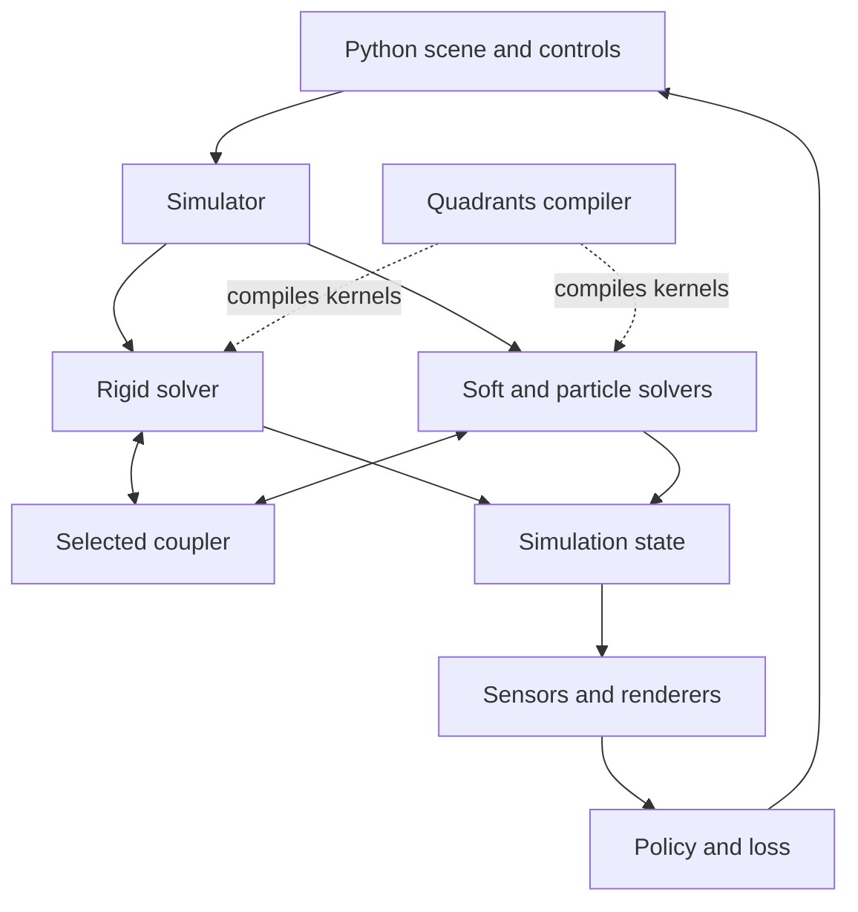

**Assessment dated October 31, 2026.** Genesis, now called **Genesis World**, is an actively developed simulation platform for robotics and physical AI. Its most valuable combination is a shared scene, several physical representations, cross-solver contact, batched execution, and integration with machine learning. For OpenAgents’ Coax, Psionic, and 3D-world work, it is worth studying both as a working simulator and as an example of how a numerical compiler supports an entire application stack.

The current published engine release is **1.4.5**, dated **October 22, 2026**. The physics engine and Quadrants compiler are open source. The separately distributed Nyx renderer has public documentation and examples, while its implementation source is absent from the public repository inspected. Differentiability is substantial but selective. These distinctions materially affect adoption decisions. [Engine release](https://github.com/Genesis-Embodied-AI/genesis-world/releases/tag/v1.4.5) · [Project](https://github.com/Genesis-Embodied-AI/genesis-world) · [Nyx repository](https://github.com/Genesis-Embodied-AI/genesis-nyx)

The analysis below uses tagged engine source and current official documentation. Current Quadrants and Nyx documentation can describe component changes beyond the engine’s pinned dependencies. Performance claims are assessed from their stated methodology; this report does not contain a new hardware benchmark.

# Project status and direction

Genesis began as an academic project in December 2024 and is now supported by Genesis AI. The current repository is Genesis-Embodied-AI/genesis-world. Its public snapshot showed about 30,100 stars and 2,900 forks, alongside continuing releases and development. Company support and public contributions are both visible; this should be understood as company-supported open source. [Introduction](https://genesis-world.readthedocs.io/en/latest/user_guide/overview/what_is_genesis.html) · [Repository](https://github.com/Genesis-Embodied-AI/genesis-world)

| Milestone | Date |
| - | - |
| Academic Genesis launch | December 2024 |
| Quadrants fork from Taichi | June 2025 |
| Genesis World 1.0.0 | May 27, 2026 |
| Genesis World 1.3.0 | July 29, 2026 |
| Genesis World 1.4.0 | September 6, 2026 |
| Genesis World 1.4.5 | October 22, 2026 |

Release dates come from [PyPI history](https://pypi.org/project/genesis-world/); the compiler’s origin is documented in the [Quadrants repository](https://github.com/Genesis-Embodied-AI/quadrants).

Recent development addresses practical engineering problems. Version 1.4.5 improves complex-mesh collision, asset and kernel caching, memory duplication, and trajectory recording; it also fixes AMD-specific failures and adds runtime screw constraints. It explicitly includes breaking changes to differentiable tensor handling. Pin versions and validate upgrades even within the 1.x series. [Release notes](https://github.com/Genesis-Embodied-AI/genesis-world/releases/tag/v1.4.5)

Version 1.4.0 introduced portable scene and trajectory archives and the `gs replay` command, initially for rigid simulation. Recorded, bit-exact replay should be distinguished from independently recomputing bitwise-identical physics across different processors. [Version 1.4.0](https://github.com/Genesis-Embodied-AI/genesis-world/releases/tag/v1.4.0)

My assessment is that the project has enough substance for serious robotics evaluation. Its release cadence, numerical work, and debugging tools are encouraging. API churn and uneven optional-backend coverage make it a dependency to manage deliberately. The most visible direction is better contact, faster and more reliable iteration, stronger sensing, and convergence toward Nyx for rendering. The latter is an announced direction, not completed feature parity. [Rendering direction](https://genesis-world.readthedocs.io/en/latest/user_guide/rendering/index.html)

# What is open source

| Component | Public status |
| - | - |
| Genesis physics and simulation implementation | Apache-2.0 source |
| Quadrants compiler | Apache-2.0 source |
| Nyx repository | Public documentation, examples, and binary distribution; renderer implementation source not present |
| Company task generation, reconstruction, and broad evaluation systems | Should not be assumed included in the public simulator |

Sources: [Genesis](https://github.com/Genesis-Embodied-AI/genesis-world) · [Quadrants](https://github.com/Genesis-Embodied-AI/quadrants) · [Nyx](https://github.com/Genesis-Embodied-AI/genesis-nyx).

A June 1, 2026 maintainer clarification explicitly separated the public simulator from the company’s reconstruction pipeline, Nyx source, automated task generation, and larger evaluation systems. The current Nyx repository still describes itself as documentation and examples. Its public package makes it usable; that does not make its implementation inspectable or rebuildable. [Maintainer clarification](https://github.com/Genesis-Embodied-AI/genesis-world/discussions/2871)

This is the essential qualification to the original “generative physics engine” positioning. The public engine can support generated scenes, synthetic observations, and learned controllers, but an entire natural-language-to-worlds-and-tasks system should not be counted as a shipped open-source capability.

The dependency licenses also matter. The engine manifest includes PyMeshLab, whose repository specifies GPL-3.0, and the TetGen wrapper, whose underlying TetGen library is AGPL despite the wrapper being MIT. A commercial distribution review should cover those dependencies, optional binaries, and assets individually. The Apache license on the engine does not settle the license of every component. [Dependency manifest](https://github.com/Genesis-Embodied-AI/genesis-world/blob/main/pyproject.toml) · [PyMeshLab](https://github.com/cnr-isti-vclab/PyMeshLab) · [TetGen](https://github.com/pyvista/tetgen)

# Architecture

The public ownership boundary is a **Scene**. An entity combines a **Morph** for geometry and initial pose, a **Material** for its physical model and solver selection, and a **Surface** for appearance. A scene owns simulation and visualization. Solver arrays hold many entities’ state, and entity accessors address their own slices. [Core concepts](https://genesis-world.readthedocs.io/en/latest/user_guide/configuration/concepts.html)



This diagram separates simulation kernels from rendering. A renderer has its own backend; it should not be assumed to run through Quadrants.

The normal lifecycle is to describe a scene, build its data structures and kernels, then repeatedly step it. A step may contain several physics substeps. Adding or changing arbitrary world topology is consequently a different workload from advancing a prepared simulation. For an engine with continuous world streaming, this build boundary deserves explicit attention.

During an ordinary coupled substep, the coupler prepares shared information, solvers advance locally, contact exchanges momentum, and solvers finalize their updates. The implementation also has specialized paths, including rigid-only execution. [Coupling](https://genesis-world.readthedocs.io/en/latest/user_guide/theory/coupling/index.html) · [Simulator source](https://github.com/Genesis-Embodied-AI/genesis-world/blob/v1.4.5/genesis/engine/simulator.py)

Batching is part of the state model. `scene.build(n_envs=N)` creates independent environment instances, and one `scene.step()` advances the batch. This is especially useful when policies need many experiences simultaneously. A thousand independent robot scenes and one world containing a thousand interacting robots exercise different scaling properties. [Parallel simulation](https://genesis-world.readthedocs.io/en/latest/user_guide/getting_started/parallel_simulation.html)

A small illustrative API example is:

```python
import genesis as gs

gs.init(backend=gs.gpu)
scene = gs.Scene(
    sim_options=gs.options.SimOptions(dt=1 / 240),
    show_viewer=False,
)
scene.add_entity(gs.morphs.Plane())
ball = scene.add_entity(
    morph=gs.morphs.Sphere(radius=0.1, pos=(0, 0, 1)),
    material=gs.materials.Rigid(),
)
scene.build(n_envs=1024)

for _ in range(240):
    scene.step()

positions = ball.get_pos()
```

This illustrates the programming model; it is not a measured performance result.

# Physics coverage

Genesis offers several representations because different materials need different numerical methods.

| Family | Representation | Documented uses |
| - | - | - |
| Rigid | Articulated coordinates and collision geometry | Robots, mechanisms, rigid props |
| MPM | Material particles plus a background grid | Elastic and plastic materials, sand, snow, liquids |
| FEM | Volumetric meshes, with shell paths through IPC | Elastic solids, muscles, deformable manipulation |
| PBD and XPBD | Particles with position constraints | Cloth, ropes, deformables, particle liquids |
| SPH | Interacting fluid particles | Free-surface liquids |
| Stable Fluids | Eulerian grid | Smoke and gas |

Sources: [Soft solvers](https://genesis-world.readthedocs.io/en/latest/user_guide/theory/soft_solvers.html) · [PBD implementation](https://genesis-world.readthedocs.io/en/latest/_modules/genesis/engine/solvers/pbd_solver.html) · [Rigid dynamics](https://genesis-world.readthedocs.io/en/latest/user_guide/theory/rigid_solver/forward_dynamics.html).

MPM includes elastic, plastic, sand, snow, and active-muscle models; FEM includes multiple elasticity models and active stress. SPH provides WCSPH and DFSPH pressure-solving paths. There are also driven tool and kinematic entity paths, whose physical participation differs from normal dynamic bodies. [Soft-solver theory](https://genesis-world.readthedocs.io/en/latest/user_guide/theory/soft_solvers.html) · [SPH source](https://genesis-world.readthedocs.io/en/latest/_modules/genesis/engine/solvers/sph_solver.html)

The practical tradeoff is not simply which solver has the longest feature list. FEM follows a material mesh, making its deformation and stress representation natural for shaped elastic objects. MPM transfers information between particles and a grid, which helps accommodate large deformations. Particle methods simplify some free-surface and topology problems but introduce sampling and neighborhood costs. Position-constraint approaches offer another stability and cost tradeoff.

For example, a robot lifting a rubber block, stirring a liquid, pushing sand, and folding cloth should not automatically use the same material solver. Genesis provides a common interface for those choices. Choosing the representation, contact model, resolution, timestep, and parameters remains part of building a valid simulation.

“Universal” describes broad coverage. It does not establish validated support for every domain-specific model, such as combustion, orbital ephemerides, radiation transport, fracture propagation, or relativistic dynamics.

# Rigid dynamics and collision

Genesis implements its own rigid-body dynamics, with MuJoCo serving as a major reference and a compatibility target. Its state is expressed in joint configuration and velocity. Forward kinematics places the links, composite rigid-body inertias form the mass matrix, and the solver applies actuation, gravity, passive forces, and contact. [Forward dynamics](https://genesis-world.readthedocs.io/en/latest/user_guide/theory/rigid_solver/forward_dynamics.html) · [Validation guidance](https://github.com/Genesis-Embodied-AI/genesis-world/blob/main/CODING_GUIDELINES.md)

The relevant mechanics can be summarized schematically as:

```math
M(q)\ddot q = \tau_{\mathrm{applied}} + \tau_{\mathrm{passive}} + \tau_{\mathrm{bias}} + J(q)^T f_{\mathrm{constraint}}
```

The mass matrix connects accelerations to forces; the Jacobian maps contact and joint constraints into the robot’s generalized coordinates. This formulation is useful for articulated machinery, where the movement of one link changes the dynamics of others.

The default contact formulation allows small constraint violations and solves for their response jointly. Newton with Cholesky factorization is the default optimizer, with a conjugate-gradient alternative. Pyramidal friction is the default; elliptic friction and additional friction modes have narrower compatibility. The default integrator, `approximate_implicitfast`, saves work relative to the fuller implicit path while introducing an approximation relevant to stiff systems. [Constraint model](https://genesis-world.readthedocs.io/en/latest/user_guide/theory/rigid_solver/constraints.html) · [Solver options](https://genesis-world.readthedocs.io/en/v1.4.5/_modules/genesis/options/solvers.html)

Collision detection uses bounding boxes and filters before detailed contact generation. Convex pairs normally use Minkowski Portal Refinement, with GJK/EPA available for refinement and differentiation. Non-convex geometry has signed-distance-field paths; primitive and terrain pairs have specialized routines. Multiple contacts can be generated by perturbing collision queries. [Collision detection](https://genesis-world.readthedocs.io/en/latest/user_guide/theory/rigid_solver/collision_detection.html)

A useful implementation detail is that the broad phase is backend-dependent: the tagged options select sweep-and-prune on CPU or with heterogeneous entities, and parallel all-pairs iteration on GPU otherwise. GPU-friendly regular work can outweigh an algorithm’s nominal asymptotic advantage at some problem sizes. Contact islands and hibernation provide additional opportunities to skip independent or inactive work, although hibernation is disabled for differentiation. [Tagged options](https://genesis-world.readthedocs.io/en/v1.4.5/_modules/genesis/options/solvers.html)

# Coupling between materials

Coupling is one of Genesis’s strongest architectural ideas. A rigid gripper and a soft object require a method for exchanging forces and momentum across their separate representations. Genesis selects one scene-level coupler, with different coverage and numerical tradeoffs.

| Coupler | Appropriate workload | Material limits |
| - | - | - |
| Default explicit coupler | Broad mixed-material scenes | Supports specific pairs; not every possible combination |
| SAP | Sustained rigid and FEM contact | Rigid and FEM only, 64-bit precision, implicit FEM |
| IPC through libuipc | Cloth, substantial deformation, difficult contact | Optional backend with its own platform and model restrictions |

The default coupler supports rigid interaction with MPM, SPH, PBD, and FEM, plus selected soft-solver pairings. Its breadth is useful for exploratory mixed-material scenes, but selecting two supported solvers does not prove they can interact with each other. [Coupling matrix](https://genesis-world.readthedocs.io/en/latest/user_guide/theory/coupling/index.html)

**SAP means Semi-Analytic Primal here**, distinct from sweep-and-prune in collision detection. It targets stable contact under sustained load, such as a gripper pressing and holding an elastic object. Its requirements include 64-bit precision and implicit FEM; it does not support differentiable simulation. [SAP](https://genesis-world.readthedocs.io/en/latest/user_guide/theory/coupling/sap_coupler.html)

**IPC means Incremental Potential Contact.** Its barrier formulation is designed to prevent intersections during difficult deformable contact. It costs more per step, uses the optional `pyuipc` backend, and handles articulated robots through specific coupling arrangements. Detailed documentation limits that backend to x86 Linux and Windows, on CPU or NVIDIA GPU. It is also outside the supported gradient path. [IPC](https://genesis-world.readthedocs.io/en/latest/user_guide/theory/coupling/ipc_coupler.html) · [Rigid compatibility checks](https://genesis-world.readthedocs.io/en/v1.4.5/_modules/genesis/engine/solvers/rigid/rigid_solver.html)

The design lesson is to expose these choices clearly. A single API can organize several methods while preserving their different guarantees, costs, and restrictions.

# Quadrants and the compiler strategy

Genesis’s Python interface sits above compiled numerical kernels. Quadrants, forked from Taichi in June 2025, supplies the compiler and runtime. The project now develops independently of upstream compatibility. Its source includes native compiler infrastructure; “written in Python” should be read as a description of the simulation programming model, not every dependency in the stack. [Quadrants](https://github.com/Genesis-Embodied-AI/quadrants)

The tagged Genesis 1.4.5 dependency manifest pins **Quadrants 1.3.3**. The discussion here also covers the compiler’s current published design documentation, so a newly documented feature should be checked against that pinned version before use. [Tagged manifest](https://github.com/Genesis-Embodied-AI/genesis-world/blob/v1.4.5/pyproject.toml)

Its documented targets include CUDA, ROCm/HIP, Metal, Vulkan/SPIR-V, and x86/ARM64 CPUs. Supported combinations differ by operating system and architecture. Compiler target support is broader than the engine’s recommended platform matrix. [Supported systems](https://genesis-embodied-ai.github.io/quadrants/user_guide/supported_systems.html)

Four design choices deserve particular attention:

1. **Separate logical tensors from storage.** Fields and ndarrays make different specialization and runtime tradeoffs. The unified tensor interface permits per-tensor storage and layout choices. For Coax/Psionic, logical shape, physical layout, ownership, and specialization should be distinct concepts. [Tensor design](https://genesis-embodied-ai.github.io/quadrants/user_guide/tensor.html)

2. **Optimize warm startup as well as steady-state kernels.** Fastcache reduces repeated frontend work when loading eligible cached kernels. Persisting machine code is only one part of reducing edit-and-run latency. Cache keys, dependencies, and eligibility are language-design concerns. [Fastcache](https://genesis-embodied-ai.github.io/quadrants/user_guide/fastcache.html)

3. **Keep repeated control flow close to the GPU.** Graph replay reduces launch overhead. Device-side conditional loops have a fast path on CUDA SM 9.0+, while other configurations can fall back to host-driven iteration. Identical API syntax therefore does not imply equal scheduling or performance. [Graphs](https://genesis-embodied-ai.github.io/quadrants/user_guide/graph.html)

4. **Interoperate without unnecessary copies.** NumPy/PyTorch interoperability includes zero-copy paths with ownership and synchronization constraints. Avoiding transfers can matter as much as speeding up arithmetic when simulation and learning alternate frequently. [Interop](https://genesis-embodied-ai.github.io/quadrants/user_guide/interop.html)

One strategic limit is explicit: Quadrants removed the old C API, ahead-of-time compilation, iOS/Android, and several graphics backends to focus maintenance. No WebGPU/Wasm target appears in its supported list. For browser, console, or small native embedding, study the implementation ideas while budgeting for a different deployment layer. [Compiler scope](https://github.com/Genesis-Embodied-AI/quadrants)

# Differentiable simulation

Current Genesis supports meaningful differentiation through rigid-body dynamics. A scene can record a rollout inside the PyTorch graph, allowing a loss on later state to propagate back to control inputs or a policy that produced those inputs. Gradient-carrying states come from `get_state()`; ordinary convenience getters do not necessarily preserve that connection. [Differentiable simulation](https://genesis-world.readthedocs.io/en/latest/user_guide/theory/differentiable_simulation.html)

The useful question is which numerical path has a backward implementation.

| Path | Source-verified status |
| - | - |
| Rigid | Supported with restricted integrator, collision, friction, and coupling choices |
| MPM | Reverse kernels present; CPIC excluded |
| Explicit FEM | Reverse kernels present |
| Implicit FEM | Gradient computation explicitly rejected |
| PBD | Backward methods remain stubs |
| SPH | Backward methods remain stubs |
| SAP and IPC coupling | Unsupported for the documented differentiable rigid path |

Sources: [Rigid](https://genesis-world.readthedocs.io/en/v1.4.5/_modules/genesis/engine/solvers/rigid/rigid_solver.html) · [MPM](https://genesis-world.readthedocs.io/en/latest/_modules/genesis/engine/solvers/mpm_solver.html) · [FEM](https://genesis-world.readthedocs.io/en/latest/_modules/genesis/engine/solvers/fem_solver.html) · [PBD](https://genesis-world.readthedocs.io/en/latest/_modules/genesis/engine/solvers/pbd_solver.html) · [SPH](https://genesis-world.readthedocs.io/en/latest/_modules/genesis/engine/solvers/sph_solver.html).

The v1.4.5 rigid implementation restricts gradients to `approximate_implicitfast`, disables hibernation, and rejects elliptic friction, no-slip iterations, torsional/rolling friction, and SAP/IPC combinations. These restrictions are more informative than a general claim that the engine is differentiable. [Tagged rigid checks](https://genesis-world.readthedocs.io/en/v1.4.5/_modules/genesis/engine/solvers/rigid/rigid_solver.html)

The backward implementation is technically interesting. It combines generated and custom derivatives with an adjoint solve for the active constraint system. The reverse solve can reuse a forward Cholesky factorization or use conjugate gradients. That offers a useful example of integrating an implicit numerical operation with an ML graph. [Constraint backward implementation](https://github.com/Genesis-Embodied-AI/genesis-world/blob/v1.4.5/genesis/engine/solvers/rigid/constraint/backward.py)

For system identification, trajectory optimization, and differentiable control, this is valuable. It still needs task-level gradient checks: contact switching can make sensitivities fragile, trajectories consume memory, and long rollouts can have vanishing or exploding gradients. A gradient is the derivative of the implemented numerical model under its assumptions. Physical usefulness remains something to validate.

# Robotics and learning workflows

The control interface supports joint position and velocity targets, PD gains, force limits, direct force/torque control, and applied link wrenches. Direct state setters are useful for initialization and resets; controllers advance bodies through physical forces. [Robot control](https://genesis-world.readthedocs.io/en/latest/user_guide/getting_started/control_your_robot.html)

Inverse kinematics can solve multiple end-effectors and batched targets. Jacobians and forward kinematics are available for custom controllers. The path planner operates in joint configuration space with collision checking, including RRT/RRTConnect choices. Its waypoints need a controller and are not automatically a dynamically feasible optimal trajectory. [Advanced IK](https://genesis-world.readthedocs.io/en/latest/user_guide/robot_control/advanced_ik.html) · [Path planning](https://genesis-world.readthedocs.io/en/latest/user_guide/robot_control/path_planning.html)

The repository contains practical learning examples:

- Quadruped locomotion using PPO through rsl-rl.

- Drone hovering with a similar environment/training structure.

- Manipulation using a privileged-state teacher and a stereo-image student.

The manipulation example has a precise scope: learning positions the gripper; closing and lifting are scripted. This is a useful teacher-to-vision recipe, with the task decomposition visible in the code. [Locomotion](https://genesis-world.readthedocs.io/en/latest/user_guide/policy_training/examples/locomotion.html) · [Manipulation](https://genesis-world.readthedocs.io/en/latest/user_guide/policy_training/examples/manipulation.html)

Domain randomization includes mass, friction, center of mass, inertia, controller gains, and motor parameters. Episode reset can vary commands and initial conditions. Some per-environment model variations require enabling corresponding batched information fields. [Randomization](https://genesis-world.readthedocs.io/en/latest/user_guide/policy_training/best_practices/domain_randomization.html)

Heterogeneous environments are useful but constrained. Rigid and kinematic variants can differ in geometry, inertia, link frames, and joint parameters while retaining the same kinematic topology: matching links, joints, joint types, and degree-of-freedom counts. Do not assume an arbitrary collection of unrelated robot structures fits one homogeneous batch. [Scene API](https://genesis-world.readthedocs.io/en/latest/api_reference/engine/scene.html)

Multi-GPU scaling runs a separate process and scene on each device, optionally using distributed training to synchronize model gradients. It does not partition a single interacting physical world across GPUs. This distinction is central when comparing robotics throughput with a large multiplayer world. [Multi-GPU design](https://genesis-world.readthedocs.io/en/latest/user_guide/policy_training/multi_gpu.html)

For Psionic, Genesis is a useful workload and integration target. Replacing PyTorch within this stack would involve tensor interoperability, training code, and the autograd bridge; replacing the simulator itself would be a different project.

# Sensors and synthetic observations

Sensors are part of the simulation API, with tensor outputs, attachment to bodies, history, and support for measurement imperfections. This gives learning code a structured way to consume observations. [Sensors](https://genesis-world.readthedocs.io/en/latest/user_guide/sensing/index.html)

| Family | Useful output |
| - | - |
| IMU | Motion measurements |
| Contact, force, and joint sensing | Interaction and actuation signals |
| Tactile probes and taxels | Spatial contact estimates |
| Lidar and geometric depth cameras | Ray distances, point clouds, depth |
| Rendering cameras | Visual observations, depending on backend |
| Surface-distance sensors | Proximity signals |
| Temperature grids | Local thermal measurements and evolution |

Geometric lidar/depth uses raycasting and need not depend on a photorealistic renderer. That separation lets a training workload purchase only the sensing cost it needs. [Raycasters](https://genesis-world.readthedocs.io/en/latest/user_guide/sensing/raycaster.html)

Tactile readings require careful interpretation. Some probes estimate response from signed distances or sampled points and approximate springs, damping, or elastomer response. The documentation calls them uncalibrated geometric estimates rather than solver impulses. They can be useful relative signals, but a digital replica of a particular tactile sensor needs calibration. [Tactile sensing](https://genesis-world.readthedocs.io/en/latest/user_guide/sensing/tactile.html)

The temperature-grid sensor models local conduction, convection, radiation, and optional heat generation. Its existence should not be expanded into a claim that all materials and solvers share a validated general thermodynamics engine. [Temperature grid](https://genesis-world.readthedocs.io/en/latest/user_guide/sensing/temperature_grid.html)

# Rendering and Nyx

Physics, rendering, and sensors have separate capability matrices.

| Renderer | Role | Main qualification |
| - | - | - |
| PyRender/OpenGL | Interactive viewing and lightweight images | Camera batches are processed sequentially |
| LuisaRender | Older photorealistic path | Deprecated in favor of Nyx; source-build setup |
| Madrona batch renderer | High-throughput visual training | CUDA-only documented path |
| Nyx | Current in-house path tracing direction | Separate packages and narrower feature/platform coverage |

Sources: [Rendering](https://genesis-world.readthedocs.io/en/latest/user_guide/rendering/index.html) · [Camera backends](https://genesis-world.readthedocs.io/en/latest/user_guide/sensing/camera_sensors.html).

Nyx plugin **0.1.10** was published on **October 21, 2026**. Its newer installation source describes Vulkan ray tracing, with buffers passed to CUDA or ROCm PyTorch. It supports suitable NVIDIA and AMD GPUs on x86-64 Linux and Windows 11; it has no CPU fallback. These current instructions supersede older pages describing an internal-only or NVIDIA-only package. [PyPI](https://pypi.org/project/gs-nyx-plugin/) · [Current installation source](https://github.com/Genesis-Embodied-AI/genesis-nyx/blob/main/docs/source/user_guide/installation.md)

Current Nyx coverage includes rigid bodies, FEM, mesh-backed PBD, and selected MPM visualization. SPH, smoke, particle mode, and heterogeneous morphs remain unsupported. The plugin currently exposes RGB rather than depth, segmentation, normals, or optical flow. Its mapping of Genesis glass/water surfaces drops transmission-related properties. These are integration limits even where the renderer SDK has richer capabilities. [Current feature matrix](https://github.com/Genesis-Embodied-AI/genesis-nyx/blob/main/docs/source/user_guide/supported_features.md)

Nyx also documents PBR materials, HDRIs, Gaussian splats, multiple cameras, batched environments, and object picking. [Nyx overview](https://github.com/Genesis-Embodied-AI/genesis-nyx)

A rendered Gaussian splat is an appearance representation. Usable collision, inertia, articulation, and material behavior require appropriate physical representations alongside it. Photorealism and physical fidelity are separate dimensions of a simulation.

# Platforms assets and deployment

The supported Python range is **3.10 through 3.13**. The documented engine platform choices include CPU execution on supported desktop systems, NVIDIA/CUDA, AMD/ROCm, and Apple Silicon/Metal. Install the appropriate PyTorch build first, then Genesis. Linux with NVIDIA is the most straightforward initial evaluation path in the current documentation. [Installation](https://genesis-world.readthedocs.io/en/latest/user_guide/overview/installation.html)

| Layer | Portability interpretation |
| - | - |
| Core physics | Several CPU/GPU backends |
| Quadrants compiler | Broader target list, with feature-specific limits |
| IPC | x86 Linux/Windows, CPU or NVIDIA |
| Madrona | CUDA |
| Nyx | Supported ray-tracing NVIDIA/AMD configurations on Linux/Windows |
| Browser deployment | No documented WebGPU/Wasm target |

Use the individual backend documentation above for the full matrix; choosing one supported feature does not guarantee the entire selected stack works on the same device.

Assets include URDF and MJCF robots and common mesh formats. USD import handles scenes and articulations, with unit/frame conversion and physics information. Shader/material compatibility is more limited: some nonstandard material networks require optional baking, and downstream renderers have their own restrictions. [USD import](https://genesis-world.readthedocs.io/en/latest/user_guide/assets/usd_import.html)

A simple reproducible engine installation starts with the appropriate PyTorch package, followed by:

```bash
pip install "genesis-world==1.4.5"
```

For the current Nyx plugin, its own instructions use:

```bash
pip install "gs-nyx-plugin==0.1.10"
```

Keep a lockfile or equivalent full dependency record for a project that must reproduce results; the top-level package version alone does not freeze every dependency.

# Performance and validation

Genesis is engineered for batched throughput. Its FPS counter counts physics steps summed across environments. The profiling documentation gives the example of **43,000,000 aggregate steps per second across 30,000 environments**, or about **1,433 steps per second per environment**. [Profiling](https://genesis-world.readthedocs.io/en/latest/user_guide/developers/profiling.html)

For an illustrative timestep of 0.01 seconds:

```math
\text{per-environment real-time factor}
= \frac{43{,}000{,}000}{30{,}000}\times 0.01
\approx 14.3
```

That arithmetic explains how enormous aggregate numbers can coexist with a much smaller speedup for an individual world. It is an interpretation of the documentation’s example, not a benchmark measured for this report.

A useful adoption benchmark should report these separately:

1. Latency for one environment and aggregate throughput for batches.

2. Cold build/JIT time and warm startup time.

3. Physics time versus rendering, sensing, policy inference, resets, and recording.

4. VRAM and host memory, including long differentiable rollouts.

5. Timestep, substeps, precision, solver tolerances, collision settings, and model complexity.

6. Physical error or task success alongside speed.

A demanding contact model that takes longer can be more valuable than a fast model that trains the wrong behavior. Similarly, a sparse single-world scene may benefit from a different execution strategy than thousands of identical robots.

The project’s own efficient-environment guidance emphasizes keeping buffers on the GPU and avoiding readbacks and repeated allocations. That is a reminder to benchmark the complete learning loop. [Efficient environments](https://genesis-world.readthedocs.io/en/latest/user_guide/policy_training/best_practices/efficient_environment.html)

Its coding guidelines require physically meaningful assertions and include analytical checks and MuJoCo-consistency testing. Those practices are positive engineering signals. They do not substitute for validation against the real hardware or physical regime your application depends on. [Testing guidance](https://github.com/Genesis-Embodied-AI/genesis-world/blob/main/CODING_GUIDELINES.md)

# Engineering tradeoffs

The following are architectural assessments based on the implementation and capabilities above.

| Decision | Benefit | Cost or boundary |
| - | - | - |
| Python-hosted compiled kernels | Accessible research code and rapid experiments | JIT/build complexity and less direct native embedding |
| Several material solvers | Appropriate methods for different phenomena | Compatibility and calibration multiply |
| Explicit coupling layer | Cross-material interaction in a common scene | Stability and gradients depend on the selected method |
| Batched environments | Excellent fit for robot-learning sampling | Aggregate throughput does not establish large-world scaling |
| Differentiable dynamics | Direct optimization through simulation | More memory and restricted numerical paths |
| Multiple rendering backends | Choices for visual quality and throughput | No universal feature parity |
| Company-supported development | Focused investment and active maintenance | Public and internal product scope diverge |

A promising design can still be the wrong dependency for a particular deployment. If the target is robot learning, its batching and ML interface align closely with the workload. If the target is browser gameplay with streaming scenes, deterministic rollback, small downloads, and a native ABI, those requirements need a separate engineering evaluation.

# Recommendations for Coax Psionic and interactive worlds

**Use Genesis first as a reference simulator, a robot-learning backend, and a validation target. Study Quadrants separately as a numerical-language implementation.** That preserves immediate value while leaving room to design a runtime around the needs of your worlds.

For Coax, the most useful lessons are explicit kernel boundaries, logical-versus-physical tensor layout, specialization control, cache correctness, and backend-specific execution. A language should make it clear which dimensions are static, which values live on a device, what triggers recompilation, and when an operation synchronizes. Those details determine whether an elegant API remains fast inside a real simulation loop.

For Psionic, prioritize custom differentiation rules and interoperability. A physics solver should be able to provide a forward operation, a backward or adjoint operation, and a clear state-lifetime contract. Constraint solving is an excellent test case because the right derivative implementation may reuse numerical work from the forward solve. Design the interface so external solvers can participate without requiring every internal operation to become an ordinary tensor primitive.

For a multi-physics engine, copy the separation between geometry, material behavior, visual appearance, solver state, sensors, and coupling. Improve on the discoverability of their compatibility. Publish a matrix of solver, backend, gradient path, renderer, precision, and coupler support, and reject unsupported combinations before a long run starts.

For games and continuous worlds, treat scene mutation, object lifetime, streaming, save/load, networking, scheduling, and precision across spatial scales as primary requirements. A simulator optimized for repeated rollouts provides useful components but does not by itself establish those runtime properties.

For spacecraft or planetary scenarios, local robot arms, cabin objects, granular surfaces, and deformable equipment are plausible Genesis workloads. Orbital dynamics, reference frames, thrust/fuel models, time acceleration, and planetary-scale precision would need their own models and validation. The same distinction applies to other specialized worlds.

A practical first integration could run Genesis in a Python worker behind a small interface for creating scenes, resetting environments, submitting batched actions, retrieving observations, and exporting trajectories. Keep transfers coarse enough that per-body communication does not dominate the physics. This is a proposed integration strategy, not a built-in Genesis service API.

Evaluate it on a small acceptance suite: a free-fall sanity check, an articulated controller, frictional stacking, deformable contact, a randomized policy task, and one differentiable objective checked against finite differences. Record correctness, startup, throughput, latency, and memory for each.

My recommendation is to spend early effort on the compiler, rigid solver, coupling interfaces, and gradient bridge. They are the parts most likely to yield reusable architecture for your language and ML framework. Adopt wider functionality as concrete workloads demonstrate a need.

# Source map for implementation study

| Area | Entry point |
| - | - |
| Scene ownership and public API | [scene.py](https://github.com/Genesis-Embodied-AI/genesis-world/blob/v1.4.5/genesis/engine/scene.py) |
| Solver scheduling and substeps | [simulator.py](https://github.com/Genesis-Embodied-AI/genesis-world/blob/v1.4.5/genesis/engine/simulator.py) |
| Rigid configuration and dispatch | [rigid_solver.py](https://github.com/Genesis-Embodied-AI/genesis-world/blob/v1.4.5/genesis/engine/solvers/rigid/rigid_solver.py) |
| Contact sensitivity and adjoints | [constraint/backward.py](https://github.com/Genesis-Embodied-AI/genesis-world/blob/v1.4.5/genesis/engine/solvers/rigid/constraint/backward.py) |
| PyTorch integration | [grad/bridge.py](https://github.com/Genesis-Embodied-AI/genesis-world/blob/v1.4.5/genesis/grad/bridge.py) |
| Numerical options and compatibility | [solvers.py](https://github.com/Genesis-Embodied-AI/genesis-world/blob/v1.4.5/genesis/options/solvers.py) |
| Compiler architecture | [Quadrants](https://github.com/Genesis-Embodied-AI/quadrants) |
| Renderer compatibility | [Nyx feature matrix](https://github.com/Genesis-Embodied-AI/genesis-nyx/blob/main/docs/source/user_guide/supported_features.md) |

The engine links use the inspected release tag. Current component documentation and main-branch renderer files can evolve independently.
