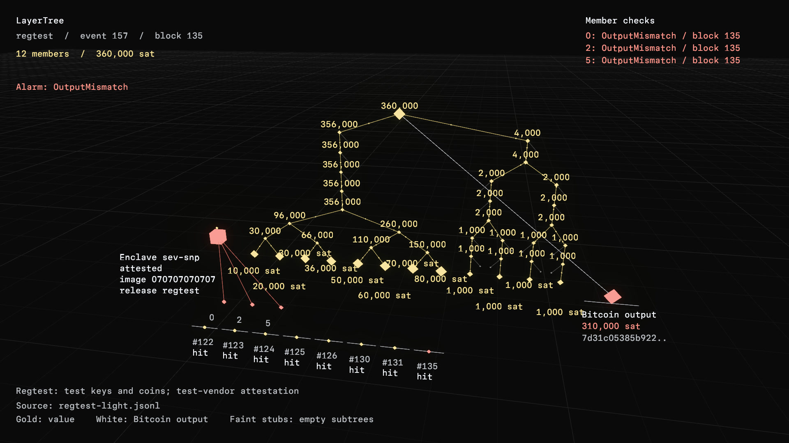
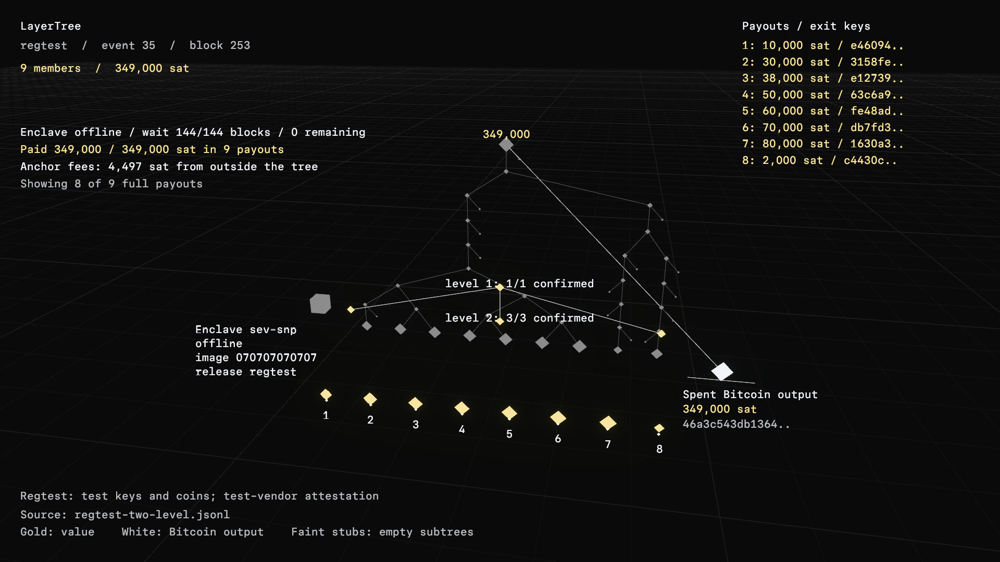
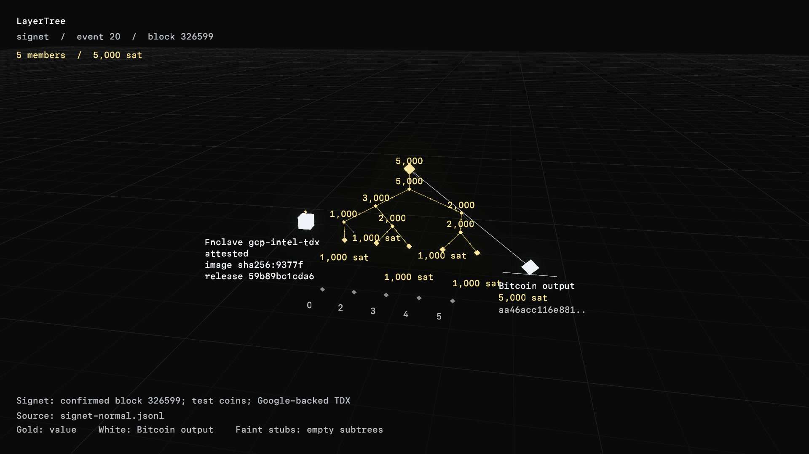
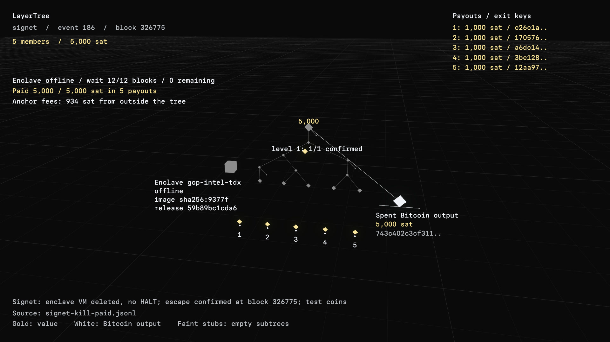
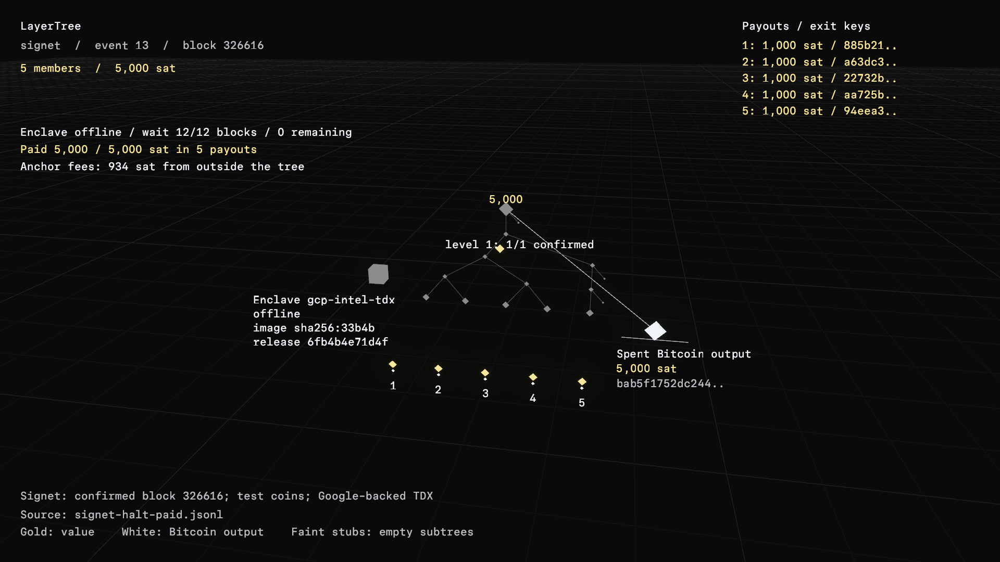

# LayerTree on mainnet today, with a TEE enforcing the rules

Status: research spec, 2026-10-15. Nothing here is built for production,
and no real money moves without the owner. The sandbox that tests the core
of this design is [`crates/layertree-tee-lab`](../../../crates/layertree-tee-lab).

## Why this exists

On 2026-10-15 Olaoluwa Osuntokun (roasbeef, CTO of Lightning Labs) wrote
that LayerTree has "all primitives in place and tested, but no clients
yet". A client can be a light client that follows the tree's spends on
chain, or it can take its leaves from a third party and check the Merkle
sum. Our owner asked whether we could "hack this onto mainnet now", or
whether we have to wait for chain upgrades. roasbeef's answer was: "you
could have some like TEE that enforces all the rules 'faithfully'". Julian
(@_julian256_) pointed out that the Great Script Restoration (GSR) proposal
has every opcode LayerTree needs except CCV, and said he plans to run the
protocol on his Core-based implementation of tapleaf `0xc2`.

This spec takes the TEE suggestion literally. An enclave in a Google Cloud
Confidential VM stands in for the missing covenant opcodes. It signs a
transition only when the transition passes the exact rules the scripts would
enforce. The tree, its leaves, its proofs and its vouchers are byte for byte
LayerTree's, so the day a covenant soft fork activates we move the same
tree into covenant scripts with one transaction.

Background: [analysis.md](analysis.md) covers the design and
[upstream-code.md](upstream-code.md) walks through the upstream code.

## The short version

- **What changes.** The tree output keeps LayerTree's root commitment. The
  difference is that its key path belongs to an enclave key in place of the
  unspendable NUMS point. Every normal transition is an enclave signature
  over a transaction that passed the rule predicate.
- **The escape hatch.** For every state the enclave pre-signs an *unroll*.
  The unroll is a small tree of transactions that pays every leaf in full
  to its own key, and it is valid only after Δ blocks of silence. Any newer
  transition kills it. So a dead enclave, a dead operator or a frozen cloud
  account costs members a wait of at most Δ blocks plus the time to the
  next heartbeat (about a week), not their money.
- **What we now trust.** If the enclave is broken (a hardware attack, a bug
  in our code, or a leaked key), it can sign a theft, and no script on
  today's chain stops that. That is the price of not waiting for a soft
  fork. We bound it with hard caps per tree, keys split across two TEE
  vendors, light clients that detect a bad spend in the next block, and an
  owner-held kill switch.
- **On-chain cost is lower than the covenant version.** A normal exit is a
  key-path spend of 298 vB measured on regtest (with a fee input and
  change), against 1,020 vB for a FULL-tier exit at
  65,536 members, because the rules run off-chain. The single-UTXO
  throughput limit is the same.
- **Verification.** The predicate replaces the scripts, so it is what has
  to be right. Its acceptance criteria are upstream's Lean theorems, one to
  one: no inflation, conservation, exit availability, voucher no-replay and
  path maintenance. Each one has a property test named after its theorem.
  The next step is Kani proofs on the Rust predicate itself (section 7).
- **Phases.** P0 regtest (now, about $0), P1 signet on real Confidential
  VMs (about $65 to $230 a month), P2 small mainnet with a hard cap and a
  kill switch, P3 multi-cloud threshold. P2 and later wait on the owner and
  on the custody review in #11761.

## 1. Which consensus features are missing

The covenant needs the following features. Every one of them is inactive on
mainnet today.

| Feature | Proposal | Used by tier | On mainnet |
| --- | --- | --- | --- |
| Varops budget | BIP-440 (GSR) | FULL, CCV `0xC2` | no |
| Restored `OP_CAT`, `OP_SUBSTR`, `OP_LEFT`, `OP_RIGHT`, `OP_AND`, `OP_DOWNSHIFT`, big-number arithmetic, tapleaf `0xC2` | BIP-441 (GSR) | FULL, CCV `0xC2` | no |
| `OP_TX` (transaction introspection) | Rusty Russell's draft, "New Opcodes for Tapscript v2" | FULL, MID, CCV | no (draft) |
| `OP_CHECKSIGFROMSTACK` | BIP-348 | FULL, MID, CCV (vouchers, tower exits) | no |
| `OP_EC_POINT_ADD`, `OP_EC_POINT_MUL`, `OP_EC_POINT_X_COORD` | Osuntokun's EC-ops draft (bips PR #1945) | FULL | no (draft) |
| `OP_CHECKCONTRACTVERIFY` (CCV) | BIP-443 | CCV | no |
| `OP_CAT` in tapleaf `0xC0` | BIP-347 | MID, MIN, CCV `0xC0` | no |
| `OP_TWEAKADD` | BIP-449 | MID, MIN | no |

What every tier needs, from spec section 4.5
([`spec/layertree.md`](https://github.com/lightninglabs/layertree/blob/f6c4d296130fa39f32d383eb841c82f9ea575539/spec/layertree.md)):

- **FULL:** BIP-440 and BIP-441, plus `OP_TX`, CSFS and the EC ops. This is
  the GSR family, and it matches Julian's remark: GSR covers everything but
  CCV.
- **CCV:** BIP-443, plus `OP_TX`, plus either the BIP-441 opcodes (`0xC2`)
  or `OP_CAT` (`0xC0`). CSFS is needed only for vouchers and tower exits.
- **MID:** `OP_CAT`, `OP_TX` (assumed in `0xC0`), CSFS and `OP_TWEAKADD`.
- **MIN:** `OP_CAT` and `OP_TWEAKADD`. This is the smallest set, but MIN has
  no vouchers and a fixed transaction shape.

**Not needed by any tier:** `OP_CHECKTEMPLATEVERIFY` (CTV, BIP-119),
`OP_TEMPLATEHASH`, `SIGHASH_ANYPREVOUT`, `OP_INTERNALKEY` and
`OP_PAIRCOMMIT`. The spec says so in section 4.2.

**What mainnet already has, and this design uses:** Taproot key and script
paths (BIP-341/342), Schnorr signatures, `OP_CHECKSIGVERIFY`,
`OP_CHECKSEQUENCEVERIFY` and BIP-68 relative locks, `OP_CHECKLOCKTIMEVERIFY`,
and (as relay policy) TRUC version-3 transactions and pay-to-anchor outputs.

## 2. The enforcer

### 2.1 What the enclave is

- A small Rust service in a GCP Confidential VM, AMD SEV-SNP on `n2d` and
  Intel TDX on `c3`. It runs the rule predicate in
  [`rules.rs`](../../../crates/layertree-tee-lab/src/rules.rs) and signs.
  It has no other signing path: no admin API, no debug key and no "sign
  this hash" call.
- **Its key is generated inside and never leaves.** At boot the enclave
  makes its key `Q_i` and puts a hash of `Q_i` and the tree parameters into
  the attestation report's `REPORT_DATA`. The hardware signs that report
  next to the launch measurement. The parameters are the operator key,
  `tree_id`, the depth, `DUST_MIN`, Δ and the migration target. Anyone can
  then check that this key belongs to this code for this tree (section 4.3).
- **The code is published.** We build the image reproducibly, log its
  digest in a transparency log (Rekor, or our NIP-ATT log), and publish the
  source commit.

### 2.2 What it signs: the predicate

The enclave signs a transaction only if all of the following hold. These are
LayerTree's transition rules (spec section 7) restated for a key-path spend,
and every check names the spec rule it stands in for.

1. **Position (7.1.1).** Input 0 spends the current tree output, and no
   other input does.
2. **Old state (7.1.3).** The enclave holds the full tree. The tree output's
   amount equals the root's sum, and the prevout the caller supplies for
   input 0 matches.
3. **New state (7.1.2, 7.1.4, 7.1.5).** Output 0 is the tree output for the
   new root, with exactly the new root's sum. The only exception is an exit
   that leaves the tree empty, where output 0 is free (7.8).
4. **Payouts (7.1.6, 7.2).** For an exit, output 1 pays the leaf's amount
   in full to `OP_1 <exit_key>`. Every tree uses the exact-payout rule
   (`EXIT^=`), so fees are always paid from outside the tree.
5. **Authorisation.** Each transition carries the signatures its spec rule
   names, and each is a BIP-340 signature over this exact transaction (the
   key-path sighash of input 0, `SIGHASH_DEFAULT`):
   - exit: the owner, or the evictor after `evict_after` with lock time
     enabled (7.2 rules 3 and 4);
   - join: the operator (7.3);
   - update: the owner and the operator (7.4), plus the exit key under
     `UPDATE^x`;
   - claim: no transaction signature, only the voucher, by the source's
     owner over `H_voucher(tree_id || body(source) || claim)`. The claim
     must also meet the carve rules: no underflow, `seq` advances,
     `SEQ_FINAL` bars it, the same evictor and an earlier or equal lease,
     and `DUST_MIN` on both sides (7.5 rules 1 to 6).
6. **The record is anchored.** The transaction carries an `OP_RETURN` with
   the hash of the transition record (section 4.1).
7. **Liveness.** The enclave also accepts exit requests directly from
   members, over an attested channel. It refuses to sign any non-exit
   transition while an exit request older than `X` blocks (say 6) is still
   waiting. An operator who censors exits therefore halts the tree, and a
   halted tree unrolls after Δ.

**One rule is stronger than the covenant's.** A covenant `JOIN_h` sees only
a subtree's hash and sum, so an operator can graft value behind a node with
no real leaves and freeze it (spec 10.2, 9.2). The enclave sees every
grafted leaf, so that cannot happen.

**One thing is weaker.** "Freedom elsewhere" (7.1.7) still holds: extra
inputs and outputs are allowed, and the signatures cover them. But the
enclave decides, where a covenant would let consensus decide.

The sandbox implements exits, evictions, joins at any height, updates,
claims, the heartbeat and migration, with a test for each rejection. These
are left to later: `CLAIM^h`, `CLAIM^x`, `SPLIT`, `EXIT^t`, `EVICT_SUBTREE_h`,
`REWRITE_h`, `DETACH_h` and the pending-leaf receive. Each is the same kind
of check, since the enclave can run any predicate a script could.

### 2.3 Why a TEE and not a federation

A k-of-n group of people can sign the same predicate. A TEE adds two
things. First, a member can check *which code* holds the key, by
attestation, not just *who* holds it. Second, the key can be one that no
person ever sees. The two can be combined: section 5 puts an owner-held
guardian key next to the enclave keys.

## 3. The tree output on today's mainnet

### 3.1 Script shape

The design keeps LayerTree's root commitment and replaces the NUMS point
with the enclave key:

```
internal key   P_k = Q + H_state(r_k)·G          (spec 6.1, Q in place of NUMS)
taptree        one leaf:  <K_k> OP_CHECKSIGVERIFY <Δ> OP_CHECKSEQUENCEVERIFY
output         P2TR(P_k, taptree)
```

- `Q` is the enclave key. With two enclaves it is a MuSig2 (BIP-327)
  aggregate of `Q_snp` and `Q_tdx`, and optionally the guardian `G` (section 5).
- `H_state` is LayerTree's tag, so `P_k` commits to the root in the same
  way the covenant output does. The sandbox checks this against upstream's
  test vectors: with NUMS in place of `Q` it reproduces upstream's internal
  key byte for byte (`tests/upstream_vectors.rs`).
- **The key path carries every normal transition.** The enclave signs with
  `q + H_state(r_k)`, tweaked again by the taptree (the `TapTweak`).
- **The script path is the unilateral exit.** `K_k` is a key made for this
  one state, used once and then deleted (section 3.2).

A member can rebuild the expected scriptPubKey from `Q`, the root, `K_k` and
Δ, and compare it with the output on chain. This is the light client's main
check.

### 3.2 The timelocked unilateral exit (no enclave needed)

Before the enclave signs the transition that creates state `k`, it does
the following:

1. It makes `K_k` and puts it into the new output's taptree. Every party
   signs the transaction after this point, since the transaction contains
   `K_k`.
2. It computes the new outpoint `o_k`. The txid does not cover witnesses, so
   it is known before anyone signs.
3. It builds the **unroll** of state `k`, a tree of version-3 (TRUC)
   transactions:
   - The **root** spends `o_k` through the `K_k` leaf, with `nSequence = Δ`.
     BIP-68 and the script's CSV both make it wait Δ blocks after `o_k`
     confirms.
   - If the tree has at most `R` leaves (the radix, 128 by default), the
     root pays each leaf's amount in full to `OP_1 <exit_key>`.
   - Otherwise the root pays up to `R` group outputs. Each group output is
     locked to a fresh key. That key signs exactly one child transaction
     (the next level) and is then deleted, so the output can only ever be
     spent by that child. **This deleted key stands in for CTV.**
   - Every transaction pays no fee and carries a zero-value pay-to-anchor
     output. Anyone can bump the fee by CPFP, and leaves are paid in full.
4. It deletes `K_k` and the group keys, then publishes the unroll.
5. Only then does it sign the transition.

Properties:

- **Killed by progress.** Any later transition spends `o_k` first, so the
  unroll of state `k` can no longer confirm. Old unrolls never need
  revoking.
- **Opened by silence.** If nothing spends `o_k` for Δ blocks, anyone can
  broadcast the unroll, and every member is paid exactly. A dead enclave, a
  deleted VM, a suspended GCP account or an operator who walks away all end
  the same way.
- **Heartbeat.** While the enclave is alive it sends a `Refresh` transition
  (no tree change, a new `K`) about every Δ/2 blocks, so an idle tree does
  not unroll. Each refresh is one key-path spend: 255 vB measured on
  regtest with a fee input and change (table below).
- **Checked by members before they rely on it.** A member's client verifies
  the whole package with public data only, using `verify_package` in
  [`unroll.rs`](../../../crates/layertree-tee-lab/src/unroll.rs). It checks
  that the root spends `o_k` by the `K_k` leaf, that the control block
  opens the output key, that nSequence and the script both say Δ, that
  every signature is valid, that every transaction conserves value, and
  that the final outputs are exactly the leaves. It then extracts its own
  branch (one transaction at up to 128 members, two at up to 16,384, three
  at up to about 2.1 million).
- **Size.** 128 P2TR outputs come to 5,604 vB at the root and 5,585 vB
  below it (measured), inside TRUC's 10,000 vB limit. Each leaf costs its
  member about 43.7 vB of output plus a share of the 153 vB anchor CPFP.
  This is a mass exit, though, not a solo one: the tree dissolves.
- **Timing.** The root is mined exactly Δ blocks after the last tree
  output. TRUC gives an unconfirmed parent one child, which the CPFP uses,
  so each further level waits a block: Δ + (levels − 1) blocks until every
  leaf is paid.

**Measured on regtest** (Bitcoin Core 30.2, 2026-10-15, #11785; Δ = 144,
radix 128; every transaction broadcast with `submitpackage` and mined;
details in the [lab README](../../../crates/layertree-tee-lab/README.md)):

| Leaves | Levels | Transactions per level | Largest per level (vB) | Blocks to the root, then to all paid |
| --- | --- | --- | --- | --- |
| 128 | 1 | 1 | 5,604 | 144, then 0 |
| 16,384 | 2 | 1, 128 | 5,604; 5,585 | 144, then 1 |
| 16,385 | 3 | 1, 2, 128 | 186; 5,585; 5,585 | 144, then 2 |

| Heartbeat budget (255 vB each, every Δ/2) | 1 sat/vB | 10 sat/vB | 50 sat/vB |
| --- | --- | --- | --- |
| Δ = 144: 14 a week | 3,570 sat | 35,700 sat | 178,500 sat |
| Δ = 288: 7 a week | 1,785 sat | 17,850 sat | 89,250 sat |
| Δ = 1,008: 2 a week | 510 sat | 5,100 sat | 25,500 sat |

A CPFP that carries a full 5,604 vB level costs 5,757 sat at 1 sat/vB,
57,570 at 10 and 287,850 at 50.
- **Two-phase signing.** In production, the enclave returns the unsigned
  transition and the new unroll first, and the owner signs only after its
  client has checked the unroll. The sandbox does the same
  (`Enclave::prepare`, then `Enclave::finish`).

**Option for small trees: pre-signed solo exits.** For trees of up to about
256 members, the enclave can also pre-sign each member's *solo* exit for
each state: a transaction that pays one leaf and recreates the tree without
it, plus that new state's unroll. That costs about `n²` signatures per
transition, so it does not scale, but it gives a member a way out alone
without dissolving the tree. This is not in the sandbox.

**Why not a 2-of-2 with each user?** A shared output with thousands of
members cannot be a 2-of-2 with each of them. The user's signature still
appears where it matters: every change to a leaf needs its owner's
signature over the exact transaction, and every payout is a P2TR to the
user's own key. For a single large balance, a plain 2-of-2 output with the
enclave plus a CSV exit path is better than a leaf. The client should
"promote" balances above a threshold out of the tree.

### 3.3 Trustless against trust-the-TEE

| Property | Covenant LayerTree | TEE LayerTree | Who you trust in the TEE version |
| --- | --- | --- | --- |
| Conservation: the tree's sum equals its output amount | consensus | the enclave, then checked by every light client after each spend | the enclave (prevention), anyone (detection) |
| Nobody moves my leaf without my signature | consensus | the enclave | the TEE vendor, our code, and the guardian if there is one |
| I can exit alone, any time, while the system is up | consensus, about 1,020 vB | the enclave must sign (forced-inclusion rule); 298 vB measured | the enclave's liveness |
| I get my money back if the operator or enclave disappears | consensus | the pre-signed unroll after Δ blocks | **trustless** once I hold a verified unroll for the current state |
| A broken enclave cannot steal | yes | **no**: the key path signs anything | bounded by caps, vendor split and the guardian |
| My leaf and proof are valid against the on-chain root | Merkle-sum proof | the same proof, and the root is committed in the output key | **trustless** |
| A third party's leaves are honest | verify the Merkle sum | the same | **trustless** |
| The operator cannot inflate balances | consensus plus Lean proofs | the enclave, and detectable from the published records | detection is trustless |
| Vouchers are single-use | `seq` in script | `seq` in the enclave | the enclave |
| Data availability | witnesses publish paths | records anchored by hash in `OP_RETURN`, mirrored | the mirrors (the hash on chain proves integrity) |
| Joining members cannot have value frozen by a fake graft | no: the covenant sees only a hash and sum | **yes**: the enclave sees every leaf | the enclave |

The line is simple. **Exits after a halt, proof checking and fraud
detection are trustless. Prevention of theft is trust-the-TEE.**

## 4. Light clients

### 4.1 Following spends on chain

A member keeps its leaf, its path, the current root, the outpoint and `K_k`,
and nothing else. This is `Member::follow` in
[`light.rs`](../../../crates/layertree-tee-lab/src/light.rs).

1. **Find the spend.** The client can compute the current tree
   scriptPubKey, and BIP-158 basic filters include the scriptPubKeys of
   outputs each block spends, so the client matches the current scriptPubKey
   and fetches the block. Upstream's
   [`design/towers.md`](https://github.com/lightninglabs/layertree/blob/f6c4d296130fa39f32d383eb841c82f9ea575539/design/towers.md)
   says a light tower "cannot match a fixed scriptPubKey". That is true,
   because the scriptPubKey changes with every transition, but a client that
   has kept up knows the next one. A client that falls behind asks a server
   for the outpoint chain.
2. **Get the record.** In the covenant version the witness publishes the
   paths. Here the witness is a single signature, so the enclave publishes a
   **transition record**: for each change, the position, the old and new
   leaf, and the changed position's path. Mirrors serve it: our API, a
   Nostr relay, and members' towers. The spending transaction carries
   `OP_RETURN H(record)`, so a record from any mirror is checked against the
   chain.
3. **Replay and check.** For each change, the old node must fold to the root
   the client holds, and the new node gives the next root. The client
   updates its own path (spec 9.7: only the sibling where the two paths meet
   changes). The final root must equal the record's, and output 0 must be
   the tree output for that root with exactly its sum.
4. **Raise the alarm on any mismatch.** A broken enclave can get a bad
   transaction mined. Every following client sees `OutputMismatch` within
   one block, and the sandbox has a test where it does. The response is to
   stop deposits, pull the kill switch and alert members. This is detection,
   not prevention.

To enforce the rule that the enclave must not publish a state without its
unroll, the enclave sends each record and unroll to `M` independent mirrors
and waits for signed receipts from `m` of them before it releases its
signature on the transition. Without the data, members could not unroll
that state.

### 4.2 Leaves from a third party

As roasbeef put it, a third party can hand out leaves, and the member
checks the Merkle sum. `Proof::verify` folds the leaf up its path, checking
every sum and refusing overflow. It requires the path's directions to
spell out the claimed position, and the result must equal the root
committed on chain. Tests check that a lowered sibling sum, a raised leaf
amount, an inflated root total, a moved position and a short path all fail.

### 4.3 Checking the enclave

A client checks this once per enclave key, and again whenever the key
changes:

1. **The report.** For SEV-SNP: the report's signature through the VCEK to
   AMD's ARK and ASK roots, and the TCB version. For TDX: the quote through
   the PCK chain to Intel's roots. Revocation lists and freshness are
   checked in both cases.
2. **The code.** The report's measurement must be in our release log, and
   the log entry must name a source commit that an independent rebuild
   turns into the same digest. The log is Rekor, with inclusion proof and
   checkpoint (#11747).
3. **The binding.** `REPORT_DATA` must equal
   `H("LayerTreeTEE/report-data", Q_i || operator_key || tree_id || D ||
   DUST_MIN || Δ || migration target)`. Then the tree's key and rules are the
   attested ones.
4. **The output.** The tree output on chain must be built from that `Q`.

The sandbox fakes steps 1 to 3 with a secp256k1 "vendor" key (`attest.rs`).
Tests show that a matching digest passes, and that a digest outside the
log, a report for other parameters, another enclave's key, and a forged
vendor signature all fail. Real report parsing is #11745. `crates/oa-att`
today verifies only Google Confidential Space tokens.

**GCP route decision (October 16, 2026, #11787).** Use Confidential
Space on TDX for the first signet service. A real production-mode token
verified in `oa-att` binds the test container digest and the exact hash
of `Q` and the tree parameters. This route trusts Google's attestation
service, launcher, and measurement policy, as well as Intel hardware.
A client checks that Google-signed token instead of claiming a direct
Intel-only quote verification. Independent image reproduction, release-log inclusion, sealed-key recovery
probes, and the confirmed signet output binding are now recorded in the
[P1 verification report](2026-10-16-signet-verification.md), with the 24-hour soak,
the physical VM kill, and both recoveries.

No SNP route on GCP qualified: the raw SNP report measures firmware, the
captured guest has no SVSM, and Google Cloud Attestation rejects the SNP
Confidential Space launch as unsupported. A hypervisor vTPM would add trust
in Google and still need an enforced measured-boot/dm-verity chain. The
SNP service needs a separately qualified cloud/image route; it does not
block the TDX signet service. Do not substitute plain SEV. Raw TDX RTMR
extension worked, but an application-supplied marker does not prove the
boot image. See the [captured reports, token, route comparison, and
cleanup](2026-10-16-attestation-routes.md).

## 5. Keys, state and lifecycle

**Who signs the key path.**

| Phase | `Q` (key path) | What a theft needs |
| --- | --- | --- |
| P1 | one TDX Confidential Space enclave on GCP; SNP follows a separately qualified route | that enclave or its attestation trust broken |
| P2 | MuSig2(SEV-SNP enclave, TDX enclave, owner guardian `G`) | both vendors broken **and** the guardian |
| P3 | FROST 2-of-3 across SEV-SNP and TDX on two clouds, plus `G` as a MuSig2 co-signer | two of three enclaves on two vendors, **and** `G` |

The guardian `G` is a key the owner holds on separate hardware. It
co-signs only after a second, independent implementation of the predicate
re-runs the transition. It is defense in depth and the kill switch. It also
makes us a key holder over members' funds, so it is a question for the
custody review (#11761). Without `G`, we run the enclaves but hold no key.

**Restarts and sealing.** If an enclave restarts with no copy of its key,
`Q` is gone, and the tree can only unroll after Δ. That is safe but costly.
So each enclave seals its key, either to its measurement (an SEV-SNP derived
key) or through key release gated on attestation (Cloud KMS with Confidential
Space, or our VAULT sealed tier, #11743). Rollback of sealed state is
harmless, because Bitcoin is the monotonic counter. An enclave restored to
an old state can only sign spends of outpoints that are already spent.

**Upgrades.** New code means a new measurement, and so a new key: sealing
is bound to the measurement, by design. The TDX restart experiment uses
local envelope encryption and an exact-image Cloud KMS grant, and therefore
also trusts KMS and its IAM administrators. The [captured two-boot, wrong-image,
and rollback checks](../../../crates/layertree-tee-lab/README.md#key-generation-and-restart-recovery-on-tdx)
cover key recovery; the live service still must restore current chain and HALT
state. An upgrade is a `Rotate` transition,
the same mechanism as the sandbox's `Migrate`:

1. Publish the new release and its log entry, then launch the new enclave
   and publish its report.
2. The old enclave checks the new report against the release log and
   announces the rotation in a record.
3. After a notice period of `N` blocks (more than Δ), the old enclave
   signs one transition. It moves the same root and amount to an output
   under `Q'`, along with that state's unroll.
4. Members who distrust the new code exit during the notice period. That is
   the same deal a covenant upgrade would offer.

**Multiple enclaves.** Each enclave runs the predicate on its own copy of
the tree and contributes a MuSig2 partial signature only if the check
passes. A partial signature is useless alone, so one honest enclave is
enough to block a theft. With MuSig2 n-of-n, losing any one enclave halts
the tree. FROST k-of-n, a draft BIP with a reference implementation,
removes that single point of failure in P3.

**The kill switch.** The owner signs a `HALT`. The enclaves then stop
sending heartbeats and sign nothing but exits, and the guardian stops
co-signing. After Δ blocks the current unroll is valid, and anyone,
including us, broadcasts it. No money goes anywhere but members' exit keys.

## 6. Threat model

| Threat | What it can do | What limits it |
| --- | --- | --- |
| SEV-SNP or TDX side channels and fault attacks: CacheWarp (2023), the Heckler and WeSee interrupt attacks (2024), BadRAM (2024, memory aliasing via the SPD chip), and the 2025 DDR bus-interposer attacks (Battering RAM, TEE.fail) | read the key, or forge attestation for one vendor; the 2025 interposer attacks need physical access to the server | caps per tree; keys split across two vendors; the guardian; light-client detection; a TCB version floor in the attestation check |
| Google as the cloud operator | stop or delete the VMs (liveness); mount a physical attack in its data centre (above); under Confidential Space, sign a false token | unroll after Δ; prefer raw hardware reports over Google tokens; a second cloud in P3 |
| The host or hypervisor | starve, pause or restart the VM; replay sealed state; drop network traffic | Δ and heartbeats; rollback is harmless (section 5); attested channels |
| Us, as operator: a bug, an insider, or coercion | ship bad code; censor; withhold records | the release log and independent rebuilds; members exit during an upgrade's notice period; the forced-inclusion rule; mirror receipts before signing; the unroll |
| Us, as guardian holder (P2) | refuse to co-sign (freeze), but not steal alone | freezing ends in the unroll; a theft needs the enclaves too |
| A member | spam exits; force a mass unroll after a quiet spell | heartbeats; exits are the member's own money |
| Fee attacks on the single UTXO | pinning, outbidding (spec 10.5) | TRUC and anchors on the unroll; heartbeat fee budget; a conservative Δ |
| Loss of the record mirrors | members cannot update paths | the enclave waits for `m` of `M` mirror receipts before it signs; a member can always fall back on the unroll it already holds |

**If the TEE is broken outright,** the loss is bounded by the value in
trees whose key path that TEE controls. Per tree that is the cap (section
10). Light clients see the bad spend in the next block. The unroll does not
help, because the attacker spends the outpoint first. The covenant version
removes this risk, and the reason to accept it now is a capped pilot, not
a general product.

## 7. Verification

In covenant LayerTree the scripts are the trust anchor. Here the enclave's
rule predicate replaces them, so the predicate is what has to be right.

### 7.1 What upstream proves, and the gap it leaves

Upstream's Lean 4 development
([`formal/`](https://github.com/lightninglabs/layertree/tree/f6c4d296130fa39f32d383eb841c82f9ea575539/formal),
[layertree.tech/components/verification.html](https://layertree.tech/components/verification.html))
proves 72 theorems about the *abstract* transition rules. These include:

- payability;
- no inflation;
- exit availability;
- conservation over any sequence of steps;
- vouchers that cannot be replayed;
- path maintenance;
- injective encodings.

Three things are assumptions in that development, not results: hash
collision resistance and tag separation (a `HashModel`), and output binding
(a `BindingModel`). Signatures are abstract (`authorised`). **The tapscript
bytecode is not proved.** Simulation and golden vectors check that it
matches the rules; nothing proves it.

In the TEE design the bytecode is gone, and Rust code stands in its place.
The gap moves with it: Lean proves the rules, and our Rust predicate has to
implement exactly those rules.

### 7.2 Acceptance criteria, one per theorem

The predicate's acceptance criteria are the theorem statements. Each one
below names the Lean theorem it comes from (file at commit `f6c4d29`) and
the property test in
[`tests/lean_mirrors.rs`](../../../crates/layertree-tee-lab/tests/lean_mirrors.rs)
that checks our code against it. Each test carries the theorem's name.

| Lean theorem (file) | Statement | The predicate must accept only when | Test |
| --- | --- | --- | --- |
| `ExitK.no_inflation` (`Transitions.lean`) | `out0 + payoutSum blocks ≤ r.sum` | output 0 plus every payout is at most the tree's amount. With exact payouts and a non-terminal exit it is equal. A payout or output 0 raised by 1 sat is refused | `ExitK_no_inflation` |
| `Steps.sum` (`Transitions.lean`) | `r'.sum + oldSum ss = r.sum + newSum ss` | the record's old and new nodes account for the whole change in the root sum, over any accepted sequence | `Steps_sum` |
| `Reachable.ledger` (`Trace.lean`) | `t'.total + removedSum = t.total + addedSum` | across any history, leaf totals balance: what left (exits, update decreases) plus what stays equals what was there plus what joined or was added | `Reachable_ledger` |
| `payable` (`Transitions.lean`) | emptying any leaf `p` is a valid step; `(t.set p none).root.sum + l.amount = t.root.sum`; other positions are unchanged | an exit's old node folds to the root, `E_0` folds to the new root, and nothing else moves | `payable` |
| `exit_available` (`Transitions.lean`), with `payoutOk` | every leaf has an accepted exit whose payout is `(l.exit_key, l.amount)` | every owner exit, and every eviction at the lease, is accepted, and it pays exactly `l.amount` to `OP_1 <l.exit_key>` | `exit_available` |
| `voucher_no_replay` (`Voucher.lean`) | after a claim, no reachable leaf has the source's body | the claim advances `seq`; the old voucher is refused after any later steps; no leaf ever again has the source's body | `voucher_no_replay` |
| `path_maintenance` (`Tree.lean`) | after a change at `p`, a member's path changes in at most the sibling where the two paths meet, and that sibling comes from `p`'s path | records carry enough to update every member's path; checked directly, and through the light client following real records | `path_maintenance`, `path_maintenance_light_client` |
| `join_sound` (`Transitions.lean`) | a graft fills only an empty aligned slot, and `out0 = r.sum + new.sum` | joins into an occupied slot are refused; output 0 is the old amount plus the grafted sum | `join_sound` |
| `Steps.sound` (`Transitions.lean`) | any accepted state is a real tree | stronger here, because the enclave holds every leaf: every leaf of every accepted state proves against its root, and there is no opaque node | `Steps_sound_no_opaque_nodes` |
| `root_inj` (`Tree.lean`) | equal roots mean equal trees | (our hash) changing any leaf field or moving a leaf changes the root | `root_inj` |
| `enc64_inj`, `le64_inj` (`Encoding.lean`) | the encodings are injective | sums and amounts cannot be re-read as other values | `enc64_inj` |

We use the same assumptions as upstream, and we make them concrete:

- **Hashes.** SHA-256 tagged hashes, as Lean's `HashModel` assumes.
- **Output binding.** The BIP-341 tweak of `Q + H_state(r)·G`, as
  `BindingModel` assumes.
- **Signatures.** Lean leaves `authorised` abstract. The predicate checks
  real BIP-340 signatures over the transaction, and `tests/rules.rs` covers
  every missing or forged case.

**Not mirrored yet**, because the sandbox does not implement those
transitions: the cohort theorems (`rewrite_sound`, `detach_sound`) and the
receive theorems (`merge_sound`, `reclaim_sound`, `Reachable.exit_value`).
Each one gets its mirror test when its transition lands.

<a id="73-next-steps-planned-not-done"></a>

### 7.3 Bounded proofs and remaining work

1. **Kani proofs on the monetary core (#11783).** The production predicate
   now calls pure functions for checked edit accounting, exact exit terms,
   voucher validation, and output checks. Six harnesses verify no inflation,
   exact exit-key payouts, conservation over up to three edits, voucher
   sequence advancement, checked node addition, and byte equality. Balances
   span `u64`; leaf amounts span the valid range; payout keys and scripts
   are arbitrary. Hash results and cryptographic validity are abstract.
   Tree lookup, Merkle paths, Bitcoin script construction, and real
   signatures remain outside this proof boundary and have the existing
   property and integration tests. The adapter checks the computed Merkle
   sum against the pure accounting before signing. The crate README lists
   each harness's bounds and commands, including a one-satoshi mutation
   check and the separate, manually submitted Cloud Build job. Kani proofs
   of path maintenance and the whole tree remain future work.
2. **Differential testing against upstream, once a licence allows.** Today
   we only *read* upstream's published vectors (`tests/upstream_vectors.rs`).
   Once a LICENSE file lands, we would generate random transition sequences
   and run each through our predicate and through upstream's executable
   reference: the Python simulator under `tools/`, or the Lean model's
   `Trans.Pre` and `Trans.apply` evaluated with `#eval`. We would compare
   accept or reject, the new root and the payouts on every step, and turn
   every disagreement into a regression test.

## 8. The route to real covenants

The tree is built to move into covenant scripts with **one transaction and
no change for members**.

- **Same bytes.** Leaves, tags, `enc64`, empty nodes, `tree_id` and voucher
  and exit-authorisation messages all follow spec v0.15.2. The sandbox
  checks against upstream's `spec/test-vectors.json`: the empty nodes, leaf
  bytes, leaf hashes, the example root, `tree_id` and the `H_state` tweak.
- **Same root commitment.** `Q + H_state(r)·G` against `NUMS + H_state(r)·G`.
- **Choose the parameters now for the tiers we expect.**
  - Dense profile, `D = 16`.
  - `DUST_MIN = 330`.
  - `tree_id` from the creation outpoint (spec 6.2).
  - Exact payouts.
  - Totals under 2^31 sat if MID is a possible target.
  - `SEQ_FINAL = 0xFFFFFFFF` (FULL and CCV); this needs a planned rewrite
    if the target is a `0xC0` tier.
- **Migration.** When CCV (or the GSR set) activates, a code release fixes
  `m`, the CCV taptree root compiled from our option set with our `tree_id`.
  After the notice period of section 5, the enclave signs `Migrate`: input 0
  is the TEE tree output, and output 0 is `TREE_SPK_CCV(r, m)` with the same
  root and amount. The sandbox implements this check (`Op::Migrate`). Every
  member's proof stays valid, because the root does not change. Vouchers
  and tower authorisations stay valid, because they bind `tree_id`, not
  `m`. From then on the enclave is not needed.
- **If FULL activates first,** the same transition targets
  `TREE_SPK(r, m)`.

## 9. How OpenAgents would use it

All of these follow our Bitcoin-only rails: Lightning, on-chain Bitcoin and
Taproot Assets. There is no Cashu and no EVM.

1. **Earnings credit leaves for authors and affiliates.** Each payee gets a
   leaf owned by our payout key, with `exit_key` set to the payee's key. A
   payout period is a cumulative voucher or an `UPDATE`. The unroll pays the
   payee's `exit_key` directly, so if OpenAgents disappears, payees still
   get what the tree says. That moves them from "trust our ledger" to "trust
   attested code, with a capped loss", which is the best fit identified in
   [integration-plan.md](integration-plan.md) (fit 2). It also gives a public
   proof of liabilities, since the tree is a Merkle-sum tree.
2. **Agent prepaid balances and x402 credits.** An agent's prepaid sats
   (API D13) become a leaf. An x402 payment becomes a voucher from the
   agent's leaf into the merchant's leaf, or into our receiver's leaf. The
   enclave applies vouchers in batches, so nothing reaches the chain per
   payment.
3. **Batched payouts.** One key-path spend can pay many owner-signed exits,
   because the enclave can enforce `EXIT_K` for any `K`.
4. **LND interop with `oa-lnd-1`** ([lnd-host.md](../../payments/lnd-host.md),
   [`crates/lnd-sdk`](../../../crates/lnd-sdk)):
   - **Channel funding from a leaf.** An exit's payout can be the funding
     output of a channel with `oa-lnd-1`. LND's PSBT funding flow lets an
     outside transaction fund a channel: LND gives the funding script, we
     build the exit paying it, and LND signs the first commitment for that
     outpoint before we broadcast. This works because the txid is fixed
     before the enclave signs. The leaf payout is P2TR, so it needs LND's
     simple taproot channels (MuSig2 funding output). Those are private-only
     in current LND, which suits a channel to us.
   - **Exits into Lightning.** A member sells its leaf for a Lightning
     payment. The member signs a hash-locked transfer of its leaf to our
     leaf (`CLAIM^h`, which the enclave enforces). `oa-lnd-1` pays the
     member's invoice and learns the preimage, and the enclave applies the
     transfer only with that preimage. No on-chain transaction happens per
     exit.
   - **Receiving from Lightning into a leaf.** `oa-lnd-1` settles the HTLC,
     then the enclave applies a cumulative voucher into the recipient's
     credit leaf. This is upstream's Lightning receive, with the enclave
     enforcing what `CLAIM^x` would.
5. **Not for micro-balances on their own.** A leaf must be at least
   `DUST_MIN` (330 sat). On the unroll, a 330-sat output is close to
   uneconomic to spend. Below a few thousand sats, the leaf should be the
   agent operator's, not each agent's.

## 10. Phases, costs and gates

GCP list prices, us-central1, on demand. The Confidential VM surcharge per
vCPU-hour is from Google's
[Confidential VM pricing page](https://cloud.google.com/confidential-computing/confidential-vm/pricing):
$0.0027502 for SEV-SNP on N2D and $0.0033982 for TDX on C3, plus a small
per-GiB surcharge. The base VM prices are approximate. Our own figure for a
`c3-standard-8` with TDX is about $0.45 an hour
([private-inference.md](../../security/private-inference.md)).

| Phase | What | Money | Monthly cost | Gate |
| --- | --- | --- | --- | --- |
| **P0 regtest** | `crates/layertree-tee-lab` (done: predicate, enclave model, unroll, light client, fake attestation, upstream vector check, and `scripts/layertree-regtest.sh`: transitions, light-client alarms and timed unrolls on bitcoind in Docker, with measured sizes and fees, section 3.2) | none | about $0 (local) | none; agent work |
| **P1 signet** | a real `c3-standard-4` TDX Confidential Space service first (#11787); Google-backed verification, reproduced image, release log, public relay records, and confirmed normal signet transitions are complete; the 24-hour soak, kill, HALT, and timed unroll continue in #11793; SNP qualification remains separate (#11788) | signet coins only | about $65 (SEV-SNP alone, about $0.09/h) to about $230 (both legs; TDX about $0.22/h) | owner OK to run the VMs |
| **P2 small mainnet** | MuSig2 of SEV-SNP, TDX and the owner's guardian; one tree, OpenAgents and staff as members first, then opt-in payees | **hard cap**: for example 0.01 BTC per tree and 100,000 sat per leaf; at most 50 members | about $230 for the VMs, plus on-chain fees: heartbeats 255 vB each (measured), twice a week at Δ = 1,008, about 5,100 sat a week at 10 sat/vB | **owner go/no-go**; #11761 custody and money-transmission review; owner holds `G` and the kill switch |
| **P3 more** | FROST 2-of-3 across two clouds and two vendors; larger caps; payout credit leaves in production; LND channel funding from leaves | caps raised step by step | plus about $100 to $300 per extra Confidential VM | owner decision per cap step; external review of the enclave code |

**Tracking.** P0 and P1, with Verse visualizations of the tree, are the
epic [#11779](https://github.com/OpenAgentsInc/openagents/issues/11779)
and its child issues (#11780 to #11799).

**Owner decisions needed:**

1. **Custody.** Does running the enclave (and, in P2, holding `G`) make
   OpenAgents a custodian or a money transmitter for members' leaves? This
   goes into #11761 before any third party's money enters a tree.
2. **The guardian.** Is the owner willing to hold `G`, the third MuSig2
   key and the kill switch? It makes theft harder, but it is a key over
   member funds.
3. **Caps.** The tree cap, the leaf cap and the member count for P2, and
   the rule for raising them.
4. **P1 spend.** Approve running one or two Confidential VMs (about $65 to
   $230 a month).
5. **P2 go/no-go.** Only after P1 shows a real report verified end to end,
   a timed unroll on signet, and light-client alarms working.
6. **Licence.** The design and sandbox reuse no upstream code. If we ever
   want to port upstream's script generators (for the migration's `m`), we
   need the LICENSE file first. It is still missing (see
   [README.md](README.md)).

### 10.1 Regtest captures


Source: `fixtures/events/regtest.jsonl`, event 8. The displayed 219,000 sat
root equals the tree output. Keys and coins are for tests; the attestation
shown in this run uses the lab's test vendor key.



The [capture gallery](captures/README.md) names the mined theft transaction
and its three `OutputMismatch` observations. The record claims 360,000 sat;
Core observes 310,000 sat in output 0, exposing the 50,000 sat shortfall. This is a Bitcoin Core 30.2
regtest run, not a Confidential VM or public signet result.



The two-level regtest run pays the full 349,000 sat to its nine remaining
leaves. Anchor fees come from outside the tree. The gallery includes exact
source events, transactions, source hashes, and commands.

### 10.2 Confirmed signet captures



The five-member, 5,000-sat tree completed join, update, exit, and refresh
at heights 326596–326599. The [P1 report](2026-10-16-signet-verification.md)
lists each public transaction, actual fee, and hardware-attestation trust
limit. The [gallery](captures/README.md#signet-tree) and its source manifest
link the exact checked log. A separate negative view changes the expected
tree ID for a captured token; it is not a live signer failure.

The primary measurement restarted on 2026-10-16 at 13:34:53 UTC after a
seven-block confirmation gap exceeded the six-block target. The clean 24-hour
window then completed with 38 heartbeats, none more than 5 blocks apart.



The scheduled deletion removed the enclave VM at height 326763 (2026-10-17
13:42 UTC; audited, no HALT). The saved escape confirmed at its first valid
block, **326775**, 12 blocks later, paying all five members exactly 1,000 sats.
The CPFP child paid 934 sats from outside the tree. Three light clients followed
the tree for about 29.5 hours through the payout with no alarm, and marked their
members exited. The [P1 report](2026-10-16-signet-verification.md#primary-tree-physical-loss-recovery)
links the audit, the 187-event fixture, and the public archive.



The separate guardian HALT run recovered all five exact 1,000-sat payouts at
height 326616, with 934 sats in external anchor fees. The
[P1 report](2026-10-16-signet-verification.md) links the checked public package,
Core reads, and final capture. Together with the physical kill above, this
completes both P1 recovery paths.

## 11. What the sandbox proves, and what it does not

The tests are in `crates/layertree-tee-lab`. Run them with
`cargo test --manifest-path crates/layertree-tee-lab/Cargo.toml`. The
crate is its own workspace and is listed in the monorepo's `exclude`.

**It shows that:**

- The Merkle-sum tree builds, proves and verifies, and a tampered sum
  fails, including as a property test.
- The bytes match upstream's vectors (an opt-in test, run against a local
  reference clone).
- The enclave signs only what passes, with one test per rejection:
  - the wrong input or prevout;
  - output 0 with the wrong root, amount or unroll key;
  - a short, long or misdirected payout;
  - a missing record;
  - an early eviction, or lock time disabled;
  - a missing or forged signature, or a signature over a different
    transaction;
  - a graft into an occupied slot, or an invalid leaf;
  - for claims: underflow, dust on either side, later lease or another
    evictor, an occupied target, a forged voucher, a voucher for another
    tree, a replayed voucher, and `SEQ_FINAL`;
  - a migration with no target or the wrong target.
- Every state's unroll verifies with the enclave dropped, at one, two and
  three levels, and a tampered unroll fails.
- Random histories conserve value, keep every proof valid and keep every
  member's unroll valid. The enclave never holds an ephemeral key after
  signing.
- Property tests mirror upstream's Lean theorems one to one, each named
  after its theorem (section 7.2).
- A light client follows exits, joins, claims and heartbeats, keeps its
  path equal to the full tree's, and catches a broken enclave's theft in
  the next block.
- The liveness and publication rules (#11786), one test each, and the
  property tests above pass with them switched on:
  - two-phase signing: `prepare` checks everything but the parties'
    signatures, pre-signs the new unroll and erases its key; a member whose
    check of that unroll fails does not sign, and `finish` has nothing to
    sign with;
  - forced inclusion: once a member's signed exit request has waited `X`
    blocks (6 by default), every non-exit transition is refused
    (`ExitCensored`) until the exit is included;
  - mirror receipts: no signature until `m` of `M` configured mirrors sign
    receipts over the record and unroll hashes (duplicates, strangers,
    forged or mismatched receipts do not count);
  - `HALT`: after the guardian's signed halt only exits are signed, and on
    regtest the unroll then confirms exactly Δ blocks after the last exit.
- On a real node (Bitcoin Core 30.2 on regtest in Docker,
  `scripts/layertree-regtest.sh`): every transition confirms with the tree
  output equal to the enclave's state, the unroll is refused one block
  early and mined Δ blocks after the tree output at one, two and three
  levels, light clients follow by BIP-158 filters and raise every alarm,
  and sizes and fees are measured (section 3.2).

**P0 limits.** The preceding regtest tests do not establish the following;
the separately measured P1 results are linked in section 10.2.

**The P0 tests do not show:**

- Real hardware attestation, sealing, or side-channel resistance.
- Anything on signet or mainnet, or under real fee pressure: regtest
  mines whatever pays the minimum.
- Exit requests and receipts over a real attested channel or real
  mirrors; the lab's are in-process.
- MuSig2 or FROST across enclaves. rust-secp256k1 0.29 has no MuSig2, so
  the sandbox models one enclave.
