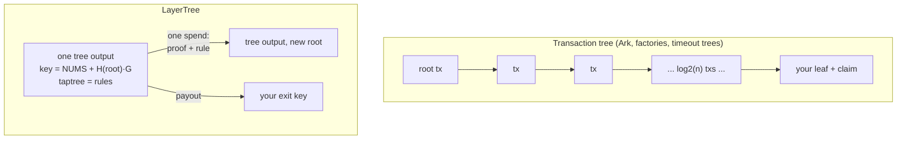
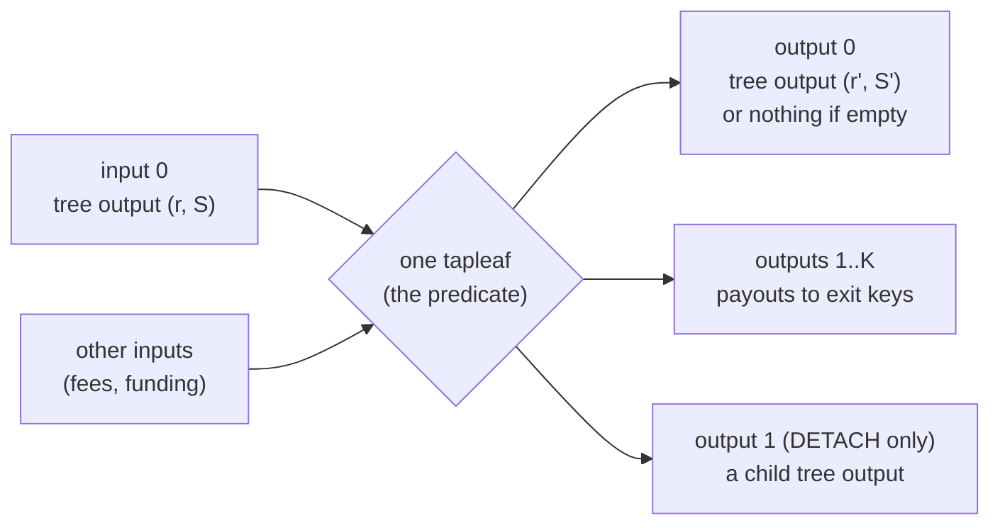

# LayerTree: analysis

Research from 2026-10-15 on LayerTree, a shared-UTXO design from Lightning
Labs (author: Olaoluwa Osuntokun). It covers how it works, what it costs,
who has to trust whom, how it compares with other designs, what the proofs
cover, what can run today, and where the claims run ahead of the evidence.
The OpenAgents side is in [integration-plan.md](integration-plan.md).

## Sources

| Source | What it is | Read at |
| --- | --- | --- |
| [layertree.tech](https://layertree.tech/) | The interactive explainer: a step-through of one tree's life, then one page per operation (state machine, join, exit, payments, swaps, eviction, batching, tiers, scaling, verification) | 2026-10-15 |
| [Short paper (PDF)](https://layertree.tech/paper/main.pdf) | "LayerTree: A Shared Bitcoin UTXO with an O(1) Unilateral Exit", the LNCS conference version: a 15-page body plus appendices, 42 pages in all | revision `ba8422e` |
| [Full paper (PDF)](https://layertree.tech/paper/main-full.pdf) | The same sources built with the ideal functionality, the UC proof, every predicate, the Lean appendix and the complete script listings (103 pages) | revision `ba8422e` |
| [github.com/lightninglabs/layertree](https://github.com/lightninglabs/layertree) | Spec, Python reference and simulator, Go implementation, Lean 4 model, design notes, paper and site sources | commit `f6c4d29` |
| [Announcement on X](https://x.com/lightning/status/2110812651882217677) | Lightning Labs' launch thread (pasted by the owner) | 2026-10-15 |

The link `http://layertree.tech/layertree-full.pdf` returns a 404 page. The
full version is at `https://layertree.tech/paper/main-full.pdf`, which the
site itself links. The PDFs are Lightning Labs' to publish, so they are linked
here and not committed.

## In one paragraph

Many users share one Bitcoin output. Who owns what is a Merkle-sum tree kept
off-chain: each leaf is a balance, and every inner node holds a hash of its
children and the sum of their amounts. The output's Taproot internal key is
tweaked by the root, so the address commits to the whole tree. The output's
tapscript leaves are the rules (join, exit, update, carve, sweep, rewrite,
detach). Each spend proves the old state against the committed root, applies
one rule, folds the new leaves up the same path, checks the sums at every
level, and requires the transaction to recreate the output under the new
root with the right payouts. So a member leaves in **one transaction** of
`O(depth)` bytes, with nobody else's signature, no pre-signed interior, no
timelock and no expiry of the shared output.

> "The output commits to an off-chain Merkle-sum tree of balances, and
> tapscript covenants enforce every change to it, with no pre-signed interior
> and no expiry of the shared output." (short paper, abstract)

## How it works

### The state and the transaction are separate

Ark, channel factories and timeout trees build a **tree of transactions**: the
shared output is the root of pre-signed or templated transactions, and a solo
exit publishes the branch from the root to your leaf, `log2(n)` transactions
that confirm in order. LayerTree builds a **tree of data** and needs only one
transaction per state change.



### The tree

A leaf is a fixed 116-byte record:

```
le64(amount) || exit_key || owner_key || evictor_key
             || le32(evict_after) || le32(nonce) || le32(seq)
```

- `owner_key` authorises the member's actions (exit, vouchers, updates).
- `exit_key` is where an exit or eviction pays (a P2TR output key).
- `evictor_key` (normally the operator's) may remove the leaf after the lease
  height `evict_after`, paying it in full to `exit_key`.
- `seq` is advanced by every redeemed voucher, which is what stops a voucher
  being replayed.

A parent node is `(H_node(hL || enc(sL) || hR || enc(sR)), sL + sR)`. Every
hash is a BIP-340 tagged hash with its own tag. Because sums sit at every
level, an inclusion proof proves a leaf's contribution to the root total, and
"the operator cannot inflate balances" becomes a theorem rather than a matter
of trust. Proof-of-liabilities schemes use Merkle-sum trees for the same reason.

```
                         (h_root, 16)          <- committed in the output key
                        /            \
               (h_L, 10)              (h_R, 6)
              /        \             /        \
        (h_A, 4)    (h_B, 6)    (h_C, 6)     E0 = (0^32, 0)
         leaf A      leaf B      leaf C       empty slot

  C's exit witness: leaf C, sibling E0, sibling (h_L, 10)
  script: fold(C) == root?  fold(E0) -> new root (h', 10)
          output 0 == tree(h', 10)?  output 1 pays 6 to C.exit_key?
```

The design has two profiles. **Dense** (the default): the operator assigns
slots, which gives aligned subtrees that cohorts can be grafted into and swept
from. **Sparse**: a leaf's position is a hash of its owner key and nonce, as
in the Taproot Assets MS-SMT. It needs no slot allocation, but it cannot graft
or sweep, and its exit costs 1.7 to 2.8 times as much.

### The tree output

The output key is `P = lift_x(x(NUMS + H_state(r)·G))` for root `r`, where
NUMS is the BIP-341 nothing-up-my-sleeve point. **The key path is
therefore unspendable**, and every spend goes through a rule script. The
taptree root `m` identifies the rule set and is fixed for the tree's life.
Taproot hides the scripts, so every member must **recompute `m` from the
published parameters** and refuse an output whose taptree has any unexpected
leaf. Custody rests on this check: an operator could add a leaf saying
"operator key spends everything" and the output would look identical
on-chain.

### Every operation is one spend



| Operation | Who authorises | What it does | Cost at D=16, FULL |
| --- | --- | --- | --- |
| `JOIN_h` | operator alone | grafts a pre-built subtree of up to 2^h leaves into an empty aligned slot; the covenant sees only its hash and sum | 937 vB for 1 leaf; ~679 vB for 256 (2.7 vB each); ~614 vB for 1,024 |
| `EXIT_K` | each leaving owner alone | removes K leaves and pays each to its exit key | 1,020 vB; +665 vB per extra leaf |
| `EXIT^t` (tower exit) | a one-time signature over the leaf body, held by a tower | same, but the holder builds and rebuilds it with its own fee input while the owner is offline | 1,046 vB |
| Eviction (`EXIT` with flag) | evictor, after the lease height | removes an expired leaf and pays its **full** amount to the member's exit key | same as an exit |
| `EVICT_SUBTREE_h` | operator, after every lease in the cohort | sweeps a whole aligned cohort, one exact payout per leaf | 158 vB/leaf for 51 leaves at h=6 |
| `UPDATE` / `UPDATE^x` | owner + operator (+ exit key) | resize, renew lease, rotate keys, transfer | 1,030 / 1,048 vB |
| `SPLIT` | owner | carves a new leaf out of the payer's leaf | 1,586 vB |
| `CLAIM` (voucher redemption) | anyone holding the voucher | redeems an off-chain voucher into a new leaf | 1,618 to 1,636 vB |
| `REWRITE_h` | operator + every changed owner | replaces a whole cohort: exits, joins, payments, renewals in one spend | 151 vB/changed leaf, 165 vB/exiting leaf at h=6 |
| `DETACH_h` | operator | moves a cohort into its own tree output (more throughput, cheaper later exits) | 780 vB at h=8; later exits 762 vB |

Figures are whole transactions on the paper's fee model (short paper
Table 7, Appendix B). The model runs about 1% under a serialised transaction
(1,020 vs 1,030 vB for the depth-16 exit).

### Moving value without touching the chain

An on-chain transition costs about nine times a bare spend, so payments
happen off-chain:

- **Vouchers.** A voucher is a BIP-340 signature by a source leaf's owner over
  `(tree_id, source leaf without amount, claim leaf)`. Anyone holding it can
  redeem it later with `CLAIM`, which `OP_CHECKSIGFROMSTACK` checks. Redemption
  advances the source's `seq`, which voids every other voucher against it.
  An issuer that pays one recipient repeatedly re-signs a **cumulative**
  voucher for the running total, and the recipient keeps the latest.
- **Credit leaf.** This is a leaf the issuer owns whose `exit_key` is the
  recipient's. With `CLAIM^x` and `UPDATE^x`, every change that could void a
  voucher needs the recipient's exit key, so the issuer can no longer void
  what it owes. The recipient's remaining exposure is that the issuer simply
  stops issuing.
- **Lightning receive.** The operator settles the payer's HTLC first, then
  signs the recipient a cumulative voucher on the credit leaf. Nothing reaches
  the chain per payment and the recipient can be offline. The recipient is
  exposed for one payment: the one settled but not yet vouched for. The
  **pending-leaf receive** (`CLAIM^hm` plus the reclaim form of `REWRITE`)
  closes that gap with a hash-locked voucher that can only raise a leaf the
  recipient alone can exit.
- **Channel leaves.** A leaf whose exit key is a 2-of-2 with the operator
  hosts an LN-Symmetry payment channel, and the channel's funding output only
  appears on exit. The paper calls it "a new channel type, not a BOLT
  channel" (short paper E.7). It is reachable only through its counterparty,
  its invoice deltas are about 220 blocks (against lnd's default of 80), and a
  force close costs about 1,681 vB.

```mermaid
sequenceDiagram
  participant Payer
  participant Op as Operator (LN node + tree)
  participant R as Recipient (credit leaf, exit key = R)
  Payer->>Op: HTLC (hash η)
  Op->>Payer: settle with preimage
  Op->>R: cumulative voucher for running total
  Note over R: nothing on-chain; R can be offline
  alt operator keeps cooperating
    Op->>R: next graft pays R a leaf; UPDATE^x retires the voucher
  else operator stops
    R->>R: CLAIM^x (1,636 vB) then exact exit (≈2,656 vB total)
  end
```

## Cost tables

### Solo exit by tier at about one million members

From the announcement, priced as the cost of one exit at 2^20 members
(depth 20):

| Tier | Opcodes beyond today's tapscript | Exit at 1M members | Measured at D=16 (paper Table 3) |
| --- | --- | --- | --- |
| CCV | `OP_CHECKCONTRACTVERIFY` (BIP-443), `OP_TX`; CSFS for vouchers | ~1,040 vB | 908 vB |
| FULL | BIP-441 restored opcodes in tapleaf 0xC2 (GSR), `OP_TX`, CSFS (BIP-348), EC-ops draft | ~1,150 vB (1,149 measured at D=20) | 1,020 vB |
| MID | `OP_CAT`, `OP_TX`, CSFS, `OP_TWEAKADD` (BIP-449), 4-byte numerics | ~1,560 vB | 1,355 vB |
| MIN | `OP_CAT` (BIP-347), `OP_TWEAKADD` (BIP-449) | ~1,680 vB | 1,473 vB |
| CCV + hypothetical `OP_MERKLESUMUPDATE` | nobody has proposed it | ~580 vB (581 on the site), +~10 vB per doubling | ~520 to 541 vB at 2^16 |

Of the 1M-member figures, only the FULL row and the hypothetical-opcode row
are measured in the sources we read. The CCV, MID and MIN figures come from
the announcement; they agree with each tier's per-level slope. The
announcement as relayed lists `TWEAKADD` under FULL. The repository and the
paper put `OP_TWEAKADD` in MID and MIN and give FULL the EC-ops draft instead
(the README says "FULL and CCV do not need it").

### Exit against depth and against other designs

| Members | LayerTree + native opcode | FULL tier | Transaction tree (Ark model) | Ratio tree / native |
| --- | --- | --- | --- | --- |
| 256 (2^8) | 461 | 762 | 1,311 | 2.8x |
| 65,536 (2^16) | 541 | 1,020 | 2,511 | 4.6x |
| 1,048,576 (2^20) | 581 | 1,149 | 3,111 | 5.4x |
| 16.8M (2^24) | 621 | 1,278 | 3,711 | 6.0x |
| 4.3B (2^32) | 701 | 1,536 | 4,911 | 7.0x |

Figures are vB per solo exit, from the site's
[scaling page](https://layertree.tech/components/scaling.html). The
transaction-tree column is a model that omits anchors and fee children, which
makes the transaction tree look cheaper than it is. For comparison, a bare
P2TR spend is 111 vB and a Lightning force close about 530 vB plus a wait of
about 145 blocks.

### Batches and entry

| Shape | Leaves | Per leaf | Who signs |
| --- | --- | --- | --- |
| `EXIT_1` | 1 | 1,020 vB | owner |
| `EXIT_2` | 2 | 842 vB | each owner |
| `REWRITE_2`, all leave | 4 | 366 vB | each owner + operator |
| `REWRITE_4`, all leave | 16 | 202 vB | each owner + operator |
| `EVICT_SUBTREE_4` | 13 | 203 vB | operator, after leases |
| `REWRITE_6`, all leave | 64 | 165 vB | each owner + operator |
| `EVICT_SUBTREE_6` | 51 | 158 vB | operator, after leases |
| `EVICT_SUBTREE_8` (D=20) | 205 | ~147 vB | operator, after leases |
| `JOIN_8`, operator-funded | 256 | 2.7 vB | operator |
| `JOIN_10`, operator-funded | 1,024 | 0.6 vB | operator |

The announcement's "about 200 vB per member" for non-interactive batched
exits matches the h=4 rewrite and sweep rows. A third party assembles the
batch by collecting tower (`EXIT^t`) authorisations or signed rewrite
consents. No batch shape gets below a floor of about 148 vB per touched leaf
(full paper §13).

### Fees in sats

| Path at D=16, FULL | vB | 2 sat/vB | 10 sat/vB | 50 sat/vB |
| --- | --- | --- | --- | --- |
| Exit, fee taken from the payout | 921 | 1,842 | 9,210 | 46,050 |
| Exit with a fee input | 1,020 | 2,040 | 10,200 | 51,000 |
| Channel-leaf force close | 1,681 | 3,362 | 16,810 | 84,050 |
| Voucher `CLAIM^x` then exact exit | 2,656 | 5,312 | 26,560 | 132,800 |

These figures are from short paper Table 16. A balance smaller than the fee
is not worth recovering alone. At 10 sat/vB a solo exit costs about
₿10,200, so a solo exit costs under 10% only for leaves of roughly ₿100,000
or more. For tiny balances, the realistic way out is a cohort exit (a sweep
or a rewrite).

### Lifetime per member

| How a member enters and leaves | LayerTree (operator-funded) | Lightning channel | Ark (round of 65,536) | Bare UTXO |
| --- | --- | --- | --- | --- |
| Batch entry, never leaves alone | 3 vB | 197 vB | 86 vB | 154 vB |
| Batch entry, batch exit | 161 vB | 197 vB | 86 vB | 154 vB |
| Batch entry, solo exit | 1,023 vB | 573 vB | 2,554 vB | 154 vB |

This is short paper Table 10. LayerTree wins when members leave together or
sell their balance by voucher. It loses to Lightning and to a bare UTXO for
members who insist on leaving alone. Lease renewals (151 to 2,616 vB per
period) are not included.

## Security and trust model

### What the operator can and cannot do

From the paper's Table 4 ("who can do what"):

| Party | Can | Cannot |
| --- | --- | --- |
| Operator | refuse to co-sign; graft new leaves, including ones it funds; evict a leaf after its lease (paying it in full); issue vouchers on its own leaves; detach a cohort; fill a cohort's empty positions | move or reduce another member's leaf; delay an exit beyond the contention bound; freeze value it did not graft and fund; change the taptree; change a lease, keys or balances unilaterally (other than raising an amount) |
| Member | exit at any time; co-sign updates; issue vouchers against its leaf; carve its leaf into empty positions | change another leaf; withdraw more than its amount; carve a leaf with another evictor or a later lease |
| Anyone | redeem a valid voucher; relay transitions; exit a leaf whose tower authorisation it holds | trigger an owner's exit without one; create leaves; alter amounts |

The key point is that the operator holds **no key over the funds**. The key
path is locked to NUMS, and every script path needs a proof plus one of these
signatures: the affected owner's; the evictor's after the lease, paying in
full; or the operator's, for operations that only add value. All of this
holds **only if the member recomputed `m`** from the published parameters
before funding.

### Data availability

- Every transition's witness publishes the paths it used, so a member derives
  its new path from each spend of the tree output; BIP-158 filters find that
  spend.
- The **one piece of data not on-chain** is a grafted member's path inside
  its own subtree, which the operator sends at join time. The spec makes
  backups of it REQUIRED: "An operator that withholds data can therefore
  inconvenience but not trap participants" (spec 10.9).
- If the operator vanishes, a member with its leaf and join-time path can
  still exit alone. Each member needs a confirmed fee coin, except under
  FULL's fee-from-payout exit. Nobody can graft, co-sign updates or settle
  cohorts. Leases stop mattering, because the evictor key is normally the
  operator's and nobody evicts. Voucher holders redeem their latest voucher
  with `CLAIM` if the source leaf still exists.
- If the operator withholds a new member's subtree data, the graft covenant
  sees only a hash and a sum. Value under a node with no real tree behind it
  is **frozen**, not stolen, and only the value grafted in is affected. This
  is why a joiner must verify its own path before funding (paper Algorithm 1).
- A member that loses its join-time path can recover it only from the
  operator or a cohort peer.

### Eviction

A lease is the price of the operator's cheap removal. After `evict_after`,
the evictor can remove the leaf, and the covenant forces the full amount to
the member's own exit key. That is not confiscation. It is, however, a forced
on-chain exit at a time the operator picks, and at about 160 vB per leaf it
makes griefing cheap. A member that wants a firm guarantee needs a far-off
lease (or a NUMS evictor) at entry, because no carve can extend a lease. A
variant with a reclaim key lets the operator take back unclaimed **pending**
receive leaves after a deadline; that value is the operator's own money until
the recipient reveals a preimage.

### The single-UTXO bottleneck

Every operation spends and recreates the same output, so all activity runs
through one chain of unconfirmed transactions:

- Bitcoin Core relay limits cap that chain: 25 transactions before Core 31,
  and at most 64 under cluster mempool. The paper's contention assumption
  [C] uses κ = 25, so a tree gets about 25 transitions per block. If 10,000
  leaves leave at once, that takes 400 blocks (157 at κ = 64).
- If a conflicting spend confirms first, a pending exit becomes invalid, and
  the owner (or tower) rebuilds it against the new root. A hostile operator
  or member with fee budget β can keep outbidding: "unbounded, it makes exit
  a fee auction" (full paper §3).
- **Fee pinning is outside the model.** A cheap early transition caps the
  feerate of everything behind it, and descendants hung off any payout use
  up the policy limit. TRUC (v3) transactions cannot help, since they cap a
  chain at two.
- The mitigations are batching (a 51-leaf sweep is one entry in the chain),
  `DETACH_h` (which moves a cohort into its own output), and sizing trees by
  exit throughput rather than depth.

### The remaining trust holes

- **Voucher voiding.** A plain voucher is a cheque: the issuer can advance
  `seq` first or let the lease pass. The credit-leaf variant removes voiding.
  For over-issuance there is an open proposal for a slashable `SLASH` bond
  ([issue #11](https://github.com/lightninglabs/layertree/issues/11)).
- **A hash-locked voucher paired with an HTLC is an ordered exchange, not an
  atomic one.** Five off-chain rules (spec 9.6.2) carry it, and no script
  stops the issuer from advancing `seq`.
- **Members must be online to exit** unless a tower holds an `EXIT^t`
  authorisation. That authorisation is a bearer right until the leaf changes.
- **Fee coins.** Every unilateral path except FULL's fee-from-payout exit
  needs a confirmed coin outside the tree.

## Comparison with other designs

| | LayerTree | Ark | Channel factories | Timeout trees / SuperScalar | Lightning channel | Spark | Statechains (e.g. Mercury) | Cashu-style mint |
| --- | --- | --- | --- | --- | --- | --- | --- | --- |
| Shared object | one UTXO, off-chain Merkle-sum tree | pre-signed (or CTV) tx tree per round | pre-signed tx tree of channels | tx tree with laddered expiries | one 2-party UTXO | statechain-style leaves co-signed with an operator set (FROST) | one UTXO per coin, key shared with an entity | mint's own UTXOs |
| Solo exit | 1 tx, ~1 kvB at 64k members | log2(n) txs + timelock, ~2.5 kvB at 64k | log2(n) pre-signed txs | log2(n) txs | 3 txs, ~145 blocks | pre-signed exit branch with timelocks | backup tx with decrementing timelock | none: ask the mint |
| Expiry | none for the output; optional per-leaf lease | every round; refresh or forfeit | none | per tree | none | no fixed expiry; timelocks shorten with transfers | timelocks shorten with transfers | none |
| Who must sign changes | operator; changed owners | round participants | all members | all at creation | both parties | operator set + user | entity + user | mint |
| Custody trust | none, if `m` is recomputed and the path backed up | none for the exit; out-of-round transfers trust server + sender | none | none | none | 1 of n operators deleted its keys | entity deleted old keys | full custody |
| Off-chain payments | vouchers, channel leaves, LN via operator | out-of-round + LN via server | channels inside | channels inside | native | native + LN via SSP | transfer whole coin | ecash tokens |
| Opcodes needed | not active (CCV / GSR / OP_TX / CSFS / CAT / TWEAKADD) | none (deployed); CTV for covenant Ark | none (needs all to sign) | CTV | none | none | none | none |
| Status | spec + simulator + Go + Lean; no chain runs it | deployed on mainnet | research | research | deployed | deployed on mainnet | deployed (limited) | deployed |

The Ark, factory and timeout-tree rows follow the paper's Tables 12 and 13.
The Spark, statechain and Cashu rows come from public descriptions of those
systems, not from the LayerTree sources. OpenAgents' payment rules exclude
Cashu for now. Spark is already in the monorepo as the person's Wallet
([docs/breez](../../breez/README.md)).

## What the Lean proofs cover

The `formal/` directory holds about 4,500 lines of Lean 4 in eleven modules.
It uses no Mathlib and has 72 headline theorems, and its axiom audit lists no
`sorryAx` (full paper Appendix A).

**Proved, about the abstract transition rules:**

- **Binding.** Roots bind trees: a node and path that fold to the root are a
  real subtree and its honest path (`root_inj`, `fold_sound`).
- **Conservation, with no hash assumption.** Every sequence of steps
  conserves the sum, and an exit pays out at most what it removes
  (`Steps.sum`, `ExitK.no_inflation`).
- **Payability.** Every known leaf has an honest witness that empties it and
  pays its amount, leaving the others unchanged (`payable`).
- **Grafts.** A graft can only fill an empty slot, and a graft without a real
  preimage freezes only the value it brought (`join_sound`, `Steps.sound`).
- **Path maintenance** for a real tree (`path_maintenance`).
- **Vouchers and cohort operations.** Vouchers cannot be replayed, and carves
  keep the evictor, the lease and the dust floor. The cohort operations
  (`rewrite_sound`, `detach_sound`), the pending receive (`merge_sound`,
  `reclaim_sound`) and the byte encodings are covered too.
- **Output binding** of the witness root and taptree to the spent output,
  under explicit hash and taproot-binding (random-oracle) assumptions.

**Not proved:**

- The **tapscript bytecode**. The scripts are matched to the rules by 3,019
  executable checks in a Python simulator and a byte-exact Go mirror, not by
  a verified compiler.
- Signatures (modelled as opaque authorisation), lock-time monotonicity, and
  which key a payout script actually pays (shown by execution only).
- Path maintenance through an opaque node (paper proof only).
- Concurrency, mempool policy, reorgs and the off-chain protocol. A P model
  is designed but not started.
- That channel leaves compose (stated as Conjecture 1).
- The UC theorem, which has only a paper proof and excludes trees that carry
  `REWRITE_h` or `DETACH_h`. Those are the operations the cheap batching
  numbers depend on.

## Deployability today

**Nothing in LayerTree runs on Bitcoin mainnet, and nothing runs on any
public test network either.** The site says so directly: "None of LayerTree
runs on Bitcoin today."

| Environment | Status | What it would take |
| --- | --- | --- |
| Bitcoin mainnet | No. None of CCV, BIP-441 (GSR), `OP_TX`, CSFS, `OP_CAT`, `OP_TWEAKADD` or the EC-ops draft is active. | Soft-fork activation of at least one tier's full set. |
| Bitcoin Inquisition signet | No. The repo's own open item says the throughput figures should be confirmed "once the opcodes exist in a test build (e.g. an Inquisition or custom signet)". `OP_TX` is a draft on a personal fork, and the EC-ops draft PR was closed unmerged. Three tiers assume opcodes in a tapleaf version their proposals do not define, and `OP_TX` and the EC-ops draft collide on opcode numbers. | Someone ships an Inquisition (or custom signet) build with one tier's opcodes. MIN (CAT + TWEAKADD) is the smallest set. |
| Mutinynet | Not today. It is a signet whose Inquisition-style "heretical" deployments lock in after one signalling block ([mutiny-net](https://github.com/MutinyWallet/mutiny-net)), so it is a plausible host once a build exists. | The same build, plus a deployment. |
| Regtest | Only with a patched node, and nobody has published one. | Patch Core with one tier's opcodes; until then the Python simulator is the closest substitute. |
| Python simulator | **Yes.** A tapscript interpreter for both leaf versions computes the real BIP-341 sighash and runs every compiled script. It needs only the standard library. | `python3 tools/test_scripts.py` and its siblings. |
| Go builders | **Yes, offline.** They build, sign and verify every transition of every tier against the simulator's sighash, but Go cannot execute the covenant. | `go test ./...` |
| Lean model | **Yes.** | `cd formal && lake build` with a Lean 4 toolchain. |
| Liquid | Not built, but the paper notes MID is "close to expressible there" (OP_CAT, CSFS, introspection, 64-bit arithmetic). | A port. Liquid is a federated sidechain, outside our Bitcoin-mainnet rails. |

So what runs today is the **simulator, the Go builders and the Lean model**.
Anything on a node is a research bet on soft forks.

## Repository and maturity

| Fact | Value |
| --- | --- |
| Created | 2026-09-17 (repo and spec header); about 70 commits by 2026-10-15 |
| Languages | Python (reference + simulator, ~22k lines), Go (~20k lines on btcd, lnd/tlv and taproot-assets), Lean 4 (~4.6k lines), TeX, a static HTML site |
| Go module path | `github.com/roasbeef/layertree` (the repo lives at `lightninglabs/layertree`) |
| Licence | **No LICENSE file**, and GitHub reports none. The spec header says `License: BSD-3-Clause`. Treat the code as unlicensed for reuse until a LICENSE file lands. |
| Spec | `spec/layertree.md` v0.15.2, Draft, RFC 2119 language |
| Tests | 1,610 FULL, 1,391 MID, 57 MIN, 4,295 CCV, 220 channel-leaf and 222 hypothetical-opcode checks; 427 Go end-to-end cases and 156 negative cases. CI runs the Python suites, a golden-vector diff, and `go build`/`go vet`. |
| Open items | P model of the off-chain protocol (not started), verified compiler, regtest harness (blocked on opcodes), message framing, `SLASH` bond (open issue #11) |
| Reviews | Three internal review files under `paper/reviews/` with an item-by-item response; no external audit |
| AI use | The paper discloses that Anthropic's Claude was used to develop the code, proofs and text from the author's design |

We read the code, scripts, tests and proofs but did not run them. The first
experiment in the integration plan is to run them at a pinned commit.

## Critical caveats

**Claims and the evidence behind them:**

| Claim | Evidence | Our read |
| --- | --- | --- |
| "The cost to exit doesn't grow with the number of users" | Measured scripts: always one transaction; bytes grow ~32 vB per level (FULL) or ~10 vB per doubling (hypothetical opcode) | True in transactions, not in bytes. In every real tier the depth is fixed when the tree is created. |
| "Anyone can exit alone at any time" | Covenant rule + Lean `payable` | True in script, given a recomputed `m`, a backed-up path, a fee coin, and being online (or a tower), and only if the exit wins the fee race on one shared UTXO. |
| "The operator cannot take anyone's money" | Lean conservation + binding; executable script checks | Strong for the rules. The link from rules to bytecode is tested, not proved, and safety depends on members checking `m`. |
| "Millions of users in one UTXO" | Arithmetic on depth | Holds for storage. Exit throughput is ~25 to 64 transitions per block per tree, so a million-member tree cannot be dissolved against the operator's will in any useful time. The paper itself says to size trees by throughput and shard them. |
| "Lightning receives into the tree" | Specified and simulated; credit-leaf and pending-leaf flows | In the plain flow the recipient trusts the operator for one payment; in the pending flow it must stay live until a deadline. Channel leaves are a new, non-BOLT channel type with ~220-block deltas. |
| "Not tied to one soft fork" | Four tiers compiled and measured | True as a hedge in the design, but every tier needs something not active, and three need opcodes in a leaf version their own proposals do not define. |
| Tier costs at 1M members | FULL measured at D=20; the others measured at D=16 | The CCV, MID and MIN 1M-member numbers are derived; the papers do not measure them. |

**Other caveats:**

- The design is about four weeks old, has a single author, is a draft and is
  unaudited. The spec is still moving (v0.15.2), and several cost figures
  changed in the last review round.
- The cheapest batch shapes (`REWRITE_h`, `DETACH_h`) sit outside the UC
  theorem.
- Fee pinning on the single output is explicitly outside the model, and
  CONCEPTS.md calls it "the design's real weak spot".
- The operator carries a real operational load: it must keep the whole tree,
  track every voucher as a liability, manage leases and renewals, run
  towers, and handle reorgs keyed by `(txid, root)`.
- The regulatory posture is untested. A plain voucher is a claim on value
  that the issuer still controls until it is redeemed.
- Without a licence file, we should not copy any code yet.
