# LayerTree captures

These 1920×1080 stills come from the named logs and events. Regtest uses test
keys, coins, and a test-vendor attestation key. Simulations are labelled in the
scene and caption. No capture here demonstrates hardware enforcement or signet.

See [the viewer commands](../../../verse/layertree-visualizer.md) and
[exact source hashes](sources.json). Re-render with `scripts/layertree-captures.py`.

## tree

Regtest tree with its checked sums.

Source: [crates/layertree-tee-lab/fixtures/events/regtest.jsonl](../../../../crates/layertree-tee-lab/fixtures/events/regtest.jsonl), event 8.
Regtest transaction: `81484eb80b2d6e7462b0661d4df30cd14804afc080c20ab5e1b2c8ed25dbb821`.

## join

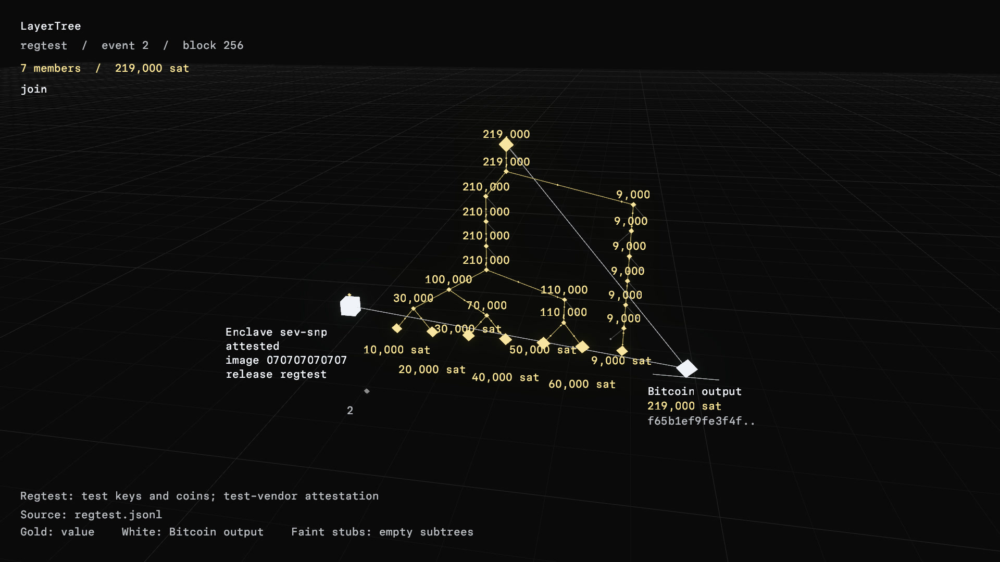

Confirmed regtest join.

Source: [crates/layertree-tee-lab/fixtures/events/regtest.jsonl](../../../../crates/layertree-tee-lab/fixtures/events/regtest.jsonl), event 2.
Regtest transaction: `f65b1ef9fe3f4fd0ddc51ae717fad88b87103d27815ca4c580e898f87e53f031`.

## update

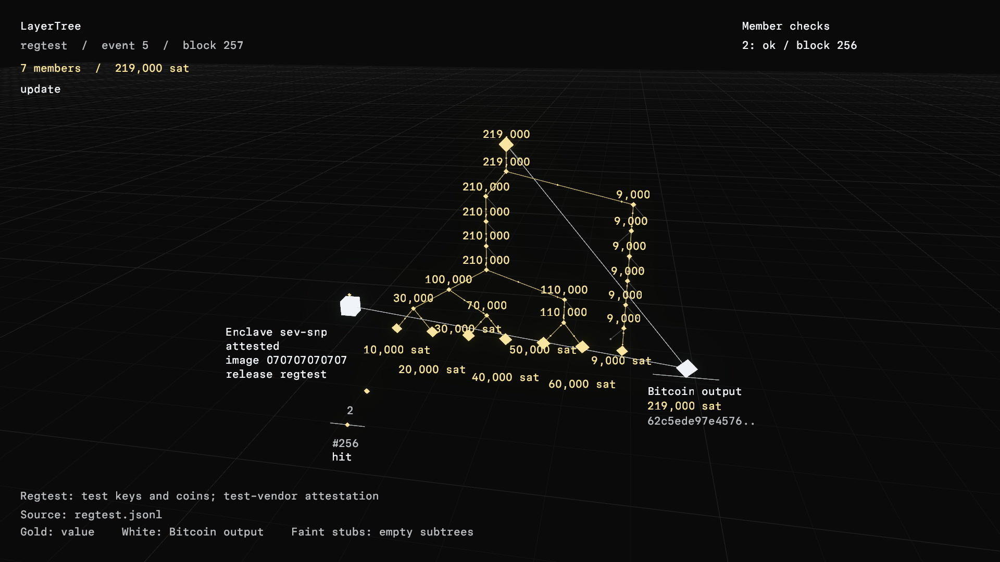

Confirmed regtest update.

Source: [crates/layertree-tee-lab/fixtures/events/regtest.jsonl](../../../../crates/layertree-tee-lab/fixtures/events/regtest.jsonl), event 5.
Regtest transaction: `62c5ede97e4576229ef17686aae8f73d97eb6ce2664a38048af2b874fdecd447`.

## claim

Confirmed regtest claim.

Source: [crates/layertree-tee-lab/fixtures/events/regtest.jsonl](../../../../crates/layertree-tee-lab/fixtures/events/regtest.jsonl), event 8.
Regtest transaction: `81484eb80b2d6e7462b0661d4df30cd14804afc080c20ab5e1b2c8ed25dbb821`.

## exit

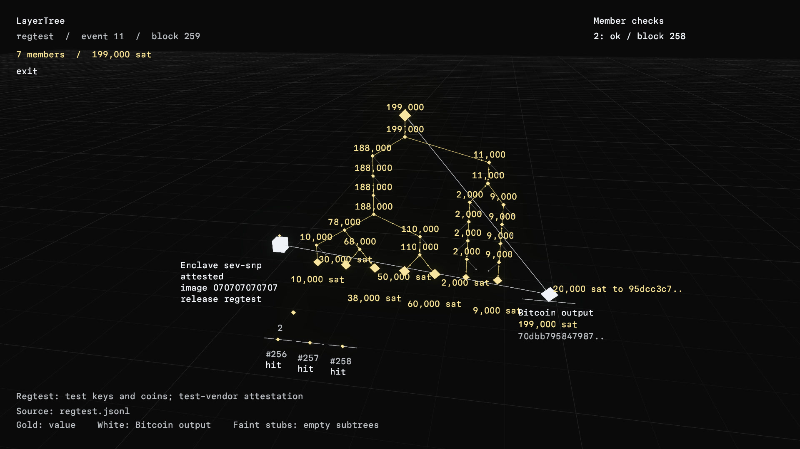

Confirmed regtest exit.

Source: [crates/layertree-tee-lab/fixtures/events/regtest.jsonl](../../../../crates/layertree-tee-lab/fixtures/events/regtest.jsonl), event 11.
Regtest transaction: `70dbb7958479879c76d4236c74e5fbdd70e5c7e2ac49731a48b2f4ffb4ea8603`.

## refresh

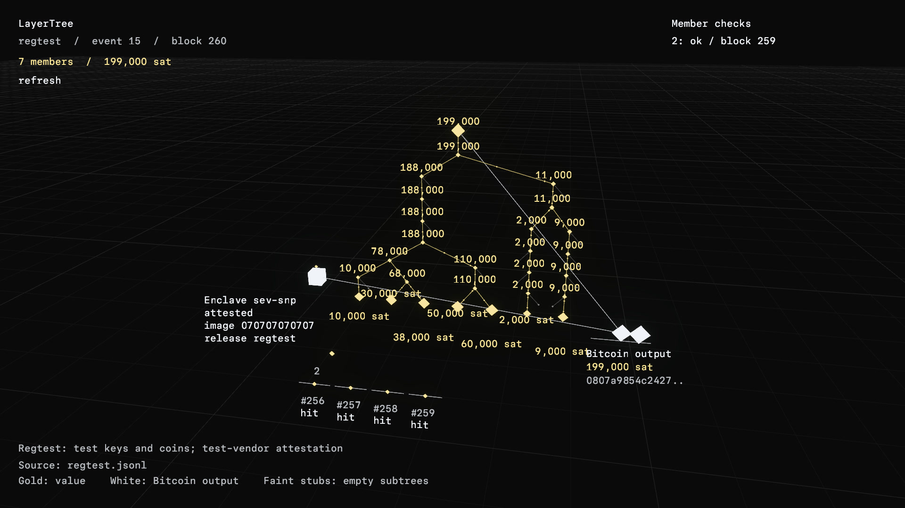

Confirmed regtest refresh.

Source: [crates/layertree-tee-lab/fixtures/events/regtest.jsonl](../../../../crates/layertree-tee-lab/fixtures/events/regtest.jsonl), event 15.
Regtest transaction: `0807a9854c242793abfee4000bc9262ea3b6ac56d2d9bf62eb80326ef94e72fb`.

## evict

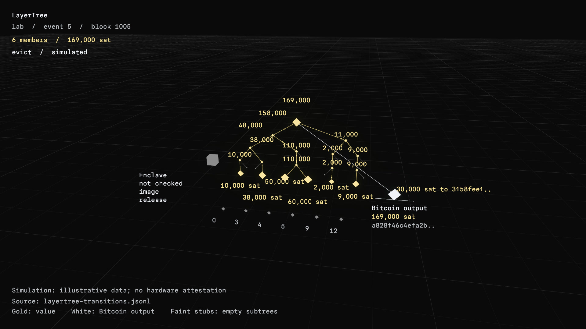

Simulated evict; illustrative hashes and transactions.

Source: [docs/verse/fixtures/layertree-transitions.jsonl](../../../../docs/verse/fixtures/layertree-transitions.jsonl), event 5.
Illustrative transaction: `a828f46c4efa2bbfd0a9e2ced413594a49675cc9314c88a320f740a8fd91ac92`.

## split

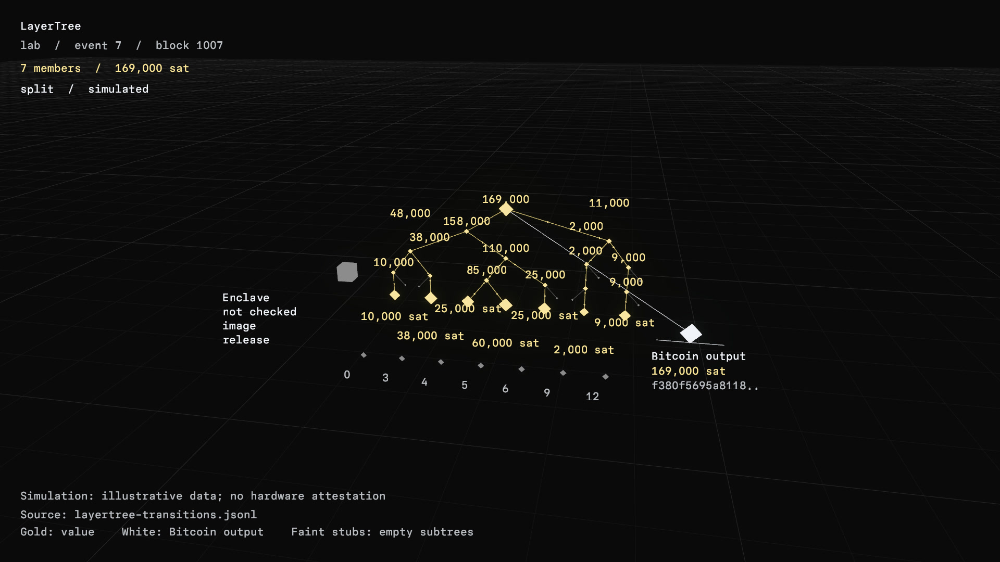

Simulated split; illustrative hashes and transactions.

Source: [docs/verse/fixtures/layertree-transitions.jsonl](../../../../docs/verse/fixtures/layertree-transitions.jsonl), event 7.
Illustrative transaction: `f380f5695a8118b79ff7c87b14399579d80e3d9053c3c244d046e1f852d853f0`.

## merge

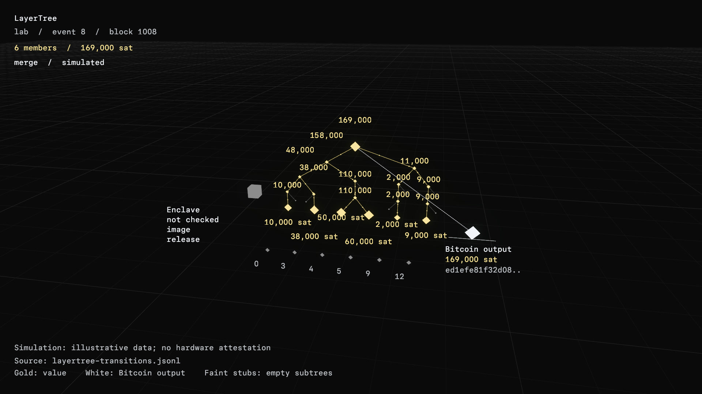

Simulated merge; illustrative hashes and transactions.

Source: [docs/verse/fixtures/layertree-transitions.jsonl](../../../../docs/verse/fixtures/layertree-transitions.jsonl), event 8.
Illustrative transaction: `ed1efe81f32d08c238969ccec56047475eb0b4e84584fb15137d74f487b33068`.

## rewrite

Simulated rewrite; illustrative hashes and transactions.

Source: [docs/verse/fixtures/layertree-transitions.jsonl](../../../../docs/verse/fixtures/layertree-transitions.jsonl), event 9.
Illustrative transaction: `9fb578930ee4fd0721c3bd89fec127c5f68d9b36dc4fb31dfbbae5f69dfd2259`.

## detach

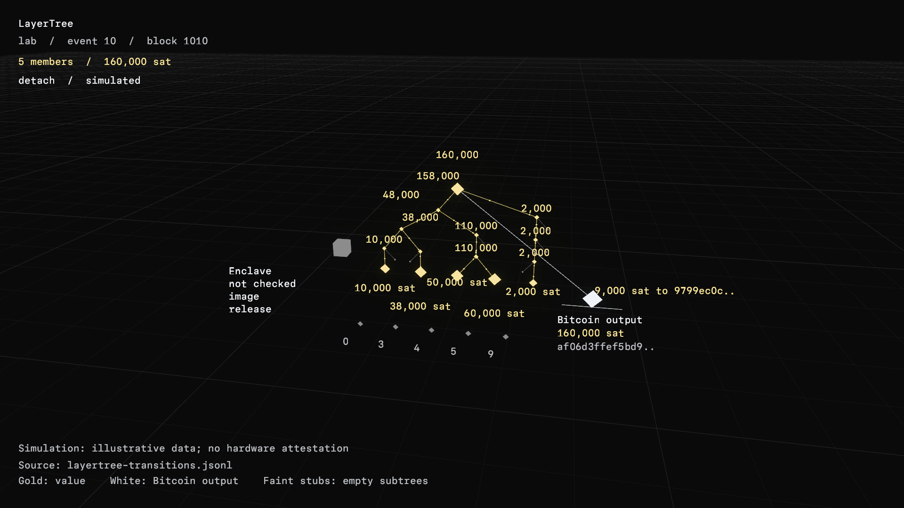

Simulated detach; illustrative hashes and transactions.

Source: [docs/verse/fixtures/layertree-transitions.jsonl](../../../../docs/verse/fixtures/layertree-transitions.jsonl), event 10.
Illustrative transaction: `af06d3ffef5bd936ef57e92490bd193e33253f928b90b061377c02a024412d93`.

## rejected

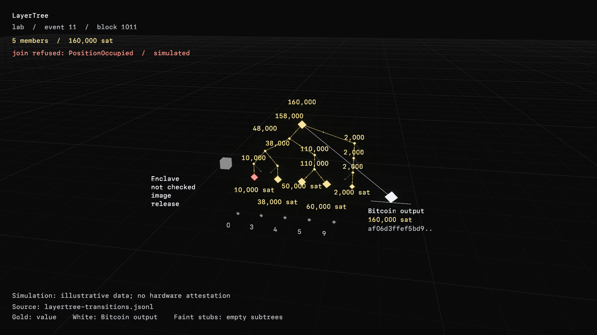

Simulated refusal; balances do not change.

Source: [docs/verse/fixtures/layertree-transitions.jsonl](../../../../docs/verse/fixtures/layertree-transitions.jsonl), event 11.

## attested

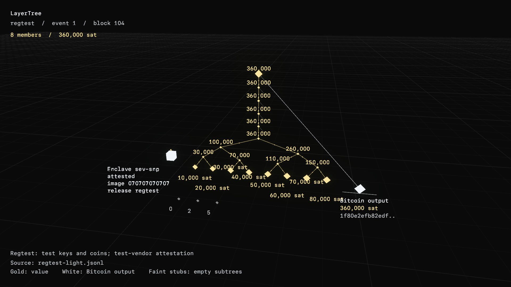

Passed test-vendor attestation on regtest; no Confidential VM.

Source: [crates/layertree-tee-lab/fixtures/events/regtest-light.jsonl](../../../../crates/layertree-tee-lab/fixtures/events/regtest-light.jsonl), event 1.

## alarm

Mined regtest theft: output 0 is 50,000 sat short; all three followers report OutputMismatch.

Source: [crates/layertree-tee-lab/fixtures/events/regtest-light.jsonl](../../../../crates/layertree-tee-lab/fixtures/events/regtest-light.jsonl), event 157.
Regtest transaction: `7d31c05385b9222c5f7914216a2fac54f42013752ee23afdf4eb3e0cf5304ff2`.

## unroll

Confirmed two-level regtest unroll; full member amounts, external anchor fees.

Source: [crates/layertree-tee-lab/fixtures/events/regtest-two-level.jsonl](../../../../crates/layertree-tee-lab/fixtures/events/regtest-two-level.jsonl), event 35.
Regtest transaction: `3c1536eef176a9959f0d7acf7eb1c38d668251d01198311fb5160e5e6f5b5135`.

## attestation UnknownMeasurement

Simulated UnknownMeasurement display; not a hardware-verifier result.

Source: [docs/verse/fixtures/layertree-attestation-errors.jsonl](../../../../docs/verse/fixtures/layertree-attestation-errors.jsonl), event 2.

## attestation ReportDataMismatch

Simulated ReportDataMismatch display; not a hardware-verifier result.

Source: [docs/verse/fixtures/layertree-attestation-errors.jsonl](../../../../docs/verse/fixtures/layertree-attestation-errors.jsonl), event 3.

## attestation VendorSignature

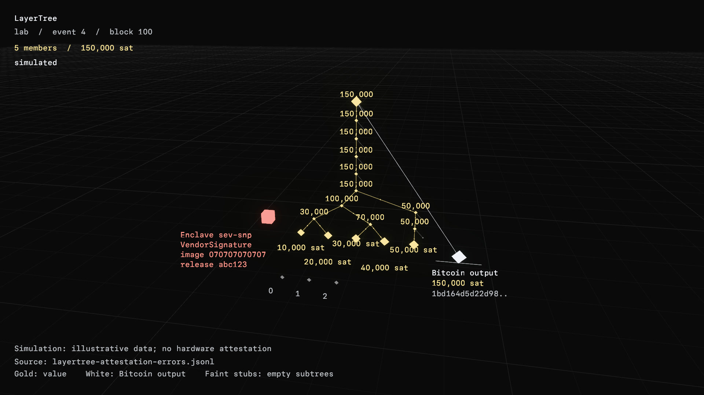

Simulated VendorSignature display; not a hardware-verifier result.

Source: [docs/verse/fixtures/layertree-attestation-errors.jsonl](../../../../docs/verse/fixtures/layertree-attestation-errors.jsonl), event 4.

Signet replacement captures wait for #11793 and #11794. Their captions must
name the public transactions; the regtest images are not substitutes for that evidence.
