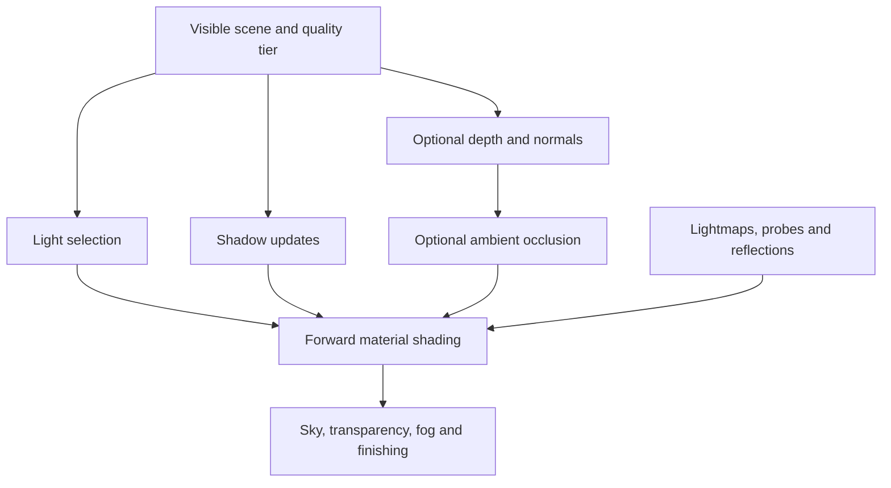

## Recommended direction

**Build a hybrid renderer with stable real-time direct lighting, mostly precomputed indirect lighting, and tightly controlled shadow and post-processing costs.** For the look you’re targeting, I would prioritize coherent light and color, soft environmental fill, stable sun shadows, material response, and atmosphere.

I prepared a **25-page report with 76 annotated primary sources**, including SIGGRAPH and I3D papers, production presentations, original implementation notes, and browser specifications:

**[browser-lighting-research-report.pdf](browser-lighting-research-report.pdf)**

It includes a rendering architecture, comparisons between techniques, memory calculations, implementation priorities, and a linked bibliography. It surveys the major useful technique families; the literature is too large for a literal catalogue of every lighting paper.

I used the new **Ocarina of Time remake for Switch 2** as the visual reference. Nintendo’s developer interview describes a tactile presentation influenced by puppetry and practical effects. My interpretation for your engine is to emphasize readable materials, carefully composed lighting, selective detail, and clean motion. The renderer design below is my recommendation; Nintendo’s public art discussion does not establish its exact lighting implementation. [Nintendo Official Site](https://www.nintendo.com/us/whatsnew/its-time-experience-the-legend-of-zelda-ocarina-of-time-reborn-exclusively-for-nintendo-switch-2/?utm_source=chatgpt.com)

---

## 1. The lighting stack I would build first

For a first production-capable version, I would choose the following:

| Component | Starting implementation | Reason |
|---|---|---|
| Material shading | A small diffuse + GGX model, with controlled artistic adjustments | Gives you coherent materials and a manageable shader system |
| Main directional light | One sun, with stable cascaded shadow maps and compact PCF filtering | Establishes form, time of day, and contact |
| Local lights | Small, selected lists of point and spot lights | Keeps runtime work predictable |
| Static indirect light | RGB irradiance lightmaps; directional encoding as an upgrade | Moves expensive bounce-light computation out of the frame |
| Moving-object indirect light | Sparse spherical-harmonic probes | Helps characters and props belong in the environment |
| Reflections | Prefiltered environment and local reflection probes | Supplies much of the material richness at modest sampling cost |
| Atmosphere | Designed sky, height/distance fog, optional cloud shadows | Creates depth and outdoor variation |
| Image stability | Deliberate roughness, texture filtering, exposure, and an explicit AA policy | Protects the stylized look during motion |
| Optional detail | Low-resolution AO and selected contact-shadow effects | Adds local grounding after the broad lighting works |

A physically motivated material foundation still allows stylization. You can remap diffuse response, adjust the shadow palette, add a masked rim term, or approximate foliage transmission. Valve’s **Illustrative Rendering in Team Fortress 2** is useful for understanding how those controls support readable forms. The specific controls should be chosen for your aesthetic. [cdn.steamstatic.com](https://cdn.steamstatic.com/apps/valve/2007/NPAR07_IllustrativeRenderingInTeamFortress2.pdf?utm_source=chatgpt.com)

For the underlying BRDF and environment-lighting implementation, **Real Shading in Unreal Engine 4** and **Physically Based Rendering in Filament** are particularly useful references. I would implement a small, consistent subset of their material models. [cdn2.unrealengine.com](https://cdn2.unrealengine.com/Resources/files/2013SiggraphPresentationsNotes-26915738.pdf?utm_source=chatgpt.com)

The biggest design decision is **which lighting changes must be supported at runtime**:

- A mostly fixed adventure world can get excellent results from baked lighting.
- A moving sun calls for separating direct sunlight from the indirect-light representation.
- Editable geometry requires explicit lighting invalidation and a fallback while new lighting becomes available.
- Large numbers of user-created lights can eventually justify a different light-selection strategy.

These cases can share much of the same material shader if the architecture separates the production of lighting data from its consumption.

## 2. Choose the rendering architecture around actual light overlap

### Start with forward shading and short light lists

For a scene dominated by a sun, a few lanterns, and environmental lighting, I would begin with ordinary forward shading. Select relevant local lights per object or spatial region on the CPU.

Measure **how many lights affect the fragments you actually shade**. The total number of lights stored in the world is a poor performance metric.

The next upgrade is **Forward+ or clustered forward shading**:

- Forward+ groups lights into screen tiles.
- Clustered shading also separates space along depth, reducing false overlap between nearby and distant surfaces.

The foundational references are Harada’s **Forward+** work and Olsson, Billeter, and Assarsson’s **Clustered Deferred and Forward Shading**. Their techniques are valuable, but the point at which they beat simple selection depends on your content and implementation. [takahiroharada.wordpress.com](https://takahiroharada.wordpress.com/wp-content/uploads/2015/04/forward_plus.pdf?utm_source=chatgpt.com)

| Architecture | When I would choose it | Main costs to watch |
|---|---|---|
| Simple forward | Few influential lights, modest material complexity | Repeated shading under overdraw; CPU selection |
| Clustered forward | Significant local-light overlap, mixed near/far geometry | List construction, index storage, dispatches, overflow handling |
| Deferred shading | Heavy overlap or a pipeline already needing a G-buffer | Attachment traffic, transparency path, MSAA complexity |
| Stochastic many-light rendering | Unpredictable scenes with very high light overlap | Sampling structures, shadow updates, temporal reconstruction |

Avoid the blanket rule that deferred shading is always bad on mobile. A tile-based GPU can retain some intermediate data efficiently when the API and pass structure cooperate. However, capabilities available through native rendering APIs cannot simply be assumed in a portable browser backend. The important object to evaluate is your **actual sequence of passes, attachments, loads, and stores**. Arm’s render-pass documentation is useful here. [documentation-service.arm.com](https://documentation-service.arm.com/static/6560a5942c8b3557fee70a16?utm_source=chatgpt.com)

### A practical frame graph

For the leanest tier, omit screen-space AO and its prepass unless another measured need justifies that pass.

For an AO-enabled forward renderer, compute AO before the material pass that consumes it, or retain a separate indirect-light contribution for later composition. **Multiplying the finished scene color by AO incorrectly darkens direct light and emission.** Also avoid applying full-strength AO to baked lighting that already includes the same occlusion. [Filament](https://google.github.io/filament/main/filament.html?utm_source=chatgpt.com)

One easy-to-miss clustered-rendering issue: light lists restricted to the opaque depth range may exclude lights needed by transparent surfaces. Use conservative coverage or a separate selection path for transparency.

## 3. Put substantial effort into the sun and shadows

For this visual target, I would give stable shadows an early engineering milestone.

### Recommended baseline: stable cascades + deterministic PCF

Start by experimenting with two sun-shadow cascades. Treat cascade count, shadow distance, map resolution, and filtering width as separate quality settings.

**Parallel-Split Shadow Maps** is the foundational cascade reference. **The Witness’s shadow-mapping articles** are especially relevant to smooth, stylized worlds: they discuss filtering choices and the visibility of shadow noise against clean surfaces. They are a strong reason to investigate compact deterministic filtering early. [NVIDIA Developer](https://developer.nvidia.com/gpugems/gpugems3/part-ii-light-and-shadows/chapter-10-parallel-split-shadow-maps-programmable-gpus?utm_source=chatgpt.com)

The implementation details that deserve attention are:

- Stable projection extents and texel-snapped translation.
- Bias that scales sensibly with the shadow projection.
- Blending between cascades.
- Inclusion of off-camera geometry that can cast shadows into view.
- Shadow-specific geometry LODs.
- A deliberate policy for grass, leaves, wind animation, and distant casters.
- Explicit cache invalidation when lights, casters, deformation, or projections change.

PCF filters **depth-comparison results**. Averaging raw depths and performing one comparison is a different operation.

### Which shadow upgrades are worth considering?

| Technique | Useful contribution | My recommendation |
|---|---|---|
| PCF | Predictable filtering of shadow visibility | Default |
| PCSS | Contact-hardening shadows through blocker search and variable filtering | Optional enhancement for important lights |
| VSM / EVSM | Moment representations that support broad filtering | Compare when wide softness matters |
| Moment shadow maps | More sophisticated reconstruction from depth moments | Later alternative with additional implementation complexity |
| Screen-space shadows | Small visible details and contact | Supplement the world-space shadow system |

**PCSS** adds blocker-search work and wider filtering. **Moment Shadow Mapping** offers another quality/cost tradeoff, with more involved reconstruction. **Bend Studio’s screen-space shadows** are useful implementation reading for the contact-detail layer, with the usual limitation that camera depth does not contain hidden geometry. [download.nvidia.com](https://download.nvidia.com/developer/SDK/Individual_Samples/MEDIA/docPix/docs/PCSS.pdf?utm_source=chatgpt.com)

### Budget shadowed lights separately from visible lights

A scene with many unshadowed lights can be manageable. A scene with many shadow-casting point lights is a different workload: a conventional point-light shadow cubemap has six faces.

I would maintain separate budgets for:

1. Lights contributing to shading.
2. Lights retaining a shadow allocation.
3. Shadow maps updated during the current frame.

Use stable priorities so lights do not visibly alternate between shadowed and unshadowed states.

### Area lights: LTC is a particularly useful paper

**Real-Time Polygonal-Light Shading with Linearly Transformed Cosines**, by Heitz and collaborators, is worth reading for broad window highlights and theatrical interior lighting. It provides an efficient approximation to the unoccluded area-light integral. Visibility and soft area-light shadows remain separate problems. [eheitzresearch.wordpress.com](https://eheitzresearch.wordpress.com/415-2/?utm_source=chatgpt.com)

I would add rectangular LTC lights only after the basic direct-light and shadow system is working.

## 4. Indirect lighting offers the largest opportunity to move work out of the frame

### Static architecture: start with lightmaps

For a fixed environment, a lightmap lets a baker perform expensive multibounce transport once, while the runtime primarily performs texture sampling.

The less glamorous engineering work matters enormously: UV charts, padding, mip generation, texel density, compression, streaming, and consistency across geometry LODs. **Precomputed Global Illumination in Frostbite** is a particularly practical reference for this part of the engine. [media.gdcvault.com](https://media.gdcvault.com/gdc2018/presentations/ODonnell_Yuriy_PrecomputedGI.pdf?utm_source=chatgpt.com)

I would begin with ordinary RGB irradiance lightmaps, then add directional information when normal-mapped materials reveal the limitation.

A single RGB value describes illumination for a particular surface response. It does not preserve all the directional information needed to respond to changing shading normals. **Valve’s radiosity normal mapping** stores a compact directional basis, making it an important reference for getting detailed material response from relatively coarse baked lighting. [cdn.fastly.steamstatic.com](https://cdn.fastly.steamstatic.com/apps/valve/2006/SIGGRAPH06_Course_ShadingInValvesSourceEngine.pdf?utm_source=chatgpt.com)

For a moving sun, keep its direct contribution separate from the bake. Remember that baked *bounce from that sun* still belongs to the lighting conditions used during baking.

### Moving objects: spherical-harmonic probes

Spherical harmonics, or SH, represent a smooth angular lighting function with a small number of coefficients. The classic paper is **An Efficient Representation for Irradiance Environment Maps**.

Degree-2 SH uses nine coefficients per color channel: **nine RGB coefficients, or 27 scalar values**. This is useful for diffuse illumination because its angular response is comparatively smooth. It does not imply that illumination changes smoothly through a wall. [graphics.stanford.edu](https://graphics.stanford.edu/papers/envmap/?utm_source=chatgpt.com)

For coefficients that already represent diffuse irradiance:

\[
E(\mathbf{x},\mathbf{n}) \approx \sum_i c_i(\mathbf{x})Y_i(\mathbf{n}),
\qquad
L_\text{diffuse}=\frac{\rho}{\pi}E.
\]

Document that convention carefully. Raw incident-radiance SH requires the diffuse convolution; other implementations store \(E/\pi\) or already-reflected light.

For spatial interpolation, **Light Probe Interpolation Using Tetrahedral Tessellations** is a useful reference. A regular grid is often simpler to implement; tetrahedra support irregular placement. Neither automatically makes interpolation respect architectural boundaries. [gdcvault.com](https://www.gdcvault.com/play/1015312/Light-Probe-Interpolation-Using-Tetrahedral?utm_source=chatgpt.com)

My initial probe system would include:

- More samples around doors, stairs, and sharp lighting transitions.
- Region identifiers and validity information.
- A conservative fallback when local data is missing.
- Debug views showing probe positions and interpolation weights.
- Identical color and exposure conventions for static surfaces and characters.

A doorway connecting a bright exterior to a dark room should be an early test scene.

### Time of day without a full dynamic-GI system

**Real-Time Samurai Cinema: Lighting, Atmosphere, and Tonemapping in Ghost of Tsushima** is especially relevant. Its treatment of sky visibility and relighting is a valuable model for separating relatively stable geometric information from changing illumination. [advances.realtimerendering.com](https://advances.realtimerendering.com/s2021/jpatry_advances2021/index.html?utm_source=chatgpt.com)

For your engine, there are two practical directions:

- Store sky visibility or transport information and evaluate it against a changing sky.
- Blend a bounded set of baked lighting scenarios.

The first is more flexible. The second is easier to control artistically.

A technical trap: multiplying sky-SH coefficients and visibility-SH coefficients element by element is not the correct general operation. Their product is a product of angular functions and needs an appropriate projection or approximation.

For anticipated interactions—such as certain doors opening or lights switching—**UberBake** is worth studying. It shows how selected runtime changes can be supported through precomputed lighting, with storage and state complexity kept under control. [cs.dartmouth.edu](https://cs.dartmouth.edu/~wjarosz/publications/seyb20uberbake.html?utm_source=chatgpt.com)

## 5. Recent research with unusually good relevance

These are the newer works I would put near the top of your research queue.

| Work | What it contributes | When I would investigate it |
|---|---|---|
| **WishGI — SIGGRAPH 2025** | Compact fitted SH representation associated with mesh vertices; avoids lightmap UVs and shifts reconstruction toward vertex work | Lighting download size or residency is a bottleneck |
| **HHD — SIGGRAPH 2024 course** | Compact directional lightmap encoding, with attention to blending behavior | You need better directional response or lighting-scenario blends |
| **Neural Light Grid — 2024** | Better visibility-aware probe contribution through offline optimization and compact reconstruction | Probe leaks remain a major quality problem |
| **LightOpt — SIGGRAPH 2026** | Optimizes the light setup itself through removal, merging, and insertion | Authored scenes contain many redundant local lights |
| **Stochastic Tile-Based Lighting in HypeHype — 2025** | Samples a bounded set of light candidates for difficult many-light scenes | User-created scenes defeat deterministic light selection |
| **Screen Space Indirect Lighting with Visibility Bitmask** | Improves a screen-space approximation of local indirect illumination and thin-surface handling | A small amount of local bounce materially improves the image |

### WishGI deserves a prototype, with a representative mesh set

Its appeal is particularly strong for a browser engine: lighting representation, memory, and reconstruction cost are tightly connected.

Its caveat is **vertex density**. Large sparse walls or terrain may need subdivision or a different representation. Mesh-local associations can be reusable, but illumination still depends on each instance’s surroundings. Evaluate total geometry bytes, lighting bytes, reconstruction work, and quality together; the paper’s native-device results do not establish a universal browser speedup. [arxiv.org](https://arxiv.org/html/2506.01288v1?utm_source=chatgpt.com)

### HHD and Neural Light Grid solve different problems

HHD concerns the representation of directional lighting. Neural Light Grid concerns which probes should contribute and how to reduce interpolation/visibility artifacts.

I would implement a conventional reference representation before either, so you can separate encoding errors from transport or interpolation errors. The useful lesson from Neural Light Grid is that learning and optimization can happen offline while runtime reconstruction remains compact. [advances.realtimerendering.com](https://www.advances.realtimerendering.com/s2024/index.html?utm_source=chatgpt.com)

### LightOpt is attractive because it improves the scene you render

LightOpt optimizes light configurations while preserving a target appearance, including time-of-day cases. This can reduce runtime work without introducing an entirely different shading architecture. For an editor, I would retain the authored lights and generate a separate optimized runtime representation, preserving gameplay-significant lights and interaction semantics. [doi.org](https://doi.org/10.1145/3799902.3811072?utm_source=chatgpt.com)

### HypeHype is relevant to an eventual creator-world engine

Its stochastic tile-based lighting uses shadow maps rather than requiring hardware ray tracing. However, the complete system also involves a G-buffer, depth hierarchy, shadow work, and temporal considerations. A small final light sample count does not make the whole pipeline constant-cost. I would keep this as a separate experiment after a deterministic renderer exists. [advances.realtimerendering.com](https://advances.realtimerendering.com/s2025/content/s2025_stb_lighting_v1.1_notes.pdf?utm_source=chatgpt.com)

The visibility-bitmask SSIL work is a smaller enhancement. Its information remains limited to visible screen data, so it needs a fallback for missing surfaces and careful handling of bounce already present in baked lighting. [arxiv.org](https://arxiv.org/abs/2301.11376?utm_source=chatgpt.com)

## 6. Reflections, AO, atmosphere, and anti-aliasing

### Reflection probes should arrive early

Start with an environment cubemap and a few local probes. The runtime needs:

- Radiance prefiltered for material roughness.
- The matching environment BRDF evaluation or lookup.
- A probe-selection and blending policy.
- Local influence volumes, with parallax correction where useful.
- A separate budget for capture updates.

An ordinary mip chain is not the same as the required roughness-dependent convolution. Likewise, sampling a prefiltered cubemap alone does not complete specular IBL; the material’s Fresnel response, roughness, and view angle still matter. Karis’s UE4 notes are useful implementation guidance. [cdn2.unrealengine.com](https://cdn2.unrealengine.com/Resources/files/2013SiggraphPresentationsNotes-26915738.pdf?utm_source=chatgpt.com)

For water, begin with coherent environment reflection and stylized highlights. A selectively updated planar reflection can be a later feature for prominent calm surfaces.

**Screen-space reflections** become worthwhile when visible scene detail substantially improves glossy floors or water. McGuire and Mara’s screen-space ray-tracing work is the foundational reading. Provide reflection-probe fallback for misses and off-screen content. [jcgt.org](https://www.jcgt.org/published/0003/04/04/?utm_source=chatgpt.com)

### AO should provide contact detail

The first papers I would read are **Scalable Ambient Obscurance** and **Practical Realtime Strategies for Accurate Indirect Occlusion**, the GTAO work. SAO emphasizes efficient access patterns and predictable work; GTAO develops the occlusion approximation. [Research](https://research.nvidia.com/publication/2012-06_scalable-ambient-obscurance?utm_source=chatgpt.com)

My initial implementation choice would be an optional low-resolution effect with a deliberately limited radius and edge-aware reconstruction.

A dark room that is bright because its probes leak needs a probe or visibility fix. Increasing AO strength will generally create a different visual problem.

### Atmosphere can have excellent visual return

Implement height/distance fog and a designed sky first. Keep the sky used for ambient illumination consistent with the visible sky.

For an upgrade, Sébastien Hillaire’s **A Scalable and Production Ready Sky and Atmosphere Rendering Technique** is highly relevant. Its lookup-table approach is a useful basis for sky and aerial perspective without a large atmospheric integral at every pixel. [sebh.github.io](https://sebh.github.io/publications/?utm_source=chatgpt.com)

I would add volumetric fog grids only when shafts, illuminated mist, or local fog volumes become important to the art direction.

### Temporal stability is part of lighting quality

Begin with a supported spatial-AA or MSAA path. **SMAA** is useful reading for a spatial solution. If noisy lighting effects introduce temporal accumulation, you also inherit motion vectors, rejection tests, history clamping, camera-cut handling, and resolution-change handling. The **Survey of Temporal Antialiasing Techniques** is a strong guide to that larger system. [iryoku.com](https://iryoku.com/smaa/?utm_source=chatgpt.com)

Specular stability also depends on material filtering. **Toksvig** and **LEAN Mapping** explain approaches to accounting for normal variation. For your target, sensible roughness and restrained subpixel normal detail are useful early controls. [tandfonline.com](https://www.tandfonline.com/doi/abs/10.1080/2151237X.2005.10129203?utm_source=chatgpt.com)

## 7. Where full dynamic GI fits

The report compares reflective shadow maps, light propagation volumes, voxel cone tracing, DDGI, surfel approaches, Lumen-style systems, and radiance cascades.

My implementation priority would depend on the concrete problem:

| Family | Best reason to investigate | Main engineering burden |
|---|---|---|
| Screen-space indirect light | Local visible bounce or contact enhancement | Missing geometry, history, reconstruction |
| Reflective shadow maps | A limited one-bounce approximation from important lights | Sampling cost and incomplete secondary visibility |
| Light propagation volumes | Broad, soft, low-frequency bounce | Leakage and volume updates |
| Voxel cone tracing | You already need a useful voxel representation | Voxelization, memory, filtering, dynamic updates |
| DDGI | Dynamic diffuse lighting with a viable ray-query implementation | Tracing, probe updates, visibility, convergence |
| Surfel/cache systems | A long-term need for large-scale dynamic GI | Placement, residency, updates, tracing, reconstruction |
| Radiance cascades | Research into hierarchical light transport | Representation size and a complete practical 3D implementation |

**Voxel cone tracing** is attractive when its scene representation can serve several engine features. Building and updating that representation solely for GI is a much larger commitment. [NVIDIA Real-Time Graphics Research](https://research.nvidia.com/labs/rtr/publication/crassin2011givoxels/?utm_source=chatgpt.com)

**DDGI** has an especially useful architectural lesson: lighting updates can be separated from lighting queries. However, browser implementation still needs an affordable way to obtain the ray information used by those updates. The irradiance-field representation does not supply a ray tracer by itself. [Research](https://research.nvidia.com/publication/2019-05_dynamic-diffuse-global-illumination-ray-traced-irradiance-fields?utm_source=chatgpt.com)

An illustrative workload shows why update scheduling matters:

- 4,096 probes × 128 rays is **524,288 rays per complete sweep**.
- Updating one sixteenth per frame is **32,768 rays per frame**.
- At 60 FPS, each probe is revisited roughly every **267 ms**, before accounting for temporal convergence.

Those are arithmetic examples, not recommended settings or measured browser performance.

### Radiance cascades deserve careful reading

The original Radiance Cascades material is a work in progress, and the family now includes different representations and dimensional assumptions. **Split Radiance Cascades**, in its 2026 version, investigates sparse world-space probes and ray splitting. It is worth following, while treating browser cost and implementation maturity as open engineering questions. [GitHub](https://github.com/Raikiri/RadianceCascadesPaper/blob/main/RadianceCascades.tex?utm_source=chatgpt.com)

Similarly, **ReSTIR** is important sampling research for many-light rendering. It does not remove the need to solve visibility, scene representation, and temporal reconstruction in your engine. [NVIDIA Real-Time Graphics Research](https://research.nvidia.com/labs/rtr/publication/bitterli2020spatiotemporal/?utm_source=chatgpt.com)

## 8. Browser budgets: count pixels, bytes, overlap, and updates

These are calculated examples to make the architecture tangible:

| Resource or operation | Calculated cost |
|---|---:|
| 1280 × 720 RGBA16F color buffer | 7.03 MiB |
| 1280 × 720 32-bit depth buffer | 3.52 MiB |
| Four 32-bit G-buffer attachments at 1920 × 1080 | 31.64 MiB, excluding depth |
| Write and read those four attachments once at 60 FPS | About 3.98 GB/s of logical uncompressed traffic |
| Three 2048² 32-bit shadow maps | 48 MiB |
| One 2048² RGBA16F lightmap with a full mip chain | About 42.67 MiB |
| 32³ probes storing 27 half-precision values each | 1.69 MiB before padding and visibility data |

Actual memory traffic depends on compression, caches, and pass behavior. These numbers are useful for identifying potentially expensive designs before profiling.

### Cluster buffers can become unexpectedly large

At 1280 × 720, using 16 × 16 tiles and 24 depth slices gives:

\[
80 \times 45 \times 24 = 86{,}400 \text{ clusters}.
\]

Reserving 64 four-byte light indices per cluster consumes **21.09 MiB**, before metadata.

That is a meaningful allocation for a renderer introduced to save lighting work. Compact lists, measured bounds, and explicit overflow behavior deserve attention.

### Internal resolution is a first-class lighting setting

Rendering at 75% resolution on both axes produces **56.25% as many pixels**. That can reduce screen-dependent shading and post-processing cost substantially, though it does not reduce all geometry, shadow, or CPU costs proportionally.

Keep CSS dimensions, device pixel ratio, and internal rendering resolution separate. A browser’s display resolution should not silently dictate your entire GPU budget.

## 9. Architecture considerations for a from-scratch engine

### Negotiate WebGPU capabilities

The current specification has both core and compatibility considerations. Relevant examples include optional half-precision shaders, optional timestamp queries, texture-format capabilities, and differing limits.

The reviewed specification supports sample counts of **1 or 4**; multisampled `rgba16float` requires `core-features-and-limits`. Compatibility adapters can also lack vertex-stage storage buffers, which matters for vertex-based lighting reconstruction. The standard provides no portable hardware-ray-tracing baseline. [w3.org](https://www.w3.org/TR/webgpu/?utm_source=chatgpt.com)

I would therefore make single-sample HDR plus spatial AA a supported path, keep f32 shader fallbacks, and avoid making advanced subgroup behavior essential.

Consider WebGPU Compatibility Mode before committing to an entire second backend. If your target audience requires WebGL2, give that path a deliberately smaller rendering feature set. Native `wgpu` capability is not evidence that the same feature is available in the browser. [khronos.org](https://www.khronos.org/assets/uploads/developers/presentations/3D_on_the_Web_2026_-_GDC_2026_WebGL%2BWebGPU_Update.pdf?utm_source=chatgpt.com)

### Separate four responsibilities

| Responsibility | What it owns |
|---|---|
| Scene lighting | Light entities, environment settings, regions, authored intent |
| Lighting producer | Offline baker, scenario generator, background update, or future dynamic GI |
| Lighting residency | Pages, probes, chunks, uploads, validity and version information |
| Material evaluation | BRDF, shadow sampling, irradiance and reflection queries |

The stable interface should describe what a surface needs—for example, diffuse irradiance at a position and normal—without requiring the material to know how that information was produced.

This is the boundary that lets you replace an RGB bake with directional data, add a relightable sky representation, or experiment with DDGI without rewriting every material.

For a Rust/Wasm implementation, I would also use bulk scene and rendering interfaces, bounded upload work, finite shader variants, and early pipeline preparation. Treat compilation and first-use stalls as part of the renderer’s performance problem.

For assets, distinguish download compression from GPU-resident compression. KTX2/Basis workflows can help transport and transcoding, but the eventual GPU format determines residency and sampling behavior. [github.khronos.org](https://github.khronos.org/KTX-Specification/ktxspec.v2.html?utm_source=chatgpt.com)

### Editable worlds need lighting versioning

If geometry or materials can change, a workable lifecycle is:

1. Apply the edit and update direct lighting immediately.
2. Mark affected indirect-light dependencies stale.
3. Use valid coarse probes or an explicit fallback.
4. Rebuild affected lighting asynchronously.
5. Accept the result only if its scene versions still match.
6. Swap complete pages or blend compatible results.

Track geometry, materials, lights, and bake settings separately. Changing a surface’s color can invalidate bounced light even when visibility remains unchanged. Moving a wall can invalidate illumination on neighboring receivers.

Each streamed lighting chunk should carry enough information to determine its bounds, region, dependencies, validity, and fallback behavior.

## 10. Implementation sequence and acceptance criteria

I would organize the work around observable visual milestones.

| Stage | Deliverable | Evidence that it is ready |
|---|---|---|
| **1. Correct image formation** | Linear lighting, small material model, exposure, tone mapping, AA | Materials remain consistent as illumination changes |
| **2. Stable direct lighting** | Sun, cascades, PCF, bounded local lights | Slow camera motion produces clean, stable shadows |
| **3. Convincing indirect lighting** | Lightmaps, SH probes, local reflections | Characters match the environment across room transitions |
| **4. Browser robustness** | Capability tiers, streaming, pipeline preparation, bounded uploads | Large frame spikes and unbounded residency are controlled |
| **5. Selective polish** | AO, sky LUTs, probe visibility, LTC, clustered lists | Each feature has a measured visual benefit and cost |
| **6. Targeted research** | WishGI, HHD, LightOpt, stochastic lighting, or dynamic GI | A specific bottleneck or visual limitation justifies the added system |

For evaluation, build a small but difficult scene containing an outdoor area with foliage, a dark doorway, a moving character, a few interior lights, a glossy surface, and water. If editing is part of the product, include a wall-removal and material-change test.

Measure CPU and GPU distributions, sustained performance, internal resolution, memory residency, upload volume, overlapping lights, and pipeline compilation events. Review motion as carefully as still frames: slow pans, disocclusions, wind, camera cuts, and transitions between lighting regions reveal problems that screenshots conceal.

### My first reading order

I would read these before starting the more experimental work:

1. **Physically Based Rendering in Filament** — conventions and an integrated material model.
2. **The Witness shadow-mapping articles** — practical shadow quality for stylized surfaces.
3. **Parallel-Split Shadow Maps** — directional-shadow allocation.
4. **An Efficient Representation for Irradiance Environment Maps** — diffuse SH foundations.
5. **Precomputed Global Illumination in Frostbite** — production lightmapping.
6. **Light Probe Interpolation Using Tetrahedral Tessellations** — spatial probe interpolation.
7. **Ghost of Tsushima’s lighting presentation** — outdoor lighting and changing illumination.
8. **Real Shading in Unreal Engine 4** — specular response and environment lighting.
9. **WishGI** — a particularly relevant compact-lighting experiment.
10. **Forward+ / Clustered Shading**, followed by **HypeHype’s stochastic lighting** when your measured light overlap warrants them.

Your first acceptance target should be a character moving from a sunlit courtyard into a softly lit interior while shadows, material response, exposure, and indirect lighting remain coherent. That scene will give you a concrete foundation for deciding which of the research techniques deserves implementation next.

