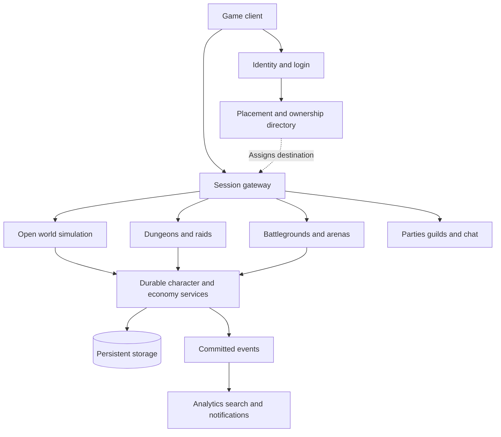

# AAA MMORPG networking and multiplayer architecture

**Large MMORPGs scale by combining many authoritative simulations with shared identity, social, and persistence systems.** The most difficult problem is deciding how much mutually interacting gameplay must be resolved together within a strict latency budget.

That distinction explains much of World of Warcraft’s architecture—and why a game can support an enormous total population while still struggling when a small fraction of that population gathers for one battle.

I prepared a **24-page report with approximately 8,700 words, architectural diagrams, implementation guidance, and 40 references**:

[AAA_MMORPG_Networking_Architecture_Report.pdf](https://chatgpt.com/library?file_id=libfile_6669139d0a788191a62609e955e10c1d&account_id=personal)

The detailed walkthrough follows. Research is current to **November 4, 2026**. Blizzard has disclosed important pieces of its architecture, but its complete contemporary production implementation is not public. I distinguish those disclosures from general engineering patterns and proposed designs.

---

## 1. The three different problems hidden inside “MMO scale”

There are three major scaling problems.

### Population scale

How many players can the entire service support concurrently?

This includes connections, authentication, character loading, storage, social services, and enough simulation capacity across the fleet.

If encounters are largely independent, more machines can host more encounters.

### World scale

How much geography, content, persistent state, and NPC activity can the game maintain?

A large world needs streaming, partitioning, lifecycle management, and mechanisms for moving players between simulation owners.

Most of that world does not need the same amount of computation at every moment.

### Interaction density

How many players can directly affect one another in the same encounter?

This is usually the hardest problem. One player’s action can affect hundreds of targets, which can trigger shields, damage calculations, procs, deaths, healing, and messages to many observers.

**A million players spread across thousands of independent spaces says little about the capacity of one battlefield.**

A useful capacity specification therefore looks like:

> A given number of players, performing a defined mixture of activities, within a defined area, while maintaining specified server frame times and action-response latency.

“Players per server” is incomplete without those conditions. Historical research measuring WoW traffic found that both activity and population affected traffic patterns, reinforcing the need to benchmark realistic gameplay. [Wiley Online Library](https://onlinelibrary.wiley.com/doi/10.1155/2014/602403?utm_source=chatgpt.com)

### The terminology matters

| Term | Meaning | Important qualification |
|---|---|---|
| **Region** | Geographic or service boundary | Often also a persistence and account boundary |
| **Realm/world** | Logical player community or world identity | Can involve many processes and machines |
| **Zone/map** | Content area or simulation space | Its visible boundary need not match a process boundary |
| **Shard** | An independent population or copy of an area | Studios use this term differently |
| **Layer** | In WoW Classic, coordinated copies across zones | Preserves more continuity than independent zone placement |
| **Phase** | Content or visibility variant based on game state | Does not necessarily require a separate machine |
| **Instance** | Separately allocated dungeon, raid, match, or map copy | Creates bounded encounters that can be placed independently |
| **Megaserver** | Shared population-placement system | Usually still consists of many separate simulations |

A realm is not synonymous with a machine. A map is not synonymous with a process. A process can host multiple maps, and an appropriately designed map can span multiple simulation owners.

---

## 2. What Blizzard has actually disclosed

### 2.1 WoW separates different kinds of connections

Blizzard’s 2019 support explanation distinguishes:

- **Home:** the character’s home-realm connection, carrying functions such as chat and auction information.
- **World:** the connection to the host handling current gameplay, including nearby entities and combat.

A dungeon can use a different gameplay host. This helps explain why chat can continue working while combat stalls, or why joining a geographically distant group changes gameplay latency. [World of Warcraft Forums](https://us.forums.blizzard.com/en/wow/t/common-technical-issues-and-solutions/22912/22?utm_source=chatgpt.com)

This is evidence of functional separation. It does not reveal every contemporary process, gateway, or protocol.

### 2.2 JAM provides a concrete view of internal communication

Joe Rumsey’s **2013 GDC presentation, “Network Serialization and Routing in World of Warcraft,”** describes JAM, WoW’s inter-server messaging layer.

The disclosed mechanisms include schema-generated C++ messages, serialization and dispatch, routing to servers/services/objects, and queued handling. Protocol negotiation supports efficient binary communication between compatible peers; an expensive JSON compatibility fallback was explicitly prohibited for public-facing protocols. The examples demonstrate the framework, rather than a complete WoW production service inventory. [media.gdcvault.com](https://media.gdcvault.com/gdc2013/slides/822575Rumsey_Joe_Network_Serialization_and%20%281%29.pdf?utm_source=chatgpt.com)

The engineering lesson is substantial: **schemas, message identity, destination ownership, compatibility, and dispatch policy belong in shared infrastructure.** Individual gameplay features should not independently invent those mechanisms.

Also, a “service” can be a module inside one executable. It does not automatically mean a separately deployed microservice.

### 2.3 Sharding and layering solve different placement problems

In his 2024 explanation, Tom Ellis describes mainline WoW’s progression toward independently replicated zones, while Classic’s layers coordinate copies across zone boundaries. Keeping players together competes with protecting a full zone from overload. His account also explains that a layer can involve coordinated shards, rather than one giant process. [Wowhead News](https://www.wowhead.com/news/blizzard-developer-on-sharding-layers-and-the-blood-moon-event-season-of-337771?utm_source=chatgpt.com)

The practical distinctions are:

- **Sharding:** distribute players among copies of an area.
- **Layering:** maintain stronger continuity among coordinated copies.
- **Phasing:** determine which content or entities a player should experience.
- **Connected Realms:** link previously separate realm communities.

These mechanisms can coexist.

### 2.4 Connected Realms join communities without explaining the storage topology

Blizzard’s 2013 Connected Realms announcement describes permanently linked realms whose players can share guilds, auctions, and group activities while retaining realm identities. That establishes the player-facing behavior; it does not establish that their databases were physically merged into one database. [worldofwarcraft.blizzard.com](https://worldofwarcraft.blizzard.com/en-gb/news/10551009?utm_source=chatgpt.com)

This distinction matters whenever someone attempts to reconstruct infrastructure from a game feature.

### 2.5 Economic and account boundaries extend beyond simulation boundaries

Blizzard’s 2022 auction update made commodity listings regional, while noncommodity items remained realm-specific under that change. Warbands subsequently expanded shared progression and storage across realms within a region. [worldofwarcraft.blizzard.com](https://worldofwarcraft.blizzard.com/en-us/news/23833174/shadowlands-927-update-notes-now-live?utm_source=chatgpt.com)

The architectural implication is that several scopes coexist:

- The simulation currently hosting a character.
- The realm associated with the character.
- A regional market.
- Account-wide or Warband-wide state.

A character’s current world process cannot be assumed to own all those systems.

### 2.6 Classic uses a modern platform

Blizzard’s 2018 restoration account explains how old art and game data were adapted to modern code, retaining infrastructure improvements and exploit fixes. Classic gameplay therefore does not imply unchanged 2004 server architecture. [Blizzard News](https://news.blizzard.com/en-us/article/22646759/restoring-history-creating-wow-classic-panel-recap?utm_source=chatgpt.com)

Another useful distinction: a database of authored spell definitions is different from a database holding live inventories and character progress. “The game is data-driven” does not mean every spell cast performs a live SQL query.

### 2.7 A recent beta incident exposes several actual backend roles

Tom Ellis’s September 2026 first-person beta account, reproduced by Wowhead, identifies **REGIONAL services**, **Battle.net Game Services**, **WORLD simulation pools**, and Oracle database work. Separate failures involved login metering, stale database statistics, and empty maps failing to shut down. These details concern a beta PTR environment, rather than a complete production deployment. [Wowhead News](https://www.wowhead.com/classic-ptr/news/behind-the-scenes-of-the-wow-forever-beta-issues-tom-ellis-explains-on-x-382993?utm_source=chatgpt.com)

This is a particularly useful operational lesson: login failures, slow looting, and simulation overload can have entirely different causes.

### 2.8 “Realmless” still leaves simulation partitioning

Blizzard’s 2026 materials for the separately described **WoW Forever** branch replace traditional realm selection with ruleset-based player ecosystems. That player-facing structure does not establish one unpartitioned simulation or unlimited local population. [Blizzard News](https://news.blizzard.com/en-us/article/24302070/choose-your-ruleset-in-world-of-warcraft-forever?utm_source=chatgpt.com)

### What cannot responsibly be claimed

The public sources do not establish Blizzard’s complete current:

- Process and service topology.
- Packet schemas and compression system.
- Interest-management data structures.
- Database topology and durability policies.
- Authority-transfer protocol.
- Hardware inventory or cloud deployment split.
- Universal tick rate across versions and subsystems.

Projects such as TrinityCore or MaNGOS can illustrate independent implementations. Their code is not evidence of Blizzard’s production backend.

---

## 3. The overall architecture of a large MMORPG

The following diagram is a **reference architecture**, synthesizing the engineering patterns discussed here.

Three boundaries are especially important.

### The gameplay path

This handles commands, simulation, and replication.

It needs predictable latency and bounded queues. A combat update should not depend on an unrelated analytics service answering synchronously.

### The control plane

This places players, creates capacity, discovers owners, deploys versions, and manages lifecycle.

Once an encounter is running, it should ideally continue through a temporary placement-service outage. That requires deliberately separating allocation from ongoing gameplay.

### Durable state and shared services

These preserve characters, possessions, relationships, and progression.

Their consistency rules differ from those of visual state. A slightly delayed leaderboard is acceptable in circumstances where a duplicated sword is not.

Content delivery is another separate path. Textures, terrain, sounds, animations, and static definitions generally arrive through installation or content streaming. Live networking communicates dynamic state and references to that content.

---

## 4. What happens from login to entering the world

A practical login sequence involves considerably more than opening a connection.

1. **Check compatibility.** Verify client version, protocol compatibility, and required content.
2. **Authenticate identity.** Establish who the player is and what they can access.
3. **Authorize character access.** Confirm ownership and relevant restrictions.
4. **Resolve the existing session.** Prevent a stale session from continuing to control the character.
5. **Select a destination.** Consider region, ruleset, group, map capacity, saved location, and reconnect reservations.
6. **Load authoritative state.** Retrieve the character state needed by the destination.
7. **Establish initial replication.** Send entity lifecycle information and a usable baseline.
8. **Activate gameplay.** Begin accepting the character as a participant.

A crowded spawn point creates an initial-state burst: many entities must be introduced before ordinary incremental updates make sense.

### Reconnecting is a separate protocol

A reconnect may need to:

- Preserve the character temporarily.
- Replace the previous transport connection.
- Resume an existing instance.
- Recover a bounded gap in events.
- Resolve pending durable operations.
- Reject messages from an obsolete session.

A socket, an authenticated session, and ownership of a character have different lifetimes.

### There can be several queues

A login queue might protect authentication. A character-loading queue might protect storage. A realm queue might enforce population policy. A map queue might protect one overloaded event.

If operators only see “players waiting,” they can easily scale the wrong subsystem.

---

## 5. What runs inside the server-side engine

An authoritative server needs the parts of the engine required to decide gameplay:

- Entity and component state.
- Movement and collision representations.
- Navigation and spatial queries.
- Combat and ability rules.
- AI decisions.
- Timers and scheduled events.
- Encounter scripting.
- Replication.
- Persistence integration.

It generally does not need the client’s rendering workload.

A headless server can load simplified collision and navigation data without loading every texture, sound, or visual effect.

### Authority does not imply that clients do no work

Server authority means the server decides which results are accepted.

Clients may still predict movement, report positions, submit timestamps, and play anticipated animations. The server must define what it validates and what it never allows a client to decide.

For example, a client might report a predicted movement result. It should not be able to authoritatively declare that it earned an item.

### Parallelism needs explicit dependencies

Useful parallel work can include independent pathfinding, broad-phase queries, visibility calculations, and serialization from stable snapshots.

Shared mutable combat state is harder. If damage, healing, interrupts, and death all modify the same character, their ordering matters.

An ECS or actor model can organize that work. Neither automatically determines how to distribute it across machines.

A good principle is:

> Keep frequent, tightly coupled interactions local; distribute work across boundaries that have clear ownership and manageable communication.

---

## 6. There is no single “network tick”

Several clocks coexist:

| Cadence | What it controls |
|---|---|
| Client render rate | Visual presentation |
| Input sampling/upload | Capturing and transmitting player intent |
| Movement integration | Advancing physical state |
| Combat scheduling | Casts, impacts, interrupts, periodic effects |
| AI decision rate | Choosing actions and paths |
| Replication frequency | Publishing state to connections |
| Persistence frequency | Checkpoints and durable commits |

Blizzard explicitly described multiple message loops with different priorities in its 2019 batching explanation. Its January 2021 Classic PTR announcement reduced the spell-batch window from **400 ms to 10 ms**. Those numbers are not equivalent to the server’s complete simulation or packet frequency. [World of Warcraft Forums](https://us.forums.blizzard.com/en/wow/t/spell-batching-in-classic/137118/1?utm_source=chatgpt.com)

For a hypothetical fixed-step simulation:

- **20 Hz:** 50 ms per step.
- **30 Hz:** about 33.3 ms.
- **60 Hz:** about 16.7 ms.

If arrivals are uniformly distributed and the server is keeping up, waiting for the next step adds about half a step on average.

But when a nominal 50 ms step takes 150 ms to compute, commands queue. A low network ping cannot compensate for that backlog.

---

## 7. Interest management is central to scaling

**Interest management determines which information each client needs.**

A typical pipeline is:

1. Find spatial candidates.
2. Filter by world copy and phase.
3. Apply visibility and permission rules.
4. Add nonspatial subscriptions, such as party health.
5. Select components and priority.
6. Encode against known client state.
7. Fit the connection’s transmission budget.

### It saves CPU as well as bandwidth

It is insufficient to examine every entity for every client and discard most results at the end.

That can reduce transmitted bytes while retaining the expensive computation.

Epic’s Replication Graph documents reusable actor lists and spatial or dormant groupings that reduce per-actor/per-connection work. This improves replication within a server; it does not itself distribute a world simulation across servers. [Epic Developer Community](https://dev.epicgames.com/documentation/en-us/unreal-engine/replication-graph-in-unreal-engine?utm_source=chatgpt.com)

### Spatial proximity is only one rule

A party member on another map might need a health update without their entire surrounding world being replicated.

A nearby stealth character might be spatially relevant but not entitled to be revealed.

A character’s visible equipment might be relevant while the contents of their bank are private.

### Avoid interest-boundary churn

If an entity repeatedly enters and leaves interest as it moves around a threshold, the server may repeatedly send creation and destruction information.

Hysteresis helps: use different entry and exit thresholds. Preloading or predictive relevance helps when fast movement would otherwise cause visible pop-in.

The exact policy depends on movement speed, interaction range, network delay, and gameplay.

### Interest management is also a security boundary

If a hidden enemy’s position is already on the client, encrypting the network connection does not prevent the player from inspecting it.

Riot’s documented fog-of-war work illustrates the value of withholding information until it is needed. [Riot Games](https://www.riotgames.com/en/news/demolishing-wallhacks-valorants-fog-war?utm_source=chatgpt.com)

---

## 8. Replication needs more than “send only changes”

Different information needs different delivery semantics.

| Information | Appropriate conceptual policy |
|---|---|
| Current transforms | Prefer the newest useful state |
| Input history | Sequence and acknowledge enough information to reproduce movement |
| Spawn/despawn | Preserve lifecycle or provide explicit recovery |
| Combat outcomes | Preserve ordering and identity where required |
| Inventory transactions | Preserve durable effects and recorded results |
| Chat | Apply channel-specific reliable delivery rules |
| Static content | Use separately managed bulk delivery |

These categories do not necessarily require separate sockets.

### Delta compression requires a known baseline

Suppose a packet says:

> Here is entity state 120, expressed as changes from state 115.

That is useful only if the receiver has state 115.

On an unreliable channel, the server cannot assume that the last snapshot it sent arrived. Acknowledged baselines and a recovery path solve that problem. Glenn Fiedler’s snapshot-compression article provides a concrete implementation. [Gaffer On Games](https://gafferongames.com/post/snapshot_compression/?utm_source=chatgpt.com)

### Object lifecycle must be unambiguous

A movement delta must not be **applied** before its entity and required baseline exist.

If it arrives early, the protocol needs bounded buffering, rejection, or recovery.

Likewise, a late packet must not affect a different entity that reused the same identifier. Generation numbers or equivalent lifecycle identities prevent that ambiguity.

Teleports should be marked as discontinuities rather than interpolated as ordinary travel.

### Compression is application-specific

Useful techniques include:

- Integer identifiers.
- Changed-component masks.
- Quantized coordinates.
- Compact orientation representations.
- References to static definitions.
- Dormancy.
- Different update frequencies by importance.
- Coalescing superseded state before serialization.

For illustration, representing one kilometer with an unsigned 16-bit coordinate gives approximately **1.53 cm between representable values**. Whether that is appropriate depends on the game.

### Slow clients need bounded queues

A lagging connection should not accumulate an unlimited history of obsolete positions.

Track queue age as well as queue length. A packet that is small but already too old to matter can still damage responsiveness.

---

## 9. TCP, UDP, QUIC, and browser networking

There is no universal transport choice for every MMO subsystem.

Published traffic research studied WoW using TCP. That establishes a historical implementation and demonstrates that TCP-based MMORPGs can succeed. It does not establish every contemporary Blizzard transport. [Wiley Online Library](https://onlinelibrary.wiley.com/doi/10.1155/2014/602403?utm_source=chatgpt.com)

### TCP

TCP supplies reliable ordered bytes and established congestion control.

The tradeoff is that newer bytes on the connection can wait behind missing earlier bytes. Application framing, buffering, queue limits, and small-message behavior matter.

### UDP with a game protocol

UDP allows the application to distinguish replaceable state from information that needs recovery.

A production implementation still needs security, sequencing, pacing, congestion control, acknowledgments where useful, retransmission policies, and connection management.

“Use UDP” is therefore only the beginning of a networking design.

### QUIC

QUIC supports secure multiplexed streams. Loss does not impose ordering across every independent stream, although each reliable stream still has ordering dependencies. Its DATAGRAM extension supports unreliable messages sharing the connection’s congestion controller. [rfc-editor.org](https://www.rfc-editor.org/rfc/rfc9000.html?utm_source=chatgpt.com)

Putting all gameplay into one reliable QUIC stream can preserve the stale-data blocking problem within that stream.

### Browser engines

WebTransport is relevant because its API provides streams and datagrams. Target-browser support and fallback behavior still need verification; a browser game should not assume unrestricted native UDP sockets. [w3.org](https://www.w3.org/TR/webtransport/?utm_source=chatgpt.com)

### The important boundary

**A transport acknowledgment is not a gameplay acknowledgment.**

Receiving bytes does not prove that a command passed validation, an inventory mutation committed, or a character entered a world.

---

## 10. Prediction, interpolation, and combat fairness

### Local prediction

A common movement approach is:

1. Simulate local input immediately.
2. Retain input history.
3. Receive the server’s accepted state and processed-input position.
4. Correct to that state.
5. Replay unacknowledged inputs.

Epic documents this pattern in Character Movement, including saved moves, server validation, corrections, and resubmission. Its server movement scheduling also illustrates why authority should not be equated with one universal fixed movement loop. [Epic Developer Community](https://dev.epicgames.com/documentation/en-us/unreal-engine/understanding-networked-movement-in-the-character-movement-component-for-unreal-engine?utm_source=chatgpt.com)

### Remote interpolation

Other characters are commonly presented from buffered snapshots.

Buffering introduces visual delay but smooths irregular packet arrival. Extrapolation can hide short gaps, although collisions and unexpected actions make it unreliable. [Gaffer On Games](https://gafferongames.com/post/snapshot_interpolation/?utm_source=chatgpt.com)

### Latency compensation is a game rule

A shooter might evaluate a shot against historical target positions.

A target-based MMORPG might instead emphasize cast queues, range tolerance, action ordering, and interrupt timing.

The design must specify:

- When range and line of sight are checked.
- How old a command may be.
- How client timestamps are bounded.
- What happens if the target dies during a cast.
- How simultaneous actions are ordered.
- Which state can be rewound.

Rewinding movement does not imply rewinding the economy.

### An illustrative latency budget

Assume:

- 50 ms outbound transit.
- 25 ms average wait for a 20 Hz simulation step.
- 3 ms processing.
- 50 ms return transit.
- 8 ms until presentation.

That totals approximately **136 ms**, before additional buffering.

Local anticipation can make an action feel earlier. It cannot make the authoritative result arrive before the underlying communication and computation occur.

---

## 11. Why crowded battles are so expensive

A player standing in a town may mainly require position and appearance updates.

A player fighting in a crowd can trigger:

- Area queries.
- Range and line-of-sight checks.
- Resistance and immunity calculations.
- Damage absorption.
- Procs and triggered abilities.
- Healing selection.
- Threat changes.
- Death and reward processing.
- Combat-log fan-out.

Summons, pets, projectiles, and temporary effects add more entities.

### The network multiplication

For a simplified payload estimate:

\[
B \approx N \times k \times f \times s
\]

where:

- \(N\): connected recipients.
- \(k\): relevant changing entities per recipient.
- \(f\): updates per entity per second.
- \(s\): encoded bytes per update.

**These are hypothetical examples, not Blizzard measurements.**

| Scenario | Assumptions | Outbound payload |
|---|---|---:|
| Distributed population | 50,000 × 80 entities × 10 Hz × 24 bytes | **960 MB/s**, or **7.68 Gbit/s** |
| One area with bounded interest | 1,000 × 80 × 10 × 24 | **19.2 MB/s**, or **153.6 Mbit/s** |
| Full mutual visibility | 1,000 × 999 × 10 × 24 | **239.76 MB/s**, or **1.918 Gbit/s** |

The last case has approximately **12.5 times** the payload of the bounded-interest case.

These estimates exclude headers, retransmissions, initial state, combat events, chat, and communication between servers.

If 50,000 were the **average** concurrent population for a 30-day month, the first workload would produce about **2.49 PB of payload**. Peak concurrency cannot be substituted for average concurrency when calculating monthly transfer.

### Spatial indexing has limits

With full mutual visibility, there are \(N(N-1)\) directed replication relationships.

Spatial indexing removes irrelevant candidates. It cannot remove interactions that the game genuinely requires inside a dense crowd.

### The available responses have gameplay consequences

A studio can optimize calculations, reuse queries, parallelize independent work, reduce unnecessary events, prioritize critical updates, or simplify presentation.

It can also impose population limits, target caps, separate objectives, or instances.

Those are product decisions as well as engineering decisions. A capacity claim should disclose the conditions under which it was achieved.

---

## 12. Partitioning a world and transferring authority

There are several distribution strategies:

| Strategy | Strength | Main difficulty |
|---|---|---|
| Independent realm copies | Strong isolation and straightforward scaling | Splits communities |
| Multiple map copies | Flexible population distribution | Placement stability and social continuity |
| Geographic partitioning | Supports continuous geography | Cross-boundary interactions and transfers |
| Entity/group partitioning | Potentially finer load balancing | Frequent coordination among interacting owners |

These strategies can be combined.

The best boundary often follows interaction structure. A dungeon entrance is convenient because a party can move together into a bounded encounter. A boundary through a dense melee is much harder.

### Border replicas

A neighboring owner can maintain a read-only replica—sometimes called a ghost—to answer local queries.

That replica does not automatically acquire authority to apply damage or remove items.

Distributed research such as Colyseus demonstrates separating primary ownership, replicas, and placement, but research results are not evidence of Blizzard’s implementation or a guarantee of arbitrary production scale. [usenix.org](https://www.usenix.org/legacy/event/nsdi06/tech/full_papers/bharambe/bharambe_html/?utm_source=chatgpt.com)

### A safe handoff needs a recoverable decision

An illustrative transfer protocol is:

1. Reserve capacity at the destination.
2. Prepare it while the source remains authoritative.
3. Establish a cutover point.
4. Transfer relevant state and the last processed command sequence.
5. Account for commands arriving during the transition.
6. Commit one authoritative ownership outcome.
7. Activate the destination under a new ownership generation.
8. Reject stale writes from the former owner.
9. Redirect routing and eventually release old state.

The difficult cases occur around crashes and lost acknowledgments.

If the destination prepared successfully and then failed, did ownership transfer? If the source resumes after a pause, can it still save the character?

Fencing tokens can allow protected services to reject stale owners’ writes. The recipient must enforce the token; merely storing a lease in the old process is insufficient. [Martin Kleppmann’s blog](https://martin.kleppmann.com/2016/02/08/how-to-do-distributed-locking.html?utm_source=chatgpt.com)

### Seamless terrain and seamless simulation are separate

A client can stream terrain continuously while authority changes at invisible boundaries.

Conversely, a visually seamless world can have broken combat continuity if cross-boundary actions are poorly specified.

Starting another worker adds capacity. It does not automatically split a running encounter or transfer its authoritative state.

---

## 13. Persistence and the economy

An MMO needs several consistency regimes.

| State | Typical requirement |
|---|---|
| Displayed remote position | Low latency with tolerable temporary error |
| Encounter checkpoint | Explicit recovery policy |
| Currency and inventory | Durable, conflict-safe mutation |
| Account-wide progression | Defined ownership and concurrency |
| Search and analytics | Rebuildable, potentially asynchronous views |
| Authored content | Versioned publication and compatibility |

The database should not be asked for every nearby position on every frame.

High-frequency simulation belongs in memory under known ownership. Valuable changes need explicit durability.

### Example: buying a sword

Suppose Alice buys Bob’s sword for 100 gold.

A robust operation:

1. Assigns an identifier to this particular purchase.
2. Validates buyer, seller, item, balance, price, restrictions, and versions.
3. Debits Alice.
4. Credits Bob.
5. Transfers the sword.
6. Records the result.
7. Commits the required durable state.
8. Acknowledges success.

The critical case is:

> The transaction commits, but the response is lost.

A retry must return the recorded result rather than charging Alice again.

### Deduplication and concurrency control are different

An operation identifier prevents duplicate application of one request.

A version guard prevents a request from overwriting state that changed since it was read.

PlayFab documents these as separate mechanisms. Neither alone creates an atomic transaction across arbitrary independent databases. [Microsoft Learn](https://learn.microsoft.com/en-us/xbox/playfab/economy-monetization/economy-v2/tutorials/idempotent-transactions-and-retries?utm_source=chatgpt.com)

Database isolation also matters. Serializable transactions can require whole-transaction retries when concurrent execution conflicts with the required ordering. [postgresql.org](https://www.postgresql.org/docs/current/transaction-iso.html?utm_source=chatgpt.com)

### Operations crossing storage boundaries need a protocol

Possible designs include:

- Keeping the invariant inside one transactional service.
- Using supported distributed transactions.
- Reserving assets in escrow while a durable workflow completes.

Reserved assets must not remain spendable elsewhere.

A message queue does not automatically provide exactly-once business effects.

### Transactional outbox

One useful proposed pattern is to commit both the mutation and a notification record in the same transaction. A separate worker then publishes that notification, with duplicate-safe consumers.

This closes the gap where the purchase commits but the process crashes before publishing the event.

### Recovery is more than restoring a snapshot

A local simulation rollback cannot blindly undo an item already traded outside that simulation.

Recovery needs explicit objectives, stale-session rejection, pending-operation reconciliation, schema compatibility, and tested restore procedures.

Replay also requires capturing the necessary dependencies: randomness, content version, external results, and potentially execution ordering. Inputs alone do not always reproduce the same run.

---

## 14. Shared services, live operations, and failure containment

### Keep unrelated work out of combat

Parties, guilds, chat, markets, search, and analytics have their own workloads.

A guild message need not execute through every recipient’s combat loop. Auction search can use a cached index, while purchase revalidates authoritative availability.

Blizzard’s account of its older mobile auction architecture describes excessive query load straining servers and sometimes affecting in-game latency. That is a concrete reason to isolate optional surfaces from core gameplay. [worldofwarcraft.blizzard.com](https://worldofwarcraft.blizzard.com/en-us/news/23837376/the-auction-house-joins-the-wow-companion-app?utm_source=chatgpt.com)

### Bound retries and queues

Retries can amplify overload, particularly when several layers independently retry.

Use deadlines, bounded queues, retry budgets, and appropriate backoff and jitter. A timeout does not prove that an operation had no effect. AWS’s Builders’ Library documents these failure mechanisms. [d1.awsstatic.com](https://d1.awsstatic.com/builderslibrary/pdfs/timeouts-retries-and-backoff-with-jitter.pdf?utm_source=chatgpt.com)

### Fleet scaling has several controls

Operators need to distinguish:

- Creating workers.
- Placing workers on hosts.
- Assigning new players.
- Retiring existing workers.

A worker hosting active maps holds live state.

Agones documents allocation and scheduling separately and includes protection against ordinary eviction of active game servers. The game still owns migration and recovery. [Agones](https://agones.dev/site/docs/advanced/scheduling-and-autoscaling/?utm_source=chatgpt.com)

### Ready capacity matters

Starting useful capacity may require booting, loading content, warming caches, connecting to storage, and registering services.

A fleet can therefore have sufficient theoretical capacity but insufficient *ready* capacity during a launch.

Scheduled events justify pre-scaling. Unexpected demand requires reactive controls and admission limits.

### Deployments need multiple compatibility plans

Separate:

- Client assets.
- Server binaries.
- Gameplay data.
- Protocol schemas.
- Persistent database schemas.

Blizzard’s historical hotfix explanation distinguishes server updates from client patches. The general deployment implication is that these artifacts have different rollout and rollback constraints. [Rate of Change](https://worldofwarcraft.blizzard.com/en-us/news/3435893?utm_source=chatgpt.com)

A practical rollout can send new instances to a new version while old encounters finish. Storage changes should support the overlap.

Rolling back a binary does not necessarily reverse data written by it.

### Regional failure

Geographic proximity helps latency. It does not make one battle safely active in two independent regions.

Disaster recovery, durable cross-region replication, and geographically distributed live simulation are different engineering problems.

---

## 15. Observability, testing, and security

### Measure the entire action path

Player-visible delay includes:

> Input sampling → network transit → server queueing → simulation → dependency work → replication queueing → return transit → presentation.

Useful measurements include:

- Server frame-time percentiles by workload.
- Queue depth **and age**.
- Relevant entities per connection.
- Serialization CPU.
- Bytes and packets by message type.
- Initial-state bursts.
- Transfer duration and failures.
- Database contention and transaction latency.
- Reconnect success.
- Party-placement success.
- Admission rejection reasons.

Host-average CPU can conceal one saturated simulation thread.

### Load tests must play the game

Idle bots holding connections are insufficient.

Test moving crowds, combat rotations, area effects, pets, summons, looting, trading, quest updates, group changes, and map transfers.

Also test launch bursts, mass portal arrivals, popular auction queries, and reconnect storms.

Inject failures at the difficult points:

- After commit but before acknowledgment.
- During ownership transfer.
- When an old owner resumes.
- During a database failover.
- While protocol versions overlap.
- Under packet loss, jitter, reordering, and bandwidth restriction.

### Security has several layers

Validate admission, command permissions, message lengths, movement, and economic operations.

Bound decompression, allocations, and expensive queries. Keep unnecessary secret state off clients. Protect public endpoints against connection churn and volumetric attacks.

Internal permissions matter too: an optional service should not automatically possess authority to mint items or impersonate a simulation owner.

The objective is to make abusive work bounded and failures local.

---

## 16. What other major MMORPGs demonstrate

### EVE Online: a shared universe still has many owners

CCP’s 2023 Tranquility disclosure describes PROXY session processes, SOL processes, Microsoft SQL Server, and a combination of on-premises and cloud services. Simulation and other workloads have different placement. [EVE Online](https://www.eveonline.com/news/view/tranquility-tech-iv?utm_source=chatgpt.com)

EVE’s Time Dilation design slows simulation time under overload. Its 2016 operations report describes a 10% floor and continuing queue growth when demand exceeds capacity even there. Controlled degradation extends capacity without making it unlimited. [EVE Online](https://www.eveonline.com/news/view/introducing-time-dilation-tidi?utm_source=chatgpt.com)

For runtime context, EVE announced a staged Python 3 migration in August 2026; the described first stage still ran on Python 2.7. [EVE Online](https://www.eveonline.com/news/view/the-move-to-python-3-begins?utm_source=chatgpt.com)

**Lesson:** define overload behavior explicitly, and distinguish the shared universe from the execution unit handling one hotspot.

### Guild Wars 2: placement is a social system

ArenaNet’s megaserver design assigns players to map copies using party, guild, language, home world, and other affinity information. Additional copies accommodate population. [GuildWars2.com](https://www.guildwars2.com/en/news/introducing-the-megaserver-system/?utm_source=chatgpt.com)

Its subsequent improvements describe guild reservations and draining maps through reduced placement and voluntary transfers. [GuildWars2.com](https://www.guildwars2.com/en/news/continued-improvements-to-the-megaserver-system/?utm_source=chatgpt.com)

A later cloud case study notes that map processes could remain alive for weeks, explaining why process replacement alone is not sufficient recovery. [AWS for Games Blog](https://aws.amazon.com/blogs/gametech/arenanet-guild-wars-mmorpg-migration/?utm_source=chatgpt.com)

**Lesson:** utilization and community quality are separate objectives. A balanced fleet can still produce a poor experience if it separates friends.

### New World: continuous geography across simulation owners

AWS’s 2022 account describes public entry points, multiple simulation hubs, state handoff during movement, and a separate pool for instanced activities. It reports 30 simulation updates per second and DynamoDB persistence. [AWS for Games Blog](https://aws.amazon.com/blogs/gametech/the-unique-architecture-behind-amazon-games-seamless-mmo-new-world/?utm_source=chatgpt.com)

**Lesson:** a continuous landscape can span simulation owners, but transfer and relevant-state selection become core engine capabilities.

### The Elder Scrolls Online: parallelization is a correctness project

In July 2023, Matt Firor reported that early server multithreading work delivered smaller gains than desired and that one change was reverted because of instability. Hardware upgrades had produced larger visible improvements at that stage. [Elder Scrolls Online](https://forums.elderscrollsonline.com/en/discussion/637691/server-multithreading-update-july-2023?utm_source=chatgpt.com)

**Lesson:** additional cores help only when the workload can exploit them safely. The relevant measurement is improved gameplay under realistic load, including correctness and tail latency.

---

## 17. What I would build into an MMO-capable engine

An engine intended for this class of game should provide the following as foundational systems:

| Capability | Why it matters |
|---|---|
| **Headless runtime** | Runs authoritative gameplay without rendering overhead |
| **Stable identity model** | Separates persistent identity, runtime identity, and object generation |
| **Explicit authority** | Defines who may mutate each consistency domain |
| **Command pipeline** | Validates, sequences, expires, acknowledges, and deduplicates |
| **Scheduling and dependency model** | Makes parallelism and frame budgets explicit |
| **Replication descriptors** | Specify recipients, fields, precision, priority, and lifecycle |
| **Client timing infrastructure** | Supports prediction, reconciliation, interpolation, and clock estimation |
| **World-transfer contract** | Makes ownership migration recoverable |
| **Persistence boundary** | Protects valuable state without blocking unrelated simulation |
| **Content and protocol versioning** | Supports live compatibility |
| **Diagnostics** | Attributes cost to abilities, entities, messages, and dependencies |
| **Realistic test harness** | Reproduces gameplay and injected failures |

Schema generation can produce encoders, decoders, inspectors, validation, and compatibility checks. It should still require explicit decisions about private fields and recipient-specific state.

Unreal’s replication and movement systems are useful building blocks; Iris is another replication option described by Epic. A persistent MMO additionally needs the placement, ownership, economy, and operational systems around those mechanisms. [Epic Developer Community](https://dev.epicgames.com/documentation/en-us/unreal-engine/iris-replication-system-in-unreal-engine?utm_source=chatgpt.com)

Language and runtime choices should follow those boundaries. A runtime strong at concurrent sessions and supervision may suit platform services, while a native, data-oriented loop handles expensive simulation. Calling across that boundary for every entity update can negate the benefit.

For agent-driven NPCs, expensive inference should generally produce asynchronous intents under a budget. The authoritative simulation validates those intents and supplies fallback behavior when inference is late.

### The development order I would recommend

1. **Prove one authoritative scene** with real movement and combat.
2. **Add interest management and replication budgets.**
3. **Measure realistic same-location capacity.**
4. **Implement durable progression and crash-safe economic operations.**
5. **Add independent instances, admission, reconnect, and draining.**
6. **Build recoverable world transfers.**
7. **Add shared social systems and group-aware placement.**
8. **Expand the fleet and automate compatible deployments.**
9. **Optimize dynamic partitioning only where measured demand requires it.**

If the product’s defining promise is thousands of players in one fight, that must be demonstrated early. It will influence combat rules, partition boundaries, replication policy, client presentation, and acceptable degradation. Those decisions determine the architecture far more than the choice between TCP and UDP or the number of servers available.

