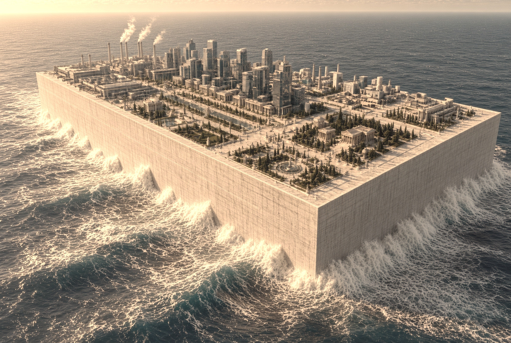

# Palmer Luckey's SLAB announcement

Source: <https://x.com/PalmerLuckey/status/2122861334371180795>
Posted November 17, 2026, 7:15 p.m. Central (November 18 UTC).

The post text, verbatim:

> Selling Oculus to Facebook in 2014 gave me money for helicopter flight lessons and developing a seastead called SLAB with a 1,000 year design life.
>
> The goal was to be cheaper than land and absent state/local laws that cripple critical American industries like metal processing, medical research/treatment, desalination, oil refining, chemical engineering, and more.  Me and a few close friends cashed it up at a $1B valuation back in 2017, and while it still has a long way to go, there has been significant progress towards my goal of reviving manifest destiny and westward expansion.  At a time when most of the seasteading community wanted to escape the US and smoke pot, this was the one project explicitly designed to make America stronger, a relief valve for ill considered or outdated rules and regulations.
>
> I am only talking about it now because a few media outlets got wind of me and some friends topping up the coffers and plan on calling SLAB my new floating AI datacenter project. It is way cooler than that, way older than that, and I hate looking like a hype-chasing consensus loser, so now you have to read this tweet.

The image attached to the post, labelled AI-generated on X. It is concept art,
not a design drawing:

Analysis: [slab.md](slab.md) and
[SLAB_Research_Report_2026-11-18.pdf](SLAB_Research_Report_2026-11-18.pdf).
