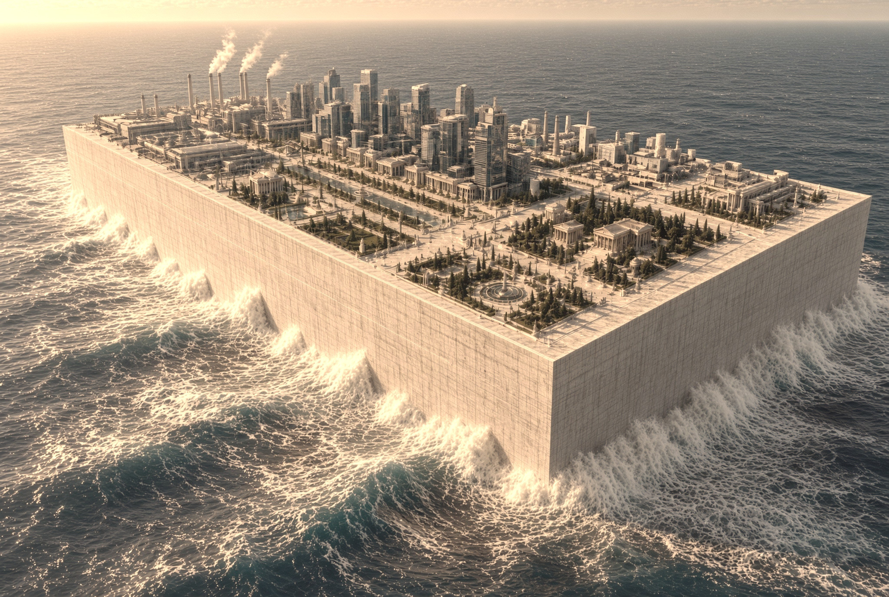

# What it would take to build the city in Palmer Luckey’s SLAB image

*Feasibility assessment, 18 November 2026.*

**A working piece of the image could be built today.** A shipyard could deliver a cellular concrete float carrying one industrial plant to a sheltered, serviced berth. The best U.S. starting point examined here is a shallow-draft module at a Gulf Coast industrial port such as Corpus Christi, subject to a berth agreement and permits. For assembling very large sections, a sheltered Norwegian fjord with a deepwater construction history is a stronger physical precedent. For the entire skyline on one exposed platform, the missing evidence is a site where the loaded hull fits, the structure and its utilities survive the sea together, and an authority can grant the intended use. The announcement identifies no such site. [Archived announcement and image](palmer-luckey-post.md)

## Reading the picture against the tweet

The archive records that X labelled the image AI-generated. Luckey describes a seastead intended to strengthen U.S. industry. He names metal processing, medical research and treatment, desalination, refining and chemical engineering. He wants serviced space cheaper than land, relief from some state and local rules, and a 1,000-year design life. The $1 billion figure is his account of a **2017 valuation**. The sum available to build the structure is undisclosed. The post also disputes the description of SLAB as a new AI data center. Its stacks identify neither a process nor a power source. Hull geometry, scale, site, tenants and occupancy are open questions. [Archived tweet](palmer-luckey-post.md) · [Original post](https://x.com/PalmerLuckey/status/2122861334371180795)

| Visible feature | What a designer has to explain |
| --- | --- |
| Two nearly vertical, continuous faces with spray at the waterline | What holds the deck that far above water? Where can a tug, ferry or rescue craft come alongside? The near corner gives a good view of the freeboard but no reliable scale or view of the submerged hull. |
| A cluster of tall buildings near the middle, lower halls on either side | Which hull walls carry the column loads? How much does the center of gravity rise as floors are occupied? Can the towers and their services tolerate hull flex and wind-driven acceleration? |
| Several stacks, some with visible plumes, near civic-looking buildings and trees | Which process can run there with occupied buildings downwind? The uses, emissions, fuel inventory and population would determine the spacing. A plume gives no measure of any of them. |
| Avenues, plazas, gardens and an almost uninterrupted rim | The public plan needs room for freight, firefighting, muster and waste removal. Saturated soil, water tanks and loaded vehicles all consume payload. The visible faces show no clear cargo berth, evacuation landing or protected entrance. |

The following calculation adopts the repository’s simulation dimensions so its assumptions can be checked or replaced. The image supplies no surveyed length, dependable floor count or evidence for a particular material. The concrete dome in the announcement thread is Ben Silone’s separate proposal. [Simulation assumptions, §3.1](slab-world-spec.md) · [Silone’s reply](silone-dome.md)

## How much would it weigh?

Take a rectangular hull **1,000 m long, 600 m wide and 50 m deep**, floating 25 m down with 25 m of hull above calm water. That gives 60 hectares of gross deck. At an assumed seawater density of 1.025 tonnes/m³, the water displaced weighs **1,000 × 600 × 25 × 1.025 = 15,375,000 metric tonnes**. That is the whole operating mass, including ballast. A solid block of the same outer dimensions at 2.5 tonnes/m³ would weigh 75 million tonnes. Even submerged to the deck it could displace only 30.75 million tonnes. A concrete version owes its buoyancy to the volume its watertight cells enclose. These first-pass figures use square corners and vertical sides. [Simulation geometry and mass assumptions](slab-world-spec.md)

| Illustrative weight account at 25 m draft | How the mass arises |
| --- | --- |
| About 6.03 million t of reinforced and prestressed concrete | The simulation allows 1.5 m for the bottom, 1 m for the deck and 1.5 m for perimeter walls. At 50 m spacing, 0.6 m internal walls divide the hull into 240 cells. Summing the five gross slab and wall volumes gives 2.412 million m³ at 2.5 t/m³. This is a quantity estimate before detailed framing and joint design. |
| 2.0 million t of buildings, plant and equipment | A simulation allowance. Spread over the deck it averages 3.33 t/m². A tower column, crane wheel or tank foundation can exceed that average many times over. For example, 20 occupied floors averaging an assumed 1 t/m² per floor impose 20 t/m² over the building footprint before the load concentrates into individual columns. Those columns need support all the way down to the bulkheads. |
| 0.5 million t of process liquids, fuel and fresh water | Tank locations and fill states determine heel, trim and how much liquid is free to move when the hull inclines. The operating manual needs approved loading sequences. |
| About 6.85 million t of seawater ballast | The mass that closes this illustrative ledger, after rounding. Only ballast that can safely be discharged while preserving trim, stability, hull stresses and mooring geometry can be exchanged for cargo. |

**One metre of additional immersion carries 615,000 t** over this waterplane. Another 100,000 t distributed evenly with ballast held fixed adds about 16 cm of draft in calm water. Conversely, the assumed 6.03 million t of bare hull alone draws about 9.8 m. It could be floated out lighter than its operating draft if its temporary structure and stability allow. Its **600 m width persists at every draft**. Those two numbers lead to different conclusions about which yards and channels could handle it. A separate pilot, assumed here to be 100 × 50 m at 5 m draft, displaces about 25,600 t in the same water, including its own hull. That is a practical size to investigate with a port.

## The structure under the streets

**Hull and joints.** One candidate is a cellular caisson in low-permeability marine concrete. Reinforcement controls cracking, and prestressing can keep critical joints compressed under service loads. The design needs a specified mix, cover over reinforcement, crack limits, sealed penetrations, protected tendon anchorages and a way to inspect or isolate a leaking cell. Specify different protection for the submerged, splash and atmospheric zones. A steel pontoon with coated surfaces and cathodic protection below water offers established shipyard fabrication and weld inspection. Steel or composite topsides can reduce weight high up. Each choice changes inspection access, corrosion allowance and fire protection. Monaco’s 352 m prestressed caisson was cast in Spain and towed to a hinged shore connection. Its engineers specified a 100-year life. It establishes a construction method and shows how much the end conditions matter. [Monaco project engineers](https://www.afgc.asso.fr/app/uploads/2018/05/Martareche.pdf) · [DNV offshore concrete standard](https://www.dnv.com/energy/standards-guidelines/dnv-st-c502-offshore-concrete-structures/)

**A kilometre of deck bends.** Waves can lift one area while the next loses support. The average heave at the middle tells little about curvature under a tower or movement across a pipe joint. Japan’s Mega-Float team tested hydroelastic response and landed aircraft on a 1,000 m floating runway in Tokyo Bay. Its deck covered roughly 80,000 m². The example here has 7.5 times that area and carries a different pattern of loads. A rigidly connected grid must carry bending and torsion through its seams. Articulated sections can move more independently, but roads, fire mains and utility crossings then need joints rated for relative movement. A semi-submersible could put buoyancy deeper and support a raised deck on columns, at the cost of a different underwater structure, draft and support pattern. [Japanese transport ministry trial](https://www.mlit.go.jp/english/maritime/mega_float.html) · [Mega-Float dimensions](https://www.mlit.go.jp/common/000234826.pdf)

**The sea sets operating limits.** Measure winds, directional waves, currents, tides, surge and seabed conditions at the candidate site. Model the hull, moorings, anchors, cables and elastic connections together, then test the critical cases in a wave basin. Check deflections, accelerations on occupied floors, fatigue at joints, wave impact and overtopping at the rim. Flood an edge compartment in the model, remove a mooring line, and check the resulting heel, remaining freeboard and cable excursion. In sheltered water a shore connection or pile-guided berth may be possible. In exposed water, spread moorings take up seabed beyond the deck perimeter. Soil borings must justify the anchor type and holding capacity. Set separate limits for survival, plant operation and boarding. A platform may survive a storm for days after its last safe opportunity to land supplies or evacuate patients. [DNV environmental loads](https://www.dnv.com/energy/standards-guidelines/dnv-rp-c205-environmental-conditions-and-environmental-loads/) · [Shell’s moored industrial precedent, Prelude](https://www.shell.com.au/about-us/what-we-do/gas-and-lng/prelude-flng-facility/prelude-overview.html)

## The port, the factory and the people above it

A workable deck plan starts with the flows missing from the illustration. Put cranes, a laydown area and heavy tanks over primary hull walls beside a protected freight berth. Reserve a separate passenger landing, adjustable gangways and more than one route from occupied areas to refuge and embarkation. A 25 m freeboard demands intermediate landings or lifts for ordinary transfers and a means of escape when power fails. Set process blocks and air intakes by fire, explosion and plume studies across wind directions. Keep hazardous inventory and spill drainage isolated from accommodation, a clinic and escape routes. Place heavy equipment low where flooding protection and maintenance access permit. Preserve corridors for replacing a transformer or exchanger after the surrounding buildings are occupied. [UK offshore fire and emergency-response guidance](https://www.hse.gov.uk/PuBns/books/l65.htm)

Start the utility design with one tenant’s hourly electricity, heat, cooling and water demand, tonnes of inbound feedstock and outbound product, and maximum tolerable interruption. A continuous 20 MW load, for example, consumes **480 MWh per day**. A cable crossing a moving hull needs strain relief, a repair route and independent emergency power for pumps, controls, communications and refuge. A desalination tenant also needs a water customer, storage or a delivery pipe, an intake and an acceptable brine discharge. A metal processor needs bulk berths, crane capacity and a route out for residues. Specify drinking water, wastewater treatment, refuse, medical transfer and days of supplies for the design port closure. The OTEC and nuclear studies in this folder explore power options. Neither is a disclosed SLAB dependency. [Industrial wastewater and cooling intakes](https://www.epa.gov/npdes/industrial-wastewater) · [OTEC assessment](otec.md) · [Marine reactor concept](ocean-atomics-reactor.md)

## Where could it exist today?

These are site screens for different jobs. Published channel dimensions describe a navigation route. Permanent occupation requires a separate, surveyed footprint for the hull, mooring spread, approach and maneuvering room. Water depth must cover loaded draft plus under-keel clearance through low water and vessel motion. Local chart datums, water density, siltation and the latest soundings matter.

| Place | What could fit, and on what conditions |
| --- | --- |
| **Corpus Christi / Ingleside, Texas** | A shallow-draft module serving a Gulf Coast industrial customer is the strongest U.S. pilot case here. The port reports its improved channel at 54 ft deep at mean lower low water and 530 ft wide, about 16.5 × 162 m. The example 100 × 50 m module warrants a tow study. The 600 m assembled hull exceeds the channel width even empty. Find a leased off-channel berth, utility connection, emergency tow and hurricane refuge or mooring plan. Hurricane Harvey made landfall near Port Aransas. For desalination, Texas has an actual intake and discharge permitting process. [Port channel dimensions](https://portofcc.com/wp-content/uploads/PCCA-Press-Release-CIP-Completion-vf.pdf) · [National Weather Service on Harvey](https://www.weather.gov/hgx/hurricaneharvey) · [Texas desalination permitting](https://www.tceq.texas.gov/permitting/water_rights/wr-permitting/marine-seawater-desalination) |
| **Long Beach outer harbor, California** | A shore-powered module could use shelter behind the breakwaters if the port can spare a berth and the load can secure an interconnection. The Corps’ navigation study gives the Queens Gate approach a width of 1,200–1,300 ft (366–396 m). Even its proposed 80 ft project depth is only 24.4 m. Both comparisons exclude a conventional tow of the fully loaded example through that channel. Tsunami currents, air emissions and competing vessel movements belong in the harbor case. An exposed site seaward of the harbor requires a new wave, mooring and transfer analysis. [Corps navigation study](https://www.spl.usace.army.mil/Portals/17/docs/projectsstudies/POLB%20Deep%20Draft%20Navigation%20Study%20Final%20IFR%20EIS-EIR%20OCT21.pdf) · [USGS tsunami scenario for the ports](https://www.usgs.gov/media/images/safrr-tsunami-scenario-ports) |
| **Vats and Yrkefjorden, Norway** | A credible place to investigate sheltered deepwater assembly. Vats has a heavy marine yard, and the municipal planning record documents the mooring of a spar buoy drawing 134 m in Yrkefjorden. That establishes deep water at one location. A 600 m wide assembly still needs a clear route and turning area, rights to occupy the water, acceptable mooring conflicts with fishing and shipping, and Norwegian planning approval for the specific use. An assembly contract here and permanent U.S. industrial operation would be two distinct projects, with an ocean tow between them. [Yard operator](https://www.afgruppen.com/offshore/Decommissioning/af-miljobase-vats/) · [Municipal planning record, fig. 4-12](https://www.vindafjord.kommune.no/_f/p14/ifc28caa8-f814-45d9-a78d-6e12167ca105/v3-planskildring-af-miljobase-vats-med-sjoomrader-hoyring.pdf) |
| **Federal shelf waters off Texas** | Water of sufficient depth within support-vessel range could be screened for a permanently moored plant. The Coast Guard records operating floating facilities in the Gulf, with vessel status varying by unit. Select a specific block and verify storm loads, soil and pipeline surveys, navigation, fishing access, spill response, shore landings and a lawful tenure for this use. Petroleum infrastructure provides suppliers and experience. A general manufacturing or residential platform would need its own legal basis and case for occupying the site. [Coast Guard facility inventory](https://www.dco.uscg.mil/OCSNCOE/FOF/Index/) · [Outer Continental Shelf leasing statute](https://uscode.house.gov/us/usc/119-136/t43/s1337/) |

The closest physical setting for the **whole deck** is a deep, sheltered basin where sections can be joined and remain at their final berth. Shelter can come from geography or a breakwater whose cost and footprint enter the same project. If the horizon in the image is essential, Shell’s Prelude shows what exposed operation entails even for a single purpose. Its 488 × 74 m gas plant has seabed moorings, offshore transfer systems and an onshore support base. The assumed SLAB deck covers about 17 Prelude length-by-beam rectangles. An exposed site must demonstrate how people, freight and emergency services cross that last stretch of sea in its actual weather. [Shell’s Prelude facility](https://www.shell.com.au/about-us/what-we-do/gas-and-lng/prelude-flng-facility/prelude-overview.html)

## Who would govern it?

In the U.S., plot the hull, anchors, cables and landfall separately. The state submerged-land boundary is generally 3 nautical miles offshore, and 9 off Texas, Puerto Rico and Florida’s Gulf coast. The U.S. territorial sea reaches 12 nautical miles from the baseline. The exclusive economic zone (EEZ) extends up to 200 nautical miles, subject to international boundaries. Those lines allocate different powers. A site just beyond California’s state waters can still trigger federal coastal consistency review for effects on the California coast. In a U.S. harbor, work and structures in navigable waters can require Army Corps authorization under section 10, with section 404 review for discharges of dredged or fill material where applicable. A port lease, navigation authorization, discharge permit and tenant operating license answer different questions. [NOAA maritime zones](https://www.noaa.gov/maritime-zones-and-boundaries) · [California Coastal Commission](https://coastal.ca.gov/fedcd/fedcndx.html) · [Army Corps permit authorities](https://www.sam.usace.army.mil/Missions/Regulatory/Permit-Types/)

On the U.S. outer continental shelf, **jurisdiction and permission to occupy are separate decisions**. Federal law expressly reaches artificial islands and specified seabed-attached installations. Applicable, consistent adjacent-state law can become federal law there. The federal leasing statute authorizes particular activities. A cable to shore, an anchor or a generator alone does not establish authority to lease a site for an entire mixed-use town. Obtain written positions on the proposed use and the structure’s status from the seabed manager and Coast Guard. Resolve whether cargo movements are between coastwise points before choosing supply vessels. A clinic would separately need a lawful basis for treatment, qualified personnel and medical transfer. FDA has conditions for accepting foreign clinical studies submitted in support of U.S. approvals. [43 USC §1333](https://uscode.house.gov/us/usc/119-136/t43/s1333/) · [43 USC §1337(p)](https://uscode.house.gov/us/usc/119-136/t43/s1337/) · [Coast Guard guidance](https://www.dco.uscg.mil/OCSNCOE/FOF/) · [CBP coastwise guidance](https://www.cbp.gov/sites/default/files/2024-12/Jones%20Act%20ICP_Complete_04DEC24.pdf) · [FDA foreign studies guidance](https://www.fda.gov/regulatory-information/search-fda-guidance-documents/fda-acceptance-foreign-clinical-studies-not-conducted-under-ind-frequently-asked-questions)

Abroad, the host coastal state has authority over artificial islands in its EEZ under UNCLOS Article 60, including customs, health, safety and immigration jurisdiction. An artificial island acquires no territorial sea of its own. On the high seas, freedom to construct installations is qualified by international law, shelf rights and due regard for other users. Flag-state duties attach to ships. No private owner gains sovereignty over the water. The U.S. remains outside the convention and observes relevant law-of-the-sea rules as customary practice. A distant site also needs a state willing to receive crews, patients, cargo and waste. To deliver on Luckey’s American industrial objective, agreements would have to say who secures U.S. market access, maintains the shore base, pays for rescue and spill response, and removes the structure if the operator fails. Fishing communities and commercial mariners have a direct stake in the occupied area and access routes. [UNCLOS Articles 56 and 60](https://www.un.org/Depts/los/convention_agreements/texts/unclos/part5.htm) · [UNCLOS Articles 87, 89 and 92](https://www.un.org/Depts/los/convention_agreements/texts/unclos/part7.htm) · [NOAA on U.S. treaty practice](https://www.noaa.gov/law-of-sea-convention)

## How it could be built, repaired and paid for

1. **Secure a tenant and two water areas.** Define the output to sell, workforce, freight and power contract. Survey the assembly basin and final site, including the passage between them. Establish who can authorize the footprint and shore connections. Get shipyard, port, insurer and independent engineering review of the same configuration.
2. **Cast and test repeatable units.** Build cellular sections in a graving dock or casting basin with concrete batching, aggregate and reinforcement supply, controlled curing, heavy lifts and an unobstructed float-out. Inspect tendons and welds, pressure-test boundaries and weigh each unit. At an assumed aggregate placement rate of 3,000 m³ per working day, the example hull alone represents about **804 placement days**. Parallel yards could divide the volume. Mobilization, curing, outfitting and weather add their own constraints.
3. **Assemble where the geometry permits.** Tow light units under surveyed clearances and weather limits. Hold adjacent units in alignment with temporary moorings and controlled ballast. Demonstrate a full-scale connection that transfers load, keeps water out and can be inspected. Each partially connected arrangement needs its own stability and strength check. Fit heavy plant in the sequence allowed by crane reach and trim. If the assembled hull cannot leave the basin, join at the final site or change the design. [DNV marine operations standard](https://www.dnv.com/energy/standards-guidelines/dnv-st-n001-marine-operations-and-marine-warranty/)
4. **Commission the marine systems before admitting occupants.** Prove station keeping, compartment isolation, pumps on emergency power, utility disconnection, spill containment and evacuation with a landing out of service. Operate the first tenant through a measured season. Record downtime, joint strains, water ingress, berth closures, inspection labor and delivered cost per unit of output before expanding.

**A thousand years requires an owner and a repair method.** Define what remains in service after replacement of moorings, bearings, cables, plant and perhaps entire hull sections. Provide access to tendon anchorages, monitoring points in the splash zone, isolatable cells, replaceable lines and a means to repair the underside while afloat. Bridge experience shows that voids in tendon grout can conceal corrosion. Validate site-specific deterioration models against material samples and repeated inspections. For perspective, under the simplifying assumption of independent, stationary annual extremes, an event with a 0.1% chance each year has about a **63% chance** of occurring at least once in 1,000 years. Allow for changing sea conditions, periodic reassessment, capital reserves and successor ownership. [FHWA research on tendon corrosion](https://highways.fhwa.dot.gov/sites/fhwa.dot.gov/files/2022-09/FHWA-HRT-22-090.pdf) · [DNV offshore concrete standard](https://www.dnv.com/energy/standards-guidelines/dnv-st-c502-offshore-concrete-structures/)

**“Cheaper than land” can be tested at pilot scale.** Compare the delivered cost of the same product at the same availability against a named onshore industrial site, including shore works, annualized capital, energy, freight, weather downtime, insurance, overhaul and eventual removal. Count the usable leased area after setting aside berths, safety distances and utilities. At the example volume, each **$100/m³ difference** in the installed cost of hull concrete moves capital cost by **about $241 million**, or **$402 per square metre of gross deck**. A yard quotation would supply the actual unit price. To extend a pilot result to the pictured city, the owner would need a surveyed and authorized site, an independently reviewed hull and joint design for its seas, a yard-backed construction and repair price, and a tenant willing to pay the resulting delivered cost.
