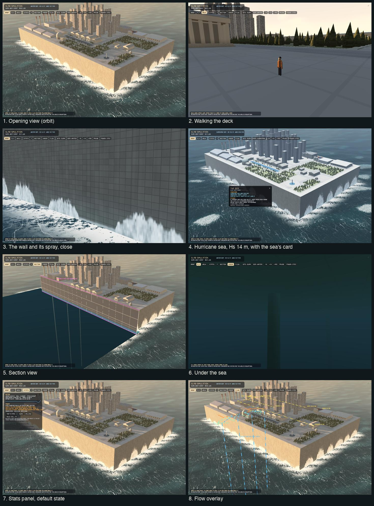

# SLAB world: audit and recommendations

*Audit of `/realms/slab` and of everything in this folder, November 18, 2026.
Code read at `main` commit `2792bcdb5f` (2:25 p.m. Central).*

**The world is a good engineering model that a newcomer can't yet read.** The
research is careful, the hull really floats on the simulated sea, and the
deck matches the concept image's layout. But a person who clicks through from
a video about Palmer Luckey's post lands on a small all-capitals toolbar, a
flat-shaded city with nobody in it, and a stats panel that opens in an
unexplained power shortfall. Nothing tells them how big the platform is, why
it floats, how it would be built, or where it could go. Those four questions
are what this world should answer, in that order, without the visitor reading
a doc.

This audit covers the whole world. The construction timelapse has its own
rebuild plan in
[issue 13682](https://github.com/OpenAgentsInc/openagents/issues/13682); this
doc refers to it and adds only what that issue leaves out.

## The ten things to do first

| # | Do this | Why |
| --- | --- | --- |
| 1 | Put the world in production and fix its address | `openagents.com/realms/slab` redirects to `/worlds/slab`, which returns 404. Nobody can open it today. |
| 2 | Open on a guided tour, not a toolbar | A newcomer needs to be led through size, floating, building and siting before free play means anything. |
| 3 | Show scale | Nothing in the frame tells you the wall is 118 m high or the deck a kilometre long. |
| 4 | Rewrite every word on screen in plain sentence case | The HUD and cards are all capitals, about 9 px tall, and full of terms such as GM, DT, PUE and SWAC. |
| 5 | Add a "What would it take?" panel with sliders | The models to drive it already exist. There is not one slider in the explore world. |
| 6 | Tell one story about where it is | The world floats off Guam in 1,500 m of water. The build view assembles it off Texas in 40 m. Nothing connects the two. |
| 7 | Make the weight add up | The hull you see is 143 m deep. The mass budget on its card is for a 50 m hull. |
| 8 | Draw it photoreal | The realm is tagged `painterly`. The engine's `photoreal` style is defined but not built. |
| 9 | Make the water physical at the wall | Spray is a painted shape on the wall, set to match the picture. The sea does not reflect, shelter or break against the hull. |
| 10 | Rebuild the construction view | As issue 13682 sets out. |

The sections below give the findings behind each, then the recommended build.

## Who arrives, and what they need

The visitor has just watched a short video that quotes Luckey's post. They
have not read this folder and will not. Most arrive from X, and most of X's
traffic is on phones. They bring roughly these questions:

1. **How big is this thing?**
2. **How does a block of concrete float, and what holds it there?**
3. **How would you even build it?**
4. **Where would it go, and who allows it?**
5. **What runs on it, and what powers that?**
6. **Is any of this real?**

The research in this folder answers all six. The world currently answers the
fifth in detail, the second partly, and the rest not at all. The visitor
should be able to get a first answer to each within two minutes, then stay as
long as they like changing things.

## What exists today

| Part | State |
| --- | --- |
| The platform | `prime`: a 1,000 × 600 m hull, 143 m deep, 25 m in the water. Districts follow the concept image: turbine halls, industry and stacks, 23 towers, a canal, temples, gardens, data halls, a mining yard, a medical block. |
| Other layouts | One Silone dome and a seven-dome cluster with bridges (key K), and a moored powership with nuclear power. |
| Physics | The hull heaves, rolls, pitches and drifts on the simulated sea, held by 16 mooring lines, with wind and current. A cell can be holed and ballast pumped against it. |
| Systems | OTEC, nuclear or hybrid power, data halls, desalination, industry and Bitcoin miners, with a dispatcher that sheds load. |
| Sites and seas | Five sites (Guam, Puerto Rico, Kona, the equator, California) and six sea states, calm to hurricane. |
| Ways to look | Orbit, fly, walk; a section cut, an underwater view, a flow overlay; nine travel stations on the number keys. |
| Cards | Click anything for a card with Construction, Physics and Now sections. |
| Construction | A 90-second scrubbable timelapse (key B). Issue 13682 lists what is wrong with it. |

That is a lot of working machinery. Almost none of it is reachable by a
person who doesn't already know it is there.

## Findings

### 1. Getting in

| Finding | Detail |
| --- | --- |
| The world is not live | On November 18 at about 2:15 p.m. Central, `https://openagents.com/realms/slab` returned a redirect to `/worlds/slab`, and that returned 404. |
| The documented address is the old one | The realm page, the spec and the code comments all say `/realms/slab`. The site now serves worlds under `/worlds/`. Every deep link in `apps/openagents-web/realms/slab/index.md` uses the old form. |
| Phones | At 390 × 844 the toolbar wraps to three rows and runs off the right edge (the Flow button is cut off), and the hint line at the bottom is cut off too. Walking and flying need a keyboard. |
| No WebGPU | The page shows its name and one link. That follows the site's rule for pages, so the linked page has to carry the story for those visitors. Today it opens with a description of the world being unlisted. |
| Link preview | The page names `og/realms/slab.jpg` as its share image. Check that it exists in production and shows the world, since the post's preview card is the first thing people see. |

### 2. The first minute

- **No introduction.** The world opens on the concept image's camera angle
  with a toolbar of fifteen buttons. One hint line says "Drag to turn, wheel
  to zoom, WASD to move, click anything to learn about it." Nothing says what
  SLAB is, who proposed it, or what you are meant to do here.
- **No sense of scale.** The opening view has no ship, person, vehicle or
  known building in it. A 118 m wall reads as a garden wall. The research has
  the comparisons ready: Shell's Prelude is 488 × 74 m, and the deck covers
  about 17 of them; Mega-Float's runway was 1,000 m; Monaco's caisson is
  352 m.
- **Nothing is labelled.** Districts have names in the code (`district()` in
  `slab.coax`) and in each card, but no name appears over the deck. You have
  to click a building to learn that it is a data hall.
- **The stations are hidden.** Keys 1 to 9 jump to nine good viewpoints.
  They are listed only inside the help panel, as one run-on line.
- **The construction button is easy to miss** and sits apart from the rest of
  the toolbar. It is the feature most likely to hold a newcomer.
- **The disclaimer is right and should stay.** "Reconstruction: SLAB's real
  design is unpublished. Dimensions and systems are this world's
  assumptions." It is the most honest line on screen, in the smallest type.

### 3. Words and the HUD

| Finding | Detail |
| --- | --- |
| Type | Every label is in capitals in a pixel font. At 1440 × 900 the body text is about 9 px tall. Long lines are hard to read at any size in capitals. |
| Jargon in the toolbar | "STATS", "SECTION", "UNDER", "FLOW", "−1H", "+1MO", "POWER: OTEC". A newcomer doesn't know what OTEC is or why they would want a section. |
| Jargon in the stats panel | "DECK ACCEL 0.99 MILLI-G", "PEAK LINE 4.0 OF 40 MN", "DT 23.5 C", "SWAC", "HALVING", "HOLE CELL A1", "TRIP A PIPE". Each is correct. None is explained. |
| The help panel | A block of key bindings that ends with a file path, `docs/research/ocean/slab-world-spec.md`, which is not a link. |
| Controls that cycle blind | Site, sea and power are buttons that step to the next value. You can't see the choices or pick one. |
| Its own look | The HUD is drawn with the engine's stroke font, not `components/kit`. It doesn't match `/chat` or the rest of the site. |

### 4. The default state looks broken

Open the stats panel on the default world and it reads, in amber: "Supply
112.3 MW against 163 MW of fixed loads" and "Data halls short: batteries and
generators carry them." Mining is at 0 of 50, industry at 0 of 20 and
desalination at 0 of 15.

This is deliberate. The spec chose a 120 MW OTEC plant that cannot carry the
city, to make the OTEC report's point. It is a good lesson and a bad first
impression: the visitor's first reading of the numbers is a platform that
doesn't work, with no explanation, and stacks that don't smoke although the
concept image's do. The data halls also stay "on backup" for as long as you
watch, although the spec gives them 15 minutes of batteries and a 40 MW
generator plant. Backup never runs out.

### 5. Cards

The cards are the best part of the world. Each has a clear structure, real
dimensions and live numbers. Their problems are about the reader:

- **They start with the specification, not the point.** The hull's card opens
  with "The prime monolith: reinforced, prestressed concrete" and goes
  straight to slab thicknesses. It never says "this is a hollow concrete box,
  and it floats because it weighs less than the water it pushes aside."
- **They show formulas a newcomer can't use.** "R = 6B(S + F)(1 − P) / (E U H)
  per facility MWh", "Gross = 171.4 × (DT / 24)² MW", "GM 1,188 m across".
- **Sourced and assumed are not marked.** The spec asks for every number to
  be tagged. Only the sea's surface temperatures are.
- **They lead nowhere.** No card links to the research behind it, and none
  offers a next step ("see it cut open", "see how it was built").
- **Two cards disagree with the spec.** The data halls' card says two halls
  of 50 MW. Section 6.2 of the spec says four halls of 25 MW. The cranes'
  card is still in the code though the cranes are gone.

### 6. Walking the deck

Walking works, and the deck moves with the hull under you. But the city is
empty. The ground is one flat grey surface with street lines. There are no
people, vehicles, doors, benches, signs or lights. Trees are plain cones.
Towers are boxes with a window pattern. You can't go inside anything. A
visitor who walks for thirty seconds has seen everything walking offers.

Nothing at eye level explains anything, either. A person standing at the
wall's edge is 118 m above the sea, which is the most striking fact in the
whole design, and the world gives them no rail to lean on and no number to
read.

### 7. The cutaway views

- **Section.** It cuts the hull open and shows the cells, which is exactly
  what a newcomer needs. It has one label, in magenta, about hull bending. It
  doesn't label the waterline, the ballast, the bulkheads, the cells or the
  keel, and it doesn't say that most of what you see is empty space.
- **Under the sea.** At the default position the view is a dark teal field
  with two faint pipes. The hull's bottom, the sixteen mooring lines and the
  anchors are not visible. The water model fades everything within about a
  hundred metres, which is physically right and useless for explaining.
- **Flow overlay.** It draws the cold water coming up, the warm water in and
  a power line to each district with its megawatts. It is the clearest
  explanatory view in the world. Its labels are small, overlap each other
  near the plant, and several read "0.0 MW" in the default state.

### 8. Where it is

The world's site list is Guam, Puerto Rico, Kona, the equator and California.
All five assume 1,500 m of water and taut moorings to anchors 2 km out. The
construction view builds the platform at Corpus Christi, assembles it at a
berth in 40 m of water 48 nautical miles off Texas, and commissions it there.
That berth is not one of the five sites. The build ends on a city that has no
cold-water pipes, because 40 m of water rules them out; the main world's city
depends on them.

So the world shows two different SLABs and never says so. The feasibility
doc is clear that these are different jobs: a Gulf Coast pilot, a sheltered
basin for assembling something this wide, and an exposed permanent site. The
world should tell that story, or pick one.

Other gaps in "where":

- **No map.** You can't see where any site is, how far it is from land, or
  how deep the water is.
- **No legal lines.** Luckey's "three miles" reply is the reason the
  California site exists. The research sets out the 3, 9, 12, 24 and 200
  nautical mile lines and what each changes. None is shown.
- **No seabed, coast or other ships.** Every site is the same empty ocean
  with a different label.
- **Storms are a label.** "Typhoons" appears on the sea's card. The
  hurricane sea state exists, but nothing connects a site to its storm season
  or shows what a storm does to operations.

### 9. Numbers that don't agree

| Where | Conflict |
| --- | --- |
| Hull depth and mass | The world draws a 143 m hull to match the picture. Its mass budget (6.0 Mt of concrete, 6.9 Mt of ballast) is for the spec's 50 m hull. The card says so in small print. By our arithmetic, raising only the outer wall adds about 0.45 million m³ (1.1 Mt); raising the bulkheads too adds about 1.25 million m³ more (3.1 Mt). Either way the ballast figure is wrong for the hull shown. |
| Construction hull | The timelapse builds the 50 m hull and ends 25 m above the water. The main world's deck is 118 m above it. |
| Concrete volume | The spec and the feasibility doc use 2.41 million m³. The timelapse uses 2.68 million m³ and ends with 6.16 Mt of ballast against the spec's 6.9 Mt. Issue 13682 notes this. |
| Data halls | Two halls of 50 MW on the card and in the deck table. Four of 25 MW in section 6.2. |
| Spray height | The spec's results section derives about four times the significant wave height from standing-wave physics, capped at 24 m. The opening view now draws about nine times, every 95 m, to match the picture. In the default 4 m sea that is 36 m of spray. |
| Opening sea | The world opens on the `winter` sea (4 m) at Guam in June, whose own default is the `trade` sea (1.5 m). It was chosen for the picture. |
| Buoyancy grid | The spec asks for 6,000 columns on a 10 m grid. The code uses 960 on a 25 m grid. |
| Tests | The spec lists 14 tests. Tests 9 (two runs agree bit for bit) and 10 (the momentum ledger balances) have no check in the code. |

Each of these is defensible alone. Together they mean a visitor who compares
two numbers will often find they don't match, and the world loses the trust
its research has earned.

### 10. How it looks

The realm is registered with `"style": "painterly"`. The engine's art-style
doc defines a `photoreal` style (physically based shading, measured colours,
real and contact shadows, a physical sky, volumetric fog, tone mapping) and
says its engine work "isn't planned yet and gets its own initiative when a
zone needs it." SLAB is that zone.

What is drawn today:

- **Geometry.** The platform is a short list of analytic shapes (boxes,
  cylinders, gables, domes, temples) traced in the shader, with at most 152
  records. This is the same limit that makes the construction view look like
  grey blocks. There is no mesh pass in this realm.
- **Materials.** Colour by kind, with a painted pattern: a square grid on the
  wall, a window grid on towers, street lines on the deck. No roughness, no
  reflections in the glass towers, no weathering, no waterline staining that
  responds to the sea.
- **Light.** One sun with shadows on desktop, a painted sky, a golden-hour
  grade for the opening view. No ambient occlusion, no sky reflection on the
  deck, no lit windows or work lights at night.
- **Life.** No people, vehicles, ships, aircraft, birds, flags or moving
  machinery. Smoke rises from the stacks only under nuclear or hybrid power.

The concept image works because of its light and its surf, not its layout.
The world has the layout.

### 11. The water

**What is real.** The sea is the engine's spectral sea: a JONSWAP spectrum
from wind speed, synthesized by FFT, deterministic on the world's clock,
drawn to the horizon on a clipmap. The hull reads the same heights the eye
sees. This is a sound base.

**What is not.**

| Area | Today | What is missing |
| --- | --- | --- |
| Look | The "painted water" preset: colour bands and a calm reflection. The near sea was tuned today to the picture's warm grey. | The engine's physical water look (Fresnel, roughness-blurred sky reflection, depth absorption, sun glints, light through crests) is built for Everglade and not used here. |
| Detail | From the orbit, the sea reads as a flat sheet with a bright vein pattern. | The hurricane sea (14 m) and the winter sea (4 m) look nearly the same from above. Only the foam patches differ. Wave height can't be read. |
| The wall | Spray is a shape painted on the wall at fixed spacing, with a white band at its foot. | A vertical wall reflects a wave and roughly doubles it. That standing wave, the run-up, the broken water and the wind-blown spray should come from the waves that actually arrive. |
| The lee | The sea is the same on all four sides. | A kilometre of hull shelters the water behind it. That calm is where boats come alongside, and it matters to every "how do you supply it" question. |
| Disturbance | None. | No wake from the current past the hull, no discharge plume, no moonpool surge, no ripples from anything. The engine has ripples, wakes and spray particles from the river work. |
| Weather | Wind speed only. | The engine's weather (cloud, rain, storm, lightning, fog) is not used. A hurricane is a clear sky with more foam. |
| Under water | Dark, with correct absorption. | Sun shafts, the surface seen from below, and enough range to see the hull and its lines. The engine's underwater module has these. |

**The hull's physics.**

- It models five motions: heave, roll, pitch, surge and sway. It does not
  model yaw, so the platform can't turn on its moorings.
- Wave force is the vertical lift on each column plus a horizontal push that
  assumes one 160 m wave for how pressure fades with depth. Shorter and
  longer waves are treated the same.
- Damping is one fixed ratio (8%) in each motion. Added mass is a constant.
  The spec says these stand in for effects it doesn't compute.
- There is no slow drift force from waves, which is what actually loads
  moorings in a storm.
- The sea is not changed by the hull at all. Waves pass through it.
- The moorings are a formula per line, tuned to break at a 150 m offset.
  There is no seabed, no line shape, and no line can fail.

None of this is wrong for a planning model, and the spec is open about it.
But "real physics in the water" means the water and the hull act on each
other, and today the hull only listens.

### 12. The construction view

Issue 13682 covers this fully. Three points it doesn't make:

1. **Its hull is not the world's hull** (50 m against 143 m), as above.
2. **Its camera aims too high.** In the build view the camera targets the
   118 m deck height, while the construction deck sits 25 to 38.5 m above the
   water. This came in when the two changes were merged. We read it in the
   code and did not run it.
3. **It ends in a different place from the world it hands back to.** Leaving
   the build view returns you from a commissioned platform off Texas to a
   platform off Guam with pipes a kilometre long.

### 13. This folder

| Doc | Note |
| --- | --- |
| `README.md` | Said of the world spec "nothing in it is built yet." Fixed in the same change as this audit. |
| `slab-world-spec.md` | Now a mix of brief, status log and results. Its tables in section 3.1 are still the 50 m hull's. It is the right place to settle the hull once. |
| `slab-construction-review.md`, the film and the frame page | Superseded by issue 13682, which asks for them to be replaced. They add 14 MB. |
| `slab-image-feasibility.md` | The best source for a newcomer's questions. Almost none of it is in the world yet. |
| `slab.md`, `otec.md` | Sound. Their law and cost sections are the source for the "where" and "what would it cost" controls below. |
| `apps/openagents-web/realms/slab/index.md` | Uses the old address, and reads as a feature list. It is the page a visitor without WebGPU gets. |

## Recommendations

### A. The visit, start to finish

Give the world three modes, in this order, with one button each:

1. **Tour** (the default for a first visit). Seven stops, about fifteen
   seconds each, each with one sentence and one number on screen. The camera
   moves on a track (`metaverse-engine/cam/track.coax`). The visitor can skip
   ahead, go back, or leave the tour at any stop.
2. **Explore.** What exists now, cleaned up: orbit, walk, fly, click for
   cards, the cutaways.
3. **Build it.** The construction timelapse from issue 13682.

A fourth panel, **What would it take?**, is available from Explore (section C).

The tour's stops, each answering one of the visitor's questions:

| Stop | Shows | Says (draft) |
| --- | --- | --- |
| 1. The claim | The concept image, then a cross-fade to the world from the same camera | "Palmer Luckey says he is building this. He has published no design. This is our reconstruction from his picture." |
| 2. The size | The platform with Prelude, a container ship and a 100 m tower drawn beside it, then removed | "One kilometre long. The wall stands 118 m above the sea." |
| 3. Why it floats | The section view, labelled, with the waterline | "It is a hollow box. It weighs 15.4 million tonnes and pushes aside the same weight of water." |
| 4. What holds it | The underwater view, lit, with the lines and anchors | "Sixteen lines to the seabed, 1,500 m down." |
| 5. What runs on it | The flow overlay, with power balanced | "Cold water from a kilometre down drives the power plant. Here is where the power goes." |
| 6. How you'd build it | Twenty seconds of the timelapse | "120 pieces, cast ashore, towed out one at a time." |
| 7. Where it could go | The map, with the legal lines | "Three miles out is still the United States." Then: "Your turn." |

Do the same reveal on a phone with touch: tap to advance, drag to look.

Done when: a person who has read nothing can watch the tour once and answer
"how big, why does it float, how is it built, where could it go" in their own
words. Test it on three people who haven't seen it.

### B. Words, labels and cards

- **Rebuild the HUD on `components/kit` with the mono skin** so it matches
  `/chat`. Sentence case. No label smaller than the kit's body size.
- **Replace the toolbar with four groups:** Look (orbit, walk, fly), See
  inside (cut open, underwater, flows), Change (the panel in section C) and
  Build it. Use menus that show their choices in place of buttons that cycle.
- **Plain names.** "Cut it open" for Section. "Go underwater" for Under.
  "Water and power" for Flow. "Ocean thermal power" on first use of OTEC.
- **Show the stations** as a row of named places you can click.
- **Name the districts on the deck** when the camera is high, and fade the
  names as you come down.
- **Rewrite each card to one pattern:**
  1. What it is, in one plain sentence.
  2. Why it is here.
  3. Three numbers, each with a comparison ("282 m³ of cold water a second,
     about four times the Thames at London").
  4. What it is doing now.
  5. A tag on each number: from Luckey, from a source, or our assumption.
  6. Two actions: a related view, and the research section behind it.
  Move formulas behind a "the maths" disclosure.
- **Label the section view:** waterline, ballast, a cell, a bulkhead, the
  keel, the deck, and "empty" on the empty cells.
- **Start in a state that works.** Open with power that covers the loads, so
  the stacks smoke as in the picture and the panel is calm. Make the OTEC
  shortfall a tour moment and a slider outcome: "Run it on ocean thermal
  power alone and watch what switches off."
- **Give the backup limits.** Batteries run out after 15 minutes and the
  generators cover 40 MW. Show the halls going dark when both are spent.
- **Keep the reconstruction line,** and make it a full-size sentence at the
  first tour stop.

### C. "What would it take?" sliders

One panel. Each control changes the world you are looking at and a short
readout. Each readout says whether its number is sourced or assumed. Show
every limit on the control itself, and say why a control stops where it does.
Reuse `components/core/slider.coax`, which the timeline already uses.

| Control | Range | What changes on screen | Readout | Model that already exists |
| --- | --- | --- | --- | --- |
| Buildings and equipment | 0 to 6 Mt | The hull sinks or rises; ballast level in the section view | Draft, freeboard, ballast left, "one more metre of draft carries 615,000 t" | Hydrostatics in `slab-sim.coax`; ballast in the section view |
| Hull length, width, depth | 100 to 2,000 m; 50 to 1,000 m; 30 to 150 m | The hull resizes; the deck plan scales or tiles | Displacement, concrete volume, stiffness, natural periods | `SimShape` already takes these |
| Wall and slab thickness | 0.5 to 3 m | Section view | Concrete volume and mass, draft of the bare hull | The spec's structure table |
| Concrete price | $100 to $1,000 per m³ | — | Hull cost, cost per m² of deck ("each $100/m³ is about $241 million") | Feasibility doc |
| Casting yards and pour rate | 1 to 8 positions; 1,000 to 6,000 m³ a day | Timelapse speed | Years to build ("804 placement days at 3,000 m³ a day") | Feasibility doc; issue 13682 phase 1 |
| Where | A map you click | Sea, sky, depth, distance to land, the legal zone you are in | Water depth, surface temperature, storm season, nearest port, "inside U.S. territorial sea" | Sites in `slab-sim.coax`; zones in `slab.md` section 5 |
| Distance from shore | 0 to 250 nautical miles | The coast recedes; lines cross under you | Which rules change at 3, 9, 12, 24 and 200 nmi | `slab.md` section 5 |
| Wind | 0 to 40 m/s | The sea, the spray, the hull's motion | Wave height, mooring tension against breaking load, deck acceleration against the comfort bands | Exists as `?wind=` |
| Month | January to December | Sun, sea temperature, storm risk | OTEC output for the month | Exists as `?month=` |
| Power | Ocean thermal plant size; number of reactor modules | Pipes and modules appear | Supply against demand, what is shed | Exists as `?otec=`, `?modules=` |
| Tenants | Data, desalination, industry, mining on or off, and their size | Districts light or go dark | Power needed, cooling water, freight per day | Dispatch in `slab-sim.coax` |
| Design life | 25 to 1,000 years | — | "A storm with a 0.1% chance each year has a 63% chance of happening in 1,000 years" | Feasibility doc |

Rules for the panel:

- **A "why not?" line.** When a setting can't work, say what breaks: "The
  hull is wider than the Corpus Christi channel (162 m)." "No ocean thermal
  power here: the water is 15 °C in February." "Under 40 m of water there is
  no room for the pipes."
- **Presets** for the scenarios the research describes: the picture, the
  Gulf Coast pilot (100 × 50 m, 5 m draft), the Norwegian fjord assembly,
  three miles off California, Guam with ocean thermal power, one Silone dome.
- **Every state has an address,** so people can share "my SLAB".
- **A reset** to the picture.

Done when: a visitor can make the platform too heavy and watch it sink to its
deck, move it to California and watch the power plant stop, and shrink it to
the pilot and watch it fit through the channel.

### D. One story about where

- **Add the Gulf of Mexico off Texas as a site,** with its real depth, its
  hurricane season and the nine-mile Texas boundary.
- **Decide what the timelapse builds.** Either it builds the Gulf Coast
  platform that the world then shows at the Texas site, or it ends with an
  ocean tow to the operating site. Say which on screen.
- **Add a chart** of the coast and the route, as issue 13682 phase 4 asks,
  and use the same chart as the "Where" control.
- **Draw the place:** a coastline on the horizon when land is within sight,
  the seabed under the moorings, a supply ship on its run, the 3 and 12 mile
  lines as buoys or a drawn line on the water.
- **Cut the dock notch.** The spec defines a sheltered dock in the south
  wall and the feasibility doc asks where a tug or a rescue boat comes
  alongside. The picture doesn't show one, so the world left it out. A
  newcomer's second question after "how big" is "how do you get on".

### E. Make the numbers agree

Settle these in the spec, then change the code and the cards to match:

1. **The hull.** Choose one of:
   - a 143 m structural hull with a new mass budget, ballast and centre of
     gravity; or
   - the spec's 50 m hull with a lighter, separately weighed 93 m wall on
     top, drawn as such in the section view.
   The construction view then builds the same thing.
2. **Concrete volume and final ballast,** in one ledger used by the world,
   the timelapse and the cards.
3. **The data halls:** two or four.
4. **Spray:** derive it from the waves at the wall (section G). If the
   picture's look is wanted for the opening shot, get it with a storm.
5. **The buoyancy grid:** use the spec's 10 m grid, or change the spec and
   say why.
6. **Tests 9 and 10:** add them, or remove them from the spec.

Put the shared hull body in `metaverse/hull.coax`, as the spec planned and
issue 13682 needs, so the world and the timelapse can't drift apart again.

### F. Photoreal

Treat SLAB as the first zone of the engine's `photoreal` style. Build the
style in `metaverse-engine/`, not in this realm, and switch the realm's tag
when it lands.

| Layer | Build |
| --- | --- |
| Drawing path | A mesh pass with instancing for the platform and everything on it. Issue 13682 phase 3 recommends the same for construction objects. Do it once for both. Keep the analytic trace for shadows and picking if it helps. |
| Shading | Physically based: GGX, energy conserving, with roughness and normal detail. |
| Concrete | Form lines and lift joints at the cell spacing, tie holes, colour variation between pours, streaks under every opening, a dark wet band and marine growth at the waterline that follows the live waterline. |
| Glass | Towers that reflect the sky, the sea and each other, with lit floors at dusk. |
| Light | A physical sky tied to the site, the month and the hour. Contact shadows and ambient occlusion. Haze with distance. Tone mapping and a restrained grade. |
| Detail | Windows, roof plant, pipe racks, stairs, railings at the wall's edge, road markings, lamp posts, tanks with ladders, cranes at the dock. |
| Life | People at walking scale, vehicles on the streets, a supply ship, a helicopter, flags and plumes that follow the wind. |
| Trees | Real cypress shapes that move in the wind, in place of cones. |
| Night | Street and window lights, navigation lights, work lights on the build. |
| Tiers | A phone tier with fewer instances and simpler shading, measured with `frametime.ts`. |

The reference is the concept image itself: low sun, long shadows across the
deck, bright surf at the foot of a pale wall. Take that view as the style's
golden, and compare against the picture as the sea-colour work already does.

Done when: the opening view, side by side with the concept image, reads as
the same place, and a still from walking height looks like a photograph of a
city, not a model of one.

### G. Real water

In order of how much each buys:

1. **Use the physical water look.** Port the Fresnel, sky reflection,
   absorption, glint and crest-light terms from the engine's water look to
   this realm's sea, in place of the painted preset.
2. **Make wave height readable.** More spectral detail near the eye, foam
   from the sea's own breaking measure scaled to the wind, wind streaks at
   gale force and above, and spindrift in a hurricane. A visitor should tell
   a 1.5 m sea from a 14 m sea at a glance.
3. **Waves that meet the wall.** Along each face, take the waves that arrive
   and compute:
   - the reflected wave and the standing wave in front of the wall;
   - run-up height on the wall, and spray thrown above it, driven by the wave
     that actually hits at that point and time;
   - broken water at the foot, carried off by the wind and current.
   Draw spray as lit particles (the engine has them), not a shape on the
   wall.
4. **The sheltered side.** Reduce the sea in the hull's lee by a simple
   diffraction model, so there is visibly calmer water behind it. Put the
   dock there.
5. **Things the hull does to the water.** A wake from the current, a
   discharge plume where the plant's water returns, surge in the moonpools.
6. **Weather.** Use the engine's weather for cloud, rain and storm so that
   the hurricane state looks like one, with the sea, sky and visibility
   changing together.
7. **Under water.** Sun shafts, the surface from below, a visible range long
   enough to see the hull and its lines when the view is opened, and the
   seabed at shallow sites.

For the hull's own physics:

- Add yaw, so wind and current off the beam turn the platform against its
  lines.
- Let wave force depend on wavelength, by splitting the sea into its bands
  (the spectral sea already has cascades) with a depth decay for each.
- Add the slow drift force, since it sets mooring loads in storms.
- Give the moorings a shape and a seabed, and let a line break. "Lose a
  line" is a better demonstration than "hole a cell" on a hull this stiff.
- Add the two missing tests.
- State on screen what is still not modelled: the hull does not change the
  wave field beyond the wall and lee models, and nothing here is a
  frequency-domain analysis.

Done when: turning the wind up changes what you see at the wall in
proportion, the lee side is visibly calmer, and every white thing on the
water comes from the simulation.

### H. Before the post goes out

A short list that doesn't wait for the larger work:

1. Deploy the world, and make `/realms/slab` and `/worlds/slab` both open
   it.
2. Fix the addresses in the realm page.
3. Check the link preview on X.
4. Open in a working power state.
5. Put the reconstruction sentence and a three-line "what is this" on the
   first screen.
6. Show the stations and the Build button together.
7. Check the toolbar on a phone.
8. Rewrite the linked page to lead with the film and five stills, for
   visitors without WebGPU.
9. Record the video from the world with the fixed-step recorder, so what
   people see in the post is what they get when they click.

## Order of work

| Stage | Work | Depends on |
| --- | --- | --- |
| 0 | Section H | Nothing |
| 1 | Settle the numbers (E) and write the construction method (issue 13682 phase 0) | Nothing. Small, and everything else reads from it. |
| 2 | Tour, words, labels and cards (A, B) | Stage 1 for the figures |
| 3 | The sliders panel (C) and the site story (D) | Stage 1; the shared hull module |
| 4 | Photoreal style and the mesh pass (F) | Shares its drawing path with issue 13682 phase 3 |
| 5 | Real water (G) | Stage 4 for the look; independent for the physics |
| 6 | The construction rebuild (issue 13682 phases 1 to 6) | Stages 1 and 4 |

Stages 2 and 3 are what make the world understandable. Stages 4 and 5 are
what make it worth filming. If the post has a date, do 0, 1 and 2 before it.

## Not recommended

- **More systems.** The power and dispatch models are already deeper than a
  newcomer can use. Explain the ones that exist.
- **Process simulation for industry, a market, or a population.** The spec
  rules these out, rightly.
- **Tuning the physics to look dramatic.** A kilometre of hull barely moves
  in a gale. That is a finding. Show it with the dome beside it, which does
  move.
- **Claiming more than the research does.** Keep "reconstruction", keep
  sourced against assumed, and keep the OTEC line about 0.1 MW.

## How this audit was done

**Read in full:** `palmer-luckey-post.md`, `slab.md`, `silone-dome.md`,
`otec.md`, `ocean-atomics-reactor.md`, `slab-image-feasibility.md`,
`slab-world-spec.md`, `slab-construction-review.md`, this folder's README,
the realm page, `metaverse/slab-construction.coax`, and issue 13682.

**Read in part:** `apps/openagents-web/slab.coax` (the frame loop, camera,
cards, HUD and build view), `metaverse/slab-sim.coax` (the hull step, its
constants and its tests), `metaverse/slab-plan.coax` and
`apps/openagents-web/gpu/slab.coax` (their headers and structure), and the
engine's `water.md` and `art-styles.md`.

**Looked at:** the concept image, the construction film's ten-frame contact
sheet, and thirteen headless screenshots of the world at 1440 × 900 and
390 × 844.

**Limits.**

- The screenshots came from a local server running a checkout 14 commits
  behind `main`. It lacked the statues, the dome layouts, the powership,
  today's sea-colour change and the build view. Those were read in code and
  commit messages, not seen.
- The two PDF reports were checked against their Markdown versions by
  outline only.
- The three videos were not watched. Their written shot lists were read.
- Nothing was checked in a visible Chrome window or on a real phone. A
  headless pass is not proof of what a visitor sees.
- Frame rate was not measured.
