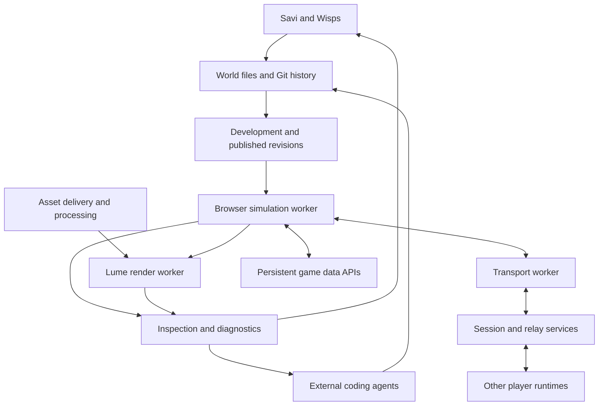

# Spawn.co: architecture and technical report

**Spawn is an integrated game platform built around a custom browser engine, an AI collaborator called Savi, editable game files, and managed multiplayer and persistence.** Its architecture is particularly relevant to your OpenAgents work because the engine, authoring format, agent tools, and live feedback are designed to operate together.

The most significant findings are:

- **The website and game engine are separate systems.** The website uses Next.js and React; games run in a separate browser runtime.
- **The current runtime has distinct workers for simulation, networking, rendering, and several expensive background tasks.**
- **Lume is Spawn’s own renderer.** The inspected browser runtime requires WebGPU.
- **Mantle is its own physics engine.** Public engineering notes describe substantial custom collision and determinism work.
- **A Spawn 6 game is a Git repository**, with structured world data and JavaScript behaviors.
- **Its documented multiplayer lineage delegates simulation to clients and elected hosts**, while relays coordinate state. That deserves close attention when comparing it with an MMO architecture.
- **The strongest product design is the feedback loop:** agents can modify the world, inspect running state, see rendered results, read useful diagnostics, and iterate.

**Research date: November 12, 2026, US Central.** I inspected official documentation, release notes, the public API specification, actual website JavaScript, and assets served by a published game.

There are three evidence levels throughout this report:

| Evidence level | Meaning |
|---|---|
| **Directly observed** | Present in the currently served HTML, JavaScript, headers, or API specification. |
| **Documented** | Stated by Spawn, without independent performance testing. |
| **Historical implementation detail** | Found in indexed first-party engineering notes, chiefly from the v5 release series. These explain the design’s evolution but do not establish that every detail remains unchanged in v6. |

Some of the most detailed engineering notes remain searchable even though the current versions of those pages show shorter, user-facing descriptions. I distinguish those carefully below.

---

## 1. What Spawn is building

Spawn combines conversational game creation, a hosted runtime, multiplayer, social discovery, and creator monetization. Creators can build 2D, 3D, and interface-driven games, and can package reusable tools or content as mods. Its stated platform model resembles Roblox: creation and distribution happen within the same environment. [Spawn](https://www.spawn.co/about/what-spawn-is?utm_source=chatgpt.com)

The company identifies **Jacob Sansbury** as its founder, describes a team of fewer than ten people and an unannounced funding round, and says the current product entered beta in February 2026 after an extended alpha. Its website explicitly warns that coverage predating February describes an earlier product. [spawn.co](https://www.spawn.co/?utm_source=chatgpt.com)

For architecture purposes, the useful distinction is between four connected layers:

1. **The platform:** accounts, discovery, social features, publishing, payments, and agent access.
2. **The authoring system:** Savi, external coding agents, editable files, history, and engine documentation.
3. **The engine:** simulation, physics, rendering, input, audio, UI, and assets.
4. **The hosted services:** session coordination, state distribution, persistence, asset processing, and delivery.

That separation matters because “what framework does the website use?” answers only a small part of how Spawn works.

---

## 2. The website stack: what I verified directly

The production website exposes unusually clear framework identifiers.

| Layer | Direct observation |
|---|---|
| Web framework | **Next.js 16.4.3** |
| Routing/application architecture | Next.js **App Router** |
| Bundling | **Turbopack** |
| UI framework | React DOM **19.3.0-canary-278794d7-20261002** |
| Website delivery | Response headers include Vercel cache/deployment identifiers and Cloudflare identifiers |
| Game surface | A separate iframe served from **`play.spawn.co`** |
| Media delivery | Public references include **`spawnfile.io`** and related media domains |

The framework versions are explicit in the [served website bundle](https://www.spawn.co/_next/static/immutable/chunks/czz6hed2px.js). The delivery findings come from the public homepage’s response headers.

**Vercel and Cloudflare are verified participants in delivery; those headers do not identify the complete backend.** They do not establish where every database, simulation host, generation job, or agent process runs.

### The game is isolated from the product shell

I inspected the published [Home by Five game page](https://www.spawn.co/@legion/home-by-five). It embeds a separate game document on `play.spawn.co`, with sandbox permissions for functions such as scripts, pointer lock, and downloads. The runtime response also carries cross-origin isolation headers.

This gives Spawn a practical boundary between:

- The surrounding website and social interface.
- The running game.
- Additional authored UI realms inside the engine.

Architecturally, this makes it easier to manage game lifecycle, permissions, failure recovery, and engine versions independently of the Next.js application. It is evidence of deliberate separation, although inspecting iframe attributes is not a security audit.

Spawn also distributes macOS, Windows, and Linux desktop applications. Its download page does not identify the wrapper technology, so I could not verify whether those use Electron or another shell. [Spawn](https://www.spawn.co/download?utm_source=chatgpt.com)

---

## 3. The current browser engine is organized around workers

This is one of the strongest findings because it is visible in the **currently served runtime**, which identifies itself as engine **6.0.0**.

Its public asset manifest names the following entry points:

| Responsibility | Shipped module |
|---|---|
| Simulation/runtime | `engine-client-runtime-worker.mjs` |
| Network transport | `engine-client-transport-worker.mjs` |
| Background jobs | `engine-client-jobs-worker.mjs` |
| Rendering | `worker-renderer.mjs` |
| GPU pipeline compilation | `worker-pipeline-compiler.mjs` |
| Material construction | `worker-material-builder.mjs` |
| Texture baking | `worker-texture-bake.mjs` |
| KTX2 decoding | `worker-ktx2-decode.mjs` |
| Animation poses | `worker-pose-lane.mjs` |
| Audio programs | `worker-audio-program.mjs` |

These are shipped components; their presence does not mean every game starts every worker.

The [runtime entry](https://play.spawn.co/v4/client/pool/6d66a223-282119ce6d920749.js) explicitly requires worker-based simulation. It also contains `OffscreenCanvas`, `ImageBitmap` presentation paths, and renderer-restart machinery intended to preserve simulation state.

### Why this design matters

A browser game has several workloads with very different timing requirements:

- Input needs a prompt response.
- Simulation needs a controlled timestep.
- Rendering needs consistent frame delivery.
- Shader compilation can be bursty.
- Texture decoding and model preparation can be expensive.
- Networking needs to keep processing while other work runs.

Putting all of those on one JavaScript event loop makes unrelated tasks interfere with one another. Spawn’s organization is designed to limit that interference.

The tradeoff is significant engineering complexity: messages between workers, resource ownership, startup sequencing, error propagation, and duplicated dependencies. Spawn’s older engineering notes even describe accidentally including renderer modules in the simulation bundle, then removing them—an example of the maintenance burden this architecture creates. [Spawn](https://www.spawn.co/about/release-5-2-15?utm_source=chatgpt.com)

### A reconstructed system map

This diagram shows logical relationships supported by the public material. It is not a complete deployment topology.

The architectural center is a **running, inspectable world**. Authoring tools and agents operate around that world rather than producing an opaque project and disappearing.

---

## 4. World representation: structured data plus scripts

Spawn’s public agent documentation gives a concrete authoring contract.

| Concern | Documented representation |
|---|---|
| World configuration | `world.config.yaml` |
| Objects | YAML records |
| Object behaviors | JavaScript modules with `update(ctx, dt)` |
| Shared gameplay rules | `tick(ctx)` in `sim.js` |
| Game HUD | HTML returned from UI scripts |
| Custom materials | Scripted materials expressed through TSL node APIs |
| Shared/object state | World and per-object state interfaces |
| Reproducible time and randomness | `ctx.now()` and `ctx.random()` |

The geometry and material vocabulary retains Three.js names, including `MeshStandardMaterial` fields. Spawn also documents built-in Three.js/TSL namespaces and engine-owned instancing APIs. [spawn.co](https://www.spawn.co/llms.txt?utm_source=chatgpt.com)

### The important architectural choice

The world has a constrained vocabulary that an agent can learn, inspect, validate, and modify.

That gives an AI system several advantages:

- A request can become a small edit to an existing object.
- Validation can point to a specific field or script.
- The engine can own networking and persistence semantics.
- Multiple editing tools can operate on the same representation.
- Compatibility can be maintained at the authoring boundary while internals change.

This is highly relevant to a custom engine. You can expose a stable world schema while retaining freedom to rewrite the renderer, physics system, or storage implementation underneath it.

### Three.js vocabulary and renderer ownership are separate questions

Using familiar geometry and material names does not establish that the current renderer is stock Three.js. Conversely, describing Lume as in-house does not establish that every supporting component was written without third-party code.

The evidence supports a custom runtime with an authoring surface that preserves useful Three.js conventions.

---

## 5. Git, live editing, publishing, and engine versions

Spawn 6 makes the game’s files and history available through Git. Authorized creators and editors can clone them. The documentation says pushes to `main` reach development rooms without a conventional creator-operated build/deployment step, usually within seconds, although larger changes can take longer. [Spawn](https://www.spawn.co/about/faq?utm_source=chatgpt.com)

The [public OpenAPI specification](https://www.spawn.co/openapi.json), which I retrieved directly, makes the version model more explicit:

- Older worlds support a whole-document game-spec API.
- Version 6 worlds use Git as the source of truth.
- Publication advances `refs/spawn/live`.
- Updates can apply to existing sessions immediately or on their next session.

### There are three different kinds of state

For understanding this architecture, keep these separate:

| State | Example | Why it needs its own semantics |
|---|---|---|
| Authored content | Terrain definitions, behavior scripts, item definitions | This is what a creator edits and versions |
| Running simulation | A moving vehicle, active projectiles, a door opening | This changes continuously during play |
| Durable player/world data | Inventory, progression, persistent construction | This must survive sessions and failures |

A Git rollback of a behavior script should not automatically erase someone’s inventory. A physics snapshot should not silently redefine the published game. An engine upgrade should not accidentally migrate unrelated player data.

Spawn’s product documentation distinguishes game history from player progress; the implementation details of all migration boundaries are not public. [Spawn](https://www.spawn.co/about/faq?utm_source=chatgpt.com)

### “No build step” is an interface property

The creator does not need to run a conventional build-and-deploy pipeline for every change. Internally, Spawn still performs work such as script processing, asset conversion, material construction, and GPU pipeline compilation—the worker manifest makes that visible.

For OpenAgents, the valuable goal is to make changes **incremental, observable, and reversible**, even when substantial processing happens behind the interface.

---

## 6. Rendering: Lume, WebGPU, materials, and assets

### What is established

Spawn introduced **Lume** in its July 10, 2026 v5.2 release, describing an in-house renderer rebuild that preserved documented custom materials and visual effects. It reported typical GPU-use reductions of **30–95%**. Those are company-reported figures; I found no reproducible scene/hardware benchmark accompanying them. [Spawn](https://www.spawn.co/about/release-5-2-0?utm_source=chatgpt.com)

Current runtime evidence corroborates the custom WebGPU path:

- The [bootstrap module](https://play.spawn.co/v4/client/pool/aabb4631-de1476cd0c59fa3b.mjs) checks for `navigator.gpu` and refuses to run the engine when it is unavailable.
- The [renderer worker](https://play.spawn.co/v4/client/pool/b01835d7-c59d4393b20aed9f.mjs) contains Lume-specific machinery and diagnostics.
- Indexed first-party documentation describes Lume as WebGPU-only. [Spawn](https://www.spawn.co/%40medivhus/almost-up?utm_source=chatgpt.com)

This requirement is verified for the inspected browser runtime. It should not be generalized to every historical version or every desktop/headless execution path.

### Rendering capabilities disclosed publicly

Release material describes:

- Dense GPU foliage.
- Multiple material styles and custom scripted materials.
- GPU-driven particles.
- Device-dependent visual quality.
- Procedural skies, day/night lighting, and shadows.
- Terrain material depth and displacement features.
- Postprocessing authored through scripts. [Spawn](https://www.spawn.co/about/release-5-2-0?utm_source=chatgpt.com)

The interesting point is the combination of expressive visuals with controls that an agent can manipulate. A high-level request such as changing the mood can map to a handful of stable parameters rather than a complete renderer rewrite.

### Particularly useful historical rendering details

The engineering notes disclose several concrete optimizations:

| Historical detail | Architectural significance |
|---|---|
| Hillaire-style atmosphere lookup textures | Expensive atmospheric work can be precomputed and reused |
| Dual Kawase bloom replacing an earlier bloom implementation | Postprocessing topology was explicitly optimized |
| Avoiding expensive multisampling combinations on high-DPI displays | Quality policy considers the cost of the actual display path |
| KTX2/Basis transcoding moved off the render worker | Texture preparation is separated from frame production |
| Incremental uploads by mip level | Large textures need not monopolize one frame |

These come from the v5 lineage; they are not a complete description of the present v6 render graph. [Spawn](https://www.spawn.co/about/release-5-0-0?utm_source=chatgpt.com)

### Asset pipeline evidence

The current manifest includes **Basis Universal transcoder JavaScript and WebAssembly**, KTX2 assets, MSDF font resources, separate material/texture workers, and content-hashed filenames. Older GLB processing notes describe normalization around KTX2/Basis textures. [Spawn](https://www.spawn.co/about/release-5-2-15?utm_source=chatgpt.com)

That points to a managed asset pipeline with preprocessing and caching. It does **not** establish that the engine core itself is a native engine compiled to WebAssembly; the publicly delivered runtime contains substantial JavaScript modules, alongside WASM helpers.

### What remains unknown about Lume

I could not verify the full current lighting architecture, occlusion strategy, GPU draw-command generation, portal recursion policy, or complete shader graph. There is enough evidence to establish serious custom rendering work, but not enough to reconstruct Lume from public materials alone.

---

## 7. Physics: Mantle

Spawn’s physics system has evolved substantially.

The June 2026 v5 release introduced **Mantle** as an optional custom deterministic engine while retaining Rapier as the default at that time. The v6 release later describes Spawn’s own physics engine as part of its new foundation. [Spawn](https://www.spawn.co/about/release-5-0-0?utm_source=chatgpt.com)

Indexed technical documentation identifies Mantle as written in **TypeScript** and claims bit-exact restoration. That is a vendor determinism claim, not something I independently tested. [Spawn](https://www.spawn.co/%40medivhus/almost-up?utm_source=chatgpt.com)

### Concrete collision-engine evidence

The v5.2.20 engineering notes describe character-controller contact generation using **GJK/EPA** against heightfield and triangle-mesh geometry.

One documented problem involved internal triangle edges producing false wall-like contact normals on apparently flat ground. The fix brought active-edge information into character contact handling and corrected normals along internal seams. [Spawn](https://www.spawn.co/about/release-5-2-20?utm_source=chatgpt.com)

That is strong evidence of custom collision-engine implementation. It also exposes the sort of detail that determines whether a physics system feels good: stable grounding, edge behavior, collision normals, and transitions between nearby surfaces.

### Why determinism would be valuable here

In a distributed simulation, deterministic behavior can help with:

- Reproducing bugs from saved state and inputs.
- Moving simulation responsibility between participants.
- Restoring a world after an interruption.
- Comparing implementations across execution environments.
- Keeping procedural generation consistent.

It does not, by itself, solve network consistency or cheating. Participants must still agree on relevant state, inputs, ordering, and authority.

I did not find a complete public specification of Mantle’s broadphase, constraint solver, continuous collision detection, supported-shape matrix, or determinism guarantees.

---

## 8. Multiplayer: the most consequential architectural choice

**The strongest public description is a client-heavy simulation system with coordinated ownership.** The exact current v6 trust model is not fully disclosed.

### Direct current evidence: binary WebSocket transport

The current [transport worker](https://play.spawn.co/v4/client/pool/c594a708-60e54527e8d93c2e.mjs) constructs sockets and sets their binary type to `arraybuffer`.

The API also describes signed session grants, pseudonymous player identities, and a socket attachment mechanism. These establish an authenticated binary socket path; they do not establish WebRTC or WebTransport usage. [Source: public OpenAPI contract](https://www.spawn.co/openapi.json).

### Historical architecture: one simulator per entity

Indexed first-party documentation describes:

- One simulator responsible for each entity.
- A player’s browser simulating its own entities.
- An elected browser holding responsibility for shared entities.
- A relay distributing updates without running gameplay simulation.
- A fixed timestep, defaulting to **30 Hz**. [spawn.co](https://www.spawn.co/%400liver/the-man-behind-the-tree?utm_source=chatgpt.com)

Related engineering notes reveal relay sequencing, group-commit fanout, acknowledgements, membership, host epochs, catch-up, and compaction. References to `cf-relay`, `relay-do.ts`, and `workerd` tests against a Durable Object strongly indicate a **Cloudflare Durable Objects implementation in that relay lineage**. [Spawn](https://www.spawn.co/about?auth=true\&utm_source=chatgpt.com)

### Fallback hosts complicate the picture

Older notes describe a container-hosting path in which the server can take responsibility for a place when clients cannot. Client election was changed to outrank the server’s fallback seat. Other notes describe Savi’s builder remaining present for an authoring session so work can continue across areas. [Spawn](https://www.spawn.co/about/release-5-2-14?utm_source=chatgpt.com)

The resulting reconstruction is:

1. Player-controlled entities can run locally.
2. Shared simulation has an assigned host.
3. Relay services coordinate and distribute state.
4. Other hosts can provide continuity when a normal client is unavailable.

The public material shows multiple deployment modes and generations. It would be inaccurate to flatten all of them into one universal architecture.

### The benefits

As an architectural inference, delegating simulation to participants can reduce central simulation costs and make locally owned movement respond immediately. It also gives a platform a natural way to support many small, intermittently occupied worlds.

### The costs

The difficult questions move to other places:

- What happens when a host tab is backgrounded?
- How is responsibility transferred without duplicated execution?
- How are simultaneous interactions resolved?
- What state must be re-established when a player reconnects?
- How much can a malicious participant influence?
- Which results require independent validation?

These are central design questions for your MMO work.

### Three kinds of authority must remain distinct

| Authority | Question |
|---|---|
| **Content authority** | Who may edit and publish the world? |
| **Simulation authority** | Who decides that a movement, collision, hit, or other event occurred? |
| **Durability authority** | Who commits a lasting inventory, progression, or ownership change? |

A relay that orders messages is not automatically validating the gameplay truth of every message. Equally, client simulation does not prove that payments trust arbitrary client reports: Spawn’s July notes explicitly describe server-stamped purchase events. [Spawn](https://www.spawn.co/about/release-5-2-5?utm_source=chatgpt.com)

**For a competitive MMO or valuable economy, I would require a precise account of those boundaries before adopting this model.**

---

## 9. World streaming, places, rooms, and portals

Spawn’s v6 announcement claims spatial streaming around the player, portals between places and worlds, and persistent player/world state. It also describes transferring carried or moving objects through portals. [Spawn](https://www.spawn.co/about/release-6-0-0?utm_source=chatgpt.com)

Its terminology distinguishes:

- **Places:** areas within a game.
- **Rooms:** separate sessions.
- **Instances:** separate copies allowing different groups to occupy equivalent content. [Spawn](https://www.spawn.co/about/faq?utm_source=chatgpt.com)

### How to interpret the scale claims

“No size limit” and “any number of people” are product claims with several possible technical meanings.

A world can have enormous total extent while each client loads only a small neighborhood. A platform can support many players by distributing them among rooms or instances. Neither establishes that thousands of mutually interacting players can occupy one tightly coupled simulation.

For evaluating MMO applicability, I would want measurements for:

| Measurement | What it would establish |
|---|---|
| Players in one interacting area | Actual local concurrency |
| Active entities per simulation owner | Simulation capacity |
| Bandwidth per client | Network cost under density |
| Ownership-transfer latency | Continuity during host changes |
| Join time versus world complexity | Streaming effectiveness |
| Tick-time percentiles | Behavior under sustained load |
| Reconnect and restoration time | Recovery quality |

The older v5 announcement discussed approximately 100-player rooms. That is historical context, not a verified current v6 cap. [Spawn](https://www.spawn.co/about/release-5-0-0?utm_source=chatgpt.com)

Portals are also more than a rendering problem: crossing them can involve identity, permissions, item semantics, ownership, and persistence. Spawn’s FAQ notes that destination rules govern what can enter. [Spawn](https://www.spawn.co/about/faq?utm_source=chatgpt.com)

---

## 10. Persistence and backend data

The public API exposes a **SQLite-compatible game-data interface**: its documented queries reference `sqlite_master`, distinguish development and live databases, and return a `limitBytes` constant of **10 GiB** for that interface. [Source: OpenAPI specification](https://www.spawn.co/openapi.json).

That is a concrete store-level contract. It does not identify the platform’s complete database estate or mean that 10 GiB is a universal limit on world extent, downloadable assets, or all game data combined.

### Assets have their own delivery path

The agent documentation describes content-addressed asset names, CDN references, and a separate upload-target flow for files too large for the normal request path. This allows larger asset transfers to avoid passing entirely through the application API. [Source: full agent documentation](https://www.spawn.co/llms-full.txt).

Architecturally, these separate concerns:

- Small authored changes.
- Large binary assets.
- Continuously changing simulation state.
- Durable player and world data.

That separation is useful for caching, failure recovery, and cost control.

### Backend details I could not establish

I could not reliably identify the complete database vendor mix, regional deployment layout, persistence transaction model, backup policy, or all compute providers.

There are Supabase-related strings in public JavaScript, but the inspected context included examples used for authentication/log handling. That is insufficient evidence to label Supabase as the current production database.

---

## 11. Savi’s architecture: the engine is part of the agent system

The current FAQ names **Claude Opus 5.5** as Savi’s default model and says providers can change. It also describes **Wisps**, helpers that work on separate parts of a build. These are Spawn’s disclosures, rather than independently verified model-routing details. [Spawn](https://www.spawn.co/about/faq?utm_source=chatgpt.com)

The deeper architectural point is that Savi has a specialized operating environment.

Public materials describe tools for:

- Reading world structure and state.
- Editing objects and scripts.
- Obtaining scene views and object previews.
- Inspecting authored HTML interfaces.
- Reading errors and performance information.
- Reporting engine problems.
- Joining and evaluating a game.

The UI inspection work is particularly revealing: it can identify rendered elements, their bounds, visibility, and input behavior, including overlays intercepting clicks. [Spawn](https://www.spawn.co/about/release-5-2-15?utm_source=chatgpt.com)

### The feedback loop is a major part of the product

My architectural reading is:

**Generate → apply → observe → diagnose → revise.**

The quality of that loop depends on what the engine tells the agent.

Consider the difference between:

- “The object is missing.”
- “The object exists in state, but its geometry has not reached rendering.”
- “Its texture is still downloading.”
- “Its asset is being generated.”
- “Its script failed at this field.”
- “The GPU device was lost.”

Those situations call for different actions. If an agent receives the same vague failure for all of them, it can waste time regenerating assets or rewriting correct scripts.

Spawn’s release notes repeatedly improve that distinction, including clearer save failures, invalid geometry names, state-value errors, and GPU diagnostics. [Spawn](https://www.spawn.co/about/release-5-2-20?utm_source=chatgpt.com)

### Runtime budgets are also part of the agent interface

The engine documents scheduled script updates, proximity-based execution, and avoiding per-tick work for event-only objects. Later releases describe pausing runaway scripts and limiting work in unoccupied multiplayer areas. [Spawn](https://www.spawn.co/about/release-5-2-5?utm_source=chatgpt.com)

This is a strong design lesson: an engine used by coding agents needs to explain **why work was reduced or stopped**, so the agent can correct the expensive behavior.

---

## 12. External agents are supported through an explicit contract

Spawn publishes:

- [Short agent documentation](https://www.spawn.co/llms.txt).
- [Full agent documentation](https://www.spawn.co/llms-full.txt).
- [An OpenAPI specification](https://www.spawn.co/openapi.json).
- Version-specific engine references.
- Git access to authorized worlds.
- A Bun-based packaged client.

The external surface includes live-room inspection, logs, health information, read-only execution, assets, and publishing. The health schema exposes tick-budget and memory information; the API distinguishes inspection from writes through Git. [Source: OpenAPI specification](https://www.spawn.co/openapi.json).

The documentation also separates unlinked agents’ compute allowances from access to subsidized inference and GPU generation. External agent accounts do not receive an unrestricted API for waking Savi. [Source: full agent documentation](https://www.spawn.co/llms-full.txt).

### Why this matters

An external coding agent can work against the same game representation without needing a bespoke editor integration for every operation.

The strongest pattern is **version-matched knowledge**: the agent should read documentation corresponding to the engine its world actually runs. Otherwise it may confidently generate valid code for the wrong API.

For OpenAgents, that pattern maps naturally to a generated reference package containing:

- The world schema.
- Supported behavior APIs.
- Examples.
- Engine capabilities.
- Known limits.
- Diagnostic meanings.
- The exact runtime version or build identity.

---

## 13. Importing games, exporting code, and platform dependence

Spawn’s import documentation is explicit: existing games are **adapted to Spawn’s engine**. Their rules, levels, controls, screens, and assets can carry over, while the original engine, networking, server, and database implementation are replaced. It names engines such as Unity, Godot, Phaser, Babylon, and Three.js as possible sources. [Spawn](https://www.spawn.co/about/bring-a-game?utm_source=chatgpt.com)

This is AI-assisted porting, so architectural compatibility depends on how well the original game’s behavior maps to Spawn’s abstractions.

On the way out:

- Authorized users can retain their game code through Git.
- A code clone does not automatically contain every referenced asset binary.
- Spawn does not provide a ready-to-run Steam export.
- Porting elsewhere requires adapting Spawn-dependent behavior. [Spawn](https://www.spawn.co/about/faq?utm_source=chatgpt.com)

I also could not verify a public reusable license for the complete engine. The documented engine-reference repository required authentication during inspection. Publicly served JavaScript and accessible documentation do not establish that the engine is available as an open-source dependency.

### Economics influence the technical boundaries

Spawn subsidizes creation to support games hosted on its platform. Its published usage rules restrict unattended use of Savi and using subsidized generation primarily for projects shipped elsewhere. [Spawn](https://www.spawn.co/about/what-spawn-is-for?utm_source=chatgpt.com)

Its November 5 monetization article describes a creator fund and a 50% creator share of player spending. However, that article and the current FAQ disagree on paid access and recurring subscriptions, so the exact availability of those features should be checked in the product. [Spawn](https://www.spawn.co/about/make-games-full-time?utm_source=chatgpt.com)

---

## 14. Engineering process and operational maturity

The founder describes a company whose agents work from accumulated records: meetings, customer feedback, playtests, decisions, and incident history. He also describes separate implementation and adversarial-review roles. These are first-party accounts of their process, not independent operational audits. [workbyjacob.com](https://www.workbyjacob.com/thoughts/written-for-readers-that-didnt-exist-yet?utm_source=chatgpt.com)

That matters because Spawn’s architecture appears to support two related loops:

1. Savi improves a creator’s game.
2. Internal engineering processes improve the platform when Savi or players expose engine failures.

The release history contains substantive work on physics, rendering, reconnects, synchronization, asset loading, and migration. It demonstrates active implementation and debugging. It does not prove that the platform has reached a particular reliability or scale threshold.

The v6 launch itself lists rough edges around vehicle smoothness, leaf-shadow cost, migration, and mobile quality selection. Those were disclosed release conditions; I did not test whether each remains present today. [Spawn](https://www.spawn.co/about/release-6-0-0?utm_source=chatgpt.com)

---

## 15. What I would take from this for OpenAgents

For your engine and metaverse work, I would study Spawn most closely in these areas.

### A. Make the world format the stable contract

Your Coax implementation can coexist with a structured authoring layer that agents understand.

The agent should be able to express objects, relationships, behaviors, assets, and persistence intent through a small, well-defined interface. The engine can then enforce and execute those semantics.

That gives you room to change implementation strategy without forcing every generated world to change.

### B. Give agents access to both state and the rendered result

An entity existing in the database does not prove that a player can see it, reach it, or interact with it.

An effective engine-agent interface should combine:

- World queries.
- Runtime logs.
- Frame captures.
- UI hit testing.
- Performance measurements.
- Input and playtesting controls.

Spawn’s public materials show sustained attention to exactly this problem.

### C. Treat diagnostics as part of the authoring API

A useful error should identify the operation, affected object or file, expected shape, actual failure, and whether retrying can help.

This is especially valuable when the “developer” is an agent. Clear diagnostics reduce speculative edits and repeated work.

### D. Separate simulation, rendering, and expensive background processing

The worker architecture is worth studying independently of their language choices.

For a browser engine, ask which work can delay interaction or frame delivery:

- Asset decoding.
- Shader construction.
- Geometry generation.
- Animation preparation.
- Large state updates.

Move work based on measured contention, while keeping the inter-worker contracts understandable and observable.

### E. Design authority deliberately for each game category

Spawn’s client-heavy lineage is attractive for responsive, inexpensive shared worlds.

For your MMO ambitions, I would separately specify authority over movement, combat outcomes, inventory, currency, ownership, and persistent construction. Some can tolerate local authority; others may require trusted validation or arbitration.

The right design depends on the consequences of a fabricated result.

### F. Pin content, runtime behavior, and documentation together

An agent’s generated code is only meaningful relative to an API version. Reproduction also benefits from an exact runtime build identity, not merely a release label.

Treat the world revision, engine build, asset identities, and matching documentation as a coherent reproducibility record.

### G. Preserve deployment choice if it is part of your differentiation

Spawn’s architecture benefits from controlling the hosted platform end to end.

If OpenAgents is intended to support self-hosting, on-prem deployments, or standalone games, define those boundaries early. A portable world format is only one part of portability; multiplayer, storage, assets, identity, and payments also need replaceable interfaces.

---

## Overall assessment

**Spawn is a serious reference implementation for an engine designed to be operated by AI agents.** The public evidence shows a substantial browser runtime, custom rendering and physics work, explicit agent integration, live versioned worlds, and detailed operational feedback.

Its most valuable architectural idea is the relationship between those pieces: **the world is editable, the running result is inspectable, and the agent can connect a requested change to what players actually experience.**

For OpenAgents, I would prioritize that authoring-and-feedback architecture as a reference. I would evaluate its multiplayer ownership model separately against your requirements for trust, persistence, deployment freedom, and dense MMO interactions.

