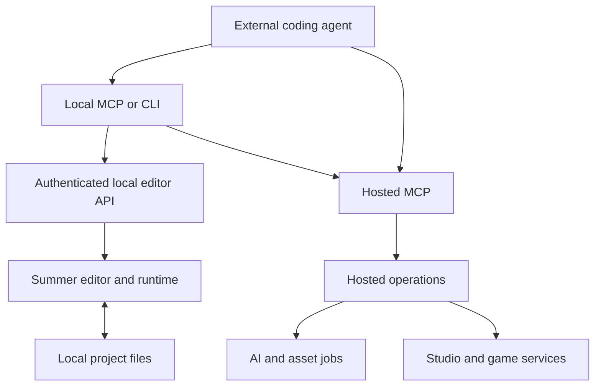

# Summer Engine: architecture and technical assessment

**Summer Engine is a Godot-derived desktop game engine, an agent integration layer, and a hosted game-development platform.** Its most distinctive engineering is in how agents discover operations, modify projects, inspect the running game, generate assets, and carry work through to publication.

Compared with Spawn, Summer starts from a different foundation: **a conventional scene-based engine and local project files**, extended with agent automation and managed services. Spawn’s architecture centers more directly on live browser worlds. Summer’s legal notices explicitly establish its Godot 4 lineage, while its public repository exposes the MCP/CLI integration rather than the native engine implementation. [Summer Engine](https://www.summerengine.com/legal/third-party-notices?utm_source=chatgpt.com) [Public repository architecture](https://github.com/SummerEngine/summer/blob/5d0bc70c6228a2f718485913449f20482434b47b/docs/DEVELOPMENT.md).

My assessment is that **Summer is particularly worth studying as an agent execution and verification architecture**. Its interfaces go substantially beyond “ask an LLM to write GDScript.” The public evidence is less conclusive about autonomous game quality, production multiplayer scale, and the implementation of its proprietary engine changes.

**Research scope:** public documentation, the article you linked, legal infrastructure disclosures, delivered website JavaScript, and the public source repository, checked November 13, 2026. I inspected `summer-engine` **4.9.2**, commit **5d0bc70**. The desktop engine has separate versioning; the current changelog lists **0.8.6**, released November 12. I did not install the engine or run a hosted-game benchmark. [Summer Engine](https://www.summerengine.com/changelog?utm_source=chatgpt.com) [Package snapshot](https://github.com/SummerEngine/summer/blob/5d0bc70c6228a2f718485913449f20482434b47b/package.json).

---

## 1. The overall architecture

There are several products under the Summer name, and separating them makes the architecture easier to understand.

| Component | Architectural role |
|---|---|
| **Summer Engine** | Native editor, scene system, scripting, rendering, physics, imports, and game execution |
| **Local MCP/CLI package** | Gives external coding agents structured access to the editor and hosted operations |
| **Summer’s built-in agent** | Hosted development assistant that plans, delegates, edits, and verifies |
| **Summer Studio** | Web workspace for assets, planning, teams, and game operations |
| **Summer API** | Asset-generation jobs with model schemas, estimates, queues, and downloadable results |
| **Summer Games** | Distribution, player identity, multiplayer, persistence, and platform services |
| **Summer Router** | AI used by players inside a shipped game |

These boundaries are visible across Summer’s source-status page, API documentation, and runtime-AI reference. The native editor, public agent package, and hosted services have different licensing and execution environments. [summerengine.com](https://www.summerengine.com/source-status?utm_source=chatgpt.com)

The external-agent path can be reconstructed fairly precisely:

The local and hosted connections serve different purposes. The hosted MCP does not, by itself, provide access to an arbitrary desktop editor. The local package discovers and authenticates to a running editor; after cloud sign-in, it can also invoke hosted operations. This separation is explicit in the [repository README](https://github.com/SummerEngine/summer/blob/5d0bc70c6228a2f718485913449f20482434b47b/README.md) and [local API client](https://github.com/SummerEngine/summer/blob/5d0bc70c6228a2f718485913449f20482434b47b/src/core/api-client.ts).

**Architectural implication:** Summer combines local execution with cloud intelligence and services. Calling it simply a browser game generator would miss most of the system.

---

## 2. Website and backend infrastructure

### The website frontend

Inspection of the JavaScript actually delivered by `summerengine.com` identified:

- **Next.js 16.4.3**, using the App Router.
- **React 19.3.0 canary**, with the version string `19.3.0-canary-278794d7-20261002`.
- **Turbopack** bundles.
- Vercel delivery headers, including Next.js prerender and Vercel cache metadata.

These are deployment fingerprints from the inspected build, rather than an inferred stack from the page’s appearance. The version strings appear in its [Next.js bundle](https://www.summerengine.com/_next/static/immutable/chunks/3ro11ixl4qy-a.js) and [React/framework bundle](https://www.summerengine.com/_next/static/immutable/chunks/1mtwmdwx4ug-2.js).

This identifies the **website application**. It says nothing by itself about the technology rendering a Summer game.

### The hosted infrastructure is unusually well disclosed

Summer publishes a provider register that identifies substantial parts of its infrastructure:

| Responsibility | Disclosed providers |
|---|---|
| Website, API, scheduled jobs, uploads | **Vercel**, including Blob |
| Account database and authentication | **Supabase** |
| Background workers | **Railway** |
| Queues, caching, rate limits | **Upstash** |
| Asset storage and media processing | **Cloudflare R2**, **Cloudinary** |
| AI retrieval index | **turbopuffer** |
| Terrain and animation GPU workloads | **Modal** |
| Model routing | **Vercel AI Gateway**, with some direct/alternative routes |
| Asset generation | **fal**, **ElevenLabs** |
| Agent research and Board voice | **Exa**, **Context7**, **LiveKit** |
| Summer Games platform and game servers | **AWS**, including CloudFront delivery |
| Product analytics and errors | **PostHog**, **Sentry** |

The register also distinguishes the creator platform from Summer Games and provides some hosting regions. [Summer Engine](https://www.summerengine.com/legal/subprocessors?utm_source=chatgpt.com)

**My interpretation:** this is a broad service composition. Summer supplies the product workflow, engine integration, identity, budgeting, and operation semantics across several specialized providers.

The disclosures do **not** reveal the complete internal topology. They do not establish which AWS compute service runs a match, how database tables are structured, how workers are scheduled, or how failure recovery works. Assigning Kubernetes, ECS, a particular event bus, or a specific database replication design would go beyond the evidence.

---

## 3. The game engine itself

### Godot lineage and project representation

The strongest technical description is **a proprietary Godot-derived engine/editor**. Summer’s notices explicitly describe a derived work of Godot Engine 4. Its extension documentation names **Godot 4.7.2-stable** as the current upstream technical base. [Summer Engine](https://www.summerengine.com/legal/third-party-notices?utm_source=chatgpt.com)

Its projects retain familiar Godot structures:

- `project.godot` configuration.
- `.tscn` scenes and `.tres` resources.
- Scene trees, nodes, resources, signals, and attached scripts.
- GDScript workflows.
- Native extension interfaces.

The public tooling locates projects through `project.godot`, and its verification harness checks both live scene snapshots and saved `.tscn` files. These formats are operational parts of the architecture, rather than an export compatibility claim. [Project discovery](https://github.com/SummerEngine/summer/blob/5d0bc70c6228a2f718485913449f20482434b47b/src/core/engine.ts), [outcome verification](https://github.com/SummerEngine/summer/blob/5d0bc70c6228a2f718485913449f20482434b47b/evals/outcomes/README.md).

This is a useful foundation for agents: the project has a durable, inspectable representation outside the chat. An agent can examine a scene, modify its script, save the result, and compare the on-disk artifact with the running game.

### Rendering and physics

Summer inherits a substantial engine substrate. Its third-party inventory includes Godot Physics, Jolt, navigation and geometry libraries, and graphics infrastructure. However, a dependency inventory does not establish the current default physics backend or the exact renderer selected on every target. [Summer Engine](https://www.summerengine.com/legal/third-party-notices?utm_source=chatgpt.com)

I would therefore separate:

- **Established:** a Godot-family scene/runtime architecture and documented Summer-specific additions.
- **Not independently established:** the private engine diff, performance improvements, backend defaults, or the quality of every modified subsystem.

### Native extensions require version-specific testing

Summer’s GDExtension guidance recommends generating the extension interface and API description from the **installed Summer binary**, compiling against that interface, and testing each target.

It also warns that detailed ABI measurements on the page came from an older binary. Those measurements should not be treated as current compatibility proof. [Summer Engine](https://docs.summerengine.com/extending/gdextension?utm_source=chatgpt.com)

The practical implication is that ordinary project files offer useful portability, while precompiled native plugins and Summer-specific APIs introduce additional compatibility work.

### The browser export is a significant customization

Summer’s current documented exporter uses:

- A **custom WebGPU web template**.
- Forward+ or Mobile renderer projects.
- Threads disabled in the documented export path.
- A ZIP with `index.html` at its root.

The exporter refuses Compatibility-renderer projects and instructs users to install Summer’s templates rather than the editor’s stock template download. [Summer Engine](https://docs.summerengine.com/quickstarts/web-game?utm_source=chatgpt.com)

That is an important departure from assuming a conventional stock-Godot browser export. Summer’s documentation also identifies a separate path for hosting manually uploaded stock Godot web builds; those should not be confused with Summer-generated WebGPU builds. [Summer Engine](https://docs.summerengine.com/publishing/export?utm_source=chatgpt.com)

**Assessment:** the browser target represents actual runtime/export engineering. Public documentation still leaves browser compatibility, payload size, startup time, and sustained performance to be measured.

---

## 4. How an external agent controls the engine

### The local bridge

The public package is TypeScript running on Node.js, with the MCP SDK, Commander, Zod, and YAML among its dependencies. The inspected release requires **Node 22 or later**. [Package definition](https://github.com/SummerEngine/summer/blob/5d0bc70c6228a2f718485913449f20482434b47b/package.json).

The execution path is:

1. A coding agent invokes an MCP tool or CLI command.
2. The package selects the appropriate running editor.
3. It sends an authenticated request to a local HTTP API.
4. The engine executes the operation.
5. The package returns results, errors, events, or a pending-operation receipt.

The client uses `127.0.0.1`, bearer authentication, `POST /api/ops`, result polling, and an event-polling interface. [API client implementation](https://github.com/SummerEngine/summer/blob/5d0bc70c6228a2f718485913449f20482434b47b/src/core/api-client.ts).

### Project identity is a real concern in the design

Editor discovery uses per-instance records. Selection can depend on the current project directory or an explicit instance/project choice.

Requests also carry project identity information. File mutations require a complete bound identity, and the client detects a mismatch when the editor’s current project changes. [Discovery implementation](https://github.com/SummerEngine/summer/blob/5d0bc70c6228a2f718485913449f20482434b47b/src/core/engine.ts), [identity checks](https://github.com/SummerEngine/summer/blob/5d0bc70c6228a2f718485913449f20482434b47b/src/core/api-client.ts).

This is a strong design choice. When several editors or projects are open, a successful operation against the wrong project is a more serious failure than a cleanly rejected request.

### The agent can observe execution

The integration exposes scene editing, scripts, run/debug operations, screenshots, runtime input, and inspection/probe capabilities. Summer explicitly states that the engine tools require its desktop engine; cloud asset operations can be useful independently. [Summer Engine](https://www.summerengine.com/godot-mcp?utm_source=chatgpt.com)

That supports a meaningful development loop:

**inspect → edit → execute → observe → correct.**

The quality of the agent depends on all five stages. Code generation alone cannot establish that a camera sees the player, a collision shape is attached, or an input actually triggers the expected animation.

### Hosted authentication is separate

The cloud client uses MCP Streamable HTTP. Its authentication implementation uses an authorization-code flow with PKCE and a loopback redirect; source comments identify Supabase as the authorization server. [Hosted transport](https://github.com/SummerEngine/summer/blob/5d0bc70c6228a2f718485913449f20482434b47b/src/core/hosted-mcp.ts), [OAuth implementation](https://github.com/SummerEngine/summer/blob/5d0bc70c6228a2f718485913449f20482434b47b/src/core/oauth.ts).

---

## 5. Assessment of the MCP design

The article you linked is useful because it discusses interface design, measurements, and failures. The public code makes it possible to assess several of those choices directly.

### A. A shared operation vocabulary

Summer represents actions as named operations, with metadata such as:

- Input and output schemas.
- Provider: local, engine, or cloud.
- Effect classification.
- Approval requirements.
- Examples.
- Standard results and errors.

Names such as `games.list` provide a vocabulary that can be presented through MCP and CLI adapters. The effect types distinguish reads, writes, spending, publishing, player-facing changes, and destructive work. [Operation contract](https://github.com/SummerEngine/summer/blob/5d0bc70c6228a2f718485913449f20482434b47b/src/core/ops/contract.ts).

**Why this matters:** the semantic operation becomes the stable integration point. A new agent client should not require inventing a new meaning for “publish this game” or a different error model.

There is an implementation caveat: the development documentation says many legacy handlers still have handwritten schemas and mirrored CLI dispatch. Newer capabilities share more implementation, while parity tests limit drift. The “one definition everywhere” architecture remains partially consolidated. [Development notes](https://github.com/SummerEngine/summer/blob/5d0bc70c6228a2f718485913449f20482434b47b/docs/DEVELOPMENT.md).

### B. Discover operations before loading every schema

The v4 interface combines common directly exposed tools with:

- `summer_search`: find relevant operations and their schemas.
- `summer_call`: execute a selected operation.

The inspected shipped catalog contains **305 cloud entries and 91 local entries**. That is a count of catalog records at this commit, not proof that 396 operations are simultaneously available to every account or profile. [Catalog](https://github.com/SummerEngine/summer/blob/5d0bc70c6228a2f718485913449f20482434b47b/registry/operations/public-catalog.json), [surface implementation](https://github.com/SummerEngine/summer/blob/5d0bc70c6228a2f718485913449f20482434b47b/src/mcp/ops-surface.ts).

The benefit is straightforward: an agent can retrieve the relevant schema when it needs it, reducing the amount of unrelated tool information in context.

The tradeoff is also straightforward: **operation search becomes part of the correctness path**. If discovery fails, an available capability may effectively disappear from the agent’s perspective.

### C. Operation search is deterministic lexical retrieval

The public implementation does not use an LLM or embeddings for operation ranking. It uses tokens, stemming, synonyms, prefixes, inverse-document-frequency weighting, and field-specific scores.

For example, action words receive more weight than summaries. There are also coverage, phrase, and exact-name bonuses. [Search implementation](https://github.com/SummerEngine/summer/blob/5d0bc70c6228a2f718485913449f20482434b47b/src/core/ops/search.ts).

I think this is a reasonable choice for a controlled operation vocabulary:

- Results are reproducible.
- Failures can become regression cases.
- Naming and metadata improvements are observable.
- Search does not require another model call.

It should be distinguished from Summer’s separate semantic search over project content.

### D. The token results are client-dependent

The article reports these first-model-call input-token measurements:

| Client configuration | Earlier version | v4 | Reduction |
|---|---:|---:|---:|
| npm, eager loading of all tools | 147,366 | 64,747 | 56% |
| Hosted, eager loading of all tools | 43,062 | 12,915 | 70% |
| npm, Claude Code | 7,501 | 5,938 | 21% |
| npm, Codex CLI | 13,161 | 13,161 | 0% |

These were single measurements of initial context loading. Against a manually tuned earlier configuration, the article reports an 8% reduction. The benefit therefore depends heavily on what the client already defers. [Summer Engine](https://www.summerengine.com/blog/designing-an-mcp-server-for-ai-agents?utm_source=chatgpt.com)

My conclusion is that search/call offers **catalog scalability and reduced manual tool selection**. A blanket claim of 70% cheaper game development would not follow from these measurements.

### E. Responses describe execution state

The operation contract distinguishes completion, running jobs, required approval, dry-run results, and structured failure. Errors include retry guidance rather than merely a message string. [Response contract](https://github.com/SummerEngine/summer/blob/5d0bc70c6228a2f718485913449f20482434b47b/src/core/ops/contract.ts).

This matters particularly for uncertain outcomes. A timeout can mean either:

- The request never reached execution.
- The action executed but its response was lost.

Those require different recovery behavior. Summer’s cloud adapter represents this distinction and uses idempotency keys where supported. [Cloud adapter](https://github.com/SummerEngine/summer/blob/5d0bc70c6228a2f718485913449f20482434b47b/src/core/ops/cloud.ts).

### F. Dry runs have provider-specific limits

A concrete finding from the code: **the audited local `summer_call` dry-run path validates the input schema without contacting the engine**.

It returns a preview with `changes: []`, `estimate: null`, and `valid: true`. That establishes schema validity, but it does not establish that a target node exists or calculate the actual scene change. [Local execution path](https://github.com/SummerEngine/summer/blob/5d0bc70c6228a2f718485913449f20482434b47b/src/mcp/ops-surface.ts).

Similarly, the local path does not implement the cloud path’s key-based deduplication.

**Assessment:** the shared contract is valuable, but callers need to understand how strongly each provider implements it.

### G. Approval policy is still evolving

Summer documents six permission groups and structured approval flows. Its current permission documentation also says some switches are not yet editable and that several store operations still require explicit approval. [Summer Engine](https://docs.summerengine.com/mcp/permissions?utm_source=chatgpt.com)

The correct architectural reading is that Summer has an explicit permission model, with some rollout differences between the contract, UI, and service-specific enforcement.

---

## 6. The built-in AI: orchestration, memory, and retrieval

### Multi-agent development

Summer describes a main planning agent with specialists for research, construction, asset creation, verification, and advice. Specialists can work concurrently with focused contexts and return results to the main agent.

The documented builder handles scripts, scenes, input bindings, and compile checks; the verifier inspects scene, script, and runtime behavior. Model assignments are intentionally changeable. [Summer Engine](https://docs.summerengine.com/ai-tools/subagents?utm_source=chatgpt.com)

This is a plausible division of labor. The difficult engineering questions lie underneath it: how conflicting edits are resolved, when a verifier’s failure blocks completion, and how shared project state remains consistent. The proprietary orchestration implementation is not publicly available to inspect.

### Three different forms of context

Summer distinguishes:

| Context | Purpose |
|---|---|
| **Project memory** | Persistent decisions such as art direction, mechanics, and naming rules |
| **Skills** | Repeatable procedures for building things |
| **Project intelligence** | Retrieval over what is currently in the files |

The memory documentation describes project-specific notes that carry into new chats, rather than treating every previous conversation as automatically available context. [Summer Engine](https://docs.summerengine.com/ai-tools/memory?utm_source=chatgpt.com)

Project intelligence indexes text content in chunks, indexes binary assets through paths and metadata, maintains file fingerprints, and updates changed content. It also supplies a compact project map. Exact modifications still rely on direct reads and scene inspection; the documentation says stale edits are refused when files have changed since being read. [Summer Engine](https://docs.summerengine.com/ai-tools/rag-search?utm_source=chatgpt.com)

That combination is stronger than relying exclusively on semantic retrieval. Retrieval can locate relevant material; fresh reads establish the actual content being modified.

### Local projects still have cloud data paths

Summer’s security documentation says prompts and selected project content reach its API and model providers. Project indexing sends source chunks, metadata, and embeddings to its retrieval infrastructure. [Summer Engine](https://docs.summerengine.com/security/overview?utm_source=chatgpt.com)

Consequently, “the editor is local” does not mean the built-in AI operates entirely locally. That distinction matters when evaluating offline operation, organizational data requirements, or the feasibility of replacing Summer’s hosted intelligence.

---

## 7. Asset generation and AI inside shipped games

### The asset pipeline

Summer’s API presents generation as a common job workflow:

1. Discover the model and input schema.
2. Obtain an estimate.
3. Submit a job with an idempotency key.
4. Receive completion or a queued/running job.
5. Follow it through polling, server-sent events, or a signed webhook.
6. Retrieve asset IDs and files.

The documentation says jobs become `done` after their files reach Summer storage. It also records the concrete model used when a default alias was requested. Accepted generation jobs currently cannot be cancelled, and private asset-library listings can contain file URLs downloadable without sign-in. [Summer Engine](https://docs.summerengine.com/api/jobs?utm_source=chatgpt.com)

**Assessment:** the useful engineering is in normalizing model access, pricing, lifecycle, storage, and engine import. The disclosed providers support a model-orchestration interpretation; they do not establish that Summer trains its own general image, audio, or language foundation models.

### Summer Router is a separate runtime subsystem

Router provides AI while the game is being played: character replies and tool calls, voice lines, and images. Credentials, character configuration, model selection, and spending caps remain hosted.

The documented interfaces differ by execution context:

- Single-player: `Summer.client.router`.
- Multiplayer: `Summer.authority.router`, associated with a player session.

The current documentation describes an early preview for Summer Games, built into engine 0.8 and later. Calls from the editor and Local Play return `unavailable`, so games need fallback behavior. Wider storefront support is described as forthcoming. [Summer Engine](https://docs.summerengine.com/router/overview?utm_source=chatgpt.com)

This creates an additional platform dependency for games using live AI. Generated scripts or downloaded art are durable project assets; live model responses require a continuing service.

---

## 8. Multiplayer: meaningful structure, with an important movement distinction

### Dedicated authority

The current managed architecture uses a dedicated authority/server for a match or world. A project has separate client and authority responsibilities:

- Client: input, camera, presentation, and local player movement.
- Authority: shared rules, accepted state, results, and validation.

The integration includes network-world and spawner nodes, verified sessions, and separate entry scenes. [Summer Engine](https://docs.summerengine.com/build/multiplayer?utm_source=chatgpt.com)

This is a materially different architecture from simply assigning one player as host.

### Player movement runs on the client

The public movement implementation is unusually explicit:

- The owning client runs its movement controller, gravity, jumping, and collision.
- It publishes changed poses at approximately **20 Hz**.
- The authority checks submitted poses.
- Rejected movement corrects the owner to the accepted position.
- Other clients interpolate accepted poses approximately **100 ms behind**.

The sample validation checks identity, finite values, bounds, and a movement-distance allowance. It does not re-simulate the complete controller and collision trajectory on the server. [Summer Engine](https://docs.summerengine.com/skills/multiplayer-movement?utm_source=chatgpt.com)

**My assessment:** this favors immediate local response and simpler remote presentation. Its resistance to invalid movement depends on the acceptance policy. Dedicated servers and verified identities are useful foundations, but they do not automatically establish authoritative physical simulation or comprehensive cheat prevention.

### Persistence has explicit consistency mechanisms

World persistence exposes revision-based save operations, restore gating, runtime/save receipts, and a documented **16 MiB** save-payload limit. The API requires periodic saving because a crashed process cannot perform a final-save callback. [Summer Engine](https://docs.summerengine.com/api-reference/gdscript/authority/world?utm_source=chatgpt.com)

Persistent worlds can sleep and later restore. Existing private worlds retain the version they started with when a new game version is published. [Summer Engine](https://docs.summerengine.com/build/persistent-worlds?utm_source=chatgpt.com)

That version policy protects continuity, but introduces a practical migration problem: developers may need to support several world/save versions simultaneously.

### Browser support and scale need careful reading

Summer’s October multiplayer guide excludes its managed multiplayer from browser builds. Its documentation also exposes large configurable admission limits, while Local Play has a smaller documented limit. These are configuration and product constraints, not production throughput measurements. [Summer Engine](https://www.summerengine.com/blog/make-a-multiplayer-game-with-ai?utm_source=chatgpt.com)

I found no public benchmark establishing real-time performance at the maximum configuration, nor enough information to identify the managed wire protocol, tick scheduling, or server orchestration implementation.

For a browser multiplayer project, **web export availability and managed multiplayer availability must be evaluated separately**.

---

## 9. Export architecture, ownership, and platform dependence

### Summer Games bundles separate content from the runtime

The documented `summer.bundle.v1` format includes a manifest, client pack, and optional server pack. The Summer Games application supplies the runtime.

The export system also uses declared source domains to exclude authority-only roots from the client package. This is a useful deployment boundary: server-only code can be kept out of what players download. [Summer Engine](https://docs.summerengine.com/publishing/export?utm_source=chatgpt.com)

Summer also documents web ZIPs and standalone desktop exports. These are different artifacts with different runtime and service assumptions.

### Open tooling does not mean an open platform

The source-status page distinguishes:

- MIT-licensed CLI, MCP, skills, and integrations.
- A free-to-use proprietary desktop engine.
- Proprietary hosted intelligence and platform services.
- Hosted services that are not currently self-hostable. [summerengine.com](https://www.summerengine.com/source-status?utm_source=chatgpt.com)

The runtime license permits commercial exported games without a runtime royalty or per-install charge, subject to its conditions. It also separates the embedded runtime from hosted platform services and restricts standalone extraction or redistribution of proprietary runtime modules. [Summer Engine](https://www.summerengine.com/legal/runtime-license?utm_source=chatgpt.com)

There are therefore several independent portability questions:

1. Can you retain and edit the project files?
2. Can you distribute an exported executable?
3. Can you replace the agent integration?
4. Can you replace multiplayer, identity, or runtime AI?
5. Can you rebuild or modify Summer’s engine implementation?

Summer provides different answers at each layer. Exportability is valuable, but it does not make every service dependency replaceable.

---

## 10. How convincing is the testing evidence?

### The MCP article tests interface behavior

The article describes **168 sessions** across two clients, four setups, seven tasks, and three repetitions. Account and editor interactions used fixtures. Both v4 and the tuned older setup completed the selected tasks; v4 incurred four bad initial calls, versus none for the tuned baseline. [Summer Engine](https://www.summerengine.com/blog/designing-an-mcp-server-for-ai-agents?utm_source=chatgpt.com)

That is evidence about tool discovery and interaction behavior. It is not a benchmark of agents independently building arbitrary working games.

### The repository has a broader verification system

The public evaluation documentation distinguishes several levels:

| Evaluation family | Documented maturity |
|---|---|
| Retrieval/routing | Running regression evaluation |
| Tool/schema parity | Automated checks |
| Skill behavior | Partly manual, with gaps and stubs |
| Example execution | Incomplete runner |
| Whole-game construction ladder | Designed; runner still planned |
| Model driving a real editor | Manual harness |
| Outcome checks | Implemented recorded-trajectory replay |

These distinctions are stated in the [evaluation map](https://github.com/SummerEngine/summer/blob/5d0bc70c6228a2f718485913449f20482434b47b/evals/README.md).

### The outcome checks are worth studying

The outcome harness replays operations into fresh engine fixtures, then checks:

- Live scene snapshots.
- Saved project files.
- Runtime errors.
- Gameplay probes.
- Whether deliberately broken variants fail the intended assertion.

A test can therefore catch “the object exists in memory but was never saved” or “the platform is visible but has no collision.” The current replay mode does not include a fresh reasoning model or visual-model judge. [Outcome harness](https://github.com/SummerEngine/summer/blob/5d0bc70c6228a2f718485913449f20482434b47b/evals/outcomes/README.md).

The screenshot interface also records conditions such as synthetic-camera use and project mismatch. This helps distinguish a convenient preview from evidence of actual gameplay. [Screenshot receipts](https://github.com/SummerEngine/summer/blob/5d0bc70c6228a2f718485913449f20482434b47b/src/core/api-client.ts).

### Headless execution has limits

Summer documents headless scripting for simulation, imports, resource work, and export. Its headless guide also explains that the dummy renderer cannot produce rendered screenshots. Visual verification requires a rendering environment. [Summer Engine](https://docs.summerengine.com/automation/headless?utm_source=chatgpt.com)

A newer public headless-worker routing path exists, but is explicitly opt-in and disabled by default. It should not be mistaken for the universal execution path. [Headless routing design](https://github.com/SummerEngine/summer/blob/5d0bc70c6228a2f718485913449f20482434b47b/docs/HEADLESS_ROUTING.md).

**Assessment:** Summer demonstrates serious attention to verification. The public evidence supports individual interface and execution guarantees more strongly than a universal autonomous-game-development success rate.

---

## 11. Comparison with Spawn

The main architectural distinction is where each system places its center of gravity.

| Dimension | Summer | Spawn |
|---|---|---|
| Core representation | Godot-family project, scenes, resources, scripts | Git-backed world tree with YAML and JavaScript |
| Runtime foundation | Native Godot-derived engine with custom export paths | Custom browser-oriented runtime |
| Browser rendering | Summer WebGPU export template | Lume WebGPU renderer |
| Agent integration emphasis | Editor operations, MCP/CLI, asset jobs, publishing | World edits, live-room inspection, browser-world execution |
| Typical workflow emphasis | Build a project, test it, export or publish | Edit a world and deliver changes into live rooms |
| Useful architecture lesson | Structured execution and verification across many capabilities | Direct connection between world files and running environments |

Spawn’s current public descriptions support the Git/YAML/JavaScript world model, live delivery, Lume, and live-room agent interfaces. [Spawn](https://www.spawn.co/%40legion/home-by-five?utm_source=chatgpt.com) Summer’s side follows from the engine, bridge, and export sources discussed above.

**For a conventional game-development tool with native exports, Summer is the closer architectural reference. For a browser world that agents continuously inhabit and modify, Spawn is the closer reference.**

Neither comparison establishes which produces better games. That would require equivalent tasks, runtime testing, and measurements.

---

## 12. Design lessons worth borrowing

### 1. Make domain operations the durable interface

The useful abstraction is the operation—its input, effect, result, and recovery behavior. MCP, CLI, and web UI can then expose consistent semantics.

Summer’s partial legacy duplication also shows the maintenance cost when adapters drift into separate implementations.

### 2. Bind mutations to a concrete project and state

Project identity, fresh reads, and stale-edit rejection address failures that generic code-generation demos often miss.

An agent should be able to answer: **which project, which version of the file, and which running process did this action affect?**

### 3. Treat observation as part of the product

A useful engine agent needs runtime state, errors, inputs, screenshots, and persisted-file checks. Each provides different evidence.

For example, a screenshot can show a platform; a physics probe can establish that the player lands on it; a saved-scene check can establish that the platform survives reopening.

### 4. Give uncertain outcomes a first-class representation

A lost response after a paid generation or publish request requires explicit recovery semantics. Stable job IDs, idempotency keys, and an `outcome_unknown` state help prevent an agent from blindly repeating an action.

### 5. State how strong a dry run actually is

I would distinguish four levels in an agent platform:

1. Schema validation.
2. Validation against current targets and permissions.
3. Calculation of the expected changes.
4. Execution in an isolated, disposable environment.

Summer’s local implementation demonstrates why a single `dryRun` label can otherwise suggest more assurance than it delivers.

### 6. Evaluate separate sources of failure

Keep separate measurements for:

- Discovery quality.
- Tool execution.
- Runtime correctness.
- Persistence.
- Visual quality.
- Agent planning and recovery.
- Honest reporting of incomplete work.

A system can improve one while regressing another. Summer’s evaluation structure makes that separation visible.

---

## Overall assessment

**Summer’s strongest public contribution is the engineering around making a substantial game engine operable by agents.** The operation catalog, local project binding, runtime inspection, structured job lifecycle, and outcome-testing machinery are all meaningful.

The architecture also carries real complexity: a proprietary engine fork, multiple cloud services, native and browser export paths, managed multiplayer, and a separate runtime-AI system. The public documents reveal enough to understand the functional boundaries, but not enough to verify production performance or the internals of the private services.

I would describe Summer as:

> **A Godot-derived game-development platform with an unusually explicit agent control layer, substantial hosted asset and game services, and promising verification infrastructure whose guarantees still vary by subsystem.**

For architectural study, I would prioritize its **operation contract, local editor bridge, project identity checks, and outcome harness**. For adoption, the decisive evidence would be a representative project that exercises the intended export target, multiplayer model, and agent workflow end to end.

