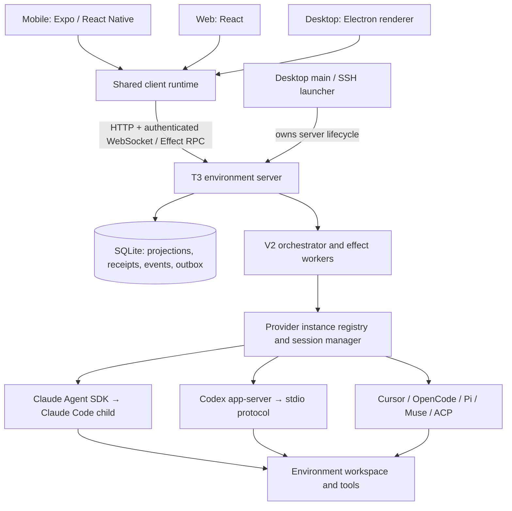

# T3 Code: coding-agent connection audit

Audited 2026-11-13. Source: the local checkout at
`~/work/projects/repos/t3code`, upstream
[`pingdotgg/t3code`](https://github.com/pingdotgg/t3code), pinned to
[`f313d0a6cb843551fb60e57a454a71e71a3a8c04`](https://github.com/pingdotgg/t3code/commit/f313d0a6cb843551fb60e57a454a71e71a3a8c04).
That revision identifies the server and desktop packages as `0.1.9`. This audit
describes that source tree, not every published T3 app or a running deployment.

## Main finding

T3 Code is a client/server control plane for coding agents. Its mobile app does
not install Claude Code or Codex on the phone. The apps connect to a T3
**environment server**, which owns the workspace, provider credentials, agent
processes, tools and durable conversation state. The server translates each
agent's native protocol into a common orchestration model. Mobile, web and the
desktop renderer consume that model through authenticated HTTP and WebSocket
RPC.

Claude Code runs through the Claude Agent SDK and a managed Claude Code child
process. Codex runs through a spawned `codex app-server` with bidirectional
JSON messages over stdio. Other drivers use Cursor's local Agent SDK, OpenCode
HTTP/event streams, Pi's JSON RPC, Muse's MSP SDK, and ACP agent processes.
Neither a terminal screen scrape nor a common model-completion endpoint is the
central integration.

The arrows between apps and T3 are different protocols and trust boundaries
from the arrows between T3 and an agent. Keeping that distinction is essential
when adapting this design to Coax Native.

## Reading order

1. [Apps, routes and the connection protocol](01-apps-and-connections.md): what
   runs on each device; direct pairing, SSH, Tailscale and T3 Connect; reconnects
   and synchronization.
2. [The orchestration and persistence model](02-orchestration.md): a complete
   message round trip, durable commands, events, session ownership, approvals,
   recovery, handoffs and checkpoints.
3. [Claude Code integration](03-claude-code.md): SDK/process boundary,
   configuration, authentication, streaming, permission callbacks and native
   conversation operations.
4. [Codex integration](04-codex.md): app-server handshake, thread/turn routing,
   approvals, questions, subagents, native state and managed ChatGPT login.
5. [Other providers and the extension boundary](05-other-providers.md): every
   built-in driver, its transport, ownership model and important differences.
6. [Security, failures and evidence limits](06-security-and-reliability.md):
   credential audiences, filesystem authority, logs, maintenance and test evidence.
7. [What to adapt for OpenAgents and Coax Native](07-openagents-path.md):
   conclusions and a proposed implementation sequence, explicitly separate from
   verified T3 behavior.
8. [Source map and audit method](08-source-map.md): pinned entry points,
   dependency versions, verification scope and reproducibility.

## Scope and confidence

This is a source audit of the execution path and its surrounding control plane.
It includes client transport, remote access, provider discovery/authentication,
process startup, message streaming, tools, requests for human input, cancellation,
background work, conversation continuity, durability and diagnostics. UI styling,
voice/media internals, source-control providers and cloud billing are covered
only where they affect that path.

Claims link to pinned upstream code or upstream architecture notes. Source
declarations of capability are distinguished from guarantees verified at runtime.
Tests and replay fixtures were inspected; **no T3 scripts, binaries, installs,
tests, agent sessions or authenticated services were run**. This audit does not
certify sandbox strength, current account entitlements, production deployment
configuration or the behavior of a different provider version. No credential
files were opened. Current OpenAI documentation is used only to clarify the
app-server protocol, not to infer what this T3 revision implements.

The common source starting points are the
[built-in registry](https://github.com/pingdotgg/t3code/blob/f313d0a6cb843551fb60e57a454a71e71a3a8c04/apps/server/src/provider/builtInDrivers.ts),
[RPC session](https://github.com/pingdotgg/t3code/blob/f313d0a6cb843551fb60e57a454a71e71a3a8c04/packages/client-runtime/src/rpc/session.ts),
[server RPC boundary](https://github.com/pingdotgg/t3code/blob/f313d0a6cb843551fb60e57a454a71e71a3a8c04/apps/server/src/ws.ts),
and [architecture overview](https://github.com/pingdotgg/t3code/blob/f313d0a6cb843551fb60e57a454a71e71a3a8c04/docs/internals/overview.md).
