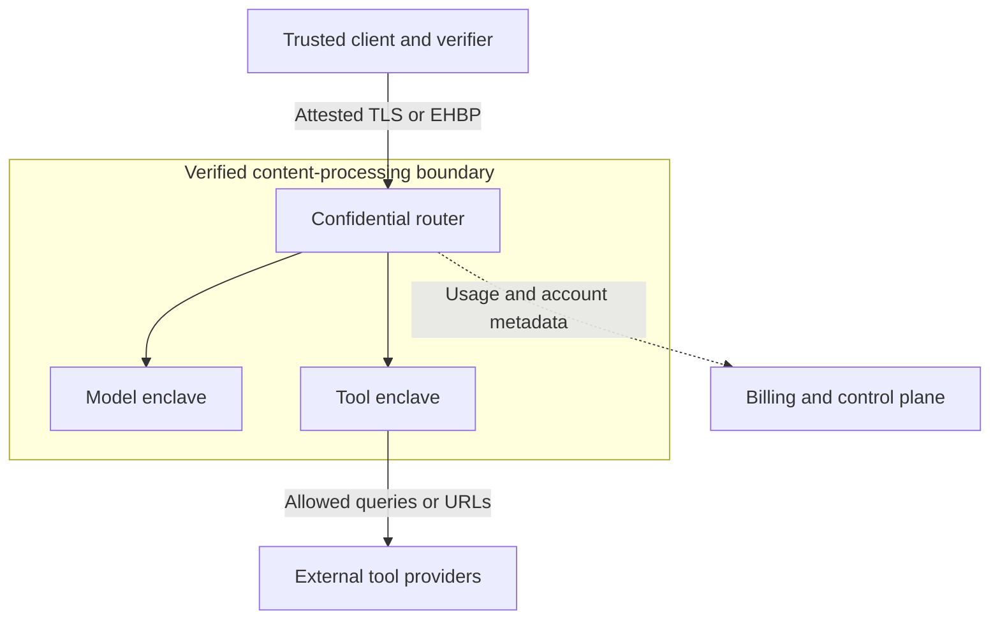

# Tinfoil: company, products, architecture, and integration report

**My recommendation: add Tinfoil as a verified inference provider behind Coder’s model-access interface, then evaluate confidential agent execution as a separate project.** Its infrastructure is relevant to OpenAgents, especially where customers want their code and prompts hidden from the inference operator. A broader promise that also excludes OpenAgents from seeing customer content requires additional work around client encryption, agent execution, tools, credentials, and storage.

I’ve tailored the integration recommendations to your current **Rust Coder / Coder Cloud, Coax, Psionic, and Google Cloud** direction.

**Full report:** [Tinfoil_Report.pdf](Tinfoil_Report.pdf) — 19 pages, architecture diagram, implementation sketches, pricing, and 55 source links.

This is a **November 11, 2026** research snapshot. I reviewed official documentation, public repositories, customer confirmation, and live pricing. I did not run a paid deployment, independently reproduce their builds, or benchmark their service.

## 1. What the company is

Tinfoil develops **confidential computing infrastructure for AI**: clients can verify the environment receiving their data, establish an encrypted connection to it, and run inference or other software inside hardware-protected execution environments. Its commercial products span private chat, hosted inference, customer containers, and confidential development machines. [Private AI](https://tinfoil.sh/?utm_source=chatgpt.com)

### Founders and company background

| Item | Finding |
|---|---|
| Company | Tinfoil, Inc., based in San Francisco |
| Founded / accelerator | YC lists founding in 2024 and the Spring 2025 batch |
| CEO and cofounder | **Tanya Verma**, formerly at Cloudflare, with work on protocols and Workers AI |
| Cofounder | **Jules Drean**, MIT PhD in secure hardware, with NVIDIA and Microsoft Research experience |
| Cofounder | **Sacha Servan-Schreiber**, MIT PhD in cryptography/privacy, with Microsoft Research and MongoDB experience |
| Named angel investors | Paul Graham, Nick Sullivan, Alana Renda, and Michael Grinich |

These details come from YC and Tinfoil’s company material. I could not establish an authoritative total funding amount, valuation, ARR, or revenue, so I would leave those unspecified. [Y Combinator](https://www.ycombinator.com/companies/tinfoil?utm_source=chatgpt.com)

There is credible customer evidence beyond Tinfoil’s own marketing. **DuckDuckGo independently confirms that Tinfoil serves GPT-OSS 120B and Gemma 4 31B in Duck.ai**, under its zero-provider-visibility designation. Tinfoil also lists organizations and projects including Maple, Screenpipe, Mozilla, Workshop Labs, and university work; a university logo should not be read as an institution-wide purchasing agreement. [DuckDuckGo Help Pages](https://duckduckgo.com/duckduckgo-help-pages/duckai/ai-chat-privacy?utm_source=chatgpt.com)

### My assessment of its position

Tinfoil’s value is the integration of several difficult systems problems:

- Hardware attestation.
- Reproducible, measured software environments.
- Verification of model artifacts.
- Encryption tied to the verified workload.
- Usable SDKs, deployment tools, and operational infrastructure.

For us, it is a potential infrastructure supplier. Its **Bunkers** product also overlaps with the confidential coding environment that Coder Cloud could offer. I would preserve our ownership of the agent workflow, model-provider abstraction, evaluations, customer relationship, and billing.

## 2. Product and service inventory

| Offering | What it provides | Likely relevance to us |
|---|---|---|
| **Tinfoil Chat** | Consumer/team-facing private AI assistant | Product reference and occasional direct use |
| **Inference API** | Hosted models with verifying clients | Best initial integration |
| **Containers** | Customer workloads inside confidential CPU/GPU environments | Custom agent workers, model serving, RAG, training |
| **Bunkers — Preview** | Persistent confidential development machines | Possible Coder Cloud execution backend |
| **SDKs, Proxy, CLI** | Verification, encrypted transport, local compatibility bridge | Rust integration and Coax bridge |
| **Auxiliary APIs** | Embeddings, audio, decisions, safeguards, PII filtering, document conversion, search | Optional capabilities behind our provider layer |
| **Enterprise services** | Contractual support, customization, identity and deployment options | Customer-specific commitments |

The public product pages and current documentation establish these offerings; Bunkers is explicitly a preview. [Private AI](https://tinfoil.sh/?utm_source=chatgpt.com)

### Tinfoil Chat

The documented clients are **web and iOS**. Chat includes model selection, reasoning, voice input, file attachments, projects, personalization, custom prompts, searchable history, imports, and encrypted share links. It also supports generated interactive displays such as charts and timelines. Deep Research can continue in the background and has a documented limit of one run per hour. [Tinfoil Documentation](https://docs.tinfoil.sh/chat/features?utm_source=chatgpt.com)

The paid plan is listed at **$20/month**. There are hourly usage allowances; I did not verify a dependable current numeric token allowance and would not repeat older quota figures. [Pricing](https://tinfoil.sh/pricing?utm_source=chatgpt.com)

Its history encryption deserves a precise explanation:

- A content-encryption key is generated on the user’s device.
- Synced conversation data is encrypted.
- The key can be delivered over an attested connection to the Chat harness for in-memory processing.
- Passkeys support wrapping and recovery.
- Local-only and temporary conversation options are available.

Thus, “Tinfoil does not hold a reusable plaintext copy of your history key” is a different claim from “the key never leaves the device.” The latter would be inaccurate. Browser-local caches also do not receive an additional layer of application encryption. [Tinfoil Documentation](https://docs.tinfoil.sh/chat/cloud-sync?utm_source=chatgpt.com)

### Supporting APIs and libraries

| Component | Function and integration detail |
|---|---|
| **Embeddings** | Nomic Embed Text v1.5; 768-dimensional embeddings |
| **Decision models** | Typed decisions, probabilities, and rubric-style evaluation; experimental |
| **Safety model** | GPT-OSS Safeguard for policy evaluation |
| **PII filter** | Detects/redacts sensitive spans through a dedicated endpoint |
| **Audio** | Transcription, audio understanding, speech generation, and realtime transcription |
| **Document conversion** | Converts documents into Markdown through `/v1/convert/file`; supports base64 file data |
| **Web search / MCP** | Search and page retrieval through an authenticated MCP service |
| **Admin API** | Keys, usage, billing, and container administration |
| **Passkey Kit** | JavaScript/Swift primitives for passkey-derived key wrapping |
| **Verification tools** | CLI and embeddable verification interfaces |

The document API does **not** implement the usual OpenAI `/v1/files` plus `file_id` workflow. Document processing uses enclave-hosted processing, with OCR/vision handled separately where needed. [Tinfoil Documentation](https://docs.tinfoil.sh/models/embedding?utm_source=chatgpt.com)

Passkey Kit is useful infrastructure, but it does not itself provide our complete authentication, encrypted-record format, or storage system. It supplies key-derivation and wrapping primitives around WebAuthn PRF, HKDF, and AES-GCM. [Tinfoil Documentation](https://docs.tinfoil.sh/guides/passkey-kit?utm_source=chatgpt.com)

## 3. Inference catalog and pricing

The principal chat models currently listed are below. **Prices are USD per million tokens.** Context figures are catalog limits, not a guarantee of useful task performance at that length.

| Model ID | Context | Input | Cached input | Output |
|---|---:|---:|---:|---:|
| `gpt-oss-120b` | 131K | $0.15 | — | $0.60 |
| `gemma4-31b` | 256K | $0.40 | — | $1.00 |
| `deepseek-v4-1-flash` | 1M | $0.60 | $0.01 | $1.45 |
| `glm-5-3` | 1M | $1.80 | $0.45 | $5.75 |
| `kimi-k3-1-pro` | 256K | $4.00 | $0.40 | $20.00 |
| `llama3-3-70b` | 128K | $1.75 | — | $2.75 |

The live pricing page marks Kimi K3.1 Pro experimental; the model documentation marks DeepSeek V4.1 Flash experimental. Kimi K3 remains listed as deprecated. GLM-5.3 always uses reasoning, with effort controls; its reasoning tokens consume the output allowance. [Pricing](https://tinfoil.sh/pricing?utm_source=chatgpt.com)

Additional listed prices include:

| Service/model | Published rate |
|---|---:|
| Nomic embeddings | $0.016 / million input tokens |
| GPT-OSS Safeguard | $0.15 input / $0.60 output |
| PII filter | $0.80 / million input tokens |
| Voxtral Small 24B | $0.20 input / $0.60 output |
| Decision small / medium / large | $0.02 / $0.06 / $0.40 per million input tokens |
| Whisper Turbo / Qwen3 TTS | $0.01 per request |
| Voxtral TTS / Realtime | $0.002 per request |
| Document processing / web search | $0.05 per request |

The audio and document charges above are labeled **per request**, so we should confirm duration and page limits before forecasting a real workload. [Pricing](https://tinfoil.sh/pricing?utm_source=chatgpt.com)

Two SDK gaps affect us:

1. **Decision models currently have documented Python, JavaScript, and Go support, but not Rust or Swift support.**
2. **Verified realtime speech WebSockets currently require the Node.js client, rather than browser JavaScript.**

Neither prevents integration, but each may require another trusted component and a deliberate boundary decision. [Tinfoil Documentation](https://docs.tinfoil.sh/models/decisions?utm_source=chatgpt.com)

My initial coding evaluation would compare GPT-OSS as the inexpensive baseline, GLM for long-context tasks, and Gemma where vision matters. The acceptance metric should be **cost per successfully completed task**, including retries, tool calls, reasoning output, and human correction.

## 4. How the security architecture works

### The basic mechanism

Tinfoil uses **trusted execution environments**, or TEEs. A request is encrypted in transit, decrypted inside a protected environment, processed there, and encrypted on its way back.

The model still operates on plaintext inside that protected environment. This differs from fully homomorphic encryption, where computation operates on ciphertext. Tinfoil’s security depends on the hardware isolation, verification process, and approved software behaving as intended. [Tinfoil Documentation](https://docs.tinfoil.sh/verification/verification-in-tinfoil?utm_source=chatgpt.com)

The documented inference architecture can be simplified as:

The router verifies downstream model/tool environments before forwarding content. Account and billing systems remain outside the content-processing boundary and receive operational metadata. Exact routing varies with the service and client/proxy release. [Tinfoil Documentation](https://docs.tinfoil.sh/verification/attestation-architecture?utm_source=chatgpt.com)

### What a client needs to verify

Several checks work together:

| Check | What it establishes |
|---|---|
| Hardware evidence | The reported environment is rooted in supported hardware |
| Workload measurement | The environment matches the expected software/configuration |
| Build provenance | The release came through the expected build process |
| Independent reproducibility | Published source can reproduce the released artifact |
| Model commitment | The model artifact is bound to a measured identity |
| Connection-key binding | The encryption/TLS key belongs to the verified workload |
| Release/freshness policy | The client accepts the intended versions and evidence |

Attestation alone does not establish that the program is safe. A valid measurement of buggy or malicious software remains a valid measurement. The client’s approved-release policy is therefore part of the security design. [Tinfoil Documentation](https://docs.tinfoil.sh/verification/verification-in-tinfoil?utm_source=chatgpt.com)

### Software and model measurement

Tinfoil describes a minimal Linux confidential VM built from pinned inputs with Nix, a read-only `dm-verity` root, constrained privileges, and a reproducible build process. The trusted software still includes supervisors, networking components, the container runtime, and GPU support. [Tinfoil Documentation](https://docs.tinfoil.sh/verification/cvm-image?utm_source=chatgpt.com)

**Modelwrap** addresses another important gap: measuring a model server is insufficient if arbitrary weights can be loaded afterward. Tinfoil packages model data into a read-only artifact with a Merkle-root commitment in measured configuration, validating blocks as they are read. [tinfoil.sh](https://tinfoil.sh/blog/2026-02-03-proving-model-identity?utm_source=chatgpt.com)

For Psionic, the implication is useful: model identity should eventually encompass the checkpoint, transformations or quantization, tokenizer, runtime assumptions, and expected tensor layout—not merely a model-family name.

Tinfoil’s October 25 architecture post also describes replacing OVMF with a much smaller launch path using roughly 300 lines of assembly and an IGVM build process. That reduces a particular firmware component; it does **not** reduce the entire trusted computing base to 300 lines. General documentation still references OVMF, so we should verify which architecture a specific deployed release actually uses. [tinfoil.sh](https://tinfoil.sh/blog/2026-10-25-less-is-more?utm_source=chatgpt.com)

### Encrypted transport

Native clients can bind TLS to an attested key. Browsers need another mechanism because ordinary browser JavaScript cannot arbitrarily pin a TLS certificate.

Tinfoil’s **Encrypted HTTP Body Protocol, EHBP**, uses HPKE-based encryption for HTTP bodies. This lets an intermediary relay ciphertext while headers and routing information remain available. It does not hide traffic timing, sizes, account information, or every header. [Tinfoil Documentation](https://docs.tinfoil.sh/resources/ehbp?utm_source=chatgpt.com)

**Changing an OpenAI client’s base URL to Tinfoil does not, by itself, perform attestation.** A verifying SDK or verified proxy is necessary for that guarantee. This distinction should appear directly in our implementation review and product claims. [Tinfoil Documentation](https://docs.tinfoil.sh/sdk/direct-api-access?utm_source=chatgpt.com)

## 5. What the protection covers—and what remains trusted

### The main boundaries

| Layer | Practical implication |
|---|---|
| Inference infrastructure | Designed to exclude Tinfoil/cloud operators from plaintext when verification succeeds under the stated assumptions |
| Our conventional backend | Can still read prompts if it receives them before calling Tinfoil |
| Client device | Browser code, extensions, native binaries, local caches, and device compromise remain relevant |
| External tools | A service receives the data deliberately sent to it |
| Metadata | Account, payment, usage, timing, and traffic information can remain visible |
| Application behavior | Attestation does not prevent prompt injection, unsafe tool use, or software bugs |
| Availability | The infrastructure can refuse service or withhold storage |
| Persistent state | Encryption alone does not prevent rollback to an older state |

These boundaries follow from Tinfoil’s documented architecture and threat models. [Tinfoil Documentation](https://docs.tinfoil.sh/verification/attestation-architecture?utm_source=chatgpt.com)

### Search and moderation

Web search introduces an external recipient: Tinfoil documents Exa for search under a zero-data-retention arrangement, while its privacy policy identifies Context.dev for Chat page fetching. Those providers still receive the queries or URLs needed to perform the requested work. PII filtering can reduce accidental disclosure; it does not prove that a query is anonymous. [Tinfoil Documentation](https://docs.tinfoil.sh/guides/web-search?utm_source=chatgpt.com)

Chat also runs safeguards inside the enclave. A violation flag and conversation identifier can leave the enclave and be associated with the account. That documented Chat mechanism should not be generalized into a claim that every API or Container workload follows the same moderation pipeline. [Safety & Safeguards](https://tinfoil.sh/safety-and-safeguards?utm_source=chatgpt.com)

### Prompt caching

Prompt-prefix caches can retain internal model state in volatile GPU memory. They are not persistent transcript databases, but neither do they necessarily disappear as soon as a request completes.

Tinfoil’s `user_cache_secret` partitions cache reuse. We should supply a stable, opaque value per user or appropriate tenant scope. It is not an encryption key, should not be the API key, and rotating it does not force immediate deletion of the old cached state. [Tinfoil Documentation](https://docs.tinfoil.sh/sdk/prompt-caching?utm_source=chatgpt.com)

### Hardware and audit limits

Tinfoil’s hardware support combines AMD SEV-SNP or Intel TDX with confidential NVIDIA GPU configurations. Physical attack assumptions still matter; published TEE.fail research illustrates why the hardware trust model needs explicit treatment. Multi-H100/H200 deployments can also involve unencrypted NVLink within a trusted GPU group and require explicit configuration acknowledgement. [Security and Privacy FAQ](https://tinfoil.sh/security-and-privacy-faq?utm_source=chatgpt.com)

Performance overhead is workload-dependent. Tinfoil’s own measurements vary substantially with CPU–GPU transfers, batching, interconnect behavior, and training workload. We should benchmark Psionic’s execution patterns rather than assume a uniform, negligible penalty. [tinfoil.sh](https://tinfoil.sh/blog/2026-06-23-confidential-computing-overhead?utm_source=chatgpt.com)

Tinfoil says it has completed SOC 2 Type II and has worked with Trail of Bits. I have not reviewed the underlying reports. Before a production contract, we should inspect their scope, findings, remediation, and coverage of newer products. The public terms describe a **99.9% uptime target, not a guaranteed contractual SLA**. [Security and Privacy FAQ](https://tinfoil.sh/security-and-privacy-faq?utm_source=chatgpt.com)

## 6. Containers and Bunkers

### Containers: our software in their confidential runtime

Containers are the relevant product when we want the **agent loop itself** inside the protected environment.

The deployment path is approximately:

1. Package our worker as a Linux container.
2. Publish an immutable image.
3. Define its public measured configuration.
4. Generate a release through the prescribed build workflows.
5. Deploy the chosen release.
6. Release secrets only to the approved environment.

Private images are supported, including Google Artifact Registry. The configuration repository is public, however, so image/source confidentiality and configuration confidentiality are different questions. [Tinfoil Documentation](https://docs.tinfoil.sh/containers/overview?utm_source=chatgpt.com)

Several operating constraints affect the design:

| Constraint | Consequence for us |
|---|---|
| No inbound private networking | A worker does not automatically become a member of our GCP VPC |
| No built-in load balancer | We own routing, health checks, and replica selection |
| Ephemeral filesystem by default | Durable jobs require explicit storage and recovery |
| Public measured configuration | Keep secrets and sensitive metadata out of that repository |
| Volume or multi-GPU updates incur downtime | Use checkpoints or application-level redundancy |
| Debug deployments fail production attestation | Keep sensitive production data out of debug mode |

Stateless CPU/single-GPU deployments can use blue-green updates; the same zero-downtime expectation does not apply to every stateful or multi-GPU deployment. [Tinfoil Documentation](https://docs.tinfoil.sh/containers/overview?utm_source=chatgpt.com)

### Secrets are a material distinction

**Ordinary managed secrets are encrypted at rest but accessible to Tinfoil’s deployment infrastructure.**

The separate private-secret mechanism lets a customer-controlled keyserver verify the environment before releasing credentials. That mechanism is beta. If our product promise excludes Tinfoil from credential access, standard secret injection does not satisfy it. If the promise also excludes OpenAgents, the key-release design must account for our access too. [Tinfoil Documentation](https://docs.tinfoil.sh/containers/secrets-and-env-vars?utm_source=chatgpt.com)

For durable state, Tinfoil offers an encrypted S3 sidecar and encrypted volumes. The sidecar encrypts objects before they reach S3; volumes support filesystem-style state but add attachment, recovery, and update constraints. [Tinfoil Documentation](https://docs.tinfoil.sh/containers/persistent-storage?utm_source=chatgpt.com)

The current V3 beta scope includes private secrets, encrypted volumes, attested keys/SSH, fresh container attestation, and release-pinning/freshness features. **Hosted inference and remote attestation as a whole are not labeled beta.** We need to evaluate the exact SDK and feature combination we intend to ship. [Tinfoil Documentation](https://docs.tinfoil.sh/resources/feature-status?utm_source=chatgpt.com)

### Bunkers: confidential development machines

Bunkers is closer to a ready-made coding-agent environment:

- Ubuntu 24.04 with sudo and Docker.
- Persistent encrypted workspace.
- SSH and browser terminal.
- Optional desktop environment.
- Preinstalled coding agents including OpenCode, Claude Code, Codex, Crush, Qwen Code, pi, Goose, Droid, and Copilot.
- A measured Nix-based base toolset.

It is currently a preview. Installing more software later does not mean that every subsequently installed component becomes part of the original measured toolset. [Tinfoil Documentation](https://docs.tinfoil.sh/bunkers/features?utm_source=chatgpt.com)

A Bunker’s owner key is central to access: ordinary account or organization administration does not itself grant access to the encrypted machine. That is attractive for customer-controlled environments, but it means our provisioning, recovery, and support flows need deliberate design. A root-capable agent inside the Bunker can still read, modify, or destroy the workspace. [Tinfoil Documentation](https://docs.tinfoil.sh/bunkers/security?utm_source=chatgpt.com)

Its **Perimeter** is especially interesting for Coder. This separate enclave holds credentials, supplies placeholders to the worker, and enforces outbound request policy. It can distinguish recognized operations, apply deny/read-only/ask/allow decisions, and pin MCP definitions. It terminates outbound TLS where inspection and credential injection require it. [Tinfoil Documentation](https://docs.tinfoil.sh/bunkers/perimeters?utm_source=chatgpt.com)

That gives us a useful separation between **code-execution authority** and **credential authority**. It does not eliminate the consequences of whatever requests we authorize.

Also, running Claude Code or another agent inside a Bunker does not automatically make its external model provider confidential. The model provider still receives whatever code and prompts the agent sends.

## 7. How I would integrate it into our stack

### First choose the promise

These are three different architectures:

| Architecture | Where plaintext exists | Promise we can reasonably make |
|---|---|---|
| **Server-side verified inference** | Client, our backend, verified Tinfoil environment | Inference infrastructure is excluded under the stated assumptions |
| **Client encryption with an opaque relay** | Client and verified Tinfoil environment | Our relay need not read inference content |
| **Confidential agent execution** | Client, verified agent worker, verified model/tool environments, authorized external recipients | The agent workflow can be protected from infrastructure operators |

A conventional backend cannot privately inspect, embed, rewrite, or execute content it cannot decrypt. A client-encrypted relay and a confidential worker solve different parts of that problem. [Tinfoil Documentation](https://docs.tinfoil.sh/guides/proxy-server?utm_source=chatgpt.com)

### A. Add a Rust provider adapter to Coder

This is the first implementation I would do.

Use the official Rust SDK behind the existing model-access interface. It wraps `async-openai`, adds verification, and provides a `chat_relaxed()` path for Tinfoil-specific fields. The repository is Apache-2.0 licensed and documents a Rust 1.88 minimum. [Tinfoil Documentation](https://docs.tinfoil.sh/sdk/rust-sdk?utm_source=chatgpt.com)

The adapter should own:

- Model selection and supported-capability flags.
- Streaming and tool-call normalization.
- Reasoning and output-budget controls.
- Cancellation and partial-stream accounting.
- Per-user cache scope.
- Verification failures as a distinct error class.
- Usage records associated with our request identifiers.

I would also attach a privacy requirement to each request. A request requiring confidential execution must not silently fall back to ordinary HTTPS or a different provider after a verification failure.

Keep these policies at the provider boundary. Coax’s language semantics and Psionic’s tensor APIs should not depend on Tinfoil-specific concepts.

### B. Bridge Coax through the existing verifier

The fastest first path is Tinfoil’s local proxy, which provides an OpenAI-compatible endpoint such as:

`http://127.0.0.1:3301/v1`

Coax can use ordinary local HTTP while the proxy handles verification upstream. The local leg is plaintext, so the proxy belongs on the same trusted machine with a deliberately restricted local interface. [Tinfoil Documentation](https://docs.tinfoil.sh/local-proxy/cli?utm_source=chatgpt.com)

If packaging or process boundaries later justify it, expose the Rust integration through a narrow C ABI:

- Create client.
- Start request.
- Consume stream events.
- Cancel.
- Free resources.

IPC is easier to isolate and upgrade. A C ABI can reduce process overhead but brings buffer ownership, callback threading, and foreign-runtime failures into the host. I would avoid implementing attestation, certificate validation, or HPKE directly in Coax for the first integration.

### C. Preserve billing while hiding prompts from our backend

Tinfoil documents a relay architecture in which the client verifies the environment and encrypts the request body. Our backend authenticates the user, forwards the ciphertext, and adds the provider credential.

Usage information can be returned through a response header or streaming trailer, allowing metering without prompt visibility. The relay must preserve encrypted bodies, streaming behavior, and relevant headers. [Tinfoil Documentation](https://docs.tinfoil.sh/guides/proxy-server?utm_source=chatgpt.com)

Our implementation still needs to:

- Reserve budget before admitting work.
- Bound concurrent requests and output.
- Reconcile final usage, including disconnected streams.
- Avoid plaintext in logs, traces, exceptions, and queues.
- Separate operational metadata from content.

Tinfoil’s spending caps are soft; in-flight requests can overshoot them. Reasoning is billed as output, and interrupted streams can still incur generated-token charges. [Tinfoil Documentation](https://docs.tinfoil.sh/admin/admin-api?utm_source=chatgpt.com)

### D. Move sensitive orchestration into Containers

For a customer requiring a private agent workflow, package the Coder worker inside a confidential container and keep its sensitive operations there:

- Repository access.
- Prompt assembly.
- Tool execution.
- Embeddings and retrieval.
- Memory processing.
- Encryption before durable storage.

Every external service needs an explicit disclosure decision. A confidential worker that sends a proprietary repository to an ordinary external tool has moved the disclosure point, not removed it.

I would begin with one bounded worker type and a clear recovery model. Confirm restart behavior, secret release, checkpoint recovery, key loss, update downtime, and egress policy before expanding.

### E. Evaluate Bunkers as an optional execution backend

A Bunker pilot could run alongside our current Coder Cloud execution path. We would retain the agent protocol, customer billing, and orchestration layer while evaluating the supplied workspace and Perimeter.

The important questions are ownership and automation: can we provision and manage these machines in the way our product needs, while respecting their owner-key access model? Their preview status and enterprise automation surface need explicit confirmation. [Tinfoil Documentation](https://docs.tinfoil.sh/bunkers/security?utm_source=chatgpt.com)

### F. Psionic and Google Cloud

Containers do not require us to adopt PyTorch. The relevant tests are whether Psionic’s compiled runtime can run in the supported container/CUDA environment, whether its artifacts can be measured, and whether its memory and transfer patterns perform acceptably.

I would proceed through CPU execution, CUDA execution, artifact verification, checkpoint/restart, and then performance measurement. A successfully built image alone establishes very little about confidential execution.

Google Cloud also offers confidential GPU infrastructure. Building directly there would leave more responsibility with us for workload measurement, client verification, key release, model serving, and reproducible deployment. Tinfoil packages much of that operational work. We should compare complete systems, not just VM prices. [docs.cloud.google.com](https://docs.cloud.google.com/confidential-computing/confidential-vm/docs/create-a-confidential-vm-instance-with-gpu?hl=en\&utm_source=chatgpt.com)

For the MMO and general cloud services, I would keep latency-sensitive simulation, authoritative state, and ordinary infrastructure on their existing path. Tinfoil is most relevant to selected private AI workers.

## 8. Compute economics

Published Container rates are:

| Resource | Rate |
|---|---:|
| CPU | $0.06 per core-hour |
| RAM | $0.01 per GB-hour |
| Provisioned disk | $0.000137785 per GB-hour |
| H200 | $5.90 per GPU-hour |
| B200 | $8.12 per GPU-hour |
| B300 | $9.23 per GPU-hour |

Disk remains billable until deleted. GPU capacity is dedicated and carries **monthly commitments**, despite hourly rate presentation. I did not establish a verified public Bunkers price. [Pricing](https://tinfoil.sh/pricing?utm_source=chatgpt.com)

At an illustrative 730 hours/month, those rates imply:

- **4 vCPUs + 16 GB RAM:** about **$292/month**.
- **100 GB disk:** about **$10.06/month**.
- **One H200:** about **$4,307/month**, before CPU, RAM, and storage.
- **Eight H200s:** about **$34,456/month** for GPUs alone.

These are arithmetic illustrations, not quotes or utilization-adjusted comparisons.

Hosted inference is a much smaller initial commitment. For example, 10 million uncached input tokens plus 2 million billed output tokens on GPT-OSS 120B calculate to **$2.70**, before tool charges and taxes. The production question is how many such tokens, retries, tool calls, and review cycles a useful completed job consumes.

## 9. Acceptance tests and rollout

I would use this sequence:

| Phase | Work | Exit criterion |
|---|---|---|
| **1. Provider evaluation** | Rust adapter and representative Coder tasks | Useful results, acceptable latency/cost, verified failures remain failures |
| **2. Privacy boundary** | Choose ordinary backend processing or client-encrypted relay | Documented plaintext locations and approved product claims |
| **3. Confidential execution** | One Container worker or Bunker workflow | Recovery, secrets, storage, cancellation, and egress work as designed |
| **4. Customer offering** | Contract, capacity, support, billing, and region commitments | Commercial terms match the deployed architecture |

The five most important implementation checks are:

1. **Verification fails before content is sent.** Test invalid evidence, an unexpected release, and a mismatched transport key using our own harness.
2. **Coder’s actual API contract works.** Exercise tools, structured output, context limits, modalities, and provider-specific events.
3. **Streaming and cancellation are correct.** Avoid repeating partially consumed generations or duplicating tool actions after interruptions.
4. **The claimed privacy boundary is observable.** Inspect our logs, queues, temporary files, error reports, and relay behavior.
5. **Tenant separation and billing hold under concurrency.** Verify cache scopes, usage reconciliation, output limits, and budget overshoot.

These establish integration behavior. Model quality and capacity still require a separate benchmark on our real workloads.

## 10. Questions to settle before a production commitment

I would prioritize the following vendor questions:

1. **Which exact SDK, attestation generation, firmware, model artifacts, and router release would our deployment use?**
2. **Can private secrets, encrypted volumes, and attested connections receive the support commitments our product needs?**
3. **What does “on-prem integration” mean operationally?** The enterprise page advertises it, but does not establish turnkey self-hosted, air-gapped, or arbitrary BYOC operation. [Pricing](https://tinfoil.sh/pricing?utm_source=chatgpt.com)
4. **Which regions and infrastructure providers process content and metadata?**
5. **What capacity, topology, interconnect protections, and monthly commitments apply to our GPU configuration?**
6. **What are Bunker eligibility, pricing, automation interfaces, owner-key recovery, and enterprise collaboration semantics?**
7. **Can we inspect the SOC 2 and relevant audit reports, including coverage of newer products?**
8. **What latency, concurrency, context, rate-limit, and service-credit terms can be committed contractually?**
9. **May OpenAgents embed, meter, and resell these services to our customers under the proposed agreement?**
10. **What are the guarantees and responsibilities for rollback protection, key recovery, backups, export, and customer exit?**

**I would buy a bounded amount of verified inference first and retain a replaceable integration.** That can deliver a useful privacy improvement quickly. A customer-private Coder offering is also plausible, but its value—and its engineering burden—comes from protecting the whole agent workflow, including the credentials and state around the model.

