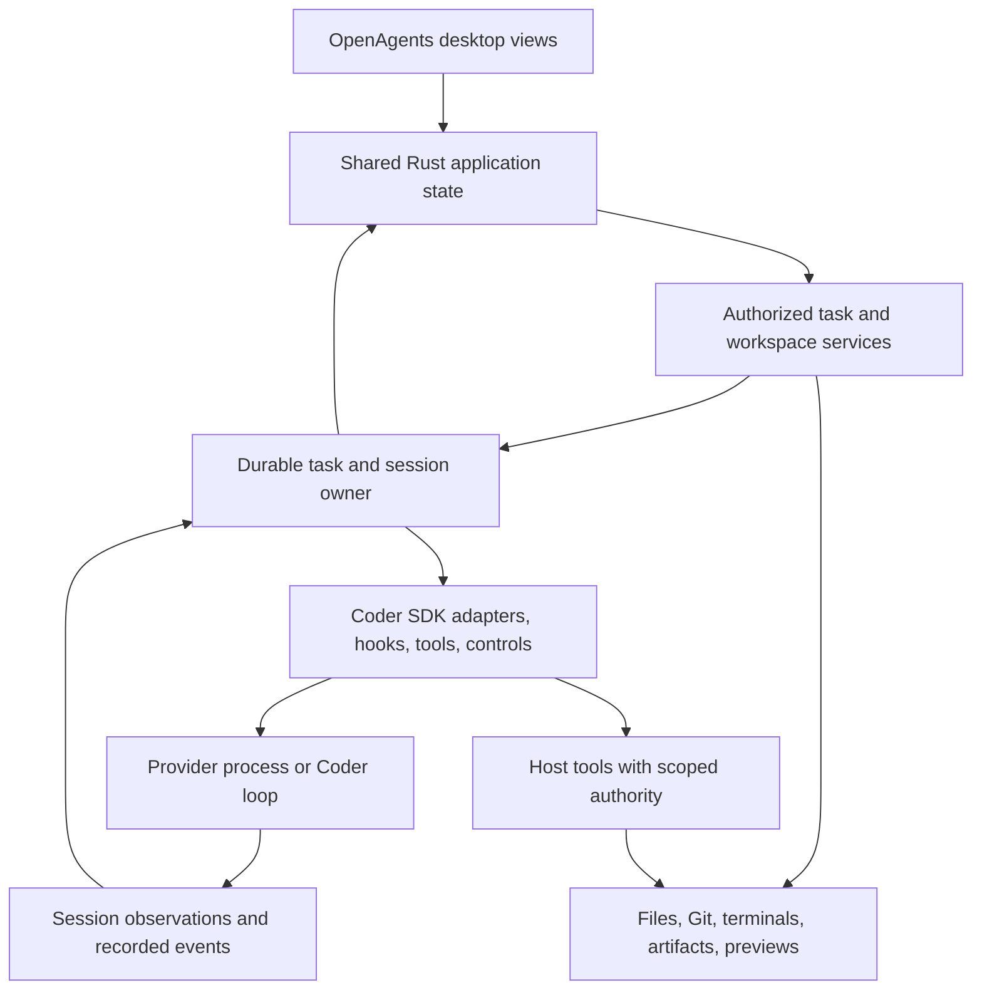

# Coder SDK intersections with the desktop app

Assessment date: 2026-10-15. Source baseline:
`ed027bcaa6c70511dbd2be11e8060325b95ed626`. This is a source review and proposed
integration sequence, not an implementation or live-provider certification.
The [Zeron parity analysis](README.md) supplies the workflow requirements and
gap IDs referenced below.

The best integration is to make the desktop another client of Coder's
host-owned execution services, with the Coder SDK providing common session
behavior underneath. Start by exposing capabilities, observations, and
approvals through the existing desktop/task path. Extend provider-neutral SDK
contracts where those paths currently depend on provider-specific types.

The SDK can remove duplicated session and policy wiring. It cannot by itself
provide the missing file editor, browser, Git history, pull-request board,
remote file service, or desktop layout. Those features need application and
host services, some of which can also be offered to agents through SDK tools.

## What the SDK actually provides

The implementation is [the `coder-sdk` crate](../../../crates/coder-sdk/src/lib.rs).
It is an internal monorepo crate. Its [design document](../../coder/design/coder-sdk.md)
still begins with “Specification, not built,” but later sections and current
source describe substantial implemented behavior. Use the source, not that
opening status line, to decide what needs building.

| Area | Existing implementation | Desktop implication |
| --- | --- | --- |
| Hook vocabulary | [`Event` and `Call`](../../../crates/coder-sdk/src/events.rs): 12 lifecycle/tool/compaction/subagent/file hook events with a tool name and JSON payload. | Reuse for execution policy and instrumentation. These are not a complete stream of assistant text, questions, plans, images, and UI state. |
| Hook composition | [`Registry`](../../../crates/coder-sdk/src/registry.rs), [`Runner`, `Applied`, and `Budget`](../../../crates/coder-sdk/src/compose.rs): matching, ordered rewrites, final-input floor checks, permission/stop outcomes, failure handling, and context budgets. | The desktop must display and answer the host's resulting requests, not independently recompute whether a tool may run. |
| Interactive approval | [`Hooks::asking` and `Asker`](../../../crates/coder-sdk/src/hooks.rs), plus Claude/Codex integration. An unresolved Ask is held as a denial if no asker is attached. | There is a natural callback for desktop approval cards, but it still needs host request identity, delivery, cancellation, expiry, and stale-answer handling. |
| Disclosure | [`Admission`](../../../crates/coder-sdk/src/admission.rs) checks exact declared data/recipient pairs for hooks and tools. | Preserve it when enabling decision/plugin hooks. It does not establish file rights, account ownership, paired-device grants, or spending permission. |
| Claude integration | [`Claude::install`, `permission_handler`, and `SessionBox`](../../../crates/coder-sdk/src/claude.rs) adapt shared hooks and session configuration to the Claude Agent SDK. | Reuse the adapter. `Claude` is a hook/configuration integration, not a common provider-neutral session manager with desktop persistence. |
| Codex integration | [`Codex`, `Open`, `Control`, `Output`, and `Ended`](../../../crates/coder-sdk/src/codex.rs) manage app-server initialize/open/resume/turn/steer/interrupt/close and emit observations. | This is a practical initial backend for a common session API, but its current output and configuration remain Codex-specific. |
| ACP and OpenCode | [`acp`](../../../crates/coder-sdk/src/acp.rs) supplies hooks, permissions, gate installation, and turn hooks; [`opencode`](../../../crates/coder-sdk/src/opencode.rs) adapts tool-hook shapes and plugin setup. | These modules do not constitute one complete lifecycle implementation for every provider. Host runtime code still launches and drives the sessions. |
| Session control | [`coder_delegate::session::Session`](../../../crates/coder-delegate/src/session.rs) defines start/observe/stop/resume/steer, capability checks, cleanup acknowledgment, and a versioned controller. | Reuse or adapt this existing abstraction before inventing a second lifecycle trait. It does not yet provide the full desktop contract described below. |
| Tools | [`Tool` and `ToolServer`](../../../crates/coder-sdk/src/tools.rs) provide shared tool schemas/bodies, Claude in-process MCP, stdio MCP, optional hook gating, and recorded outcomes. Codex can expose these as dynamic tools. | Host workspace services can have both UI and agent entry points without implementing their behavior twice. |
| Delegation | [`Delegator`, `Host`, `Lineage`, `Authority`, and reports](../../../crates/coder-sdk/src/delegation.rs) provide bounded parent/child execution, background starts, records, and narrowed write/disclosure authority. | Reuse child identity and records for the desktop agent explorer. More live child observations and transcript access still need projection and transport. |
| Worktree and tool guards | [`worktree`](../../../crates/coder-sdk/src/worktree.rs), [`checkout_guard`](../../../crates/coder-sdk/src/checkout_guard.rs), [`floors`](../../../crates/coder-sdk/src/floors.rs), and [`git_guard`](../../../crates/coder-sdk/src/git_guard.rs). | Keep execution checks shared across desktop, terminal, and remote tasks. These checks do not replace optimistic concurrency for human editor saves or Git mutations. |
| Extensible hooks | [`plugin_hooks`](../../../crates/coder-sdk/src/plugin_hooks.rs), [`command`](../../../crates/coder-sdk/src/command.rs), [`bridge`](../../../crates/coder-sdk/src/bridge.rs), decision and monitoring modules. | Expose understandable status and opt-in configuration through the host; keep plugin grants, policy versions, and disclosure checks in execution code. |
| Identity and replay | [Hook-set digest](../../../crates/coder-sdk/src/digest.rs) and [`Recorded`/`ScriptedSession`](../../../crates/coder-sdk/src/scripted.rs). | Reuse deterministic hook tests and configuration identity. Hook replay alone cannot drive a complete desktop transcript fixture. |
| Other clients and policy | [`auto_policy`](../../../crates/coder-sdk/src/auto_policy.rs) and [`cloud_solver`](../../../crates/coder-sdk/src/cloud_solver.rs). | No-harness model policy can support a coding entry without an installed CLI. The cloud Solver client is a separate possible issue-to-PR workflow, not remote desktop session transport. |

### Three distinctions that matter for integration

**Hook support is not workflow support.** The nine `HookBackend` variants include
Scripted, Coder loop, different Codex transports, and several ACP enforcement
classes. They are not nine production provider adapters matching Zeron's nine
providers. A provider's ability to run hooks does not prove that the desktop can
install it, sign in, choose models, accept images, resume sessions, or inspect
its children.

**SDK events are not the presentation event model.** The SDK's `Event` is a
hook name. [`coder_delegate::stream::Event`](../../../crates/coder-delegate/src/stream.rs)
is a different type: normalized executor observations with deliberately clipped
claims/output. [`openagents_chat::coder_events::CoderEvent`](../../../crates/openagents-chat/src/coder_events.rs)
is the existing task presentation model. These types serve different purposes;
using the same word does not make them interchangeable.

**SDK admission is only one authority check.** `Admission` currently contains
disclosures. `Registry::register` validates hook IDs and floor fallback rules;
it does not accept an admission and automatically enforce every disclosure.
Registration paths must apply the disclosure check explicitly. Likewise,
`delegation::Authority` narrows write and disclosure authority; it is not the
complete host permission, account, or payer contract.

## Where the OpenAgents desktop intersects today

The current OpenAgents desktop does not directly depend on `coder-sdk` in its
[manifest](../../../crates/openagents-desktop/Cargo.toml). It depends on `coder`
and shared chat crates. `coder` itself depends on the SDK. That dependency is
evidence of available reuse, not proof that every desktop execution path uses
the same SDK session implementation.

| Existing path | Source evidence | Integration consequence |
| --- | --- | --- |
| General chat and handoff | [`chat::Panel`](../../../crates/openagents-desktop/src/chat.rs), shared [`coder_run::Run`](../../../crates/openagents-chat-app/src/coder_run.rs). | Keep hosted OpenAgents chat and its routing intact. Add explicit coding configuration alongside it rather than treating every ordinary chat as a provider session. |
| Local Coder execution | Desktop [`CoderLane::answer`](../../../crates/openagents-desktop/src/worker.rs#L556) calls `Local::start_requested`, follows task events, stops/continues tasks, and reads exact task reviews. [`Local`](../../../crates/coder/src/task/local.rs) owns selection, worktrees, task records, and launch. | Put richer options and observations through this service boundary first. Directly spawning a new provider session from a view would bypass existing task lifecycle and records. |
| Host-backed chat/task control | [`HostLane`](../../../crates/openagents-desktop/src/worker.rs#L336), [`HostControl`](../../../crates/openagents-desktop/src/control.rs), and the [local broker contract](../../desktop/local-coder.md). | Add typed task/session operations through existing authority and retry identities. A desktop-specific SDK transport is unnecessary for the first slice. |
| Task events and presentation | [`CoderEvent` and `Mapper`](../../../crates/openagents-chat/src/coder_events.rs), [`coder_run`](../../../crates/openagents-chat-app/src/coder_run.rs), [`task_chat`](../../../crates/openagents-chat-app/src/task_chat.rs). | Extend these projections and their upstream observations to display SDK capabilities and policy outcomes. Preserve existing traces and review/Publish semantics. |
| Coder's newer interactive runtime | [`sdk_hooks`](../../../crates/coder-new/src/sdk_hooks.rs), [`codex_chat`](../../../crates/coder-new/src/codex_chat.rs), [`delegate_host`](../../../crates/coder-new/src/delegate_host.rs), and [`harness_plugin`](../../../crates/coder-new/src/harness_plugin.rs). | These provide useful implemented patterns for provider sessions, approval integration, routing, and delegation. They belong to `coder-new`; they are not already the `openagents-desktop` runtime. Extract reusable pieces without importing its `App` or UI globals into the desktop. |
| Older Coder/Microcoder hook integration | [`coder::hooks`](../../../crates/coder/src/hooks.rs) installs shared floors, worktree checks, and checkout checks through the bridge; the SDK design inventories Microcoder session integration. | Audit the exact selected task backend before migration. Keep existing protections when replacing a launcher; a transitive SDK dependency alone does not establish equivalent interactive approval behavior. |
| Saved session browsing | [`retained`](../../../crates/openagents-chat-app/src/retained.rs) and the [saved-session contract](../../desktop/local-coder.md#saved-codex-and-claude-code-sessions). | Add an explicit native-resume action through a session service. The current Continue with Coder transfers bounded context to a new task; it does not resume the original provider's session. |

The SDK design's phrase “Coder chat (terminal, desktop)” refers to the Coder
runtime it inventories. It should not be read as evidence that the separate
OpenAgents desktop window already consumes `coder_new::codex_chat` or its
approval UI.

## Recommended boundary

The arrows describe logical ownership, not a proposed new network protocol.
The local desktop can keep its current worker/control boundary; a remote client
uses the existing host connection and grants. Providers, hooks, and credentials
execute on the selected owner. Views consume bounded snapshots/events and send
typed commands.

The same file service can serve a human editor and a permitted agent tool, but
the callers have distinct authority and concurrency requirements. An editor
save must not be encoded as an artificial `PreToolUse` firing just to reuse a
hook. Factor shared path checks if useful, then enforce each caller's actual
contract.

## Logical SDK extensions, in implementation order

All API names in this section are proposed concepts unless linked to an
existing symbol. Prefer additive adapters and small types over a new universal
framework. Exact crate/file placement should follow the first real consumer.

### 1. Expose capabilities and session descriptors

Start with a read-only description of the session the host can actually run.
Combine the existing `Capabilities`, `HookTier`, route/harness declarations,
provider readiness, and model metadata into a portable view. Keep machine
installation and credentials in host services.

The description needs these separate dimensions:

- Provider and adapter identity, supported executable version, local/remote
  owner, and availability with a useful reason when unavailable.
- Start/observe/stop/resume/steer support, steering semantics, fork support,
  structured questions, approvals, images, plans, child sessions, and context
  occupancy. A lifecycle boolean alone cannot express this whole set.
- Per-event hook enforcement and any restrictions required by the requested
  task. Observing a tool after execution cannot satisfy a must-deny policy.
- Models, reasoning choices, provider options, and which choices apply to a new
  session, a resumed session, or the next turn.
- Requested versus resolved provider/model and the host's permitted fallback
  policy. Preserve payer and disclosure choices when resolving alternatives.

Do not blindly reuse `Capabilities::default()` for a new wire response: the
current implementation returns all five lifecycle capabilities. New optional
capabilities and absent fields from an old host must default to unsupported.
Translate the existing internal type at the boundary if changing its defaults
would break consumers.

**First useful result:** the desktop can show accurate provider/model controls
and disable unsupported actions before submission. This addresses COM-01/02/08,
RUN-01/04/07, REM-08, and parts of NAV-08 without replacing task execution.

The first read-only slice is implemented in
[#11694](https://github.com/OpenAgentsInc/openagents/issues/11694): portable types
in `route_contract::session`, SDK backend descriptions in `coder_sdk::session`,
and a description frozen with each local task turn. It reaches the desktop
through `CoderStarted`, shows the requested and resolved provider/model,
follows fallback changes, and gates task controls. Older events keep the
existing task-control contract; absent or unknown new capability fields grant
no provider-native operations. Executable versions and native session IDs
remain unknown until observed. Provider installation, catalog refresh, and
model-picker mutations remain later work.

### 2. Add a common observation contract and desktop projection

Normalize provider observations near the SDK/backend boundary, then map them
into the existing Coder task events. Do not replace the hook event enum with a
transcript enum or store complete tool output in hook payloads.

Use stable host, task, provider-session, turn, item/tool-call, and child-session
identities. Add a generation and ordered sequence so the task owner can reject
old observations and a client can resume delivery. Define explicit delta,
snapshot, completion, and missing-history behavior. Durable replay and subscriber
backpressure belong to the session owner, not a renderer callback.

Normalize text, exposed reasoning summaries, tool start/result, plan updates,
typed question/approval requests, file/artifact references, context occupancy,
usage/rate-limit observations, completion, interruption, and failure. Reuse
existing schemas where they already express the right fact. Keep usage,
capacity, and money distinct, and preserve unknown versus measured zero.

Current Codex `Output::Usage` and `RateLimits` contain provider JSON; its other
variants expose thread/model/text/thinking/tools/gates. That is useful input,
not yet a complete cross-provider desktop contract. The executor stream's
clipped assistant claims are also unsuitable as the full transcript source.

**First useful result:** extend the existing desktop Coder display with accurate
session/model state, plans, context usage, and policy outcomes. This addresses
RUN-06, TRN-04–06/10, REM-05/06, and CUS-16. Stable IDs also prepare child tabs.

### 3. Bridge interactive approvals and questions through the host

Reuse `Asker` as the SDK callback and the desktop's existing approval/answer
controls as the presentation. Put the pending request in a host-owned registry
before publishing it. A proposed request envelope needs the session/turn and
generation, unique request ID, final tool input identity after rewrites, scope,
expiry/cancellation, and the allowed response choices.

An answer must name that pending request and current generation. Answer once,
reject stale/duplicate/conflicting answers, and invalidate it when the tool,
session, target, or authority changes. Cancel the waiting callback on stop or
disconnect according to the operation's disposition; never interpret a missing
UI or an expired card as Allow. Do not persist a provider continuation token as
though it were reusable after the provider process has exited.

Typed user questions need their own schema, including multiple questions,
choices, multi-select, and free text. They are not the same as permission to
execute a tool, even when both temporarily pause a turn.

There is a concrete integration distinction in current code: `Hooks::fire`
can await an attached asker, while a `ToolServer::gated` call uses the runner
and returns an error for an unanswerable Ask. If common tool approvals are
needed, add an explicit asynchronous resolver to that path or use the backend's
existing interactive gate. Do not assume `.gated()` automatically opens a card.
Prevent duplicate hook execution when a provider already gates the same MCP
tool itself.

**First useful result:** one current-session approval can be answered in the
OpenAgents window while a supported backend waits, with deterministic cancel
and stale-answer behavior. This addresses COM-09/12, RUN-06/15, and REM-04/10.

### 4. Consolidate session creation and control behind a host facade

Adapt the existing `coder_delegate::session::Session` and SDK backend-specific
operations into one host-facing lifecycle. `Session` uses methods returning
`impl Future`; it is not directly a `dyn Session` interface. An enum-backed
adapter or a small boxed-future boundary is an implementation choice, not a
reason to replace every current session implementation.

A common start specification should bind checkout/cwd, provider, model,
reasoning/options, instruction/tool policy, resources, native resume identity,
hook-set identity, and existing execution/disclosure/payer references. The SDK
resolves provider mechanics; the task owner retains durable start IDs,
worktrees, admission, queue ownership, recording, and publication.

Define new start, native resume, context transfer, and fork separately. An
unavailable native session must not silently become an empty new conversation.
For example, the current `coder-new::codex_chat` wrapper can fall back from a
failed resume to a new thread seeded with conversation text. That can be useful,
but a desktop native-resume action must disclose and identify that outcome.

Normalize stop-with-cleanup, running steer, continue-after-completion, close,
and errors with an explicit effect disposition where it matters. Queueing,
edit leases, and interrupt-and-send remain task-level operations. Do not label
a queued follow-up or stop/restart as native mid-turn steering.

**First useful result:** explicit session configuration and native resume can
be added while preserving the current durable task ID and UI. This addresses
COM-01–03/10/15, RUN-05/07/15, TRN-13, and REM-04/06.

### 5. Share service-backed tools and delegation observations

Use `ToolServer` to offer permitted host capabilities to agents after those
services exist. Examples include read-only workspace search, permitted file
reads, current diff inspection, scoped child-chat operations, and bounded
artifact publication. Call the same domain service as the desktop; do not make
the UI invoke agent tools as its internal API.

Keep the invocation's originating session, authority, owner/checkout, and
disclosure. Tool names/schema annotations do not authorize filesystem or network
access. Never turn raw tool output or an agent-supplied path into an authorized
artifact. The current `ToolRun` returns the Claude SDK's `ToolResult`; a portable
client API should use an SDK-owned result/observation shape and adapt vendor
types internally if multiple clients need it.

Project the SDK's existing `Lineage`, `Child`, delegation `Record`/`Report`, and
host runtime events into a live child list with stable IDs and transcript
references. Add bounded child updates and read access where missing. Keep a
user-created side conversation/fork distinct from an execution subagent; they
need different lifecycle and authority semantics.

**First useful result:** one read-only workspace service is shared with an
agent tool, and one delegated child can be inspected from its parent chat.
This addresses RUN-14, NAV-11/12, TRN-06, REM-11, and parts of WRK-04/GIT-04.

### 6. Extend resources, artifacts, and replay as needed

Add a provider-neutral resource reference for prompt images and produced
artifacts, with ownership, validated type, size, identity/hash, and permitted
usage. Host storage/upload services own the bytes, path checks, lifetime, and
remote reads. SDK adapters translate validated references into provider input
and report produced references; views load media through the host contract.

This closes a different layer from clipboard/capture UI. It should support
attachment-bearing follow-ups and queues without forcing images into a text
prompt or the hook log. Generated images, tool previews, and future interactive
visuals need explicit artifact types, not an unbounded JSON/blob event.

Reuse hook `ScriptedSession` for policy-composition tests. Add a separate
scripted observation/control source for the host facade: text deltas, plans,
approval waits, cancellation, child updates, native resume, missing media, and
late events. Existing fake Codex/Claude/ACP tests remain useful adapter tests;
their presence does not prove a desktop UI flow was exercised.

**First useful result:** the desktop can replay a complete coding-session
fixture without a provider login and consume the same observation shapes as a
real task. This supports MED-01–04, COM-11/15, TRN-10, RUN-16, and REM-12.

## What belongs in each layer

| Concern | Extend SDK or shared session abstraction | Keep in host/application service | Desktop responsibility |
| --- | --- | --- | --- |
| Provider/model controls | Capabilities, supported options, normalized provider metadata, resolved configuration. | Installation, readiness/account probes, credential use, durable configuration and target selection. | Pickers, unavailable reasons, next-turn versus current-session feedback. |
| Session lifecycle | Adapter start/resume/control/cleanup and observation normalization. | Task IDs, queue, outbox, worktree ownership, replay, restart recovery and uncertain-effect handling. | Drafts, controls, status and actionable errors. |
| Policy and approvals | Registry/composition, enforcement tiers, async approval callback, policy/disclosure metadata. | Pending request identity, current grants, answer validation, delivery, cancellation and records. | Current request card, allowed answers and visible cancellation. |
| File editor | Reusable path/authority checks only where applicable; optional agent file tools. | Authorized directory/file/image/search/write/watch/mutation operations and save concurrency. | Explorer, tabs, dirty buffers, edit selection/undo and conflict UI. |
| Git and pull requests | Shared agent tools can call a permitted source-control service. | Diff/history/ref/discard/PR APIs, exact-review publishing, GitHub writes and credentials. | Diff/history/PR surfaces, notes, confirmation and staged handoff. |
| Terminals and actions | A session/tool may request an authorized terminal action through a host interface. | PTY lifetime, owner/checkout, replay, action storage/import/setup and process cleanup. | Tabs/docking/grid/input, identity, exit/reconnect feedback. |
| Subagents and side chats | Delegation identity, authority narrowing, child lifecycle/observations. | Child task stores, transcript access, user chat/fork relationships and remote routing. | Parent/child explorer, read-only child tabs and separate side-chat composers. |
| Browser and previews | Optional context/tool handoff using explicit host capabilities. | Preview discovery/proxy rights, browser profile identity and service lifetime. | Native website view, tabs, URL entry, overlays, cookies through platform adapters. |
| Dictation and realtime voice | Future normalized resources/session control and scoped workspace tools; provider voice adapter only if deliberately added. | Call ownership and provider negotiation, optional model/media service boundaries. | Viewer-local microphone/speaker, permissions, hold/cancel, captions, mute/end. |
| Themes and layout | No execution SDK dependency. | Shared preferences and resource validation where appropriate. | Surface host, fonts, colors, materials, artwork, animation and accessibility. |

Neither `SubagentStart` nor `FileChanged` being a hook name provides a live child
transcript or recursive workspace watcher. Neither an MCP server nor the
`cloud_solver` HTTP client provides the remote workspace protocol. These are
places to integrate shared services, not reasons to put every desktop feature
in `coder-sdk`.

## Small implementation slices

| Order | Concrete change | Primary code owners | Acceptance |
| --- | --- | --- | --- |
| 1 | Read-only capability/session descriptor projected through the existing task/desktop worker path. | `coder-sdk`/`coder-delegate`, current task services, `openagents-chat-app`, desktop worker. | A scripted/local task shows requested/resolved provider/model and correct supported actions; old/unknown capabilities stay unavailable. |
| 2 | Observation bridge into current `CoderEvent` and bounded shared projections. | SDK backend adapters, task event mapper, shared chat presentation. | Equivalent fixture output displays once across initial load, follow, reconnect, completion, and chat switch. Existing exact-review state stays intact. |
| 3 | Host-owned pending approval and SDK `Asker` bridge on one supported backend. | SDK callback/backend, task/control service, shared decision UI. | Allow once, deny, cancel, stop, stale answer, duplicate answer, no UI, and rewritten-input cases reach exactly the intended request. |
| 4 | Explicit provider/model/reasoning configuration and native-resume request through the task owner. | Session facade/adapters, task configuration, shared composer and desktop picker. | A subsequent turn uses the recorded choices; missing native resume is explicit; no silent account/payer/target switch. |
| 5 | One authorized workspace read/search service plus a `ToolServer` adapter for it. | Host workspace service and SDK tool integration. | A viewer and permitted agent get consistent results for the same authorized checkout; wrong host, denied path, and stale checkout are refused. |
| 6 | Delegation projection with inspectable child transcript. | SDK delegation, host transcript service, shared subagent model, desktop surface host. | Child start/progress/end/failure stays attached to its parent and is readable without granting control over another task. |
| 7 | Attachment/resource references and complete scripted-session fixture. | SDK input/output adapters, host artifact storage, shared queue/media presentation. | Image-bearing follow-up and queue behavior handles acknowledgment loss, unsupported provider, owner offline, stale loads, and bounded decoding. |

Slices 1–3 give the desktop useful SDK integration without replacing its whole
execution engine. File/editor/browser work can proceed alongside them under the
[parity delivery plan](delivery-plan.md). Choose one exercised provider path
first, then add adapters under the same contracts; do not claim every provider
works because one callback test passes.

Keep generic SDK contracts independent of `openagents-desktop`, `coder-new::App`,
native UI objects, and local window callbacks. Existing `sdk_hooks` is useful
integration evidence, but it closes over Coder settings, approval UI, plugin
state, and runtime policy. Extract reusable registry/configuration construction
only when a second consumer needs it; inject the app-specific services.

## Checks and remaining limits

The next implementation work needs focused coverage for:

- Existing floor/rewrite precedence, required hook-tier refusal, unadmitted
  disclosure, hook timeout, and unchanged hook-set identity on continuation.
- Approval identity and cancellation across turn/session changes, including
  tools gated through MCP and provider-native permission callbacks.
- Ordered observations, delta versus reset semantics, deduplication, bounded
  buffering, subscriber detach, and late old-session/account results.
- Requested/resolved configuration, unsupported model options, native resume
  versus context transfer, and stop cleanup before reuse.
- Child authority narrowing, child/parent transcript separation, and resources
  served only by the correct owner.
- At least one desktop fixture through the actual worker/service/projection
  path, rather than a test limited to SDK hook replay.

Use formatting and tests for changed crates and affected consumers when code
changes. Provider protocol or native behavior that cannot be established with
fixtures needs a separate explicit run, using isolated state and the repository's
test-account rules. This documentation review required no provider call,
production session, runtime test, or Rust build.

Source relationships were checked with the code graph and then source reads.
The review confirms available contracts and integration boundaries; it does
not establish current live provider compatibility, complete SDK coverage of
every desktop-selected task backend, or performance of the proposed common
session facade. Those are acceptance work for the implementation slices above.
