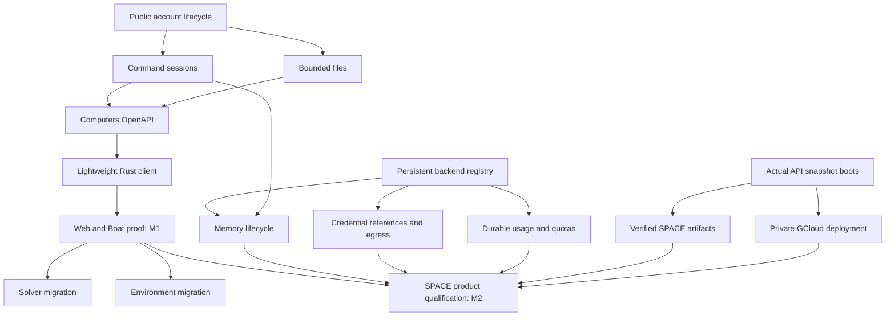

# SDK and Computers delivery plan

2026-10-17. Status: Computers source delivery complete under
[#11800](https://github.com/OpenAgentsInc/openagents/issues/11800); combined
SPACE live qualification remains pending. The [delivery record](computers-delivery-evidence.json)
audits the child issues and links their evidence. The
[master delegation](../audits/2026-10-16-master-delegation.md#after-close-checks)
assigns remaining deployments and live checks to lane 0. Source completion does
not enable customer SPACE access, publication, or pricing. The release brief
separately authorizes Coder binary work; #11823 remains lane 1's delivery.

The owner subsequently selected [Coder Desktop](../coder-desktop/README.md), a separate
Zeron fork, as the first external SDK reference client. Its application work
starts with auth/history exports in #11826/#11828 independently of Computers
and web adoption. Keep the existing M1
web proof and M2 backend qualification; the desktop does not add a platform
release prerequisite to either milestone. Its plan records the cross-repository
dependency, host-consumer requirements, and Rust/TypeScript boundary.

## First desktop delivery: authentication and history

Owner priority, 2026-10-15: the first SDK-backed desktop journey is sign in,
see previous account chats in the sidebar, and open any saved chat.
[#11824](https://github.com/OpenAgentsInc/openagents/issues/11824) tracks it.
All issues, including fork implementation, stay in `OpenAgentsInc/openagents`.
Computers M1/M2 remain independent; their implementations do not gate this
read-only milestone. Coordinate client naming with #11805 and schema coverage
with #11818, without waiting for the Computers specification or package publication.

| Issue | Deliverable | Completion prerequisites |
| --- | --- | --- |
| [#11825](https://github.com/OpenAgentsInc/openagents/issues/11825) | Verify public device sign-in, account discovery, errors, and OpenAPI | None |
| [#11826](https://github.com/OpenAgentsInc/openagents/issues/11826) | Export lightweight Rust SDK auth and caller-controlled credential storage | #11825 |
| [#11827](https://github.com/OpenAgentsInc/openagents/issues/11827) | Qualify complete chat lists, message pages, saved files/tool details, archive and shared-project reads | None |
| [#11828](https://github.com/OpenAgentsInc/openagents/issues/11828) | Export typed SDK history reads and bounded pagination | #11826, #11827 |
| [#11829](https://github.com/OpenAgentsInc/openagents/issues/11829) | Isolated desktop identity, SDK sign-in, Keychain, restart, and sign-out | #11826 |
| [#11830](https://github.com/OpenAgentsInc/openagents/issues/11830) | Existing account chats in the GPUI sidebar | #11828, #11829 |
| [#11831](https://github.com/OpenAgentsInc/openagents/issues/11831) | Existing-chat transcript view with full available history | #11828, #11829 |
| [#11832](https://github.com/OpenAgentsInc/openagents/issues/11832) | External SDK example and complete desktop journey against deployed public handlers | #11830, #11831 |

The public auth schema (#11825) is implemented and deployed. The development
Rust auth facade is [`openagents-sdk`](../../crates/openagents-sdk/README.md)
(#11826); it reuses portable device parsing from `openagents-login` with the
CLI's `system` helpers disabled. Typed history reads (#11828) and macOS account,
sidebar, and transcript integration (#11829–#11831) are implemented. The desktop
[auth](../coder-desktop/auth-client-evidence.json),
[sidebar](../coder-desktop/history-sidebar-evidence.json), and
[reader](../coder-desktop/history-reader-evidence.json) records identify their
source pins and checks. The [standalone example](../../examples/sdk-history/README.md)
and [delivery evidence](../coder-desktop/delivery-evidence.json) complete #11832.
The public native read passed with disposable production test-account chats;
the current staging credential and real GitHub/Keychain checks remain in
`NEEDS_OWNER.md`. Package publication stays deferred.

The built device flow is `POST /v1/device/code`, `POST /v1/device/token`,
and `POST /v1/device/sign-out`; approval stays on the website. Reuse
`openagents-login` and the account service, not Zeron WorkOS/edge auth.
Sessions last 30 days with no refresh token; validate the restored account,
handle expiry/revocation, and clear private views on sign-out. Current app
reads cache successful auth checks for up to 30 seconds; qualification must
state and test the actual revocation bound. Default API credentials are
bearer app sessions; supported sign-in keys and `oak_` keys have different
route authority. Prefix matching never proves access.

The [saved history API](chat-history.md) adds bounded ID-order discovery,
archive/shared-project reads, revision-checked full transcripts, and saved
files, captures, and tool details. Its schemas are in `openapi.app.json`;
#11828 exposes typed SDK readers with account-bound references, cancellation,
unknown content, and explicit changed/missing results.
The [external-client evidence](history-client-evidence.json) records the
Git-pinned production read and fixture cleanup. The legacy routes keep distinct contracts:

- `GET /v1/threads`: offset/limit, at most 200 rows per page, with
  `threads`, `total`, `more`, and `next_offset`; excludes archived chats.
- `GET /v1/threads/{id}`: latest 200 nonempty messages with an `earlier`
  count. Do not treat it as the full transcript.
- `GET /v1/threads/{id}/messages`: oldest first, `after`/`limit`,
  `data`/`next`, at most 200 per page, with `msg_<index>` identities.
  Saved attachment fields currently return null; stored tool details need
  a public read mapping.
- Project-filtered chat lists use another cursor envelope/order. The
  legacy account list still has a 10,000-record ceiling; use `/v1/history`
  for bounded continuation beyond it.

Acceptance includes existing web and synced terminal/phone chats, long
histories, saved attachments/tool/thinking content, archived chats, and
current shared-project access. Unsynced local history stays local. Reads
must not send, resume, allocate, wake, or change a chat. Test two synthetic
accounts, late results after account switch, restart, denied/expired device
codes, revoked sessions/shares, missing/deleted chats, and unavailable
services. Use fake GitHub first, then dedicated staging accounts; never
inspect the owner's chat contents as acceptance evidence. #11832 records
public server/spec/SDK/app revisions and cleanup. No new GitHub automation.

## Delivery outcome

For the independent Computers track, ship a public, account-scoped Computers API and lightweight Rust client that the
web itself consumes. Prove a complete useful workflow on Boat first, then repeat
it on a supported SPACE deployment. Keep additional backends and publishing
choices separate from that first useful delivery.

The [SDK overview](README.md) defines client/host/provider ownership. The
[Computers contract](computers.md) defines public requirements and placement.
The [SPACE integration roadmap](../cloud/space-integration-roadmap.md) supplies
production detail and measured constraints. This directory connects them to
implementation issues; proposed fields/endpoints remain proposals until shipped.

## Milestones and first work

| Milestone | Outcome | Completion issues |
| --- | --- | --- |
| First desktop: authentication and history | External sign-in, existing sidebar chats, complete saved history | [#11824](https://github.com/OpenAgentsInc/openagents/issues/11824)–[#11832](https://github.com/OpenAgentsInc/openagents/issues/11832) |
| M1: public Boat flow | Public lifecycle, command sessions/files, specification/client, and real web adoption | [#11801](https://github.com/OpenAgentsInc/openagents/issues/11801), [#11802](https://github.com/OpenAgentsInc/openagents/issues/11802), [#11803](https://github.com/OpenAgentsInc/openagents/issues/11803), [#11804](https://github.com/OpenAgentsInc/openagents/issues/11804), [#11805](https://github.com/OpenAgentsInc/openagents/issues/11805), [#11806](https://github.com/OpenAgentsInc/openagents/issues/11806) |
| M2: supported SPACE flow | Stable backend dispatch, actual snapshot boots, verified environment, lifecycle/security/operations/usage, and product qualification | [#11809](https://github.com/OpenAgentsInc/openagents/issues/11809)–[#11816](https://github.com/OpenAgentsInc/openagents/issues/11816) |
| Independent adoption | Solver and Environment migrations, own-machine backend, broader API reference | [#11807](https://github.com/OpenAgentsInc/openagents/issues/11807), [#11808](https://github.com/OpenAgentsInc/openagents/issues/11808), [#11817](https://github.com/OpenAgentsInc/openagents/issues/11817), [#11818](https://github.com/OpenAgentsInc/openagents/issues/11818) |
| Conditional follow-ups | Host publication, external providers, additional language clients, optional payment, and next-release CLI | [#11819](https://github.com/OpenAgentsInc/openagents/issues/11819)–[#11823](https://github.com/OpenAgentsInc/openagents/issues/11823) |

For the first desktop milestone, start #11825 and #11827. The Computers
account boundary in [#11801](https://github.com/OpenAgentsInc/openagents/issues/11801)
is deployed; its [verification record](computers-lifecycle-evidence.json) pins
both images and the completed staging workflows. Command sessions
[#11802](https://github.com/OpenAgentsInc/openagents/issues/11802) are deployed;
their [verification record](computers-commands-evidence.json) covers bounded
output, retries, cancellation, and timeout. Bounded workspace files
[#11803](https://github.com/OpenAgentsInc/openagents/issues/11803) are deployed;
their [verification record](computers-files-evidence.json) covers binary and empty
transfers, checksums, path restrictions, stop/wake persistence, and cleanup.
The Computers specification
[#11804](https://github.com/OpenAgentsInc/openagents/issues/11804) is published;
its [verification record](computers-openapi-evidence.json) covers deterministic
Rust generation, runtime/schema checks, and an independent public workflow.
Continue with the Rust client
[#11805](https://github.com/OpenAgentsInc/openagents/issues/11805) in the owner's
requested sequence. Keep using the same worktree and push and close each issue
before starting the next one.

M1 does not wait for SPACE, all-route OpenAPI coverage, own machines, payments,
or publication. M2 does not wait for external providers, a new Coder release,
or unrelated internal migrations. Solver and Environments can adopt the proven
Boat client without waiting for SPACE.

## Issue directory

Issue bodies contain implementation scope, negative cases, acceptance checks,
verification, cleanup, and boundaries. Native GitHub dependencies are the source
of truth for completion blockers. All new issues belong to the OpenAgents board
(project 19); update any additional board memberships when an issue changes.

### First public Boat delivery

| Issue | Scope | Completion prerequisites |
| --- | --- | --- |
| [#11801](https://github.com/OpenAgentsInc/openagents/issues/11801) | expose account-authenticated lifecycle operations on the public API | None in this plan |
| [#11802](https://github.com/OpenAgentsInc/openagents/issues/11802) | add durable command sessions, streaming, and confirmed cancellation | [#11801](https://github.com/OpenAgentsInc/openagents/issues/11801) |
| [#11803](https://github.com/OpenAgentsInc/openagents/issues/11803) | expose account-scoped bounded file reads and writes | [#11801](https://github.com/OpenAgentsInc/openagents/issues/11801) |
| [#11804](https://github.com/OpenAgentsInc/openagents/issues/11804) | publish the Computers OpenAPI contract with compatibility and regeneration checks | [#11801](https://github.com/OpenAgentsInc/openagents/issues/11801), [#11802](https://github.com/OpenAgentsInc/openagents/issues/11802), [#11803](https://github.com/OpenAgentsInc/openagents/issues/11803) |
| [#11805](https://github.com/OpenAgentsInc/openagents/issues/11805) | implement the lightweight Rust Computers client and stable retry identities | [#11804](https://github.com/OpenAgentsInc/openagents/issues/11804) |
| [#11806](https://github.com/OpenAgentsInc/openagents/issues/11806) | move web chat computers onto the public Rust client and prove the first Boat flow | [#11805](https://github.com/OpenAgentsInc/openagents/issues/11805) |

### Internal consumer migrations

| Issue | Scope | Completion prerequisites |
| --- | --- | --- |
| [#11807](https://github.com/OpenAgentsInc/openagents/issues/11807) | migrate Solver allocation and cleanup off direct Boat calls | [#11806](https://github.com/OpenAgentsInc/openagents/issues/11806) |
| [#11808](https://github.com/OpenAgentsInc/openagents/issues/11808) | migrate Environment builders and verifiers onto shared lifecycle ownership | [#11806](https://github.com/OpenAgentsInc/openagents/issues/11806) |

### SPACE foundations and qualification

| Issue | Scope | Completion prerequisites |
| --- | --- | --- |
| [#11809](https://github.com/OpenAgentsInc/openagents/issues/11809) | add persistent backend dispatch and requirement-based placement | None in this plan |
| [#11810](https://github.com/OpenAgentsInc/openagents/issues/11810) | select verified snapshot boots through the Computers API driver path | None in this plan |
| [#11811](https://github.com/OpenAgentsInc/openagents/issues/11811) | build and freshly verify immutable development environment artifacts | [#11810](https://github.com/OpenAgentsInc/openagents/issues/11810) |
| [#11812](https://github.com/OpenAgentsInc/openagents/issues/11812) | declare memory-preserving suspend and qualify wake, cancellation, and recovery | [#11809](https://github.com/OpenAgentsInc/openagents/issues/11809), [#11802](https://github.com/OpenAgentsInc/openagents/issues/11802) |
| [#11813](https://github.com/OpenAgentsInc/openagents/issues/11813) | authorize credential references and enforce immutable egress profiles on GCloud | [#11809](https://github.com/OpenAgentsInc/openagents/issues/11809) |
| [#11814](https://github.com/OpenAgentsInc/openagents/issues/11814) | deploy a private maintained GCloud service with durable storage and bounded capacity | [#11810](https://github.com/OpenAgentsInc/openagents/issues/11810) |
| [#11815](https://github.com/OpenAgentsInc/openagents/issues/11815) | persist usage, quotas, and uncertain reservations across backends | [#11809](https://github.com/OpenAgentsInc/openagents/issues/11809) |
| [#11816](https://github.com/OpenAgentsInc/openagents/issues/11816) | qualify the public SDK and web-chat path, recovery, and staged rollout | [#11806](https://github.com/OpenAgentsInc/openagents/issues/11806), [#11809](https://github.com/OpenAgentsInc/openagents/issues/11809), [#11810](https://github.com/OpenAgentsInc/openagents/issues/11810), [#11811](https://github.com/OpenAgentsInc/openagents/issues/11811), [#11812](https://github.com/OpenAgentsInc/openagents/issues/11812), [#11813](https://github.com/OpenAgentsInc/openagents/issues/11813), [#11814](https://github.com/OpenAgentsInc/openagents/issues/11814), [#11815](https://github.com/OpenAgentsInc/openagents/issues/11815) |

### Additional supported backend and API completeness

| Issue | Scope | Completion prerequisites |
| --- | --- | --- |
| [#11817](https://github.com/OpenAgentsInc/openagents/issues/11817) | implement an enrolled-own-machine adapter with safe attach and detach semantics | [#11809](https://github.com/OpenAgentsInc/openagents/issues/11809), [#11802](https://github.com/OpenAgentsInc/openagents/issues/11802), [#11803](https://github.com/OpenAgentsInc/openagents/issues/11803) |
| [#11818](https://github.com/OpenAgentsInc/openagents/issues/11818) | inventory public API routes and incrementally extend the unified OpenAPI reference | None in this plan |

### Publication policy and native CLI follow-ups

| Issue | Scope | Completion prerequisites |
| --- | --- | --- |
| [#11819](https://github.com/OpenAgentsInc/openagents/issues/11819) | define the host public boundary and publication evidence | None in this plan; activation condition below |
| [#11820](https://github.com/OpenAgentsInc/openagents/issues/11820) | specify external computer-provider admission and paid placement policy | None in this plan; activation condition below |
| [#11821](https://github.com/OpenAgentsInc/openagents/issues/11821) | generate additional language clients only after demand and repository decisions | [#11804](https://github.com/OpenAgentsInc/openagents/issues/11804); activation condition below |
| [#11822](https://github.com/OpenAgentsInc/openagents/issues/11822) | add opt-in x402 payment with spending caps and retry-safe execution | [#11805](https://github.com/OpenAgentsInc/openagents/issues/11805), [#11815](https://github.com/OpenAgentsInc/openagents/issues/11815); activation condition below |
| [#11823](https://github.com/OpenAgentsInc/openagents/issues/11823) | consume the public Computers SDK for remote work and agent tools | [#11816](https://github.com/OpenAgentsInc/openagents/issues/11816); release brief authorizes binary work |

## Qualification scenarios

### M1: Boat through the public SDK and web

Qualified on 2026-10-16 in [#11806](https://github.com/OpenAgentsInc/openagents/issues/11806).
The [evidence record](computers-web-evidence.json) identifies the deployed code,
85 targeted checks, staging and production SDK workflows, real web development
and follow-up, restart/output recovery, account isolation, cancellation, and
cleanup. It also records the corrected live defects, the fixture's compiler
setup, and unrelated verification failures. SPACE qualification remains M2.

1. Authenticate as the dedicated test account using the documented public
   credential type. Never give the client an internal service bearer or trust
   an account header supplied by the caller.
2. Create and observe a Boat computer with a stable logical request key.
3. Upload a fixture, execute an identified command, and attach/read its stdout,
   stderr, result, and bounded output history.
4. Stop/wake the same computer and read the unchanged fixture.
5. Repeat useful task/follow-up behavior in a web chat using the same account
   contract and client, preserving chat/task identity and grants.
6. Exercise a second synthetic account, a conflicting retry, response/stream
   loss, service restart, and explicit process cancellation. Verify no access
   crossover, duplicate allocation, or command replay.
7. Delete all test chats/computers/projects and confirm resource/process cleanup.
   Retain scrubbed commit/spec/client identities, outcomes, and timing boundaries.

### M2: supported SPACE through that same contract

The #11809–#11816 implementations are closed on code. The combined public
SDK/web journey and recovery matrix have not passed. Use the
[qualification runbook](space-qualification.md), [pending packet](space-qualification-packet.json),
and [assessment](space-qualification-assessment.json) for the remaining deployment
checks. Earlier driver latency and same-worker memory evidence retain their
narrow scope. Boat stays the public default, and pricing stays off.

Repeat M1 with explicit fast-sandbox placement and a verified development
artifact. Verify actual snapshot boots at fixed shape, preserve process/memory
and workspace across wake, renew credentials, and measure useful agent output.
Exercise durable checkpoint/worker-loss behavior, revoked grants, egress bypass,
capacity/storage failure, usage reconciliation, and cleanup. Record exact limits;
same-host restore does not prove cross-host recovery.

Keep the original snapshot create-to-first-command p50-under-two-seconds target,
with at least twenty comparable cold and snapshot attempts and p90/failure counts.
Report API acceptance, reconcile delay, readiness, attachment, repository setup,
wake, and model time separately. Set additional production thresholds from the
measured evidence before broad access. Never substitute Perplexity's numbers or
the spike's node-ready 319 ms for our API or user task latency.

Disable new SPACE placement and restore the prior default during rollback,
while continuing to observe, wake, stop, and delete already bound SPACE computers.
Defaults do not migrate existing computers. Verify Boat remains available.

## Activation conditions and scope boundaries

The [big-bang release brief](../audits/2026-10-16-coder-1.0-big-bang.md)
lifts the binary freeze and makes the next-release list Monday 1.0.0 scope.
The [completed SDK policy](release-policy.md) specifies #11819–#11822;
publication and commercial activation choices move to
[`NEEDS_OWNER.md`](../../NEEDS_OWNER.md#sdk-publication-and-commercial-activation).

- [#11819](https://github.com/OpenAgentsInc/openagents/issues/11819): Host facade and publication criteria are specified. Keep publication conditional on two qualified real non-Coder consumers and an owner-selected package/support policy.
- [#11820](https://github.com/OpenAgentsInc/openagents/issues/11820): Activate external provider work only after owner approval of trust, account consent, supported data classes, qualification, pricing, and payout policy.
- [#11821](https://github.com/OpenAgentsInc/openagents/issues/11821): Wait for a concrete language demand, owner repository/package decision, and explicit publication authorization; no TypeScript product code in this repository.
- [#11822](https://github.com/OpenAgentsInc/openagents/issues/11822): Activate only for a defined owner-approved paid offer and explicit client opt-in, after durable usage and payment/execution retry qualification.
- [#11823](https://github.com/OpenAgentsInc/openagents/issues/11823): Build native Computers SDK integration for Monday 1.0.0 after #11816 qualification; the freeze is no longer a blocker.

Close the policy issues after their scoped specifications are merged and checked;
owner-only activation stays in `NEEDS_OWNER.md`. These publication decisions are
not native blockers of M1 or M2. Preparation documents supported boundaries without
publishing packages, enrolling outside providers, spending money, creating other
repositories. Paid persistent computers require a
separate explicit entitlement and price policy; bounded operator qualification
can precede that commercial activation.

Snapshot/Fork remains unsupported for SPACE's pinned public adapter. Terminals,
previews, scheduled wake, and arbitrary customer/provider placement are separate
capabilities. An enrolled host adapter must prove non-destructive detach and
current workspace/command/file grants; it is not a simulated cloud computer.

## Verification

The Computers service guards money (usage, quotas) and authority (one
account's computers, files and checkpoints), under concurrency, retries and
uncertain driver outcomes. Its properties K1–K7 are
[verification target 2](../verification/targets.md#2-computers-the-lifecycle-commands-files-and-usage):
Stateright on the pure lifecycle core, Turmoil on the real API, and fuzzing
and Kani on the file-path check. Each touched issue's acceptance includes
its properties, and every counterexample becomes a `computer-conformance`
case.

## Issue handling, evidence, and completion

Claim an issue before implementation and release it when stopping. Keep native
blockers and every project board membership current. Mark ready scopes Todo,
open completion dependencies Blocked, and conditional scopes Blocked with the
activation reason rather than inventing a dependency on an unrelated issue.
The umbrella's completion blockers are M1 and M2, not every related proposal.

Close each child when its scoped code is on main and its focused checks pass,
under the release brief. Record deployments and live checks in the master's
After-close checks table; closing an issue does not mark those checks passed.
Close the umbrella after its source milestone children close. Keep the delivery
record explicit about pending SPACE qualification and the separately assigned
#11823 terminal work. Record owner-only activation in `NEEDS_OWNER.md`, and open
a new defect if later deployment or owner verification fails.

Use the pinned toolchain, affected-crate tests, and formatting for behavior;
documentation-only edits need links, referenced paths, and diff checks. Do not
require the full workspace release gate or unrelated phone/engine suites. Run
live acceptance only for the scoped flows being implemented. No GitHub workflows
or GitHub-billed automation.

Production checks use the dedicated test account; local authority/host tests use
synthetic accounts and temporary HOME/state/root/tasks. Never use the owner's
production account or real machines. Use isolated browser profiles through
`openagents browser run -- CMD` when browser verification is needed. Clean every
record, guest, process, private snapshot, disk, and temporary infrastructure
resource made by the checks. Evidence contains identities, outcomes, limits,
cost assumptions, and cleanup inventories, never secret values or private content.

## Existing completed work

- #11624: internal computer lifecycle, driver contract/conformance, and web chats.
- #11728: measured SPACE driver/GCE spike, including its negative HTTP snapshot
  adoption result; preserve its raw evidence and closed status.
- #11777: detailed SPACE production roadmap; this plan adds concrete issue links.
- #11709: desktop session configuration/resume work; use it as host-consumer
  evidence without duplicating or reopening its implementation scope.
- #11766: per-turn credential transport work; it does not prove secret-free RAM
  or snapshots. #11771 is Monday 1.0.0 scope under the big-bang release brief.

The initial #11818 inventory/composition milestone is implemented and deployed;
[route coverage](public-routes.md) and [evidence](public-reference-evidence.json)
record its scope. Incremental app-contract and System One schema work is tracked
in #11857 and #11858. Uncovered domains do not block the Computers slice.

The public System One composition and discovery work (#11858) is implemented
and deployed; [qualification evidence](systemone-evidence.json) records the
verified slice and its limits. Remaining application schema work is #11857.
