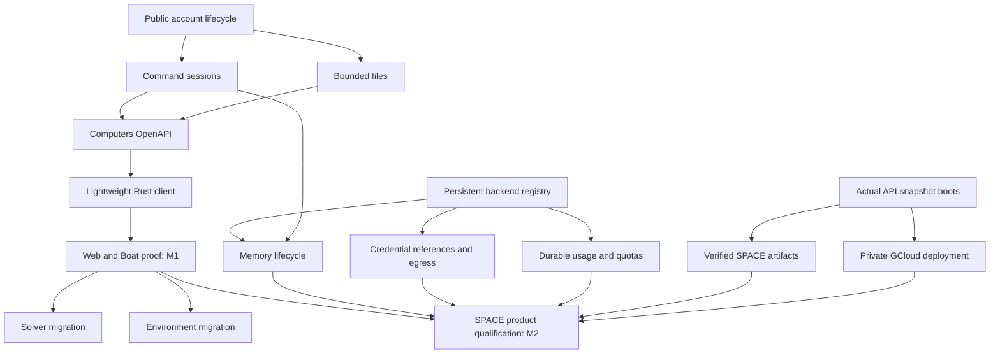

# SDK and Computers delivery plan

2026-10-15. Status: tracked implementation backlog. Umbrella:
[#11800](https://github.com/OpenAgentsInc/openagents/issues/11800).
The owner authorized this documentation and issue breakdown; creating the
backlog does not report implementation, authorize publication or a new Coder
release, or open production access.

The owner subsequently selected [Coder Desktop](../coder-desktop/README.md), a separate
Zeron fork, as the first external SDK reference client. Its application work
can begin against #11805 independently of web adoption. Keep the existing M1
web proof and M2 backend qualification; the desktop does not add a platform
release prerequisite to either milestone. Its plan records the cross-repository
dependency, host-consumer requirements, and Rust/TypeScript boundary.

## Delivery outcome

Ship a public, account-scoped Computers API and lightweight Rust client that the
web itself consumes. Prove a complete useful workflow on Boat first, then repeat
it on a supported SPACE deployment. Keep additional backends and publishing
choices separate from that first useful delivery.

The [SDK overview](README.md) defines client/host/provider ownership. The
[Computers contract](computers.md) defines public requirements and placement.
The [SPACE integration roadmap](../cloud/space-integration-roadmap.md) supplies
production detail and measured constraints. This directory connects them to
implementation issues; proposed fields/endpoints remain proposals until shipped.

## Milestones and first work

| Milestone | Outcome | Completion issues |
| --- | --- | --- |
| M1: public Boat flow | Public lifecycle, command sessions/files, specification/client, and real web adoption | [#11801](https://github.com/OpenAgentsInc/openagents/issues/11801), [#11802](https://github.com/OpenAgentsInc/openagents/issues/11802), [#11803](https://github.com/OpenAgentsInc/openagents/issues/11803), [#11804](https://github.com/OpenAgentsInc/openagents/issues/11804), [#11805](https://github.com/OpenAgentsInc/openagents/issues/11805), [#11806](https://github.com/OpenAgentsInc/openagents/issues/11806) |
| M2: supported SPACE flow | Stable backend dispatch, actual snapshot boots, verified environment, lifecycle/security/operations/usage, and product qualification | [#11809](https://github.com/OpenAgentsInc/openagents/issues/11809)–[#11816](https://github.com/OpenAgentsInc/openagents/issues/11816) |
| Independent adoption | Solver and Environment migrations, own-machine backend, broader API reference | [#11807](https://github.com/OpenAgentsInc/openagents/issues/11807), [#11808](https://github.com/OpenAgentsInc/openagents/issues/11808), [#11817](https://github.com/OpenAgentsInc/openagents/issues/11817), [#11818](https://github.com/OpenAgentsInc/openagents/issues/11818) |
| Conditional follow-ups | Host publication, external providers, additional language clients, optional payment, and next-release CLI | [#11819](https://github.com/OpenAgentsInc/openagents/issues/11819)–[#11823](https://github.com/OpenAgentsInc/openagents/issues/11823) |

Start [#11801](https://github.com/OpenAgentsInc/openagents/issues/11801) for the public account boundary, with [#11809](https://github.com/OpenAgentsInc/openagents/issues/11809) and
[#11810](https://github.com/OpenAgentsInc/openagents/issues/11810) independently eligible for preparation. The broader route
inventory [#11818](https://github.com/OpenAgentsInc/openagents/issues/11818) can also proceed independently. Command/file design
and the specification can be drafted alongside lifecycle development; their
native prerequisites describe completion/integration dependencies, not a ban
on useful independent preparation.

M1 does not wait for SPACE, all-route OpenAPI coverage, own machines, payments,
or publication. M2 does not wait for external providers, a new Coder release,
or unrelated internal migrations. Solver and Environments can adopt the proven
Boat client without waiting for SPACE.

## Issue directory

Issue bodies contain implementation scope, negative cases, acceptance checks,
verification, cleanup, and boundaries. Native GitHub dependencies are the source
of truth for completion blockers. All new issues belong to the OpenAgents board
(project 19); update any additional board memberships when an issue changes.

### First public Boat delivery

| Issue | Scope | Completion prerequisites |
| --- | --- | --- |
| [#11801](https://github.com/OpenAgentsInc/openagents/issues/11801) | expose account-authenticated lifecycle operations on the public API | None in this plan |
| [#11802](https://github.com/OpenAgentsInc/openagents/issues/11802) | add durable command sessions, streaming, and confirmed cancellation | [#11801](https://github.com/OpenAgentsInc/openagents/issues/11801) |
| [#11803](https://github.com/OpenAgentsInc/openagents/issues/11803) | expose account-scoped bounded file reads and writes | [#11801](https://github.com/OpenAgentsInc/openagents/issues/11801) |
| [#11804](https://github.com/OpenAgentsInc/openagents/issues/11804) | publish the Computers OpenAPI contract with compatibility and regeneration checks | [#11801](https://github.com/OpenAgentsInc/openagents/issues/11801), [#11802](https://github.com/OpenAgentsInc/openagents/issues/11802), [#11803](https://github.com/OpenAgentsInc/openagents/issues/11803) |
| [#11805](https://github.com/OpenAgentsInc/openagents/issues/11805) | implement the lightweight Rust Computers client and stable retry identities | [#11804](https://github.com/OpenAgentsInc/openagents/issues/11804) |
| [#11806](https://github.com/OpenAgentsInc/openagents/issues/11806) | move web chat computers onto the public Rust client and prove the first Boat flow | [#11805](https://github.com/OpenAgentsInc/openagents/issues/11805) |

### Internal consumer migrations

| Issue | Scope | Completion prerequisites |
| --- | --- | --- |
| [#11807](https://github.com/OpenAgentsInc/openagents/issues/11807) | migrate Solver allocation and cleanup off direct Boat calls | [#11806](https://github.com/OpenAgentsInc/openagents/issues/11806) |
| [#11808](https://github.com/OpenAgentsInc/openagents/issues/11808) | migrate Environment builders and verifiers onto shared lifecycle ownership | [#11806](https://github.com/OpenAgentsInc/openagents/issues/11806) |

### SPACE foundations and qualification

| Issue | Scope | Completion prerequisites |
| --- | --- | --- |
| [#11809](https://github.com/OpenAgentsInc/openagents/issues/11809) | add persistent backend dispatch and requirement-based placement | None in this plan |
| [#11810](https://github.com/OpenAgentsInc/openagents/issues/11810) | select verified snapshot boots through the Computers API driver path | None in this plan |
| [#11811](https://github.com/OpenAgentsInc/openagents/issues/11811) | build and freshly verify immutable development environment artifacts | [#11810](https://github.com/OpenAgentsInc/openagents/issues/11810) |
| [#11812](https://github.com/OpenAgentsInc/openagents/issues/11812) | declare memory-preserving suspend and qualify wake, cancellation, and recovery | [#11809](https://github.com/OpenAgentsInc/openagents/issues/11809), [#11802](https://github.com/OpenAgentsInc/openagents/issues/11802) |
| [#11813](https://github.com/OpenAgentsInc/openagents/issues/11813) | authorize credential references and enforce immutable egress profiles on GCloud | [#11809](https://github.com/OpenAgentsInc/openagents/issues/11809) |
| [#11814](https://github.com/OpenAgentsInc/openagents/issues/11814) | deploy a private maintained GCloud service with durable storage and bounded capacity | [#11810](https://github.com/OpenAgentsInc/openagents/issues/11810) |
| [#11815](https://github.com/OpenAgentsInc/openagents/issues/11815) | persist usage, quotas, and uncertain reservations across backends | [#11809](https://github.com/OpenAgentsInc/openagents/issues/11809) |
| [#11816](https://github.com/OpenAgentsInc/openagents/issues/11816) | qualify the public SDK and web-chat path, recovery, and staged rollout | [#11806](https://github.com/OpenAgentsInc/openagents/issues/11806), [#11809](https://github.com/OpenAgentsInc/openagents/issues/11809), [#11810](https://github.com/OpenAgentsInc/openagents/issues/11810), [#11811](https://github.com/OpenAgentsInc/openagents/issues/11811), [#11812](https://github.com/OpenAgentsInc/openagents/issues/11812), [#11813](https://github.com/OpenAgentsInc/openagents/issues/11813), [#11814](https://github.com/OpenAgentsInc/openagents/issues/11814), [#11815](https://github.com/OpenAgentsInc/openagents/issues/11815) |

### Additional supported backend and API completeness

| Issue | Scope | Completion prerequisites |
| --- | --- | --- |
| [#11817](https://github.com/OpenAgentsInc/openagents/issues/11817) | implement an enrolled-own-machine adapter with safe attach and detach semantics | [#11809](https://github.com/OpenAgentsInc/openagents/issues/11809), [#11802](https://github.com/OpenAgentsInc/openagents/issues/11802), [#11803](https://github.com/OpenAgentsInc/openagents/issues/11803) |
| [#11818](https://github.com/OpenAgentsInc/openagents/issues/11818) | inventory public API routes and incrementally extend the unified OpenAPI reference | None in this plan |

### Deferred follow-ups

| Issue | Scope | Completion prerequisites |
| --- | --- | --- |
| [#11819](https://github.com/OpenAgentsInc/openagents/issues/11819) | define the host public boundary and publication evidence without changing frozen binaries | None in this plan; activation condition below |
| [#11820](https://github.com/OpenAgentsInc/openagents/issues/11820) | specify external computer-provider admission and paid placement policy | None in this plan; activation condition below |
| [#11821](https://github.com/OpenAgentsInc/openagents/issues/11821) | generate additional language clients only after demand and repository decisions | [#11804](https://github.com/OpenAgentsInc/openagents/issues/11804); activation condition below |
| [#11822](https://github.com/OpenAgentsInc/openagents/issues/11822) | add opt-in x402 payment with spending caps and retry-safe execution | [#11805](https://github.com/OpenAgentsInc/openagents/issues/11805), [#11815](https://github.com/OpenAgentsInc/openagents/issues/11815); activation condition below |
| [#11823](https://github.com/OpenAgentsInc/openagents/issues/11823) | consume the public Computers SDK for remote work and agent tools | [#11806](https://github.com/OpenAgentsInc/openagents/issues/11806); activation condition below |

## Qualification scenarios

### M1: Boat through the public SDK and web

1. Authenticate as the dedicated test account using the documented public
   credential type. Never give the client an internal service bearer or trust
   an account header supplied by the caller.
2. Create and observe a Boat computer with a stable logical request key.
3. Upload a fixture, execute an identified command, and attach/read its stdout,
   stderr, result, and bounded output history.
4. Stop/wake the same computer and read the unchanged fixture.
5. Repeat useful task/follow-up behavior in a web chat using the same account
   contract and client, preserving chat/task identity and grants.
6. Exercise a second synthetic account, a conflicting retry, response/stream
   loss, service restart, and explicit process cancellation. Verify no access
   crossover, duplicate allocation, or command replay.
7. Delete all test chats/computers/projects and confirm resource/process cleanup.
   Retain scrubbed commit/spec/client identities, outcomes, and timing boundaries.

### M2: supported SPACE through that same contract

Repeat M1 with explicit fast-sandbox placement and a verified development
artifact. Verify actual snapshot boots at fixed shape, preserve process/memory
and workspace across wake, renew credentials, and measure useful agent output.
Exercise durable checkpoint/worker-loss behavior, revoked grants, egress bypass,
capacity/storage failure, usage reconciliation, and cleanup. Record exact limits;
same-host restore does not prove cross-host recovery.

Keep the original snapshot create-to-first-command p50-under-two-seconds target,
with at least twenty comparable cold and snapshot attempts and p90/failure counts.
Report API acceptance, reconcile delay, readiness, attachment, repository setup,
wake, and model time separately. Set additional production thresholds from the
measured evidence before broad access. Never substitute Perplexity's numbers or
the spike's node-ready 319 ms for our API or user task latency.

Disable new SPACE placement and restore the prior default during rollback,
while continuing to observe, wake, stop, and delete already bound SPACE computers.
Defaults do not migrate existing computers. Verify Boat remains available.

## Activation conditions and scope boundaries

- [#11819](https://github.com/OpenAgentsInc/openagents/issues/11819): Defer publication until an explicit boundary, two real non-Coder consumers, and owner publication/release decisions; binary-only changes wait for the Coder freeze to lift.
- [#11820](https://github.com/OpenAgentsInc/openagents/issues/11820): Activate external provider work only after owner approval of trust, account consent, supported data classes, qualification, pricing, and payout policy.
- [#11821](https://github.com/OpenAgentsInc/openagents/issues/11821): Wait for a concrete language demand, owner repository/package decision, and explicit publication authorization; no TypeScript product code in this repository.
- [#11822](https://github.com/OpenAgentsInc/openagents/issues/11822): Activate only for a defined owner-approved paid offer and explicit client opt-in, after durable usage and payment/execution retry qualification.
- [#11823](https://github.com/OpenAgentsInc/openagents/issues/11823): Binary-dependent implementation waits for the owner to lift the Coder 1.0.0 freeze and authorize a release.

These follow-ups remain open with their conditions recorded. They are not native
blockers of M1 or M2. Preparation can document supported boundaries without
publishing packages, enrolling outside providers, spending money, creating other
repositories, or changing frozen binaries. Paid persistent computers require a
separate explicit entitlement and price policy; bounded operator qualification
can precede that commercial activation.

Snapshot/Fork remains unsupported for SPACE's pinned public adapter. Terminals,
previews, scheduled wake, and arbitrary customer/provider placement are separate
capabilities. An enrolled host adapter must prove non-destructive detach and
current workspace/command/file grants; it is not a simulated cloud computer.

## Verification

The Computers service guards money (usage, quotas) and authority (one
account's computers, files and checkpoints), under concurrency, retries and
uncertain driver outcomes. Its properties K1–K7 are
[verification target 2](../verification/targets.md#2-computers-the-lifecycle-commands-files-and-usage):
Stateright on the pure lifecycle core, Turmoil on the real API, and fuzzing
and Kani on the file-path check. Each touched issue's acceptance includes
its properties, and every counterexample becomes a `computer-conformance`
case.

## Issue handling, evidence, and completion

Claim an issue before implementation and release it when stopping. Keep native
blockers and every project board membership current. Mark ready scopes Todo,
open completion dependencies Blocked, and conditional scopes Blocked with the
activation reason rather than inventing a dependency on an unrelated issue.
The umbrella's completion blockers are M1 and M2, not every related proposal.

The documentation/issue-planning pass does not claim implementation issues or
mark them done. Release the umbrella claim after the plan is pushed; leave it
open tracking delivery. Close each child as soon as its scope is merged to main,
its own checks pass, and its required deploy is done. Record owner-only activation
in `NEEDS_OWNER.md`, and open a new defect if later owner verification fails.

Use the pinned toolchain, affected-crate tests, and formatting for behavior;
documentation-only edits need links, referenced paths, and diff checks. Do not
require the full workspace release gate or unrelated phone/engine suites. Run
live acceptance only for the scoped flows being implemented. No GitHub workflows
or GitHub-billed automation.

Production checks use the dedicated test account; local authority/host tests use
synthetic accounts and temporary HOME/state/root/tasks. Never use the owner's
production account or real machines. Use isolated browser profiles through
`openagents browser run -- CMD` when browser verification is needed. Clean every
record, guest, process, private snapshot, disk, and temporary infrastructure
resource made by the checks. Evidence contains identities, outcomes, limits,
cost assumptions, and cleanup inventories, never secret values or private content.

## Existing completed work

- #11624: internal computer lifecycle, driver contract/conformance, and web chats.
- #11728: measured SPACE driver/GCE spike, including its negative HTTP snapshot
  adoption result; preserve its raw evidence and closed status.
- #11777: detailed SPACE production roadmap; this plan adds concrete issue links.
- #11709: desktop session configuration/resume work; use it as host-consumer
  evidence without duplicating or reopening its implementation scope.
- #11766: per-turn credential transport work; it does not prove secret-free RAM
  or snapshots. #11771 remains in the existing frozen-binary next-release list.
