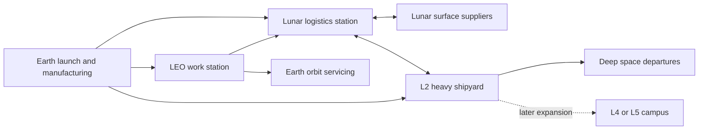

# Phased cislunar stations and spacecraft construction strategy

Planning date: October 14, 2026. Example funding and program start: January
2027. If funding starts later, move the dates by the same interval.

We should start with a robotic work station in low Earth orbit, develop lunar
transport and fuel handling in parallel, then build a lunar logistics station
and a dedicated heavy shipyard in an Earth–Moon L2 halo orbit. The first
station earns flight experience and serves Earth-orbit customers; later
stations extend the same equipment and services across cislunar space.

The long-term business is spacecraft assembly, delivery, maintenance, and
refueling. Stations are facilities that make those services possible. Each
new location must improve delivery cost, turnaround, construction capacity,
or access for a defined set of customers.

This is an aggressive startup plan with substantial funding available at
the start. All future dates, sizes, capacities, staffing levels, and milestone
thresholds below are **proposed planning targets [P]**, not demonstrated
capabilities or supplier commitments. Sourced flight history and physical
facts carry **[V]**. The engineering gates determine expansion; missing a gate
moves the dependent milestone, rather than changing its meaning.

## Decisions to carry into preliminary design

- Make the first station robotic and uncrewed. Buy a flight-proven bus,
  launch services, and propulsion where suitable; develop the assembly tools,
  interfaces, and operating system that distinguish the company.
- Keep the LEO station operating after expansion. Build new stations for new
  roles rather than moving the entire company to the Moon.
- Develop transport, cryogenic storage, and lunar prospecting alongside the
  first station. They have separate flight programs and schedules.
- Select the lunar logistics orbit from customer routes. An L2-family near
  rectilinear halo orbit (NRHO) is the baseline candidate; a conventional L2
  halo is the baseline for the later heavy shipyard.
- Preserve Earth's view of the Moon. Avoid a large facility centered on the
  Earth–Moon L1 line, and check station silhouettes, transits, and reflected
  light from Earth for every proposed orbit and expansion.
- Supply early operations from Earth. Treat lunar oxygen and materials as
  later supply options whose production and delivery must be demonstrated.
- Add crew only when the operational benefit justifies life support,
  radiation protection, emergency return, and a separately qualified vehicle.

## The network and the job of each location

Here, L1, L2, L4, and L5 mean the **Earth–Moon** system. The existing Verse
Lagrange 1 zone uses **Sun–Earth** L1; its location is a different system.

| Region or facility | Role | Initial approach | Expansion condition |
| --- | --- | --- | --- |
| Earth launch sites and ground operations | Manufacture modules, integrate cargo, launch, and control the fleet | Buy launch and tracking services; own payload integration and flight operations | Sustained demand supports dedicated integration capacity |
| LEO work station | Robotics qualification, assembly, inspection, repair, and cargo preparation | First owned station; modular and uncrewed | Repeatable assembly and contracted work justify additional bays |
| Medium Earth orbit, GEO, and high Earth orbit | Customer delivery, servicing, and transfer staging | Serve with mobile vehicles; add fuel packages where a route needs them | A permanent depot saves more transport and waiting than it costs |
| Earth–Moon transfer routes | Carry parts, propellant, and finished spacecraft | A fleet of cargo carriers with defined destination, payload, and return capability | Repeat deliveries justify reusable tugs and higher cadence |
| Lunar logistics station | Receive Earth cargo, exchange lander loads, store spares, and service vehicles | Candidate NRHO; use standardized cargo and fuel interfaces | Surface traffic and repeat transport support a dedicated port |
| Low lunar orbit | Surface survey, landing support, and local deliveries | Mobile landers, survey spacecraft, and relay services | Add a local depot only if a specific landing route benefits |
| Lunar surface | Prospect resources, produce oxygen, prepare construction materials, and maintain landers | Buy initial landings; fly a small extraction pilot | Sustained product recovery and delivered cost justify an industrial site |
| L2 heavy shipyard | Assemble large ships, inspect structures, install propulsion, and prepare departures | Dedicated halo selected for construction and communications | Flight assembly and a funded delivery pipeline support scale |
| L4 or L5 region | Later storage, manufacturing, or habitation campus | Study and send a small pathfinder before committing a station | A distinct customer or industrial advantage survives full orbit and logistics analysis |
| L3 region | Possible future specialized operations | Serve a justified mission with a mobile asset | No permanent station in the initial plan |

Coverage means being able to deliver services across these regions. It does
not require an owned station in every orbit or at every Lagrange point.

The arrows show candidate services, not mandatory stops. A module that passes
all acceptance checks on Earth can travel directly to the lunar port or
shipyard. Routing all cargo through LEO would add unnecessary handling.

## Why the first station should be in LEO

Our first engineering problem is repeatable robotic construction in space.
LEO lets us fly replacement hardware and customer payloads without also
developing a lunar cargo route for every experiment. It provides an earlier
place to sell assembly and inspection services. This is a program judgment;
orbit, inclination, customer compatibility, drag, debris exposure, and
disposal still need a mission-specific trade.

Use cooperative targets with grapple fixtures, replaceable modules, and
accessible connectors. NASA and CSA have demonstrated robotic servicing
tasks on the ISS [V], but those precedents do not establish autonomous
multi-arm construction of a large ship.
[NASA servicing demonstration](https://www.nasa.gov/news-release/nasa-and-csa-robotic-operations-advance-satellite-servicing/)

Avoid making the first product the repair of arbitrary, unprepared
satellites. NASA discontinued OSAM-1 after technical, cost, and schedule
problems, together with a shift away from servicing unprepared spacecraft
and the absence of a committed partner [V]. Our response is prepared
interfaces, bounded tasks, and a customer payload on each early flight.
[NASA OSAM-1 decision](https://www.nasa.gov/missions/update-on-status-of-nasas-osam-1-project/)

## Orbit choices for the later stations

### Lunar logistics station

Evaluate an NRHO against a conventional L2 halo and a distant retrograde
lunar orbit for the actual Earth-cargo and surface-lander routes. Include
round-trip propellant, flight time, launch windows, eclipse duration,
communications, rendezvous, and contingency recovery. An apparently cheap
one-way transfer is not enough to choose a reusable transport system.

Gateway's selected NRHO supports lunar surface access and uninterrupted
Earth communications [V]. CAPSTONE entered an NRHO and completed its primary
orbit-characterization objectives [V]. Those are useful precedents for a
logistics port, rather than evidence that a large factory should use the
same orbit.
[Gateway orbit](https://www.nasa.gov/gateway-frequently-asked-questions/),
[CAPSTONE flight results](https://www.nasa.gov/smallspacecraft/capstone/)

### L2 heavy shipyard

Favor a conventional halo with generous minimum lunar distance for a
factory handling long, flexible structures. The selection must demonstrate
acceptable gravity-gradient loads, year-round lighting and eclipse power,
Earth visibility, station-keeping, and cargo access using an ephemeris model
that includes solar perturbations. Proximity to L2 alone establishes none
of those requirements.

At the exact L2 point, the Moon blocks Earth. An appropriately selected halo
can move the factory clear of that alignment. From Earth, a facility beyond
the Moon cannot occult the lunar surface, although visible facilities near
the limb and bright reflections still matter to the owner's visual preference.
Verify the actual geometry rather than assuming every halo has the desired
visibility. See [astrodynamics.md](astrodynamics.md).

L1 remains a comparison case for transport cost, even though the visual
preference rules out a large facility centered there. A NASA infrastructure
study describes broadly similar orbital access costs for L1 and L2 [V]; our
vehicle and route calculations must decide the difference for this network.
[NASA depot architecture study](https://ntrs.nasa.gov/api/citations/20120015297/downloads/20120015297.pdf)

### L4 and L5 expansion

L4 and L5 are stable in the ideal Earth–Moon three-body model [V]. Real
solar perturbations, radiation pressure, and formation behavior still need
analysis. They deserve a later campus study, but their stability does not
establish the best cost for cargo delivery or spacecraft departures.
[NASA Lagrange-point explanation](https://science.nasa.gov/solar-system/resources/faq/what-are-lagrange-points/)

Target a small L4 or L5 pathfinder in 2031–2034 [P], sharing navigation and
communications hardware with the lunar program. An optional first campus
in 2037–2042 [P] follows only if the pathfinder and logistics comparison
support a distinct storage, manufacturing, or habitation service. It is a
fourth station option, separate from expansion of the L2 shipyard.

## Aggressive baseline schedule

Time zero is funded program start. The calendar assumes January 2027.
Work overlaps: later design starts before earlier operations finish, while
flight deployment waits for the relevant engineering gate. Every range in
this table is [P].

| Phase | Months from start | Calendar target | Flight result | Gate for the next deployment |
| --- | --- | --- | --- | --- |
| Ground qualification and procurement | 0–12 | 2027 | Integrated station, arm, docking, and cargo prototypes; launch slots reserved | Interfaces frozen; flight parts ordered; structural, thermal, and fault tests pass |
| Orbital assembly demonstrator | 12–18 launch; 18–24 evaluation | 2028 launch; qualification through early 2029 | A hosted or small free-flying robot picks, installs, inspects, and removes prepared parts | Repeated assembly, safe contact, autonomous stop, and recovery demonstrated |
| LEO work station | 30–42 | Second half of 2029–second half of 2030 | An owned robotic station begins assembly and customer work | Cargo capture, module replacement, commissioning, and sustained operation pass |
| Cislunar pathfinder and transport demonstrations | 18–48 | Second half of 2028–early 2031 | Small lunar-orbit pathfinder, followed by cargo delivery and rendezvous demonstrations | Orbit operations, ground coverage, delivery accuracy, and transport propellant budget measured |
| Lunar logistics station | 48–66 | 2031–second half of 2032 | A robotic lunar port receives multiple deliveries and exchanges cargo with a lander | Repeat transport and emergency recovery work; storage and fuel interfaces qualified |
| L2 assembly pilot | 60–84 | 2032–2034 | A separate construction platform assembles and commissions a modest spacecraft | Base reaction control, structural inspection, fuel loading, and a departure burn demonstrated |
| Initial heavy shipyard | 84–108 | 2034–2036 | Construction of the first 100–300 t wet spacecraft | Delivered cargo flow, flight-qualified structure, propulsion, and customer mission all close |
| Industrial expansion | 108–144 | 2036–2039 | More bays, larger power and fuel capacity, and repeated large-ship deliveries | Measured throughput supports additional launches and transport vehicles |
| Thousand-tonne spacecraft program | 144–180 | 2039–2042 | A mission-specific spacecraft approaching 1,000 t wet | Hundreds of tonnes of dry hardware, propellant supply, propulsion, and assembly scale demonstrated |

The first demo's short schedule requires existing spacecraft hardware and
a bounded payload. A station developed from a clean-sheet bus, new docking
system, new arms, and new propulsion together does not fit that schedule.

The earliest heavy-ship date assumes a successful flight sequence. Keep an
already manufactured replacement for the first demonstration and critical
station units, and reserve another launch opportunity. A failed demo triggers
a replacement flight and shifts its dependent gates; parallel lunar
navigation and resource work can continue.

## What each station builds

The capacities below are initial design envelopes [P]. Station dry mass
excludes stored fuel and visiting vehicles. Spacecraft dry mass excludes
usable propellant; wet mass includes it. Maximum dimensions depend on the
assembled structure and handling method, not just mass.

| Facility | Station dry mass | Installed electrical generation | Construction objective |
| --- | --- | --- | --- |
| First orbital demonstrator | 0.5–2 t | 2–10 kW | Prepared components below 100 kg; a deployed structure around 10 m |
| LEO work station | 5–15 t initially | 20–50 kW | Customer assemblies of 1–5 t dry and structures around 20–50 m |
| Expanded LEO work station | 15–40 t | 50–150 kW | Multiple work areas and assemblies of 5–20 t dry |
| Lunar logistics station | 10–30 t | 30–100 kW | Cargo handling, transport servicing, and spares; construction is secondary |
| L2 assembly pilot | 20–50 t | 100–300 kW | Spacecraft of 5–20 t dry, with a fully commissioned propulsion system |
| Initial L2 heavy shipyard | 50–150 t | 0.5–2 MW | Spacecraft of 20–80 t dry and 100–300 t wet; structures around 100–300 m |
| Expanded L2 heavy shipyard | Sized from flight loads and utilization | 2–10 MW | Several bays; later spacecraft of 200–500 t dry and up to 1,000 t wet |

These are separate sizing problems. A structure's span determines bending
and flexible modes; a module's mass and inertia determine arm loads; a
ship's wet mass and mission determine propulsion and fueling. Validate the
power envelopes against loads and radiator area before selecting hardware.

Scale assembly from prepared rigid modules and deployable trusses to larger
structures. Use movable arm bases and cooperative arms so that handling
reach does not require one enormous cantilevered robot. Inspect and load-test
each attachment before accepting the next construction stage.

## Transport and propellant strategy

Use purchased launch and injection services initially. Develop reusable
carriers after repeat demand defines their payload and destination. Keep
chemical propulsion for time-sensitive transfers, docking, and departure
tests; investigate electric propulsion for slow bulk cargo only after its
power, radiation exposure, and trip time have been sized.

Early fuel service can use replaceable propulsion packages or qualified
storable-propellant transfer. Run a separate cryogenic demonstration before
building a commercial liquid-oxygen or methane depot. Liquid hydrogen adds
a further storage and thermal program and should enter only when a customer
mission justifies it.

NASA's LOXSAT preparation describes flight testing for storage, boiloff,
pressure control, gauging, and transfer [V]. These are development tasks,
not assumptions that can be skipped by funding a larger tank.
[NASA cryogenic flight demonstration](https://www.nasa.gov/directorates/stmd/tech-demo-missions-program/cryogenic-fluid-management-cfm/nasa-industry-prepare-cryogenic-fuel-technology-demo/)

For our depot, qualify repeated vehicle-to-vehicle transfer, not only
movement between tanks on one spacecraft. Test disconnects, leaks, restart
after dormancy, thermal cycling, and quantity measurement. Set a storage
test of at least 180 days [P], with a measured loss and cooling-power budget
that closes the proposed service interval.

Target our first cryogenic flight experiments in 2028–2030 [P], repeat LEO
fuel service in 2030–2032 [P], and qualification for a cislunar depot in
2032–2034 [P]. Keep early station and transport operations compatible with
storable propulsion or replaceable fuel packages until those gates pass.

Place bulk fuel storage and engine commissioning apart from occupied work
areas and unfinished structures. Select separation and approach paths from
plume, collision, venting, and failed-burn analysis. Multiple nearby facilities
require controlled relative trajectories; loose cargo does not remain beside
a station without restraint or navigation and propulsion.

## Cargo flow determines construction scale

Track dry hardware and propellant separately, in tonnes **delivered to the
shipyard**. Launch capacity to LEO is not delivered capacity at L2. Include
transfer propellant, carrier dry mass, return capability, storage loss,
reserve, station consumables, and spare hardware.

The following arithmetic uses assumed delivered payloads [P]. It excludes
the shipyard's initial construction and replacement flights. It is a launch
and transport requirement, not a forecast of an available launcher's output.

| Example ship | Assumed delivery capability | Minimum cargo arrivals per ship |
| --- | --- | --- |
| 50 t dry plus 150 t propellant | 10 t dry hardware per hardware arrival; 20 t net propellant per tanker arrival | 5 hardware arrivals plus 8 tanker arrivals, rounded up |
| 250 t dry plus 750 t propellant | Same assumed delivery capability | 25 hardware arrivals plus 38 tanker arrivals, rounded up |

An initial cadence of one example 200 t wet ship per year therefore needs
at least 200 t/year delivered, before other operations. One example 1,000 t
wet ship per year needs at least 1,000 t/year delivered. Those mass splits
do not establish mission Δv; a propulsion design and trajectory must justify
each ship's propellant allocation.

Report capacity as accepted dry tonnes, usable propellant tonnes, assembly
hours, and completed ships. Before authorizing a new bay, compare the cost
and schedule of assembling modules in LEO and transporting the finished
vehicle with delivering those modules separately for assembly at L2. Some
products should continue to be built in LEO.

## Lunar resources as a parallel expansion

Keep oxygen recovery from regolith and water extraction as separate
prospecting and processing options. A mapped ice deposit does not establish
mineable reserves, product purity, or delivery cost. Oxygen production also
does not provide methane or hydrogen; the chosen fuel needs a separate
supply plan.

NASA's lunar surface program describes oxygen extraction and associated
processing demonstrations, including tests using lunar simulant [V]. A
surface pilot still must prove operation with actual material, excavation,
dust, heat rejection, maintenance, and power interruptions.
[NASA lunar surface technology](https://www.nasa.gov/lunar-surface-technology/)

| Resource phase | Calendar target [P] | Required result before expansion |
| --- | --- | --- |
| Ground plant and site selection | 2027–2030 | Process, feedstock assumptions, lander accommodation, and power system tested together |
| Surface prospecting and extraction pilot | 2030–2033 | Measure feedstock and recover a quantified, usable product on the Moon |
| Repeat production and orbital delivery pilot | 2033–2036 | Sustained production, storage, ascent, and delivery to a customer demonstrated |
| Commercial oxygen supply | 2036–2039 | Delivered usable oxygen beats the contracted Earth-supply alternative at measured throughput |
| Structural materials and large-scale supply | 2039 onward | Flight-qualified material, manufacturing consistency, and logistics demonstrated |

Buy initial landing services. Start an owned reusable lander program once
the lunar port has a recurring route. Qualify return and refueling before
counting reuse as a reduction in delivery cost. Contract Earth-supplied
backup propellant until lunar production and transport meet operating needs.

Size the surface pilot's power and thermal system from measured site
illumination, interruptions, and the process duty cycle. A polar site does
not guarantee continuous sunlight. Include shutdown and restart, or qualify
energy storage or another power source for the longest production outage.

## Workstreams and engineering gates

Fund these programs concurrently, with common interfaces and separate
flight acceptance. More engineers can build test equipment and hardware in
parallel; they cannot substitute for accumulated operation in orbit.

| Program | First decisive result | Gate before scale |
| --- | --- | --- |
| Robotics and structures | Orbital pickup, placement, connection, inspection, and removal | At least 100 successful representative cycles [P], including contact disturbances and recoverable failures; this is an initial gate, not a reliability qualification |
| Station bus and power | Stable operation with moving arms and deployable structures | At least 6 months [P] of representative operation with thermal, power, attitude, and replacement margins measured |
| Cargo transport | Delivery and docking at the intended destination | At least 3 repeat deliveries [P], with return or disposal completed and the next vehicle ready |
| Cryogenic fuel service | Repeated storage and transfer in flight | Loss, gauging error, contamination, transfer completion, and cooling demand within the customer-specific limits |
| Cislunar navigation and communications | Autonomous safe operation through loss of ground contact | Full-year geometry analyzed; recovery, timekeeping, ranging, and contracted ground coverage demonstrated |
| Lunar resources | Quantified surface product | Sustained production and orbital delivery; measured net output after power and maintenance costs |
| Heavy spacecraft commissioning | A complete assembled vehicle with working systems | Structural proof, leak and electrical tests, flexible-body control, a controlled burn, and the intended departure trajectory |

Use LunaNet-compatible communications and navigation interfaces where they
apply. NASA's specification provides interoperability between lunar service
providers [V]. Buy compatible relay service when it becomes operational;
retain independent tracking and an RF command path. Partner availability
must not be the only way a vehicle can enter a safe state.
[LunaNet interoperability specification](https://www.nasa.gov/directorates/somd/space-communications-navigation-program/lunanet-interoperability-specification/)

During the first quarter, build a trajectory and logistics model with real
launch windows, rendezvous, finite burns, eclipse power, communications, and
abort destinations. Compare orbit choices using the same cargo and fleet
assumptions. The CR3BP supports concept work; deployment planning needs
ephemerides and disturbances. Carry navigation uncertainty and solar
radiation pressure into station-keeping and collision analysis.

Qualify propulsion and attitude control at each construction stage and
across propellant depletion. Include flexible structures, plume impingement,
sloshing, wheel or gyroscope saturation, and the momentum transferred by
arms. A completed geometry with an attached engine is not a commissioned
spacecraft.

## Alternative execution plans

| Plan | Sequence | Aggressive target [P] | When to choose it |
| --- | --- | --- | --- |
| Recommended industrial plan | LEO demo → LEO work station; parallel transport → lunar port → L2 shipyard | First heavy spacecraft in 2034–2036 | We need both a flight learning program and a repeatable construction business |
| Direct cislunar partnership | Buy or host the LEO qualification flights; use a partner's qualified bus and cargo route for the first lunar work platform | Small lunar platform in 2030–2031; L2 construction pilot in 2031–2033 | A partner can supply qualified hardware, actual delivery slots, and operations; skip the owned LEO station, not orbital qualification |
| Earth-orbit construction emphasis | Expand LEO assembly; keep a small lunar port; deliver finished vehicles or major assemblies to cislunar destinations | Larger LEO assemblies in 2031–2033; heavy L2 infrastructure deferred | Delivered hardware and propellant costs dominate, or lunar demand develops slowly |

The direct plan saves deployment of an owned first station. It does not
automatically advance large-ship delivery: cargo throughput, fuel service,
structural qualification, and propulsion remain on the critical path. If
those partner capabilities require development, use the baseline dates.

## What funding accelerates and what sets the schedule

Funding should buy parallel test articles, supplier engineering capacity,
flight units and spares, environmental-test access, a launch backlog,
ground coverage, and several independent development teams. Start with a
core of roughly 80–150 people [P], growing toward 300–600 [P] through station,
transport, production, test, and operations programs. Suppliers provide
additional capacity; assign system-level integration to our own team.

The schedule still depends on flight-component lead times, manufacturing
yield, integrated thermal and structural testing, launch accommodation,
in-orbit learning, and replacement flights. Start spectrum, launch,
operating authorization, debris mitigation, and export-compliance work
alongside engineering; they affect deployment access. Human-rating and
new nuclear propulsion are outside the baseline critical path.

The dominant dependencies are:

1. Flight-proven assembly tools and cooperative interfaces before expanding
   the LEO station or deploying the L2 assembly pilot.
2. Repeat lunar delivery before committing the lunar port to a recurring
   commercial service.
3. Flight-proven storage and vehicle-to-vehicle transfer before treating
   cryogenic depots as reliable supply.
4. A funded hardware and propellant delivery pipeline before promising
   large-ship completion dates.
5. Flight-qualified load paths, propulsion, and attitude control before
   scaling from the pilot spacecraft to hundreds of tonnes.

Crewed visits can become a separate service once transport and station
support are qualified. Permanent crew and large rotating habitats need
their own architecture and schedule; robotic industry should not wait for
them.

## First funded quarter

1. Select the first paying assembly or inspection payload and agree on its
   mechanical, electrical, and acceptance interfaces.
2. Reserve the first demo launch and a replacement opportunity. Order long
   lead flight components and integrated ground test hardware.
3. Freeze the cooperative cargo, grapple, latch, power, data, and fuel
   interface families; test reconnects and replacement on Earth.
4. Size the first LEO station from that payload, including collision
   avoidance, disposal, and accommodation for visiting vehicles.
5. Complete the initial orbit and logistics comparison for the lunar port
   and L2 shipyard, including Earth's Moon view and illumination.
6. Commission parallel transport, cryogenic storage, navigation, and lunar
   resource prototypes, each with a named flight milestone.
7. Establish the delivered-mass and operating-cost model and negotiate
   launch, carrier, tracking, and supplier capacity against it.

## Relationship to the spacecraft simulation

The existing [simulation roadmap](sim-mapping.md) is the engineering sandbox
for orbital construction. Add the phased network to its future scenarios:
LEO qualification, cargo arrival, a lunar logistics port, an L2 construction
pilot, and growth to heavy spacecraft. Keep station designs, cargo routes,
assembly plans, fuel inventory, and power budgets as distinct documents
that can be checked together.

A simulation milestone establishes modeled behavior. Flight qualification
requires the corresponding hardware and operations results above. Use the
simulation to expose why a proposed schedule or design fails before
committing a launch or a construction bay.
