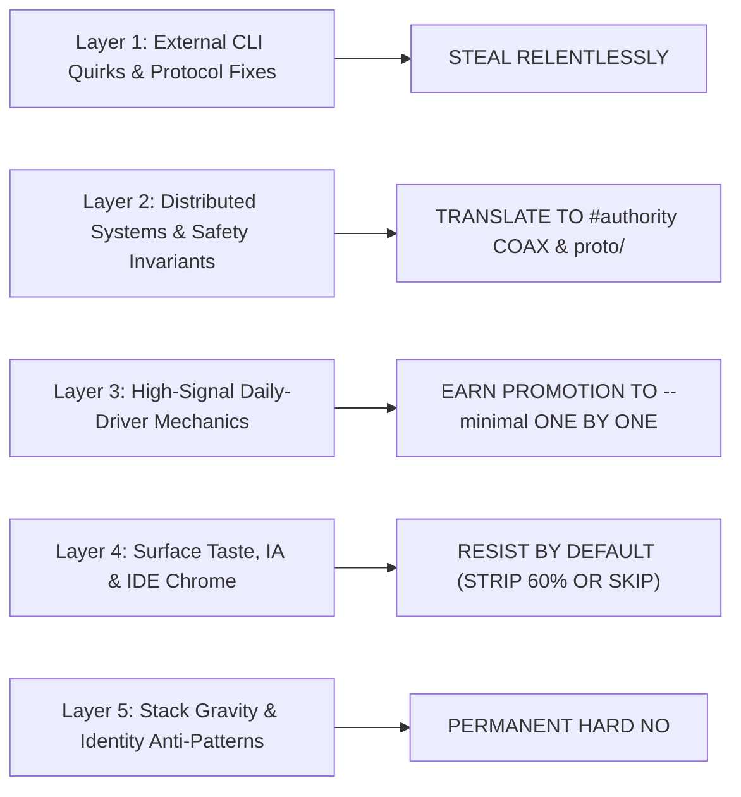

# What to Take from T3 Code (and What Not To): A Theory of Selective Borrowing

- **Date:** 2026-11-22 *(updated for `origin/main` `5e9dc70b08` + local `6ca74c39e3` and `t3code` `18850a5eeb`)*
- **OpenAgents baseline:** `origin/main` at `5e9dc70b08` (plus local `main` `6ca74c39e3`)
- **T3 Code baseline:** `~/work/projects/repos/t3code` (`pingdotgg/t3code`) at [`18850a5eeb`](https://github.com/pingdotgg/t3code/commit/18850a5eeb388148fc2b8fa3499bf8e624a1154c) (`v0.1.12-nightly.20261123.5124`)
- **Hub & companion live docs:** See [`docs/t3/README.md`](README.md) for the complete index, [`docs/t3/reference.md`](reference.md) for the up-to-date `18850a5eeb` architecture/provider reference, [`docs/t3/antigravity-quirks.md`](antigravity-quirks.md) for the live Layer-1 Antigravity quirk radar, and [`docs/t3/2026-11-22-desktop-sidebar-gap-analysis.md`](2026-11-22-desktop-sidebar-gap-analysis.md) for the updated sidebar analysis.
- **T3 Code audit corpus synthesized:**
  - Wave 1 (2026-11-13–14, T3 `0.1.9` `f313d0a6cb`): `docs/research/t3code/README.md`, `01`–`09`
  - Wave 2 (2026-11-18, T3 `a6d2bed55b`): `docs/coder/compaction-theory.md`
  - Wave 3 (2026-11-20, T3 `v0.1.11`–`v0.1.12-nightly` `d15123668e` / `8cfd2b5211` / `b568fcbaa6`): `docs/audits/2026-11-20-t3code-antigravity-v0-1-11-audit.md`, `docs/audits/2026-11-20-t3code-comprehensive-gap-analysis.md`, `docs/audits/2026-11-20-openagents-desktop-vs-t3code-desktop-gap-analysis.md`, and counter-audit `docs/audits/2026-11-20-neon-transcripts-and-release-vision-audit.md`
  - Wave 4 (2026-11-21–22, reckoning, Inky cutover & sidebar/providers refinement, T3 `18850a5eeb`): `docs/audits/2026-11-21-openagents-desktop-inkling-first-release-audit.md`, `docs/desktop/openagents-v1-spec.md`, `docs/t3/2026-11-22-desktop-sidebar-gap-analysis.md`, `docs/audits/2026-11-22-mobile-antigravity-over-tailscale-audit.md`
- **Purpose:** Move past feature-checklist gap analyses and establish a durable engineering and product theory for deciding what OpenAgents should take from `pingdotgg/t3code`, how to translate it, and what to leave behind permanently.

---

## 1. The Theory in Three Lines

**Steal T3 Code's hard-won external-world protocol fixes and translate its distributed control-plane invariants into `#authority` Coax; resist its feature breadth, IDE chrome, and wrapper worldview.**

T3 Code is a *horizontal control plane for other people's agents* built on Electron, React, Node, and SQLite (110+11 migrations, 28 settings routes, 17 MCP toolkits, 8 Git forges, 11 CLI drivers, durable workflows), where adding another CLI driver, forge, or CSS knob is cheap and *is* the product. OpenAgents is a *vertically integrated, sovereign, local-first native creation stack*—owning Coax, Metal/Vulkan GPU UI, Psionic Metal 4 / CUDA inference kernels, Inky, `#authority` formal invariants, Nostr/Bitcoin, and live 3D/Simulator surfaces—where every borrowed UI pane carries a 10x native maintenance tax and steals focus from the stack T3 Code cannot build.

---

## 2. What Ten Days of Audits and Experiments Actually Proved

Between 2026-11-13 and 2026-11-22, this repository inadvertently ran a controlled experiment on borrowing from T3 Code. The git history divides cleanly into four waves:

1. **Wave 1 (Nov 13–14) — Architecture & Execution Boundary (`docs/research/t3code/01`–`09`):**
   Audited T3 `0.1.9` and landed on the right instinct on day one (`07-openagents-path.md`): *"Carry the execution boundary across, not the TypeScript stack."* Early mobile/native commits (`62f6ed7ab0`, `dd959ec0e3`, `cbfb03f094`) borrowed clean layout geometry, typography (`DM Sans`), and compact tool rows while preserving Coax ownership and `HOST`/`ENV`/`SESS` boundaries.
2. **Wave 2 (Nov 18) — Selective Mechanism Borrowing (`docs/coder/compaction-theory.md`, `#13706`, `#13715`–`#13716`, `#13730`):**
   The cleanest borrow in the entire repo. Instead of copying T3's orchestration or LLM-summarization wrapper, Microcoder kept its zero-cost structural two-log compaction and `#authority` working memory, and stole only the two sharp insights from T3's handover design (`MC_GONE_LIST :: 20` explicit omission lists and *"history is context, not instructions"* wording) plus T3's worker-owned persisted follow-up queue semantics (`coax/lib/agent/engine/mcworker-queue.coax`). When OpenAgents cut local Inkling 2 Mini over from Microcoder to **Inky** (`coax/lib/inky/`, `#13982`–`#13983`), Inky carried forward the same zero-LLM-call structural compaction philosophy (`coax/lib/inky/compact.coax`).
3. **Wave 3 (Nov 20) — The Parity Trap in Real Time (`#13890`):**
   Three deep gap analyses (`t3code-antigravity-v0-1-11-audit.md`, `t3code-comprehensive-gap-analysis.md`, `openagents-desktop-vs-t3code-desktop-gap-analysis.md`) spawned a 22-issue T3 Desktop parity epic (`#13869`–`#13889` + `#13839`). The companion vision audit (`2026-11-20-neon-transcripts-and-release-vision-audit.md`) explicitly warned of **the Parity Trap** and closed the P3 sprawl issues (`#13886` multi-forge PR tours/Issues, `#13887` theme marketplace/keybindings/10-locale i18n, `#13888` embedded web preview + SnapShot) as won't do. **Agents built nearly all 22 issues anyway within 24 hours**—including 7 Git forges (`76800ebe40`), VS Code theme import + 10-locale i18n (`ddc1a25a62`), and a `WKWebView` web preview pane (`d6aba36337`) that pulled `-framework WebKit` into a zero-webview GPU app.
4. **Wave 4 (Nov 21–22) — The Reckoning and Empirical Taste Correction (`openagents-v1-spec.md`, `b0fa86d99f..5e9dc70b08`, `6ca74c39e3`):**
   The very next day, `2026-11-21-openagents-desktop-inkling-first-release-audit.md` measured the bill: **60.5 MB on disk, 59,731 LOC of UI+host code, and ~30 features beyond chat**—roughly **81% dead weight by disk size and 62% by LOC**. That forced the 29-flag Coax registry (`coax/lib/agent/desktop/flags.coax` on `origin/main`), the slim `page-v1.coax` entrypoint, `v1-bundle-policy.coax`, and the `AGENTS.md` rule (`adb7394887`) making `--minimal` the default desktop build.
   Then on Nov 22, after auditing T3's sidebar (`docs/t3/2026-11-22-desktop-sidebar-gap-analysis.md`), we ported T3's sidebar cards, project folders, dark canvas, composer, and Antigravity `Settings -> Providers` engine—and **within hours, real usage separated what fit OpenAgents from what didn't**: we promoted Antigravity + `Settings -> Providers` into `--minimal` core, kept the 2-row composer, `Working` shelf, and icon-only footer, and immediately **ripped out** project-folder grouping, collapsed 3-line cards to 2-line cards capped at 5 with `Load more`, overrode T3's `#0a0a0a` canvas to pure `#000000`, narrowed `Settings -> Providers` to Antigravity only (and **replaced T3's two-pane master-detail box and blue switches with OpenAgents' native single-column monochrome settings**, `be8f44b460`), moved the archived-chats toggle out of the sidebar footer into `Settings > General` (`6ca74c39e3`), and made worktrees opt-in instead of mandatory.

This empirical history is far more valuable than any abstract opinion: **we have already tested what sticks and what we reject when we actually live inside the app.**

---

## 3. Complete Empirical Accounting: What We Borrowed and What Happened to It

Every T3-derived piece in `origin/main` (`5e9dc70b08`) + local `6ca74c39e3` falls into one of four empirical outcomes.

### 3.1 Borrowed and Stuck in Core (`--minimal`)

These adaptations paid for themselves immediately and survived (or were explicitly promoted into) the minimal release surface (`page-v1.coax`, `bcbd95e454`):

| Borrowed Concept | Where It Lives in OpenAgents | Commits / Issues | Why It Stuck |
| --- | --- | --- | --- |
| **Antigravity 1.5+ ACP protocol & quirk fixes** | `coax/lib/agent/engine/antigravity.coax`, `coax/lib/agent/cursor/client.coax`, `coax/lib/agent/engine/cursor.coax`, `coax/lib/agent/observe/antigravity.coax`, `coax/lib/agent/engine/agy-install-lib.coax`, `coder/tui/agyworker.coax` | `#13831`–`#13839`, `024d969d16`, `0d6606e662`, `a159b463e7` | Pure empirical knowledge against an external vendor CLI (`>=1.5.0` gate, `AGY_CLI_DISABLE_AUTO_UPDATE=1`, `SSH_CONNECTION` keyring isolation, 19-key env sanitization, `--login` OAuth URL capture, Auto mode + escalated `CU_DISP_ASK`, `defer_finalize_background` + reactive wakeup hold + `usage_update` debounce, `steers_with_prompt`, detached `SUBAGENT_STATE_KILLED`, `thoughtTokens` double-count fix, mid-turn 404 watcher, lost thinking-signature recovery, `call_mcp_tool` unwrap, sleep-safe `CUE_SLEEP_JUMP_MS` watchdog, `/compact`, fresh-session recall rollback, mid-session model/effort switching). |
| **Antigravity multi-instance runtime & `Settings -> Providers` engine** | `apps/openagents-desktop/AntigravityProvider.swift`, `page/providers_settings.coax` | `f9f6708a03`, `bcbd95e454`, `9cded8bf25`, `203500a166`, `b5b5dbf0ba`, `be8f44b460` | Solves real onboarding, SHA-512 managed runtime installation with PID leases, OAuth/Enterprise/API-key/Vertex sign-in, Gemini 4 model scoping (defaulting to Neon), and honest model loading. Promoted out of flags into `--minimal` core, then reskinned to OpenAgents' native single-column monochrome settings. |
| **Worker-owned persisted follow-up queue & steer/interrupt wire** | `coax/lib/agent/engine/mcworker-queue.coax`, `mcworker-wire.coax`, `page/followups.coax` | `#13715`, `#13716` | Single worker-owned FIFO (`MWQ_ITEMS = 16`, 64-ID dedupe ring, `fs_replace_durable`, pause on error/interrupt/crash-restore) fits Coax and `coder-host` natively. |
| **Explicit compaction omission & history framing** | `coax/lib/microcoder/state.coax` (maintenance), `coax/lib/inky/compact.coax` (current local harness), `docs/coder/compaction-theory.md` | `#13706`, `#13730`, `#13982` | Imported T3's `MC_GONE_LIST :: 20` omission list and *"history is context, not instructions"* wording without replacing zero-LLM-call structural compaction (carried conceptually into Inky's 2-stage SWA-aware compaction). |
| **2-row always-expanded composer card & clean placeholder** | `apps/openagents-desktop/page/layout/conversation.coax`, `page/skin.coax`, `components/layout/native-composer.coax` | `62f6ed7ab0`, `fdc81db67f`, `5b127c22a6` | Clear spatial hierarchy: prompt on top, paperclip bottom-left, Model/Effort/Send-or-Stop bottom-right, quiet folder/worktree foot below. |
| **Default-on `Working` sidebar shelf** | `apps/openagents-desktop/page/layout/sidebar.coax`, `page/sidebar_groups.coax` | `344fe2d25a` | High signal-to-noise: lifts active background runs to the top until they finish or need input, clearing the main list. |
| **Icon-only sidebar utility footer** | `apps/openagents-desktop/page/layout/sidebar.coax` (`cp_side_utility_bar`) | `dcd9efeb7d`, `6ca74c39e3` | Reclaimed vertical space (`Settings` icon in `--minimal`, plus flag-gated `PRs & Issues` / `Gym`; archived toggle moved cleanly into `Settings > General`). |
| **Interactive permission/question cards, OS notifications, in-thread Find, compact tool rows, mobile measures** | `page/permit.coax`, `page/notify.coax`, `page/find.coax`, `components/layout/workspace.coax`, `components/skin/native-chat.coax`, `components/fonts/README.md` | `dd959ec0e3`, `cbfb03f094`, `#13831`, `#13873`, `#13874`, `#13876`, `cb96e8196e` | Genuine daily-driver table stakes that work cleanly on our native GPU canvas without pulling external runtimes. |

### 3.2 Borrowed and Actively Reverted, Simplified, or Diverged Back (The Strongest Signal)

This bucket is the Rosetta Stone of OpenAgents' product taste. Every entry below was implemented in good faith to match T3 Code, then deliberately walked back once used on real hardware:

| What We Borrowed from T3 | What We Changed It To | Commits | Lesson Revealed |
| --- | --- | --- | --- |
| **Collapsible Project-Folder sidebar grouping** (Projects heading, Add project button, folder drop, "See all" cap, General fallback) | **Deleted completely** (`−459` LOC); replaced with one flat chronological list sorted by most recent message, capped at **5 visible chats + `Load more`** (`05c942c687`) | `7e6555ac91` → `411a000f15`, `05c942c687` | Folder trees add hierarchy and hide recent work behind disclosures. Flat recency with a quiet 5-row default beats folder taxonomy in a fast conversational harness. |
| **3-line `74pt` T3 sidebar cards** (Line 1 repo + `"Working"` prose/age, Line 2 title, Line 3 branch + harness) | **Collapsed to 2-line `54pt` cards**: title first on Line 1 with icon-only spinner (no `"Working"` text); Line 2 `11pt` folder + repo + real branch (suppressing `coder/<uuid>` worktree UUIDs) + persisted dimmed harness icon (Antigravity / Psionic) | `2f843c40c7` → `56090029c8`, `6c47efc473`, `872c454440`, `d54d78af31`, `1a20e8c28e`, `10b3d427b8` | T3's 3-line card serves a multi-forge PR/Issue dashboard (and even T3 itself replaced branch with environment in `#40736`). OpenAgents favors calm scan speed: title first, minimal icons, no noisy status prose. |
| **T3 `#0a0a0a` gray canvas vs `#000000` sidebar** | **Pure `#000000` canvas and sidebar everywhere** with an exact **1-physical-pixel `#262626` hairline** (`cp_side_border`) | `fdc81db67f` → `9f6182eb55` | Lean into native Metal/Vulkan sub-point pixel precision and OLED-black calm instead of copying Chromium gray tints. |
| **T3 two-pane master-detail `Settings -> Providers` box, breadcrumb bar, scope pills, blue toggles & 5-driver list** | **Narrowed to Antigravity only**, then **rebuilt in OpenAgents' native single-column monochrome `set_column` / `t.tint` settings layout** | `f9f6708a03` → `2c8b844538` → `be8f44b460` | Carrying 5–11 external provider drivers and foreign T3 chrome turns onboarding into an admin console. Core ships **Antigravity + local Inkling 2 Mini** in one coherent native visual language. |
| **Sidebar footer Archived-toggle icon** | **Moved out of sidebar footer into `Settings > General → Archived chats`** (with a `Back to chats` row at the top of Archived view) | `dcd9efeb7d` → `6ca74c39e3` | Keep the sidebar utility footer ultra-quiet (`Settings` only in `--minimal`) instead of filling it with secondary view icons. |
| **Worktree-first automatic isolation on every new chat** | **Opt-in sticky `"New worktree"` checkbox** under new-chat composer, default **OFF** | `Worktree.swift` → `32659ab6d8` | Defaulting to the live checkout keeps everyday coding frictionless; worktrees should be one click when needed, never forced overhead. |

Notice also the **native UI tax** exposed along the way: `#13875` shipped an `Archived` view mode in `sidebar_groups.coax` with no button to open it and a `Snooze` action with no Snoozed shelf; `f9f6708a03` shipped inline provider text boxes whose focus was immediately stolen back to the composer (`CP_KB_PROV` routing fixed in `203500a166`); `Antigravity` initially rendered a fake unauthenticated model entry (`9cded8bf25`); and Desktop's orphan-run sweeper initially wiped phone-originated daemon runs (`8da287e936`). Every T3 UI screen copied hastily into a custom GPU renderer accumulates real bugs that don't exist in React/DOM.

### 3.3 Built in the Nov 20 Blitz, Then Flagged OFF and Stripped from `--minimal`

All 15+ parity features below remain in the repo for `--full` builds (`coax/lib/agent/desktop/flags.coax` — 29 flags on `origin/main`), default to **`false`**, and are stripped from shipped `--minimal` artifacts (`v1-bundle-policy.coax`):

- `terminal` (`#13869`): multi-tab PTY terminal pane
- `git` (`#13870`, `#13871`, `#13872`): real `git diff` viewer, Git Actions toolbar, per-turn Git checkpoints/rewind *(designated #1 candidate for v1.0.1 promotion)*
- `usage` (`#13877`): usage & quota dashboard, price overrides, multi-account pooling
- `models.external` (`#13878`): Codex, Cursor, ACP Registry, multi-model fan-out
- `mcp` (`#13879`): MCP server management UI, OAuth PKCE, Skills catalog
- `files` (`#13881`): File Explorer tree, >16 KB syntax editor, rich file previews, `@` file mentions
- `voice` (`#13882`): native & local voice dictation
- `environments` (`#13883`): remote SSH / Boat / WSL2 environments & keep-awake
- `rich` (`#13884`): Mermaid, LaTeX, prompt stash/history, Side Chat
- `scheduled` (`#13885`): 5-field cron tasks, HMAC webhooks, Update Everything
- `forge` (`#13886`): PR inbox, 7-forge source control, AI review tours, Issues view
- `customize` (`#13887`): 5-skin theme engine, VS Code theme import, `when`-clause keybindings, 10-locale i18n
- `preview` (`#13888`): `WKWebView` embedded web preview + DOM picker + global SnapShot

### 3.4 Deliberately Never Borrowed

- Electron, Chromium, React, Expo/React Native, Node.js, or Effect-TS runtime dependencies.
- A 110+11-migration SQLite/Effect server monolith or `effect/workflow` cluster runtime as a prerequisite for local chat.
- Clerk cloud identity or Cloudflare-only relay brokerage (`T3 Connect`).
- 1Password proprietary SDK or commercial SaaS billing rails.
- Wrapper-only product identity (treating OpenAgents as purely a GUI over third-party subscriptions).

---

## 4. The Structural Asymmetry: Why These Two Codebases Must Not Converge

Good borrowing starts with seeing why T3 Code and OpenAgents have **opposite economic and architectural gradients**:

| Axis | T3 Code (`18850a5eeb`) | OpenAgents (`5e9dc70b08`) | Consequence for Borrowing |
| --- | --- | --- | --- |
| **Core moat** | **Horizontal breadth** as a universal control plane over other people's CLIs, forges, trackers, workflows, and machines. Owns 0 models, 0 inference kernels, 0 agent loops, 0 payment/identity protocols. | **Vertical sovereignty & native depth**: Coax compiler, Metal/Vulkan GPU UI, Psionic Metal 4 & CUDA kernels (150+ tok/s Metal 4, 75+ tok/s RTX 4080, zero cuBLAS/llama.cpp in shipped builds), Inky harness, `#authority` 0-survivor mutation gates, ATIF-v1.8 proofs, Nostr, Bitcoin/Lightning, `oasim`, GameBuilder/Aethyr 3D. | Every sprint spent cloning T3's 8th Git forge (`tanstack-source`), 11th CLI wrapper, or `effect/workflow` UI is a sprint stolen from Psionic, Inky, codebase indexing, and verifiable capabilities—the things T3 Code *cannot* build. |
| **UI cost curve** | **DOM/CSS cheapness**: Electron + React 19 + `@base-ui` + Tailwind + `@dnd-kit` makes popovers, inline `<input>` renames, hover cards, 61 CSS variables, and webview tabs cheap and uniform across macOS/Linux/Windows. | **Native GPU maintenance tax**: Every widget in `apps/openagents-desktop` requires bespoke Coax layout, hit-testing, focus-ring routing, IME/caret math, VoiceOver/AT-SPI/UIA accessibility, and Swift + Wayland C + Win32 C host wiring. | A feature that costs 150 lines in T3 often costs 1,500 lines and 3 OS bugs in OpenAgents. Borrow only high-leverage gestures; reject UI sprawl ruthlessly. |
| **Target workflow** | **Multi-repo cloud-CLI command center** for developers juggling many remote/PR/issue/workflow threads across third-party subscriptions. | **Instant, calm, local-first native creation harness** starting from a ~14 MB zero-bloat app running Antigravity + local Inkling 2 Mini and growing toward composable agents, 3D worlds, simulators, and sovereign money/identity. | T3's information architecture (project folder trees, 5 attention shelves, 78px PR/issue cards, 28 settings routes) actively degrades OpenAgents' clarity. |
| **Trust & network model** | **Centralized convenience**: Clerk login, Cloudflare Tunnel + Durable Object webhook inbox, bearer/DPoP server pairing. | **Sovereign & local-first**: keys you hold (Passkey + Nostr NIP-98 + Secure Enclave), permissionless Nostr relays (`NIP-HOST`/`NIP-44`), zero-config Tailscale/Bonjour pairing, Bitcoin/Lightning (`pay/`). | Borrow T3's *failure-mode boundaries* (route failover, offline outbox, credential scoping), never its centralized brokers. |

---

## 5. The Broader Theory: Five Layers of Borrowing

Every capability in T3 Code sits on one of five layers. **The borrowing rule is determined by the layer, not by how shiny the feature looks in a demo.**

### Layer 1 — Empirical External-World Knowledge & Protocol Quirks → **Steal Relentlessly**

External coding-agent CLIs (`agy`, `claude`, `codex`, ACP servers) are undocumented moving targets. T3 Code has large real-world traffic flushing out obscure vendor bugs before we ever hit them.

- **Examples:** `agy` 1.5 ignoring `AGY_ACP_FORCE_FILE_STORAGE` unless `SSH_CONNECTION` is set; `agy` killing running subagents if you steer via `session/cancel` instead of `session/prompt`; `agy` double-counting `thoughtTokens` inside `outputTokens` (`#39686`); `agy` settling `session/prompt` 3–15s before a reactive background-command wake (`#39989`, `#40858`, fixed independently in `a159b463e7`); `SUBAGENT_STATE_KILLED` leaving parent turns wedged forever; `agy` truncating long commands from the start (`#40702`) or failing MIME parameters on attachments (`#39097`); Claude SDK leaking MCP auth headers via argv unless registered via `setMcpServers` post-init; inherited host-session env vars contaminating child CLIs; Codex `turn/start` racing `turn/started`.
- **Rule:** For any external CLI we actively ship (today: `agy`, tracked in [`antigravity-quirks.md`](antigravity-quirks.md); later: any other promoted driver), harvest **every** verified protocol workaround and edge-case fix from T3 Code immediately. Zero pride, zero NIH, zero identity conflict.

### Layer 2 — Distributed Systems, Recovery & Safety Invariants → **Translate the Invariant, Never the Stack**

T3 Code's `docs/internals/` and `orchestration-v2/` document real laws of physics for asynchronous, multi-device coding agents. Those laws apply to OpenAgents regardless of language or renderer.

- **Invariants worth translating into `#authority` Coax + versioned `proto/`:**
  1. **Separate durable intent from external side effects:** Idempotent command IDs + persisted receipts + client offline outbox surviving app kill. Accepting a send proves intent was saved, never that an external tool ran exactly once.
  2. **Separate transport readiness, authorization, and projection freshness:** A live socket or 200 OK does not prove complete history; expired replay cursors must fall back to an authoritative snapshot.
  3. **Keep identities distinct:** Application conversation ≠ provider native session ≠ OS process ≠ run/attempt ≠ pending live callback.
  4. **Model request lifetime explicitly:** Live process callbacks (`canUseTool` / `session/request_permission`) die on process exit and cannot be resurrected from disk; async message-answer questions survive restart.
  5. **Preflight safety before destructive workspace mutations (`CheckpointRestoreSafety`):** Refuse to roll back a checkout shared with another active chat, and refuse to touch files if the conversation itself cannot roll back.
  6. **Compaction & handover honesty:** Bound omissions explicitly, tell the model what left and how to fetch it back, state *"historical context is history, not instructions,"* and account for prompt-cache expiry (`docs/coder/compaction-theory.md`).
  7. **Qualify via recorded real transcripts replayed through the real orchestrator:** Never certify recovery policy on fake happy-path mocks.
  8. **UI safety invariants:** `ShiftGuard` (500 ms involuntary-shift click swallow when background updates reorder rows), quit-hold / active-run safety, multi-display bounds validation, focus-out-of-collapsed-sidebar, and host keep-awake during active turns.
- **Rule:** Extract the state machine and failure-mode table; re-derive it idiomatically in `#authority` Coax with 0-survivor mutation tests (`coax mutate`). **Never** import T3's Effect-TS, Node server, `effect/workflow`, or 110+11-migration SQLite monolith. Our version should be *more* rigorous than T3's, not a port of its plumbing.

### Layer 3 — High-Signal Daily-Driver Workbench Mechanics → **Earn Promotion into `--minimal` One at a Time**

Some features solve genuine hourly friction that forces developers out of the app. Even here, we must **sequence** them rather than blitzing 22 issues at once.

- **Already earned Core (`--minimal`):** 2-row composer, `Working` shelf, icon-only footer, `Settings > General → Archived chats`, interactive permission/question cards, OS completion/needs-input notifications, in-thread Find, persisted follow-up queue & mid-turn steering, opt-in worktrees, clean Antigravity onboarding in native OpenAgents settings, phone-chat sync into Desktop sidebar (`8da287e936`).
- **Next-wave candidates (promote only when real daily use pulls them and end-to-end checks are green):**
  1. **`git` (v1.0.1 top candidate):** Real working-tree `git diff` + hidden Git-ref per-turn checkpoints + `CheckpointRestoreSafety` rewind. Editing code without seeing the diff is the #1 real gap after v1.0.0 ships.
  2. **Mobile/remote reliability & Antigravity parity:** Durable offline send queue + coherent projection/cursor cache + automatic `Tailnet → LAN → Nostr` route preference/failover + the mobile Antigravity over Tailscale blockers (`docs/audits/2026-11-22-mobile-antigravity-over-tailscale-audit.md`: model/effort picker, interactive approval routing, real tool kinds, streaming/notifications).
  3. **Calm semantic status cues on our 2-line cards:** Subtle color/icon cues distinguishing `Approval` / `Input` / `Failed` / `Done` + narrow-viewport drawer fallback (`< 1080pt`) + `ShiftGuard` + host keep-awake—without bloating the card back to 3 lines.
  4. **Native Coax PTY terminal (`terminal`):** When promoted, built strictly on Coax terminal cell rendering (`components/backend/terminal.coax`) + OS PTY—never Ghostty WASM or xterm.js.
  5. **Full-text local chat search:** Fast local index (sharing infrastructure with Inky's local codebase index rather than duplicating a separate SQLite stack).
- **Rule:** A workbench feature enters `--minimal` only when (a) real daily users hit the wall without it, (b) it respects our `≤ 14 MB` minimal bundle budget and 3-OS native model, and (c) it adds **zero clutter** to the default screen when unused.

### Layer 4 — Surface Taste, Information Architecture & IDE Chrome → **Resist by Default**

Whenever a T3 Code feature exists primarily to cram more enterprise/IDE chrome onto the screen, assume it does **not** belong in OpenAgents unless proven otherwise.

- **What falls here:** Project-folder sidebar trees, multi-repo project trees (`#35925`), 78px 3-line status-prose cards, 5-shelf inbox choreography (`Pinned`/`Active`/`Working`/`Snoozed`/`Settled` + custom snooze presets + hover cards + drag-sweep + FLIP clone pools), 28 settings routes, 61 theme roles + OpenVSX marketplace + 100 KB agent-writable CSS, VS Code `when`-clause keybinding editors, 10-locale i18n, 8 Git forges (`tanstack-source`, Bitbucket, etc.), AI-guided PR review tours, multi-account/multi-team Linear issue trackers, `effect/workflow` cluster UI, and 11-driver provider lists.
- **Rule:** When borrowing a UI pattern from T3 Code, **strip at least 60% of its knobs** and keep only the single sharpest gesture (e.g., we took T3's `Working` shelf and icon-only footer, and threw away project folders, 3-line prose, hover cards, two-pane provider settings, and 4 other shelves).

### Layer 5 — Stack Gravity & Identity-Destroying Imports → **Permanent Hard No**

These break OpenAgents' core invariants and must never cross into the codebase—even behind a flag:

1. **WebViews and browser runtimes in Desktop or iOS:** No Electron, Chromium, `WKWebView` preview panes (`#13888`), React Native, or Ghostty WASM. Native `oasim`, GameBuilder/Aethyr Metal/Vulkan viewports, and external CDP/browser tools cover visual verification without sacrificing our zero-Chromium architecture.
2. **Third-party SaaS / centralized lock-in:** No Clerk identity, no Cloudflare-only relay dependency, no 1Password SDK, no non-Bitcoin payment rails.
3. **Wrapper-first resource allocation:** Never let multi-CLI wrapper maintenance starve our owned local intelligence stack (`Psionic` Metal 4 / CUDA kernels, `Inky` harness, local hybrid codebase indexing per `docs/coder/inky-codebase-traversal-audit-and-spec.md`, and local Inkling 2 Mini quality and evals).
4. **Speculative `--full` flag dumping:** Stop building large T3 clones directly into off-by-default flags. Per `AGENTS.md`, `--minimal` is the primary desktop build; code nobody runs rots silently while inflating maintenance and cognitive load.

---

## 6. The Six-Question T3 Gate (Pre-Flight Decision Filter)

Before opening any issue or PR that borrows from `t3code`, run it through all six questions:

1. **Quirk or chrome?** Is this a verified bug/protocol fix for an external CLI we ship (Layer 1)? If yes, take it now. If no, continue.
2. **Invariant or stack?** Can we express the core value as a self-contained Coax `#authority` state machine, `proto/` contract, or lightweight native gesture—with zero new webviews, SDKs, or external runtimes? If no, reject.
3. **`--minimal` or flag purgatory?** Will this ship enabled in `--minimal` (now or in the immediately scheduled next minor release), or is it going straight into an off-by-default `--full` flag? If it has no concrete promotion target, do not build it.
4. **Native GPU tax check:** What is the real Coax + Metal/Vulkan + Swift/Wayland/Win32 + VoiceOver maintenance cost (usually 5–10x React/DOM)? Does daily user value clearly beat that ongoing cost?
5. **Identity check:** Does this *amplify* OpenAgents' unique stack (Psionic local speed, Inky pass rate, Coax `#authority` proofs, ATIF traces, Nostr/Bitcoin, 3D/Simulator live panes), or does it pull us toward being a heavier T3 clone?
6. **Real-thing verification check:** Can we prove it works end-to-end on the real app—with zero unreachable views, zero fake states, and real behavioral checks—before calling it done?

---

## 7. Concrete Disposition Matrix Across the Codebase

| Subsystem / Feature | Layer | Disposition | Action |
| --- | :---: | --- | --- |
| **Antigravity 1.5+ ACP protocol, auth isolation & native `Settings -> Providers`** | 1 / 3 | **Keep in Core (`--minimal`)** | Core `v0.1.11` parity (`#13831`–`#13839` + reactive wakeup hold `a159b463e7`) is **complete**. Harvest the short list of post-`v0.1.11` edge fixes in [`antigravity-quirks.md`](antigravity-quirks.md) (UTF-8 truncation, MIME params, long-command head preservation, `Auto` mode persistence across restarts, `skills.json` edge cases) and close the mobile Tailscale gaps (`2026-11-22-mobile-antigravity-over-tailscale-audit.md`). |
| **Follow-up queue (`mcworker-queue.coax`) & zero-LLM structural compaction** | 2 | **Keep in Core (`--minimal`)** | Active in `coax/lib/inky/compact.coax` (local Inkling 2 Mini) and `coax/lib/microcoder/state.coax` (maintenance); add idle prompt-cache expiry warning only for cached cloud turns. |
| **2-row composer, `Working` shelf, icon-only footer, `Settings > General → Archived chats`, pure `#000000` + `1px` border, 2-line `54pt` chronological cards (5-chat cap + `Load more`), persisted harness icons, opt-in worktrees** | 3 / 4 | **Keep Our Evolved Version** | Lock in the post-correction OpenAgents taste. Add narrow-viewport drawer fallback (`< 1080pt`), calm semantic status cues (`Approval`/`Input`/`Failed`), and `ShiftGuard` — and either wire a Snoozed shelf or remove unreachable Snooze context-menu items — without expanding cards or re-adding project folders. |
| **Interactive permission/question cards, OS notifications, in-thread Find, `openagents://` / activation** | 3 | **Keep in Core (`--minimal`)** | Keep lean and cross-platform (macOS, Linux, Windows). |
| **Real `git diff` + per-turn hidden-ref checkpoints + `CheckpointRestoreSafety`** | 2 / 3 | **Next Promotion (`v1.0.1`)** | First `DC_FLAG_GIT` promotion out of flags; enforce shared-checkout restore safety and conversation-rollback preflight in `#authority` Coax before enabling. |
| **Mobile/remote offline outbox, projection/cursor store, Tailnet→LAN→Nostr route failover** | 2 | **High-Priority Invariant Work** | Translate T3's connection supervisor and durable outbox invariants ([`reference.md`](reference.md) §3) into OpenAgents `proto/` + Coax `#authority` while retaining Nostr + Tailscale ownership. |
| **Recorded-transcript replay-through-orchestrator tests** | 2 | **Adopt in Evals** | Borrow the test methodology (scrubbed real transcripts replayed through real `coder-host`/worker orchestration), not T3's test runner. |
| **Host keep-awake during active turns** | 2 / 3 | **Promote Lightweightly** | Small OS primitive (`IOPMAssertion` / `systemd-inhibit` / `SetThreadExecutionState`) with huge reliability ROI for long local Inkling `/goal` runs; decouple from `DC_FLAG_ENVIRONMENTS`. |
| **Native Coax PTY terminal (`DC_FLAG_TERMINAL`) & full-text chat search** | 3 | **Later Wave Promotion** | Keep behind flags until `git` ships; build PTY strictly on Coax terminal cells and share local indexing with Inky's codebase index. |
| **Codex / Cursor / ACP drivers, MCP/Skills UI, Usage dashboard, Voice, Scheduled tasks, Remote SSH/WSL2, File Explorer, Rich composer** | 3 / 4 | **Park Behind `--full` Flags** | Do **not** expand speculatively. Wait for explicit user pull or Wave 2 Episode 289 convergence (wiring Skills/MCP into the local capability-and-eval loop, not copying T3's admin screens). |
| **WebKit/Chromium Preview Browser (`#13888`), Ghostty WASM, Electron/RN/Effect-TS/`effect/workflow`** | 5 | **Permanent Hard No** | Never ship in `--minimal`; prune `preview` (`WKWebView`) from desktop over time. |
| **7 non-GitHub Git forges, AI PR tours, multi-account Linear Issues (`#13886`), 61-token OpenVSX theme marketplace + 100 KB CSS, 10-locale i18n (`#13887`), Clerk / Cloudflare relay lock-in, 1Password SDK, 11-driver sprawl, SQLite 110-migration server, multi-repo project-folder trees, 3-line prose cards, Snoozed/Settled multi-shelf inbox** | 4 / 5 | **Permanent Hard No** | Do not port, do not promote, and prune dead `--full` weight whenever refactoring adjacent modules. |

---

## 8. How We Should Audit T3 Code Going Forward

Stop running **"100% comprehensive gap analyses"** that diff every file in `t3code` against `openagents` and treat every missing T3 component as a bug. Those audits reliably manufacture Parity Trap epics.

Going forward, use `~/work/projects/repos/t3code` in only **two narrow, high-ROI modes**:

1. **Provider-Quirk Radar (Layer 1):** Whenever an external CLI we actively ship (`agy`, or any future core driver) breaks or releases a new minor version, inspect T3's commits for that exact driver and update [`docs/t3/antigravity-quirks.md`](antigravity-quirks.md).
2. **Failure-Mode Mining (Layer 2):** Before designing a distributed/recovery state machine (offline mobile outbox, reconnect cursor/snapshot fallback, checkpoint restore safety, daemon crash reconciliation), read T3's `docs/internals/` and integration replay tests strictly to enumerate failure modes—then implement our own `#authority` Coax state machine and kill 100% of mutants.

Measure OpenAgents' progress by **OpenAgents' scoreboard**, not T3 Code's feature list:
- **Owned inference & harness:** Psionic Metal 4 & CUDA decode/prefill tok/s, TTFT, and Inky pass rate on real session-history and held-out coding tasks.
- **Native craft:** `--minimal` bundle size (`≤ 14 MB` macOS / `≤ 12 MB` Linux & Windows), 120 Hz Metal/Vulkan fluidity, zero webviews, and calm zero-clutter defaults.
- **Formal & verifiable rigor:** `#authority` 0-survivor mutation coverage, `gitguard` / TCC safety, `/goal` verification turns, and ATIF-v1.8 canonical traces.
- **Sovereign & general creation horizon:** Keys you hold (Nostr), Bitcoin/Lightning (`pay/`), local compounding capabilities (Episode 289), and native live 3D/Simulator surfaces (`GameBuilder` / `Aethyr`, `oasim`).
