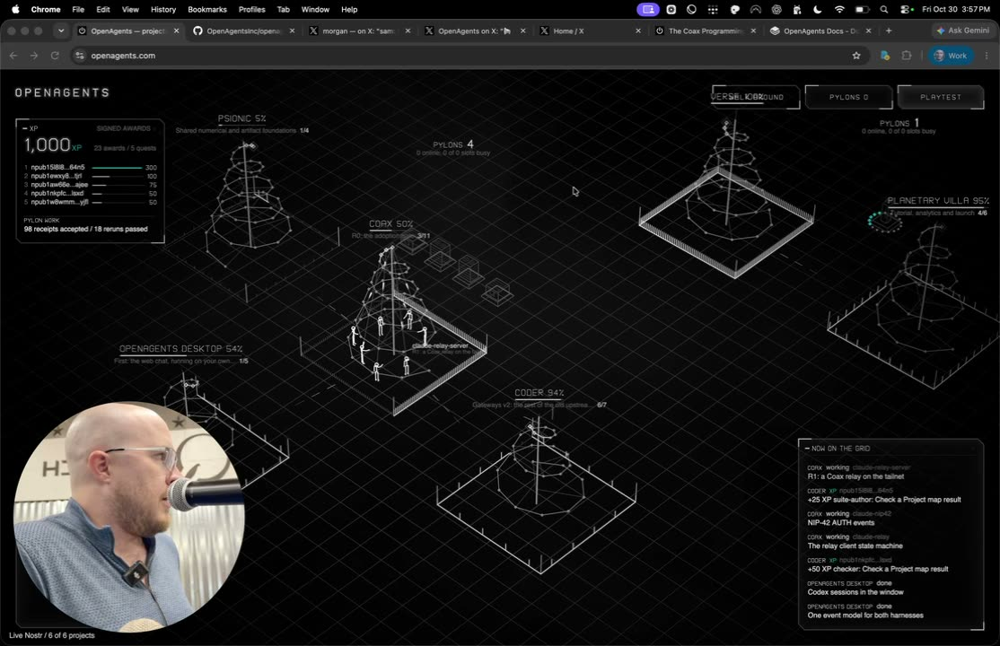
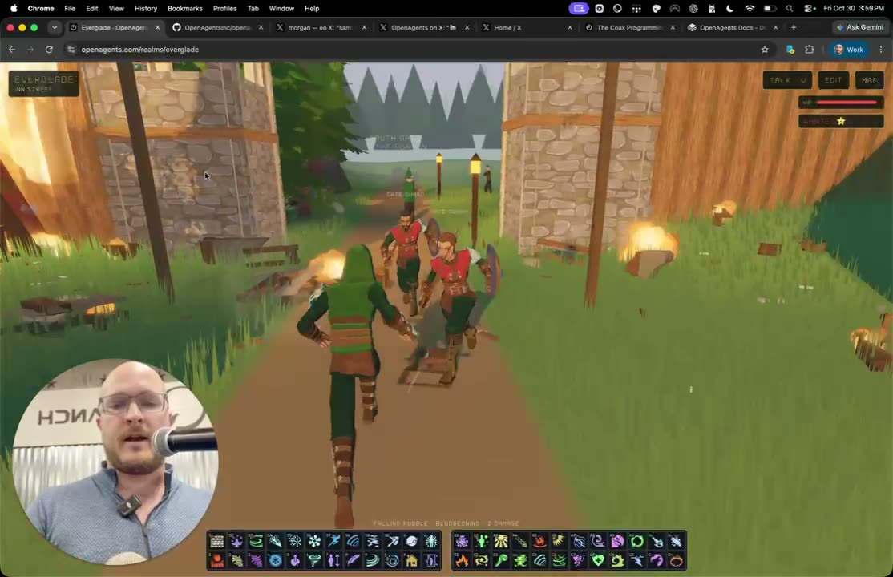
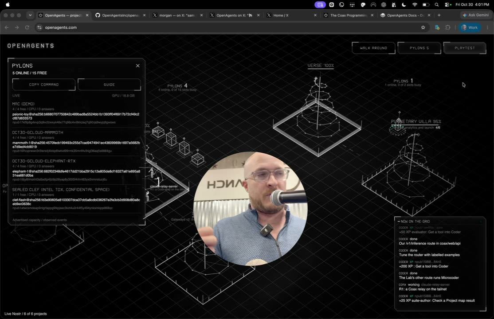
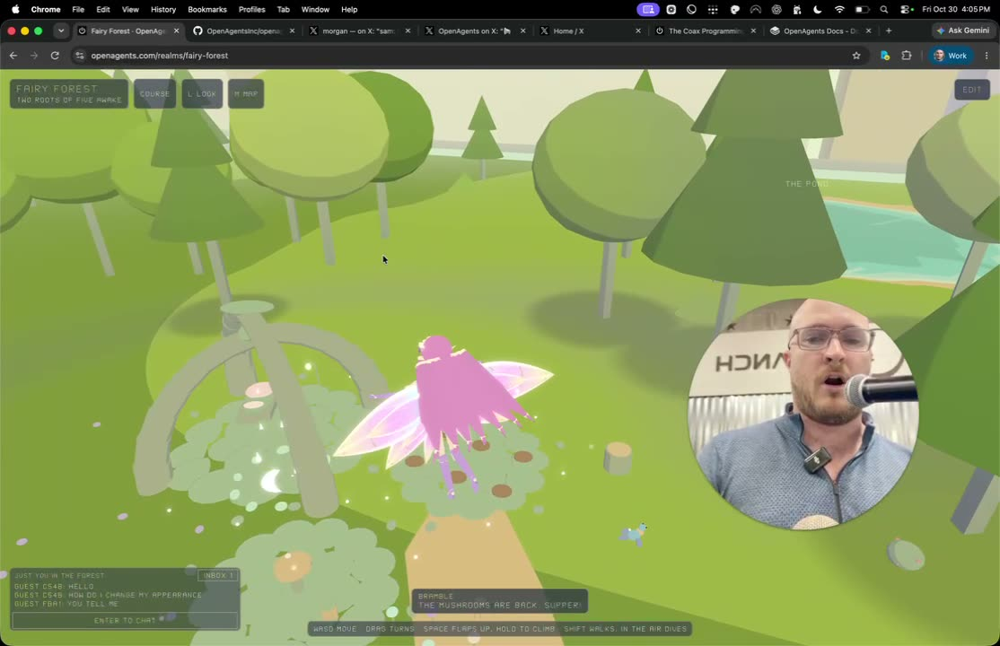
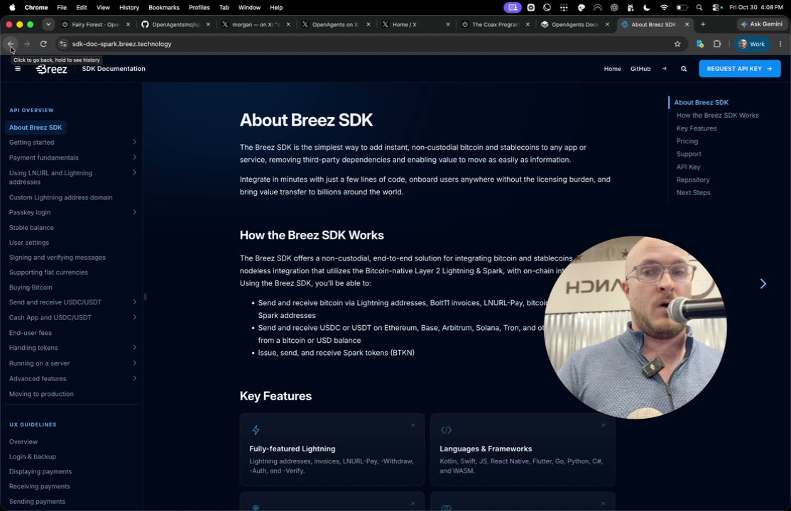
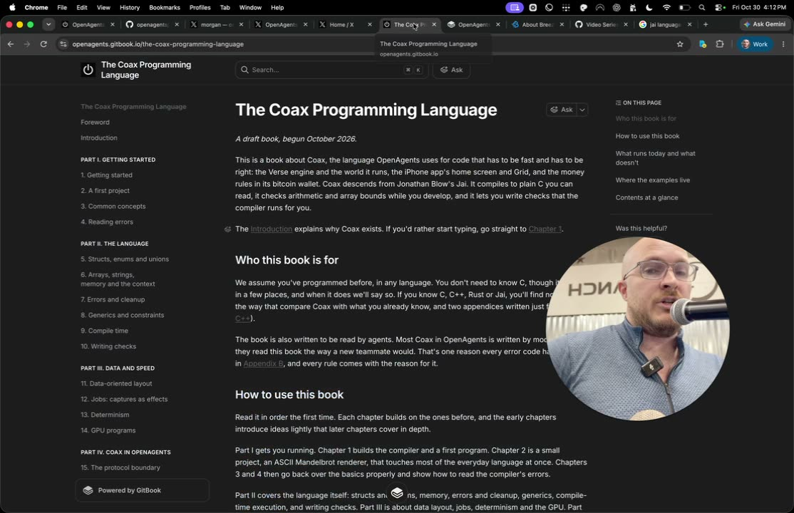
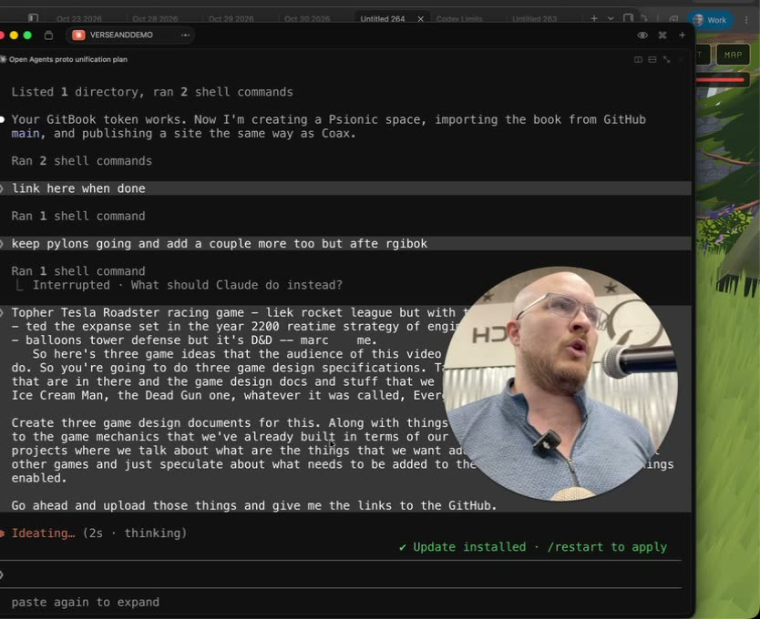
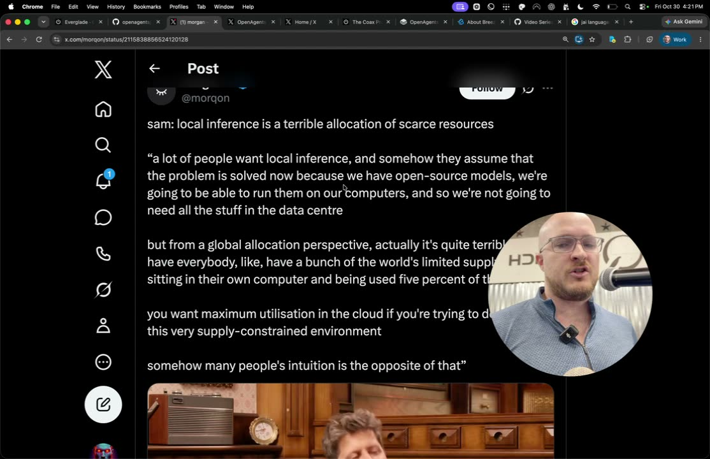
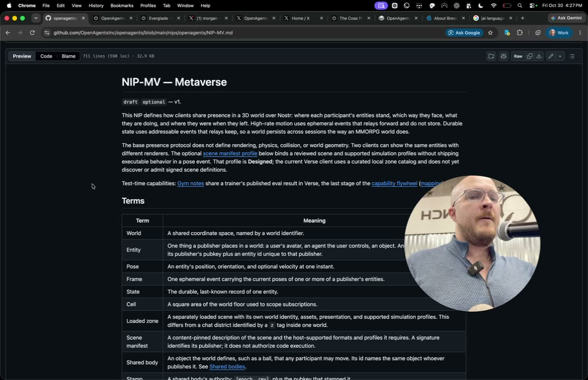

# Episode 290: Enter the Verse

Christopher, at a Pleb Lab-sponsored event, demos OpenAgents.com as a playtest rather than a slide deck. He shows the homepage's projects, walking around the multiplayer Grid and Everglade's spells, then relaunches the Pylons compute network for Bitcoin, pitched at gamers with idle hardware. He also covers the Verse marketplace with Bitcoin wallets for every person and agent, the Coax language and Psionic books, and the web-first Verse engine. The audience pitches three games (Orbit League, Belt 2200 and Hold the Stair), and Claude writes their design documents live.

Media source: the recording's subtitle file (`.srt`)
Transcript runtime: 00:34:22
Timestamp basis: the recording's subtitle timings
Generated at: 2026-10-30

Built from the recording's subtitle file, grouped into 30-second paragraphs, and reviewed for project terms and names (Claude, Nostr, D&D, GPUtopia, Topher, Ted and Marc). Verify wording against the video before using it as quote-grade source material. Episode 290 replaces the earlier, never-recorded 290 draft scripts. Screenshots are frames from the recording.

**[00:00]** Two different events Pleb Lab sponsored. We did of our 290 episodes we did as these, so this will be number three. Hi, so I'm Chris, I'm founder of OpenAgents. On the screen here you'll see OpenAgents.com. This is not a slide deck, okay everybody, this is a playtest. Get your computers out, get your phones out, okay, this is gonna be interactive, we're gonna have some fun. You don't have to. You can listen to me speak loudly. OpenAgents.com, here's what you see. This is just what I want the future

**[00:30]** of working with agents to look and feel like, okay? I don't want to be in my terminal begging and arguing with Claude and tiptoeing around. What does Claude feel like letting me do today? No, no, no. Hey, let's see what the OpenAI Codex desktop apps bugs are today because they ship new bugs every day. So, no, what it should feel like is a little bit more like a video game. So, here we have a visual representation of the

**[01:00]** different projects that we're working on at OpenAgents.com. You're going to step through some of these. Here's our desktop app. Here's our machine learning library. Here's our custom programming language that we started writing three days ago. All of this is in that language. Here's our coding agent coder. I don't know how well this is optimized for the phone, but if you click walk around, this is actually a little multiplayer world. And if anybody on their computer or phone also clicks walk around,

**[01:30]** hey, here's somebody. Move. Yeah, there you go. Yeah, let's go. Let's go. Let's do it. Where are we going to go? Let's go to Everglade. Let's see. Alright. So, if you couldn't tell, I like video games. Oh, yes. Let's see what we got. Let's see what we got. Let's see. I really like throwing meteors on stuff. If you follow me on X, I just like break in a bunch of buildings with meteor showers everywhere. So, yeah, boom! Okay, I just aggroed the guards, so I gotta go. Can I float? Hang on, hi, yeah.

**[02:00]** Where's my float? Reverse gravity. Oh, yeah. Oh, his corpse floated too. Holy crap. Now, when I float, if I levitate more, then they can't get me except with the like level five. So we just made like a little GTA style, little aggro situation where the guards get tougher and tougher because they want to prevent me from breaking the town. Okay, so this is just me having some fun and demoing some stuff. We want to create. Create a 3D world with 2D interfaces

**[02:30]** weaved into it so we can kind of have some fun while you're commanding your agents to do some stuff. Okay, so let me direct your attention to one particular thing on OpenAgents.com. I have this thing called Pylons. And this gets back to the very first AI product. That I launched in 2023 was called GPUtopia. It was a decentralized network, a way for you to run a piece of software on your consumer device, your gaming computer, and sell your spare compute for Bitcoin.

**[03:00]** It put your compute, you'd like load this open model from Hugging Face. This was like 2023, 2024, so the open models were like Vicuna 7B. And be just horrible by today's standards. But we kind of like had this OpenAI-compatible API endpoint. Somebody could hit inference and that would be fanned out to someone's computer and they get paid Bitcoin for it. So, very cool that that technology worked. At the height of it, we had 300 people online running this worker

**[03:30]** software simultaneously. The big problem was who's Going to pay for that because it's not the best inference, it's not the cheapest inference, it's not the fastest inference, it's not the most private inference. So it's cool that it works, and there might be some ways where we could jump. But we didn't have a buyer three years ago. Went through some phases earlier this year where I was convinced that the buyers were going to be coding agents, and we did some amazing experiments where we

**[04:00]** got. Coding agents being a little bit more efficient than Claude Code by being creative with what combination of open models and decision models that we used. But really, a 10% improvement over Claude Code is just not enough for a product for a venture-backed company to justify making that your bread and butter. Not when the big companies like Anthropic and OpenAI are spending billions and billions of dollars subsidizing user acquisition. So, coding agents is thoroughly saturated. Personal agents are starting to be super saturated

**[04:30]** with meta and SpaceX AI, SpaceX SAI, whatever, like dropping billions of dollars, giving away computers because they want you to use their personal agents. So, it's like, what is the more unique avenue of market entry? So, for us, it's like, hey, imagine if there's a target market. It's been overlooked by all these labs. So let's say that this target market also happens to have generally very powerful computers at home,

**[05:00]** underused most of the time, and they also have disposable income. So they could be both buyers and sellers in this marketplace. Hey, gamers, perfect. Okay, great. So, we are today sort of launching or relaunching our distributed compute network. We're calling it Pylons. This is powered by our machine learning framework called Psionic. 100% of this is open source.

**[05:30]** And maybe more importantly, for sort of beyond this room, we have now a user base, a small All but growing user base of sort of like normies, mainstream people, gamers who are like absolutely thrilled that I can go. So, just as an example, like earlier today, I was at like the checkout line at Target, and like the cashier overheard me talking with my wife about Dungeons and Dragons. And so I was like, oh, cool, like, you know, my sort of hobby project.

**[06:00]** For the last year on and off, has been like, I want to create an MMORPG sort of like using the D&D rule set. And so, here we talk about D&D. I was like, oh, cool, let me show you. I've got all of the main druid spells ported into like MMORPG style things in here. One of these lets me turn into a dragon, or like not 100% implemented, but like, I've got a bunch. To the main ways you could blow air around and do crazy stuff. And his whole thing was like,

**[06:30]** oh my gosh, would this let me, as a DM, dungeon master, like create my own worlds and like, like, have a 3D world for the, like, the, the, the campaigns that I lead my people to? Like, yes, absolutely. And I'm like, okay, when I go home, like, make a landing page for the D&D card. Like, that's one example. Of, like, Normie loves the idea. The type of people that spend money on their workbooks and their books and their figurines, like, would they spend $10 a month on a subscription for this or compute or customizing assets?

**[07:00]** Yes, they would. Example two: my wife texts all her friends: if there was a video game in your mind that you've been thinking of that someday wouldn't. Be cool if you were to create, what would that be? You know, a ton of response back. For some reason, two-thirds of the responses had to do with fairies. Yeah, well, I want a fairy on a fairy, I'm gonna customize my fairy, and you know, I want to fly around in a little garden, and I want there to be like little animals to take

**[07:30]** care of, and I want to improve the environment. And so, we whipped that up into a game design document. Like, throw it into our Claude engine, paired with our custom game engine that we've also, you know, coded from scratch. And now we've got this little thing. Now, this part here is not single player, the grid is single player, if the grid is multiplayer, this and Everglade right now are single player, but we are a few days away from also turning these into multiplayer

**[08:00]** realms. If you haven't noticed your X feed be completely taken over by reverse engineering of games just in the last couple of weeks, it's because models, particularly Opus 5.5, are so, so, so good at both reverse engineering games and creating models from scratch. Well, if you are the type of person who keeps up with all this and you're whipping out your Claude Code and like, oh, look at the bucket, look what I can do. What you have right now, my whole X feed, is demo city.

**[08:30]** Everyone's making demos. Look what I can do. Is anybody paying these people for anything they're creating? Absolutely not. But what if you could take your Claude Code and say, hey, listen, this fairy in OpenAgents.com Fairy Forest sucks. Someone clearly vibecoded this for three seconds. I'm gonna go take an existing 3D model, properly licensed. I'm gonna go recreate this from scratch, and probably with five minutes of prompting,

**[09:00]** anybody here could improve on this fairy model or like give it the, you know, make it editable or like customizable in different ways. And so you should be able to list. Assets that you make in the OpenAgents Verse marketplace, and someone who's like, Oh, hey, there's an upgrade button next to my fairy here. Oh, look at this, and you can see like the top three coolest things,

**[09:30]** and you can click a button and you can pay 15 cents if you've loaded your OpenAgents. Credits account with dirty fiat, and we charge you 10% fees and pass on the 2.9% that's 30 cents and factor in chargebacks and all the horror that comes with supporting mainstream payments. But wait a second, I can get a 25% discount if I pay in this thing called Bitcoin. Boom, boom, boom. Oh, integrated. Purchasing through Cash App.

**[10:00]** I know Cash App. Bada boom, bada boom. So, underlying all of this is every single person and agent using this gets their own Bitcoin wallet. We're using the Breeze Spark SDK, which we've used on and off for a year. Fantastic technology. These guys take care of all of the horrible plumbing and stuff that I don't want to have to. And as a result, what I can do is just give everyone and their agent a wallet.

**[10:30]** I, as a developer, can programmatically switch from, you know, that person's paying that person, move it from here to there. It's self-custodial-ish, good enough for what we're doing. They just added like USDC support if you care about that. And they have integrations with both Cash App and one of the other purchasing things. So somebody can. Literally, with their Apple Pay, and I've tested this, with their Apple Pay, click a button, do an Apple Pay, you know, a few, maybe a minute later, they've got Bitcoin in their account that they can then

**[11:00]** spend. So, this is just our take on what we think. What is a consumer product that people are going to pay for that's going to get both Bitcoin payments? There's a lot of debate recently about what. What are people actually going to be willing to pay for? Well, we think just consumers with disposable income that want cute stuff, like that's one thing. And then, how are people going to earn it? We already know from the last time we launched the GPUtopia thing: if you have spare compute and we say run this on your computer,

**[11:30]** plug this in, hit this button, and we're going to send Bitcoin to your wallet because there's spare compute that you have. Are you going to do that? Probably, yes, you will, as soon as there's demand. Maybe more exciting than just the sort of selling of the raw inference. And there's a lot of fun stuff there. Now, what's possible with things like Mesh LLM, where you can kind of like split up models across multiple devices. But go a level higher than that. You all, most of you, probably have subscriptions to Claude, to Codex, to any of these things where you're paying for.

**[12:00]** A set of usage, and you're not using all of it. You might not even be using most of it. And if I said there was a way for you to plug in your agent, point your agent at our docs and say, Yeah, hey, like make my agent online available for work. Here's what I want to charge. You limit it by hours, don't work while I'm working, but overnight, your agent. Agents can kind of moonlight in the OpenAgents grid. Coming here, I want you to wake up tomorrow with more Bitcoin

**[12:30]** in your wallet because your agent did some productive stuff. Maybe it uses one or two or five percent of your weekly capacity, but that's money that Anthropic is not going to pay you. Okay, so a little bit about the tech behind this. All of this is 100% open source in our repo. You'll note that. This repo has 39,000 commits and it's been around for three years, but I occasionally will like nuke the entire code base, except for one folder, docs/transcripts,

**[13:00]** which has all the transcripts of the 289, 90-ish episodes of this series. So, agents, and this has been a tremendous asset for me because I can go back through the entire series of all the content that we've ever. Thought through if I'm ever like wanting to dig up a point that I've made or technology that I've talked about, like everything possible that's worth doing in the realm of agents for the last three years, we've done a video on and explored and come up with our take on it, tied it into Bitcoin, all this stuff. So, I have just not only

**[13:30]** these transcripts, but also like years and years of code. So, it lets me take on increasingly ambitious things enabled largely by. Of these models that are out, where I can now do something like, okay, so we built sort of version one of all of this fully in Rust. I love Rust. Rewrite it all in Rust. I was on Team Rewrite It All in Rust until three days ago, and I'm like, man, these compile times are really horrible. And like the build folders and just trying to monkey with the caching and like the Google Cloud images and the Docker images,

**[14:00]** like, what if there's a better way? And I realized that. There's a game developer named Jonathan Blow. Anyone heard of him? He made the Jai programming language, built this up over 10 years. Sort of a game dev-centric programming language sitting somewhere between C and C. He's talked a lot about it, but it's been closed source. It's a private beta to get in. The compiler is closed source, but there's a bunch of information and architecture. And code snippets from all around the internet about what Jai is.

**[14:30]** They say, hey, agents, here's what we need. We need that, that thing that is behind that closed door. Make our own version of this, please. So, we have a book now written in the last 48 hours called The Coax Programming Language. And this is. One of two books. We'll have another link in a moment here. I'll smash it on the escape key earlier. So basically, we have like two books to kind of explain different pieces of this because we want also developers,

**[15:00]** if you care about building in very advanced agentic stacks, I'd love to have any nerdy tech conversations after this about what we like about Coax contracts. Rust and stuff. But we have books in here. So Coax, the programming language, coax/book. You can see that every single chapter is marked down. You can literally just point your agent at this or the GitBook thing and learn about Coax. Fortunately,

**[15:30]** Jai, which it's closely based on, is already in the training data of all of these models, so it very quickly picks it up. And the second book is our machine learning book. Our framework is called Psionic. We are porting this from Rust also into Coax. So, one thing that's just amazing about this, we have our own game engine. This is all a custom game engine written in.

**[16:00]** In Coax, again, all written in the last three days in a programming language created three days ago. And what are some things that I wanted it to do? Well, this needs to be heavily web-centric, partly because I just love the virality of being able to drop a link to a realm. Man, we are about to take over Twitter, by the way. I'm gonna have like. I'm gonna drop into, I'm gonna be a reply guy, and I'm gonna be like, I'm gonna make a building called,

**[16:30]** like, Here's Your Point, and then I'm gonna like drop a freaking meteor swarm on it, and just like, you know, 3D reply guy. Anyways, so we're gonna be like hilarious on Twitter, but like being able to link, like, hey, like, come, like, check this out. We get multiplayer. So, so, anyway, it's a web-centric game engine, it loads very fast. This is sort of like a Art style sort of modeled on Breath of the Wild, but we have some other demos we've been doing approximating photorealistic graphics that get very, very, very good. It was a low-poly style. We can support essentially anything.

**[17:00]** We also have the very basic version of this Realm Creator Live now. I don't know how stable it is for you, but what I'd love to do is have one or two or three people. Shout out right now the question that I've been asking to our users. I'd like to get three examples here, and we will connect you with you later to get your Nostr pubkey and Lightning wallet connected to the world that we make for you. Please shout out like one or two or

**[17:30]** three examples of a game that you wish existed but does not exist and you would like a playable version. Of that to be live in the next hour. Shout it out. Who wants to go first? Tesla Roadster Racing Game. Tesla Roadster Racing Game. Give me like a really funny mechanic that people would go crazy if we just on Twitter. But with Tesla Roadsters. Like Rocket League, but with Tesla Roadsters. Anything else? In space.

**[18:00]** In space. Nice. That's an Elon retweets there. Okay, so that's Topher. Okay, give me another one. Speaking of that, dude, we should use AI to build the freaking Expanse third trilogy. As a v episode, if Amazon's too chicken s*** to do it. Okay,

**[18:30]** I love the Expanse. Okay, give me one more. Balloons Tower Defense, but it's D&D. You said Balloons Tower Defense? Balloons Tower Defense, but it's D&D. And your name, sir? My name is San. Yeah. Marc? Okay, Marc, make sure I have your contact info. Marc with a C. Marc with a C. Okay, alright, so here's what we're gonna do. My goal is to. Have a web UI fully built into our web application so you never need to get dirty and talk to Claude. But just for purposes now, that this can be done via Claude.

**[19:00]** Okay, so let's just do a little thing. Now, the process that I'm about to do, all of you can do by cloning our GitHub repo. If you do that, do it one level deep, not the full repo, because you don't want nine gigabytes of three years of old. Code that's been deleted, but just get the first separate level. So you can literally open up Claude Code, point it at this repo, do the same process I'm about to do, and just tell your agent to open a pull request, and we'll merge your world in, get it all set up so that you can have the editor tools. Okay, so let's just see how this can do.

**[19:30]** Let me make this a little bigger. So here's three game ideas that Audience of this video where we're recording has wanted to do. So, you're going to do three game design specifications. Take a look at the existing realms that are in there and the game design docs and stuff that we have for in the verse folder for Ice Cream Man, the Dead Gun One, whatever it's called, Everglade, the Fairy Thing. Create three game design documents for this,

**[20:00]** along with. With things that are maybe relevant, tie into the game mechanics that we've already built in terms of our engine. Take note of our projects where we talk about what are the things that we want added to the engine to support other games, and just speculate about what needs to be added to the engine to make these things enabled. Go ahead and upload those things and give me the links to the GitHub docs. So I'm gonna do that first. And then that's a step that we'll ordinarily

**[20:30]** skip over. But when I'm like right now, just kind of like manually vibing with whoever we're talking with, I'm like, we do an initial game design spec, get their feedback on it, we throw it into the engine, an hour later, we have a playable game, we iterate on it, and then you can speculate that, like, there's a few other companies, there's a startup called Spawn that they have kind of. This flow, where it's like AI-driven game dev, and you like have your world, and like you get in there, and they just use their VC-funded Claude Opus to just instantly

**[21:00]** vibing stuff very rapidly. And that's cool. I don't think that they've done anything to connect the worlds together. The big idea for me is that this probably is. What the metaverse should be and feel like. The metaverse, which sort of went through its tech hype cycle and kind of died off, people kind of make fun of it. And those images of like Zuckerberg renaming his company to Meta,

**[21:30]** and then having the horrible picture of him in front of the Eiffel Tower. It's like super low poly. It's like, this is what you've paid $50 billion for? No, I think this actually is. Going to be the right approach to it, where it's something where we can immediately put something in their hands. Here's a thing that you can edit based on your feedback. And just based on the testing that we've done with this so far, letting people go from idea to world in minutes and then let them edit it by voice, this makes obsolete a whole bunch of.

**[22:00]** Prior game development workflows, and I'd argue that it also kind of outmaneuvers things like even the very AI-centric, AI-forward game CEOs like Tim Sweeney, who I have a lot of respect for, the creator of Unreal Engine, they're hardcore pivoting Unreal to AI. They're all in on it, but Unreal still has a crappy pipeline for deploying to web. And we see constantly, constantly comments, people like, I wish I could like very Easily create 3D worlds and games and put

**[22:30]** them in the web browser and make them shareable. It's like, okay, well, we just created that. What prevents someone else from building this exact same thing tomorrow? I mean, the code's there, take it. My bet is that this is going to start aggregating a powerful network effect. And the thing that I've been saying for years, the main theme of OpenAgents and the sort of Raison d'être of us in the very beginning. Why I made episode one of OpenAgents three years ago, the day after OpenAI's Dev Day 2023,

**[23:00]** was Sam Altman saying, Yeah, we really care about getting developers paid RevShare. We're going to do a GPT store. GPTs are our sort of precursor to agents. We think the future is agents, and we're going to let developers get paid to do GPTs. And episode one of the series, The next day, I was like, BS, there's no way that they're going to do what they should do, which is like pay developers fractional rev share proportional to the paid usage of the work that they produce. And like, we're going to do that. We didn't launch the basic version of that too early, 2023, 2024. But,

**[23:30]** like, now to come back and say, hey, wait a second, the models, the agents, the demand has all evolved to the point where, like, now there's a real Hunger for this kind of thing. And now we can go back to Sam Altman. This kind of went mini-viral in the last day on the subject of local inference. You dirty local inference people. Sam Altman says, Local inference is a terrible allocation of scarce resources. Quote: A lot of people want local inference, and somehow they assume that the

**[24:00]** problem is solved now because we have open source models, we're going to be able to run. them on our computers and so we're not going to need all the stuff in the data center. But from a global allocation perspective, actually it's quite terrible to have everybody like have a bunch of the world's limited supply of DRAM sitting in their own computer and being used 5% of the time. You want maximum utilization in the cloud if you're trying to deal with this very supply-constrained environment. Somehow many people listen, Molon Labe, come and get my fing DRAM from my computer. Like, no, I'm gonna use it. Thank you very much.

**[24:30]** Hey, your Lambo is being used 5% of the time. Who cares? Now, if you really care about increasing allocation, what can you do? Well, you can, if you have a, you know, Tesla, you can put it on the Rideshare network and like ride it out, sharing economy style. If you have spare compute, as everyone in this room does, You currently have a valuable resource no one's paying you for. I'll pay you for it.

**[25:00]** And if not me, people in the OpenAgents marketplace who are like, wait a second, I can run models. So, the pylons, for example, right now, when you actually run a pylon, it can run two things: GPT-OSS, very basic model, but great for small. Tool use as well as Elephant and Mammoth, the decision models that are even better than Jev on some benchmarks. This whole decision model thing that's come out recently, open sourced by Baseten. And that responds in a quarter of a second

**[25:30]** on a standard gaming computer. So it's very easy for us to dip our hands in the well of, well, let's just be an inference business, and instead of building things on top. Of NVIDIA GPUs, where we have to stand in line for a year. No, a lot of this actually can be run on gaming computers. Now we can go back to that original idea that we launched with GPUtopia. Hey, let's connect these together into one pool. And maybe if we have excess compute, we'll sell it externally. But I'm pretty sure having ambient compute as a primitive that we can

**[26:00]** make use of in interesting experiences right now, for example. These AI NPCs in Everglade, I attack a building, they charge after me. They've got very basic sort of like game-style scripting. Imagine MMOs where the NPCs are able to coordinate using like AI conversations to be like truly formidable enemies. If you give me an MMORPG with that mechanic in place tomorrow, I'll pay you. $500 a month. I want that. Can we multiply that idea times

**[26:30]** enough of the cool stuff that people have in their head that they haven't yet had the technical ability to create? Give them a platform and a way to do that? I died. That's a great stopping point. I'll take any questions. Shout it out. Go ahead. And we'll take a look at these specs while you ask. Go ahead. Hi, so first of all, super impressed. I haven't even seen this before. I will look a lot deeper into into the GitHub.

**[27:00]** So when you go to the website and you go to a specific world, there is this entire kind of like a world. What is happening there? Is there like a dedicated computer that if a person goes there and creates their own world, where is that whole thing? And does not conflict with the other people's worlds. So, we have plans to have everything here be fully forkable. So, like, for example, like open agent/slash official open agent,

**[27:30]** like, we're going to maintain our own version of Everglade with a particular rule set. It's not going to be destructible. Like, I want that to be like our. Main sort of like quest jumping off point, but we're gonna let you click fork and add whatever crazy rule set that you want on top of it. And then, if you introduce a rule set or an NPC change, you'll just have living in your account Everglade Fork, call it Doomglade, and you make it permanent at nighttime and zombies come out, and now it's a first-person shooter, and you're like machine gunning down zombies

**[28:00]** in a fantasy town. Like, I would play that, you know. For a few minutes, you know, try it. This is not fully implemented, but we have in our NIPs folder 20 different specifications for an open protocol called Nostr. This is, you can read separately about what Nostr is. People might have talked about it here today. But what happens now is that companies that have large visions that want to build on Nostr. Will come up with their own list of specifications.

**[28:30]** And I've inlined in our repo the 10 or so NIPs from Block who built their, what's it called, Buzz product using like 12 different NIPs. That they needed to supplement the official ones because they wanted to do things that were deserving of their own NIPs. In this example, delegating your own public key to To be able to have an agent act as you, but within a limited subset. It's like, okay, we're gonna need a bunch of that, we'll just pull those in. We have our own 20 related to all the stuff that we're doing,

**[29:00]** and one of the ones we're gonna be building on is a metaverse nip. Like, we're not just creating an experience that you have to use through openagents.com, we want this to be fully extensible down to the level of the protocol where anybody Who doesn't, like, you should not need to ask our permission to like innovate in this new way. This should just be like the primitive for 3D worlds that happen to be open. The answer to your question is like everything that you could conceive of that's possible for remixability,

**[29:30]** forkability, it's all possible. And then we want to have our own sort of like curated store where people who create things that we think are resonating with our audience will sort. So, we kind of want to solve the distribution problem that instead of sharing your demos on X and nobody looks at it after two days, it's like you've got a place to list it and get hopefully some like recurring residuals over people using or remixing your stuff. Is there a dedicated harness that builds the world?

**[30:00]** Like, if I were to clone down my computer, what I'm trying to Building the game by using the chat. Is there a harness that you guys develop with its own rules and structures? So yes, but step one is: I don't know if that's in there yet, but like skills that will work with Claude Code. Like, literally, you could just point Claude Code to this, it's gonna pull in the skill, it can see what the API endpoints are, it can like. So so in a day or so that'll be in place.

**[30:30]** And then we want to be building our own harnesses sort of like into the web application so you don't like we need to make it as easy as possible for the non-technical user while letting like the agent power users like have all of the like programmatic controls, MCP and all that stuff to just do everything through their own setup. So w we will definitely support both paths. Let's take a quick spin through the Doc, just so you can see an example of what I do. I'm happy to take another question. I know, I'm watching it. And yeah, I've got agents going,

**[31:00]** so they kind of burn it down faster. That will be the end of my talk. Alright, so we have. No, I think we'll wrap up. Okay, so we've got Orbit League pitched by Topher. We've got Belt 2200 pitched by Top. Ted and Hold the Stair from Marc. Ted and Topher and Marc, any changes to your game name there? Does that sound good? Sure, it does sound good. So let's see what this says. These are original games in their genres.

**[31:30]** Hell yeah. They borrow general styles: a car-ball sport, hard sci-fi, a popping tower defense, tabletop fantasy rules. None of any one. Existing games named oh yeah, Claude just recently added to their system prompt, you can't fork other games, like but fortunately there's enough original here that that doesn't matter. Okay, but that's why it's all self-conscious about like it doesn't it doesn't use anybody else's, but we'll we'll be getting away from Claude quite soon here. Okay, the engine work they share. Three of the needs show up in more than one game.

**[32:00]** Okay, so these are things that like our engine doesn't fully support. But I'll like go add support for tonight so by tomorrow like all the s*** will be in place. So fast multiplayer. The multiplayer that's in the grid if you played with that that right now just used this very basic like HTTP janky thing. Like we're about to have like industry leading pure C hardcore multiplayer built into browsers in the best possible way. Like that'll be in there. Okay, so blah blah blah blah blah. Orbit League needs 60 updates a second. With prediction on rollback,

**[32:30]** Belt 2200 needs deterministic lock step, both need a web socket room service with an authoritative tick. Easy. And we'll have that be a combination of Nostr for like when there needs to be authentication, and then for some like fast-running things, we might use Nostr's ephemeral spec or do something cousin that works well with that. But like, that will be solved. Contacts in the rigid body solver. So we have, and then you can go look in, like, verse/rigid.coax, like the current code for this steps bodies in F64 with quaternion attitude

**[33:00]** and RK4 rotation. And it's cool that, like, if you know, two years ago, I would stop up on this and be like, what the hell is that? Let me go Google this. Like, I don't need to have to. I can dig into it if I want to, but many units cheaply, Dead Gears. And this is like another game someone had, they wanted to mix up two games. I don't even know. Know what the originals were, but like mash up two games. We have a FPS based on that. Everglade's level of detail, hundreds to low thousands of moving things on a phone. So I'm happy that like you both wanted to build stuff in space. I've actually have a world that I don't have ready to share,

**[33:30]** but like building like a little spaceport at Lagrange 2, kind of modeled a little bit on. I'm thinking, let's build Tycho Station, but actually. Model it and where so so we're gonna be doing some cool space s***. We've got DND, the SRD 5e rules already like partially implemented. So, this is all, so anyway, follow our Twitter because in the next couple of days, you're gonna see I'm intentionally gonna be building cool s*** like this, but let the record show that Friday at October 30 on at 4-ish p.m.

**[34:00]** Central, we have the initial specs for these three games. And I'm going to make a personal mission of Topher, Ted and Marc getting you guys paid some Bitcoin in the next 48 hours from people being like, holy f***, I can destroy a planet with Belt 2200. Should I end on that note? All right. Thanks, guys. OpenAgents.com. See you soon.
