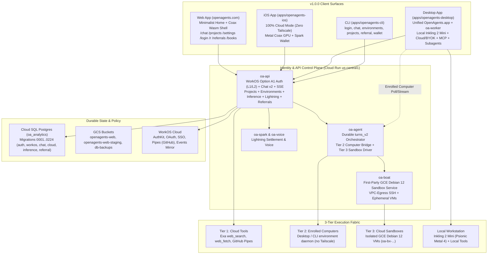

# OpenAgents v1.0.0 — Definitive Launch Specification

**Target Launch Date:** Monday, November 30, 2026  
**Baseline Commit:** `964e083668` (`origin/main`, 2026-11-27)  
**Surfaces:** Web (`openagents.com`) · Mobile (iOS TestFlight — 100% Cloud Mode, Zero Tailscale) · Desktop (macOS Apple Silicon primary + Linux/Windows source builds) · CLI (`openagents`) · OpenAgents Cloud (`oa-api`, `oa-agent`, `oa-boat`, `oa-spark`, `oa-voice`)  
**Supersedes:** [docs/desktop/openagents-v1-spec.md](../desktop/openagents-v1-spec.md) (2026-11-21 desktop-only Inkling-minimal draft; Desktop has since unified `--minimal` and `--full` in `#14116` and OpenAgents Cloud + WorkOS + Referrals have landed).

---

## Document Index

| Document | Scope |
| --- | --- |
| [README.md](README.md) *(this file)* | Product definition, cross-surface matrix, architecture, scope boundaries, and non-negotiable launch invariants |
| [web.md](web.md) | `openagents.com` public homepage, authenticated Home Dashboard, Cloud Chat, Projects, Settings, `/login`, `/r/<code>`, `/referrals`, and 9 static SSR `/books` |
| [mobile.md](mobile.md) | iOS v1.0.0 TestFlight — 100% OpenAgents Cloud mode, complete Tailscale removal, pure-black Metal Coax GPU UI, WorkOS auth, Cloud Environments/Projects, Spark Wallet |
| [desktop.md](desktop.md) | Unified `OpenAgents.app` (macOS Apple Silicon DMG + auto-update), `oa-worker`, local Inkling 2 Mini on Metal 4, Cloud/BYOK models, MCP, Subagents, computer enrollment, Linux/Windows builds, and `openagents` CLI |
| [platform-cloud-auth-money.md](platform-cloud-auth-money.md) | OpenAgents Cloud execution tiers (Tier 1 Cloud Tools, Tier 2 Enrolled Computers, Tier 3 GCE Sandboxes `oa-boat`), WorkOS Option A1 auth, Bitcoin/Lightning credit, and Referrals & Promo Credit (`0224`) |
| [launch-checklist.md](launch-checklist.md) | Live status matrix as of Friday Nov 27, owner-only actions, Weekend → Monday cutover playbook, hard Go/No-Go gates, and instant rollback commands |

---

## 1. What OpenAgents v1.0.0 Is

OpenAgents v1.0.0 is a **unified, open-source agent workspace across Web, iOS, and Desktop** built in Coax around **active human direction, inspectable execution, portable state, and Bitcoin-only economic rails**.

A user creates **one OpenAgents account** (WorkOS Magic Auth, Google, GitHub, Apple, Email+Password, Enterprise SSO, Passkey, or Nostr) and gets the same synced workspace everywhere:

1. **Web (`https://openagents.com`):** Start immediately in the browser — Cloud Chat with live streaming & tools (web search, web fetch, GitHub code/issues/PRs via WorkOS Pipes), Projects linked to GitHub repos, Cloud Sandboxes (real Debian 12 GCE VMs via `oa-boat`), and live delegation to your enrolled Macs/Linux workstations. Zero local setup required to start; zero Tailscale required to reach your machines.
2. **Mobile (iOS TestFlight):** Pure-black native Metal Coax GPU app running **100% in OpenAgents Cloud mode** with **Tailscale completely removed**. Sign in once, see every synced Cloud conversation, start or continue turns on Cloud, a Cloud Sandbox, or any enrolled computer, manage Projects and Environments, and hold a self-custodial Spark Bitcoin/Lightning wallet.
3. **Desktop (`OpenAgents.app` for macOS Apple Silicon + Linux/Windows source builds + `openagents` CLI):** Full native coding workspace powered by `oa-worker`, detached `coder-host` daemon, per-chat git worktrees (`gitguard`), local **Inkling 2 Mini** (32K context on Metal 4 via `psionic-inkling-serve`), frontier cloud/BYOK models (Gemini 4 Neon, Claude, OpenRouter), Exa WebSearch/WebFetch, optional XSearch, full MCP (Phases 0–5), cache-exact Subagents with git rules, Compact-Bench compaction, `/goal` autonomous verification, and one-click enrollment into OpenAgents Cloud so Web & iOS can dispatch turns to your machine seamlessly.
4. **Open Knowledge & Growth Engine:** All **9 technical books** prerendered as 0 KB JS / 0 KB Wasm static SSR at `openagents.com/books`, plus a single unified **Referral & Promo Credit** system (`$5` GitHub connect + `$10` invited = `$15` stacked, `$5` inviter on 2-day activation, `1%` lifetime Lightning top-up kickback, 5/25/100 milestones).

---

## 2. System Architecture

---

## 3. Cross-Surface Capability Matrix (v1.0.0)

| Capability | Web (`openagents.com`) | iOS (`apps/openagents-ios`) | Desktop (`OpenAgents.app`) | CLI (`openagents`) |
| --- | :---: | :---: | :---: | :---: |
| **WorkOS Auth** (Magic Auth, Google, GitHub, Apple, Email+Password, SSO) | Yes (`/login`) | Yes (`AccountView`, Apple 4.8) | Yes (`Account.swift`) | Yes (`login --workos`) |
| **Passkey & Nostr Identity** (`L2` / `L2-fresh` step-up) | Yes | Yes | Passkey only (no Nostr in Desktop v1) | Yes (NIP-98) |
| **Synced Cloud Chat (`chat_v2` + SSE)** | Yes (`/chat`) | Yes (`MobileCloudChat`) | Yes (linked via account) | Yes (`chat`) |
| **Cloud Inference + Tool Loop** (Gemini 4 Neon `thought_signature`, Tier 1 tools) | Yes | Yes | Yes | Yes |
| **GitHub Repo Integration** (WorkOS Pipes, zero stored token) | Yes (`/projects`, `/settings`) | Read/use via Projects & Cloud Chat | Yes | Yes |
| **Enrolled Computers (Tier 2 — Zero Tailscale)** | Target & monitor turns | Target & monitor turns | Enroll workstation + run turns | `environments enroll/run` |
| **Cloud Sandboxes (Tier 3 — GCE `oa-boat`)** | Target + metered billing | Target + stream output | Target + stream output | Yes |
| **Local Inkling 2 Mini (Psionic Metal 4, 32K ctx)** | — | — | Yes (macOS Apple Silicon ≥ 32 GB) | Via Psionic binary |
| **Local Coding Harness (`oa-worker`, worktrees, MCP, Subagents, `/goal`, Browser Pane)** | — | — | Yes | Yes (`coder`, `mcp`) |
| **Bitcoin / Lightning Paid Credit & Spark Wallet** | Top-up + balance (`/settings/wallet`) | Native Spark Wallet (`WalletView`) | Balance display via account API (no Spark Wallet / Bitcoin SDK in Desktop v1) | `wallet` |
| **Referrals & Promo Credit** (`/r/<code>`, `$5+$10+$5+1%`, milestones) | Full UI (`/r/`, `/referrals`, Settings) | Balance reflected via account API | Two-line Paid + Promo balance via account API | `referral`, `admin referral` |
| **9 Static SSR Technical Books** | Yes (`/books`, 0 KB JS/Wasm) | — | — | — |
| **Tailscale / LAN Pairing** | None | **Removed completely** | **Removed from Desktop v1** (zero Bonjour/Local Network) | None |

---

## 4. Non-Negotiable Launch Invariants

Every v1.0.0 surface enforces these repository-wide invariants before shipping:

1. **Done means the real installed/deployed thing works end-to-end.** Zero fake marker files, zero stubbed responses, zero synthetic pass claims. Every gate in [launch-checklist.md](launch-checklist.md) is verified against live production/staging endpoints, real GCE VMs, real iOS Simulator / TestFlight builds, and the real signed `/Applications/OpenAgents.app`.
2. **Zero Tailscale on Mobile & Zero Tailscale Required for Cloud.** `apps/openagents-ios/` contains zero Tailscale/Tailnet/MagicDNS/Bonjour/100.x code or permissions. Web and Mobile talk exclusively to `openagents.com` (`oa-api` / `oa-agent`).
3. **No Public Login Link on the Homepage (`/`).** Logged-out visitors to `https://openagents.com/` see the clean minimalist homepage (`Download for Mac`, `Join the TestFlight`, `Build from source for Windows and Linux`, app preview) with **no** `Sign in` / `/login` link (`964e083668`). `/login` remains directly accessible, and already-signed-in users hitting `/` automatically mount the Coax Home Dashboard.
4. **Coax First & `#authority` Mutation Zero.** All money, auth, placement, bundle, and referral rules live in `#authority` Coax (`pay/referral-policy.coax`, `coax/lib/gateway/`, `coax/web/api/*-policy.coax`, `apps/openagents-desktop/v1-bundle-policy.coax`) with **0 surviving mutants**, zero new C→PL/pgSQL calls (`sql-rules-routes` never increases), and every wire shape registered in `proto/registry.json`.
5. **Bitcoin-Only Money & Separate Promo Credit.** Lightning / on-chain Bitcoin / Spark sats (`inference.credit` in msat) are the sole money rail (no USDC, USDT, EVM, Solana, Tron, or Cashu). Referral/GitHub promo credits live in `inference.promo_credit` (USD micros), are strictly non-withdrawable/non-transferable service discounts, spend oldest-expiry-first on promo-eligible models up to `$5`/UTC day, and never commingle with paid sats.
6. **Option A1 Identity Sovereignty.** OpenAgents owns the canonical `acct_` spine and local sessions (`__Host-oa_session`, `oa_at_`/`oa_rt_` + `OA-Device-Proof`). WorkOS is a replaceable `L1` authentication front door that can be toggled off in one env-var flip (`OA_WORKOS_ENABLED=0`) with zero session or data loss; `L2` / `L2-fresh` actions (wallet backup, agents, recovery) always require first-party Passkey or Nostr step-up.
7. **Zero Third-Party Branding Leaks.** No retired names (`Zeron`) or third-party vendor logos/API keys juxtaposed with Inkling or OpenAgents surfaces.

---

## 5. Explicit Out-of-Scope Boundaries (Post-v1.0.0)

To protect Monday's ship date, the following items are **explicitly NOT part of v1.0.0** (code remains in the repo for post-launch releases):

- **Public Android Play Store launch:** Android WorkOS Phase 4 auth unit/NDK checks are green, but full Android app packaging and Play Store release are post-v1.0.0.
- **Signed/notarized Linux `.AppImage`/`.deb` and Windows `.msi`/`.exe` installers & CUDA Inkling hillclimbing:** Linux and Windows ship as build-from-source paths for v1.0.0; signed installers and CUDA local-model parity ship in v1.0.x.
- **Public Apple App Store submission:** iOS launches via public **TestFlight** (`https://testflight.apple.com/join/dvQdns5B`) on Monday; full App Store review follows once physical-device soak completes.
- **`gamebuilder.org` WorkOS cutover & legacy Resend login-code retirement:** `gamebuilder.org` stays isolated (`OA_WORKOS_GAMEBUILDER_ENABLED=0`) for one full release cycle per [docs/auth/2026-11-26-workos-cutover-runbook.md](../auth/2026-11-26-workos-cutover-runbook.md).
- **Fiat subscriptions / Pro `$10/mo` Stripe checkout / GameBuilder creator marketplace payouts:** Post-v1.0.0; v1.0.0 runs on Lightning prepaid credits + GitHub/Referral promo credits + BYOK + local Inkling 2 Mini.
- **Pylon public marketplace / Metaverse multiplayer social launch:** Pylon & Everglade pages remain live on the site as existing features, not gated launch blockers for v1.0.0.
