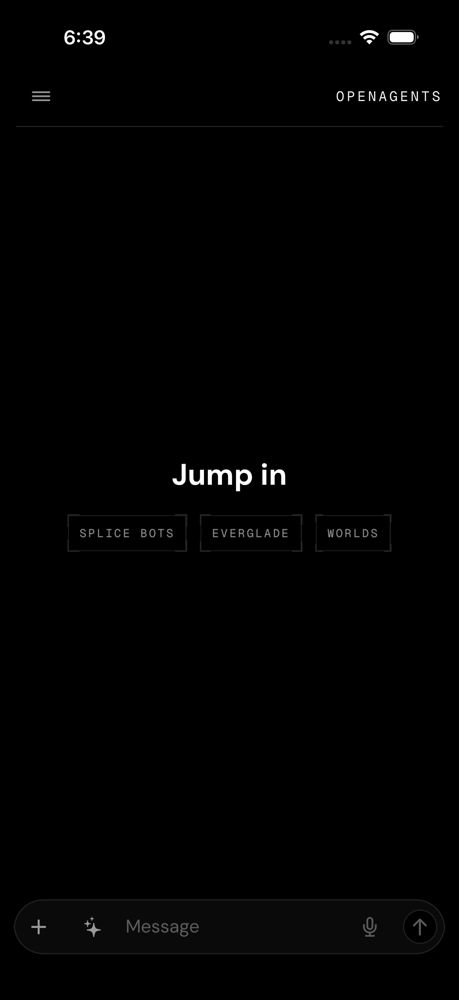
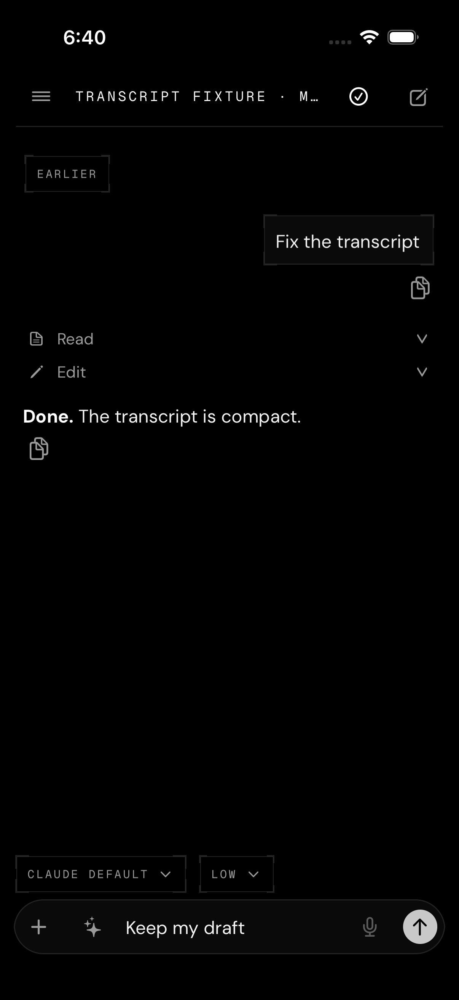
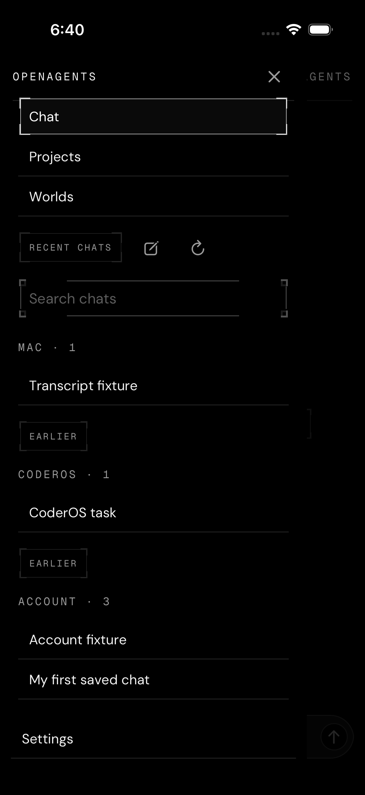
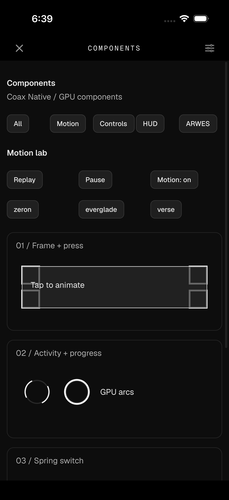
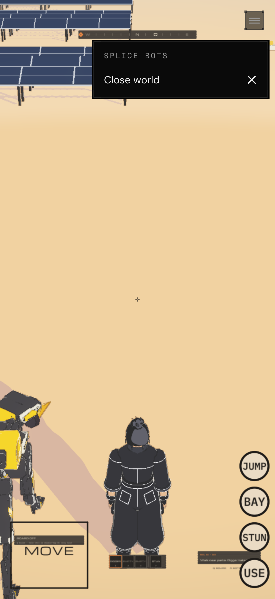

# Monochrome Arcade mobile components — 1087

The current default iOS app uses the shared component library's GPU chrome.
Coax owns frames, stateful motion, activity, progress, rules and grayscale
paint; native adapters supply measured bounds/clips, text, editing, selection,
touch actions and accessibility. See [the implementation checkpoint](../../../components/rendering.md#implementation-checkpoint-default-ios-chrome-1087).

## Scope

Buttons/icon actions, fields/multiline editors, notices, headers, rows, menus,
composer, message/code/table/quote decorations, compact tools, activity and
progress now use `components/native/scene.coax`. The same adapters cover
login, chat/history, Projects, Usage, Settings, wallet extras, world
library/create/edit, the floating world menu and Updates. The mobile gallery
and its navigation enforce grayscale. World content retains authored colors.
AppKit/GTK and Android are not migrated by this release.

One shared transparent Metal scene paints each native component surface;
there is no Metal view per control. Keys preserve motion through polling and
reordering. The scene clips to native measured ancestors, excludes hidden
nodes, counts capacity refusals, handles reduced motion, and stops GPU frames
when inactive/backgrounded. Source-inspired corner-square/line assembly,
press/focus, two-arc activity and determinate spring progress are implemented.
Full A01–A28 parity, image/backdrop blur, icon morphs, inline GPU islands and
multiple simultaneous worlds remain separate work. No performance or power
improvement is claimed.

## Verification

- Remote Coax: **84/84** scene/transitive checks; **6** selected gallery checks.
  Components gate: 57 layer files, zero failures; existing migration count 22.
- Installed SDK: measured GPU adapter/hidden/clipped-node behavior, OTP input
  attributes, Update-offer component presentation, multiline
  notice measurement at large text size; Markdown selection/copy and compact
  transcript/tools. Native package signatures, integrity, runtime/generation
  refusal, deduplication and trial rollback pass.
- Installed UI: login focus/outside-tap keyboard dismissal and fixed viewport;
  gallery sections/scroll/background/resume and Settings roundtrip; drawer
  search/draft restoration/effort picker; account chat send/reopen/Markdown;
  isolated Claude-account Usage login; Projects edit/publish/chat; read-only
  wallet present/missing cases; streamed Splice Bots and current Everglade II,
  touch/camera controls and floating menu.
- **24 distinct SDK/UI tests pass** across the targeted runs. Initial wallet
  assertions used old labels, and the world test omitted opening the drawer;
  those test paths were repaired and the affected suites pass. No production
  API, real wallet, real Claude login or account record was changed in these
  tests. World assets came from their real public delivery endpoints.
- `tools-check`, native stock-style and normal pre-push gates pass. The
  app/extras runtime oracle passes. All screenshot account data is local fixture
  data, not the owner's conversations or balance.
- Pixel inspection of nine app/gallery screenshots finds no RGB channel
  difference above 3/255. The world scene is deliberately excluded; its app
  menu is grayscale over the authored colored scene.

Results are retained at `/private/tmp/oa-arcade-{first,flows,features,recheck,visual,live-feed}.xcresult`.
Build/archive, exact source/Generated/Starter artifacts, logs and original
screenshots are retained under `~/.openagents/releases/openagents-ios-1087/`.
Physical-device VoiceOver, power/frame-time and real-account qualification
remain owner/device checks, not simulator results.

## Pictures

These are installed simulator screenshots, not design mockups. Home, login,
input focus, drawer, chat and gallery use the final frame/composer geometry.
Usage captures the earlier frame geometry in this same port; world-menu
captures the final shared frame geometry before the notice-only sizing fix.

| Home | Login | Chat |
| --- | --- | --- |
|  |  |  |

| Drawer | Motion library | World menu |
| --- | --- | --- |
|  |  |  |

Additional pictures: [focus](input-focus.png), [controls](controls.png),
[Usage](usage.png), [project draft](project.png).

## Release artifact

- TestFlight **1087: VALID / IN_BETA_TESTING**, explicitly verified in **Owner**.
- Product source commit: `cb28ed9acbe0080f69224347c7ad2b9f11f2cfcf`.
- Bundle: `com.openagents.app`, version `1.0.0`, build `1087`.
- Installed runtime: `c0170334adad35610e486564d214c750754640e945234d7fb5d071343af06ae1`.
- Exported IPA SHA-256: `d6f12298dca5a0b5ba007445d14f1a48ea2f1abe87e3a96ebe82f2dacbf88a69`.
- Apple accepted delivery `361ad295-0fde-4abc-991b-9edbef9ef95f`.
- The signed generation-1 feed is byte-identical at both public endpoints.
  All twenty packaged resource sizes and SHA-256 hashes match the exported
  IPA's exact Starter files. All four world producers pass the archive's
  dynamic-link check, and all five dSYMs are retained in shared symbol storage.
- After uninstalling and reinstalling the simulator app, the live public feed
  reports the latest compatible update without offering an Apply prompt,
  including after relaunch. The component-based Update offer is separately
  exercised by the installed SDK presentation test.
