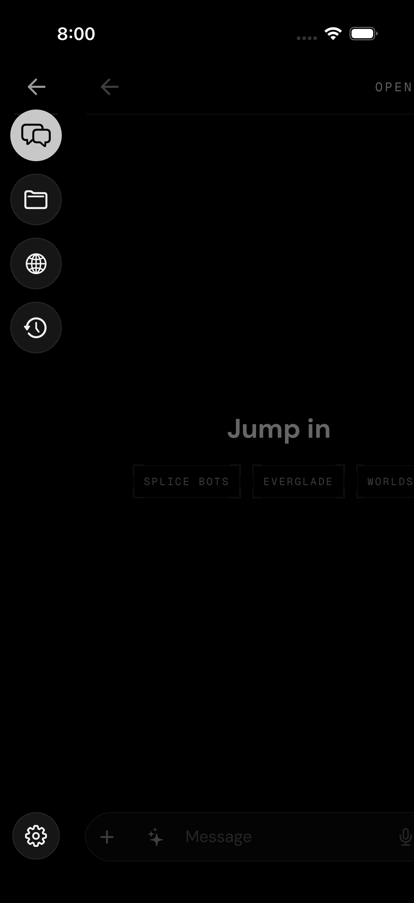
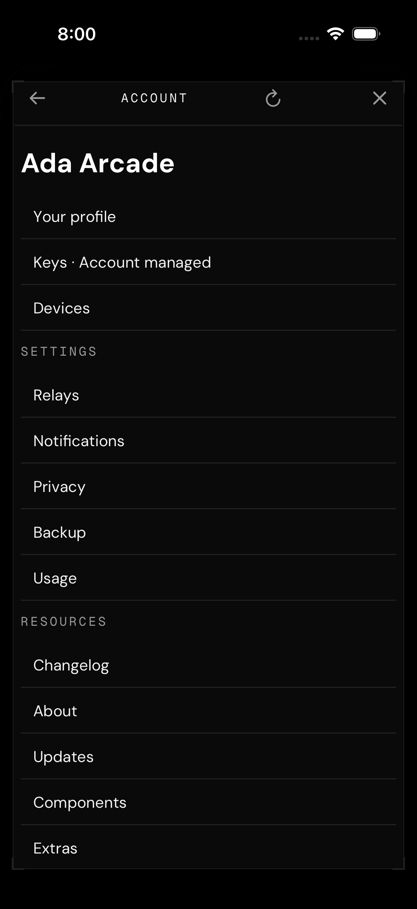
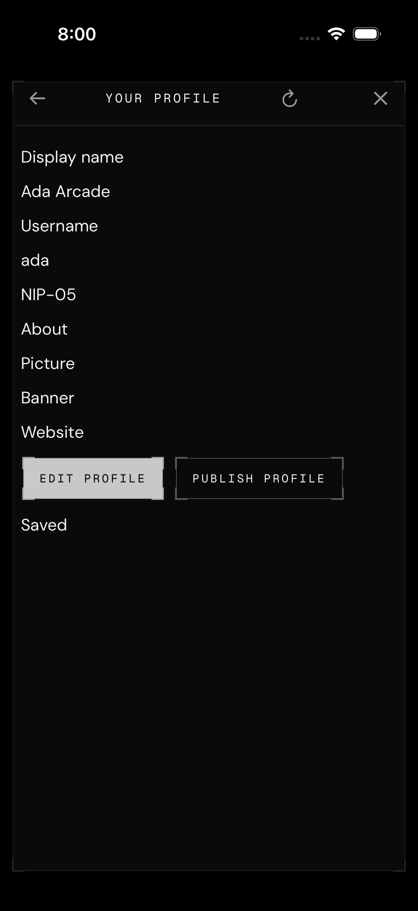
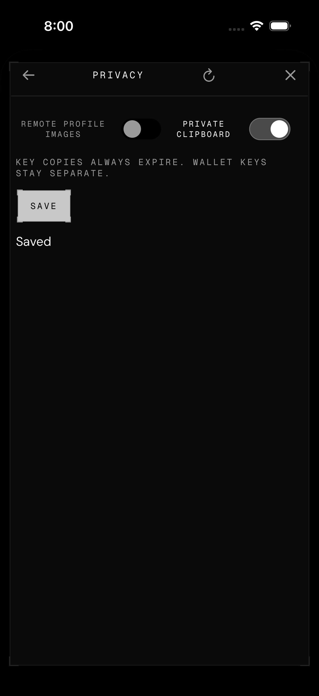
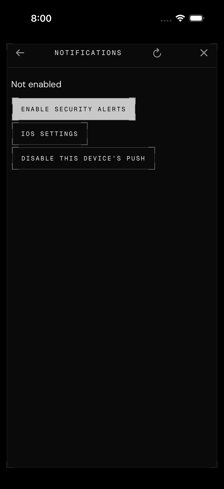
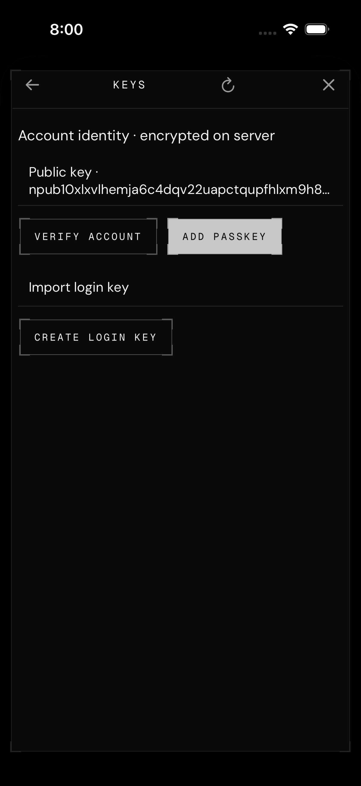
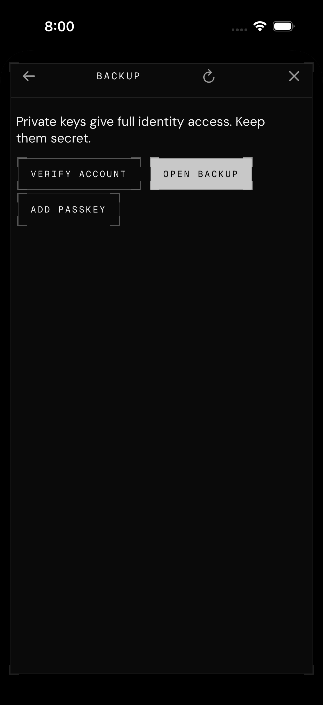
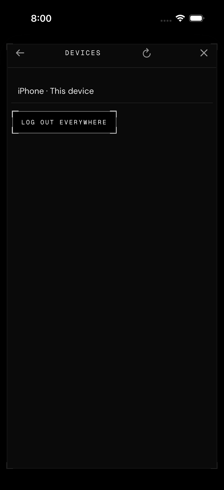
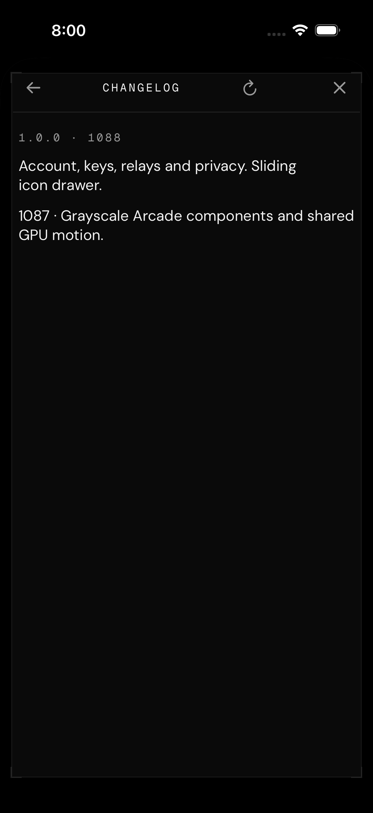

# Arcade account/settings — iOS 1088

The Account hub, profile editor, relays, privacy, notification settings,
keys/passkeys, protected backups, device sessions and resources use the shared
Coax UI and grayscale Arcade component scene. The drawer is a sliding 70-point
icon rail with 50-point controls; Recent chats retains the wider history pane.
The [source mapping](../../arcade/07-account-settings.md) and
[protocol](../../protocol/account-settings-v1.md) define the implemented scope.

Verification:

- Shared settings: 170 Coax/transitive checks pass. Native scene: 85 pass;
  workspace geometry/drag: 16 pass. The settings admission authority kills
  51/51 mutants; the changed profile-signing wrapper kills 11/11, with no
  survivors or equivalent exclusions.
- Real API/PostgreSQL, ASan/UBSan: 14 account/settings checks pass, covering
  anonymous/L1/stale-L2 refusal, revision CAS, unchanged data after refusal,
  actual derived backup identity, cache headers, public kind-zero content and
  lifecycle registration. The wrapper initially failed on the new gate's
  unregistered structured 401 response; its appended route/goldens and exact
  two-response replay now pass. Existing route indices remain unchanged.
- Frozen settings, backup and native action profiles match product codecs.
  Wire, component and layer gates pass without adding an allowlist entry.
- SDK checks cover hex/nsec input, invalid/zero/public-key refusal, Keychain
  preservation, private-input isolation, masked backup/clearing and failed
  proof refusing export. Navigation checks cover history/search, retained
  drafts, projects and world shortcuts. Existing Projects/Usage program checks
  also pass.
- The expanded native app's combined JSON-reader call chain exceeded its old
  1 MiB Wasm stack in history discovery. Its explicit 2 MiB stack fixes that
  installed-app failure within the unchanged 32 MiB carrier memory.

Simulator account data and exported screenshots are disposable fixture data.
Actual Apple passkey/Face ID ceremonies, real push receipt, physical-device
accessibility and power measurements remain in root NEEDS_OWNER.md.
The release retains the previous world producers and all wallet key records.

- **27 distinct SDK/UI tests pass** across the focused runs: 21 SDK/program
  checks, the five account/navigation/chat/Projects/Usage flows, and the live
  feed fresh-install/relaunch regression. The earlier UI logout assumptions
  were updated for the explicit confirmation flow; affected tests pass.
- The final settings walkthrough passes and exports all nine pictures below.
  Maximum RGB-channel difference is 1/255 (drawer 0), including the simulator
  chrome. These are actual installed-app captures, not mockups.
- Normal pre-push passes, including the touched Coax/authority suites. No
  bypass was used. The API was built once, migrated and promoted through
  staging, then the same image deployed to production with verified health.

## Release

- Native source commit: `ed787238c703a07e5cf7b113434c4c2c4c1952d1`.
- OpenAgents **1.0.0 (1088)**: **VALID / IN_BETA_TESTING**, explicitly verified
  in **Owner**.
- Runtime: `ca9f6af65f0906ab3917fdf37e4f3dcc6016672bb2a4de0fe2b6b7995a4b7542`.
- IPA: 19,811,132 bytes. Generation 1 covers all 20 archived resources;
  sizes/digests match the exported IPA. Both public feed endpoints return the
  identical signed envelope. Fresh install and relaunch offer no redundant
  update.
- Four native realm libraries pass the release Mach-O import/export gate.
  All five dSYMs are retained by UUID. The distribution archive has production
  APNs entitlement.
- API image: `sha256:0263591778240af4104e47c4ae4840a763a19b3a612d9b9b932d6792c0c91899`.
  Staging: `oa-api-staging-00227-2mb`; production: `oa-api-00165-cbx`.
  Migration 0202 and rollout/health checks pass. Anonymous production settings
  reads return 401; no owner's identity secret was requested for testing.

Frozen Generated/Starter/config, archive, IPA, manifests, signatures, symbols,
logs and originals live under `~/.openagents/releases/openagents-ios-1088/`.
The SDK result bundles are `/private/tmp/oa-settings-{unit,unit2,final,recheck,pictures,live-feed}.xcresult`;
passing outcomes are aggregated above, not every intermediate run.

## Installed pictures

| Drawer | Account | Profile |
| --- | --- | --- |
|  |  |  |

| Privacy | Notifications | Keys |
| --- | --- | --- |
|  |  |  |

| Backup | Devices | Changelog |
| --- | --- | --- |
|  |  |  |
