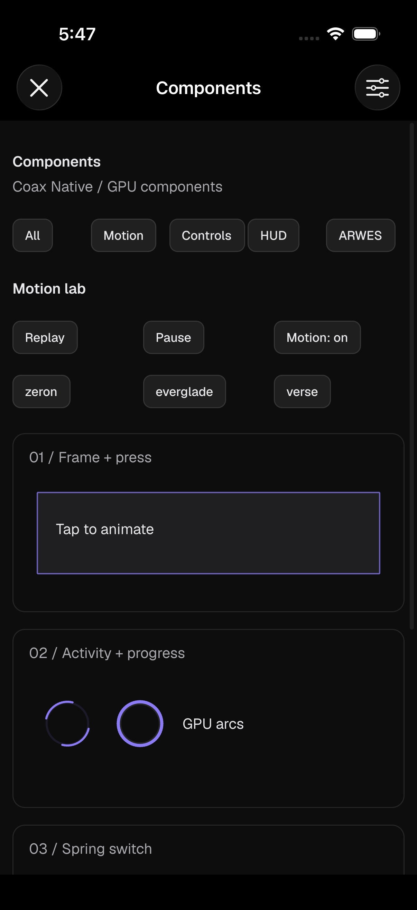
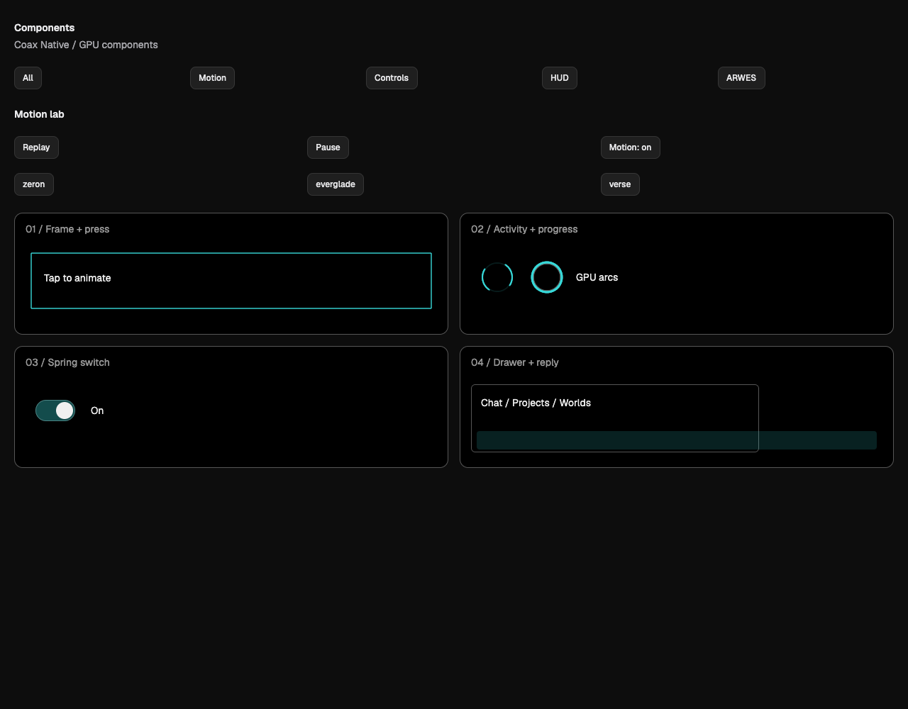
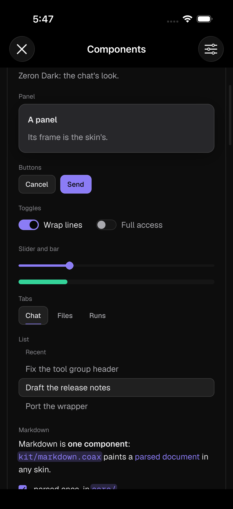
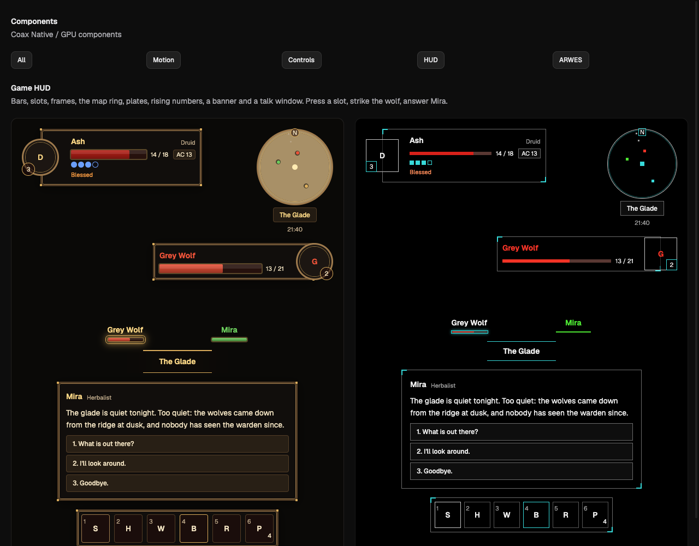
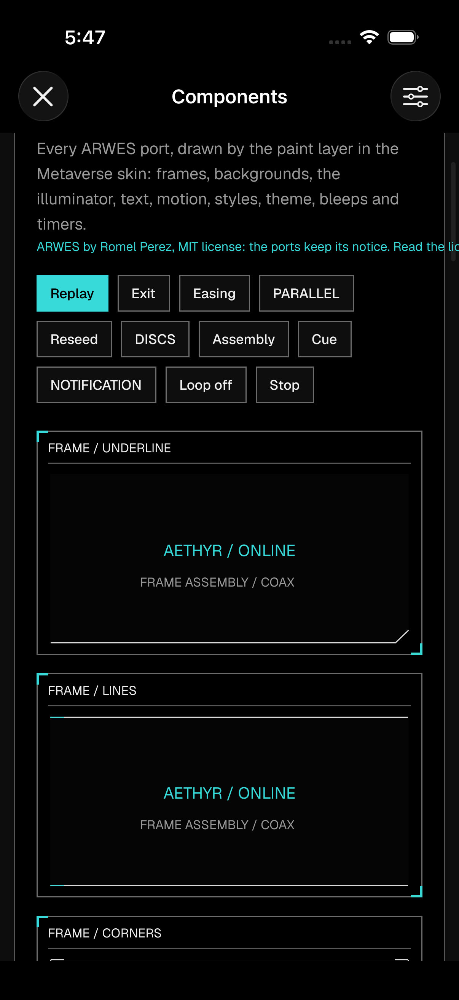
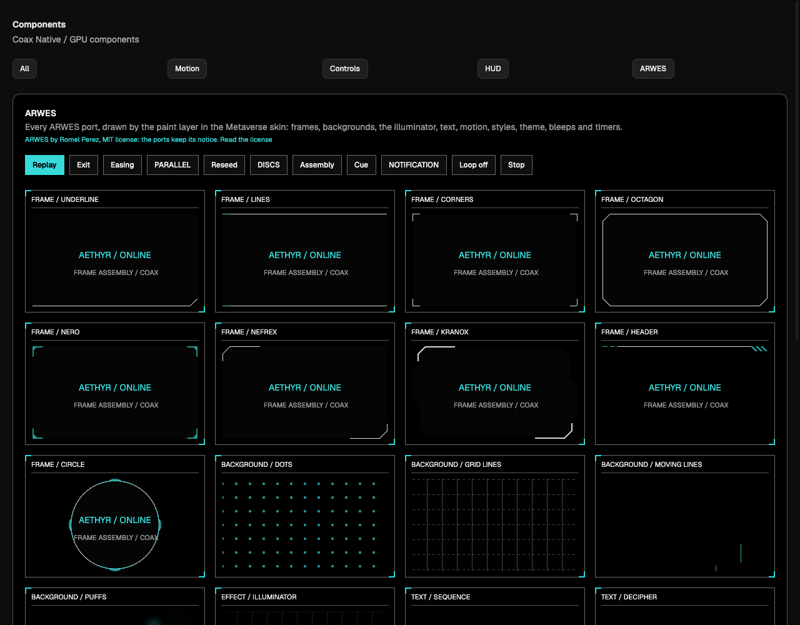

# Coax Native component gallery

The iOS app embeds `components/gallery/page.coax` through the existing Apple
Metal host. `/components-gpu` runs the same Coax gallery on WebGPU.
`/components` retains the DOM kit and links to the GPU inspector.

Native runtime: `6b4f06c837e18adb5429bde0931a1c4968d6398e6c6094d00aa783fa692286d5`. Build: 1086. Frozen 1085 world producers and
asset inventories are retained. The archive's four framework import/export
checks passed. Generated C/Metal, Starter, signed archive, upload and SDK logs
are retained under `~/.openagents/releases/openagents-ios-1086/`.

## Checks

- Shared gallery run: 116 of 117 passed initially. The old slanted-line check
  assumed arcs emitted no vertices; after updating its index for the newly
  rendered arc, all 22 GPU backend checks passed. The other 116 checks were
  unchanged, including all 25 ARWES specimens, HUD controls and shared parsers.
- New animation check passed after moving geometry/paint strengths into
  `UiAnimated` skin tokens. It covers frame, activity/progress, switch and
  drawer/reply surfaces. Spring analytic position, partitioning, interruption,
  clamping and reduced motion passed. Touch scroll/cancel check passed.
- `components-check`: 56 layer files, zero failures, 22 existing migration rows.
  The existing JSON-fields adapter moved out of core to fix its invalid layer
  dependency; its focused path check passed unchanged.
- Settings-link Coax check passed; it uses the existing link service and does
  not replace the active conversation request.
- Installed simulator test passed section switching, touch scrolling, options,
  app background/resume and retained rendering. The Settings test uses the
  independent local email oracle on port 13567. Simulator authentication
  requires Xcode ad hoc signing (`CODE_SIGNING_ALLOWED=YES CODE_SIGN_IDENTITY=-`);
  an unsigned build cannot retain the account token in Keychain. Manual deep
  signing was refused by the simulator; use Xcode's generated entitlements.
- The release archive and export succeeded; runtime-oracle checked the app and extras
  portable programs before archiving. `tools-check` passed.

## Pictures

These are actual rendered screenshots, not design mockups. Native pictures
come from the installed iOS 26.5 simulator; web pictures use muted headless
Chrome with the hardware Apple Metal WebGPU adapter. Skin-token refactoring
retains the pictured geometry. The viewport and scroll position differ.

| Native Metal | WebGPU |
| --- | --- |
|  |  |
|  |  |
|  |  |

## Scope

This is the first inspectable library checkpoint: shared controls, Markdown,
four skins, HUD cards, 25 ARWES specimens and the new motion kit. It does not
qualify all 28 Arcade animation cases, general image/blur composition, inline
GPU islands, multiple world views, complete accessibility/text parity or an
OTA native renderer. No physical-phone or Android run was performed in this
change. Production chat keeps its existing native text/input path.

## Published result

- TestFlight **1086: VALID / IN_BETA_TESTING**, explicitly verified in **Owner**.
  Apple delivery `edf68ea5-af70-4748-a517-c8ddaeda7cd2` succeeded.
- The signed generation-1 feed is byte-identical through both public endpoints.
  All twenty package file hashes match the exported IPA's exact Starter bytes.
  The gallery itself is installed native code, outside the OTA package.
- The targeted web publication retains the production host/shader/font asset
  identities and updates only the two galleries. GPU module:
  `components.b5e341425237.wasm`. The full-site prebuilt attempt hit an existing
  `oneshot` size-budget failure; no other website pages were deployed.
- The complete installed Settings → Components → Close → Settings → Close →
  drawer close → Chat path passed with Xcode-generated simulator signing.
  Returning from Settings retains the existing drawer state; the check closes
  that drawer before asserting the composer is visible.
- The HTML-to-GPU navigation uses the shared `k_go` anchor; its Coax regression
  check passes. It does not depend on a gallery-specific JavaScript handler.
